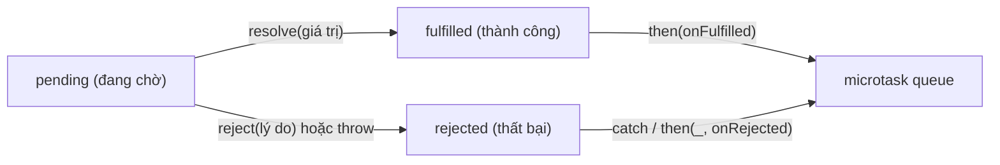
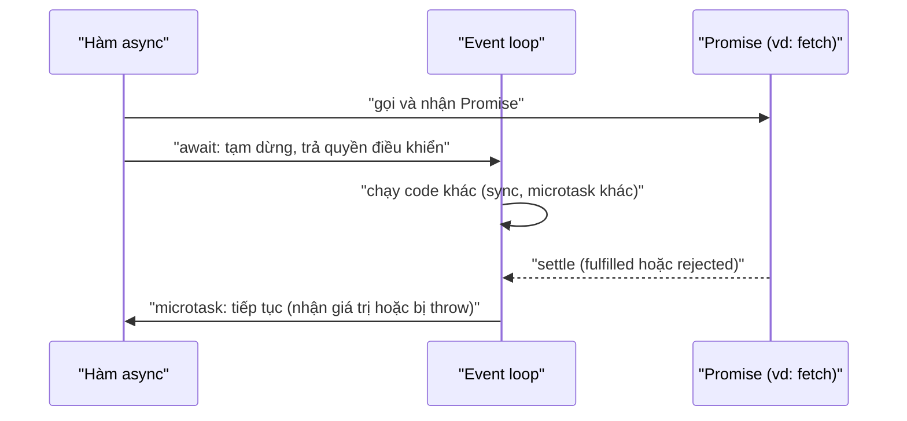

# Lý thuyết 8: Promise và async/await

Hầu hết việc đáng làm trong ứng dụng web (gọi API, đọc file, chờ người dùng, hẹn giờ) đều mất thời gian, và JavaScript chỉ có một luồng chính để chạy code. Bài này trả lời câu hỏi "làm sao chờ mà không đứng yên": từ callback, qua Promise, tới `async/await`. Phần cơ chế hàng đợi bên dưới (task, microtask, render) đã có ở [Lý thuyết 1 của Frontend Core](/go?p=11-Frontend-Core%2Flt-01-javascript-runtime-event-loop.md), bài này chỉ nhắc lại đúng chỗ cần và tập trung vào cách **dùng** Promise cho đúng.

## Promise là gì?

Hãy nghĩ tới tấm phiếu hẹn ở quán cà phê đông khách. Bạn gọi món, quầy đưa cho bạn một tấm phiếu số 42 thay vì ly nước. Phiếu chưa phải là nước, nhưng nó là **lời hứa** sẽ có kết quả: hoặc bạn được gọi lấy món, hoặc quầy báo hết nguyên liệu. Trong lúc chờ bạn vẫn rảnh tay làm việc khác, và chỉ cần đăng ký trước "khi số 42 xong thì gọi tôi". Promise chính là tấm phiếu đó: một object đại diện cho kết quả **chưa có nhưng sẽ có** của một thao tác bất đồng bộ.

**Cốt lõi:** Promise là object có đúng ba trạng thái (`pending`, `fulfilled`, `rejected`) và chỉ chuyển trạng thái **một lần**, sau đó bất biến. Bạn không truyền callback cho hàm nữa mà nhận lại một Promise, rồi gắn `then/catch/finally` vào nó; mỗi lần gắn lại trả về một Promise **mới**, nên các bước nối thành chuỗi và lỗi tự chảy xuống cuối chuỗi tới chỗ bắt đầu tiên.

- Vì Promise chỉ settle một lần, nên callback luôn được gọi tối đa một lần dù thư viện bên dưới có gọi `resolve` nhiều lần.
- Vì `then` trả về Promise mới, nên kết quả của bước trước thành đầu vào bước sau và có thể nối chuỗi phẳng thay vì lồng nhau.
- Vì callback của `then` chạy ở **microtask**, nên chúng luôn chạy sau code đồng bộ hiện tại và trước mọi timer.



Mô hình tư duy: Promise là cái hộp dán nhãn "chưa có gì", chỉ mở một lần; ai đăng ký trước hay sau khi mở hộp đều nhận cùng một kết quả, và luôn nhận **không đồng bộ** (qua microtask).

## Vấn đề nó giải quyết, và vì sao dev phải nắm

Thế hệ code đầu tiên xử lý bất đồng bộ bằng callback: "làm xong thì gọi hàm này". Với một bước thì ổn. Với nhiều bước phụ thuộc nhau, callback lồng callback tạo hình kim tự tháp (callback hell), khó đọc và khó xử lý lỗi. Tệ hơn là **inversion of control** (đảo ngược quyền điều khiển): bạn giao callback cho code của người khác và tin rằng họ sẽ gọi đúng một lần, đúng lúc, đúng tham số. Không có gì đảm bảo điều đó. Promise lấy lại quyền điều khiển: thư viện trả về một object, còn bạn quyết định làm gì với nó.

Bạn cần nắm kỹ phần này vì mọi API hiện đại (`fetch`, `import()`, Web Crypto, đọc file trong Node) trả về Promise, và phần lớn lỗi thực tế quanh async đến từ vài hiểu lầm lặp đi lặp lại: quên `return` trong `then`, `await` trong vòng lặp làm chạy tuần tự không cần thiết, `forEach(async)` không chờ gì cả, rejection không ai bắt, và thứ tự log không như đoán. Hiểu mô hình Promise và microtask giúp bạn tự suy ra các hiện tượng này thay vì nhớ từng mẹo.

**Tóm tắt:**

- Bất đồng bộ cho phép luồng chính không đứng chờ I/O; kết quả được "giao lại" khi sẵn sàng.
- Callback lồng nhau gây callback hell và inversion of control (không đảm bảo callback được gọi đúng một lần).
- Promise có ba trạng thái, settle một lần; `then/catch/finally` luôn trả Promise mới nên nối chuỗi được, lỗi lan xuống tới `catch` gần nhất.
- `Promise.all` (cần tất cả), `allSettled` (chờ tất cả, không ném), `race` (kết quả đầu tiên, dù lỗi), `any` (thành công đầu tiên).
- `async` function luôn trả Promise; `await` tạm dừng hàm đó (không chặn luồng chính) và là một điểm nhường microtask.
- Tuần tự thì `await` lần lượt, song song thì khởi tạo hết Promise rồi `Promise.all`; `forEach(async)` không chờ, dùng `for...of` hoặc `map` kèm `all`.
- Lỗi xử lý bằng `try/catch` quanh `await`; rejection không ai bắt là `unhandled rejection` và có thể làm sập tiến trình Node.
- Hủy việc đang chạy cần `AbortController`; `Promise.race` chỉ ngừng chờ, không ngừng việc (chi tiết ở bài 13).

## Các khái niệm cần biết

- **Bất đồng bộ (asynchronous)**: thao tác bắt đầu bây giờ nhưng hoàn tất sau; luồng chính không bị chặn trong lúc chờ.
- **Callback**: hàm bạn đưa cho code khác để nó gọi lại khi xong việc.
- **Promise**: object đại diện cho kết quả tương lai của thao tác bất đồng bộ.
- **Settled**: trạng thái đã kết thúc, tức `fulfilled` hoặc `rejected`. Đã settled thì không đổi nữa.
- **Executor**: hàm bạn đưa cho `new Promise(executor)`; chạy **đồng bộ** ngay, nhận `resolve` và `reject`.
- **Thenable**: object có method `then`; Promise và `await` đều "mở" thenable để lấy giá trị.
- **Microtask**: hàng đợi ưu tiên chứa callback của `then` và phần sau `await`; xả cạn sau mỗi task (xem bài event loop).
- **Rejection**: Promise bị từ chối, do `reject(...)` hoặc do ném lỗi trong executor, trong `then` hoặc trong hàm `async`.
- **Unhandled rejection**: rejection mà tới cuối lượt microtask vẫn chưa có handler nào gắn vào.
- **`AbortController` / `AbortSignal`**: cặp đối tượng chuẩn để báo hiệu "hủy" cho thao tác đang chạy.
- **Concurrency (đồng thời) và parallelism (song song)**: JS xử lý nhiều I/O chờ cùng lúc trên một luồng; "song song" thật sự về CPU cần Worker.

## Callback hell và inversion of control

Ví dụ dưới mô phỏng ba bước phụ thuộc nhau bằng callback, rồi cho thấy rủi ro khi một thư viện gọi callback hai lần.

```javascript
function layUser(id, cb) { setTimeout(() => cb(null, { id, ten: "An" }), 10); }
function layDon(uid, cb) { setTimeout(() => cb(null, ["d1", "d2"]), 10); }
function layChiTiet(d, cb) { setTimeout(() => cb(null, "ct-" + d), 10); }

layUser(1, (e1, u) => {
  if (e1) return console.log(e1);
  layDon(u.id, (e2, ds) => {
    if (e2) return console.log(e2);
    layChiTiet(ds[0], (e3, ct) => {
      if (e3) return console.log(e3);
      console.log(u.ten, ds, ct);
    });
  });
});

function thuVienXau(cb) { cb(null, "lần 1"); cb(null, "lần 2"); }
let n = 0;
thuVienXau((e, v) => console.log("thanh toán", ++n, v));
```

```text
thanh toán 1 lần 1
thanh toán 2 lần 2
An [ 'd1', 'd2' ] ct-d1
```

_Đã chạy thử trên Node 22._

Phần dưới cho thấy inversion of control: `thanh toán` bị chạy **hai lần** vì thư viện gọi callback hai lần, và bạn không có cách nào ngăn từ phía mình. Phần trên cho thấy hình kim tự tháp: mỗi bước thụt vào thêm một tầng, mỗi tầng lặp lại việc kiểm tra lỗi. Dòng kết quả của chuỗi ba bước in ra sau cùng vì mỗi bước chờ một timer.

Chuyển callback kiểu `(err, value)` sang Promise chỉ cần một hàm bọc nhỏ, và chuỗi dài ra thành chuỗi phẳng:

```javascript
function layUser(id, cb) { setTimeout(() => cb(null, { id, ten: "An" }), 10); }
function layDon(uid, cb) { setTimeout(() => cb(null, ["d1", "d2"]), 10); }
function layChiTiet(d, cb) { setTimeout(() => cb(null, "ct-" + d), 10); }

const hoaPromise = (fn) => (...args) =>
  new Promise((res, rej) => fn(...args, (e, v) => (e ? rej(e) : res(v))));

const pUser = hoaPromise(layUser);
const pDon = hoaPromise(layDon);
const pChiTiet = hoaPromise(layChiTiet);

pUser(1)
  .then((u) => pDon(u.id).then((ds) => ({ u, ds })))
  .then(({ u, ds }) => pChiTiet(ds[0]).then((ct) => console.log(u.ten, ds, ct)))
  .catch((e) => console.log("lỗi", e));
```

```text
An [ 'd1', 'd2' ] ct-d1
```

_Đã chạy thử trên Node 22._

**Nền tảng:** vấn đề của callback không phải cú pháp thụt vào mà là **mất quyền kiểm soát**: bạn không biết callback được gọi 0, 1 hay nhiều lần, đồng bộ hay bất đồng bộ. Promise ép mọi thứ về một hợp đồng cố định: settle một lần, luôn gọi handler bất đồng bộ.

**Lưu ý:** Node có sẵn `util.promisify` để làm đúng việc của `hoaPromise`; nhiều API đã có sẵn bản Promise (ví dụ `fs/promises`). Ưu tiên bản có sẵn.

## Promise: ba trạng thái và `new Promise`

Executor chạy ngay lập tức và đồng bộ; `resolve` và `reject` chỉ có tác dụng **lần gọi đầu tiên**.

```javascript
const p = new Promise((resolve, reject) => {
  console.log("executor chạy đồng bộ");
  resolve("xong");
  reject(new Error("bị bỏ qua"));
  resolve("lại");
});
console.log(p);
p.then((v) => console.log("then nhận", v));
console.log("dòng cuối của script");

console.log(new Promise(() => {}));
const loi = Promise.reject("lý do");
loi.catch(() => {});
console.log(loi);
```

```text
executor chạy đồng bộ
Promise { 'xong' }
dòng cuối của script
Promise { <pending> }
Promise { <rejected> 'lý do' }
then nhận xong
```

_Đã chạy thử trên Node 22._

Thứ tự in ra chứng minh hai điều: executor chạy trước cả dòng `console.log(p)`, còn callback của `then` chạy **sau** dòng cuối của script dù Promise đã `fulfilled` từ trước (callback luôn chờ microtask). Promise chưa ai gọi `resolve` mãi mãi ở `pending`; một Promise như vậy nằm trong chuỗi sẽ làm chuỗi treo mà không báo lỗi gì, đây là lỗi hay gặp khi quên gọi `resolve` ở một nhánh.

Ném lỗi trong executor tự động biến thành `reject`, nên không cần `try/catch` bên trong. Hai hàm tiện ích `Promise.resolve(x)` và `Promise.reject(e)` tạo nhanh Promise đã settle.

**Phải thuộc:** ba trạng thái `pending` → `fulfilled` hoặc `rejected`, chỉ chuyển một lần. Executor chạy đồng bộ, handler của `then/catch/finally` luôn chạy bất đồng bộ (microtask).

## `then`, `catch`, `finally` và chaining

Mỗi lời gọi `then`, `catch`, `finally` trả về **Promise mới**, và giá trị của Promise mới đó do handler quyết định: trả giá trị thường thì Promise mới `fulfilled` với giá trị đó, trả về một Promise khác thì Promise mới "đi theo" Promise đó, ném lỗi thì Promise mới `rejected`.

```javascript
const p1 = Promise.resolve(1);
const p2 = p1.then((v) => v + 1);
console.log(p1 === p2);

Promise.resolve(1)
  .then((v) => v + 1)
  .then((v) => new Promise((r) => setTimeout(() => r(v * 10), 10)))
  .then((v) => { console.log("giá trị", v); })
  .then((v) => console.log("then không return:", v))
  .then(() => { throw new Error("nổ"); })
  .then(() => console.log("bước này bị bỏ qua"))
  .catch((e) => { console.log("bắt:", e.message); return "hồi phục"; })
  .then((v) => console.log(v))
  .finally(() => console.log("finally chạy cuối"));
```

```text
false
giá trị 20
then không return: undefined
bắt: nổ
hồi phục
finally chạy cuối
```

_Đã chạy thử trên Node 22._

Đọc kết quả: `p1 === p2` là `false`, chứng tỏ `then` tạo Promise mới. Bước thứ ba trả về Promise nên chuỗi **chờ** nó xong rồi mới đi tiếp với giá trị `20`. Bước `then` không `return` gì thì bước sau nhận `undefined`. Khi bước giữa ném lỗi, mọi `then` kế tiếp bị bỏ qua cho tới `catch` đầu tiên; `catch` trả về giá trị thì chuỗi **hồi phục** và trở lại nhánh thành công.

Lỗi phổ biến nhất khi nối chuỗi là quên `return` Promise bên trong `then`:

```javascript
const lay = (v) => new Promise((r) => setTimeout(() => r(v), 10));

lay(1)
  .then((v) => { lay(v + 1); })
  .then((v) => console.log("quên return:", v));

lay(1)
  .then((v) => lay(v + 1))
  .then((v) => console.log("có return:", v));
```

```text
quên return: undefined
có return: 2
```

_Đã chạy thử trên Node 22._

Nhánh đầu in `undefined` ngay lập tức, vì bước thứ hai không chờ Promise `lay(v + 1)` mà không ai theo dõi; Promise đó chạy "lạc" khỏi chuỗi (và nếu nó lỗi thì thành unhandled rejection). Nhánh sau trả về Promise nên chờ đúng.

`finally` khác `then` ở chỗ: handler không nhận đối số, giá trị trả về bị bỏ qua, và kết quả hay lỗi ban đầu đi tiếp xuống dưới. Nó chỉ làm đổi chuỗi khi chính nó ném lỗi.

```javascript
Promise.resolve("A")
  .finally(() => "bị bỏ")
  .then((v) => console.log("1. giá trị đi tiếp:", v));

Promise.reject(new Error("E"))
  .finally(() => console.log("2. dọn dẹp"))
  .catch((e) => console.log("2. lỗi đi tiếp:", e.message));

Promise.resolve("A")
  .finally(() => { throw new Error("từ finally"); })
  .catch((e) => console.log("3. finally ném lỗi:", e.message));
```

```text
2. dọn dẹp
3. finally ném lỗi: từ finally
1. giá trị đi tiếp: A
2. lỗi đi tiếp: E
```

_Đã chạy thử trên Node 22._

Ba nhánh chạy xen kẽ qua microtask nên dòng log của chúng có thể lẫn vào nhau; hãy đọc theo nhãn 1, 2, 3.

Một chi tiết quan trọng cho lỗi: `then(onOk, onErr)` với hai tham số **không** bắt lỗi do chính `onOk` ném ra, vì `onErr` chỉ nhìn Promise trước. Dùng `.then(onOk).catch(onErr)` để catch bao cả hai.

**Nhớ:** luôn `return` Promise trong `then` nếu muốn chờ nó; `catch` đặt cuối chuỗi để gom lỗi của mọi bước; `finally` dùng để dọn dẹp, không để biến đổi giá trị.

## Các hàm tổ hợp: `all`, `allSettled`, `race`, `any`

Khi có nhiều Promise chạy cùng lúc, bốn hàm này quyết định "khi nào xong" và "xong với gì".

| Hàm | Fulfilled khi | Rejected khi | Dùng khi |
|---|---|---|---|
| `Promise.all` | **tất cả** thành công (mảng kết quả theo đúng thứ tự đầu vào) | **một** cái bị reject (lý do của cái đầu tiên) | Cần đủ mọi thứ mới làm tiếp |
| `Promise.allSettled` | tất cả đã settle (mảng `{status, value/reason}`) | không bao giờ | Muốn báo cáo từng việc thành công hay thất bại |
| `Promise.race` | cái **đầu tiên settle** là thành công | cái đầu tiên settle là thất bại | Timeout, "ai nhanh hơn" |
| `Promise.any` | cái **đầu tiên thành công** | **tất cả** thất bại (`AggregateError`) | Gọi nhiều mirror, lấy cái nào về trước |

Đoạn dưới chạy từng tổ hợp lần lượt và in kết quả. Cú pháp `async/await` được giải thích ở mục sau; tạm đọc `await` là "chờ Promise này xong".

```javascript
const sau = (ms, v, loi) =>
  new Promise((res, rej) => setTimeout(() => (loi ? rej(new Error(v)) : res(v)), ms));
const A = () => sau(60, "A");
const B = () => sau(10, "B");
const X = () => sau(30, "X", true);

async function thu(ten, f) {
  try { console.log(ten + ":", "fulfilled", await f()); }
  catch (e) { console.log(ten + ":", "rejected", e.constructor.name, e.message); }
}

async function main() {
  await thu("all", () => Promise.all([A(), B()]));
  await thu("all có lỗi", () => Promise.all([A(), X(), B()]));
  await thu("allSettled", () => Promise.allSettled([A(), X()]).then((r) =>
    r.map((x) => x.status + ":" + (x.status === "fulfilled" ? x.value : x.reason.message))));
  await thu("race", () => Promise.race([A(), B()]));
  await thu("race gặp lỗi trước", () => Promise.race([A(), X()]));
  await thu("any", () => Promise.any([X(), A()]));
  await thu("any hết lỗi", () => Promise.any([X(), sau(5, "Y", true)]));
}
main();
```

```text
all: fulfilled [ 'A', 'B' ]
all có lỗi: rejected Error X
allSettled: fulfilled [ 'fulfilled:A', 'rejected:X' ]
race: fulfilled B
race gặp lỗi trước: rejected Error X
any: fulfilled A
any hết lỗi: rejected AggregateError All promises were rejected
```

_Đã chạy thử trên Node 22._

Điểm đáng chú ý: `all` giữ **thứ tự đầu vào** chứ không phải thứ tự hoàn tất. `all` có một Promise lỗi thì lập tức reject, nhưng các Promise còn lại **vẫn tiếp tục chạy** (JavaScript không có cách hủy chúng). `race` chỉ quan tâm cái nào settle trước kể cả khi đó là lỗi. `any` bỏ qua lỗi cho tới khi hết hy vọng, lúc đó ném `AggregateError` chứa mảng `errors`.

**Lưu ý:** `Promise.all([])` với mảng rỗng fulfilled ngay, còn `Promise.race([])` và `Promise.any([])`: `race` treo mãi, `any` reject. Truyền vào mảng rỗng cần được kiểm tra có chủ ý.

## `async/await` là cú pháp trên Promise

`async function` luôn trả về Promise: giá trị `return` thành giá trị fulfilled, `throw` thành rejected. `await p` tạm dừng **hàm đó** (không phải cả chương trình), đăng ký phần còn lại của hàm làm callback của `p`, và trả quyền cho event loop. Khi `p` settle, phần còn lại chạy tiếp từ microtask.

```javascript
async function f() { return 1; }
async function g() { throw new Error("g nổ"); }

console.log(f() instanceof Promise);
f().then((v) => console.log("f trả", v));
g().catch((e) => console.log("g bắt", e.message));

(async () => {
  console.log(await 5);
  console.log(await { then(res) { res("thenable"); } });
  try { await g(); } catch (e) { console.log("try/catch:", e.message); }
})();
console.log("dòng cuối của script");
```

```text
true
dòng cuối của script
f trả 1
g bắt g nổ
5
thenable
try/catch: g nổ
```

_Đã chạy thử trên Node 22._

Đọc kết quả: `await 5` vẫn đi qua microtask (đợi một nhịp) dù 5 không phải Promise; `await` cũng "mở" được thenable; và `try/catch` bắt được rejection vì `await` biến rejection thành `throw` tại chỗ đó. Dòng "dòng cuối của script" in trước các kết quả `await` vì phần sau `await` luôn là bất đồng bộ.



**Nền tảng:** `async/await` là đường cú pháp, không phải cơ chế mới. Đoạn `const v = await p; dung(v);` tương đương `p.then((v) => dung(v))`, và `try/catch` quanh `await` tương đương `.catch`. Mọi quy tắc về Promise (settle một lần, microtask, lan truyền lỗi) vẫn nguyên.

**Nhớ:** `await` chỉ dùng được trong hàm `async` hoặc ở top-level của ES module (xem [bài 9](/go?p=13-JavaScript%2Fmedium%2Flt-09-module-va-xu-ly-loi.md)). Hàm `async` không bao giờ ném lỗi đồng bộ ra ngoài: lỗi luôn nằm trong Promise nó trả về.

## Chạy tuần tự và chạy song song

Đây là chỗ `await` hay bị dùng sai. Mỗi `await` đặt một "điểm chờ", nên đặt chúng nối đuôi nhau thì các việc độc lập cũng chạy lần lượt.

```javascript
const viec = (ten, ms) => new Promise((r) => setTimeout(() => r(ten), ms));

async function tuanTu() {
  const a = await viec("a", 100);
  const b = await viec("b", 100);
  const c = await viec("c", 100);
  return [a, b, c];
}

async function songSong() {
  const pa = viec("a", 100);
  const pb = viec("b", 100);
  const pc = viec("c", 100);
  return Promise.all([pa, pb, pc]);
}

async function dung(ten, f) {
  const t0 = performance.now();
  const kq = await f();
  const ms = Math.round((performance.now() - t0) / 100) * 100;
  console.log(ten, kq, "mất khoảng", ms, "ms");
}

async function main() {
  await dung("tuần tự", tuanTu);
  await dung("song song", songSong);
}
main();
```

```text
tuần tự [ 'a', 'b', 'c' ] mất khoảng 300 ms
song song [ 'a', 'b', 'c' ] mất khoảng 100 ms
```

_Đã chạy thử trên Node 22._

Tuần tự mất khoảng ba lần thời gian một việc, song song chỉ bằng việc chậm nhất, vì ở `songSong` cả ba Promise được **khởi động** trước khi chờ. Quy tắc: nếu việc sau không cần kết quả việc trước thì đừng `await` chúng nối đuôi nhau.

Vòng lặp cũng áp dụng đúng quy tắc đó, kèm một cái bẫy riêng là `forEach(async)`. `forEach` không biết gì về Promise: nó gọi callback, bỏ qua Promise trả về, rồi đi tiếp.

```javascript
const sleep = (ms) => new Promise((r) => setTimeout(r, ms));
const ds = [3, 1, 2];

async function main() {
  console.log("--- forEach(async)");
  ds.forEach(async (n) => { await sleep(n * 20); console.log("forEach xong", n); });
  console.log("sau forEach: chưa chờ gì");
  await sleep(100);

  console.log("--- for...of (tuần tự)");
  for (const n of ds) { await sleep(n * 20); console.log("tuần tự xong", n); }

  console.log("--- map + all (song song)");
  const kq = await Promise.all(ds.map(async (n) => { await sleep(n * 20); return n * 2; }));
  console.log("song song xong", kq);
}
main();
```

```text
--- forEach(async)
sau forEach: chưa chờ gì
forEach xong 1
forEach xong 2
forEach xong 3
--- for...of (tuần tự)
tuần tự xong 3
tuần tự xong 1
tuần tự xong 2
--- map + all (song song)
song song xong [ 6, 2, 4 ]
```

_Đã chạy thử trên Node 22._

`forEach` in dòng "sau forEach" ngay lập tức, rồi các callback tự hoàn tất theo thời gian riêng (1, 2, 3 theo độ trễ, không theo thứ tự mảng). `for...of` đi theo thứ tự mảng, mỗi lần chờ xong mới sang phần tử kế. `map` kèm `Promise.all` chạy đồng thời cả ba và `kq` giữ đúng thứ tự mảng đầu vào.

Chạy song song hết không phải lúc nào cũng tốt: 1.000 request cùng lúc có thể làm server từ chối hoặc nghẽn mạng. Khi cần giới hạn đồng thời, dùng một "bể" worker nhỏ:

```javascript
const sleep = (ms) => new Promise((r) => setTimeout(r, ms));

async function chayGioiHan(items, gioiHan, fn) {
  const kq = [];
  let i = 0, dangChay = 0, max = 0;
  const tho = Array.from({ length: gioiHan }, async () => {
    while (i < items.length) {
      const k = i++;
      dangChay++; max = Math.max(max, dangChay);
      kq[k] = await fn(items[k]);
      dangChay--;
    }
  });
  await Promise.all(tho);
  return { kq, max };
}

chayGioiHan([1, 2, 3, 4, 5, 6], 2, async (n) => { await sleep(20); return n * n; })
  .then(({ kq, max }) => console.log(kq, "đồng thời tối đa:", max));
```

```text
[ 1, 4, 9, 16, 25, 36 ] đồng thời tối đa: 2
```

_Đã chạy thử trên Node 22._

**Phải thuộc:** việc **độc lập** thì khởi động hết rồi `Promise.all`; việc **phụ thuộc** thì `await` nối tiếp; không dùng `forEach` với callback `async` khi cần chờ; cần giới hạn số việc đồng thời thì tự giới hạn hoặc dùng thư viện.

## Xử lý lỗi và unhandled rejection

Với `async/await`, lỗi xử lý bằng `try/catch/finally` quen thuộc; với Promise thuần thì `.catch`/`.finally`. Cái bẫy kinh điển là `return` một Promise mà không `await` bên trong `try`: lỗi "trốn" qua khỏi `catch` của hàm.

```javascript
async function quenAwait() {
  try { return Promise.reject(new Error("trốn")); }
  catch (e) { console.log("không bao giờ in dòng này"); }
}
async function coAwait() {
  try { return await Promise.reject(new Error("trốn")); }
  catch (e) { console.log("bắt được:", e.message); return "đã xử lý"; }
  finally { console.log("finally chạy"); }
}

quenAwait().catch((e) => console.log("lỗi lọt ra ngoài:", e.message));
coAwait().then((v) => console.log(v));
```

```text
bắt được: trốn
finally chạy
đã xử lý
lỗi lọt ra ngoài: trốn
```

_Đã chạy thử trên Node 22._

Khi `return p` mà không có `await`, hàm kết thúc ngay và chuyển Promise `p` ra ngoài, nên `catch` bên trong đã "hết hiệu lực" lúc `p` bị reject. Thêm `await` giữ hàm lại đúng chỗ để bắt.

**Unhandled rejection** xảy ra khi một Promise bị reject và đến cuối lượt xử lý vẫn không có handler. Nguyên nhân thường gặp: quên `catch` ở cuối chuỗi, quên `await` nên lỗi nằm ở Promise "mồ côi", hoặc gọi hàm `async` trong `forEach`. Trong Node 15 trở đi, mặc định tiến trình bị **dừng** với mã lỗi khác 0. Trình duyệt chỉ in lỗi ra console và phát sự kiện `unhandledrejection` (xem [bài 9](/go?p=13-JavaScript%2Fmedium%2Flt-09-module-va-xu-ly-loi.md)).

```javascript
process.on("unhandledRejection", (lyDo) => {
  console.log("unhandledRejection:", lyDo.message);
});

Promise.reject(new Error("không ai bắt"));
console.log("script chạy hết, chưa ai bắt lỗi");
```

```text
script chạy hết, chưa ai bắt lỗi
unhandledRejection: không ai bắt
```

_Đã chạy thử trên Node 22._

Ở đây `process.on` chỉ để ta quan sát; ngoài thực tế handler toàn cục này nên dùng để **ghi log rồi thoát**, không dùng để "nuốt" lỗi. Thói quen tốt: mọi chuỗi Promise hoặc hàm async trả ra ngoài phải được `await`, `return` hoặc có `catch`; hàm đầu vào của chương trình (event handler, route) là nơi gom lỗi cuối cùng.

**Lưu ý:** `new Promise(async (resolve) => { ... })` là mẫu sai: ném lỗi bên trong hàm `async` làm Promise của **hàm async đó** reject, không phải Promise ngoài, nên Promise ngoài treo vĩnh viễn và lỗi thành unhandled. Nếu đã có `async`, không cần bọc `new Promise` nữa.

## Timeout, hủy bằng `AbortController`

JavaScript không cho hủy một Promise đang chạy. `Promise.race` giúp bạn **ngừng chờ** sau một thời hạn, nhưng việc thật vẫn chạy tiếp ở nền.

```javascript
const sleep = (ms, v) => new Promise((r) => setTimeout(() => r(v), ms));

function voiTimeout(p, ms) {
  let t;
  const het = new Promise((_, rej) => {
    t = setTimeout(() => rej(new Error(`quá ${ms} ms`)), ms);
  });
  return Promise.race([p, het]).finally(() => clearTimeout(t));
}

voiTimeout(sleep(200, "chậm"), 50).catch((e) => console.log("1.", e.message));
voiTimeout(sleep(10, "nhanh"), 100).then((v) => console.log("2.", v));

function ngu(ms, signal) {
  return new Promise((res, rej) => {
    const t = setTimeout(res, ms);
    signal?.addEventListener("abort", () => { clearTimeout(t); rej(signal.reason); }, { once: true });
  });
}
const ac = new AbortController();
setTimeout(() => ac.abort(new Error("người dùng hủy")), 20);
ngu(500, ac.signal).catch((e) => console.log("3.", e.message));
```

```text
2. nhanh
3. người dùng hủy
1. quá 50 ms
```

_Đã chạy thử trên Node 22._

Dòng nhãn "1." cho thấy `race` với bộ đếm giờ là công thức timeout; `finally` dọn timer để không giữ tiến trình sống thêm. Nhưng `sleep(200)` bên dưới vẫn chạy hết 200 ms, vì `race` không dừng được nó. Để thật sự **hủy**, hàm bất đồng bộ phải nhận một `AbortSignal` và tự dừng việc khi tín hiệu `abort` bắn (nhãn "3.": timer bị `clearTimeout` ngay). `fetch` đã hỗ trợ `signal` sẵn, và `AbortSignal.timeout(ms)` tạo nhanh một signal tự hủy sau một thời gian. Cách hủy `fetch`, kết hợp timeout, hủy theo kiểu "chỉ giữ kết quả mới nhất" nằm ở [bài 13](/go?p=13-JavaScript%2Fhard%2Flt-13-fetch-storage-worker-observer.md).

**Nhớ:** Promise không hủy được; muốn hủy việc thật, truyền `AbortSignal` xuống tới thao tác gốc.

## Thứ tự microtask và chuyện gì xảy ra sau `await`

Bài [Frontend Core: event loop](/go?p=11-Frontend-Core%2Flt-01-javascript-runtime-event-loop.md) mô tả đầy đủ một vòng lặp (task, microtask, render). Với bài này chỉ cần nhớ ba mệnh đề: (1) code đồng bộ chạy hết trước; (2) callback của `then` và phần sau `await` là microtask, xả cạn sau code đồng bộ và **trước** mọi timer; (3) microtask xếp hàng theo thứ tự được thêm vào. Ví dụ thử vận dụng:

```javascript
console.log("1 sync");
setTimeout(() => console.log("8 timeout"), 0);

Promise.resolve()
  .then(() => console.log("4 then thứ nhất"))
  .then(() => console.log("6 then thứ hai"));

(async () => {
  console.log("2 async bắt đầu: vẫn đồng bộ");
  await null;
  console.log("5 sau await thứ nhất");
  await null;
  console.log("7 sau await thứ hai");
})();

console.log("3 sync cuối");
```

```text
1 sync
2 async bắt đầu: vẫn đồng bộ
3 sync cuối
4 then thứ nhất
5 sau await thứ nhất
6 then thứ hai
7 sau await thứ hai
8 timeout
```

_Đã chạy thử trên Node 22._

Hãy lần theo: ba dòng đồng bộ in 1, 2, 3 (hàm `async` chạy đồng bộ cho tới `await` đầu tiên). Rồi microtask được xả theo thứ tự xếp hàng: `then` thứ nhất (4), phần sau `await` thứ nhất (5). Mỗi cái lại xếp tiếp một microtask mới vào **cuối** hàng: `then` thứ hai (6), `await` thứ hai (7). Cuối cùng mới tới task của timer (8), dù timer đăng ký từ sớm nhất.

**Lưu ý:** trả về (hoặc `resolve` bằng) một Promise tốn thêm vài nhịp microtask so với trả giá trị thường. Đừng dựa vào số nhịp chính xác để đồng bộ hai chuỗi; nếu cần thứ tự, hãy chờ rõ ràng bằng `await` hay `then`.

## Bẫy thường gặp

| Bẫy | Biểu hiện | Cách tránh |
|---|---|---|
| Quên `return` Promise trong `then` | Bước sau nhận `undefined`, chạy sớm | `return` hoặc dùng `async/await` |
| `await` nối đuôi các việc độc lập | Chậm gấp nhiều lần cần thiết | Khởi động hết rồi `Promise.all` |
| `forEach(async ...)` | Code sau chạy khi việc chưa xong, lỗi thành unhandled | `for...of` hoặc `await Promise.all(arr.map(...))` |
| `Promise.all` với danh sách lớn | Bão request, bị rate limit | Giới hạn đồng thời |
| `return p` không `await` trong `try` | `catch` bỏ lỡ lỗi | `return await p` khi cần bắt tại chỗ |
| Không có `catch` ở cuối chuỗi | Unhandled rejection, Node dừng | Mọi chuỗi phải được `await` hoặc `catch` |
| `new Promise(async ...)` | Promise ngoài treo, lỗi thành unhandled | Bỏ `new Promise`, dùng hàm `async` thẳng |
| Tưởng `race` hủy được việc thua | Việc nền vẫn chạy, tốn tài nguyên | Dùng `AbortController` |
| `try/catch` bao gọi hàm async mà không `await` | Lỗi không bị bắt | `await` bên trong `try` |
| Dựa vào thứ tự log giữa các chuỗi lệch tick | Thứ tự đổi khi sửa nhỏ | Chờ rõ ràng thay vì đoán |

## Câu hỏi phỏng vấn thường gặp

Mỗi câu có chuỗi: gợi ý suy luận, lập luận, đáp án ngắn, điều cần nhớ. Thử tự đi theo gợi ý trước khi đọc tiếp.

### 1. Promise giải quyết điều gì mà callback không làm được?

**Câu hỏi:** Vì sao cần Promise khi đã có callback? Inversion of control là gì?

**Gợi ý suy luận:**
- Khi đưa callback cho thư viện, bạn có đảm bảo nó được gọi đúng một lần, không quá sớm không?
- Muốn nối ba bước phụ thuộc nhau bằng callback thì code trông thế nào, và lỗi xử lý ở đâu?
- Một object đại diện cho kết quả tương lai thì ai nắm quyền quyết định làm gì với kết quả?

**Lập luận:** với callback, bạn giao quyền điều khiển cho code ngoài: nó có thể gọi hai lần, không gọi, hoặc gọi đồng bộ. Promise đảo lại: nó là object bạn giữ, settle đúng một lần, và handler luôn chạy bất đồng bộ qua microtask. Nối chuỗi bằng `then` cho code phẳng, lỗi chảy xuống `catch` gần nhất thay vì kiểm tra `err` ở mỗi tầng.

**Đáp án ngắn:** Promise đóng gói kết quả tương lai thành object có hợp đồng cố định (settle một lần, handler bất đồng bộ), cho phép nối chuỗi phẳng và gom lỗi tại một chỗ; callback thì phải tin code bên ngoài gọi đúng.

**Nhớ:** callback hell chỉ là triệu chứng; gốc bệnh là mất quyền kiểm soát việc gọi callback.

### 2. `Promise.all`, `allSettled`, `race`, `any` khác nhau thế nào, khi nào dùng cái nào?

**Câu hỏi:** So sánh bốn hàm tổ hợp. Cho ví dụ chọn đúng hàm cho từng tình huống.

**Gợi ý suy luận:**
- Hàm nào dừng ngay khi có một lỗi, hàm nào chờ tất cả dù có lỗi?
- Hàm nào quan tâm tới "đầu tiên" và đầu tiên theo nghĩa nào (settle hay thành công)?
- Khi mảng đầu vào rỗng thì mỗi hàm hành xử ra sao?

**Lập luận:** `all` cần mọi thứ thành công và giữ thứ tự đầu vào, reject ngay khi có một lỗi. `allSettled` không bao giờ reject, trả báo cáo từng việc, hợp với "chạy nhiều việc rồi tổng hợp". `race` lấy cái settle đầu tiên bất kể thành công hay lỗi, hợp với timeout. `any` lấy thành công đầu tiên, chỉ reject (`AggregateError`) khi tất cả hỏng, hợp với việc gọi nhiều nguồn dự phòng. Không hàm nào hủy các Promise còn lại.

**Đáp án ngắn:** `all`: đủ hết hoặc lỗi sớm. `allSettled`: chờ hết, báo từng cái. `race`: người về đầu, kể cả lỗi. `any`: thành công đầu tiên, lỗi khi tất cả lỗi.

**Nhớ:** không hàm nào hủy việc còn lại; mảng rỗng: `all` thành công ngay, `race` treo, `any` reject.

### 3. Đoạn code dùng `forEach(async ...)` có vấn đề gì và sửa thế nào?

**Câu hỏi:** Vì sao `arr.forEach(async (x) => { await luu(x); })` rồi in "đã lưu hết" ngay sau đó lại sai? Hãy đưa hai cách sửa, một tuần tự một song song.

**Gợi ý suy luận:**
- `forEach` làm gì với giá trị trả về của callback?
- Hàm `async` trả về gì ngay khi gặp `await` đầu tiên?
- Cần giữ thứ tự và không quá tải thì chọn vòng lặp nào, còn muốn nhanh nhất thì sao?

**Lập luận:** `forEach` bỏ qua giá trị trả về nên Promise của từng callback không ai theo dõi; code sau `forEach` chạy ngay, và lỗi bên trong thành unhandled rejection. Muốn chờ phải có một Promise tổng hợp: tuần tự dùng `for...of` với `await`, song song dùng `await Promise.all(arr.map(async ...))`. Với danh sách lớn nên giới hạn số việc đồng thời.

**Đáp án ngắn:** `forEach` không chờ Promise. Sửa: `for (const x of arr) await luu(x)` (tuần tự) hoặc `await Promise.all(arr.map(luu))` (song song, nên giới hạn đồng thời nếu mảng lớn).

**Nhớ:** muốn chờ thì phải có Promise để chờ; `forEach` không tạo ra nó.

### 4. `async/await` khác gì Promise, và `await` làm gì với luồng chạy?

**Câu hỏi:** `await` có chặn luồng chính không? `async function` trả về gì? Lỗi trong hàm async đi đâu?

**Gợi ý suy luận:**
- Khi hàm gặp `await`, phần còn lại của hàm được lưu ở đâu?
- Một hàm `async` ném lỗi đồng bộ thì người gọi nhận exception hay Promise bị reject?
- Phần sau `await` chạy ở task hay microtask?

**Lập luận:** `await p` không chặn luồng chính: nó tạm dừng riêng hàm đó, đăng ký phần còn lại làm callback (microtask) của `p`, và trả quyền cho event loop; khi `p` settle thì hàm chạy tiếp. Hàm `async` luôn trả Promise: `return` thành fulfilled, `throw` thành rejected, nên người gọi phải `await` hoặc `catch`. Đây là cú pháp trên Promise nên mọi hành vi Promise vẫn đúng; ví dụ `await` một rejection tức là `throw` tại điểm đó, bắt được bằng `try/catch`.

**Đáp án ngắn:** `async/await` là cú pháp trên Promise làm code bất đồng bộ đọc như tuần tự. `await` tạm dừng hàm (không chặn luồng chính), phần sau là microtask; hàm `async` luôn trả Promise và chuyển lỗi thành rejection.

**Nhớ:** `await` nhường quyền, không chặn; lỗi trong hàm async luôn đi qua Promise trả về.

### 5. Làm sao đặt timeout và hủy một request đang chạy?

**Câu hỏi:** Bạn có thể dùng `Promise.race` để timeout không? Có hủy được request không? Cách làm đúng là gì?

**Gợi ý suy luận:**
- Sau khi `race` kết thúc vì timeout, việc ban đầu còn chạy không?
- Làm sao báo cho thao tác gốc biết "dừng lại"?
- Nên dọn timer của `race` thế nào để khỏi rò rỉ?

**Lập luận:** `race` giữa Promise thật và Promise "reject sau N ms" cho bạn timeout (nhớ `clearTimeout` trong `finally`), nhưng nó chỉ ngừng **chờ**, việc gốc vẫn tiếp tục và tốn tài nguyên. Muốn dừng thật, cần tín hiệu hủy: tạo `AbortController`, truyền `signal` cho `fetch` (hoặc hàm tự viết lắng nghe sự kiện `abort`), rồi gọi `abort()` khi hết giờ hoặc khi người dùng đổi ý; `AbortSignal.timeout(ms)` làm sẵn phần hẹn giờ. `fetch` bị hủy sẽ reject với `AbortError`.

**Đáp án ngắn:** `race` với timer cho timeout nhưng không hủy việc; hủy thật bằng `AbortController`/`AbortSignal` truyền vào thao tác (như `fetch`), có thể kèm `AbortSignal.timeout`.

**Nhớ:** Promise không hủy được; hủy là chuyện của thao tác bên dưới, chi tiết ở [bài 13](/go?p=13-JavaScript%2Fhard%2Flt-13-fetch-storage-worker-observer.md).

Bài kế tiếp: [Lý thuyết 9: Module và xử lý lỗi](/go?p=13-JavaScript%2Fmedium%2Flt-09-module-va-xu-ly-loi.md)

