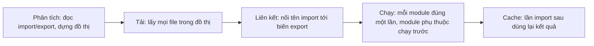
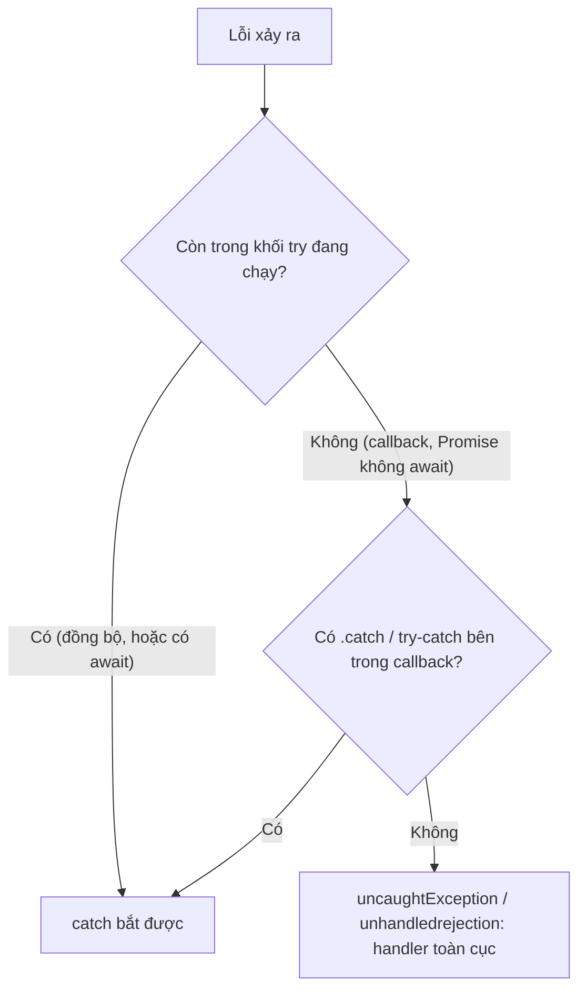

# Lý thuyết 9: Module và xử lý lỗi

Bài này gom hai kỹ năng mà mọi dự án JavaScript thật đều cần: chia code thành các file có ranh giới rõ ràng (module), và xử lý khi mọi thứ không đi đúng kế hoạch (lỗi). Hai chủ đề nghe xa nhau nhưng gặp nhau ở chỗ: lỗi nạp module, lỗi trong Promise, và cách một ứng dụng biết mình đang hỏng ở đâu. Bạn nên đã đọc [Lý thuyết 8 về Promise](/go?p=13-JavaScript%2Fmedium%2Flt-08-promise-va-async-await.md), vì phần lỗi bất đồng bộ dựa trên đó.

## Module là gì?

Hãy tưởng tượng một công ty với nhiều phòng ban. Mỗi phòng có bàn làm việc riêng (phạm vi riêng), và chỉ đưa ra ngoài những thứ họ muốn chia sẻ qua một quầy tiếp nhận: "phòng kế toán xuất bảng lương, phòng nhân sự nhận bảng lương". Không ai tự ý lục ngăn kéo phòng khác. Khi cần, phòng này ghi rõ "tôi cần thứ X của phòng kia" ở đầu phiếu công việc, nên giám đốc nhìn phiếu là biết ai phụ thuộc ai mà không cần chạy thử. **Module** là cơ chế đó cho code: mỗi file có phạm vi riêng, khai báo rõ cái gì `export` ra, cái gì `import` vào.

**Cốt lõi:** ES module là file có phạm vi riêng, nối với nhau bằng khai báo `import/export` mà engine đọc **trước khi chạy** để dựng đồ thị phụ thuộc. Mỗi module chỉ được nạp và chạy **một lần**, kết quả được cache và chia sẻ cho mọi nơi import nó, và các giá trị import là liên kết sống (live binding) tới biến gốc chứ không phải bản sao.

- Vì `import/export` là khai báo tĩnh nên engine và bundler biết phụ thuộc mà không cần chạy code, nên mới có tree shaking và báo lỗi sớm.
- Vì mỗi module chạy một lần rồi cache nên trạng thái ở cấp module (một biến, một kết nối) là singleton dùng chung toàn ứng dụng.
- Vì import là liên kết sống tới biến gốc nên module nhập vào thấy được thay đổi sau này của module xuất ra, nhưng không được tự gán lại.



Mô hình tư duy: import không "copy giá trị", nó là "cửa sổ nhìn vào biến của module khác", và cả đồ thị được chạy đúng một lượt theo thứ tự phụ thuộc.

## Vấn đề nó giải quyết, và vì sao dev phải nắm

Thời chưa có module, mọi script nạp bằng nhiều thẻ `<script>` dùng chung phạm vi toàn cục: hai file khai báo cùng tên biến là xung đột, thứ tự thẻ quyết định chuyện sống chết, và không ai biết file nào cần file nào. Module giải quyết bằng cách tách phạm vi, buộc khai báo phụ thuộc, và cho công cụ khả năng phân tích. Lỗi cũng là một phần của chuyện này: khi code chạy trong môi trường mà bạn không kiểm soát (mạng chập chờn, dữ liệu người dùng, API đổi định dạng), lỗi chắc chắn xảy ra. Vấn đề không phải "tránh mọi lỗi" mà là **lỗi được phát hiện sớm, mang đủ thông tin, và được xử lý đúng chỗ**.

Bạn cần nắm phần này khi cấu hình bundler hoặc `package.json` (ESM hay CommonJS), khi gặp lỗi `Cannot use import statement outside a module`, khi tách ứng dụng thành các lát nạp theo nhu cầu (code splitting), khi tìm vì sao một lỗi bị nuốt mất, và khi thiết kế cách báo lỗi cho người dùng và cho đội vận hành.

**Tóm tắt:**

- Module có phạm vi riêng; `export` công khai, `import` khai báo phụ thuộc; import tĩnh được hoist và đánh giá trước thân module.
- Có named export (nhiều, tên cố định) và default export (một); `export ... from` để re-export, `import * as ns` lấy cả namespace.
- Import là live binding chỉ đọc; module chạy một lần và được cache, nên là nơi tự nhiên cho singleton.
- `import()` động trả Promise (code splitting, nạp có điều kiện); top-level `await` chỉ có trong module và làm module phụ thuộc phải chờ.
- Dependency vòng không bị cấm nhưng gây truy cập biến chưa khởi tạo; phá vòng bằng cách tách module.
- `try/catch/finally`: `finally` luôn chạy, và `return` trong `finally` ghi đè mọi thứ trước nó; nên ném `Error` (không ném chuỗi), kèm `cause` khi bọc lỗi.
- `try/catch` chỉ bắt lỗi đồng bộ trong khối; lỗi trong callback hoặc Promise không `await` phải được bắt tại nơi nó xảy ra.
- Phân biệt lỗi đoán trước (xử lý và phục hồi) với lỗi lập trình (để nổ sớm, ghi log); handler toàn cục (`error`, `unhandledrejection`) là lưới an toàn cuối cùng.

## Các khái niệm cần biết

- **Module scope**: phạm vi của một file module; biến khai báo ở top-level không thành biến toàn cục.
- **Named export**: `export const a`, `export { a, b }`; import phải dùng đúng tên (có thể đổi bằng `as`).
- **Default export**: `export default ...`; mỗi module chỉ một, import đặt tên tùy ý. Thực chất là named export có tên `default`.
- **Namespace object**: `import * as ns` trả object chứa mọi export, bị đóng băng, và vẫn là liên kết sống.
- **Re-export**: `export { x } from "./a.js"` chuyển tiếp export của module khác mà không tạo biến cục bộ.
- **Live binding**: import là tham chiếu sống, đọc ra giá trị hiện tại của biến gốc, không gán lại được.
- **Dynamic `import()`**: biểu thức trả Promise của namespace object; đường dẫn có thể tính lúc chạy.
- **Top-level await**: `await` ở cấp ngoài cùng của module, không cần bọc hàm `async`.
- **Module graph / cache**: đồ thị các module và bảng lưu kết quả; khóa là URL đã chuẩn hóa của module.
- **CommonJS**: hệ module cũ của Node (`require`, `module.exports`), chạy đồng bộ.
- **`Error`**: object lỗi chuẩn có `name`, `message`, `stack` và (mới) `cause`.
- **Lỗi đoán trước (operational)**: thất bại có thể xảy ra bình thường (mạng, input sai, không tìm thấy), cần xử lý.
- **Lỗi lập trình (programmer error)**: bug thật (truy cập `undefined`, sai kiểu), cần sửa code chứ không "xử lý".
- **Unhandled rejection**: Promise bị reject mà không ai bắt (xem bài 8).

## ES module: import, export, và thứ tự chạy

Ví dụ dưới là ba file nhỏ. `dem.mjs` có cả named export lẫn default, `index.mjs` re-export, và `main.mjs` import theo nhiều kiểu. Đuôi `.mjs` báo cho Node biết đây là ES module; phần đường dẫn **bắt buộc có đuôi file**.

```javascript
// file: dem.mjs
export let dem = 0;
export function tang() { dem++; }
export default function macDinh() { return "giá trị mặc định"; }
export const PI2 = 6.28;
console.log("dem.mjs được chạy");

// file: index.mjs
export { dem, tang } from "./dem.mjs";
export { default as macDinh } from "./dem.mjs";
export * as tienIch from "./dem.mjs";

// file: main.mjs
import macDinh, { dem, tang as tangDem } from "./dem.mjs";
import * as ns from "./dem.mjs";
import { macDinh as md, tienIch } from "./index.mjs";

console.log("bắt đầu main");
console.log(dem);
tangDem();
console.log(dem, ns.dem);
try { dem = 5; } catch (e) { console.log(e.name + ": " + e.message); }
console.log(macDinh === md, tienIch.PI2);
console.log(Object.keys(ns));
```

```text
dem.mjs được chạy
bắt đầu main
0
1 1
TypeError: Assignment to constant variable.
true 6.28
[ 'PI2', 'default', 'dem', 'tang' ]
```

_Đã chạy thử trên Node 22._

Đọc kết quả. Dòng "dem.mjs được chạy" xuất hiện **trước** "bắt đầu main" và **chỉ một lần**, dù `dem.mjs` được import ở nhiều chỗ (`main.mjs` hai lần, `index.mjs` ba lần). Đó là hai hệ quả của việc import được hoist và module được cache: engine nạp xong cả đồ thị, chạy module phụ thuộc trước, rồi mới chạy thân `main.mjs`. Sau `tangDem()`, `dem` đọc ra `1` ở cả hai cách import, đúng nghĩa live binding: `dem` không phải bản sao 0 lúc import. Gán `dem = 5` bị từ chối, vì import là chỉ đọc; muốn đổi thì gọi hàm do module gốc export (`tang`). Cuối cùng, `ns` là namespace chứa mọi export, kể cả `default`.

**Phải thuộc:** quy tắc của module: (1) import được hoist và chạy trước thân module; (2) mỗi module chạy đúng một lần rồi cache; (3) import là liên kết sống chỉ đọc; (4) `export default` thực chất là một named export tên `default`.

Về chọn **named hay default**: named export giữ tên cố định ở mọi nơi dùng nên dễ tìm kiếm, đổi tên đồng loạt, và bundler tree-shake tốt hơn. Default export tiện khi module "là một thứ" (một component, một class) nhưng mỗi nơi import có thể đặt tên khác nhau, gây khó đọc.

## Chạy trong trình duyệt và `type="module"`

Trình duyệt chỉ coi script là module khi có `type="module"`. Khác biệt so với script thường cần nhớ:

```html
<script type="module" src="/app/main.js"></script>
<script type="module">
  import { khoiTao } from "/app/main.js";
  khoiTao();
</script>
<script nomodule src="/app/legacy-bundle.js"></script>
```

_Minh họa, chưa chạy thử._

- **Hoãn như `defer`**: script module không chặn việc parse HTML và chạy sau khi tài liệu được phân tích xong, theo thứ tự.
- **Strict mode mặc định** và phạm vi riêng: `var` ở top-level không thành thuộc tính của `window`; `this` ở top-level là `undefined`.
- **Chạy một lần mỗi URL**: nhiều thẻ trỏ cùng một module thì module chỉ được thực thi một lần.
- **Cần HTTP(S) và CORS**: mở file qua `file://` thường bị chặn; nạp module từ domain khác cần header CORS phù hợp.

Trong Node, một file là ES module khi có đuôi `.mjs` hoặc khi `package.json` đặt `"type": "module"`; đuôi `.cjs` luôn là CommonJS. Lỗi `Cannot use import statement outside a module` hầu như luôn có nghĩa là file đang được xem là CommonJS hoặc thẻ `<script>` thiếu `type="module"`.

## Dynamic `import()` và top-level await

`import "..."` ở đầu file là tĩnh: đường dẫn phải là chuỗi cố định, và không đặt trong `if` hay hàm. Khi cần nạp **có điều kiện** hoặc **trì hoãn** (tách bundle, nạp màn hình khi người dùng bấm), dùng `import()` trả về Promise của namespace object.

```javascript
// file: nang.mjs
console.log("nang.mjs được nạp");
export const nang = () => "việc nặng";
export default class Bao {}

// file: main.mjs
console.log("bắt đầu");
const canDung = true;
if (canDung) {
  const m = await import("./nang.mjs");
  console.log(m.nang(), typeof m.default, Object.keys(m));
}

const m1 = await import("./nang.mjs");
const m2 = await import("./nang.mjs");
console.log("cache, cùng một namespace:", m1 === m2);

const cfg = await new Promise((r) => setTimeout(() => r({ port: 3000 }), 10));
console.log("cấu hình sau await ở top-level:", cfg);

try { await import("./khong-co.mjs"); }
catch (e) { console.log("không nạp được:", e.code); }
```

```text
bắt đầu
nang.mjs được nạp
việc nặng function [ 'default', 'nang' ]
cache, cùng một namespace: true
cấu hình sau await ở top-level: { port: 3000 }
không nạp được: ERR_MODULE_NOT_FOUND
```

_Đã chạy thử trên Node 22._

`nang.mjs` chỉ được nạp (và in dòng đầu) khi `import()` chạy lần đầu, lần sau trả lại đúng namespace đã cache. Lỗi nạp (file không có, mạng hỏng) là một rejection, nên bắt bằng `try/catch` với `await` hoặc `.catch`. Ví dụ cũng dùng **top-level await**: `await` ở cấp ngoài cùng, chỉ hợp lệ trong module.

Top-level await tiện cho khởi tạo bất đồng bộ (đọc cấu hình, kết nối), nhưng có cái giá: mọi module **import** module đó phải chờ nó xong mới chạy được. Một `await` chậm ở gốc đồ thị có thể kéo chậm cả ứng dụng lúc khởi động.

**Nền tảng:** import tĩnh cho công cụ khả năng phân tích và loại code thừa; `import()` đổi lại sự linh hoạt (điều kiện, trì hoãn) và công cụ sẽ tách phần đó thành một lát riêng để nạp sau. Hãy dùng tĩnh làm mặc định, `import()` có chủ đích cho việc nặng hoặc ít dùng.

## Dependency vòng

Hai module import lẫn nhau tạo vòng. ES module không cấm điều đó, nhưng một trong hai module sẽ chạy khi module kia **chưa kịp khởi tạo xong**.

```javascript
// file: a.mjs
import { b } from "./b.mjs";
export const a = "A";
export function inA() { return "inA thấy b = " + b; }
console.log("a.mjs chạy, b =", b);

// file: b.mjs
import { a, inA } from "./a.mjs";
export const b = "B";
console.log("b.mjs chạy");
try { console.log(a); } catch (e) { console.log(e.name + ": " + e.message); }
console.log(typeof inA, inA());

// file: main.mjs
import "./a.mjs";
```

```text
b.mjs chạy
ReferenceError: Cannot access 'a' before initialization
function inA thấy b = B
a.mjs chạy, b = B
```

_Đã chạy thử trên Node 22._

`main` nạp `a`, `a` cần `b`, `b` lại cần `a` (vòng), nên `b.mjs` **chạy trước** `a.mjs`. Lúc đó `a` (khai báo `const`) chưa khởi tạo nên đọc nó gây `ReferenceError` (vùng chết tạm thời), còn hàm khai báo `inA` đã dùng được vì function được khởi tạo từ lúc liên kết.

Cách xử lý, theo thứ tự ưu tiên: tách phần dùng chung ra module thứ ba để cả hai cùng import một chiều; hoặc chỉ truy cập giá trị import **bên trong hàm** (chạy sau khi mọi module khởi tạo xong) thay vì ở top-level; công cụ như ESLint (`import/no-cycle`) hay `madge` giúp phát hiện vòng.

**Nhớ:** vòng không làm chương trình sập ngay mà tạo ra lỗi phụ thuộc thứ tự; hễ thấy `undefined` hay `ReferenceError` ở top-level module, hãy nghĩ tới vòng.

## ESM so với CommonJS, ở mức đủ dùng

CommonJS (`require`, `module.exports`) là hệ module gốc của Node, chạy **đồng bộ** và **linh động** (`require` có thể nằm trong `if`, nhận chuỗi tính toán). ESM thì tĩnh và dựa trên liên kết sống. Bảng so sánh chi tiết đã có trong [Frontend Core: runtime và event loop](/go?p=11-Frontend-Core%2Flt-01-javascript-runtime-event-loop.md); ở đây chỉ chạy thử điểm khác biệt hay làm người ta vấp nhất: **sao chép giá trị** so với **liên kết sống**.

```javascript
// file: lib.cjs
let dem = 0;
module.exports = { dem, tang() { dem++; } };

// file: main.mjs
import { createRequire } from "node:module";
import cjsDefault from "./lib.cjs";

const cjsRequire = createRequire(import.meta.url);
const { dem, tang } = cjsRequire("./lib.cjs");
tang();
console.log("CommonJS, dem đã bị sao chép:", dem);
console.log("module.exports.dem vẫn là:", cjsDefault.dem);

console.log(typeof require, typeof module, typeof __dirname);
console.log("this ở top-level ESM:", this);
console.log(typeof import.meta.url, typeof import.meta.dirname);
```

```text
CommonJS, dem đã bị sao chép: 0
module.exports.dem vẫn là: 0
undefined undefined undefined
this ở top-level ESM: undefined
string string
```

_Đã chạy thử trên Node 22._

Trong `lib.cjs`, `module.exports = { dem, ... }` sao chép giá trị `0` của `dem` tại thời điểm gán; sau đó `tang()` chỉ tăng biến cục bộ, nên nơi nhận vẫn thấy `0` (khác hẳn ví dụ `dem.mjs` ở trên). Một module ESM không có `require`, `module`, `__dirname`; thay vào đó có `import.meta.url` (và `import.meta.dirname` ở Node mới). ESM nhập được CommonJS (phần `module.exports` thành default import), nhưng chiều ngược lại có nhiều hạn chế, kể cả ở các bản Node mới; khi trộn hai hệ, hãy đọc tài liệu đúng phiên bản bạn dùng.

**Phải thuộc:** ESM: tĩnh, liên kết sống, hỗ trợ top-level await, không có `require/module/__dirname`. CommonJS: động, sao chép giá trị lúc `require`, đồng bộ. Viết mới thì chọn ESM.

## Xử lý lỗi: `try/catch/finally`, `throw` và `finally` với `return`

`try` bao đoạn có thể lỗi, `catch` chạy khi có exception, `finally` chạy **bất kể** kết quả (thành công, lỗi, `return`, `break`, `continue`). Từ ES2019 có thể bỏ binding: `catch { ... }` khi bạn không cần đối tượng lỗi.

```javascript
function f1() {
  try { return "từ try"; }
  finally { console.log("finally chạy trước khi return thật sự"); }
}
function f2() {
  try { return "từ try"; }
  finally { return "từ finally"; }
}
function f3() {
  try { throw new Error("x"); }
  catch { return "từ catch"; }
  finally { console.log("dọn dẹp xong"); }
}
function f4() {
  for (const i of [1, 2, 3]) {
    try {
      if (i === 2) continue;
      console.log("xử lý", i);
    } finally {
      console.log("finally của", i);
    }
  }
}

console.log(f1());
console.log(f2());
console.log(f3());
f4();
```

```text
finally chạy trước khi return thật sự
từ try
từ finally
dọn dẹp xong
từ catch
xử lý 1
finally của 1
finally của 2
xử lý 3
finally của 3
```

_Đã chạy thử trên Node 22._

Kết quả cần chú ý: ở `f1`, giá trị `"từ try"` được **tính xong**, rồi `finally` chạy, rồi mới thật sự trả về. Ở `f2`, `return` trong `finally` **ghi đè** `return` trước đó (và nuốt luôn exception nếu có), nên hầu hết quy ước coding cấm `return`/`throw` trong `finally`. `f4` cho thấy `finally` chạy cả với `continue`. Chỗ dùng chuẩn của `finally` là dọn tài nguyên: đóng file, nhả lock, ẩn spinner.

**Phải thuộc:** `finally` luôn chạy. `return` hoặc `throw` bên trong `finally` ghi đè kết quả của `try/catch`, nên tránh.

## `throw` và đối tượng `Error`

`throw` ném được **mọi** giá trị (kể cả chuỗi hay số), nhưng nên luôn ném object `Error` (hoặc lớp con), vì chỉ `Error` mới mang `stack` (dấu vết gọi hàm) và có `instanceof` để phân loại.

```javascript
const e = new Error("hỏng rồi", { cause: new TypeError("nguyên nhân gốc") });
console.log(e.name, "|", e.message, "|", e.cause.name, e.cause.message);
console.log(typeof e.stack, e.stack.split("\n")[0]);
console.log(String(e), e instanceof Error);

try { throw "chuỗi thường"; }
catch (x) { console.log(typeof x, x instanceof Error, x.stack); }

const thu = [
  () => null.x,
  () => chuaKhaiBao,
  () => new Array(-1),
  () => JSON.parse("{"),
  () => decodeURIComponent("%"),
];
for (const f of thu) {
  try { f(); } catch (err) { console.log(err.constructor.name + ":", err.message); }
}
```

```text
Error | hỏng rồi | TypeError nguyên nhân gốc
string Error: hỏng rồi
Error: hỏng rồi true
string false undefined
TypeError: Cannot read properties of null (reading 'x')
ReferenceError: chuaKhaiBao is not defined
RangeError: Invalid array length
SyntaxError: Expected property name or '}' in JSON at position 1 (line 1 column 2)
URIError: URI malformed
```

_Đã chạy thử trên Node 22._

Các lỗi có sẵn thường gặp: `TypeError` (thao tác sai kiểu, truy cập thuộc tính của `null/undefined`), `ReferenceError` (biến chưa khai báo hoặc còn trong TDZ), `RangeError` (giá trị ngoài phạm vi), `SyntaxError` (cú pháp hoặc JSON sai), `URIError`. Chuỗi bị ném (`"chuỗi thường"`) không có `stack`, và gây khó khăn cho cả người gỡ lỗi lẫn công cụ giám sát.

Tùy chọn `cause` (ES2022) dùng để **bọc** lỗi mà không mất nguyên nhân gốc: ở tầng nghiệp vụ, ném lỗi có ngữ cảnh ("Không đọc được hồ sơ người dùng") và đính lỗi kỹ thuật bên dưới vào `cause`.

**Nhớ:** luôn `throw new Error(...)` (hoặc lớp con), không ném chuỗi; bọc lỗi thì giữ `cause`.

## Tự định nghĩa lớp lỗi

Khi ứng dụng cần phân biệt "dữ liệu sai" với "không tìm thấy" với "lỗi hệ thống", tạo lớp lỗi riêng kế thừa `Error` (kế thừa theo [bài 7](/go?p=13-JavaScript%2Fmedium%2Flt-07-prototype-va-class.md)) để `catch` phân loại bằng `instanceof` thay vì so chuỗi message.

```javascript
class AppError extends Error {
  constructor(message, options) {
    super(message, options);
    this.name = new.target.name;
  }
}
class ValidationError extends AppError {
  constructor(truong, message, options) {
    super(message, options);
    this.truong = truong;
  }
}
class NotFoundError extends AppError {
  status = 404;
}

function kiemTra(u) {
  if (!u.ten) throw new ValidationError("ten", "Thiếu tên");
  return u;
}

try { kiemTra({}); }
catch (e) {
  console.log(e.name, "|", e.message, "|", e.truong);
  console.log(e instanceof ValidationError, e instanceof AppError, e instanceof Error);
  console.log(String(e), Object.keys(e), JSON.stringify(e));
}

function maHttp(e) {
  if (e instanceof ValidationError) return 400;
  if (e instanceof NotFoundError) return e.status;
  throw e;
}
console.log(maHttp(new ValidationError("a", "x")), maHttp(new NotFoundError("không có")));

async function layUser() {
  try { JSON.parse("{hỏng"); }
  catch (e) { throw new AppError("Không đọc được hồ sơ", { cause: e }); }
}
layUser().catch((e) => console.log(e.message, "<- do:", e.cause.name));
```

```text
ValidationError | Thiếu tên | ten
true true true
ValidationError: Thiếu tên [ 'name', 'truong' ] {"name":"ValidationError","truong":"ten"}
400 404
Không đọc được hồ sơ <- do: SyntaxError
```

_Đã chạy thử trên Node 22._

Ba điểm đáng nhớ. Một: `super(message, options)` chuyển cả `cause` lên `Error`, và đặt `this.name = new.target.name` để tên hiển thị đúng với lớp con (nếu không, `name` vẫn là `"Error"`). Hai: `message` và `stack` là non-enumerable nên không xuất hiện trong `Object.keys` hay `JSON.stringify`; khi cần gửi lỗi đi nơi khác, tự dựng một object thuần (`{ name, message, ...}`) hoặc định nghĩa `toJSON`. Ba: hàm `maHttp` cuối cùng `throw e` với lỗi lạ, thay vì nuốt đi, để lỗi không được biết tới vẫn nổi lên.

**Lưu ý:** không phân loại lỗi bằng so sánh `e.message === "..."`; message đổi là code gãy. Dùng lớp lỗi hoặc một trường mã (`code`) ổn định.

## Lỗi đồng bộ và bất đồng bộ

`try/catch` hoạt động trên **call stack hiện tại**: nó chỉ bắt exception ném ra trong lúc khối `try` đang chạy. Callback của `setTimeout` chạy ở một lần lặp khác của event loop, khi khối `try` đã kết thúc từ lâu, nên exception trong đó không còn "thuộc" `try` nào. Cùng lý do với một Promise bị reject mà không `await`.

```javascript
process.on("uncaughtException", (e) => console.log("uncaughtException:", e.message));
process.on("unhandledRejection", (e) => console.log("unhandledRejection:", e.message));

try {
  setTimeout(() => { throw new Error("trong setTimeout"); }, 0);
  console.log("khối try chạy xong");
} catch {
  console.log("không bao giờ in dòng này");
}

try {
  Promise.reject(new Error("Promise không ai await"));
} catch {
  console.log("cũng không bao giờ in dòng này");
}

async function dung() {
  try { await Promise.reject(new Error("có await")); }
  catch (e) { console.log("bắt được:", e.message); }
}
dung();
```

```text
khối try chạy xong
bắt được: có await
unhandledRejection: Promise không ai await
uncaughtException: trong setTimeout
```

_Đã chạy thử trên Node 22._

Hai `catch` đầu không bao giờ chạy: lỗi của timer rơi vào `uncaughtException`, lỗi của Promise rơi vào `unhandledRejection` (hai handler cho Node, mục dưới nói về trình duyệt). Chỉ khi có `await`, rejection mới được biến lại thành exception **tại chỗ** nên `try/catch` bắt được. Cách làm đúng cho từng kiểu: với callback, đặt `try/catch` **bên trong** callback hoặc bọc nó thành Promise (như `hoaPromise` ở [bài 8](/go?p=13-JavaScript%2Fmedium%2Flt-08-promise-va-async-await.md)); với Promise, `await` trong `try` hoặc gắn `.catch`.



**Nền tảng:** exception đi lên theo call stack. Khi code bất đồng bộ quay lại, call stack là mới và rỗng, nên phải có chỗ bắt ngay tại điểm vào đó. Vì vậy mỗi "điểm vào" (callback, event handler, route, hàm `async` cao nhất) cần có người chịu trách nhiệm bắt lỗi.

## Handler lỗi toàn cục

Dù cẩn thận đến đâu vẫn có lỗi lọt. Trình duyệt cho hai cổng cuối cùng để biết điều đó: sự kiện `error` cho lỗi đồng bộ chưa bắt (và lỗi tải tài nguyên), và `unhandledrejection` cho Promise bị reject mà không ai bắt.

```javascript
function baoCao(chiTiet) {
  navigator.sendBeacon("/api/log-loi", JSON.stringify(chiTiet));
}

window.addEventListener("error", (ev) => {
  baoCao({
    loai: "error",
    thongDiep: ev.message,
    file: ev.filename,
    dong: ev.lineno,
    stack: ev.error?.stack,
  });
});

window.addEventListener("unhandledrejection", (ev) => {
  baoCao({ loai: "rejection", lyDo: String(ev.reason), stack: ev.reason?.stack });
  ev.preventDefault();
});

// Cách cũ, tương đương cho lỗi đồng bộ:
window.onerror = (thongDiep, nguon, dong, cot, loi) => {
  baoCao({ thongDiep, nguon, dong, cot, stack: loi?.stack });
  return false;
};
```

_Minh họa, chưa chạy thử._

Các handler này là **lưới an toàn**, không phải chỗ xử lý lỗi nghiệp vụ: dùng để ghi log, gửi về hệ thống giám sát và (nếu muốn) hiện thông báo chung. `preventDefault()` chỉ chặn việc in lỗi ra console, không làm lỗi biến mất. Một chi tiết hay gặp: lỗi từ script nạp từ domain khác không có CORS chỉ báo chung chung `"Script error."` không kèm dòng và stack. Trong Node, tương đương là `process.on("uncaughtException")` và `process.on("unhandledRejection")` như ví dụ trước; sau `uncaughtException` tiến trình ở trạng thái không đáng tin nên thường ghi log rồi thoát và để trình giám sát khởi động lại.

## Lỗi đoán trước và lỗi lập trình, và mẫu Result

Không phải lỗi nào cũng cần xử lý như nhau. **Lỗi đoán trước** (mạng rớt, người dùng nhập sai, bản ghi không tồn tại) là phần bình thường của hệ thống: bắt, thông báo hoặc thử lại. **Lỗi lập trình** (`undefined.x`, gọi sai tham số, hàm trả sai kiểu) là bug: đừng cố "phục hồi", mà để nó nổi lên sớm, ghi log đầy đủ rồi sửa code. Nuốt một lỗi lập trình bằng `catch {}` chỉ giấu bug sang chỗ khác và biến nó thành sai dữ liệu im lặng.

Quy tắc thực dụng: chỉ bắt loại lỗi bạn biết cách xử lý, còn lại **ném lại**.

```javascript
function chiBatSyntaxError(f) {
  try { return f(); }
  catch (e) {
    if (e instanceof SyntaxError) return null;
    throw e;
  }
}

console.log(chiBatSyntaxError(() => JSON.parse("{")));
try { chiBatSyntaxError(() => undefined.x); }
catch (e) { console.log("lỗi lạ được chuyển tiếp:", e.name); }

const ok = (value) => ({ ok: true, value });
const err = (error) => ({ ok: false, error });

const chia = (a, b) => (b === 0 ? err("chia cho 0") : ok(a / b));
function docJson(s) {
  try { return ok(JSON.parse(s)); }
  catch (e) { return err(e.message); }
}

for (const r of [chia(6, 3), chia(1, 0), docJson('{"a":1}'), docJson("{")]) {
  console.log(r.ok ? "giá trị: " + JSON.stringify(r.value) : "lỗi: " + r.error);
}
```

```text
null
lỗi lạ được chuyển tiếp: TypeError
giá trị: 2
lỗi: chia cho 0
giá trị: {"a":1}
lỗi: Expected property name or '}' in JSON at position 1 (line 1 column 2)
```

_Đã chạy thử trên Node 22._

Nửa sau là mẫu **Result**: thay vì ném exception cho thất bại đoán trước, hàm trả về một giá trị mô tả "thành công hoặc thất bại", buộc nơi gọi phải nhìn vào `ok` trước khi dùng `value`. Ưu điểm là thất bại hiện rõ trong chữ ký hàm và không "bay" xuyên nhiều tầng; nhược điểm là code dài hơn và phải truyền kết quả qua từng tầng. Mẫu này kết hợp rất tốt với kiểu dữ liệu của TypeScript (union phân biệt, xem [Lý thuyết 2 của Frontend Core](/go?p=11-Frontend-Core%2Flt-02-typescript-nang-cao.md)). Dùng Result cho thất bại thường xuyên, dự đoán được; exception cho tình huống bất thường thực sự.

**Phải thuộc:** bắt đúng loại lỗi bạn xử lý được và ném lại phần còn lại; lỗi đoán trước thì phục hồi hoặc báo, lỗi lập trình thì để nổ và sửa.

## Bẫy thường gặp

| Bẫy | Biểu hiện | Cách tránh |
|---|---|---|
| `return` hoặc `throw` trong `finally` | Lỗi hoặc giá trị đúng bị nuốt | Chỉ dọn dẹp trong `finally` |
| `catch (e) {}` rỗng | Bug biến mất, dữ liệu sai âm thầm | Ghi log và ném lại nếu không xử lý được |
| `throw "chuỗi"` | Không có `stack`, không `instanceof` | `throw new Error(...)` hoặc lớp con |
| Bọc lỗi mà bỏ nguyên nhân gốc | Khó tìm gốc rễ | Truyền `{ cause: e }` |
| `try/catch` quanh `setTimeout` hoặc Promise không `await` | Lỗi lọt ra ngoài | Bắt bên trong callback, hoặc `await` trong `try` |
| So sánh `e.message` để phân loại | Gãy khi đổi câu chữ | Lớp lỗi riêng hoặc `code` |
| Quên `.mjs`/`"type": "module"` | `Cannot use import statement outside a module` | Đặt đúng đuôi hoặc `type` |
| Thiếu đuôi file trong đường dẫn import | `ERR_MODULE_NOT_FOUND` | Ghi đủ `./file.js` |
| Dependency vòng | `ReferenceError` hoặc `undefined` ở top-level | Tách module chung, dùng giá trị trong hàm |
| Gán lại biến import | `TypeError: Assignment to constant variable` | Gọi hàm do module gốc export |
| Top-level await chậm ở module gốc | Cả ứng dụng khởi động chậm | Đưa việc chờ xuống nơi cần |
| `JSON.stringify(error)` | Mất `message` và `stack` | Tự dựng object lỗi hoặc `toJSON` |

## Câu hỏi phỏng vấn thường gặp

Mỗi câu có chuỗi: gợi ý suy luận, lập luận, đáp án ngắn, điều cần nhớ. Thử tự đi theo gợi ý trước khi đọc tiếp.

### 1. Import trong ES module là "copy giá trị" hay "tham chiếu"? Module được chạy mấy lần?

**Câu hỏi:** Một module export biến `let dem` và hàm `tang()`. Hai file khác cùng import chúng. Điều gì xảy ra với giá trị `dem` sau `tang()`, và module gốc chạy bao nhiêu lần?

**Gợi ý suy luận:**
- Import tạo một bản sao hay một liên kết tới biến gốc?
- Engine có nạp lại file mỗi lần gặp `import` không, hay tra cứu một nơi lưu trước đó?
- Nơi nhập có được gán lại biến import không?

**Lập luận:** ES module dùng live binding: tên import là cửa sổ chỉ đọc nhìn vào biến của module xuất, nên sau `tang()` mọi nơi đều thấy `dem` mới. Engine dựng đồ thị theo URL đã chuẩn hóa, mỗi module chạy một lần rồi được cache; các lần import sau chỉ liên kết với cùng một đối tượng module. Vì vậy trạng thái cấp module là singleton. Còn gán lại biến import thì bị cấm vì nó không thuộc về module nhập.

**Đáp án ngắn:** là tham chiếu sống chỉ đọc, không phải bản sao; module chạy đúng một lần và được cache cho mọi nơi import.

**Nhớ:** muốn đổi giá trị của module khác thì gọi hàm nó export; CommonJS mới là sao chép giá trị.

### 2. `import` tĩnh khác `import()` động ở đâu, và top-level await có cái giá gì?

**Câu hỏi:** Khi nào dùng `import()`? Top-level await có tác dụng phụ nào lên module khác?

**Gợi ý suy luận:**
- Công cụ build biết gì về import tĩnh mà không cần chạy code?
- `import()` trả về cái gì, và lỗi nạp biểu hiện thế nào?
- Nếu module A dùng `await` ở top-level thì module B import A phải làm gì?

**Lập luận:** import tĩnh khai báo phụ thuộc từ trước nên có tree shaking và phát hiện lỗi sớm. `import()` trả Promise nên dùng khi muốn nạp có điều kiện hoặc trì hoãn (code splitting, tính năng ít dùng); lỗi nạp là rejection cần `catch`. Top-level await cho phép khởi tạo bất đồng bộ trong module, nhưng module nào import nó phải chờ nó xong, nên đặt `await` chậm ở gốc đồ thị làm chậm khởi động toàn bộ.

**Đáp án ngắn:** tĩnh để công cụ phân tích và tối ưu, mặc định dùng; `import()` trả Promise để nạp theo nhu cầu. Top-level await chặn các module phụ thuộc cho tới khi xong.

**Nhớ:** tĩnh làm mặc định, `import()` có chủ đích, top-level await dùng tiết kiệm.

### 3. Vì sao `try/catch` không bắt được lỗi trong `setTimeout` hay Promise? Sửa thế nào?

**Câu hỏi:** Đoạn code bọc `setTimeout(() => { throw ... })` trong `try/catch` nhưng lỗi vẫn làm sập chương trình. Giải thích và đề xuất cách sửa.

**Gợi ý suy luận:**
- Khi callback của timer chạy, khối `try` còn trên call stack không?
- Rejection của Promise không `await` đi tới đâu?
- Làm sao đưa lỗi bất đồng bộ trở lại nơi `try/catch` nhìn thấy được?

**Lập luận:** exception chỉ lan lên theo call stack hiện tại. Callback của timer chạy sau, ở một lần lặp event loop khác, với call stack mới, nên `try` đã đóng từ lâu. Promise bị reject cũng vậy: nó biến thành `unhandledrejection` nếu không ai bắt. Cách sửa: đặt `try/catch` bên trong callback, hoặc bọc thao tác thành Promise rồi `await` trong `try`, hoặc gắn `.catch`.

**Đáp án ngắn:** vì lúc callback hoặc rejection xảy ra, `try` đã kết thúc và không còn trên call stack. Bắt lỗi bên trong callback, hoặc `await` Promise trong `try`, hoặc dùng `.catch`.

**Nhớ:** mỗi "điểm vào" bất đồng bộ phải tự có người bắt lỗi; handler toàn cục chỉ là lưới an toàn.

### 4. Tự định nghĩa lớp lỗi để làm gì, và cần chú ý gì?

**Câu hỏi:** Vì sao nên tạo `ValidationError extends Error` thay vì ném `Error` với message khác nhau? Cần lưu ý gì khi cài đặt?

**Gợi ý suy luận:**
- Làm sao `catch` phân biệt được hai loại lỗi mà không so sánh chuỗi?
- `name` mặc định của lỗi lớp con là gì, và nên thiết lập ra sao?
- Khi bọc một lỗi kỹ thuật vào lỗi nghiệp vụ, thông tin gốc để ở đâu?

**Lập luận:** lớp lỗi riêng cho phép `catch` phân loại bằng `instanceof`, và mang theo dữ liệu có cấu trúc (trường sai, mã trạng thái) thay vì nhét hết vào message. Cần gọi `super(message, options)` để giữ `cause` và `stack`, đặt `name` đúng với lớp, tránh phụ thuộc vào văn bản message để phân loại. Lưu ý `message` và `stack` không được `JSON.stringify` nên cần chuyển đổi tay khi gửi đi.

**Đáp án ngắn:** để phân loại lỗi bằng `instanceof`/mã ổn định và mang theo dữ liệu. Nhớ `super(message, options)`, đặt `name`, dùng `cause` khi bọc lỗi.

**Nhớ:** phân loại bằng kiểu hoặc `code`, không bằng chuỗi message.

### 5. `finally` hoạt động thế nào khi có `return`, và khi nào nên bắt lỗi, khi nào nên để nổ?

**Câu hỏi:** Hàm có `return` trong `try` và `finally`. Kết quả thế nào? Phân biệt lỗi đoán trước và lỗi lập trình, và nói về mẫu Result.

**Gợi ý suy luận:**
- `finally` chạy trước hay sau khi giá trị `return` ở `try` được tính?
- Nếu `finally` cũng `return`, giá trị nào thắng?
- Với một lỗi mà bạn không biết cách phục hồi, `catch` nên làm gì?

**Lập luận:** giá trị `return` ở `try` được tính trước, sau đó `finally` chạy, rồi mới trả về; nhưng `return` hoặc `throw` trong `finally` sẽ ghi đè, nuốt cả lỗi. Lỗi đoán trước (mạng, input) nên được xử lý hoặc thử lại; lỗi lập trình nên nổ sớm kèm log đầy đủ để sửa. Vì vậy chỉ bắt loại lỗi mình biết xử lý và ném lại phần còn lại. Với thất bại thường xuyên và dự đoán được, trả về Result (`{ ok, value | error }`) giữ lỗi hiện trong chữ ký hàm, còn exception để cho tình huống bất thường.

**Đáp án ngắn:** `finally` chạy sau khi tính giá trị `return` của `try` và trước khi thoát; `return` trong `finally` ghi đè. Bắt lỗi đoán trước, để lỗi lập trình nổi lên (ném lại); Result là lựa chọn khác cho thất bại bình thường.

**Nhớ:** `finally` để dọn dẹp, `catch` chỉ cho lỗi bạn xử lý được, phần còn lại ném lại.

Bài kế tiếp: [Lý thuyết 10: DOM và sự kiện](/go?p=13-JavaScript%2Fmedium%2Flt-10-dom-va-su-kien.md)

