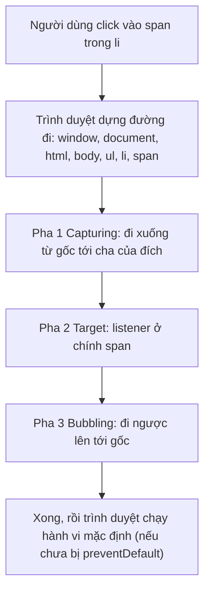
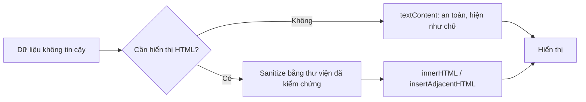
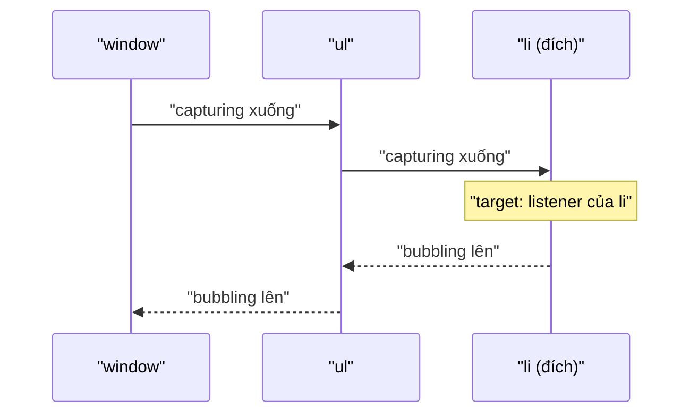

# Lý thuyết 10: DOM và sự kiện

Bài này nói về cách JavaScript "chạm" được vào trang web: DOM (cây đối tượng mô tả trang) và hệ thống sự kiện (cách trang báo cho bạn biết người dùng vừa làm gì). Chúng ta đi từ cấu trúc cây, các cách truy vấn và chỉnh sửa node, sang sự kiện với ba pha lan truyền, event delegation và custom event, rồi kết thúc bằng chi phí render (reflow, repaint) và cách gom đọc-ghi để giao diện không giật.

Quy ước trong bài: các ví dụ cần trình duyệt (có `document`, `window`) được ghi `_Minh họa, chưa chạy thử._` vì môi trường soạn bài không có DOM thật. Các ví dụ logic thuần (mô phỏng bubbling bằng mảng, `EventTarget` và `CustomEvent` của Node) đã chạy thật trên Node 22 và dán nguyên kết quả.

## DOM là gì?

Hãy hình dung **sơ đồ tổ chức của một công ty**. Có một giám đốc ở trên cùng, dưới là các phòng ban, mỗi phòng ban có nhiều nhân viên. Bạn muốn đổi tên một nhân viên thì phải biết vị trí của họ trong sơ đồ. DOM (Document Object Model) là sơ đồ đó cho trang web: trình duyệt đọc HTML, dựng thành một **cây các object**, và đưa cho JavaScript một bộ API để tìm, đọc, sửa, thêm, xóa các nhánh trên cây. HTML chỉ là văn bản ban đầu; DOM là bản "sống" trong bộ nhớ, và đó mới là thứ bạn thao tác (và là thứ người dùng thấy sau khi trình duyệt vẽ lại).

## Vấn đề nó giải quyết, và vì sao dev phải nắm

Nếu không có DOM, trang web chỉ là tài liệu tĩnh. DOM cho phép trang phản ứng: hiện thông báo lỗi khi nhập sai, thêm một dòng vào danh sách, mở modal. Dù bạn dùng React hay Vue (chúng tự thao tác DOM hộ), mọi lỗi khó chịu đều quay về DOM: tại sao click vào icon con mà handler không chạy, tại sao thêm 1.000 dòng làm trang đơ, tại sao chèn nội dung từ người dùng lại tạo lỗ hổng XSS, tại sao listener gắn cho phần tử mới thêm không hoạt động.

Người dùng framework mà không nắm DOM sẽ gặp khó ở ba chỗ. Một, khi cần thao tác ngoài vòng quản lý của framework (focus, scroll, đo kích thước, tích hợp thư viện bên thứ ba). Hai, khi debug hiệu năng (reflow, repaint, layout thrashing). Ba, khi phỏng vấn: các câu về event bubbling, delegation, `preventDefault` so với `stopPropagation` gần như câu nào cũng hỏi.

**Cốt lõi:** DOM là một cây gồm nhiều loại node; phần lớn thao tác bạn làm là với **element** (loại node đại diện thẻ HTML). Tương tác với người dùng diễn ra bằng **sự kiện**: khi có sự kiện, trình duyệt dựng một đường đi từ gốc tới phần tử đích và gọi các listener theo ba pha (capturing, target, bubbling).

- Vì DOM là cây có quan hệ cha con, nên sự kiện xảy ra ở phần tử con có thể được "nghe thấy" ở tổ tiên, và đó là cơ sở của event delegation.
- Vì mỗi lần sửa DOM có thể buộc trình duyệt tính lại layout và vẽ lại, nên thao tác DOM tốn kém hơn nhiều so với tính toán thuần trong JavaScript, và cần gom nhóm để giảm chi phí.
- Vì nội dung chèn vào DOM có thể là mã thực thi hoặc HTML do người dùng kiểm soát, nên chọn `textContent` hay `innerHTML` không chỉ là chuyện tiện tay mà là chuyện bảo mật.



Mô hình tư duy: DOM là cây, sự kiện là **giọt nước nổi lên** từ phần tử bị tác động, đi qua mọi tổ tiên; còn listener là các "trạm quan sát" bạn đặt trên đường đi.

**Phải thuộc:** mọi thứ trong DOM là node; element là loại node có thẻ; sự kiện đi qua ba pha theo thứ tự capturing, target, bubbling; `addEventListener` mặc định nghe ở pha bubbling.

**Tóm tắt:**

- DOM là cây object do trình duyệt dựng từ HTML; `document` là gốc, mỗi thẻ là một element node, văn bản là text node.
- Node là khái niệm rộng (gồm text, comment, element...), element là node có thẻ; `children` chỉ chứa element còn `childNodes` chứa mọi node.
- Truy vấn bằng `querySelector`/`querySelectorAll` (CSS selector, trả bản chụp tĩnh), `getElementById`, `closest` (tìm tổ tiên), `matches` (kiểm tra selector); `HTMLCollection` là live còn `NodeList` từ `querySelectorAll` là static.
- Tạo bằng `createElement`, gắn bằng `append`/`before`/`replaceWith`/`remove`; dùng `DocumentFragment` để gom nhiều thay đổi.
- `textContent` đặt văn bản thuần và an toàn; `innerHTML` phân tích chuỗi thành HTML nên dễ dính XSS khi chứa dữ liệu người dùng.
- Attribute (trong HTML) khác property (trên object DOM); với class, style, data-* dùng `classList`, `style`, `dataset`.
- Sự kiện có ba pha capturing, target, bubbling; `event.target` là nơi phát sinh, `currentTarget` là nơi listener đang chạy; `stopPropagation` chặn lan truyền, `preventDefault` chặn hành vi mặc định, hai việc khác nhau.
- Event delegation đặt một listener ở tổ tiên và dùng `target.closest(...)`; `CustomEvent` + `dispatchEvent` tạo sự kiện riêng; sửa DOM nên gom đọc rồi ghi để tránh reflow liên tục.

## Các khái niệm cần biết

- **DOM (Document Object Model)**: mô hình object của tài liệu, cây các node mà JavaScript thao tác được.
- **Node**: đơn vị cơ bản của cây. Có nhiều loại: element, text, comment, document, fragment.
- **Element**: node đại diện một thẻ HTML, có attribute, class, children. Là loại node bạn dùng nhiều nhất.
- **HTMLCollection (live)**: tập element tự cập nhật khi DOM đổi, ví dụ `parent.children`, `getElementsByClassName`.
- **NodeList (static hoặc live)**: tập node; kết quả `querySelectorAll` là bản chụp tĩnh, còn `childNodes` là live.
- **Attribute / property**: attribute là giá trị khai báo trong HTML (chuỗi), property là thuộc tính của object DOM (có kiểu thật, ví dụ `checked` là boolean).
- **Event listener**: hàm được đăng ký để chạy khi một loại sự kiện xảy ra trên một target.
- **Capturing / bubbling**: hai chiều đi của sự kiện, từ gốc xuống đích, rồi từ đích ngược lên gốc.
- **Event delegation**: đặt một listener ở phần tử cha để xử lý sự kiện của nhiều con, kể cả con thêm sau.
- **CustomEvent**: sự kiện do bạn định nghĩa, mang dữ liệu trong `detail`.
- **Reflow (layout) / repaint**: reflow là tính lại kích thước và vị trí; repaint là vẽ lại pixel. Reflow thường tốn kém hơn.
- **XSS (Cross-Site Scripting)**: tấn công chèn mã vào trang qua dữ liệu không được xử lý an toàn.

## Cây DOM, node và element

Một đoạn HTML như `<ul id="list"><li>Một</li><li>Hai</li></ul>` thành cây gồm element `ul` có hai element `li`, mỗi `li` chứa một text node. Ngay cả khoảng trắng và xuống dòng giữa các thẻ cũng có thể thành text node, đó là lý do `childNodes` đôi khi chứa nhiều "thứ lạ" hơn bạn tưởng.

```javascript
const list = document.querySelector("#list");
console.log(list.nodeType);           // 1: element
console.log(list.childNodes.length);  // gồm cả text node chứa xuống dòng
console.log(list.children.length);    // chỉ element: 2
console.log(list.firstElementChild.textContent);   // "Một"
console.log(list.parentElement, list.nextElementSibling);
```

_Minh họa, chưa chạy thử._

Quy tắc chọn API: dùng các thuộc tính có chữ "Element" (`children`, `firstElementChild`, `nextElementSibling`, `parentElement`) khi bạn chỉ quan tâm thẻ; dùng `childNodes`, `firstChild`, `nextSibling` khi cần cả văn bản và comment. Hằng số hay gặp của `nodeType`: 1 là element, 3 là text, 8 là comment, 9 là document.

**Nền tảng:** "node" là khái niệm gốc, "element" là một loại node. Mọi element đều là node (kế thừa `Node` qua `Element`, `HTMLElement`), nhưng không phải node nào cũng là element. Khi tài liệu nói "`parentNode`" thì cha có thể là `document` hoặc `DocumentFragment`, còn `parentElement` chỉ trả về element hoặc `null`.

## Truy vấn phần tử

`querySelector(selector)` trả phần tử đầu tiên khớp (hoặc `null`), `querySelectorAll(selector)` trả toàn bộ dưới dạng `NodeList` tĩnh. `getElementById` nhanh nhưng chỉ tìm theo id. Hai phương thức bổ trợ hay bị bỏ quên: `element.closest(selector)` đi **ngược lên** (kể cả chính nó) tìm tổ tiên đầu tiên khớp selector; `element.matches(selector)` trả boolean cho biết chính nó có khớp không.

```javascript
const btn = document.querySelector("button.save");
const cards = document.querySelectorAll(".card");       // NodeList tĩnh
const card = btn?.closest(".card");                      // tổ tiên gần nhất có class card
console.log(btn?.matches(".save:not([disabled])"));      // true hoặc false
cards.forEach((c) => c.classList.add("seen"));           // NodeList có forEach
const arr = [...cards];                                   // chuyển sang mảng nếu cần map/filter
```

_Minh họa, chưa chạy thử._

### HTMLCollection live và NodeList static

Một số API trả về tập **live**: nó luôn phản ánh trạng thái DOM hiện tại, nên độ dài và nội dung đổi khi DOM đổi. Số khác trả bản chụp **static** tại thời điểm gọi. Sự khác biệt này gây lỗi kinh điển khi vừa duyệt vừa xóa.

Đoạn mô phỏng sau dùng mảng để tái hiện đúng hiện tượng (không phải DOM thật, nhưng logic giống hệt):

```javascript
// Mô phỏng HTMLCollection live và NodeList static bằng closure
const items = ["a", "b"];
const liveList = () => items;            // luôn đọc mảng hiện tại
const staticList = items.slice();        // chụp một lần
items.push("c");
console.log("live length:", liveList().length, "| static length:", staticList.length);
// vòng lặp xóa trên live: lỗi kinh điển
const live = ["x","y","z","w"];
for (let i = 0; i < live.length; i++) live.splice(i, 1);
console.log("còn lại sau xóa trong vòng lặp live:", live);
```

```text
live length: 3 | static length: 2
còn lại sau xóa trong vòng lặp live: [ 'y', 'w' ]
```

_Đã chạy thử trên Node 22._

Đọc kết quả: tập live thấy phần tử thêm sau (độ dài 3), bản chụp tĩnh vẫn là 2. Ở vòng lặp xóa, mỗi lần xóa một phần tử thì `length` giảm và các phần tử sau dồn lên vị trí cũ, nên chỉ số `i` tăng làm ta **nhảy cóc** qua phần tử: bốn phần tử mà chỉ xóa được hai, còn lại `y` và `w`. Với DOM thật, `parent.children` là live nên rơi vào đúng bẫy này; cách tránh là chuyển sang mảng trước (`[...parent.children]`), duyệt ngược, hoặc dùng `querySelectorAll` (tĩnh).

**Lưu ý:** `querySelectorAll` trả `NodeList` tĩnh nên an toàn khi vừa duyệt vừa sửa; còn `children`, `getElementsByClassName`, `getElementsByTagName`, `childNodes` là live. `HTMLCollection` không có `forEach`; hãy `Array.from` hoặc spread (nhờ nó là iterable, xem [Lý thuyết 11](/go?p=13-JavaScript%2Fhard%2Flt-11-iterator-generator.md)).

**Nhớ:** cần chụp một lần thì dùng `querySelectorAll`; nhận về tập live thì chuyển sang mảng trước khi lặp và sửa.

## Tạo, sửa, xóa node

Quy trình chuẩn: tạo (`createElement`, `createTextNode`, `cloneNode`), cấu hình, rồi gắn vào cây. Các API hiện đại `append`, `prepend`, `before`, `after`, `replaceWith`, `remove` gọn hơn nhiều so với `appendChild`, `insertBefore`, `removeChild`, và nhận được cả chuỗi lẫn node.

```javascript
const ul = document.querySelector("#list");
const li = document.createElement("li");
li.textContent = "Mục mới";
li.className = "item";
ul.append(li);                          // thêm cuối
ul.prepend(document.createElement("li")); // thêm đầu
li.before("Chú thích: ");                // chèn chuỗi trước li (thành text node)
li.replaceWith(Object.assign(document.createElement("li"), { textContent: "Đã thay" }));
ul.lastElementChild.remove();            // tự gỡ khỏi cây
const copy = ul.firstElementChild.cloneNode(true); // true: sao chép cả con (deep)
```

_Minh họa, chưa chạy thử._

Khi cần thêm **nhiều** node, đừng gắn từng cái vào cây đang hiển thị. Dựng trước trong `DocumentFragment` (cây "nháp" nằm ngoài tài liệu), rồi gắn một lần: trình duyệt chỉ phải xử lý một lần chèn.

```javascript
const frag = document.createDocumentFragment();
for (let i = 1; i <= 1000; i++) {
  const li = document.createElement("li");
  li.textContent = `Dòng ${i}`;
  frag.append(li);
}
document.querySelector("#list").append(frag);   // một lần chèn, fragment rỗng sau đó
```

_Minh họa, chưa chạy thử._

**Phải thuộc:** một node chỉ có thể ở **một chỗ** trong cây: `append` một node đang có sẵn là **di chuyển** nó chứ không sao chép (muốn bản sao thì `cloneNode(true)`). `remove()` gỡ node khỏi cây nhưng biến vẫn giữ tham chiếu, nên node chưa bị thu hồi nếu còn biến hoặc listener giữ nó (nguồn gốc của "detached DOM leak", xem [JavaScript runtime và event loop](/go?p=11-Frontend-Core%2Flt-01-javascript-runtime-event-loop.md)).

## textContent và innerHTML

Cả hai đều gán nội dung cho element nhưng hoàn toàn khác bản chất. `textContent` đặt **văn bản thuần**: mọi ký tự `<`, `>` đều thành chữ hiển thị. `innerHTML` **phân tích chuỗi thành HTML** rồi dựng node, nghĩa là bất kỳ thẻ nào trong chuỗi đều trở thành phần tử thật.

```javascript
const box = document.querySelector("#comment");
const userInput = '';

box.innerHTML = userInput;     // NGUY HIỂM: ảnh lỗi kích hoạt onerror, chạy mã của kẻ tấn công
box.textContent = userInput;   // AN TOÀN: hiện nguyên chuỗi như văn bản
```

_Minh họa, chưa chạy thử._

Dòng `innerHTML` là ví dụ XSS (Cross-Site Scripting) kinh điển. Lưu ý: thẻ `<script>` chèn bằng `innerHTML` không chạy, nhưng thuộc tính sự kiện như `onerror` và URL `javascript:` thì có thể. Quy tắc thực tế: dữ liệu từ người dùng, từ API, từ URL luôn đặt bằng `textContent`. Nếu bắt buộc cho phép HTML (ví dụ nội dung soạn bằng rich text), phải làm sạch (sanitize) bằng thư viện chuyên dụng như DOMPurify hoặc API Sanitizer của trình duyệt (nếu có), và kết hợp Content Security Policy. Phần phân tích về XSS, CSP, và Trusted Types nằm trong [Bảo mật Frontend](/go?p=11-Frontend-Core%2Flt-04-bao-mat-frontend.md).



**Lưu ý:** `innerHTML +=` còn có một bẫy khác ngoài bảo mật: nó **dựng lại toàn bộ** con của element, nên mất listener đã gắn trực tiếp lên các con cũ, mất trạng thái nhập liệu và tốn chi phí. Khi chỉ cần thêm một phần tử, dùng `append` hoặc `insertAdjacentElement`.

**Nhớ:** mặc định `textContent`; chỉ dùng `innerHTML` với chuỗi do chính bạn viết cứng hoặc đã sanitize.

## Attribute và property, class, style, dataset

Khi trình duyệt phân tích HTML, các **attribute** trở thành giá trị khởi tạo cho các **property** tương ứng trên object DOM. Sau đó hai thứ có thể tách rời: bạn đổi property không nhất thiết đổi attribute và ngược lại. Ví dụ điển hình là ô nhập `value`: attribute `value` là giá trị mặc định ban đầu; property `value` là giá trị người dùng đang gõ.

```javascript
const input = document.querySelector("input[name=email]");
// HTML ban đầu: <input name="email" value="a@x.com">
input.value = "b@y.com";                 // người dùng gõ gì thì property value đổi theo
console.log(input.getAttribute("value")); // vẫn "a@x.com" (giá trị mặc định)
console.log(input.value);                  // "b@y.com" (giá trị hiện tại)

const cb = document.querySelector("input[type=checkbox]");
console.log(cb.checked, cb.getAttribute("checked")); // boolean và chuỗi/null: hai thứ khác nhau
cb.setAttribute("data-x", "1");           // attribute luôn là chuỗi
```

_Minh họa, chưa chạy thử._

Quy tắc chọn: với trạng thái động (`value`, `checked`, `disabled`, `selected`) hãy dùng **property**. Với attribute tùy chỉnh hoặc không có property tương ứng thì dùng `getAttribute/setAttribute/removeAttribute/hasAttribute`. Attribute luôn là chuỗi; property có thể là boolean, số, object (như `style`).

### classList, style, dataset

Ba API thay thế cho việc nối chuỗi thủ công:

```javascript
const el = document.querySelector(".card");
// classList: thao tác từng class, không cần tự cắt/nối chuỗi className
el.classList.add("active", "highlight");
el.classList.remove("hidden");
el.classList.toggle("open");                 // bật tắt
el.classList.toggle("compact", window.innerWidth < 600); // ép theo điều kiện
console.log(el.classList.contains("active"));

// style: chỉ ghi style inline; getComputedStyle mới đọc được giá trị cuối cùng sau CSS
el.style.backgroundColor = "tomato";          // camelCase
el.style.setProperty("--gap", "12px");        // CSS variable
const computed = getComputedStyle(el).display; // giá trị thực tế đã tính

// dataset: ánh xạ data-* sang camelCase
// HTML: <div class="card" data-user-id="42">
console.log(el.dataset.userId);               // "42" (luôn là chuỗi)
el.dataset.state = "ready";                   // thêm data-state="ready"
```

_Minh họa, chưa chạy thử._

**Lưu ý:** `el.style.width` chỉ trả giá trị **inline** mà bạn đã đặt, không phản ánh style từ stylesheet; cần giá trị cuối thì dùng `getComputedStyle` (và nhớ rằng đọc nó có thể kích hoạt tính layout, xem phần cuối). Ưu tiên bật tắt class thay vì sửa trực tiếp style: logic tách khỏi giao diện, CSS tự quản lý chuyển cảnh.

**Nhớ:** attribute là khởi tạo, property là trạng thái hiện tại; class bằng `classList`, style động qua class hoặc CSS variable, dữ liệu gắn thẻ qua `dataset`.

## Sự kiện: addEventListener và options

`element.addEventListener(type, handler, options)` đăng ký listener. Cách này thắng thuộc tính `onclick = ...` ở chỗ gắn được **nhiều** listener cho cùng loại sự kiện, có options, và gỡ được bằng `removeEventListener` (phải truyền **cùng tham chiếu hàm**; hàm ẩn danh mới tạo thì không gỡ được).

```javascript
const btn = document.querySelector("#buy");
function onBuy(e) { console.log("mua", e.type); }

btn.addEventListener("click", onBuy);
btn.addEventListener("click", () => console.log("log phụ"));   // gắn thêm, không đè
btn.removeEventListener("click", onBuy);                       // cùng tham chiếu mới gỡ được

btn.addEventListener("click", onBuy, { once: true });          // tự gỡ sau lần chạy đầu
document.addEventListener("scroll", () => {}, { passive: true }); // hứa không gọi preventDefault
document.addEventListener("click", () => {}, { capture: true });  // nghe ở pha capturing

// Hủy nhiều listener cùng lúc bằng AbortController
const ac = new AbortController();
window.addEventListener("resize", () => {}, { signal: ac.signal });
window.addEventListener("keydown", () => {}, { signal: ac.signal });
ac.abort();                                                    // gỡ cả hai
```

_Minh họa, chưa chạy thử._

Ý nghĩa các options:

- `once: true`: listener tự gỡ sau lần chạy đầu tiên.
- `passive: true`: cam kết không gọi `preventDefault()`, cho phép trình duyệt cuộn mượt mà không phải đợi handler (quan trọng với `touchstart`, `wheel`, `scroll`). Nếu bạn vẫn gọi `preventDefault`, trình duyệt bỏ qua và có thể cảnh báo trong console.
- `capture: true`: nghe ở pha capturing thay vì bubbling. Khi gỡ listener, `capture` cũng phải khớp.
- `signal`: gỡ listener khi `AbortController` bị `abort()`, tiện cho dọn dẹp khi component bị hủy.

**Phải thuộc:** để `removeEventListener` có hiệu lực, loại sự kiện, hàm (cùng tham chiếu) và giá trị `capture` phải khớp với lúc đăng ký. Listener quên gỡ là một nguồn rò rỉ bộ nhớ kinh điển.

## Ba pha: capturing, target, bubbling

Khi sự kiện xảy ra trên một phần tử, trình duyệt không chỉ gọi listener của phần tử đó. Nó xác định đường đi từ gốc (`window`) xuống phần tử đích, rồi:

1. **Capturing**: đi xuống từ gốc tới cha của đích, chỉ gọi các listener đăng ký với `capture: true`.
2. **Target**: tới chính phần tử đích, gọi mọi listener của nó (bất kể `capture`).
3. **Bubbling**: đi ngược lên từ cha của đích tới gốc, gọi các listener đăng ký bình thường.

Một số sự kiện không bubble (ví dụ `focus`, `blur`, `mouseenter`, `load`), nhưng vẫn có pha capturing; các bản "có bubble" tương ứng là `focusin`, `focusout`, `mouseover`. Kiểm tra bằng thuộc tính `event.bubbles`.

Để thấy tận mắt thứ tự, đoạn dưới đây **mô phỏng** cơ chế bằng mảng đường đi (không phải DOM thật) và chạy được trên Node:

```javascript
// Mô phỏng 3 pha với mảng đường đi (không phải DOM thật)
function makeNode(name, parent = null) { return { name, parent, listeners: [] }; }
const html = makeNode("html"), body = makeNode("body", html), ul = makeNode("ul", body), li = makeNode("li", ul);
function on(node, type, fn, capture = false) { node.listeners.push({ type, fn, capture }); }
function dispatch(target, type) {
  const path = [];
  for (let n = target; n; n = n.parent) path.unshift(n);   // gốc -> đích
  const ev = { type, target, currentTarget: null, stopped: false, stopPropagation() { this.stopped = true; } };
  const run = (node, phase, wantCapture) => {
    ev.currentTarget = node;
    for (const l of node.listeners.slice()) {
      if (l.type === type && (phase === "target" || l.capture === wantCapture)) { l.fn(ev, phase); }
    }
  };
  for (const n of path.slice(0, -1)) { if (ev.stopped) return; run(n, "capture", true); }
  if (!ev.stopped) run(target, "target", false);
  for (const n of path.slice(0, -1).reverse()) { if (ev.stopped) return; run(n, "bubble", false); }
}
const log = (label) => (e, phase) => console.log(`${label.padEnd(5)} ${phase.padEnd(7)} target=${e.target.name} currentTarget=${e.currentTarget.name}`);
on(html, "click", log("html"), true);
on(body, "click", log("body"));
on(ul, "click", log("ul"), true);
on(ul, "click", log("ul"));
on(li, "click", log("li"));
dispatch(li, "click");
console.log("--- stopPropagation ở ul (bubble)");
ul.listeners.pop(); ul.listeners.push({ type: "click", capture: false, fn: (e, p) => { console.log("ul chặn"); e.stopPropagation(); } });
dispatch(li, "click");
```

```text
html  capture target=li currentTarget=html
ul    capture target=li currentTarget=ul
li    target  target=li currentTarget=li
ul    bubble  target=li currentTarget=ul
body  bubble  target=li currentTarget=body
--- stopPropagation ở ul (bubble)
html  capture target=li currentTarget=html
ul    capture target=li currentTarget=ul
li    target  target=li currentTarget=li
ul chặn
```

_Đã chạy thử trên Node 22._

Đọc kết quả: lượt đầu đi xuống (html rồi ul ở pha capture), chạm đích (li), rồi đi lên (ul rồi body ở pha bubble). Để ý hai cột: `target` luôn là `li` (nơi sự kiện bắt nguồn), còn `currentTarget` thay đổi theo từng node đang chạy listener. Lượt hai: listener bubble ở `ul` gọi `stopPropagation`, nên `body` không còn được gọi. Chú ý `stopPropagation` không hủy các listener còn lại **trên cùng** phần tử đó; muốn dừng cả chúng dùng `stopImmediatePropagation`.



### target và currentTarget, stopPropagation và preventDefault

- **`event.target`**: phần tử **thực sự** phát sinh sự kiện (nơi người dùng bấm). Không đổi suốt quá trình lan truyền.
- **`event.currentTarget`**: phần tử mà **listener hiện tại đang gắn**. Đổi theo từng bước lan truyền. Chỉ đúng trong lúc handler chạy (đọc sau `await` sẽ thành `null`).
- **`stopPropagation()`**: chặn sự kiện **lan tiếp** sang node khác. Không ảnh hưởng hành vi mặc định.
- **`preventDefault()`**: chặn **hành vi mặc định** của trình duyệt (gửi form, đi theo link, bật checkbox). Không ảnh hưởng việc lan truyền. Chỉ có tác dụng nếu sự kiện `cancelable` và listener không `passive`.

```javascript
form.addEventListener("submit", (e) => {
  e.preventDefault();          // không tải lại trang; sự kiện vẫn bubble lên tổ tiên
  // gửi bằng fetch...
});

link.addEventListener("click", (e) => {
  e.stopPropagation();         // tổ tiên không nghe được click này; nhưng link vẫn được mở
});
```

_Minh họa, chưa chạy thử._

**Lưu ý:** hai hàm này hay bị nhầm. Đừng dùng `stopPropagation` để "chặn hành vi mặc định" và ngược lại. Ngoài ra, lạm dụng `stopPropagation` là mùi code xấu: nó phá event delegation và các tính năng toàn cục (analytics, đóng popup khi click ra ngoài) mà bạn không nhìn thấy. Chỉ dùng khi thực sự cần cắt đường đi.

**Nhớ:** target là "ai bị bấm", currentTarget là "ai đang nghe"; `preventDefault` hỏi "có làm hành vi mặc định không", `stopPropagation` hỏi "có cho tổ tiên nghe không".

## Event delegation

Giả sử danh sách có 1.000 dòng, mỗi dòng cần xử lý click. Gắn 1.000 listener vừa tốn bộ nhớ vừa không áp dụng cho dòng thêm sau. Event delegation tận dụng bubbling: gắn **một** listener ở cha, rồi dùng `event.target.closest(selector)` để biết click rơi vào phần tử nào mà ta quan tâm.

```javascript
const list = document.querySelector("#todo-list");

list.addEventListener("click", (e) => {
  const item = e.target.closest("li[data-id]");     // có thể click vào span/icon bên trong li
  if (!item || !list.contains(item)) return;         // click ngoài li, hoặc li ngoài list này
  if (e.target.closest(".delete")) {
    item.remove();
  } else {
    item.classList.toggle("done");
  }
});

// dòng thêm sau vẫn hoạt động, không cần gắn listener mới
list.append(Object.assign(document.createElement("li"), { textContent: "Việc mới" }));
```

_Minh họa, chưa chạy thử._

Điểm mấu chốt là `closest`: `event.target` có thể là phần tử con sâu (icon, `<span>` bên trong `<li>`), nên so sánh `e.target === li` sẽ hụt. Đoạn mô phỏng sau tái hiện logic đó bằng object thường (chạy được trên Node):

```javascript
// Event delegation mô phỏng: một listener ở cha, closest để tìm phần tử mong muốn
function closest(node, pred) { for (let n = node; n; n = n.parent) if (pred(n)) return n; return null; }
const ul = { tag: "ul", parent: null }, li = { tag: "li", cls: "item", parent: ul }, span = { tag: "span", parent: li }, footer = { tag: "p", parent: ul };
function handleClick(target) {
  const item = closest(target, n => n.cls === "item");
  console.log(`click vào <${target.tag}> ->`, item ? "xử lý item" : "bỏ qua");
}
handleClick(span); handleClick(li); handleClick(footer);
```

```text
click vào <span> -> xử lý item
click vào <li> -> xử lý item
click vào <p> -> bỏ qua
```

_Đã chạy thử trên Node 22._

Ưu điểm: ít listener, tự động áp dụng cho phần tử thêm sau, dọn dẹp đơn giản. Hạn chế: sự kiện không bubble (như `focus`, `blur`) cần dùng `focusin`/`focusout` hoặc capture; `stopPropagation` ở con làm delegation mất tác dụng; và listener ở cha chạy cho **mọi** click bên trong nên phải thoát sớm nhanh.

**Phải thuộc:** delegation = một listener ở tổ tiên + `e.target.closest(selector)` + kiểm tra `contains`. Nó dựa vào bubbling.

## Custom event

Khi hai phần của ứng dụng cần "nói chuyện" lỏng lẻo với nhau (module giỏ hàng báo cho header cập nhật số lượng), bạn có thể tạo sự kiện riêng. `new CustomEvent(type, { detail, bubbles, cancelable })` mang dữ liệu trong `detail`; `target.dispatchEvent(event)` phát đi và trả về `false` nếu có listener gọi `preventDefault` trên sự kiện `cancelable`. Trong trình duyệt, mặc định `bubbles` là `false` nên nếu muốn delegation hoạt động với sự kiện của bạn phải đặt `bubbles: true`.

Node 22 có sẵn `EventTarget` và `CustomEvent`, nên có thể chạy thật:

```javascript
// EventTarget và CustomEvent có sẵn trong Node 22
const bus = new EventTarget();
const h = (e) => console.log("nhận", e.type, e.detail);
bus.addEventListener("cart:add", h, { once: true });
bus.dispatchEvent(new CustomEvent("cart:add", { detail: { id: 7, qty: 2 } }));
bus.dispatchEvent(new CustomEvent("cart:add", { detail: { id: 8 } }));
console.log("lần hai không in vì once");
const ev = new CustomEvent("x", { cancelable: true });
bus.addEventListener("x", e => e.preventDefault());
console.log("dispatchEvent trả", bus.dispatchEvent(ev), ev.defaultPrevented);
```

```text
nhận cart:add { id: 7, qty: 2 }
lần hai không in vì once
dispatchEvent trả false true
```

_Đã chạy thử trên Node 22._

Trong trình duyệt, cách dùng giống hệt, chỉ khác ở chỗ target thường là một phần tử hoặc `document`:

```javascript
document.addEventListener("cart:add", (e) => updateBadge(e.detail.qty));
button.dispatchEvent(new CustomEvent("cart:add", { detail: { qty: 2 }, bubbles: true }));
```

_Minh họa, chưa chạy thử._

**Nhớ:** custom event là kênh phát-nghe nội bộ có sẵn của nền tảng; nhớ `bubbles: true` nếu cần lan lên và gỡ listener khi không dùng. Với trạng thái dùng chung giữa nhiều component lớn, state management thường là lựa chọn rõ ràng hơn.

## DOMContentLoaded và load

Hai sự kiện đánh dấu hai mốc khác nhau của quá trình tải trang:

- **`DOMContentLoaded`** (bắn trên `document`): HTML đã được phân tích xong và cây DOM đã dựng đầy đủ, script đồng bộ và `defer` đã chạy xong. **Không** chờ ảnh, stylesheet nặng, iframe. Đây là lúc an toàn để truy vấn DOM.
- **`load`** (bắn trên `window`): mọi tài nguyên phụ (ảnh, stylesheet, iframe) đã tải xong. Muộn hơn nhiều.

```javascript
document.addEventListener("DOMContentLoaded", () => {
  console.log("DOM sẵn sàng, ảnh có thể chưa tải xong");
});
window.addEventListener("load", () => {
  console.log("mọi tài nguyên đã tải");
});

// Nếu đăng ký trễ, sự kiện có thể đã bắn rồi: kiểm tra trạng thái
if (document.readyState === "loading") {
  document.addEventListener("DOMContentLoaded", init);
} else {
  init();
}
```

_Minh họa, chưa chạy thử._

Thực tế hiện đại: đặt `<script type="module">` hoặc `<script defer>` thì script chạy sau khi HTML phân tích xong nên thường **không cần** bọc trong `DOMContentLoaded`. Script thường (không `defer`/`async`) đặt trong `<head>` sẽ chặn phân tích HTML và chạy khi DOM chưa đủ, nên truy vấn thẻ phía dưới sẽ trả `null`.

**Lưu ý:** đăng ký `DOMContentLoaded` sau khi sự kiện đã bắn thì handler sẽ **không bao giờ chạy**; hãy kiểm tra `document.readyState` như ví dụ.

## Reflow, repaint và gom đọc-ghi

Khi bạn sửa DOM hoặc style, trình duyệt phải đi qua chuỗi bước: tính style, **layout** (tính kích thước và vị trí, còn gọi là reflow), **paint** (vẽ pixel), rồi ghép lớp (composite). Đổi thứ ảnh hưởng hình học (width, margin, thêm phần tử, nội dung chữ) gây reflow cho cả nhánh liên quan, rồi repaint. Đổi thứ chỉ ảnh hưởng màu sắc (background-color) bỏ qua layout, chỉ repaint. Đổi `transform` và `opacity` thường chỉ cần ghép lớp, rẻ nhất; đó là lý do animation nên dùng chúng.

Điểm khó chịu: trình duyệt cố gắng **trì hoãn** layout, gom nhiều thay đổi rồi tính một lần trước khung hình kế. Nhưng nếu bạn **ghi** (đổi style) rồi **đọc ngay** một giá trị phụ thuộc layout (`offsetHeight`, `getBoundingClientRect()`, `scrollTop`, `getComputedStyle(...)` với thuộc tính hình học), trình duyệt buộc phải tính layout **ngay** để trả giá trị đúng: đó là **forced synchronous layout**. Lặp lại trong vòng lặp thì gọi là layout thrashing. Cơ chế này đã được nhắc ở [JavaScript runtime và event loop](/go?p=11-Frontend-Core%2Flt-01-javascript-runtime-event-loop.md).

Mô phỏng tối giản (không phải DOM thật): một "phần tử" có cờ `dirty`, đọc khi đang dirty thì tính layout:

```javascript
// batching đọc-ghi: đếm số lần "layout" giả lập
let dirty = false, layouts = 0;
const el = { _h: 10, set h(v) { this._h = v; dirty = true; }, get h() { if (dirty) { layouts++; dirty = false; } return this._h; } };
function interleaved() { layouts = 0; dirty = false; for (let i = 0; i < 5; i++) { const h = el.h; el.h = h + 1; } return layouts; }
function batched() { layouts = 0; dirty = false; const hs = []; for (let i = 0; i < 5; i++) hs.push(el.h); for (let i = 0; i < 5; i++) el.h = hs[i] + 1; el.h; return layouts; }
console.log("xen kẽ đọc/ghi:", interleaved(), "lần layout; gom đọc rồi ghi:", batched(), "lần");
```

```text
xen kẽ đọc/ghi: 4 lần layout; gom đọc rồi ghi: 1 lần
```

_Đã chạy thử trên Node 22 (mô phỏng logic, số lần layout thật còn phụ thuộc trình duyệt)._

Với DOM thật, nguyên tắc tương tự: **đọc hết trước, ghi hết sau**.

```javascript
const boxes = document.querySelectorAll(".box");

// Tệ: xen kẽ đọc-ghi, mỗi vòng ép layout
boxes.forEach((b) => { b.style.height = b.offsetHeight + 10 + "px"; });

// Tốt: gom đọc, rồi gom ghi
const heights = [...boxes].map((b) => b.offsetHeight);
boxes.forEach((b, i) => { b.style.height = heights[i] + 10 + "px"; });

// Việc gắn nhiều node: dùng DocumentFragment; tách khỏi flow khi sửa nhiều
// Việc theo khung hình: requestAnimationFrame để ghi đúng lúc trước khi vẽ
requestAnimationFrame(() => { /* ghi style ở đây */ });
```

_Minh họa, chưa chạy thử._

Các cách giảm chi phí: gom đọc và ghi, dựng bằng `DocumentFragment`, đổi class một lần thay vì nhiều style lẻ, dùng `transform`/`opacity` cho animation, ẩn tạm (`hidden`) hoặc `display: none` khi sửa hàng loạt, ảo hóa danh sách dài (chỉ render phần đang thấy). Muốn biết cụ thể trang của bạn tốn ở đâu, dùng tab Performance của DevTools thay vì đoán.

**Nền tảng:** reflow và repaint nằm trên **main thread**, cùng chỗ với JavaScript của bạn. Một sự kiện handler chạy lâu hoặc layout thrashing nghĩa là khung hình bị trễ; vì thế mô hình event loop (task, microtask, rAF, render) và chuyện DOM không tách rời nhau.

**Nhớ:** đọc trước, ghi sau; gom thay đổi; dùng thuộc tính rẻ cho animation; đo bằng công cụ trước khi tối ưu.

## Bẫy thường gặp

| Bẫy | Hiện tượng | Cách tránh |
|---|---|---|
| Dùng `innerHTML` với dữ liệu người dùng | XSS: mã độc chạy trên trang | `textContent`, hoặc sanitize, xem [Bảo mật Frontend](/go?p=11-Frontend-Core%2Flt-04-bao-mat-frontend.md) |
| Duyệt `HTMLCollection` (live) khi xóa/thêm phần tử | Nhảy cóc phần tử, vòng lặp vô hạn | Chuyển sang mảng, duyệt ngược, hoặc dùng `querySelectorAll` |
| `removeEventListener` với hàm ẩn danh mới | Listener vẫn còn, leak | Giữ tham chiếu hàm, hoặc dùng `AbortController` |
| Nhầm `target` với `currentTarget` | Logic sai khi click vào phần tử con | `target.closest(...)` trong delegation, `currentTarget` cho "ai đang nghe" |
| Nhầm `stopPropagation` với `preventDefault` | Link vẫn mở, hoặc tổ tiên không nhận sự kiện | Phân biệt: lan truyền và hành vi mặc định |
| Gọi `preventDefault` trong listener `passive` | Bị bỏ qua, cảnh báo console, scroll không chặn được | Không đặt `passive` khi cần chặn |
| Gắn listener trực tiếp lên phần tử rồi dùng `innerHTML +=` | Mất listener của con cũ | Dùng delegation hoặc `append` |
| Truy vấn DOM trước khi sẵn sàng | `null` rồi `TypeError` | `defer`/`type="module"`, hoặc kiểm tra `readyState` |
| Đọc `offsetHeight` xen kẽ với ghi style trong vòng lặp | Giật, layout thrashing | Gom đọc rồi gom ghi, dùng `requestAnimationFrame` |
| Quên `bubbles: true` ở CustomEvent | Delegation không nghe được | Đặt `bubbles: true` khi cần lan lên |
| Giữ tham chiếu node đã `remove()` (biến, listener, cache) | Detached DOM, rò rỉ bộ nhớ | Xóa tham chiếu, `AbortController`, `WeakMap` khóa theo node (xem [Lý thuyết 12](/go?p=13-JavaScript%2Fhard%2Flt-12-proxy-reflect-symbol-weakref.md)) |

## Câu hỏi phỏng vấn thường gặp

### 1. Event bubbling và capturing là gì? Một click đi qua những pha nào?

**Câu hỏi:** Mô tả đường đi của một sự kiện click trên phần tử lồng trong nhiều cha, và cách chọn nghe ở pha nào.

**Gợi ý suy luận:**
- Sự kiện xuất phát từ đâu, và đi theo chiều nào trước, chiều nào sau?
- `addEventListener` mặc định nghe ở pha nào, muốn đổi thì làm sao?
- Có sự kiện nào không bubble không, và khi đó nghe bằng cách nào?

**Lập luận:** trình duyệt dựng đường đi từ `window` xuống phần tử đích. Pha capturing đi xuống, gọi các listener `capture: true` của tổ tiên. Pha target gọi listener của chính đích. Pha bubbling đi ngược lên, gọi listener thường của tổ tiên. Mặc định listener nằm ở pha bubbling; đặt `{ capture: true }` để nghe ở pha capturing (hữu ích khi muốn chặn sớm). Vài sự kiện (`focus`, `blur`, `mouseenter`, `load`) không bubble; dùng `focusin/focusout` thay thế khi cần delegation.

**Đáp án ngắn:** ba pha theo thứ tự capturing (xuống), target (đích), bubbling (lên). Listener mặc định chạy ở bubbling; `capture: true` chuyển sang capturing.

**Nhớ:** xuống, chạm đích, rồi nổi lên; bubbling mới là mặc định.

### 2. Khác nhau giữa `event.target` và `event.currentTarget`? Giữa `stopPropagation` và `preventDefault`?

**Câu hỏi:** Giải thích bốn khái niệm này, cho ví dụ phân biệt.

**Gợi ý suy luận:**
- Khi click vào `<span>` nằm trong `<button>` có listener, `target` và `currentTarget` lần lượt là gì?
- Việc "không cho form gửi đi" và việc "không cho cha biết có click" là cùng một việc không?
- Điều kiện để `preventDefault` có hiệu lực là gì?

**Lập luận:** `target` là phần tử gốc phát sinh sự kiện và không đổi; `currentTarget` là phần tử mà listener hiện tại gắn vào, đổi theo từng bước lan truyền. Với span trong button có listener, `target` là span, `currentTarget` là button. `stopPropagation` chỉ cắt đường lan truyền, hành vi mặc định vẫn chạy; `preventDefault` chỉ hủy hành vi mặc định (gửi form, mở link), sự kiện vẫn lan truyền. `preventDefault` cần sự kiện `cancelable` và listener không `passive`.

**Đáp án ngắn:** `target` là nơi phát sinh, `currentTarget` là nơi đang nghe. `stopPropagation` ngăn lan truyền, `preventDefault` ngăn hành vi mặc định; hai việc độc lập.

**Nhớ:** target thì "ai bị bấm", currentTarget thì "ai đang nghe"; lan truyền và mặc định là hai trục khác nhau.

### 3. Event delegation là gì, vì sao dùng, và cần chú ý gì khi cài?

**Câu hỏi:** Trình bày lợi ích, cách viết đúng với phần tử con lồng nhau, và hạn chế.

**Gợi ý suy luận:**
- Nếu danh sách có 1.000 dòng và dòng mới thêm động, gắn listener từng dòng gây vấn đề gì?
- Click rơi vào icon bên trong dòng thì `e.target` là gì, so sánh `===` có đủ không?
- Sự kiện nào không bubble, và `stopPropagation` ở con ảnh hưởng ra sao?

**Lập luận:** delegation đặt một listener ở tổ tiên, dựa vào bubbling để nhận sự kiện của con, rồi xác định con cần xử lý bằng `e.target.closest(selector)` và kiểm tra `container.contains(found)`. Lợi ích: ít listener (tiết kiệm bộ nhớ), tự áp dụng cho phần tử thêm sau, dọn dẹp đơn giản. Cần `closest` vì `target` có thể là phần tử con sâu hơn thứ ta muốn. Hạn chế: sự kiện không bubble cần đổi sang `focusin/focusout` hoặc capture; `stopPropagation` ở con làm cha không nhận được; handler của cha chạy cho mọi sự kiện nên phải lọc sớm.

**Đáp án ngắn:** gắn một listener ở cha và dùng `e.target.closest(selector)` để chọn đúng phần tử. Giảm số listener và hoạt động với phần tử thêm sau; chú ý sự kiện không bubble và `stopPropagation`.

**Nhớ:** một listener ở cha, `closest` để định vị, nhớ bubbling là điều kiện.

### 4. `textContent` khác `innerHTML` thế nào? Vì sao `innerHTML` nguy hiểm?

**Câu hỏi:** Giải thích khác biệt, cho ví dụ tấn công và cách phòng tránh.

**Gợi ý suy luận:**
- Chuỗi `` được xử lý ra sao ở mỗi cách gán?
- Dữ liệu nào là "không tin cậy" trong một ứng dụng thông thường?
- Nếu thật sự phải render HTML, có những lớp phòng thủ nào?

**Lập luận:** `textContent` đặt văn bản thuần nên mọi ký tự đặc biệt chỉ là chữ. `innerHTML` phân tích chuỗi thành HTML thật; chuỗi chứa thẻ có thuộc tính sự kiện (`onerror`) hoặc URL `javascript:` sẽ chạy mã của kẻ tấn công trong ngữ cảnh trang (XSS), lấy được cookie không `HttpOnly`, token, hay thực hiện hành động thay người dùng. Dữ liệu không tin cậy gồm input, nội dung từ API, tham số URL, kể cả dữ liệu lưu trong DB do người khác nhập. Phòng thủ: mặc định `textContent`; nếu cần HTML thì sanitize bằng thư viện đã kiểm chứng, kèm CSP và Trusted Types (chi tiết ở bài bảo mật frontend).

**Đáp án ngắn:** `textContent` hiển thị chuỗi như chữ an toàn; `innerHTML` dựng HTML thật nên chèn dữ liệu người dùng gây XSS. Dùng `textContent`, hoặc sanitize khi bắt buộc render HTML.

**Nhớ:** dữ liệu không tin cậy thì `textContent`; `innerHTML` chỉ cho chuỗi bạn kiểm soát.

### 5. Vì sao thao tác DOM trong vòng lặp có thể làm trang giật? Bạn tối ưu thế nào?

**Câu hỏi:** Giải thích reflow, repaint, forced synchronous layout, và các biện pháp giảm chi phí.

**Gợi ý suy luận:**
- Trình duyệt thường tính layout vào lúc nào, và điều gì buộc nó tính sớm?
- Đọc `offsetHeight` giữa các lần ghi style thì xảy ra điều gì mỗi vòng?
- Những thuộc tính nào rẻ nhất để làm animation?

**Lập luận:** thay đổi hình học buộc reflow rồi repaint, và chạy trên main thread cùng JavaScript. Trình duyệt gom thay đổi để tính layout một lần trước khung hình, nhưng nếu đọc giá trị phụ thuộc layout ngay sau khi ghi thì phải tính ngay (forced synchronous layout); xen kẽ đọc-ghi trong vòng lặp gây layout thrashing. Biện pháp: gom đọc rồi gom ghi, dựng nhiều node bằng `DocumentFragment`, đổi class một lần, dùng `transform`/`opacity` cho animation, ghi trong `requestAnimationFrame`, ảo hóa danh sách dài, và đo bằng Performance tab.

**Đáp án ngắn:** xen kẽ ghi style rồi đọc hình học ép trình duyệt tính layout nhiều lần. Gom đọc trước, ghi sau, dùng fragment, đổi class, `transform`/`opacity`, `requestAnimationFrame`.

**Nhớ:** đọc hết rồi ghi hết; rẻ nhất là không động đến layout.

Bài kế tiếp: [Lý thuyết 11: Iterator, generator và vòng lặp bất đồng bộ](/go?p=13-JavaScript%2Fhard%2Flt-11-iterator-generator.md).

