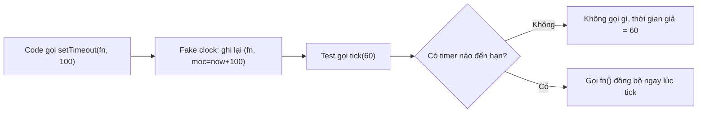

# Lý thuyết 15: Kiểm thử JavaScript — cấu trúc test, test double và fake timer

Jest, Vitest, Mocha hay `node:test` trông khác nhau ở cú pháp và cấu hình (bài [Testing, tooling và build frontend](/go?p=07-Interview-QA%2FFrontend%2Fmedium%2Fqa-fe-08-testing-tooling-build.md) đã so sánh phần đó, cùng chuyện source map và bundler), nhưng bên dưới mọi framework đều dựa trên một bộ khái niệm chung của ngôn ngữ: một test là gì, test double thay thế phụ thuộc ra sao, và fake timer "tua nhanh" thời gian bằng cách nào. [Testing React](/go?p=09-React%2Fmedium%2Flt-07-testing-react.md) và [Testing Vue](/go?p=10-Vue%2Fmedium%2Flt-07-testing-vue.md) dùng đúng các khái niệm này cho component; bài này xây nền ở mức JavaScript thuần, kèm cài tay một mock và một fake clock để thấy rõ bên trong `vi.fn()` hay `jest.fn()` thật ra làm gì.

**Tóm tắt:**

- Một test tốt theo cấu trúc Arrange-Act-Assert: chuẩn bị dữ liệu, gọi hành động, rồi khẳng định kết quả; trộn lẫn ba phần làm test khó đọc và khó sửa khi hỏng.
- Test double là tên chung cho mọi vật thay thế phụ thuộc thật trong test; năm loại kinh điển (dummy, stub, spy, mock, fake) khác nhau ở việc có hành vi giả, có ghi lại lời gọi, hay có khẳng định kỳ vọng tự thân hay không.
- `jest.fn()`/`vi.fn()` chỉ là một hàm rỗng cộng thêm một mảng ghi lại mọi lời gọi (tham số, giá trị trả về, lần gọi thứ mấy); tự cài một bản tối giản cho thấy không có gì huyền bí ở đây.
- Fake timer thay `setTimeout`/`setInterval` thật bằng một "đồng hồ giả": thời gian chỉ trôi khi code gọi `tick(ms)`, nên test chạy tức thì thay vì chờ thật vài giây.
- Test code bất đồng bộ phải `await` hoặc trả về Promise cho test runner; quên `await` khiến test "xanh giả" (pass dù assertion bên trong chưa kịp chạy hoặc đã ném lỗi sau khi test được coi là xong).
- `node:test` (có sẵn trong Node, không cần cài gì thêm) đã có `mock.fn()` và `mock.timers` làm đúng việc trên; đây cũng là test runner dự án kemtech-api dùng (`node --test`).
- Lạm dụng mock cho cả những phụ thuộc rẻ và xác định (hàm thuần, không I/O) làm test giòn: sửa chi tiết triển khai bên trong cũng làm test vỡ dù hành vi quan sát được không đổi.

## Một test gồm những gì

Mọi framework test đều xoay quanh ba việc: khai báo một test (`test`/`it`), gom nhóm (`describe`), và khẳng định (`assert`/`expect`). Cấu trúc nội dung bên trong nên theo ba bước rõ ràng, viết tắt là **AAA**:

1. **Arrange** — dựng dữ liệu đầu vào và phụ thuộc cần thiết.
2. **Act** — gọi đúng một hành động đang được kiểm tra.
3. **Assert** — khẳng định kết quả hoặc hiệu ứng phụ đúng như kỳ vọng.

```js
import { test } from 'node:test';
import assert from 'node:assert/strict';

test('tinhThue cộng đúng 10% VAT', () => {
  const gia = 100_000;                 // Arrange
  const tongThue = tinhThue(gia);       // Act
  assert.equal(tongThue, 110_000);      // Assert
});
```

**Phải thuộc:** một test nên khẳng định **một hành vi**, không phải một hàm. Hàm có nhiều nhánh (giá âm, giá bằng 0, có khuyến mãi) cần nhiều test tên rõ ràng, không nhồi hết vào một `test` to với nhiều `assert` không liên quan.

## Test double: năm loại, một bảng để không nhầm

"Mock" trong lời nói hằng ngày thường bị dùng để gọi chung mọi thứ giả lập, nhưng Martin Fowler tách rõ năm loại theo đúng việc chúng làm:

| Loại | Làm gì | Có ghi lại lời gọi? | Tự assert bên trong? |
|---|---|---|---|
| **Dummy** | Chỉ để lấp tham số bắt buộc, không bao giờ thật sự được dùng | Không | Không |
| **Stub** | Trả về giá trị cố định cho sẵn, không quan tâm input | Không | Không |
| **Spy** | Như hàm thật (hoặc bọc quanh hàm thật) nhưng ghi lại mọi lời gọi để sau này kiểm tra | **Có** | Không |
| **Mock** | Có kỳ vọng được khai báo trước ("phải được gọi đúng 1 lần với tham số X"); test tự fail nếu sai kỳ vọng | Có | **Có** |
| **Fake** | Cài đặt thật nhưng đơn giản hóa, đủ dùng cho test (ví dụ DB trong bộ nhớ thay PostgreSQL) | Tùy | Tùy |

**Nền tảng:** `jest.fn()` và `vi.fn()` về bản chất là **spy**: chúng ghi lại lời gọi, còn việc "mock" theo đúng nghĩa (tự assert kỳ vọng) nằm ở chỗ bạn gọi `expect(fn).toHaveBeenCalledWith(...)` sau đó, không nằm sẵn trong bản thân hàm. Tên gọi "mock function" của các thư viện này rộng hơn định nghĩa gốc của Fowler — biết sự khác biệt giúp bạn đọc đúng tài liệu khi nó dùng từ "mock" theo nghĩa hẹp.

## Tự cài một bản `fn()` tối giản

Cách chắc nhất để hiểu `vi.fn()`/`jest.fn()` là tự viết lại phần lõi của nó: một hàm bọc quanh một mảng ghi log.

```js
function createMock(impl) {
  const calls = [];
  const mock = (...args) => {
    calls.push(args);
    return impl ? impl(...args) : undefined;
  };
  mock.calls = calls;
  mock.calledWith = (...args) =>
    calls.some((c) => JSON.stringify(c) === JSON.stringify(args));
  return mock;
}

const fakeSave = createMock((id) => `saved-${id}`);
fakeSave(1);
fakeSave(2, 'extra');
console.log(fakeSave.calls);                    // [ [ 1 ], [ 2, 'extra' ] ]
console.log(fakeSave.calledWith(2, 'extra'));    // true
```

*Đã chạy thử bằng Node:* output đúng như chú thích ở trên.

`node:test` đã có sẵn một bản đầy đủ hơn qua `mock.fn()`, với `mock.callCount()` và `mock.calls[i].arguments`/`.result`:

```js
import { test, mock } from 'node:test';
import assert from 'node:assert/strict';

test('fn mock ghi lại lời gọi', () => {
  const save = mock.fn((id) => `saved-${id}`);
  save(1);
  save(2, 'extra');
  assert.equal(save.mock.callCount(), 2);
  assert.deepEqual(save.mock.calls[1].arguments, [2, 'extra']);
  assert.equal(save.mock.calls[0].result, 'saved-1');
});
```

*Đã chạy thử bằng Node (`node --test`):* `✔ fn mock ghi lại lời gọi`. Ý tưởng giống hệt bản tự cài ở trên, chỉ thêm tiện ích đọc kết quả.

**Suy luận:** vì mock function chỉ là một hàm cộng một mảng ghi log, nó không "biết" gì về API thật bạn đang thay thế. Nếu hàm thật đổi chữ ký (thêm tham số bắt buộc), mock vẫn "chạy được" — đây là lý do mock quá tay che giấu lỗi tích hợp thật; luôn có ít nhất vài test gọi thẳng vào code thật (integration test) bên cạnh các test đã mock phụ thuộc chậm/đắt.

## Fake timer: tua thời gian mà không cần chờ thật

Code có `setTimeout`, debounce, retry-with-backoff đều khó test nếu phải chờ thật — một test chờ 5 giây nhân với hàng trăm test làm cả suite chậm đi nhiều phút. Fake timer giải quyết bằng cách thay hàm `setTimeout` toàn cục bằng một bản giả: nó không chờ gì cả, chỉ **ghi lại** "hàm này sẽ chạy ở mốc thời gian nào", và chỉ thật sự gọi hàm khi test chủ động "tua" đồng hồ tới mốc đó.



```js
function createFakeClock() {
  let now = 0;
  let timers = [];
  let id = 0;
  return {
    setTimeout(fn, delay) {
      const tid = ++id;
      timers.push({ tid, time: now + delay, fn });
      return tid;
    },
    tick(ms) {
      now += ms;
      const due = timers.filter((t) => t.time <= now).sort((a, b) => a.time - b.time);
      timers = timers.filter((t) => t.time > now);
      due.forEach((t) => t.fn());
    },
  };
}

const clock = createFakeClock();
const fired = [];
clock.setTimeout(() => fired.push('A'), 100);
clock.setTimeout(() => fired.push('B'), 50);
clock.tick(60);
console.log(fired); // [ 'B' ]       — mới qua mốc 50, chưa tới mốc 100
clock.tick(50);
console.log(fired); // [ 'B', 'A' ]  — tổng thời gian giả đã là 110, qua cả hai mốc
```

*Đã chạy thử bằng Node:* in đúng `[ 'B' ]` rồi `[ 'B', 'A' ]`.

`node:test` có `mock.timers` làm đúng việc này cho `setTimeout` thật của Node, không cần tự cài:

```js
test('fake timer với mock.timers', () => {
  mock.timers.enable({ apis: ['setTimeout'] });
  const fired = [];
  setTimeout(() => fired.push('A'), 100);
  setTimeout(() => fired.push('B'), 50);
  mock.timers.tick(60);
  assert.deepEqual(fired, ['B']);
  mock.timers.tick(50);
  assert.deepEqual(fired, ['B', 'A']);
  mock.timers.reset();
});
```

*Đã chạy thử bằng Node (`node --test`):* `✔ fake timer với mock.timers`.

**Phải thuộc:** sau khi bật fake timer, **mọi** `setTimeout`/`setInterval` trong tiến trình test đều bị thay, kể cả của thư viện bạn không ngờ tới (driver DB, HTTP client). Luôn `reset()`/`restore()` fake timer sau mỗi test (thường ở `afterEach`), nếu không test sau sẽ chạy với đồng hồ vẫn bị đóng băng hoặc lệch mốc.

## Test code bất đồng bộ

Test runner cần biết khi nào một test bất đồng bộ thật sự xong: trả về (hoặc `await`) một Promise, không dựa vào callback xong là tự hiểu.

```js
async function fetchUser(id) {
  if (id <= 0) throw new Error('id khong hop le');
  return { id, name: 'A' };
}

test('assert.rejects bắt lỗi bất đồng bộ', async () => {
  await assert.rejects(() => fetchUser(-1), { message: 'id khong hop le' });
  assert.deepEqual(await fetchUser(1), { id: 1, name: 'A' });
});
```

*Đã chạy thử bằng Node (`node --test`):* `✔ assert.rejects bắt lỗi bất đồng bộ`.

**Suy luận:** `assert.rejects` tự `await` Promise trả về và kiểm tra nó reject đúng lỗi mong đợi; gọi `fetchUser(-1)` trực tiếp trong `try/catch` thủ công cũng được, nhưng quên `await` trong `try` thì `catch` bỏ lỡ lỗi — đúng bẫy đã nêu ở bài [Promise và async/await](/go?p=13-JavaScript%2Fmedium%2Flt-08-promise-va-async-await.md).

## Bẫy thường gặp

| Bẫy | Biểu hiện | Cách tránh |
|---|---|---|
| Quên `return`/`await` Promise trong test | Test báo pass dù assertion bên trong chưa chạy hoặc lỗi bị nuốt | Luôn `await` hành động bất đồng bộ, hoặc `return` Promise cho test runner |
| Mock cả hàm thuần, rẻ, không I/O | Test giòn: sửa chi tiết triển khai làm vỡ test dù hành vi ngoài không đổi | Chỉ mock phụ thuộc chậm/đắt/không xác định (I/O, thời gian, random) |
| Quên `reset()`/`restore()` fake timer, spy | Test sau chạy sai vì đồng hồ hoặc hành vi vẫn bị thay | `afterEach` luôn dọn mock/timer |
| Gọi `tick()` với số nhỏ hơn delay thật | Timer không chạy, nhầm tưởng code có lỗi | Tính đúng tổng thời gian cần tua, cộng dồn nếu gọi `tick` nhiều lần |
| Một `test` to, nhiều `assert` không liên quan | Test fail không rõ hành vi nào sai | Mỗi test chỉ khẳng định một hành vi, đặt tên mô tả đúng hành vi đó |
| So sánh object bằng `assert.equal` thay vì `deepEqual` | Fail sai dù nội dung giống hệt (so theo reference) | Dùng `deepEqual`/`toEqual` cho object, mảng |

## Câu hỏi phỏng vấn thường gặp

Mỗi câu có chuỗi: gợi ý suy luận, lập luận, đáp án ngắn, điều cần nhớ. Thử tự đi theo gợi ý trước khi đọc tiếp.

### 1. `jest.fn()`/`vi.fn()` thật ra làm gì bên trong?

**Câu hỏi:** Nếu không được dùng thư viện test nào, bạn cài một bản `fn()` tối giản như thế nào, và nó khác "mock" theo đúng nghĩa Fowler ở điểm nào?

**Gợi ý suy luận:**
- Để biết một hàm "đã được gọi mấy lần, với tham số gì", bạn cần lưu thông tin đó ở đâu?
- Hàm giả có cần biết trước gọi đúng hay sai không, hay việc đó để ai làm?

**Lập luận:** chỉ cần một hàm bọc quanh một mảng: mỗi lần gọi, đẩy tham số vào mảng rồi (tùy chọn) gọi một implementation giả bên dưới. Việc "đúng hay sai" không nằm trong hàm giả đó, mà nằm ở assertion bạn viết sau (`toHaveBeenCalledWith`), nên theo đúng nghĩa Fowler đây là **spy**, không phải **mock** (mock tự mang kỳ vọng và tự fail).

**Đáp án ngắn:** Một mảng ghi log cộng một hàm bọc quanh nó; ghi lại lời gọi là việc của spy, còn tự kiểm tra kỳ vọng là việc của mock — `jest.fn()` chỉ làm vế đầu, vế sau do `expect(...)` đứng ngoài đảm nhiệm.

**Nhớ:** tên "mock function" của các thư viện rộng hơn định nghĩa gốc; đừng ngạc nhiên khi tài liệu học thuật dùng từ "mock" khác với cách Jest dùng.

### 2. Vì sao fake timer có thể làm hỏng test khác nếu quên dọn?

**Câu hỏi:** Một test bật fake timer rồi không tắt; test chạy ngay sau nó bị treo hoặc sai thời gian. Giải thích cơ chế và cách tránh.

**Gợi ý suy luận:**
- Fake timer thay hàm toàn cục nào? Phạm vi ảnh hưởng của nó dừng ở "trong test đó" hay rộng hơn?
- Nếu test sau cũng gọi `setTimeout` thật, nó đang gọi bản nào?

**Lập luận:** bật fake timer nghĩa là ghi đè `global.setTimeout`/`setInterval` cho **toàn bộ tiến trình**, không tự giới hạn theo từng test. Nếu không gọi `mock.timers.reset()` (hoặc tương đương của framework), test tiếp theo vẫn đang chạy với đồng hồ giả đứng yên ở mốc test trước để lại, nên mọi `setTimeout` của nó không bao giờ tự chạy trừ khi ai đó gọi `tick`.

**Đáp án ngắn:** Fake timer ghi đè hàm toàn cục cho cả tiến trình test; không dọn sau mỗi test thì trạng thái giả đó rò sang test sau, thường biểu hiện thành treo hoặc timer không bao giờ chạy.

**Nhớ:** luôn cặp `enable`/`disable` (hoặc `reset`) trong `beforeEach`/`afterEach`, không chỉ gọi `enable` một lần ở đầu file.

### 3. Vì sao không nên mock mọi phụ thuộc, kể cả những thứ test được dễ dàng?

**Câu hỏi:** Một đồng nghiệp mock toàn bộ hàm helper thuần (không I/O) trong test. Vấn đề của cách làm này là gì?

**Gợi ý suy luận:**
- Nếu bạn đổi cách cài đặt bên trong một hàm thuần nhưng input/output quan sát được không đổi, test có nên fail không?
- Mock một hàm nghĩa là gì — test còn chạy qua code thật đó không?

**Lập luận:** mock một phụ thuộc đồng nghĩa với việc **không còn chạy qua code thật** của phụ thuộc đó nữa, chỉ chạy qua phiên bản giả bạn tự khai báo. Với hàm thuần, rẻ, xác định, việc này không mang lại lợi ích (không có gì chậm hay không xác định cần tránh) nhưng lại làm test gắn chặt vào chi tiết triển khai: đổi cách hiện thực bên trong (dù hành vi ngoài giữ nguyên) có thể làm mock không còn khớp và test vỡ dù chương trình vẫn đúng.

**Đáp án ngắn:** Mock chỉ nên dùng cho phụ thuộc chậm, đắt, hoặc không xác định (I/O, mạng, thời gian, random); mock hàm thuần làm test giòn vì gắn vào chi tiết triển khai thay vì hành vi quan sát được.

**Nhớ:** nguyên tắc ngắn gọn — "mock ở biên hệ thống (I/O), không mock logic nội bộ của chính bạn".
