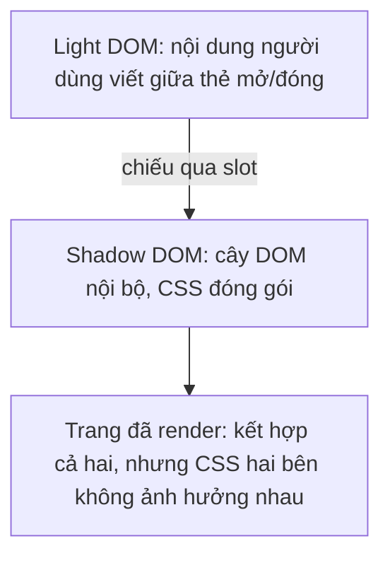

# Lý thuyết 17: Web Components — Custom Element, Shadow DOM và Template

Bài [DOM và sự kiện](/go?p=13-JavaScript%2Fmedium%2Flt-10-dom-va-su-kien.md) đã học cách tạo và thao tác node bằng tay. Web Components là ba API trình duyệt (Custom Elements, Shadow DOM, `<template>`) cộng lại thành một cách **đóng gói** DOM, CSS và logic thành một thẻ HTML mới, dùng được ở bất kỳ nơi nào hiểu HTML — React, Vue, hay không framework nào cả. Đây là lý do [Kiến trúc frontend](/go?p=11-Frontend-Core%2Flt-05-kien-truc-frontend.md) nhắc tới nó khi nói về design system dùng chung giữa nhiều team có thể đang dùng framework khác nhau, hoặc micro-frontend cần một ranh giới component không phụ thuộc framework nào.

**Tóm tắt:**

- Web Components là tên gọi chung cho ba API độc lập cộng tác với nhau: **Custom Elements** (định nghĩa thẻ HTML mới), **Shadow DOM** (đóng gói DOM và CSS, không rò ra ngoài), và `<template>` (khai báo HTML lười, không render cho tới khi được dùng).
- Một custom element là một `class` kế thừa `HTMLElement`, đăng ký bằng `customElements.define('ten-the', MyClass)`; tên thẻ **bắt buộc có dấu gạch ngang** để không bao giờ đụng tên thẻ HTML chuẩn tương lai.
- Bốn lifecycle callback quan trọng: `connectedCallback` (thêm vào DOM), `disconnectedCallback` (gỡ khỏi DOM — đúng chỗ để `removeEventListener`, tránh leak như đã học ở bài chẩn đoán rò rỉ), `attributeChangedCallback` (một attribute trong `observedAttributes` đổi giá trị), và `adoptedCallback` (hiếm gặp, khi node chuyển sang document khác).
- Shadow DOM tạo một cây DOM con **tách biệt**: CSS viết bên trong không rò ra ngoài, CSS bên ngoài (trừ vài thuộc tính kế thừa như `font`, `color`) cũng không lọt vào trong — giải quyết đúng vấn đề "class CSS đụng tên" mà quy ước BEM hay CSS Module đang vá bằng quy ước đặt tên.
- `<slot>` là cơ chế "chiếu" nội dung light DOM (nội dung người dùng đặt giữa thẻ mở/đóng) vào đúng vị trí mong muốn bên trong shadow DOM, tương tự `children`/`props.children` của component framework nhưng ở mức trình duyệt gốc.
- `<template>` khai báo HTML không bị trình duyệt parse ảnh/script bên trong ngay (không tải ảnh, không chạy script) cho tới khi bị `cloneNode` và chèn vào DOM thật — hợp để định nghĩa cấu trúc lặp lại nhiều lần mà không trả giá parse sớm.
- Web Component không tự có reactivity hay state management như React/Vue; nó chỉ là tầng DOM gốc, nên thường được dùng cho các khối lá (button, card, design-system primitive) hơn là toàn bộ ứng dụng có state phức tạp.

## Vấn đề nó giải quyết

Một thư viện UI viết bằng React không dùng được thẳng trong app Vue, và ngược lại — props, lifecycle, cách render đều khác nhau giữa các framework. CSS toàn cục cũng rò: một class `.card` trong file CSS của team A có thể vô tình đụng `.card` của team B nếu không có quy ước đặt tên nghiêm ngặt (BEM) hoặc công cụ build riêng (CSS Module, CSS-in-JS). Web Components giải quyết cả hai vấn đề ở tầng trình duyệt, không cần framework hay build tool: một custom element là một thẻ HTML thật, dùng được ở React, Vue, hay HTML thuần; Shadow DOM đảm bảo CSS bên trong nó không bao giờ rò ra ngoài hay bị ghi đè ngoài ý muốn.

## Khi nào dùng, khi nào không

| Tình huống | Chọn gì |
|---|---|
| Design system (button, input, card) dùng chung cho nhiều team, có thể khác framework | Web Component — tránh khóa cứng vào một framework |
| Widget nhúng vào trang của bên thứ ba (chat widget, banner) mà không biết trang đó dùng framework gì | Web Component — chắc chắn chạy được bất kể môi trường host |
| Toàn bộ một ứng dụng có state phức tạp, nhiều màn hình, cần routing | React/Vue — Web Component không có sẵn state management, routing, SSR tiện lợi như framework |
| Ranh giới micro-frontend giữa hai team dùng hai framework khác nhau | Web Component làm "hợp đồng" giao diện trung lập, bên trong mỗi team vẫn dùng framework của mình |

**Nền tảng:** Web Component mạnh nhất ở vai trò **khối lá tái dùng xuyên framework**, không phải bộ khung cho toàn ứng dụng; React và Vue vẫn thắng về developer experience, reactivity và hệ sinh thái cho phần "não" của ứng dụng.

## Custom Elements: định nghĩa một thẻ HTML mới

```js
class ThoiGianDem extends HTMLElement {
  static get observedAttributes() { return ['target']; }

  connectedCallback() {
    this._tick = this._tick.bind(this);
    this._timer = setInterval(this._tick, 1000);
    this._tick();
  }

  disconnectedCallback() {
    clearInterval(this._timer); // đúng chỗ dọn timer, tránh leak khi node bị gỡ khỏi DOM
  }

  attributeChangedCallback(name, oldVal, newVal) {
    if (name === 'target') this._target = new Date(newVal).getTime();
  }

  _tick() {
    const conLai = Math.max(0, Math.round((this._target - Date.now()) / 1000));
    this.textContent = `${conLai}s`;
  }
}

customElements.define('thoi-gian-dem', ThoiGianDem);
```

```html
<thoi-gian-dem target="2026-01-01T00:00:00Z"></thoi-gian-dem>
```

*Minh họa (chạy trong trình duyệt, không chạy ở đây vì cần DOM thật):* sau khi đăng ký, thẻ `<thoi-gian-dem>` dùng được y hệt thẻ HTML chuẩn — trình duyệt tự gọi `connectedCallback` khi thẻ được chèn vào trang.

**Phải thuộc:** tên thẻ custom element **bắt buộc chứa dấu gạch ngang** (`thoi-gian-dem`, không phải `thoigiandem`) — đây là quy tắc chuẩn HTML để đảm bảo không bao giờ đụng tên một thẻ HTML chuẩn được thêm trong tương lai. `disconnectedCallback` là nơi đúng để dọn mọi side effect đã tạo ở `connectedCallback` (timer, listener, subscription) — bỏ qua bước này tạo đúng loại rò rỉ đã học ở bài [chẩn đoán rò rỉ bộ nhớ](/go?p=13-JavaScript%2Fhard%2Flt-16-chan-doan-ro-ri-bo-nho-devtools.md).

## Shadow DOM: đóng gói DOM và CSS

```js
class TheXepHang extends HTMLElement {
  connectedCallback() {
    const shadow = this.attachShadow({ mode: 'open' });
    shadow.innerHTML = `
      <style>
        /* CSS này chỉ áp dụng bên trong shadow root, không rò ra ngoài */
        .box { border: 1px solid #ddd; padding: 12px; border-radius: 8px; }
      </style>
      <div class="box">
        <slot name="tieu-de">Tiêu đề mặc định</slot>
        <slot></slot>
      </div>
    `;
  }
}
customElements.define('the-xep-hang', TheXepHang);
```

```html
<the-xep-hang>
  <h3 slot="tieu-de">Hạng A</h3>
  <p>Nội dung chiếu vào slot mặc định.</p>
</the-xep-hang>
```

*Minh họa (chạy trong trình duyệt):* `.box` trong `<style>` chỉ ảnh hưởng nội dung bên trong shadow root của `<the-xep-hang>`; một trang có 100 component như vậy không cần lo CSS đụng nhau. Nội dung light DOM (`<h3 slot="tieu-de">`, `<p>`) được "chiếu" vào đúng `<slot>` tương ứng theo tên, phần không khớp slot nào có tên rơi vào `<slot>` mặc định (không tên).



**Suy luận:** sở dĩ CSS không rò là vì `attachShadow` tạo một **boundary** thật sự ở cấp engine render, không phải quy ước đặt tên như BEM (BEM chỉ giảm khả năng đụng tên bằng cách đặt tên dài và cụ thể, nhưng về bản chất vẫn là một cây CSS toàn cục, một selector quá rộng ở đâu đó vẫn có thể ghi đè). Đánh đổi: style global của trang (ví dụ CSS reset, theme) cũng **không vào được** bên trong shadow DOM trừ khi dùng CSS Custom Properties (biến CSS xuyên qua được boundary) hoặc `::part`/`::slotted` để host trang chỉnh một phần giới hạn từ bên ngoài.

## `<template>`: khai báo HTML lười

```html
<template id="mau-dong">
  <tr>
    <td class="ten"></td>
    <td class="gia"></td>
  </tr>
</template>
```

```js
const mau = document.getElementById('mau-dong');
function themDong(ten, gia) {
  const node = mau.content.cloneNode(true); // sao chép nội dung template, chưa từng gắn vào DOM
  node.querySelector('.ten').textContent = ten;
  node.querySelector('.gia').textContent = gia;
  document.querySelector('tbody').appendChild(node);
}
```

*Minh họa (chạy trong trình duyệt):* nội dung bên trong `<template>` **không được trình duyệt render** và không kích hoạt tải ảnh/chạy script cho tới khi bị `cloneNode` rồi chèn vào cây DOM thật — khác hẳn việc để sẵn một `<div hidden>` (vẫn bị parse, ảnh bên trong vẫn có thể tải trước).

**Phải thuộc:** `template.content` là một `DocumentFragment`, không phải chính template; phải `cloneNode(true)` để lấy một bản sao độc lập mỗi lần dùng — dùng chung một fragment gốc cho nhiều lần chèn sẽ **di chuyển** (không sao chép) node giữa các vị trí, vì một DOM node chỉ tồn tại ở đúng một chỗ trong cây tại một thời điểm.

## Bẫy thường gặp

| Bẫy | Biểu hiện | Cách tránh |
|---|---|---|
| Tên thẻ custom element không có dấu gạch ngang | `customElements.define` ném lỗi `DOMException` | Luôn đặt tên dạng `tien-to-ten` |
| Quên dọn ở `disconnectedCallback` | Timer/listener vẫn chạy sau khi element đã bị gỡ khỏi trang | Mọi side effect tạo ở `connectedCallback` phải có phần dọn tương ứng ở `disconnectedCallback` |
| Mong CSS global (theme, reset) tự áp vào bên trong shadow DOM | Component trông "trần", thiếu style kế thừa từ trang | Dùng CSS Custom Properties (xuyên boundary) hoặc định nghĩa style ngay trong shadow root |
| Dùng `template.content` trực tiếp thay vì `cloneNode` | Lần chèn thứ hai làm "biến mất" nội dung ở lần chèn thứ nhất (node bị di chuyển, không sao chép) | Luôn `cloneNode(true)` trước khi chèn |
| Không khai báo attribute cần theo dõi trong `observedAttributes` | `attributeChangedCallback` không bao giờ được gọi dù attribute đổi giá trị trong DOM | Liệt kê đủ attribute cần quan sát trong getter tĩnh `observedAttributes` |
| Kỳ vọng Web Component tự có state management như React/Vue | Component tự phình logic quản lý state tay, khó bảo trì khi app lớn | Dùng Web Component cho khối lá UI; state phức tạp của toàn ứng dụng vẫn nên giao cho framework |

## Câu hỏi phỏng vấn thường gặp

Mỗi câu có chuỗi: gợi ý suy luận, lập luận, đáp án ngắn, điều cần nhớ. Thử tự đi theo gợi ý trước khi đọc tiếp.

### 1. Shadow DOM giải quyết vấn đề gì mà quy ước đặt tên CSS như BEM không giải quyết triệt để được?

**Câu hỏi:** BEM, CSS Module và Shadow DOM đều nhằm tránh CSS đụng tên nhau. Khác biệt căn bản giữa chúng là gì?

**Gợi ý suy luận:**
- BEM tránh đụng tên bằng cách nào — thay đổi hành vi của CSS, hay chỉ thay đổi cách bạn đặt tên?
- Nếu một selector CSS toàn cục quá rộng (ví dụ `div { margin: 0 }`) được thêm ở đâu đó, BEM có chặn được nó ảnh hưởng tới component của bạn không? Shadow DOM thì sao?

**Lập luận:** BEM và CSS Module là giải pháp ở tầng **quy ước/công cụ build**: chúng làm class name đủ dài và cụ thể (hoặc tự động đổi tên lúc build) để xác suất đụng độ thấp, nhưng về bản chất CSS vẫn là một cây toàn cục — một selector quá rộng hoặc thiếu cẩn thận ở bất kỳ đâu trong ứng dụng vẫn có thể ghi đè. Shadow DOM là giải pháp ở tầng **engine render của trình duyệt**: nó tạo một boundary thật, CSS bên ngoài (trừ vài thuộc tính kế thừa và CSS Custom Properties) không bao giờ xuyên vào được, bất kể selector bên ngoài rộng thế nào.

**Đáp án ngắn:** BEM/CSS Module giảm khả năng đụng tên bằng quy ước đặt tên trên một cây CSS vẫn toàn cục; Shadow DOM loại bỏ triệt để vấn đề bằng một boundary thật ở cấp trình duyệt, CSS hai bên không ảnh hưởng nhau bất kể tên gọi.

**Nhớ:** đánh đổi của Shadow DOM là style global hợp lệ (theme, reset) cũng bị chặn theo, phải cố ý cho xuyên qua bằng CSS Custom Properties.

### 2. Vì sao `disconnectedCallback` quan trọng với bộ nhớ, không chỉ là "dọn dẹp cho sạch"?

**Câu hỏi:** Một custom element đăng ký `setInterval` ở `connectedCallback` nhưng không có `disconnectedCallback`. Hậu quả cụ thể là gì?

**Gợi ý suy luận:**
- Khi một element bị gỡ khỏi DOM, timer đã đăng ký bên trong nó có tự dừng theo không?
- Closure của hàm callback trong `setInterval` đang giữ tham chiếu tới cái gì?

**Lập luận:** gỡ một element khỏi DOM không tự động dừng timer hay listener nó đã đăng ký — đây là nguyên tắc đã học ở bài [chẩn đoán rò rỉ bộ nhớ](/go?p=13-JavaScript%2Fhard%2Flt-16-chan-doan-ro-ri-bo-nho-devtools.md): `setInterval` giữ closure sống mãi chừng nào chưa `clearInterval`, và closure đó thường giữ tham chiếu ngược lại chính `this` (element), khiến cả element "detached" lẫn mọi dữ liệu nó tham chiếu không bao giờ được GC thu hồi.

**Đáp án ngắn:** Không có `disconnectedCallback` để `clearInterval`, timer tiếp tục chạy vô thời hạn và giữ sống cả element đã bị gỡ khỏi trang lẫn mọi dữ liệu trong closure của nó — một dạng rò rỉ bộ nhớ kinh điển, càng rõ khi element được tạo/hủy lặp lại nhiều lần.

**Nhớ:** mọi side effect ở `connectedCallback` cần một dòng dọn tương ứng ở `disconnectedCallback`, không có ngoại lệ.

### 3. Web Component có thể thay thế hoàn toàn React/Vue trong một ứng dụng lớn không?

**Câu hỏi:** Vì Web Component là chuẩn trình duyệt gốc, không cần framework, tại sao các ứng dụng lớn vẫn chọn React/Vue thay vì chỉ dùng Web Component?

**Gợi ý suy luận:**
- Web Component tự nó có cơ chế nào để re-render khi một biến state đổi, giống `useState`/`ref` không?
- Routing, data fetching, quản lý state xuyên nhiều component — những thứ đó có sẵn trong ba API của Web Component không?

**Lập luận:** Custom Elements, Shadow DOM và `<template>` chỉ giải quyết tầng **đóng gói DOM/CSS**, không có khái niệm reactivity (tự re-render khi state đổi), không có state management xuyên component, không có routing hay data-fetching tích hợp. Tự xây các thứ đó trên nền Web Component là viết lại phần lõi mà React/Vue đã giải quyết kỹ và có hệ sinh thái lớn đi kèm (devtools, router, state library, SSR framework).

**Đáp án ngắn:** Không nên — Web Component mạnh về đóng gói và tính xuyên-framework cho các khối lá UI, nhưng thiếu reactivity, state management và hệ sinh thái cho toàn bộ ứng dụng; thực tế phổ biến là dùng React/Vue cho "não" ứng dụng và Web Component (nếu cần) cho các component design-system dùng chung.

**Nhớ:** chọn công cụ theo đúng lớp vấn đề nó giải quyết — đóng gói UI dùng chung xuyên framework thì Web Component, còn logic và state của toàn ứng dụng thì framework.
