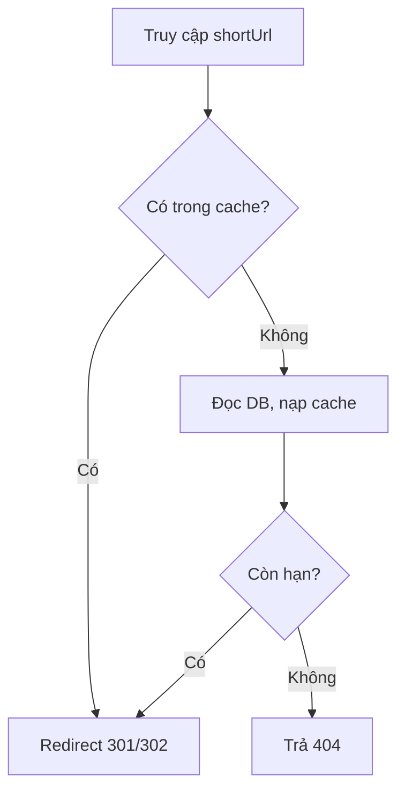
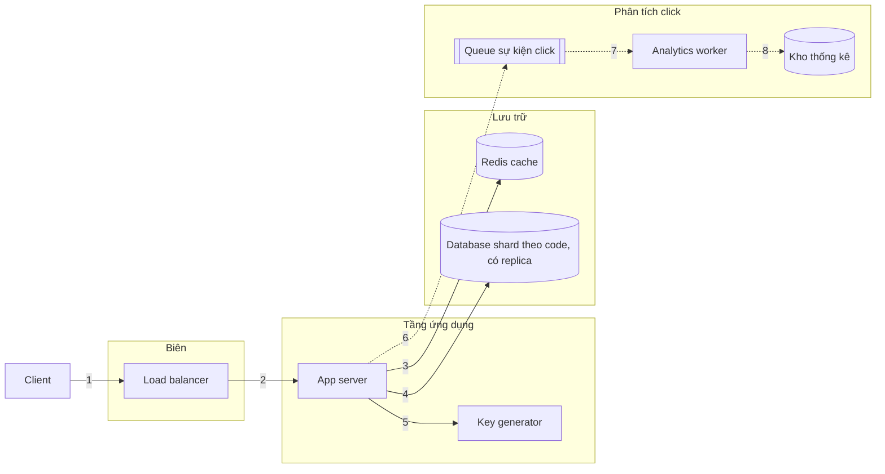
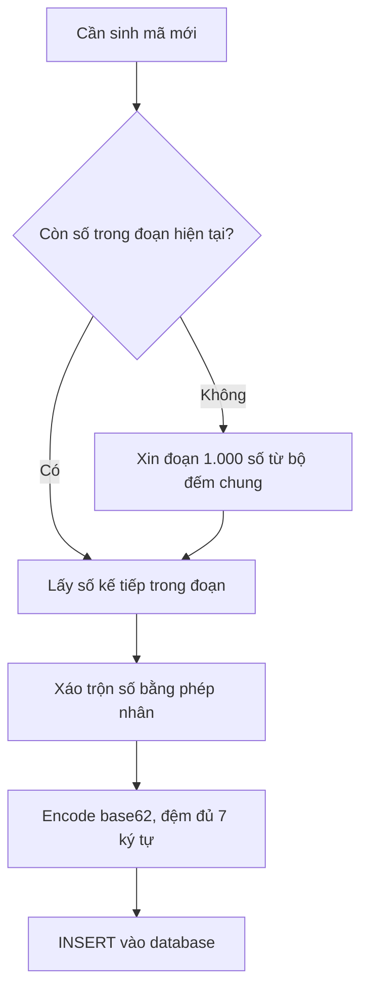
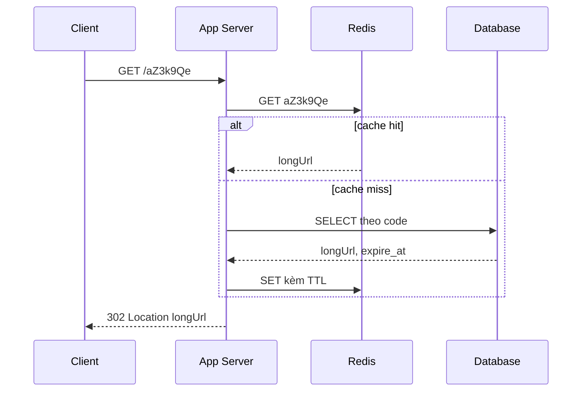

# URL Shortener (Rút gọn link)

Bài này hướng dẫn bạn thiết kế một dịch vụ kiểu bit.ly. Người dùng dán vào một link dài, hệ thống trả về một link ngắn dạng `short.ly/aZ3k9`. Ai bấm link ngắn sẽ được chuyển hướng (redirect) về link gốc. Quy mô thường gặp là hàng trăm triệu link, và số lần đọc nhiều hơn số lần tạo cả trăm lần.

**Tóm tắt:**

- Đây là hệ thống đọc nhiều ghi ít (khoảng 100:1) và truy cập chỉ theo một key (`code`), nên cache, kho key-value và shard theo `code` là hướng thiết kế tự nhiên.
- Điểm khó thật sự là sinh mã không trùng: hash cắt có thể trùng, bộ đếm + base62 dễ đoán, cấp phát đoạn số cho từng server thì không trùng và ít phối hợp.
- Mã 7 ký tự base62 cho 62^7, khoảng 3,5 nghìn tỷ mã, dư cho 6 tỷ link sau 5 năm.
- Xáo trộn số bằng phép nhân chỉ làm mã khó đoán bằng mắt chứ không phải bảo mật; cần không đoán được thật thì dùng mã ngẫu nhiên kèm unique constraint.
- Redirect 302 đếm được click nhưng mọi lượt đều qua server; 301 giảm tải tối đa nhưng trình duyệt nhớ nên mất thống kê và không đổi được đích.
- Đường đọc dùng cache-aside với TTL ngắn hơn hạn link; link viral gây hot key nên thêm cache cục bộ, và cache cả kết quả không tồn tại để chặn kẻ dò mã.
- Client retry thì dùng Idempotency-Key để không tạo link thứ hai.
- Kiến trúc gồm load balancer, app server stateless, Redis cache, database shard theo `code`, key generator, và nhánh bất đồng bộ (queue, worker) để đếm click.

## Vấn đề nó giải quyết

Link dài khó gõ, khó nhớ, dễ bị vỡ khi nhắn SMS hay in lên mã QR, và bạn không đếm được ai đã bấm vào. Link ngắn giải quyết cả bốn việc đó, và còn cho phép đo hiệu quả chiến dịch marketing vì mọi lượt bấm đều đi qua hệ thống của bạn.

Bài này hay xuất hiện trong phỏng vấn vì nhỏ mà chứa đủ các câu hỏi cốt lõi: làm sao sinh mã không trùng, vì sao đọc nhiều như vậy thì phải có cache, và chọn redirect 301 hay 302.

**Nền tảng:** Bài này là hệ thống đọc nhiều ghi ít (khoảng 100:1) với truy cập chỉ theo một key (`code`). Từ đó suy ra gần hết thiết kế: cache để đọc nhanh, kho key-value hoặc shard theo `code`, và điểm khó thật sự là sinh mã không trùng.

## Khi nào nên dùng, khi nào không

Dùng khi cần chia sẻ link qua SMS, mạng xã hội, QR code, hoặc đo lượt bấm. Nếu chỉ có vài link nội bộ thì một bảng trong database là đủ, không cần dựng cả hệ thống phân tán.

## Cách làm tóm tắt

Hệ thống sinh một mã 7 ký tự Base62 (lấy từ bộ đếm hoặc bộ sinh ID, miễn không trùng) rồi lưu cặp `mã -> link gốc` vào database. Khi có người bấm link, hệ thống tra cache trước, chỉ khi cache không có (miss) mới xuống database, sau đó trả về lệnh redirect.

## Các khái niệm cần biết

- **Base62**: hệ đếm dùng 62 ký tự (`a-z`, `A-Z`, `0-9`) để biểu diễn một số nguyên bằng chuỗi ngắn. Ví dụ số 125 viết thành `21` trong base62 (125 = 2 x 62 + 1). Dùng khi muốn mã ngắn nhưng vẫn an toàn đặt trong URL.
- **Redirect 301 và 302**: hai status code HTTP chuyển hướng. 301 là vĩnh viễn nên trình duyệt nhớ và lần sau không hỏi lại server. 302 là tạm thời nên mỗi lần bấm đều đi qua server. Chọn 302 nếu bạn cần đếm click, chọn 301 nếu cần giảm tải tối đa.
- **Cache-aside**: ứng dụng tự tra cache trước, miss thì đọc database rồi tự nạp ngược vào cache. Dùng cho dữ liệu đọc nhiều, ít đổi.
- **TTL (time to live)**: thời gian sống của một mục trong cache, hết thì tự bị xóa. Nên đặt ngắn hơn hạn của link để không phục vụ link đã hết hạn.
- **Idempotency-Key**: một header do client gửi kèm, giúp server nhận ra "đây là lần retry của cùng một request" và không tạo link thứ hai.
- **Shard**: chia dữ liệu thành nhiều phần đặt trên nhiều máy, ở đây chia theo `code`.
- **p99**: độ trễ mà 99% request nhanh hơn hoặc bằng. Nó phản ánh trải nghiệm của nhóm chậm nhất, nên hay dùng hơn trung bình.
- **Cache penetration**: kẻ xấu liên tục hỏi những mã không tồn tại, cache luôn miss nên mọi request đổ xuống database.
- **Hot key**: một key được đọc quá nhiều (ví dụ link viral) làm một node cache bị quá tải.

## Flowchart: tạo và truy cập link



**Độ khó:** Easy

## Yêu cầu

- Chức năng: tạo link ngắn từ link dài, truy cập link ngắn thì chuyển hướng về link gốc.
- Tùy chọn: alias tùy chỉnh, thời gian hết hạn.
- Phi chức năng: chuyển hướng nhanh, sẵn sàng cao, link ngắn khó đoán.

## Ước lượng

- 100 triệu link mới mỗi tháng, tỷ lệ đọc/ghi 100:1.
- Ghi: khoảng 40 request/giây. Đọc: khoảng 4.000 request/giây.
- Mỗi bản ghi khoảng 500 byte, lưu 5 năm: 100 triệu × 12 × 5 × 500 B = khoảng 3 TB.

## API

```text
POST /api/v1/urls     { "longUrl": "...", "expireAt": "..." } -> { "shortUrl": "..." }
GET  /{code}          -> 301/302 redirect tới longUrl
```

301 là chuyển hướng vĩnh viễn (trình duyệt cache, giảm tải nhưng khó đếm lượt click). 302 là tạm thời (mỗi lần đều qua server, đếm được analytics).

## Sinh mã ngắn

| Cách | Ưu điểm | Nhược điểm |
|---|---|---|
| Hash (MD5/SHA) rồi cắt 7 ký tự | Đơn giản | Có thể trùng, phải kiểm tra |
| Bộ đếm tăng dần + Base62 | Không trùng | Dễ đoán, cần bộ đếm phân tán |
| Sinh sẵn các key (Key Generation Service) | Nhanh, không trùng | Thêm một thành phần |

Base62 gồm `a-z`, `A-Z`, `0-9`. Với 7 ký tự có 62^7, tức khoảng 3,5 nghìn tỷ mã.

**Phải thuộc:** 7 ký tự base62 cho 62^7 khoảng 3,5 nghìn tỷ mã (6 ký tự là khoảng 56,8 tỷ). Redirect 301 là vĩnh viễn (trình duyệt cache, giảm tải, mất thống kê), 302 là tạm thời (đếm được click). Đọc nhiều hơn ghi nên dùng cache-aside.

**Suy luận:** Vì số lần đọc gấp cả trăm lần số lần tạo và mỗi lần tạo chỉ cần một mã chưa ai dùng, điểm khó thật sự của bài này nằm ở chỗ sinh mã chứ không phải ở lưu trữ. Hash cắt 7 ký tự trông gọn vì không cần giữ state, nhưng cắt bớt bit thì hai link khác nhau có thể ra cùng mã (paradox ngày sinh làm xác suất trùng đến sớm hơn trực giác rất nhiều), nên bắt buộc phải kiểm tra rồi sinh lại, và mỗi lần kiểm tra là một lần chạm database. Bộ đếm tăng dần thì hết trùng, nhưng một bộ đếm chung trở thành bottleneck và single point of failure, nên mới có cách xin trước một đoạn số rồi tự phát cục bộ: tải lên bộ đếm giảm đúng bằng kích thước đoạn. Đổi lại ta chấp nhận lãng phí vài số khi server chết, và điều đó vô hại vì không gian 62^7 quá lớn. Điểm dễ nhầm là tưởng xáo trộn bằng phép nhân là bảo mật: nó chỉ làm mã nhìn ngẫu nhiên, ai biết hằng số vẫn suy ngược được. Hệ quả khi review: nếu mã phải không đoán được (link riêng tư) thì dùng mã ngẫu nhiên từ SecureRandom kèm unique constraint và sinh lại khi trùng; nếu chỉ cần ngắn và không trùng thì cấp phát đoạn số là đủ.

## Kiến trúc tổng thể

Sơ đồ dưới đây cho thấy đường đi của một lượt truy cập link ngắn (đường đọc, chiếm phần lớn tải), đường tạo link mới, và nhánh bất đồng bộ ghi nhận click.



**Chú thích sơ đồ**

| Thành phần | Vai trò | Vì sao chọn / đánh đổi |
|---|---|---|
| Load balancer | Chia request cho nhiều app server, kiểm tra sức khỏe | App server không giữ state nên thêm bớt tự do; đổi lại LB phải được nhân đôi để không thành single point of failure |
| App server | Xử lý `POST /api/v1/urls` và `GET /{code}`, trả redirect | Stateless nên scale ngang dễ; mỗi lượt đọc phải chạm cache trước |
| Redis cache | Cache-aside cho cặp `code -> long_url`, cache cả kết quả không tồn tại | Đọc gấp khoảng 100 lần ghi nên cache hấp thụ gần hết tải; đổi lại phải đặt TTL ngắn hơn hạn link và xử lý hot key |
| Database | Lưu nguồn sự thật `code -> long_url`, shard theo `code`, có replica | Truy cập chỉ theo một key nên shard dễ; đổi lại thêm vận hành, và 3 TB chủ yếu cần shard để sẵn sàng chứ không vì thiếu chỗ |
| Key generator | Cấp đoạn số (hoặc mã sinh sẵn) cho từng app server rồi mã hóa base62 | Tránh trùng mã mà ít phối hợp; đổi lại có thể lãng phí vài số khi server chết, vô hại với 62^7 mã |
| Queue sự kiện click | Nhận sự kiện mỗi lượt redirect 302 mà không chặn đường đọc | Tách việc đếm click khỏi độ trễ redirect; đổi lại số liệu đến trễ vài giây |
| Analytics worker và kho thống kê | Gom sự kiện, ghi số liệu theo link và theo thời gian | Giữ bảng `urls` gọn; đổi lại thêm một hệ thống phải giám sát |

Luồng theo số trên mũi tên:

1. Client gọi `GET /{code}` (hoặc `POST /api/v1/urls` khi tạo link) qua load balancer.
2. Load balancer chuyển request tới một app server còn khỏe.
3. App server tra Redis cache theo `code`; hit thì trả redirect ngay.
4. Cache miss thì app server đọc database (replica cho đọc, primary cho ghi) rồi nạp ngược vào cache.
5. Khi tạo link, app server lấy số kế tiếp từ đoạn số của key generator, mã hóa base62 rồi ghi `code -> long_url` vào database.
6. Với redirect 302, app server đẩy một sự kiện click vào queue (nét đứt vì không chặn response).
7. Analytics worker lấy sự kiện từ queue theo batch.
8. Worker ghi số liệu đã gom vào kho thống kê.

**Điểm nghẽn:** Đầu tiên là Redis ở link viral (hot key dồn vào một node): thêm cache cục bộ trong app server và cache cả kết quả không tồn tại. Tiếp theo là key generator nếu mọi lần tạo đều gọi nó: cấp đoạn số lớn cho từng app server để tải lên bộ đếm giảm đúng bằng kích thước đoạn.

- Đọc: tra cache trước, miss thì đọc DB rồi nạp lại cache.
- Bảng: `code` (primary key), `long_url`, `created_at`, `expire_at`.
- Dữ liệu dạng key-value đơn giản nên dùng được NoSQL hoặc SQL đều ổn.

## Ước lượng bổ sung và kết luận

| Đại lượng | Tính | Kết quả |
|---|---|---|
| Đọc đỉnh (x3) | 4.000 x 3 | khoảng 12.000/giây |
| Số link sau 5 năm | 100 triệu x 12 x 5 | 6 tỷ |
| Độ dài mã | 62^6 = 56,8 tỷ, 62^7 = 3,5 nghìn tỷ | 7 ký tự là dư cho 6 tỷ link |
| Cache 20% link nóng | 350 triệu lượt đọc/ngày x 20% x 500 B | khoảng 35 GB |

Kết luận: ghi chỉ 40/giây nên một node ghi là đủ; đọc 12.000/giây đỉnh với p99 thấp nên bắt buộc có cache; 3 TB thì chia shard theo `code` chủ yếu để sẵn sàng và mở rộng, không phải vì thiếu chỗ.

## API và dữ liệu chi tiết

```text
POST /api/v1/urls   { "longUrl": "...", "alias": "tuỳ chọn", "expireAt": "tuỳ chọn" }
  -> 201 { "shortUrl": "https://sho.rt/aZ3k9Qe" }
  -> 409 nếu alias đã tồn tại
  Header Idempotency-Key: client retry không tạo link thứ hai
GET /{code} -> 302 Location: <longUrl> | 404 không có | 410 hết hạn
```

```sql
CREATE TABLE urls (
  code       VARCHAR(10) PRIMARY KEY,  -- mã ngắn, cũng là shard key
  long_url   TEXT NOT NULL,
  created_at TIMESTAMP NOT NULL,
  expire_at  TIMESTAMP NULL
);
```

Truy cập chỉ theo primary key, không join, nên hợp với kho key-value hoặc SQL shard theo `code`. Alias riêng dùng chính `code` với ràng buộc PRIMARY KEY để bắt trùng (INSERT lỗi thì trả 409).

## Thuật toán lõi: base62 và cấp phát số

Vấn đề đặt ra là nhiều app server cùng sinh mã thì làm sao không trùng mà cũng không phải hỏi một bộ đếm trung tâm cho mỗi link. Cách giải quyết là mỗi server xin một đoạn số một lần, rồi tự phát dần trong đoạn đó.



Đọc sơ đồ: bộ đếm chung chỉ bị gọi khi hết đoạn, nên tải lên nó giảm khoảng 1.000 lần. Phép xáo trộn và mã hóa là tính toán cục bộ, rất rẻ.

Mỗi app server xin một đoạn 1.000 số từ bộ đếm dùng chung rồi tự cấp phát cục bộ, nên ghi không phải gọi bộ đếm mỗi lần. Số tăng dần bị đoán được, nên xáo trộn một-một bằng phép nhân với số nguyên tố cùng nhau với 62^7 (62 = 2 x 31 nên chọn số lẻ không chia hết cho 31).

```java
// Java 17 (cũng chạy được trên Java 11)
import java.util.concurrent.atomic.AtomicLong;

public class Base62 {
    static final String ALPHABET =
        "0123456789abcdefghijklmnopqrstuvwxyzABCDEFGHIJKLMNOPQRSTUVWXYZ";
    static final long SPACE = 3_521_614_606_208L;   // 62^7
    static final long MULT = 1_000_003L;            // lẻ, không chia hết cho 31

    // Số nguyên -> base62, đệm '0' cho đủ 7 ký tự
    static String encode(long n) {
        StringBuilder sb = new StringBuilder();
        while (n > 0) {
            sb.append(ALPHABET.charAt((int) (n % 62)));
            n /= 62;
        }
        while (sb.length() < 7) sb.append('0');
        return sb.reverse().toString();
    }

    static long decode(String s) {
        long n = 0;
        for (char c : s.toCharArray()) n = n * 62 + ALPHABET.indexOf(c);
        return n;
    }

    // Xáo trộn một-một trong [0, 62^7): id liên tiếp cho mã nhìn ngẫu nhiên, không trùng
    static long scramble(long id) {
        return (id * MULT) % SPACE;   // id < 3,5e12 nhân 1e6 vẫn nhỏ hơn Long.MAX_VALUE
    }

    // Mỗi app server xin một đoạn 1000 số từ bộ đếm chung (giả lập bằng AtomicLong)
    static class RangeAllocator {
        private final AtomicLong central;
        private long next, end;
        RangeAllocator(AtomicLong central) { this.central = central; }
        synchronized long nextId() {
            if (next == end) {
                next = central.getAndAdd(1000);
                end = next + 1000;
            }
            return next++;
        }
    }

    public static void main(String[] args) {
        // 0000021 (125 = 2x62 + 1)
        System.out.println(encode(125));
        System.out.println(decode(encode(123456789L)));       // 123456789
        // 0004c95 0008oia
        System.out.println(encode(scramble(1)) + " " + encode(scramble(2)));
        RangeAllocator a = new RangeAllocator(new AtomicLong(0));
        System.out.println(a.nextId() + " " + a.nextId());    // 0 1
    }
}
```

Đã kiểm tra 1 triệu id đầu qua `scramble` không có mã trùng. Đây là che mờ chứ không phải bảo mật: ai biết `MULT` vẫn suy ngược được. Cần thật sự không đoán được thì dùng mã ngẫu nhiên (SecureRandom) và INSERT với ràng buộc duy nhất, trùng thì sinh lại.

## Flow tạo và đọc



## Đào sâu

**1. Sinh mã: hash hay bộ đếm.**

| | Hash cắt 7 ký tự | Bộ đếm + base62 | Mã ngẫu nhiên |
|---|---|---|---|
| Trùng | Có (paradox ngày sinh), phải kiểm tra và sinh lại | Không | Hiếm, vẫn phải kiểm tra |
| Đoán được | Khó | Dễ nếu không xáo trộn | Khó |
| Phối hợp | Cần truy vấn DB để kiểm tra | Cần bộ đếm hoặc cấp phát đoạn | Cần truy vấn DB |
| Cùng link dài hai lần | Cùng mã (tiện dedupe) | Hai mã khác nhau | Hai mã khác nhau |

**Phải thuộc:** Sinh mã không trùng có ba hướng: hash cắt (có thể trùng, phải kiểm tra), bộ đếm cộng base62 (không trùng nhưng dễ đoán), cấp phát đoạn số cho từng server (không trùng, ít phối hợp), kèm xáo trộn để khó đoán.

Chọn cấp phát đoạn số cho tải ghi cao vì không đụng độ và không tra DB; chấp nhận mất vài số khi server chết (khoảng trống không sao vì không gian 3,5 nghìn tỷ).

**2. Hot read và cache.** Một link viral có thể chiếm phần lớn lượt đọc. Cache-aside với TTL ngắn hơn hạn link, đặt thêm cache cục bộ (LRU nhỏ) trong app server để hot key không dồn vào một node Redis. Cache cả kết quả "không tồn tại" trong thời gian ngắn để chặn kẻ dò mã (penetration). Dùng `302` nếu cần đếm click; `301` giảm tải nhưng trình duyệt nhớ mãi nên không đổi đích hay đếm được.

**Suy luận:** Hệ thống đọc nhiều ghi ít với truy cập chỉ theo một key nên mọi thiết kế phía đọc đều xoay quanh việc tránh chạm database. Vì thế cache-aside đặt trước database, và TTL phải ngắn hơn hạn của link, nếu không cache sẽ tiếp tục redirect một link đã hết hạn. Redirect 301 trông giống một lớp cache miễn phí vì trình duyệt nhớ đích, nhưng chính vì trình duyệt nhớ nên các lượt bấm sau không còn đi qua server: bạn mất số liệu click và không đổi được đích nữa. Do đó nếu sản phẩm bán số liệu chiến dịch thì phải chọn 302 và tự gánh tải, còn 301 chỉ hợp khi link không bao giờ đổi và không cần đếm. Điểm dễ nhầm khác là hot key: một link viral dồn vào một node Redis dù tổng tải cả hệ thống còn nhỏ, nên cần thêm cache cục bộ trong app server. Hệ quả hành động: theo dõi tỷ lệ hit và tỷ lệ 404, và cache cả kết quả không tồn tại trong thời gian ngắn để kẻ dò mã không đập thẳng xuống database.

## Lỗi và giám sát

| Tình huống | Cách xử lý |
|---|---|
| Client retry khi timeout | Idempotency-Key, hoặc dedupe theo (user, longUrl) |
| Redis chết | Đọc thẳng DB có rate limiting, tránh DB sập vì dồn tải |
| Server chết giữa đoạn số | Bỏ phần còn lại của đoạn, chấp nhận khoảng trống |
| Replica chậm | Link vừa tạo có thể 404 ngắn: đọc từ primary khi miss trong vài giây đầu |

Theo dõi: p99 độ trễ redirect, tỷ lệ cache hit (mục tiêu trên 90%), tỷ lệ 404 (tăng đột biến nghĩa là bị dò), độ trễ replication, số mã còn lại trong đoạn cấp phát.

## Điểm cần nhắc

- Chống spam/lạm dụng bằng rate limit.
- Xóa link hết hạn bằng job nền.
- Mở rộng: sharding theo `code`.

