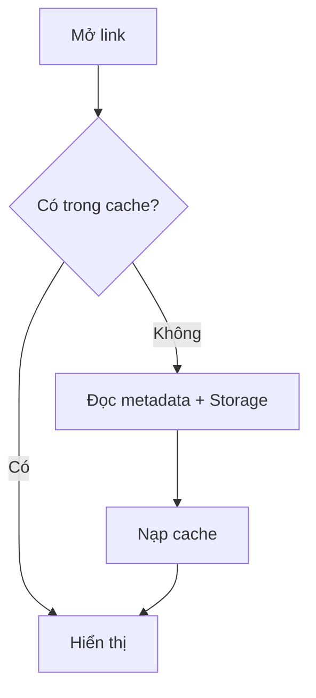
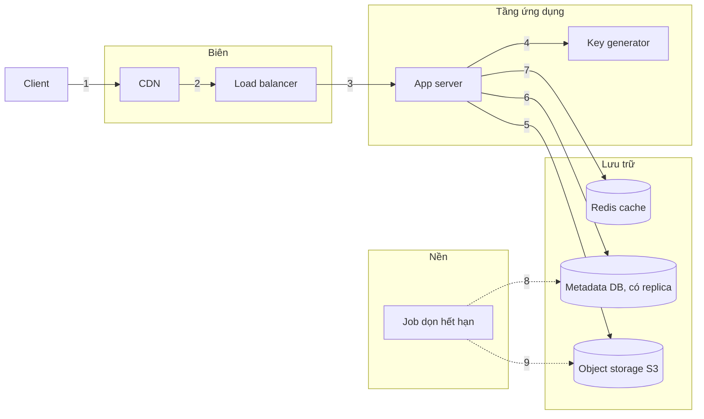
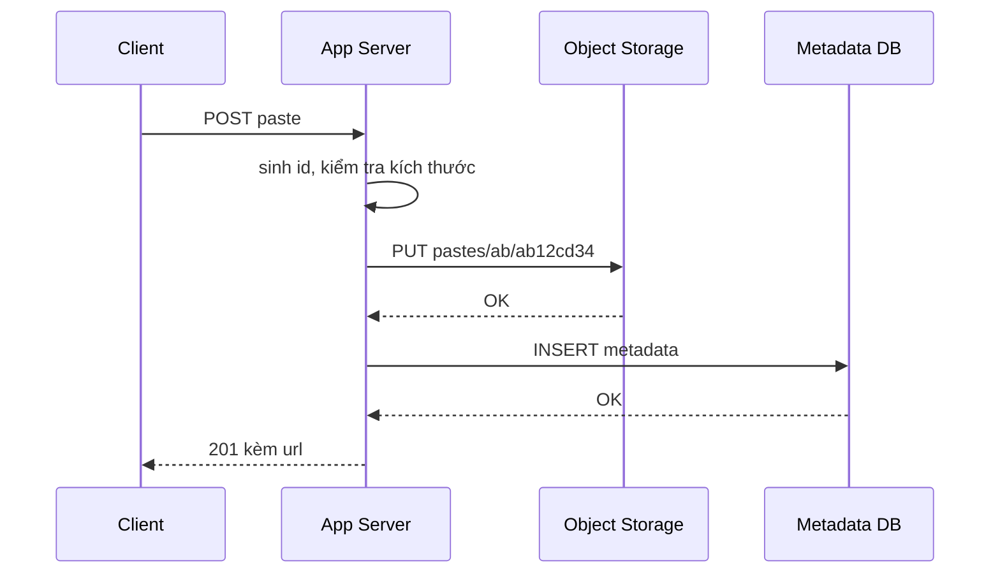
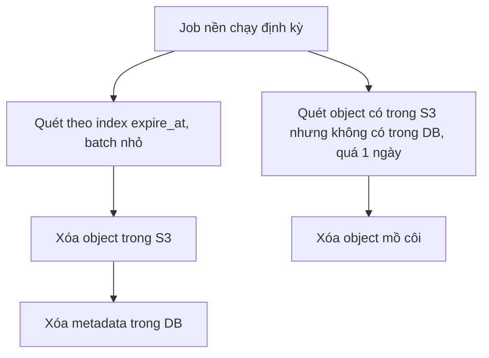

# Pastebin (Chia sẻ đoạn văn bản)

Bài này hướng dẫn bạn thiết kế một dịch vụ kiểu pastebin.com. Bạn dán một đoạn text (code, log lỗi, ghi chú) lên, hệ thống trả về một link để gửi cho người khác xem. Đoạn text có thể được đặt hạn hết hạn.

**Tóm tắt:**

- Tách dữ liệu theo đặc tính: metadata nhỏ, có cấu trúc, cần truy vấn thì nằm trong database; nội dung lớn, ít sửa, đọc theo key thì nằm trong object storage (S3).
- Ghi nội dung vào object storage trước, metadata vào database sau; lỗi giữa chừng chỉ để lại object mồ côi mà job quét dọn được, còn làm ngược lại sẽ có link trỏ vào chỗ trống.
- Hết hạn xử lý hai lớp: kiểm tra `expire_at` lúc đọc (trả 410) để đúng, và job nền quét theo index `expire_at` để thu hồi chỗ.
- Tải nhỏ (khoảng 12 ghi/giây) nên bài toán chính là dung lượng (khoảng 18 TB sau 5 năm), không phải throughput.
- Đọc nhiều hơn ghi nên dùng cache và CDN cho paste phổ biến; nội dung nhỏ có thể cache nguyên văn, nội dung lớn chỉ cache metadata.
- Presigned URL cho client tải thẳng lên S3 chỉ đáng khi nội dung lớn; với giới hạn 10 MB và tải thấp thì đi qua app là đủ.
- Paste riêng tư cần id dài, ngẫu nhiên và kiểm quyền khi đọc.
- Kiến trúc gồm CDN, load balancer, app server, key generator, Redis cache, metadata DB, object storage và job nền dọn hết hạn.

## Vấn đề nó giải quyết

Dán một đoạn log dài vào chat thì rối cả khung hội thoại, còn gửi file đính kèm thì phiền cho người nhận. Một đường link gọn là cách chia sẻ nhanh nhất.

Điểm khó nằm ở chỗ nội dung có thể to nhỏ rất khác nhau (vài trăm byte đến vài MB) và số lần đọc nhiều hơn số lần ghi, nên không nên nhét hết vào database. Bài này giống URL Shortener nhưng thêm bài toán lưu nội dung lớn.

**Nền tảng:** Tách dữ liệu theo đặc tính: metadata nhỏ, có cấu trúc, cần truy vấn thì để trong database; nội dung lớn, ít sửa, đọc theo key thì để trong object storage. Đây là mẫu thiết kế lặp lại ở nhiều bài (ảnh, video, file).

## Khi nào nên dùng, khi nào không

Dùng khi cần chia sẻ nhanh code, log lỗi, ghi chú tạm. Nếu bạn cần lưu lâu dài, có phân quyền chi tiết, có lịch sử chỉnh sửa thì hãy dùng Git hoặc wiki thay vì tự làm pastebin.

## Cách làm tóm tắt

Phần thông tin mô tả (id, hạn dùng, thời điểm tạo) lưu trong database; phần nội dung lưu trong object storage như S3. Id được sinh ra không trùng (giống URL Shortener). Paste được xem nhiều thì để vào cache, và một job nền sẽ dọn các paste đã hết hạn.

## Các khái niệm cần biết

- **Metadata**: dữ liệu mô tả về dữ liệu chính, ở đây là id, thời gian tạo, hạn, người tạo, vị trí nội dung. Nhỏ và có cấu trúc nên hợp với database.
- **Object storage (S3)**: dịch vụ lưu các object (file, blob) theo key, rẻ, bền, dung lượng gần như không giới hạn nhưng không có truy vấn phức tạp. Dùng cho nội dung lớn, ít sửa.
- **Presigned URL**: một URL tạm thời do server ký sẵn, cho phép client tải trực tiếp lên (hoặc xuống từ) S3 mà không cần đi qua app server.
- **Object mồ côi (orphan)**: object có trong S3 nhưng không có bản ghi metadata nào trỏ tới, thường do lỗi giữa chừng. Vô hại nhưng tốn chỗ, nên cần job dọn.
- **Lifecycle rule**: luật cấu hình sẵn ở S3, ví dụ tự xóa object sau 7 ngày. Hợp khi hạn dùng là các mốc cố định.
- **HTTP 410 Gone**: status code nói "tài nguyên từng tồn tại nhưng đã hết hạn hoặc bị xóa", khác 404 là "không có".

## Flowchart: tạo và xem paste



**Độ khó:** Easy

## Yêu cầu

- Chức năng: dán đoạn văn bản, nhận một link để chia sẻ; xem lại qua link.
- Tùy chọn: hết hạn tự động, riêng tư.
- Phi chức năng: đọc nhanh, bền vững, sẵn sàng cao.

## Ý tưởng chính

Giống URL shortener, nhưng nội dung lớn hơn. Tách làm hai phần:

- **Metadata** (id, thời gian tạo, hết hạn, người tạo) lưu trong database.
- **Nội dung** lưu trong object storage (S3) vì có thể vài KB đến vài MB.

## Kiến trúc tổng thể

Sơ đồ cho thấy hai đường chính: ghi (sinh id, lưu nội dung vào object storage trước, metadata vào database sau) và đọc (cache, rồi metadata và nội dung), cùng job nền dọn paste hết hạn.



**Chú thích sơ đồ**

| Thành phần | Vai trò | Vì sao chọn / đánh đổi |
|---|---|---|
| CDN | Phục vụ paste công khai phổ biến gần người đọc | Giảm tải cho app và S3; đổi lại paste hết hạn hoặc bị xóa vẫn có thể còn trong CDN đến khi TTL kết thúc |
| Load balancer | Chia request cho app server | App stateless nên scale ngang dễ; cần nhân đôi để tránh single point of failure |
| App server | Xử lý `POST /api/v1/pastes` và `GET /api/v1/pastes/{id}`, kiểm tra kích thước, hạn dùng, quyền | Đi qua app thì kiểm soát được kích thước, đổi lại tốn băng thông; với 12 ghi/giây là chấp nhận được |
| Key generator | Sinh id base62 không trùng | Tách riêng để không phải kiểm tra trùng ở database; thêm một thành phần phải sống |
| Redis cache | Cache metadata, và nội dung nhỏ nguyên văn | Đọc nhiều hơn ghi; đổi lại nội dung lớn không nên nằm trong Redis vì tốn RAM |
| Metadata DB | Lưu `id`, `object_key`, `expire_at`, người tạo; có index `expire_at` | Dữ liệu nhỏ (khoảng 180 GB) có cấu trúc, cần truy vấn nên hợp database; một DB có replica là đủ |
| Object storage | Lưu nội dung paste | Rẻ, bền, gần như không giới hạn cho 18 TB; đổi lại không có transaction chung với database |
| Job dọn hết hạn | Quét theo `expire_at`, xóa object rồi metadata, dọn object mồ côi | Thu hồi chỗ mà không làm chậm đường đọc; đổi lại cần giám sát độ trễ job |

Luồng theo số trên mũi tên:

1. Client gửi request (tạo hoặc xem paste) tới CDN.
2. CDN trả ngay nếu có bản cache của paste công khai, nếu không chuyển request tới load balancer.
3. Load balancer chuyển request tới một app server.
4. Khi tạo paste, app server xin một id duy nhất từ key generator.
5. App server ghi nội dung vào object storage trước.
6. Sau đó app server ghi metadata vào database; lỗi giữa hai bước chỉ để lại object mồ côi, dọn được.
7. Khi xem paste, app server tra Redis theo id, miss thì đọc metadata từ database rồi lấy nội dung từ object storage và nạp lại cache.
8. Job nền quét theo index `expire_at` trong database để tìm paste đã hết hạn.
9. Job nền xóa object trong S3 rồi mới xóa metadata, và dọn các object mồ côi.

**Điểm nghẽn:** Đầu tiên là dung lượng object storage (khoảng 18 TB sau 5 năm), không phải throughput: dùng lifecycle rule cho hạn cố định và job dọn để thu hồi chỗ. Tiếp theo là băng thông và độ trễ khi nội dung lớn đi qua app server: chuyển sang presigned URL để client tải thẳng lên S3 và để CDN phục vụ phần đọc.

**Suy luận:** Nội dung paste có thể từ vài trăm byte đến vài MB, trong khi metadata chỉ vài chục byte và cần truy vấn theo id hay theo hạn dùng. Nhét cả hai vào một bảng thì mỗi dòng phình to, buffer pool của database chứa được ít dòng hơn nên cache hit giảm và backup chậm, trong khi object storage được sinh ra chính cho blob lớn: rẻ, bền, dung lượng gần như không giới hạn. Vì vậy ta tách đôi, nhưng tách đôi tạo ra hai nơi ghi không có transaction chung, nên thứ tự ghi trở thành một quyết định thiết kế. Ghi nội dung trước, metadata sau thì lỗi giữa chừng chỉ để lại object mồ côi mà không ai nhìn thấy; làm ngược lại thì có link trỏ vào chỗ trống và người dùng thấy lỗi thật. Điểm dễ nhầm là nghĩ object mồ côi là lỗi nghiêm trọng, trong khi nó chỉ tốn chỗ và dọn được bằng job quét. Hệ quả khi review: luôn hỏi "nếu process chết giữa hai bước thì state nào còn lại", rồi chọn thứ tự sao cho state đó vô hại và dọn được.

## Ước lượng

Giả định: 1 triệu paste mới mỗi ngày, trung bình 10 KB, đọc/ghi 10:1, lưu 5 năm.

| Đại lượng | Tính | Kết quả |
|---|---|---|
| Ghi | 1 triệu / 86.400 | khoảng 12/giây |
| Đọc | 12 x 10 | khoảng 120/giây trung bình, 360/giây đỉnh (x3) |
| Nội dung | 1 triệu x 10 KB | 10 GB/ngày, khoảng 3,6 TB/năm, 18 TB sau 5 năm |
| Metadata | 1,8 tỷ x 100 B | khoảng 180 GB |
| Số id | 1 triệu x 365 x 5 | 1,8 tỷ, base62 6 ký tự (56 tỷ) là đủ, dùng 8 cho dư |
| Băng thông ra | 120/giây x 10 KB | khoảng 1,2 MB/giây (nhỏ) |
| Cache 20% paste nóng | 10,4 triệu lượt đọc/ngày x 20% x 10 KB | khoảng 21 GB |

Kết luận: tải nhỏ, bài toán chính là **dung lượng** (18 TB) và tách nội dung khỏi DB. Metadata 180 GB vẫn nằm vừa một DB có replica.

## API và dữ liệu

```text
POST /api/v1/pastes  { "content": "...", "expireIn": "1d", "visibility": "public|unlisted" }
  -> 201 { "id": "aB3dE9xQ", "url": "https://paste.example/aB3dE9xQ" }
  -> 413 nếu vượt 10 MB
GET  /api/v1/pastes/{id} -> 200 { "content": ..., "createdAt": ... } | 404 | 410
```

```sql
CREATE TABLE pastes (
  id         VARCHAR(10) PRIMARY KEY,
  object_key VARCHAR(100) NOT NULL,   -- vị trí nội dung trong S3
  size_bytes INT NOT NULL,
  user_id    BIGINT NULL,
  created_at TIMESTAMP NOT NULL,
  expire_at  TIMESTAMP NULL           -- có index để job dọn quét
);
CREATE INDEX idx_pastes_expire ON pastes(expire_at);
```

Nội dung nhỏ (dưới vài chục KB) có thể cache nguyên văn trong Redis; nội dung lớn chỉ cache metadata và để CDN hoặc S3 phục vụ.

## Thứ tự ghi và xử lý lỗi



**Phải thuộc:** Thứ tự ghi: nội dung vào object storage trước, metadata vào DB sau. Lỗi giữa chừng chỉ để lại object mồ côi (dọn được bằng job), còn làm ngược lại sẽ có link trỏ vào chỗ trống. Hết hạn thì kiểm tra `expire_at` lúc đọc (trả 410) và dọn nền bằng job.

Quy tắc: **ghi nội dung trước, metadata sau**. Lỗi giữa chừng chỉ để lại object mồ côi (không ai thấy, dọn được), còn làm ngược lại sẽ có link trỏ vào chỗ trống. Mã dưới đây đã chạy thử với DB giả lập lỗi (Java 11 trở lên):

```java
interface ObjectStore { void put(String key, byte[] data); }
interface MetaDb { void insert(String id, String objectKey, long expireAt); }

static String create(ObjectStore s3, MetaDb db, String id, byte[] body, long ttlMs, long now) {
    if (body.length > 10 * 1024 * 1024) throw new IllegalArgumentException("qua 10MB");
    // tiền tố phân tán, tránh "thư mục" nóng
    String key = "pastes/" + id.substring(0, 2) + "/" + id;
    s3.put(key, body);                                         // bước 1: nội dung
    // bước 2: chỉ khi bước 1 thành công
    db.insert(id, key, now + ttlMs);
    return id;
}
// Chạy với DB lỗi ở lần gọi thứ hai: kết quả "2 object, 1 metadata" (một object mồ côi)
```

## Đào sâu

**1. Nội dung lớn: đi qua app hay tải thẳng lên S3.** Đi qua app đơn giản và kiểm soát được kích thước, nhưng app giữ kết nối lâu và tốn băng thông. Với paste vài MB, app trả presigned URL để client tải thẳng lên S3 rồi gọi xác nhận; đổi lại thêm một bước và phải dọn object chưa được xác nhận. Với giới hạn 10 MB và tải 12 ghi/giây, đi qua app là đủ.

**2. Hết hạn và dọn dẹp.** Vấn đề đặt ra là xóa dữ liệu hết hạn mà không làm chậm đường đọc và không bỏ sót. Cách giải quyết là chia làm hai lớp: lớp kiểm tra lúc đọc để đảm bảo đúng, lớp job nền để thu hồi chỗ.



Đọc sơ đồ: xóa object trước rồi mới xóa metadata, để nếu lỗi giữa chừng thì lần quét sau vẫn thấy metadata và thử lại. Nhánh dưới là lưới an toàn cho các object mồ côi sinh ra ở bước ghi.

Đọc luôn kiểm tra `expire_at` (trả 410) nên không phụ thuộc job. Job nền quét theo index `expire_at` theo batch nhỏ để xóa metadata và object; thêm một job quét object mồ côi (có trong S3, không có trong DB, đã quá một ngày). Có thể dùng lifecycle rule của S3 cho hạn cố định (7 ngày, 30 ngày). Tùy chọn khử trùng lặp theo hash nội dung tiết kiệm chỗ nhưng làm việc xóa phức tạp (cần đếm tham chiếu), nên thường bỏ qua.

## Lỗi và giám sát

| Tình huống | Cách xử lý |
|---|---|
| Lỗi giữa hai bước ghi | Object mồ côi, dọn bằng job |
| Lạm dụng (spam, nội dung độc hại) | Rate limit theo IP, giới hạn kích thước, quét nội dung nếu cần |
| Paste riêng tư | Id dài và ngẫu nhiên (không tăng dần), kiểm quyền khi đọc |

Theo dõi: p99 đọc, tỷ lệ cache hit, tổng dung lượng S3 và tốc độ tăng, số object mồ côi, độ trễ job dọn.

## Điểm cần nhắc

- Giới hạn kích thước mỗi paste (ví dụ 10 MB).
- Dọn paste hết hạn bằng job nền hoặc TTL của storage.
- Đọc nhiều hơn ghi nhiều lần, nên cache và CDN cho paste phổ biến.

