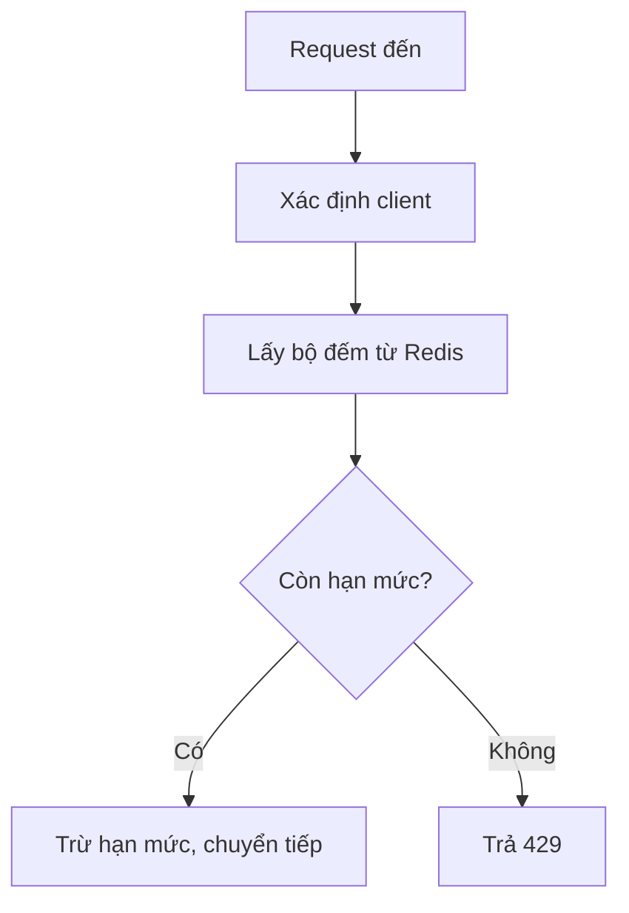
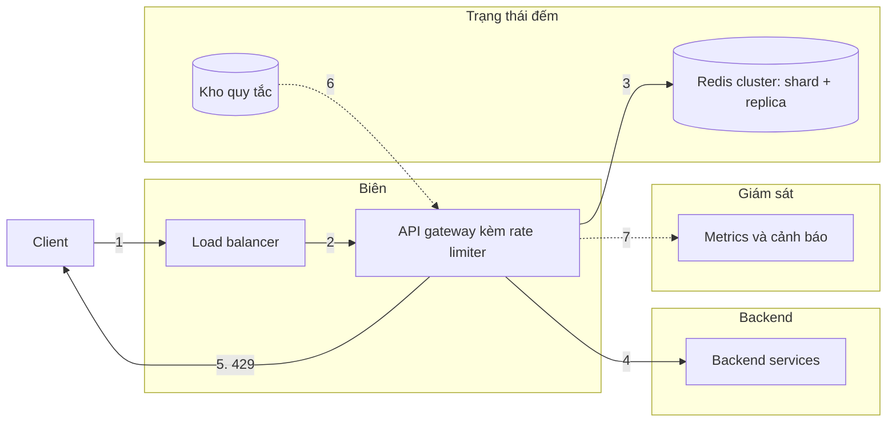
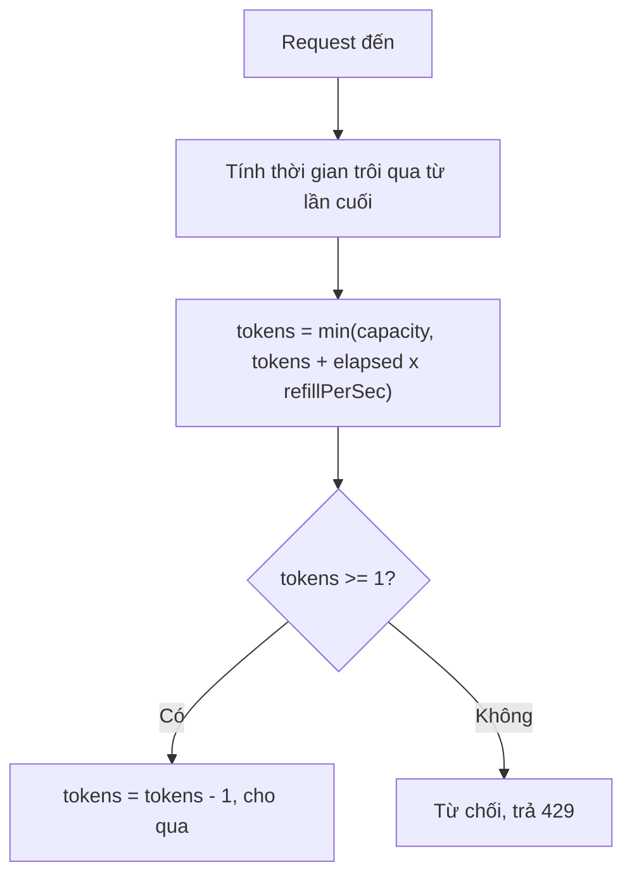
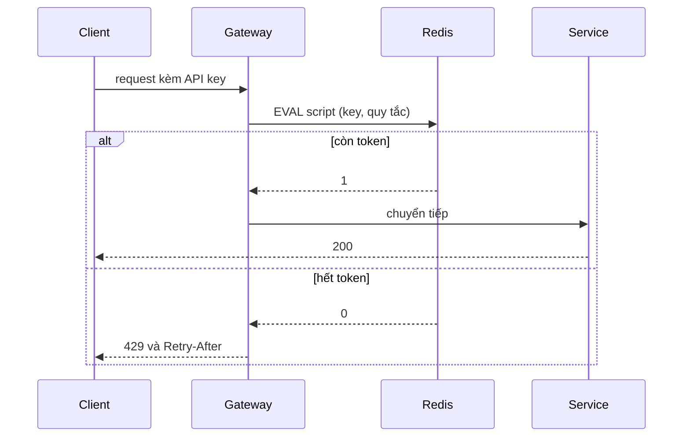
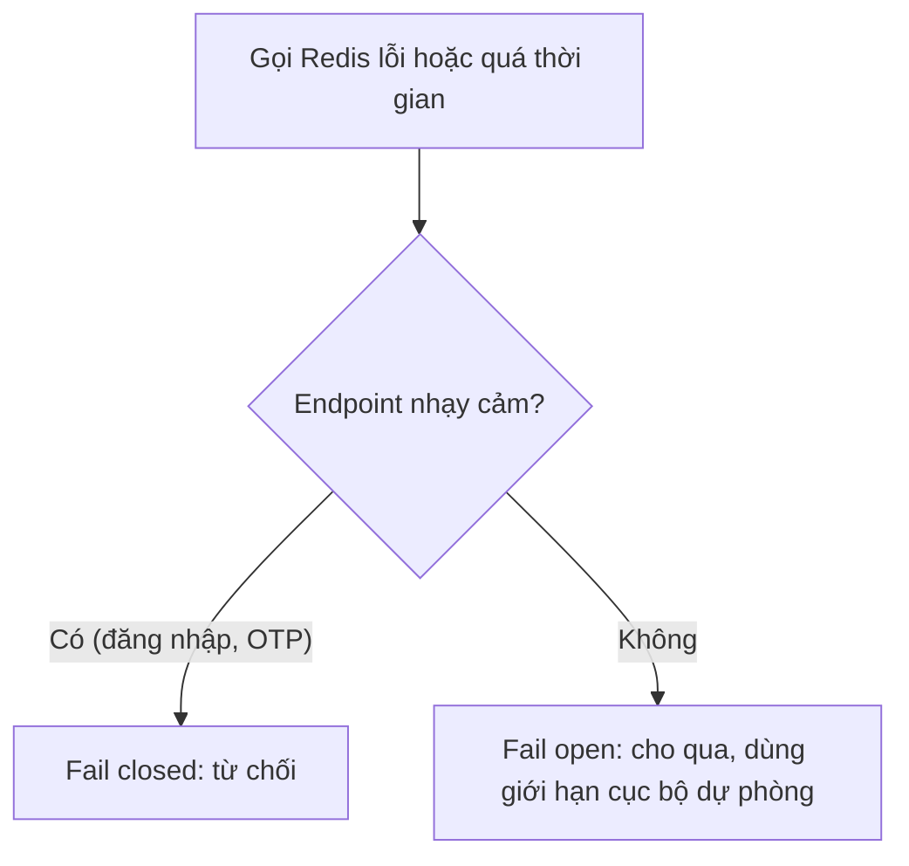

# Rate Limiter (Giới hạn tốc độ)

Rate limiter là bộ phận đứng trước API của bạn, đếm xem mỗi client (theo user, IP hoặc API key) đã gọi bao nhiêu request trong một khoảng thời gian. Vượt hạn mức thì request bị từ chối.

**Tóm tắt:**

- Rate limiter đứng trước API, đếm request theo từng client (user, IP, API key) và từ chối khi vượt hạn mức bằng HTTP 429 kèm `Retry-After`.
- Nó nằm trên đường đi của mọi request nên phải rẻ về memory và thời gian; có năm thuật toán: Fixed Window, Sliding Window Log, Sliding Window Counter, Token Bucket, Leaky Bucket.
- Fixed Window lỗi ở ranh giới cửa sổ (dồn gấp đôi); Token Bucket cho phép burst ngắn nên phổ biến nhất; Leaky Bucket làm mượt đầu ra.
- Nhiều server cần chung bộ đếm nên đặt ở Redis, và bước đọc rồi ghi phải atomic (Lua script) để tránh race condition.
- `INCR` rồi `EXPIRE` ở hai lệnh có thể để lại key không hết hạn nếu app chết giữa hai lệnh.
- Đếm cục bộ thì nhanh nhưng tổng vượt hạn mức; dùng Redis thì chính xác nhưng thêm một round trip, nên có thể xin token theo batch.
- Redis chết thì fail open cho API thường, fail closed cho endpoint nhạy cảm như đăng nhập và OTP.
- Rate limiter không thay được biện pháp chống DDoS lớn ở tầng mạng hoặc CDN.
- Kiến trúc gồm load balancer, API gateway kèm rate limiter, Redis cluster giữ bộ đếm, kho quy tắc, backend services và giám sát.

## Vấn đề nó giải quyết

Hãy hình dung một quán ăn không giới hạn số khách vào cùng lúc: chỉ cần một đám đông ập tới là bếp quá tải và mọi người đều không được phục vụ. Rate limiter giống nhân viên đứng cửa. Nếu không có nó, một client lỗi vòng lặp, một bot dò mật khẩu hay một đợt DDoS nhỏ là đủ làm sập server, và bạn còn trả thêm tiền hạ tầng cho những request vô nghĩa.

Phần khó là đếm chính xác khi có nhiều server cùng chạy mà vẫn nhanh, vì mỗi request đều phải qua bước kiểm tra này.

**Nền tảng:** Rate limiter phải đếm theo từng client, nhanh (nằm trên đường đi của mọi request) và chính xác khi nhiều server cùng chạy. Vì vậy bộ đếm đặt ở kho dùng chung và nhanh như Redis, và các bước đọc rồi ghi phải atomic để tránh race condition.

## Khi nào nên dùng, khi nào không

Dùng cho API công khai, endpoint nhạy cảm như đăng nhập hoặc gửi OTP, và các gói dịch vụ có hạn mức theo bậc. Không nên coi nó là giải pháp chống DDoS lớn: loại tấn công đó phải được chặn ở tầng mạng hoặc CDN, trước khi lưu lượng tới được hệ thống của bạn.

## Cách làm tóm tắt

Chọn một thuật toán (Token Bucket là phổ biến nhất, ngoài ra có các dạng Sliding Window), đặt rate limiter ở API Gateway hoặc middleware, và lưu bộ đếm trong Redis dùng chung cho mọi server. Vượt hạn mức thì trả HTTP 429 kèm header cho biết bao giờ được thử lại.

## Các khái niệm cần biết

- **Token Bucket**: một cái xô chứa tối đa `capacity` token, được nạp đều đặn theo tốc độ cố định. Mỗi request lấy đi một token; hết token thì bị chặn. Vì xô có thể đầy sẵn nên cho phép một đợt bùng nổ ngắn.
- **Leaky Bucket**: request đổ vào một queue và được xử lý với tốc độ cố định, như nước rỉ ra từ lỗ nhỏ. Đầu ra luôn đều, dùng khi backend cần lưu lượng mượt.
- **Fixed Window**: đếm trong từng cửa sổ cố định (mỗi phút). Hạn chế là ở ranh giới: 100 request cuối phút này cộng 100 request đầu phút sau tạo ra 200 request trong vài giây.
- **Sliding Window**: cửa sổ trượt theo thời điểm hiện tại, tránh được lỗi ranh giới ở trên.
- **HTTP 429 và `Retry-After`**: 429 là mã "quá nhiều request"; header `Retry-After` cho client biết sau bao nhiêu giây nên thử lại.
- **Race condition**: hai server cùng đọc bộ đếm rồi cùng ghi đè, dẫn đến đếm thiếu và cho lọt request. Cách tránh là dùng thao tác atomic, tức một bước không thể bị xen vào giữa.
- **Fail open và fail closed**: khi chính rate limiter hỏng (ví dụ Redis chết), fail open là cho request đi qua, fail closed là chặn tất cả.
- **Lua script trên Redis**: Redis chạy nguyên một script như một thao tác duy nhất, nên các bước đọc rồi ghi không bị xen vào.

## Flowchart: xử lý một request



**Độ khó:** Easy

## Mục đích

Giới hạn số request mỗi người dùng (hoặc IP, API key) trong một khoảng thời gian, để chống lạm dụng, bảo vệ tài nguyên và kiểm soát chi phí.

## Thuật toán

| Thuật toán | Cách hoạt động | Nhận xét |
|---|---|---|
| Fixed Window | Đếm request trong mỗi cửa sổ cố định (mỗi phút) | Đơn giản, nhưng có thể dồn gấp đôi ở ranh giới cửa sổ |
| Sliding Window Log | Lưu mốc thời gian từng request | Chính xác, tốn memory |
| Sliding Window Counter | Kết hợp hai cửa sổ liền kề theo tỷ lệ | Cân bằng độ chính xác và memory |
| Token Bucket | Xô chứa token, nạp đều, mỗi request lấy một token | Cho phép bùng nổ ngắn, rất phổ biến |
| Leaky Bucket | Request vào queue, xử lý với tốc độ cố định | Làm mượt lưu lượng |

**Phải thuộc:** Năm thuật toán: Fixed Window (đơn giản, lỗi dồn gấp đôi ở ranh giới cửa sổ), Sliding Window Log (chính xác, tốn memory), Sliding Window Counter (cân bằng), Token Bucket (cho phép bùng nổ ngắn, phổ biến nhất), Leaky Bucket (làm mượt đầu ra). Vượt hạn mức trả HTTP 429 kèm `Retry-After`.

**Suy luận:** Rate limiter nằm trên đường đi của mọi request nên nó phải rẻ về memory và về thời gian, và đó là tiêu chí chọn thuật toán trước cả độ chính xác. Fixed Window chỉ cần một bộ đếm nhưng cho phép dồn gấp đôi quanh ranh giới cửa sổ, vì hai cửa sổ liền kề đếm độc lập với nhau. Sliding Window Log sửa lỗi đó bằng cách giữ mốc thời gian của từng request, nên chính xác nhưng memory tăng theo hạn mức, không hợp khi hạn mức lớn. Sliding Window Counter và Token Bucket chỉ lưu vài con số mỗi key nên là điểm cân bằng; Token Bucket còn cho phép burst ngắn vì xô có thể đầy sẵn, khớp với hành vi thật của client. Điểm dễ nhầm là coi burst là lỗi: với API thông thường burst ngắn là vô hại và chặn nó chỉ làm client khó chịu, còn với đăng nhập hay OTP thì cần cửa sổ cứng. Hệ quả: chọn thuật toán theo từng endpoint chứ không dùng một thuật toán cho tất cả.

## Vị trí đặt

- Tại **API Gateway** hoặc middleware, trước khi request đến service.
- Quá giới hạn thì trả mã **429 Too Many Requests** kèm header `Retry-After`.

## Kiến trúc tổng thể

Nhiều server cần chung bộ đếm, nên lưu bộ đếm trong **Redis**. Sơ đồ cho thấy rate limiter đứng ở gateway, quyết định cho qua hay trả 429 bằng một lần gọi Redis, và cách quy tắc cùng số liệu giám sát đi kèm.



**Chú thích sơ đồ**

| Thành phần | Vai trò | Vì sao chọn / đánh đổi |
|---|---|---|
| Load balancer | Chia request cho nhiều instance gateway | Gateway stateless nên scale ngang; LB cần được nhân đôi |
| API gateway kèm rate limiter | Xác định client (user, IP, API key), áp quy tắc, cho qua hoặc trả 429 kèm `Retry-After` | Đặt trước mọi service nên chặn sớm, bảo vệ backend; đổi lại nằm trên đường đi của mọi request nên phải thêm rất ít độ trễ |
| Redis cluster | Giữ bộ đếm hoặc bucket mỗi key, thao tác atomic bằng Lua script | Chung một bộ đếm cho mọi gateway và nhanh; đổi lại thêm một round trip khoảng 1 ms, và là thành phần phải có replica |
| Kho quy tắc | Giữ hạn mức theo endpoint, gói người dùng | Đổi quy tắc không cần deploy; gateway nạp vào memory nên không gọi kho ở mỗi request |
| Backend services | Xử lý request đã được cho qua | Chỉ nhận tải đã được kiểm soát |
| Metrics và cảnh báo | Theo dõi tỷ lệ 429, độ trễ Redis, số lần fail open | Phát hiện cấu hình sai hoặc tấn công sớm |

Luồng theo số trên mũi tên:

1. Client gửi request tới load balancer.
2. Load balancer chuyển tới một instance gateway có rate limiter.
3. Gateway ghép key đếm (ví dụ `rl:apiKey:abc123:/orders`) và chạy một Lua script atomic trên Redis để đọc, cập nhật và quyết định.
4. Còn hạn mức thì gateway chuyển request tới backend service.
5. Hết hạn mức thì gateway trả ngay HTTP 429 kèm `Retry-After` cho client, không chạm backend.
6. Gateway định kỳ nạp quy tắc từ kho quy tắc vào memory (nét đứt vì không nằm trên đường request).
7. Gateway đẩy metrics (số request, số 429, độ trễ Redis) sang hệ thống giám sát.

**Điểm nghẽn:** Đầu tiên là một node Redis khi tải đỉnh vượt vài chục nghìn thao tác mỗi giây hoặc một key quá nóng: shard theo key, và giảm round trip bằng cách xin token theo batch. Tiếp theo là độ trễ cộng thêm trên mọi request: giữ Redis cùng vùng với gateway và cho phép fail open với API thường khi Redis chậm.

- Dùng lệnh atomic (`INCR` + `EXPIRE`, hoặc script Lua) để tránh race condition.
- Quy tắc giới hạn lưu trong cấu hình, có thể khác nhau theo endpoint và gói người dùng.

## Ước lượng

Giả định: 10 triệu người dùng hoạt động, mỗi người 100 request/ngày.

| Đại lượng | Tính | Kết quả |
|---|---|---|
| Request/ngày | 10 triệu x 100 | 1 tỷ |
| QPS trung bình | 1 tỷ / 86.400 | khoảng 11.600/giây |
| QPS đỉnh (x3) | | khoảng 35.000/giây, mỗi request 1 lần gọi Redis |
| Memory | 10 triệu key x khoảng 100 B | khoảng 1 GB |

Kết luận: 1 GB nằm gọn trong RAM; 35.000 thao tác/giây một node Redis xử lý được (cỡ vài chục nghìn đến trăm nghìn lệnh/giây, tùy máy), nhưng nên có replica và shard theo key để dự phòng. Độ trễ thêm vào mỗi request cỡ 1 ms nên rate limiter phải nhanh và ít gọi mạng.

## API, cấu hình và response

```text
Cấu hình quy tắc (lưu DB hoặc file, nạp vào memory của gateway):
  { "endpoint": "POST /login", "key": "ip",      "capacity": 5,   "refillPerSec": 0.0833 }
  { "endpoint": "*",           "key": "apiKey",  "capacity": 100, "refillPerSec": 10 }

Response khi vượt hạn mức:
  HTTP 429 Too Many Requests
  Retry-After: 12
  X-RateLimit-Limit: 100
  X-RateLimit-Remaining: 0
```

Key đếm ghép từ loại định danh và endpoint, ví dụ `rl:apiKey:abc123:/orders`. Chọn định danh: user id sau đăng nhập, IP cho endpoint chưa đăng nhập (chú ý nhiều người sau một NAT dùng chung IP).

## Thuật toán lõi bằng code

**Token bucket** (lazy refill: không cần background thread, chỉ tính số token được nạp từ lần cuối). Mỗi lần có request, rate limiter tính xem từ lần trước đã trôi qua bao lâu, cộng số token tương ứng (không vượt dung lượng xô), rồi mới quyết định cho qua hay chặn.



Đã chạy thử, Java 11 trở lên:

```java
static class TokenBucket {
    private final double capacity, refillPerSec;
    private double tokens;
    private long lastNanos;
    TokenBucket(double capacity, double refillPerSec, long nowNanos) {
        this.capacity = capacity; this.refillPerSec = refillPerSec;
        this.tokens = capacity; this.lastNanos = nowNanos;
    }
    synchronized boolean tryAcquire(long nowNanos) {
        double elapsedSec = (nowNanos - lastNanos) / 1e9;
        // nạp, không quá dung lượng
        tokens = Math.min(capacity, tokens + elapsedSec * refillPerSec);
        lastNanos = nowNanos;
        if (tokens >= 1) { tokens -= 1; return true; }
        return false;
    }
}
// Xô 5 token, nạp 1/giây: 8 request cùng lúc cho 5 qua, 3 bị chặn; sau 2 giây có lại 2 token.
```

**Sliding window counter** (ước lượng từ hai cửa sổ liền kề):

```text
ước lượng = số request cửa sổ hiện tại + số request cửa sổ trước x (phần cửa sổ trước còn nằm trong 60 giây gần nhất)

Ví dụ: giới hạn 100/phút. Phút trước có 84, phút này đã có 36, đang ở giây thứ 15.
  phần còn lại của phút trước = (60 - 15) / 60 = 0,75
  ước lượng = 36 + 84 x 0,75 = 99  -> còn nhận thêm 1 request, request kế tiếp bị chặn
```

**Bản phân tán bằng Lua trên Redis** (một script chạy atomic, không có race giữa đọc và ghi; chưa chạy thử trong môi trường này):

```lua
-- KEYS[1] = key; ARGV = capacity, refillPerSec, nowMs, cost
local d = redis.call('HMGET', KEYS[1], 'tokens', 'ts')
local capacity, rate = tonumber(ARGV[1]), tonumber(ARGV[2])
local now, cost = tonumber(ARGV[3]), tonumber(ARGV[4])
local tokens, ts = tonumber(d[1]), tonumber(d[2])
if tokens == nil then tokens = capacity; ts = now end
tokens = math.min(capacity, tokens + (now - ts) / 1000 * rate)
local allowed = 0
if tokens >= cost then tokens = tokens - cost; allowed = 1 end
redis.call('HSET', KEYS[1], 'tokens', tokens, 'ts', now)
redis.call('PEXPIRE', KEYS[1], math.ceil(capacity / rate * 1000) * 2)  -- key im lặng thì tự xóa
return allowed
```

`INCR` + `EXPIRE` (fixed window) tách hai lệnh có thể để lại key không hết hạn nếu app chết giữa hai lệnh, nên dùng script hoặc `SET key 0 EX 60 NX` trước rồi `INCR`.



## Đào sâu

**1. Chọn thuật toán.**

| | Token Bucket | Sliding Window Counter | Sliding Window Log |
|---|---|---|---|
| Memory mỗi key | 2 số | 2 bộ đếm | Một mốc thời gian mỗi request |
| Bùng nổ | Cho phép tới `capacity` | Không, trơn hơn | Không |
| Chính xác | Theo tốc độ trung bình | Gần đúng (giả định phân bố đều) | Chính xác tuyệt đối |
| Dùng khi | API chung, cho phép đột biến ngắn | Cần giới hạn cứng "N/phút" | Hạn mức nhỏ, cần chính xác (đăng nhập, OTP) |

**2. Độ chính xác với nhiều node.** Mỗi gateway đếm cục bộ thì nhanh nhưng tổng có thể vượt (N node x hạn mức). Dùng Redis dùng chung thì chính xác nhưng thêm một lần gọi mạng (cỡ 0,5 ms) mỗi request. Cân bằng: đếm cục bộ theo batch (xin trước 10 token từ Redis, dùng dần), chấp nhận sai lệch nhỏ. Đa vùng thì mỗi vùng có hạn mức riêng bằng phần của tổng, đồng bộ không chặt.

**Suy luận:** Khi có nhiều gateway, mỗi gateway đếm cục bộ thì nhanh nhưng tổng hạn mức thực tế thành N lần hạn mức đặt ra, nên bộ đếm phải nằm ở kho dùng chung. Kho dùng chung lại kéo theo hai hệ quả: mỗi request thêm một round trip mạng, và việc đọc rồi ghi bộ đếm giờ xảy ra từ nhiều server cùng lúc nên có race condition (hai server cùng đọc 99, cùng ghi 100, và cả hai cho request qua). Vì thế bước đọc, tính, ghi phải là một thao tác atomic, và Lua script trên Redis làm được điều đó vì Redis chạy mỗi script như một lệnh duy nhất. Điểm dễ nhầm là dùng `INCR` rồi `EXPIRE` ở hai lệnh: từng lệnh atomic nhưng cặp lệnh thì không, nên app chết giữa hai lệnh sẽ để lại key không bao giờ hết hạn. Hệ quả khi review: hỏi mỗi request chạm Redis mấy lần, đoạn nào không atomic, và khi Redis chết thì fail open hay fail closed cho từng loại endpoint.

## Lỗi và giám sát

**Phải thuộc:** Khi Redis chết: fail open (cho qua, ưu tiên sẵn sàng) cho API thường, fail closed (từ chối) cho endpoint nhạy cảm như đăng nhập hoặc OTP.

Khi Redis không trả lời, rate limiter phải quyết định ngay. Chọn sai có hậu quả thật: fail open sai chỗ thì kẻ dò mật khẩu được tự do thử, fail closed sai chỗ thì toàn bộ API ngừng phục vụ chỉ vì một kho đếm hỏng.



| Tình huống | Cách xử lý |
|---|---|
| Redis chết | Fail open cho API thường (ưu tiên sẵn sàng, có giới hạn cục bộ dự phòng); fail closed cho endpoint nhạy cảm như đăng nhập, OTP |
| Lệch đồng hồ giữa gateway | Dùng `TIME` của Redis hoặc tính thời gian trong script thay vì giờ client |
| Một key cực nóng (một khách lớn) | Hạn mức riêng theo gói, tách key theo endpoint để không dồn vào một shard |
| Thay đổi quy tắc | Nạp lại cấu hình không cần khởi động lại, có TTL cache |

Theo dõi: tỷ lệ 429 theo khách và endpoint, độ trễ thêm vào của rate limiter (p99), lỗi kết nối Redis, số lần vào chế độ fail open.

## Điểm cần nhắc

- Redis chết thì sao: cho qua (fail open) hay chặn (fail closed).
- Đồng bộ giữa nhiều vùng địa lý.

