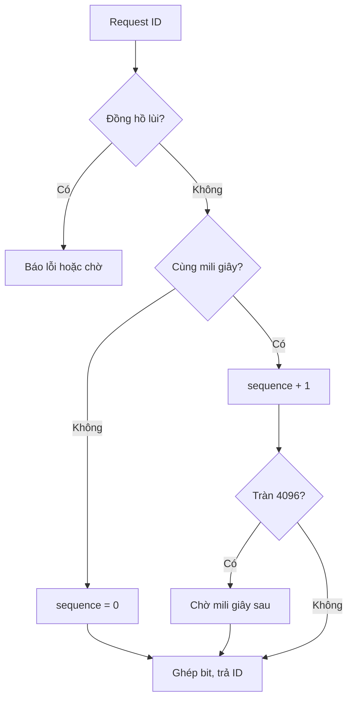
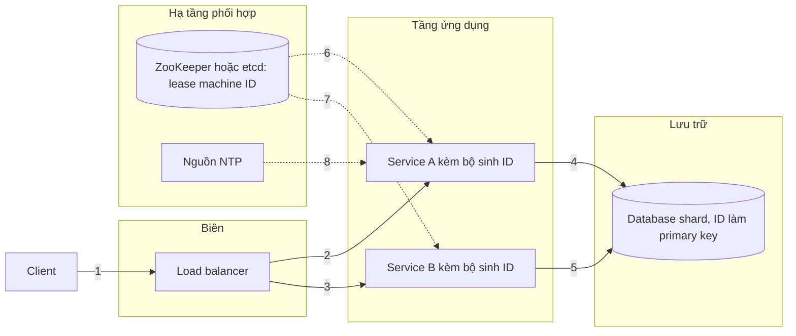
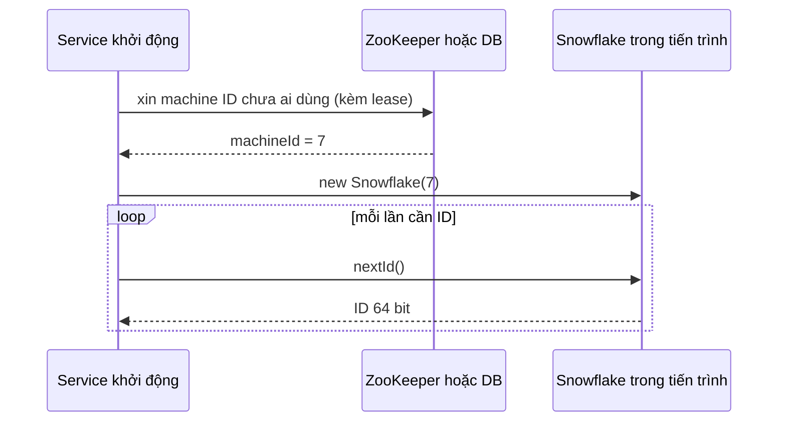
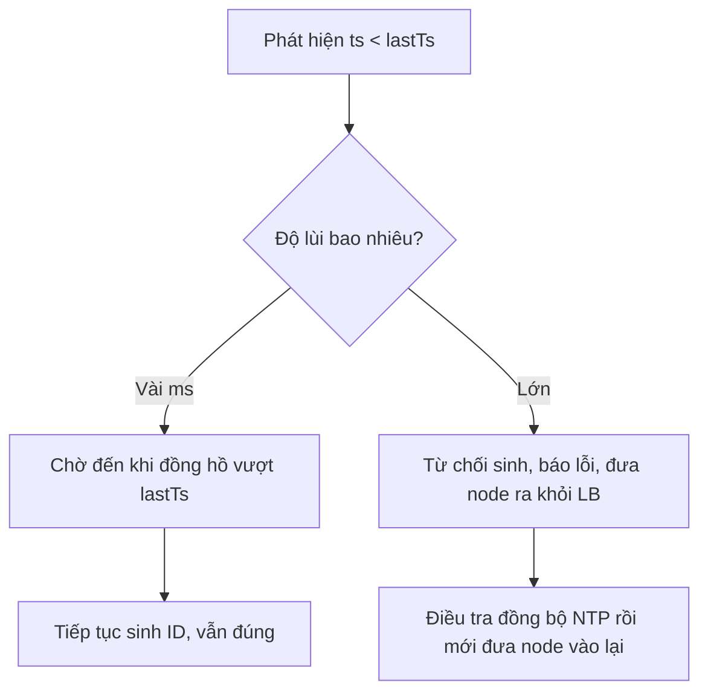

# Unique ID Generator (Sinh ID duy nhất)

Bài này hướng dẫn bạn thiết kế một bộ sinh ID (định danh) không bao giờ trùng, chạy được trên nhiều máy cùng lúc, thường ra hàng chục nghìn ID mỗi giây. Nó có thể là một service riêng hoặc chỉ là một thư viện nhúng trong từng service.

**Tóm tắt:**

- Auto-increment chỉ đúng khi có một nơi đếm; khi nhiều máy cùng ghi, ta phải chia không gian ID để mỗi máy tự sinh mà không cần hỏi ai.
- UUID v4 không cần phối hợp nhưng dài (128 bit) và không tăng dần nên làm primary key thì chèn chậm; ticket server giữ thứ tự nhưng là single point of failure và bottleneck.
- Snowflake 64 bit gồm 1 bit dấu, 41 bit thời gian (khoảng 69 năm), 10 bit machine ID (1.024 máy), 12 bit sequence (4.096 ID mỗi mili giây mỗi máy).
- Giới hạn thực tế không nằm ở tốc độ (khoảng 4,1 triệu ID mỗi giây mỗi máy) mà ở đồng hồ và việc gán machine ID.
- Đồng hồ chạy lùi do NTP có thể sinh ID trùng: lùi vài ms thì chờ, lùi lớn thì từ chối và đưa node ra khỏi load balancer.
- Machine ID trùng cũng gây ID trùng; cấp bằng lease qua ZooKeeper/etcd hoặc từ số thứ tự pod của StatefulSet.
- ID chỉ sắp xếp gần đúng giữa các máy; cần thứ tự nhân quả chặt thì không dùng Snowflake.
- Kiến trúc gồm load balancer, các service nhúng bộ sinh ID, ZooKeeper hoặc etcd cấp machine ID, nguồn NTP và database dùng ID làm khóa.

## Vấn đề nó giải quyết

Với một database duy nhất, bạn chỉ cần cột auto-increment là xong. Nhưng khi dữ liệu đã được chia shard và nhiều server cùng ghi, mỗi shard tự đếm 1, 2, 3 sẽ sinh ra ID trùng nhau. Còn nếu dùng chung một bộ đếm trung tâm thì bộ đếm đó thành bottleneck (mọi lần ghi đều phải xếp hàng chờ nó) và single point of failure (nó hỏng thì cả hệ thống không tạo được bản ghi mới). Dùng UUID thì hết trùng nhưng ID dài và không sắp xếp được theo thời gian.

**Nền tảng:** Auto-increment chỉ đúng khi có một nơi đếm. Khi nhiều máy cùng ghi, ta phải chia không gian ID sao cho mỗi máy tự sinh mà không cần hỏi ai và không bao giờ trùng nhau: Snowflake làm việc này bằng cách ghép thời gian, mã máy và số thứ tự vào một số 64 bit.

## Khi nào nên dùng, khi nào không

Dùng khi bạn sharding, hoặc tạo ID cho đơn hàng, tin nhắn, bản ghi cần sắp xếp theo thời gian tạo. Hệ thống chỉ có một database nhỏ thì cứ dùng auto-increment, đừng làm phức tạp.

## Cách làm tóm tắt

Dùng kiểu Snowflake: ghép timestamp, machine ID và số thứ tự trong cùng mili giây thành một số 64 bit. Mỗi máy tự sinh ID mà không cần hỏi ai, và ID tăng dần theo thời gian. Cái giá phải trả là bạn phải lo trường hợp đồng hồ máy bị chạy lùi.

## Các khái niệm cần biết

- **Auto-increment**: cột số tự tăng của database. Đơn giản nhưng gắn với đúng một database, nên không dùng được khi nhiều nơi cùng ghi.
- **UUID v4**: chuỗi 128 bit sinh ngẫu nhiên, gần như không bao giờ trùng và không cần phối hợp. Nhược điểm: dài, không tăng dần nên khi làm primary key, các bản ghi mới rơi vào chỗ ngẫu nhiên trong index (B-tree) làm chèn chậm và fragmentation.
- **Ticket server**: một máy chuyên cấp số cho cả hệ thống. Dễ làm nhưng chính nó là single point of failure.
- **Epoch**: mốc thời gian gốc. Snowflake lưu "số mili giây kể từ epoch riêng của hệ thống" thay vì từ năm 1970, để 41 bit dùng được lâu hơn.
- **Machine ID**: số định danh của mỗi tiến trình sinh ID. Hai tiến trình dùng cùng số này sẽ sinh trùng ID.
- **Sequence**: bộ đếm trong cùng một mili giây, để cùng một máy sinh được nhiều ID mà vẫn khác nhau.
- **Dịch bit (`<<`) và `|`**: phép dịch trái đưa một giá trị lên đúng vị trí bit của nó, phép OR ghép các phần lại thành một số.
- **NTP**: giao thức đồng bộ đồng hồ qua mạng. Nó có thể chỉnh đồng hồ lùi, đây là nguồn rủi ro chính của Snowflake.
- **Lease**: quyền sử dụng có thời hạn. Ở đây là quyền giữ một machine ID, hết hạn mà không gia hạn thì bị thu hồi để cấp cho tiến trình khác.
- **ZooKeeper/etcd**: kho cấu hình phân tán, hay dùng để cấp machine ID có lease.

## Flowchart: sinh ID kiểu Snowflake



**Độ khó:** Easy

## Yêu cầu

Sinh ID duy nhất trong hệ thống phân tán nhiều server, nhanh, và thường tăng dần theo thời gian (để sắp xếp được).

## Các phương án

| Phương án | Ưu điểm | Nhược điểm |
|---|---|---|
| Auto-increment của DB | Đơn giản | Một DB là bottleneck, khó scale |
| UUID (v4) | Không cần phối hợp, 128 bit | Dài, không tăng dần, index kém hiệu quả |
| Ticket server | Tập trung, tăng dần | Điểm lỗi duy nhất |
| Snowflake | Phân tán, tăng dần theo thời gian | Cần đồng bộ đồng hồ |

## Snowflake (64 bit)

```text
| 1 bit | 41 bit thời gian | 10 bit machine ID | 12 bit sequence |
```

- 41 bit thời gian (mili giây) dùng được khoảng 69 năm.
- 10 bit định danh máy: tối đa 1.024 máy.
- 12 bit số thứ tự: 4.096 ID mỗi mili giây trên mỗi máy.
- ID tăng dần theo thời gian, sắp xếp được, không cần phối hợp giữa các máy khi sinh.

**Phải thuộc:** Snowflake 64 bit gồm 1 bit dấu, 41 bit thời gian (khoảng 69 năm), 10 bit machine ID (tối đa 1.024 máy), 12 bit sequence (4.096 ID mỗi mili giây mỗi máy). Rủi ro chính là đồng hồ chạy lùi (NTP) và trùng machine ID.

**Suy luận:** Auto-increment đúng vì chỉ có một nơi đếm, nên khi nhiều máy cùng ghi thì mọi giải pháp thực chất là cách chia không gian ID để mỗi máy tự sinh mà không phải hỏi ai. UUID chia bằng ngẫu nhiên nên không cần phối hợp, nhưng ID không tăng dần nên khi làm primary key, bản ghi mới rơi vào vị trí ngẫu nhiên trong B-tree, gây page split và chèn chậm. Ticket server giữ được thứ tự nhưng mọi lần ghi phải gọi nó, tức là bottleneck và single point of failure. Snowflake chia không gian theo thời gian, machine ID và sequence, nên vừa không cần phối hợp vừa tăng dần theo thời gian. Cái giá là ID giờ phụ thuộc vào hai thứ nằm ngoài thuật toán: đồng hồ không được chạy lùi và machine ID không được trùng. Điểm dễ nhầm là nghĩ ID Snowflake có thứ tự toàn cục chặt; thật ra chỉ gần đúng giữa các máy vì đồng hồ lệch vài ms. Hệ quả: nếu cần thứ tự nhân quả chặt thì không dùng Snowflake, còn nếu dùng thì phải có kế hoạch cho NTP và cấp machine ID bằng lease.

## Ước lượng

| Đại lượng | Tính | Kết quả |
|---|---|---|
| Tốc độ tối đa mỗi máy | 4.096 ID/ms x 1.000 | khoảng 4,1 triệu ID/giây |
| Nhu cầu mẫu | 10.000 ID/giây toàn hệ thống | một máy đã dư, nhiều máy để chịu lỗi |
| Tuổi thọ | 2^41 ms / (1.000 x 3.600 x 24 x 365,25) | khoảng 69,7 năm kể từ mốc epoch riêng |
| Kích thước | 64 bit | vừa `BIGINT`/`long`, nhỏ hơn UUID 128 bit một nửa |

Kết luận: giới hạn thực tế không nằm ở tốc độ mà ở **đồng hồ** và **việc gán machine ID**.

## Kiến trúc tổng thể

Sơ đồ cho thấy các service sinh ID cục bộ (thư viện nhúng hoặc service riêng), nơi cấp machine ID bằng lease, nguồn đồng hồ NTP, và nơi ID được dùng làm khóa.



**Chú thích sơ đồ**

| Thành phần | Vai trò | Vì sao chọn / đánh đổi |
|---|---|---|
| Load balancer | Chia request tạo bản ghi cho các service | Mỗi service tự sinh ID nên LB không cần biết gì về ID; cần nhân đôi |
| Service kèm bộ sinh ID | Ghép 41 bit thời gian, 10 bit machine ID, 12 bit sequence thành ID 64 bit ngay trong process | Không thêm bước mạng, không thêm điểm lỗi, khoảng 4,1 triệu ID mỗi giây mỗi máy; đổi lại logic đồng hồ và sequence phải đúng ở mọi ngôn ngữ |
| ZooKeeper hoặc etcd | Cấp machine ID theo lease (hoặc dùng số thứ tự pod của StatefulSet) | Đảm bảo hai máy không trùng machine ID, nguyên nhân gây ID trùng; đổi lại thêm một hệ thống phối hợp, chỉ cần khi khởi động |
| Nguồn NTP | Giữ đồng hồ các máy gần đúng | Snowflake dựa vào thời gian; đồng hồ lùi phải xử lý (chờ hoặc từ chối) |
| Database | Lưu bản ghi với ID làm primary key | ID tăng dần theo thời gian nên chèn vào B-tree gần cuối, ít page split hơn UUID v4 |

Luồng theo số trên mũi tên:

1. Client gửi request tạo bản ghi tới load balancer.
2. Load balancer chuyển một request tới service A.
3. Load balancer chuyển request khác tới service B; hai service chạy độc lập với nhau.
4. Service A sinh ID cục bộ rồi ghi bản ghi vào database.
5. Service B sinh ID cục bộ rồi ghi bản ghi vào database, không cần hỏi A.
6. Khi khởi động, service A xin lease machine ID từ ZooKeeper hoặc etcd (nét đứt vì không nằm trên đường request).
7. Service B xin một machine ID khác, và gia hạn lease định kỳ.
8. Service đồng bộ đồng hồ với NTP; phát hiện đồng hồ lùi thì chờ hoặc từ chối sinh ID.

**Điểm nghẽn:** Đầu tiên không phải tốc độ mà là gán machine ID: chỉ 1.024 máy với 10 bit, nên cần lease tự giải phóng khi máy chết hoặc đổi cách chia bit. Tiếp theo là đồng hồ chạy lùi trên một node: đưa node đó ra khỏi load balancer cho đến khi đồng hồ ổn định, và nếu chỉ dùng một service ID tập trung thì thêm instance sau LB, mỗi instance một machine ID.

## API

```text
GET /api/v1/ids?count=100 -> 200 { "ids": [4194324483, ...] }   (nếu làm thành service)
```

Thường tốt hơn là nhúng thư viện vào từng service: không thêm một bước mạng, không thêm điểm lỗi. Chỉ làm service riêng khi cần quản lý machine ID tập trung hoặc ngôn ngữ không có thư viện.

## Thuật toán lõi bằng code

Ví dụ tính tay: 1.000 ms sau epoch, machine 5, số thứ tự 3.

```text
ID = (1000 << 22) | (5 << 12) | 3
   = 4.194.304.000 + 20.480 + 3
   = 4.194.324.483
Tách ngược: sequence = ID & 0xFFF, machine = (ID >> 12) & 0x3FF, thời gian = (ID >> 22) + epoch
```

Cài đặt (đã chạy thử: 200.000 ID liên tiếp tăng chặt và không trùng; Java 11 trở lên):

```java
class Snowflake {
    static final long EPOCH = 1_700_000_000_000L;      // mốc riêng của hệ thống (ms)
    static final int MACHINE_BITS = 10, SEQ_BITS = 12;
    static final long MAX_SEQ = (1L << SEQ_BITS) - 1;  // 4095
    private final long machineId;
    private long lastTs = -1, seq = 0;

    Snowflake(long machineId) {
        if (machineId < 0 || machineId >= (1L << MACHINE_BITS)) throw new IllegalArgumentException();
        this.machineId = machineId;
    }

    long now() { return System.currentTimeMillis(); }

    synchronized long nextId() {
        long ts = now();
        if (ts < lastTs) throw new IllegalStateException("Dong ho lui " + (lastTs - ts) + " ms");
        if (ts == lastTs) {
            seq = (seq + 1) & MAX_SEQ;
            if (seq == 0) {                          // hết 4096 số trong mili giây này
                while ((ts = now()) <= lastTs) { }   // chờ sang mili giây sau
            }
        } else {
            seq = 0;
        }
        lastTs = ts;
        return ((ts - EPOCH) << (MACHINE_BITS + SEQ_BITS)) | (machineId << SEQ_BITS) | seq;
    }
}
```



## Đào sâu

**1. Đồng hồ chạy lùi.** NTP có thể chỉnh lùi vài ms (hoặc giây nhảy). Hậu quả nếu bỏ qua: máy sinh lại đúng cặp (thời gian, sequence) đã dùng cách đây ít phút, tức là ID trùng, và dữ liệu cũ bị ghi đè hoặc báo lỗi duplicate key. Ba mức xử lý:



| Mức | Cách làm | Đánh đổi |
|---|---|---|
| Lùi vài ms | Chờ đến khi đồng hồ vượt `lastTs` | Chậm tạm thời, vẫn đúng |
| Lùi lớn | Từ chối sinh, báo lỗi, đưa node ra khỏi LB | Mất một node nhưng không có ID trùng |
| Phòng ngừa | Lưu `lastTs` ra bền vững định kỳ, khi khởi động lại chờ qua mốc đó | Thêm ghi đĩa |

Mã trên chọn cách hai cho gọn. Không bao giờ bỏ qua cảnh báo: ID trùng là lỗi dữ liệu âm thầm, rất khó dò.

**2. Machine ID duy nhất.** Hai tiến trình dùng cùng machine ID trong cùng mili giây sẽ sinh ID trùng. Cách gán: cấp qua ZooKeeper/etcd với lease (hết lease thì thu hồi), hoặc suy ra từ số thứ tự pod của StatefulSet, hoặc bảng DB có unique key. Không dùng IP hay hostname ngẫu nhiên nếu không có kiểm tra va chạm. Chỉ 1.024 máy: nếu số tiến trình lớn, giảm bit sequence và tăng bit machine (ví dụ 12 bit machine và 10 bit sequence cho 4.096 máy, 1.024 ID/ms mỗi máy).

**Lưu ý về thứ tự:** ID chỉ sắp xếp tương đối giữa các máy (đồng hồ lệch vài ms). Nếu cần thứ tự nhân quả chặt thì dùng một sequence do DB cấp hoặc logical clock, không dùng Snowflake.

## Lỗi và giám sát

| Tình huống | Cách xử lý |
|---|---|
| Đồng hồ lùi | Chờ hoặc từ chối, cảnh báo |
| Hai máy trùng machine ID | Cấp bằng lease, phát hiện khi khởi động |
| Tiến trình khởi động lại trong cùng ms | Chờ qua `lastTs` đã lưu |
| Số thứ tự cạn thường xuyên | Thêm máy hoặc tăng bit sequence |

Theo dõi: độ lệch NTP của từng máy, số lần đồng hồ lùi, tần suất sequence tràn (chờ ms kế), số ID sinh mỗi giây.

## Điểm cần nhắc

- Đồng hồ máy bị lệch hoặc chạy lùi: cần đồng bộ NTP và từ chối sinh ID khi phát hiện lùi.
- Gán machine ID duy nhất khi khởi động (qua ZooKeeper hoặc cấu hình).

