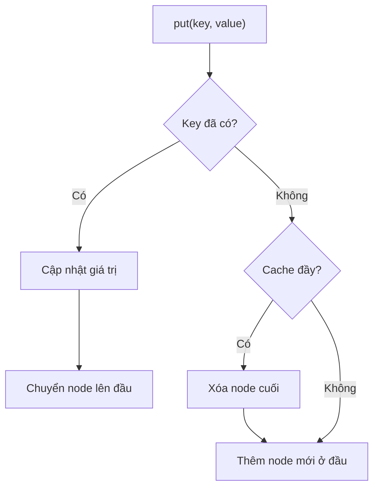
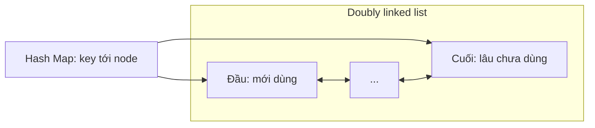
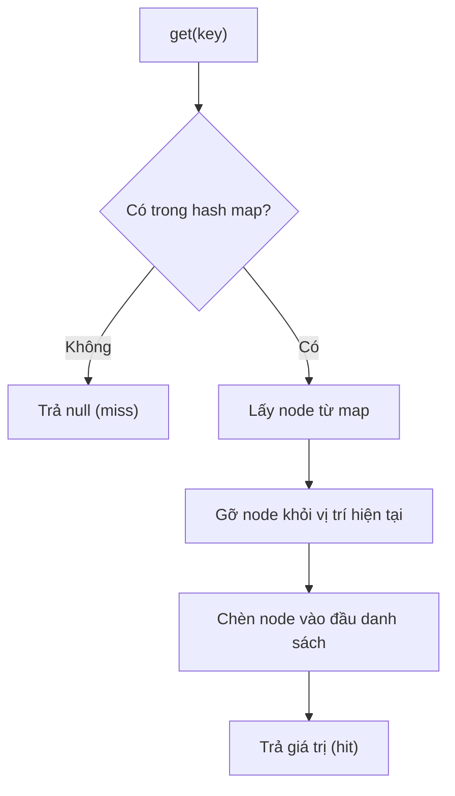
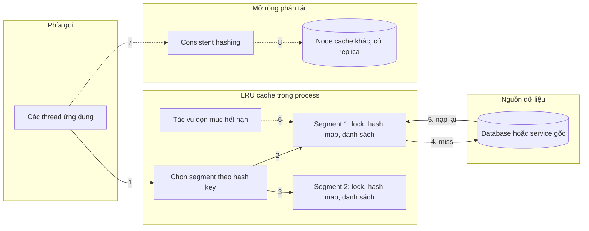

# LRU Cache / Key-Value Store đơn giản

LRU Cache là một cache có dung lượng cố định. Khi đã đầy mà cần chỗ cho mục mới, nó vứt đi mục đã lâu không ai đụng tới nhất. LRU là viết tắt của Least Recently Used, nghĩa là "ít được dùng gần đây nhất".

**Tóm tắt:**

- LRU Cache có dung lượng cố định; khi đầy thì evict mục lâu chưa dùng nhất, dựa trên giả định thứ vừa dùng sẽ sớm được dùng lại.
- `get` và `put` đều phải O(1), nên ghép hai cấu trúc: hash map để tìm node theo key, doubly linked list để giữ thứ tự dùng.
- Danh sách phải liên kết đôi để gỡ node ở giữa trong O(1); map phải trỏ tới node (không phải giá trị) để nhảy thẳng tới node cần đưa lên đầu.
- Ngay cả `get` cũng sửa danh sách, nên một lock toàn cục thành bottleneck khi nhiều thread; hướng khác là chia segment hoặc ghi nhận truy cập theo batch như Caffeine.
- Khi evict nhớ xóa cả key trong map, nếu không sẽ rò memory.
- Quét một lượt qua dữ liệu lớn đẩy sạch mục nóng; giảm bằng LFU, LRU hai tầng hoặc TinyLFU.
- Trong Java dùng `LinkedHashMap` với `accessOrder = true` và ghi đè `removeEldestEntry`; Redis dùng LRU xấp xỉ bằng lấy mẫu.
- Kiến trúc gồm các segment (mỗi cái có lock, hash map, doubly linked list), tác vụ dọn TTL, nguồn dữ liệu gốc, và lớp consistent hashing khi mở rộng phân tán.

## Vấn đề nó giải quyết

Memory thì có hạn, không thể giữ mọi thứ. Khi đầy, bạn buộc phải chọn vứt cái nào. Quy tắc LRU dựa trên một quan sát đời thường: thứ vừa dùng xong nhiều khả năng sẽ được dùng lại sớm, giống như những cuốn sách bạn để trên bàn làm việc, còn cuốn lâu không mở thì cất lên kệ cao. Đây là lựa chọn đơn giản mà hiệu quả.

Điểm khó là `get` và `put` đều phải chạy trong O(1), tức không được duyệt cả cache mỗi lần để tìm ra mục cũ nhất.

**Nền tảng:** LRU dựa trên tính cục bộ theo thời gian: thứ vừa dùng thì nhiều khả năng sẽ được dùng lại. Để `get` và `put` đều O(1) phải kết hợp hai cấu trúc: hash map để tìm node theo key, doubly linked list để giữ thứ tự dùng và gỡ node ở giữa trong O(1).

## Khi nào nên dùng, khi nào không

Dùng cho cache trong ứng dụng, cache kết quả truy vấn, browser cache. Nếu mẫu truy cập là quét một lượt qua lượng lớn dữ liệu (mỗi mục chỉ đọc một lần) thì LRU bị "đẩy sạch" các mục hữu ích ra khỏi cache và tỷ lệ hit tụt thảm hại. Khi đó hãy cân nhắc LFU hoặc thêm TTL.

## Cách làm tóm tắt

Kết hợp một hash map (tìm theo key trong O(1)) với một doubly linked list (giữ thứ tự dùng). Mỗi lần `get` hoặc `put`, mục được đưa lên đầu danh sách; khi đầy thì bỏ mục ở cuối.

## Các khái niệm cần biết

- **Cache hit và miss**: hit là tìm thấy trong cache, miss là không thấy phải lấy từ nguồn gốc. Tỷ lệ hit là thước đo chính của một cache.
- **Evict**: hành động đuổi một mục khỏi cache để lấy chỗ.
- **O(1)**: thời gian chạy không đổi dù cache có bao nhiêu mục.
- **Doubly linked list**: mỗi node có con trỏ tới node trước và sau, nên xóa hoặc chèn một node biết trước vị trí chỉ mất O(1).
- **Sentinel node**: hai node giả ở đầu và cuối, để code không cần xử lý riêng trường hợp danh sách rỗng hay thao tác ở biên.
- **LFU (Least Frequently Used)**: vứt mục được dùng ít lần nhất, không xét gần đây. Chống được kiểu quét một lượt nhưng phức tạp hơn.
- **TTL**: thời gian sống của mỗi mục; hết hạn thì coi như không còn, bất kể có hay không được dùng.
- **TinyLFU, Caffeine**: kỹ thuật và thư viện cache Java hiện đại, dùng bộ đếm tần suất xấp xỉ để chống quét một lượt.

## Flowchart: put(key, value)



**Độ khó:** Easy

## Yêu cầu

Một cache với kích thước giới hạn: `get(key)` và `put(key, value)` đều chạy O(1). Khi đầy, loại bỏ mục **ít được dùng gần đây nhất** (Least Recently Used).

## Cấu trúc dữ liệu

Kết hợp hai cấu trúc:

- **Hash map:** tra cứu key trong O(1).
- **Doubly linked list:** giữ thứ tự sử dụng; đầu danh sách là mục mới dùng, cuối là mục lâu chưa dùng.



## Thao tác

Hãy xem flow của `get` trước. Điểm mấu chốt là ngay cả thao tác đọc cũng thay đổi danh sách, vì nó đánh dấu mục này "vừa dùng".



- `get`: tìm node qua hash map, chuyển node lên đầu danh sách, trả giá trị.
- `put`: nếu key đã có thì cập nhật và chuyển lên đầu; nếu chưa thì thêm node ở đầu; nếu vượt dung lượng thì xóa node cuối và xóa key tương ứng khỏi hash map.

## Kiến trúc tổng thể

Sơ đồ cho thấy một LRU cache dùng trong thực tế: nhiều thread gọi vào cache chia thành segment, mỗi segment có hash map và doubly linked list riêng, miss thì xuống nguồn dữ liệu gốc, và một tác vụ nền dọn mục hết hạn.



**Chú thích sơ đồ**

| Thành phần | Vai trò | Vì sao chọn / đánh đổi |
|---|---|---|
| Các thread ứng dụng | Gọi `get(key)` và `put(key, value)` | Nhiều thread cùng truy cập nên cache phải thread-safe |
| Chọn segment theo hash key | Phân key vào một trong vài segment | Mỗi segment một lock riêng nên giảm tranh chấp; đổi lại LRU chỉ đúng trong từng segment chứ không toàn cục |
| Segment (lock, hash map, doubly linked list) | Tra key O(1) và giữ thứ tự dùng, evict node cuối khi đầy | Hash map kèm doubly linked list cho `get` và `put` O(1); đổi lại ngay cả `get` cũng sửa danh sách nên phải lock |
| Tác vụ dọn mục hết hạn | Xóa mục quá TTL ở nền, ngoài việc kiểm tra lười khi `get` | Giải phóng memory mà không chờ truy cập; đổi lại tốn một chút CPU nền |
| Database hoặc service gốc | Nguồn dữ liệu khi cache miss | Cache chỉ là bản sao nhanh; miss đắt hơn hit nhiều lần |
| Consistent hashing và node cache khác | Chia key cho nhiều node, replica để chịu lỗi | Thêm bớt node chỉ di chuyển một phần key; đổi lại hit rate giảm tạm thời khi đổi topology |

Luồng theo số trên mũi tên:

1. Thread ứng dụng gọi `get` hoặc `put` vào cache.
2. Nếu hash của key rơi vào segment 1, request đi tới segment 1 và lấy lock của segment đó.
3. Nếu hash rơi vào segment 2, request đi tới segment 2, không tranh lock với segment 1.
4. Hit thì đưa node lên đầu danh sách và trả giá trị; miss thì segment đọc từ nguồn dữ liệu gốc.
5. Giá trị đọc được nạp lại vào segment; nếu đầy thì xóa node cuối và xóa key tương ứng trong hash map.
6. Tác vụ nền định kỳ dọn các mục đã quá TTL (nét đứt vì không nằm trên đường request).
7. Khi một process không đủ memory, thread gọi qua lớp chia key thay vì cache cục bộ.
8. Consistent hashing chọn node cache chịu trách nhiệm cho key đó.

**Điểm nghẽn:** Đầu tiên là lock khi nhiều thread, vì `get` cũng sửa danh sách: chia thành nhiều segment hoặc ghi nhận truy cập theo batch như Caffeine. Tiếp theo là dung lượng một máy: chuyển sang cache phân tán, chia key bằng consistent hashing và thêm replica.

## Cài đặt Java

Dùng hai sentinel node (`head`, `tail`) để không phải xét trường hợp rỗng hay biên. Đã chạy thử, Java 11 trở lên:

```java
static class LRUCache<K, V> {
    private class Node { K key; V val; Node prev, next; Node(K k, V v) { key = k; val = v; } }
    private final int capacity;
    private final Map<K, Node> map = new HashMap<>();
    private final Node head = new Node(null, null), tail = new Node(null, null);

    LRUCache(int capacity) { this.capacity = capacity; head.next = tail; tail.prev = head; }

    private void unlink(Node n) { n.prev.next = n.next; n.next.prev = n.prev; }
    private void addFirst(Node n) { n.next = head.next; n.prev = head; head.next.prev = n; head.next = n; }

    synchronized V get(K key) {
        Node n = map.get(key);
        if (n == null) return null;
        unlink(n); addFirst(n);              // vừa dùng: đưa lên đầu
        return n.val;
    }

    synchronized void put(K key, V val) {
        Node n = map.get(key);
        if (n != null) { n.val = val; unlink(n); addFirst(n); return; }
        if (map.size() == capacity) {
            Node lru = tail.prev;            // sát node canh cuối = lâu chưa dùng nhất
            unlink(lru); map.remove(lru.key);   // phải xóa cả key trong map
        }
        n = new Node(key, val); map.put(key, n); addFirst(n);
    }
}
```

**Phải thuộc:** LRU Cache = HashMap (key tới node) + doubly linked list (đầu là mới dùng, cuối là lâu chưa dùng). `get` và `put` đều đưa node lên đầu; khi đầy thì bỏ node cuối và nhớ xóa cả key trong map. Trong Java có thể dùng `LinkedHashMap` với `accessOrder = true` và ghi đè `removeEldestEntry`.

Vì sao phải **doubly linked list**: xóa một node ở giữa trong O(1) cần biết node trước nó; danh sách đơn phải duyệt O(n). Vì sao phải **hash map trỏ tới node** (không phải tới giá trị): để từ key nhảy thẳng tới node cần chuyển lên đầu.

Ví dụ theo dõi với dung lượng 3 (đầu danh sách ở bên trái):

| Thao tác | Danh sách sau thao tác | Ghi chú |
|---|---|---|
| put 1, put 2, put 3 | 3 2 1 | |
| get 1 | 1 3 2 | 1 lên đầu |
| put 4 | 4 1 3 | đầy, bỏ 2 (cuối) |
| get 2 | 4 1 3 | trả null (miss) |

Cách ngắn trong Java: `LinkedHashMap` với `accessOrder = true` và ghi đè `removeEldestEntry`. Cùng chuỗi thao tác trên cho thứ tự cũ đến mới là `[3, 1, 4]` (đầu `LinkedHashMap` là mục cũ nhất, ngược chiều với danh sách ở trên):

```java
Map<Integer, String> m = new LinkedHashMap<>(16, 0.75f, true) {
    @Override protected boolean removeEldestEntry(Map.Entry<Integer, String> e) {
        return size() > 3;   // vượt dung lượng thì bỏ mục cũ nhất
    }
};
```

**Suy luận:** LRU dựa trên giả định rằng thứ vừa dùng sẽ sớm được dùng lại, nên cần biết ngay mục nào lâu chưa dùng nhất mà không duyệt cả cache. Hash map cho tìm theo key trong O(1) nhưng không có thứ tự, còn danh sách liên kết cho thứ tự nhưng tìm phải duyệt O(n). Ghép hai cái lại, với map trỏ thẳng tới node trong danh sách, thì tìm là O(1) và việc đưa node lên đầu cũng O(1), miễn là gỡ được node ở giữa mà không duyệt; điều kiện đó chỉ thỏa khi danh sách là doubly linked list vì mỗi node biết node đứng trước nó. Một hệ quả tinh tế là `get` cũng ghi vào danh sách, nên cache LRU không thể coi là read-only và một lock toàn cục sẽ thành bottleneck khi nhiều thread cùng đọc. Điểm dễ nhầm là quên xóa key trong map khi evict node cuối: map vẫn giữ node đã gỡ khỏi danh sách, gây rò memory và có thể trả về giá trị đã bị đuổi. Hệ quả hành động: nếu mẫu truy cập có kiểu quét một lượt thì LRU sẽ đẩy mục nóng ra, và phải cân nhắc LFU hoặc TinyLFU.

## Đánh đổi và điểm khó

| Vấn đề | Nói gì |
|---|---|
| Thread-safety | `synchronized` toàn cục đơn giản nhưng nghẽn khi nhiều thread, vì ngay cả `get` cũng sửa danh sách. Hướng khác: chia cache thành nhiều đoạn (segment) theo hash của key mỗi đoạn một lock riêng; hoặc ghi nhận truy cập vào buffer rồi áp dụng theo batch (cách Caffeine làm) |
| Quét một lượt | Một lần duyệt dữ liệu lớn đẩy sạch mục nóng. Giảm bằng LFU, hoặc LRU hai tầng, hoặc TinyLFU |
| TTL | Mỗi node thêm thời điểm hết hạn; kiểm tra khi `get` (lười) và dọn nền định kỳ |
| Phân tán | Redis không LRU chính xác mà dùng **xấp xỉ**: lấy mẫu ngẫu nhiên vài key rồi bỏ key cũ nhất trong mẫu, tiết kiệm memory (cấu hình `maxmemory-policy allkeys-lru`) |

Theo dõi: tỷ lệ hit, số lần evict mỗi giây (tăng đột biến nghĩa là thiếu memory hoặc bị quét), tuổi trung bình của mục bị evict.

## Mở rộng thành cache phân tán

- Chia key cho nhiều node bằng **consistent hashing**.
- Replication để chịu lỗi.
- Thêm TTL cho từng mục.
- Cần lock hoặc cấu trúc thread-safe nếu nhiều thread cùng truy cập.

