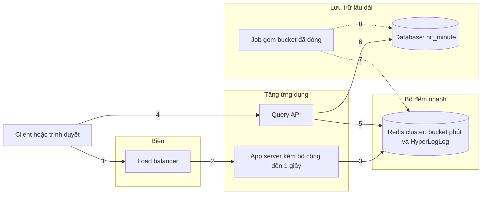
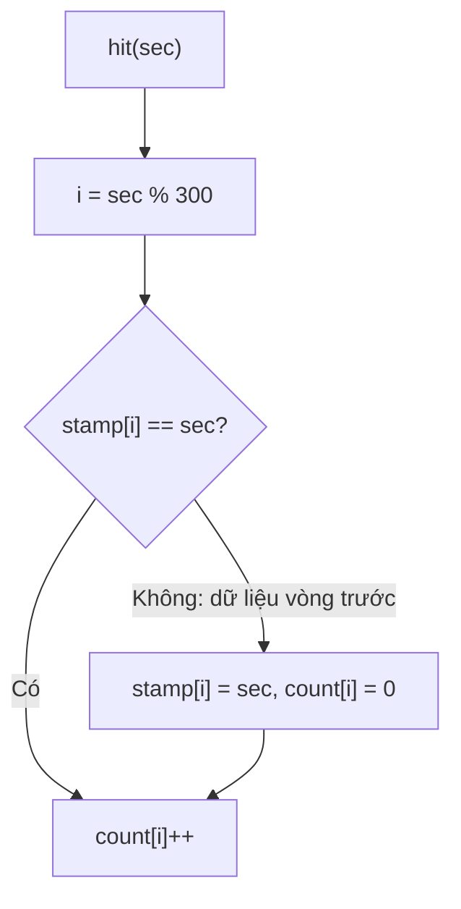
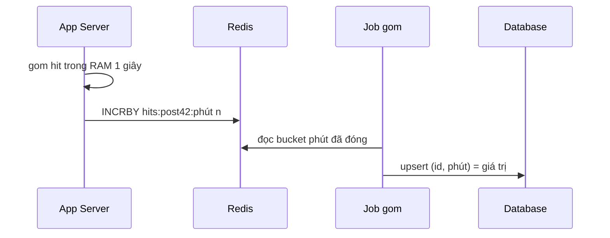

# Hit Counter (Đếm lượt truy cập)

**Độ khó:** Easy

Hit Counter là hệ thống đếm lượt xem trang hay lượt click, và trả lời được những câu hỏi như "5 phút qua có bao nhiêu hit?". Một "hit" là một lượt truy cập. Lưu lượng có thể lên hàng chục nghìn hit mỗi giây.

**Tóm tắt:**

- Hit counter ghi rất nhiều, đọc ít, chấp nhận sai lệch nhỏ, nên đổi một chút độ chính xác lấy tải ghi giảm mạnh.
- Không ghi từng hit vào database mà cộng dồn trong Redis bằng `INCR` atomic, rồi gom batch xuống database định kỳ.
- Chia thời gian thành bucket (mỗi phút hoặc giây): "N phút gần nhất" là tổng N bucket, bucket cũ tự hết hạn bằng TTL.
- Trong một tiến trình dùng vòng bucket cố định (`giây % N`) kèm nhãn giây để biết bucket nào là dữ liệu của vòng trước; memory không đổi dù hit bao nhiêu.
- Một bài viral tạo hot key vì mỗi key nằm trên đúng một shard; chia thành K key con, ghi ngẫu nhiên và cộng K key khi đọc.
- Job đẩy xuống database phải idempotent: upsert đặt giá trị tuyệt đối cho bucket đã đóng, không dùng `count = count + n`.
- Đếm người dùng duy nhất bằng HyperLogLog (khoảng 12 KB, sai số khoảng 0,8%); cần chính xác tuyệt đối (tiền) thì ghi log từng event.
- Kiến trúc gồm load balancer, app server cộng dồn, Redis cluster giữ bucket, Query API, job gom nền và database lưu số liệu lâu dài.

## Vấn đề nó giải quyết

Cách ngây thơ nhất là mỗi hit chạy một lệnh `UPDATE` vào database. Cách đó làm database chết rất nhanh, nhất là khi nhiều người cùng tăng một bộ đếm của một bài viral (hiện tượng hot key: một key bị dồn tải). Vì vậy phải tìm cách đếm nhanh mà vẫn đủ chính xác để dùng được.

## Khi nào nên dùng, khi nào không

Dùng cho lượt xem bài viết, click quảng cáo, số người đang online. Nếu bạn cần đếm chính xác tuyệt đối từng event (thanh toán, tiền bạc) thì hãy ghi log từng event, đừng dựa vào bộ đếm gần đúng, vì bộ đếm trong RAM có thể mất vài giây dữ liệu khi sự cố.

## Cách làm tóm tắt

Tăng bộ đếm trong Redis bằng lệnh `INCR` thay vì ghi thẳng database, rồi gom theo batch và đẩy xuống database định kỳ. Muốn trả số liệu theo khoảng thời gian thì chia bộ đếm thành từng bucket (ô thời gian theo phút hoặc giây) và cộng các bucket nằm trong cửa sổ cần hỏi.

## Các khái niệm cần biết

- **Bucket**: một ô đếm gắn với một khoảng thời gian cố định (ví dụ một phút). Hỏi "5 phút qua" nghĩa là cộng 5 bucket gần nhất.
- **`INCR` / `INCRBY` (Redis)**: tăng một số nguyên thêm 1 hoặc thêm n theo kiểu atomic, nên nhiều server cùng tăng không bị mất lần nào.
- **TTL**: thời gian sống của key. Bucket cũ tự bị xóa, nên Redis không phình mãi.
- **Hot key**: một key nhận lượng ghi quá lớn. Vì mỗi key nằm trên đúng một shard, shard đó thành bottleneck.
- **Vòng bucket (ring buffer)**: mảng có kích thước cố định, chỉ số tính bằng `giây % N`, nên bucket cũ bị ghi đè dần. Memory không đổi dù hit bao nhiêu.
- **Upsert**: một lệnh "chèn nếu chưa có, cập nhật nếu đã có". Dùng để job đẩy xuống DB chạy lại an toàn.
- **Idempotent**: thao tác chạy một lần hay nhiều lần đều cho cùng kết quả. Quan trọng khi job có thể bị retry.
- **HyperLogLog**: cấu trúc xác suất của Redis để đếm số phần tử khác nhau (người dùng duy nhất) bằng khoảng 12 KB, sai số khoảng 0,8%.
- **AOF**: chế độ ghi nhật ký của Redis ra đĩa để khôi phục sau khi khởi động lại.
- **HTTP 202 Accepted**: server đã nhận request nhưng chưa xử lý xong, hợp với ghi asynchronous.

**Nền tảng:** Bài toán là ghi rất nhiều, đọc ít và chấp nhận sai lệch nhỏ. Vì vậy không ghi từng hit vào database mà cộng dồn trong RAM (Redis `INCR` atomic), chia thời gian thành các bucket, rồi gom theo batch xuống DB; đổi lại có thể mất vài giây dữ liệu khi sự cố.

## Yêu cầu

- `hit(id)` ghi nhận một lượt; `getCount(id, khoảng thời gian)` trả tổng.
- Ghi rất nhiều, đọc ít hơn; cho phép sai lệch nhỏ.

## Kiến trúc tổng thể

Sơ đồ cho thấy đường ghi (cộng dồn trong RAM rồi `INCRBY` vào Redis), đường đọc (khoảng gần đọc Redis, khoảng cũ đọc database) và job nền gom bucket đã đóng xuống database.



**Chú thích sơ đồ**

| Thành phần | Vai trò | Vì sao chọn / đánh đổi |
|---|---|---|
| Load balancer | Chia `POST /api/v1/hits` cho nhiều app server | Stateless nên scale ngang; cần nhân đôi |
| App server kèm bộ cộng dồn 1 giây | Trả `202` ngay, cộng hit trong RAM theo (id, phút) rồi gửi `INCRBY` | Giảm số lệnh Redis theo số hit trùng id trong giây; đổi lại app chết thì mất tối đa 1 giây hit |
| Redis cluster | Giữ bucket `hits:{id}:{yyyyMMddHHmm}` có TTL khoảng 2 giờ và HyperLogLog người dùng duy nhất | `INCR` atomic, nhanh, rẻ memory; đổi lại một key nằm trên một shard nên bài viral thành hot key, xử lý bằng K key con |
| Query API | Trả `getCount` theo khoảng: cộng N bucket | Tách đọc khỏi ghi để scale riêng; khoảng cũ phải xuống database |
| Job gom bucket đã đóng | Đẩy bucket phút đã qua xuống database bằng upsert đặt giá trị tuyệt đối | Retry bao nhiêu lần cũng cho cùng kết quả; đổi lại chỉ gom bucket đã đóng nên dữ liệu lâu dài trễ vài phút |
| Database | Lưu `hit_minute(id, minute, count)` làm số liệu lâu dài | Chỉ nhận số đã gom theo batch nên không bị 35.000 UPDATE/giây; đổi lại không phải nơi đọc số liệu thời gian thực |

Luồng theo số trên mũi tên:

1. Client gửi `POST /api/v1/hits` qua load balancer.
2. Load balancer chuyển request tới một app server, app server trả `202` ngay.
3. App server gửi `INCRBY` theo (id, phút) vào Redis sau khi cộng dồn trong RAM khoảng 1 giây.
4. Khi cần xem số liệu, client gọi `GET /api/v1/hits/{id}?window=5m` tới Query API.
5. Với khoảng gần đây, Query API `MGET` các bucket phút trong Redis rồi cộng lại.
6. Với khoảng cũ, Query API đọc bảng `hit_minute` trong database.
7. Job nền (nét đứt) đọc các bucket phút đã đóng trong Redis.
8. Job ghi chúng vào database bằng upsert đặt giá trị tuyệt đối để retry không đếm đúp.

**Điểm nghẽn:** Đầu tiên là hot key khi một bài viral dồn mọi ghi vào một shard Redis: chia thành K key con, ghi ngẫu nhiên và cộng K key khi đọc. Tiếp theo là số lệnh Redis theo hit: cộng dồn trong RAM ở app server và thêm shard khi 35.000 hit/giây đỉnh vượt khả năng một node.

## Ước lượng

Giả định: 1 tỷ hit/ngày, 1 triệu bài đang hoạt động, cần số theo phút trong 1 giờ gần nhất.

| Đại lượng | Tính | Kết quả |
|---|---|---|
| Hit trung bình | 1 tỷ / 86.400 | khoảng 11.600/giây |
| Hit đỉnh (x3) | | khoảng 35.000/giây |
| Số key bucket phút | 1 triệu bài x 60 phút | 60 triệu key, vài GB RAM (xấp xỉ, tùy chi phí mỗi key của Redis) |
| Ghi xuống DB nếu ghi thẳng | | 35.000 UPDATE/giây: quá tải |
| Ghi xuống DB nếu gom theo phút | 1 triệu bài mỗi phút | khoảng 17.000 dòng/giây khi cả triệu bài cùng có hit, thực tế ít hơn nhiều vì chỉ bài có hit mới ghi |

Kết luận: bộ đếm trong RAM, DB chỉ nhận số đã gom theo batch.

## API và dữ liệu

```text
POST /api/v1/hits            { "id": "post42" }                -> 202 Accepted
GET  /api/v1/hits/post42?window=5m                            -> 200 { "count": 1234 }
```

```text
Redis:  hits:{id}:{yyyyMMddHHmm}   (số nguyên, TTL khoảng 2 giờ)
        uv:{id}:{yyyyMMdd}         (HyperLogLog, người dùng duy nhất)
SQL:    hit_minute(id, minute, count, PRIMARY KEY (id, minute))
```

Ghi trả `202` ngay, không đợi DB. Đọc 5 phút gần nhất là `MGET` 5 key của 5 bucket phút rồi cộng lại.

## Thuật toán lõi: vòng bucket và bộ đếm chia nhỏ

Trong một tiến trình, dùng vòng cố định 300 bucket mỗi giây: memory không đổi dù hit nhiều đến đâu. Bucket mang theo nhãn giây để biết khi nào là dữ liệu của vòng trước (cần reset). Nếu thiếu nhãn này, bucket cũ sẽ bị cộng nhầm vào số liệu mới và con số bị phình lên.



Đã chạy thử, Java 11 trở lên:

```java
static class HitCounter {
    static final int N = 300;                  // cửa sổ 300 giây
    private final long[] stamp = new long[N];  // giây mà bucket đang đại diện
    private final long[] count = new long[N];

    synchronized void hit(long sec) {
        int i = (int) (sec % N);
        // bucket của vòng trước: reset
        if (stamp[i] != sec) { stamp[i] = sec; count[i] = 0; }
        count[i]++;
    }

    synchronized long getCount(long nowSec) {
        long total = 0;
        for (int i = 0; i < N; i++)
            // chỉ cộng bucket còn trong cửa sổ
            if (nowSec - stamp[i] < N) total += count[i];
        return total;
    }
}
// hit(1), hit(2), hit(3), hit(3), hit(300): getCount(300) = 5, getCount(301) = 4 (giây 1 rơi ra),
// sau hit(301): getCount(301) = 5, getCount(303) = 2
```

**Phải thuộc:** Đếm theo khoảng thời gian bằng bucket (mỗi phút hoặc giây), tổng N phút gần nhất là cộng N bucket, bucket cũ tự hết hạn bằng TTL. Hot key (một bài viral) xử lý bằng cách chia thành K bộ đếm con rồi cộng lại khi đọc. Đếm người dùng duy nhất bằng HyperLogLog (khoảng 12 KB, sai số khoảng 0,8%).

**Hot counter** (một bài viral làm một key Redis nhận hàng chục nghìn ghi/giây, mà một key luôn nằm trên một shard): chia thành K key con, ghi vào key ngẫu nhiên, đọc thì cộng K key.

```java
static class ShardedCounter {
    private final AtomicLongArray parts;
    ShardedCounter(int k) { parts = new AtomicLongArray(k); }
    void incr() { parts.incrementAndGet(ThreadLocalRandom.current().nextInt(parts.length())); }
    long sum() { long s = 0; for (int i = 0; i < parts.length(); i++) s += parts.get(i); return s; }
}
```

Với Redis tương đương là `INCR hits:post42:202610271530:{0..K-1}`; K khoảng 8-16 là đủ, đọc tốn K lần `MGET` nên chỉ áp dụng cho key đã được phát hiện là nóng.



**Suy luận:** Hit counter ghi rất nhiều, đọc ít và chấp nhận sai lệch nhỏ, nên thiết kế đi theo hướng đổi một chút độ chính xác lấy tải ghi giảm mạnh. Mỗi hit chạy một `UPDATE` thì database chịu hàng chục nghìn ghi mỗi giây trên cùng vài dòng, nên ta cộng dồn trong memory bằng `INCR` atomic của Redis rồi gom batch xuống database ở cuối mỗi phút. Chia thời gian thành bucket làm câu hỏi "N phút gần nhất" thành phép cộng N bucket, và cho phép xóa bucket cũ bằng TTL nên memory không phình. Hạn chế của cách này là mỗi key nằm trên đúng một shard, nên một bài viral biến một key thành hot key; chia thành K key con rồi cộng khi đọc xử lý được vì ghi được rải ra K nơi. Điểm dễ nhầm là nghĩ upsert `count = count + n` an toàn khi retry: nó không idempotent nên retry sẽ đếm đúp, còn đặt giá trị tuyệt đối cho bucket đã đóng thì chạy lại bao nhiêu lần cũng cho cùng kết quả. Hệ quả: chấp nhận mất vài giây hit khi Redis hoặc app chết, và đừng dùng thiết kế này cho tiền.

## Đào sâu

**1. Giảm tải ghi.** Mỗi app server cộng dồn hit trong RAM mỗi 1 giây rồi gửi một `INCRBY` cho mỗi (id, phút), thay vì một `INCR` mỗi hit: số lệnh Redis giảm theo hệ số số hit trùng id trong giây. Đánh đổi: app chết thì mất tối đa 1 giây hit chưa gửi, chấp nhận được với bộ đếm gần đúng.

**Phải thuộc:** Job đẩy xuống DB phải idempotent: dùng upsert đặt giá trị tuyệt đối cho bucket đã đóng (`ON CONFLICT ... DO UPDATE SET count = EXCLUDED.count`), không dùng `count = count + n`, để retry không đếm đúp.

**2. Đẩy xuống DB an toàn khi retry.** Job gom mà chạy `count = count + n` rồi bị lỗi và chạy lại thì đếm đúp. Dùng upsert **đặt giá trị tuyệt đối** cho bucket phút đã đóng: `INSERT ... ON CONFLICT (id, minute) DO UPDATE SET count = EXCLUDED.count` (PostgreSQL), chạy lại bao nhiêu lần cũng cho cùng kết quả. Chỉ gom bucket phút đã qua để giá trị không còn đổi.

**Người dùng duy nhất.** `PFADD uv:post42:20261027 userId` rồi `PFCOUNT`: mỗi key tối đa khoảng 12 KB, sai số khoảng 0,8%. Đổi chính xác lấy memory; không dùng cho tiền hay quyền lợi.

## Lỗi và giám sát

| Tình huống | Cách xử lý |
|---|---|
| Redis mất dữ liệu (restart không bền vững) | Mất một ít số gần đây, chấp nhận hoặc bật AOF; số cũ nằm ở DB |
| Retry hoặc bot đếm trùng | Khử trùng theo (userId hoặc IP, id, phút) bằng `SET NX` TTL ngắn, hoặc lọc bot ở tầng trước |
| Job gom chậm hoặc lỗi | Số phút cũ thiếu: cảnh báo độ trễ job, chạy bù theo phút |
| Hot key | Phát hiện bằng `--hotkeys` hoặc đếm theo id ở app, chuyển sang bộ đếm chia nhỏ |

Theo dõi: lệnh/giây và p99 từng shard Redis, độ trễ job gom, chênh lệch tổng giữa Redis và DB, phần trăm hit bị loại vì trùng.

## Điểm cần nhắc

- Chia thời gian thành bucket (mỗi phút hoặc giờ); số trong N phút gần nhất là tổng N bucket.
- Bộ đếm cực nóng (một bài viral): chia nhỏ thành nhiều bộ đếm con rồi cộng lại.
- Cần đếm chính xác người dùng duy nhất: dùng HyperLogLog (xấp xỉ, rất tiết kiệm memory).
- Chống đếm trùng do bot hoặc retry.

