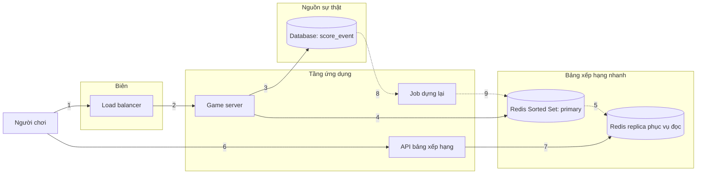
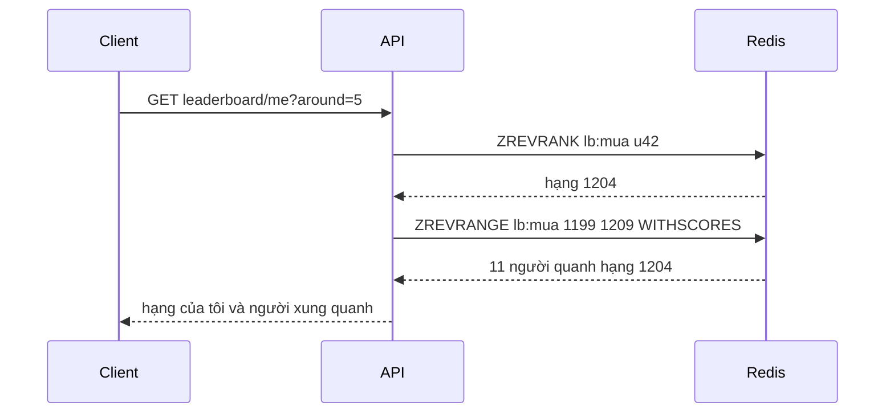
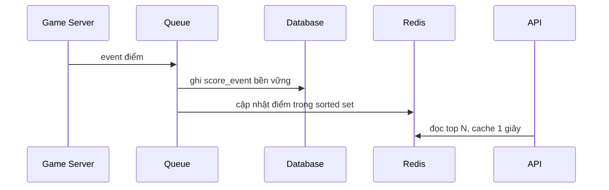

# Leaderboard (Bảng xếp hạng)

**Độ khó:** Easy

Leaderboard là bảng xếp hạng người chơi theo điểm. Nó phải trả lời nhanh hai câu hỏi: "top 10 là ai?" và "tôi đang hạng mấy?", trong khi điểm thay đổi liên tục và có thể có hàng triệu người chơi.

**Tóm tắt:**

- Bảng xếp hạng phải trả lời nhanh "top N là ai" và "tôi hạng mấy" khi điểm đổi liên tục; SQL `ORDER BY` hay đếm lại hàng triệu dòng mỗi lần là quá chậm.
- Redis Sorted Set (skip list cộng hash map) giữ sẵn thứ tự, nên cập nhật điểm, lấy top và lấy hạng đều khoảng O(log N).
- Bốn lệnh cốt lõi: `ZINCRBY`/`ZADD` (cập nhật), `ZREVRANGE ... WITHSCORES` (top N), `ZREVRANK` (hạng, đếm từ 0).
- Cùng điểm thì Redis xếp theo thứ tự từ điển của member; muốn "đạt điểm trước xếp trên" phải gộp thời điểm vào score.
- Redis chạy trong memory nên chỉ là bản sao nhanh; giữ `score_event` ở database làm nguồn sự thật để dựng lại.
- Quá một node thì shard theo userId: top N toàn cục là gộp top N của từng shard, còn hạng chính xác của người bất kỳ đắt nên thường chỉ trả hạng gần đúng ngoài top.
- Mỗi mùa giải dùng một key riêng và xử lý event điểm phải idempotent.
- Kiến trúc gồm load balancer, game server, Redis Sorted Set có replica, API bảng xếp hạng, database `score_event` và job dựng lại.

## Vấn đề nó giải quyết

Nếu làm bằng SQL, bạn viết `ORDER BY score DESC` để lấy top, và đếm số người có điểm cao hơn để biết hạng. Mỗi lần hỏi, database phải sắp xếp lại hoặc đếm hàng triệu dòng, quá chậm khi điểm cập nhật liên tục. Thứ ta cần là một cấu trúc dữ liệu luôn giữ sẵn thứ tự, để cập nhật điểm và hỏi hạng đều rẻ.

## Khi nào nên dùng, khi nào không

Dùng cho game, cuộc thi, ứng dụng học tập có điểm thưởng. Nếu chỉ có vài trăm người dùng thì một query SQL có index là đủ, không cần dựng thêm Redis.

## Cách làm tóm tắt

Dùng Redis Sorted Set: `ZADD` hoặc `ZINCRBY` cập nhật điểm, `ZREVRANGE` lấy top N, `ZREVRANK` lấy hạng, tất cả đều khoảng O(log N). Khi dữ liệu quá lớn cho một node thì chia shard theo người chơi hoặc theo mùa giải.

## Các khái niệm cần biết

- **Sorted Set (ZSET)**: tập hợp của Redis, mỗi phần tử (member) có một điểm (score) và luôn được giữ sắp xếp theo điểm. Dùng khi cần xếp hạng hoặc lấy theo khoảng điểm.
- **Skip list**: cấu trúc danh sách nhiều tầng, tầng trên có "đường tắt" nhảy xa, giúp tìm kiếm và chèn trong O(log N) như cây cân bằng nhưng đơn giản hơn.
- **O(log N)**: thời gian tăng rất chậm theo kích thước, với 10 triệu phần tử chỉ khoảng 23 bước.
- **Top N**: N phần tử có điểm cao nhất.
- **Mùa giải (season)**: một kỳ xếp hạng có điểm đầu và cuối; mỗi mùa dùng một key riêng.
- **AOF/RDB**: hai cơ chế lưu Redis ra đĩa. Không bật thì khởi động lại là mất sạch.
- **Failover**: tự động chuyển sang replica khi node chính hỏng.
- **Race condition và Lua script**: đọc điểm cũ rồi ghi điểm mới ở hai lệnh riêng có thể bị xen vào bởi người khác; script Lua chạy nguyên khối nên tránh được.
- **Idempotent**: xử lý một event điểm hai lần không được cộng điểm hai lần.

**Nền tảng:** Bảng xếp hạng cần một cấu trúc dữ liệu luôn giữ sẵn thứ tự để cập nhật điểm và hỏi hạng đều rẻ. Redis Sorted Set (skip list cộng hash map) cho các thao tác này ở O(log N), trong khi SQL `ORDER BY` phải sắp xếp hoặc đếm lại hàng triệu dòng mỗi lần.

## Thao tác với Redis Sorted Set

Cả ba câu hỏi của người chơi (cập nhật điểm, xem top, xem hạng của tôi) đều quy về các lệnh dưới đây. Lệnh `REV` nghĩa là sắp từ điểm cao xuống thấp, đúng với bảng xếp hạng. Từ Redis 6.2, `ZREVRANGE` được đánh dấu lỗi thời (deprecated) và thay bằng `ZRANGE ... REV`; lệnh cũ vẫn chạy được.

| Việc cần làm | Lệnh |
|---|---|
| Cập nhật điểm | `ZINCRBY leaderboard 10 user42` |
| Top 10 | `ZREVRANGE leaderboard 0 9 WITHSCORES` |
| Hạng của một người | `ZREVRANK leaderboard user42` |
| Người xung quanh hạng của mình | `ZREVRANGE` quanh hạng vừa tra |

**Phải thuộc:** Bốn lệnh cốt lõi: `ZINCRBY` (cộng điểm), `ZREVRANGE ... WITHSCORES` (top N), `ZREVRANK` (hạng, đếm từ 0), `ZADD` (đặt điểm). Tất cả khoảng O(log N). Cùng điểm thì Redis xếp theo thứ tự từ điển của member, muốn xếp theo thời điểm đạt điểm thì gộp thời gian vào điểm.

## Kiến trúc tổng thể

Sơ đồ cho thấy đường cập nhật điểm (ghi event bền vững, rồi cập nhật Redis Sorted Set), đường đọc top N và hạng qua API có cache ngắn, và đường dựng lại Redis từ database khi cần.



**Chú thích sơ đồ**

| Thành phần | Vai trò | Vì sao chọn / đánh đổi |
|---|---|---|
| Load balancer | Chia request cập nhật điểm cho các game server | Stateless nên scale ngang; cần nhân đôi |
| Game server | Nhận sự kiện điểm, ghi `score_event`, rồi gọi `ZINCRBY` | Event idempotent để retry không cộng đúp; đổi lại có hai nơi ghi không chung transaction |
| Redis Sorted Set (primary) | Giữ sẵn thứ tự điểm: cập nhật, top N, hạng đều khoảng O(log N) | Skip list cộng hash map nên nhanh hơn `ORDER BY` rất nhiều; đổi lại nằm trong memory nên chỉ là bản sao nhanh |
| Redis replica | Phục vụ đọc top N và hạng | Tách tải đọc khỏi ghi; đổi lại trễ vài trăm ms so với primary, chấp nhận được |
| API bảng xếp hạng | Trả top N, hạng của tôi và người xung quanh, cache kết quả khoảng 1 giây | Tải đọc lớn hơn ghi nhiều lần nên cache ngắn hấp thụ phần lớn; đổi lại số liệu cũ tối đa khoảng 1 giây |
| Database (`score_event`) | Nguồn sự thật, dựng lại Redis được | Bền vững, truy vết được; đổi lại chậm nên không nằm trên đường đọc |
| Job dựng lại | Đọc event theo batch rồi `ZADD` vào Redis cho một mùa | Phục hồi sau khi Redis mất dữ liệu; đổi lại tốn thời gian khi mùa có nhiều event |

Luồng theo số trên mũi tên:

1. Người chơi gửi sự kiện điểm (`POST /api/v1/scores`) tới load balancer.
2. Load balancer chuyển tới một game server.
3. Game server ghi `score_event` vào database để làm nguồn sự thật bền vững.
4. Game server gọi `ZINCRBY lb:{mùa}` trên Redis primary để cập nhật điểm.
5. Redis primary sao chép sang replica (nét đứt vì bất đồng bộ).
6. Người chơi gọi `GET /api/v1/leaderboard` hoặc `/me` tới API bảng xếp hạng.
7. API đọc top N bằng `ZREVRANGE` và hạng bằng `ZREVRANK` từ replica.
8. Khi Redis mất dữ liệu, job dựng lại đọc `score_event` theo batch từ database.
9. Job `ZADD` kết quả vào Redis để dựng lại bảng của mùa.

**Điểm nghẽn:** Đầu tiên là tải đọc top N và hạng: cache kết quả ngắn ở API và thêm replica. Tiếp theo là một node Redis khi vượt dung lượng hoặc tải ghi: shard theo `userId`, top N toàn cục là gộp top N của từng shard, còn hạng chính xác ngoài top thì trả gần đúng.

## Ước lượng

Giả định: 10 triệu người chơi trong mùa, mỗi ngày 2 triệu người hoạt động, mỗi người sinh 20 lần đổi điểm.

| Đại lượng | Tính | Kết quả |
|---|---|---|
| Cập nhật điểm | 2 triệu x 20 / 86.400 | khoảng 460/giây, đỉnh vài nghìn/giây |
| Memory sorted set | 10 triệu thành viên x khoảng 100 B | khoảng 1 GB (xấp xỉ, tùy độ dài id) |
| Chi phí mỗi thao tác | log2(10 triệu) | khoảng 23 bước (skip list), cỡ microsecond |
| Đọc top 100 | tải đọc thường lớn hơn ghi nhiều lần | cache kết quả 1 giây ở API |

Kết luận: toàn bộ bảng vừa một node Redis; vấn đề thật là tải đọc top N và độ bền, không phải dung lượng.

## API và dữ liệu

```text
POST /api/v1/scores            { "userId": "u42", "delta": 10 }       -> 200 { "score": 1510 }
GET  /api/v1/leaderboard?top=10                                         -> 200 [ {userId, score, rank}, ... ]
GET  /api/v1/leaderboard/me?around=5                                    -> 200 hạng của tôi và 5 người trên, 5 người dưới
```

```text
Redis:  lb:{mùa}  (sorted set, member = userId, score = điểm)
SQL:    score_event(id, user_id, season, delta, created_at)   -- nguồn sự thật, dựng lại Redis được
```

Ví dụ lệnh, "tôi và người xung quanh":

```text
ZINCRBY lb:2026-w44 10 u42            # cập nhật, trả điểm mới
ZREVRANK lb:2026-w44 u42              # hạng (đếm từ 0), ví dụ 1204
ZREVRANGE lb:2026-w44 1199 1209 WITHSCORES   # 5 người trên và 5 người dưới
```



Đọc sơ đồ: trước hết hỏi hạng của người chơi, rồi dùng hạng đó làm tâm của một đoạn `ZREVRANGE`. Hai lệnh này không atomic với nhau, nên giữa hai lần gọi hạng có thể đã đổi một chút; với bảng xếp hạng thì sai lệch này chấp nhận được.

## Thuật toán lõi: vì sao O(log N) và xử lý điểm bằng nhau

Sorted set của Redis là **skip list** (duyệt theo thứ tự, mỗi node có "đường tắt" nhảy xa) cộng một hash map `member -> score`. Skip list lưu thêm số bước của mỗi đường tắt nên `ZRANK` tính được hạng bằng cách cộng dần số bước trên đường đi, cỡ O(log N) chứ không đếm từng phần tử.

Cùng điểm, Redis xếp theo thứ tự từ điển của member, không phải thời gian. Muốn "đạt điểm trước thì xếp trên", gộp thời điểm vào điểm. Double có 53 bit nguyên chính xác, ví dụ chia 31 bit cho điểm và 22 bit cho giây kể từ đầu mùa (2^22 giây là khoảng 48 ngày). Đã chạy thử, Java 11 trở lên:

```java
static final int TS_BITS = 22;
static final long TS_MAX = (1L << TS_BITS) - 1;

// Điểm lớn xếp trên; cùng điểm thì giây nhỏ hơn (đạt sớm hơn) cho giá trị lớn hơn
static double composite(long score, long secSinceSeasonStart) {
    // chính xác khi score < 2^31
    return (double) ((score << TS_BITS) | (TS_MAX - secSinceSeasonStart));
}
static long scoreOf(double c) { return ((long) c) >> TS_BITS; }

// composite(1500, 100) > composite(1500, 200) > composite(1499, 1)
```

Khi dùng cách này, điểm thật lấy bằng `scoreOf`, và cập nhật điểm là `ZADD` giá trị gộp mới (đọc điểm cũ, cộng, gộp lại), nên dùng script Lua để tránh race. Nếu bảng chỉ giữ điểm cao nhất của mỗi người (không cộng dồn) thì `ZADD ... GT` (Redis 6.2 trở lên) là đủ.



**Suy luận:** Câu hỏi "hạng của tôi là bao nhiêu" khó với SQL vì thứ hạng là thuộc tính của cả tập dữ liệu chứ không của một dòng: phải đếm số người có điểm cao hơn, và việc đếm đó vẫn tốn thời gian tuyến tính theo số người dù có index. Sorted set của Redis giải quyết bằng skip list có lưu số bước của mỗi đường tắt, nên cộng dồn số bước dọc đường đi cho ra hạng trong O(log N). Hash map đi kèm cho tra điểm theo member trong O(1), nên cập nhật điểm cũng rẻ. Vì toàn bộ nằm trong memory, Redis là bản sao nhanh chứ không phải nguồn sự thật: mất node là mất bảng, nên phải giữ `score_event` ở database để dựng lại. Điểm dễ nhầm là cùng điểm: Redis xếp theo thứ tự từ điển của member chứ không theo thời điểm đạt điểm, nên nếu luật là "đạt trước xếp trên" thì phải gộp thời gian vào score. Hệ quả khi dữ liệu vượt một node: shard theo userId làm top N toàn cục thành gộp top N của từng shard, còn hạng chính xác của người bất kỳ trở nên đắt nên thường chỉ trả hạng gần đúng ngoài top.

## Đào sâu

**1. Quá một node: chia shard.** Chia theo **userId** (hash): cập nhật và hạng cục bộ đơn giản, top N toàn cục là gộp top N của mỗi shard (top 10 toàn cục chắc chắn nằm trong hợp các top 10 của từng shard), tốn K lần đọc. Hạng chính xác của một người bất kỳ phải cộng `ZCOUNT` điểm cao hơn trên mọi shard, đắt. Thực tế: chỉ trả hạng chính xác cho top vài nghìn, còn lại trả hạng gần đúng (phần trăm, khoảng) tính từ histogram điểm. Chia theo **khoảng điểm** thì hạng đúng nhưng người chơi di chuyển giữa shard khi điểm đổi và shard cao điểm nóng.

**2. Độ bền và dựng lại.** Redis chạy trong memory nên mất khi hỏng nếu không bật AOF/RDB. Giữ `score_event` ở DB là nguồn sự thật; dựng lại một mùa bằng cách đọc theo batch rồi `ZADD`. Replica Redis phục vụ đọc top N; đọc có thể trễ vài trăm ms so với primary, chấp nhận được cho bảng xếp hạng.

## Lỗi và giám sát

| Tình huống | Cách xử lý |
|---|---|
| Cập nhật điểm bị retry | Gắn eventId duy nhất, bỏ qua event đã xử lý (idempotent) |
| Redis chết | Failover sang replica, dựng lại phần thiếu từ `score_event` |
| Hết mùa | Đóng key cũ (chỉ đọc), chụp top vào DB, tạo key mới; đặt `EXPIRE` cho key cũ |
| Gian lận điểm | Kiểm tra phía server, rate limiting tăng điểm, loại tài khoản |

Theo dõi: p99 `ZINCRBY` và `ZREVRANGE`, kích thước sorted set, độ trễ replica, độ trễ queue, chênh lệch tổng điểm giữa Redis và DB.

## Điểm cần nhắc

- Redis chạy trong memory: lưu điểm gốc ở DB để khôi phục khi cần.
- Bảng theo tuần/tháng: mỗi kỳ dùng một key riêng, đặt thời gian hết hạn.
- Quy mô rất lớn: chia theo shard rồi gộp top của từng shard.
- Cùng điểm: quyết định thứ tự bằng thời điểm đạt điểm.

