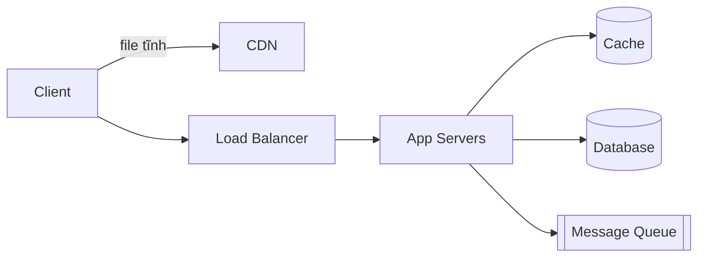
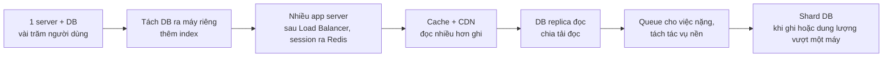
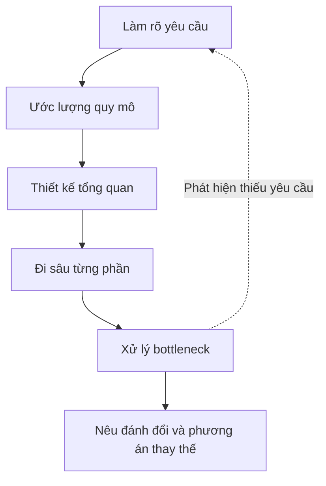

# Bài 1: Giới thiệu System Design

!!! note "Mục tiêu"
    Hiểu System Design là gì, vì sao cần, và các khái niệm nền tảng trước khi đi vào từng chủ đề.

**Tóm tắt:**

- System Design là xác định kiến trúc, thành phần và cách chúng giao tiếp để hệ thống đáp ứng yêu cầu chức năng lẫn phi chức năng ở quy mô cần thiết.
- Không có đáp án tuyệt đối: mọi lựa chọn là một đánh đổi xuất phát từ yêu cầu và quy mô, và người thiết kế giỏi nói rõ vì sao chọn A thay vì B.
- Quy trình lặp lại ở mọi bài: làm rõ yêu cầu, ước lượng, thiết kế tổng quan, đào sâu, xử lý bottleneck, nêu đánh đổi.
- Scale up (vertical) đơn giản nhưng có trần và là single point of failure; scale out (horizontal) gần như không giới hạn nhưng cần load balancer và server stateless.
- Availability tính bằng số chín: 99,9% chết tối đa khoảng 8,76 giờ mỗi năm; thành phần nối tiếp thì nhân availability (giảm), dư thừa thì tăng.
- Định luật Little: số concurrent request = throughput x latency.
- Hệ thống lớn dần từng bước theo bottleneck có số liệu; dựng Kafka hay sharding từ ngày đầu chỉ tốn chi phí.

## System Design là gì?

System Design là quá trình xác định **kiến trúc, thành phần và cách các thành phần giao tiếp** để một hệ thống phần mềm đáp ứng yêu cầu về chức năng lẫn phi chức năng (hiệu năng, độ tin cậy, khả năng mở rộng...). Cụ thể, bạn quyết định hệ thống gồm những phần nào (server, database, cache, queue...) và chúng nói chuyện với nhau ra sao để đáp ứng yêu cầu của bài toán.

Nếu coding trả lời "viết hàm này thế nào", thì system design trả lời "hệ thống gồm những phần nào, đặt ở đâu, nói chuyện với nhau ra sao, và chịu được bao nhiêu người dùng". Hãy so sánh với xây nhà: viết code giống như lắp một căn phòng, còn system design là bản vẽ cả tòa nhà, gồm móng, đường ống, thang máy, để nó không sập khi có một nghìn người dọn vào.

## Vì sao cần System Design?

Code chạy tốt trên máy của bạn hoặc với 100 người dùng chưa chắc chịu nổi một triệu người. Khi đó vấn đề không còn nằm ở một hàm viết sai, mà ở chỗ một database không đủ sức, một server chết là cả hệ thống chết, hay một tác vụ nặng làm chậm mọi người.

Chọn sai kiến trúc lúc đầu thì về sau sửa rất đắt, vì dữ liệu đã nằm sẵn và hệ thống đã có người dùng thật, bạn không thể tắt đi dựng lại. Ngoài ra đây cũng là kỹ năng cốt lõi và là phần quan trọng trong phỏng vấn.

**Nền tảng:** System Design không có đáp án đúng tuyệt đối mà là chuỗi lựa chọn có đánh đổi, xuất phát từ yêu cầu (chức năng và phi chức năng) và quy mô. Mọi bài sau đều lặp lại một khuôn: làm rõ yêu cầu, ước lượng, thiết kế tổng quan, đào sâu, xử lý bottleneck.

## Khi nào cần, khi nào không

Cần khi bắt đầu một dự án mới, khi hệ thống bắt đầu chạm giới hạn (chậm, hay sập), hoặc khi đi phỏng vấn. Với sản phẩm nhỏ chưa có người dùng thì đừng thiết kế quá tay: một server và một database thường là đủ. Dựng sẵn cả Kafka, sharding, nhiều vùng từ ngày đầu chỉ làm tốn tiền và khó bảo trì mà chưa mang lại lợi ích.

## Cách làm tóm tắt

Đi theo các bước: làm rõ yêu cầu, ước lượng quy mô, vẽ thiết kế tổng quan, đào sâu từng thành phần, tìm và xử lý bottleneck. Ở mỗi lựa chọn, luôn nói rõ đánh đổi của nó. Các bước này được trình bày chi tiết ở mục "Quy trình tiếp cận" bên dưới.

## Các khái niệm cần biết

- **Single point of failure (SPOF)**: một thành phần mà nếu nó hỏng thì cả hệ thống ngừng. Mục tiêu của thiết kế chịu lỗi là loại bỏ chúng, thường bằng cách có thêm bản dự phòng.
- **Stateless và stateful**: server stateless không giữ state người dùng trong memory nên request nào đến máy nào cũng được; stateful thì giữ, nên request phải về đúng máy.
- **Replication**: giữ nhiều bản sao của dữ liệu trên nhiều máy để chịu lỗi và chia tải đọc.
- **Sharding**: chia dữ liệu thành nhiều phần đặt ở nhiều máy khi một máy không chứa hoặc không ghi nổi.
- **Hot spot**: một phần (một key, một shard) nhận tải vượt trội so với phần còn lại.
- **Định lý CAP**: trong hệ phân tán, khi mạng bị chia cắt bạn phải chọn giữa consistency và availability.
- **Asynchronous**: giao việc vào queue rồi xử lý sau, thay vì bắt người dùng đợi.
- **Bottleneck**: thành phần chậm nhất, quyết định throughput của cả hệ thống.

## Yêu cầu của hệ thống

**Yêu cầu chức năng (Functional):** hệ thống làm gì. Ví dụ: người dùng đăng ảnh, theo dõi người khác, xem feed.

**Yêu cầu phi chức năng (Non-functional):** hệ thống làm tốt đến đâu.

| Thuộc tính | Ý nghĩa |
|---|---|
| Scalability | Mở rộng khi tải tăng |
| Availability | Tỷ lệ thời gian hệ thống hoạt động (99.9%, 99.99%...) |
| Reliability | Hoạt động đúng, không mất dữ liệu |
| Latency | Response time của một request |
| Throughput | Số request xử lý được mỗi giây |
| Consistency | Mọi người thấy cùng một dữ liệu |
| Maintainability | Dễ sửa, dễ mở rộng tính năng |

## Các thành phần cơ bản

| Thành phần | Vai trò |
|---|---|
| Client | Trình duyệt, ứng dụng mobile |
| DNS | Chuyển tên miền thành địa chỉ IP |
| Load Balancer | Phân phối request giữa nhiều server |
| Web/App Server | Chạy logic nghiệp vụ |
| Database | Lưu trữ bền vững (SQL, NoSQL) |
| Cache | Lưu tạm dữ liệu hay đọc để giảm tải DB (Redis, Memcached) |
| Message Queue | Xử lý asynchronous, tách rời các thành phần (Kafka, RabbitMQ) |
| CDN | Phân phối file tĩnh từ máy chủ gần người dùng |
| Object Storage | Lưu file lớn như ảnh, video (S3) |

## Scale lên như thế nào?

- **Vertical scaling (scale up):** nâng cấu hình một máy (thêm CPU, RAM). Đơn giản nhưng có giới hạn và là single point of failure.
- **Horizontal scaling (scale out):** thêm nhiều máy chạy song song. Mở rộng gần như không giới hạn nhưng phức tạp hơn (cần load balancer, xử lý trạng thái, đồng bộ dữ liệu).

**Phải thuộc:** Scale up (vertical) là nâng cấu hình một máy: đơn giản nhưng có trần và là single point of failure. Scale out (horizontal) là thêm máy: gần như không giới hạn và chịu lỗi tốt, nhưng cần load balancer và server stateless.

## Ví dụ có số: availability, latency, throughput

**Availability ("số chín") đổi ra thời gian chết cho phép:**

| Mục tiêu | Chết tối đa mỗi năm | Mỗi tháng (30 ngày) |
|---|---|---|
| 99% | 3,65 ngày | 7,2 giờ |
| 99,9% | 8,76 giờ | 43 phút |
| 99,99% | 52,6 phút | 4,3 phút |
| 99,999% | 5,26 phút | 26 giây |

Cách tính: `(1 - availability) x thời gian`. Ví dụ 99,9% mỗi tháng: 0,001 x 30 x 24 x 60 = 43,2 phút.

**Phải thuộc:** Số chín: 99,9% chết tối đa khoảng 8,76 giờ mỗi năm (43 phút mỗi tháng); 99,99% khoảng 52,6 phút mỗi năm. Thành phần nối tiếp thì nhân availability (giảm đi), thành phần song song dư thừa thì nhân xác suất hỏng (tăng lên). Định luật Little: số concurrent request = throughput x latency.

**Ghép thành phần:**

- Nối tiếp (request phải qua cả hai): nhân lại. App 99,9% rồi DB 99,9% cho 0,999 x 0,999 = 99,8%. Càng nhiều thành phần bắt buộc, độ sẵn sàng càng giảm.
- Song song (dư thừa, một cái sống là đủ, giả định hỏng độc lập): thất bại nhân lại. Hai bản sao 99,9% cho 1 - 0,001 x 0,001 = 99,9999%. Đây là lý do cần replica và load balancer.

**Latency và throughput liên hệ bằng định luật Little:** số concurrent request đang xử lý = throughput x latency. Ví dụ 1.000 request/giây, mỗi request 200 ms thì cần xử lý khoảng 1.000 x 0,2 = 200 concurrent request. Server chỉ có 50 thread thì queue tăng và latency tăng theo, dù CPU chưa kín.

## Hệ thống lớn lên từng bước

Không dựng kiến trúc cuối cùng từ ngày đầu; thêm thành phần khi có số liệu cho thấy bottleneck.

| Dấu hiệu | Bước tiếp theo |
|---|---|
| CPU app server cao | Thêm server, LB |
| DB đọc chậm, đọc nhiều | Cache, replica đọc |
| DB ghi hoặc dung lượng chạm trần | Shard, hoặc đổi sang kho phù hợp |
| Việc nặng làm chậm request | Đẩy vào queue, xử lý nền |
| Người dùng ở xa, file tĩnh nhiều | CDN |

**Suy luận:** Hệ thống lớn dần theo từng bottleneck, và mỗi thành phần trong kiến trúc là câu trả lời cho một bottleneck cụ thể chứ không phải thứ nên có sẵn. CPU của app server cao thì thêm server sau load balancer, nhưng điều này chỉ làm được khi server stateless, nên session phải ra Redis trước. Khi database đọc chậm, cache và replica đọc xử lý được vì tải đọc lớn hơn ghi nhiều lần; còn khi ghi hoặc dung lượng chạm trần thì mới cần sharding, vì cache và replica không giúp gì cho ghi. Mỗi bước thêm một thứ phải vận hành và một kiểu lỗi mới (dữ liệu cache cũ, replication lag, hot shard), nên dựng Kafka và sharding từ ngày đầu chỉ tăng chi phí mà không giải quyết vấn đề nào có thật. Điểm dễ nhầm là thấy từng thành phần 99,9% availability rồi nghĩ cả hệ thống cũng 99,9%: thành phần nối tiếp nhân lại nên tổng thấp hơn, và chỉ có bản dự phòng độc lập mới nâng nó lên. Hệ quả: trước khi thêm thành phần, hãy chỉ ra con số cho thấy bottleneck và nói rõ thành phần đó đổi lấy cái gì.

## Đánh đổi (Trade-off)

Không có thiết kế hoàn hảo. Mọi quyết định đều là đánh đổi, ví dụ:

- Consistency và Availability (định lý CAP)
- Latency và Throughput
- Đơn giản và linh hoạt
- Chi phí và hiệu năng

Người thiết kế giỏi biết nêu rõ **vì sao chọn A thay vì B** trong bối cảnh cụ thể.

## Quy trình tiếp cận một bài toán thiết kế

Vấn đề đặt ra khi đứng trước một đề bài mở là biết bắt đầu từ đâu. Cách giải quyết là đi theo cùng một trình tự mỗi lần, quay lại bước trước khi phát hiện điều chưa rõ.

1. **Làm rõ yêu cầu:** chức năng nào cần có, quy mô bao nhiêu người dùng.
2. **Ước lượng:** số request mỗi giây, dung lượng lưu trữ, băng thông.
3. **Thiết kế tổng quan:** vẽ các thành phần chính và data flow.
4. **Đi sâu từng phần:** schema database, API, caching, queue.
5. **Xử lý bottleneck:** single point of failure, hot spot, mở rộng.
6. **Nêu đánh đổi** và các phương án thay thế.

## Lộ trình học gợi ý

1. Scalability, Load Balancing
2. Caching, CDN
3. Database: SQL vs NoSQL, Replication, Sharding
4. CAP theorem, Consistency models
5. Message Queue, kiến trúc asynchronous
6. Microservices, API Design
7. Monitoring, độ tin cậy
8. Thực hành các bài toán: URL shortener, News feed, Chat...

