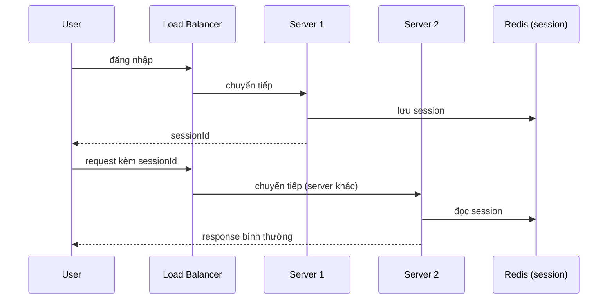
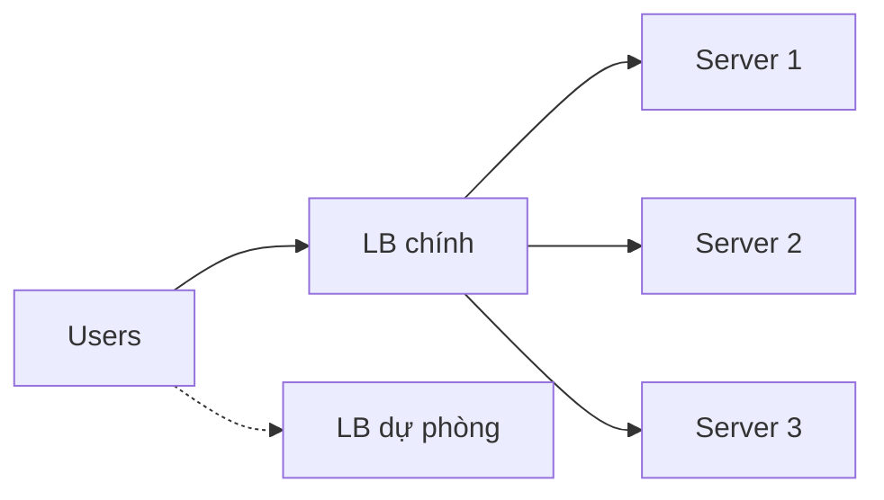
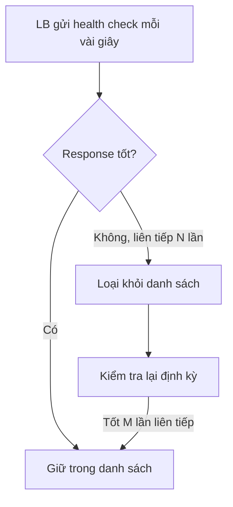

# Bài 2: Scalability và Load Balancing

Scalability là khả năng hệ thống vẫn chạy ổn khi tải tăng. Load Balancer là thành phần đứng trước, nhận request rồi chia cho nhiều server phía sau. Hai thứ này đi cùng nhau: có nhiều server thì mới cần ai đó chia việc.

**Tóm tắt:**

- Scalability là khả năng giữ hiệu năng khi tải tăng; load balancer chia request cho nhiều server phía sau, và hai thứ này đi cùng nhau.
- Scale up (vertical) đơn giản nhưng có trần và là single point of failure; scale out (horizontal) chịu tải và chịu lỗi tốt hơn nhưng phức tạp hơn.
- Muốn scale out thì server phải stateless: state người dùng ra Redis, DB hoặc token, để request nào đến máy nào cũng xử lý được; sticky session chỉ dùng khi bắt buộc.
- Thuật toán: Round Robin, Weighted Round Robin, Least Connections (hợp khi thời gian xử lý chênh lệch), IP Hash (sticky), Consistent Hashing (cache, sharding).
- L4 dựa trên IP và port nên nhanh; L7 đọc được HTTP nên định tuyến theo nội dung nhưng tốn tài nguyên hơn.
- Chính load balancer cũng là single point of failure, nên chạy cặp active-passive hoặc active-active.
- Health check loại server hỏng; connection draining giúp rút server khi deploy mà không cắt request đang chạy.
- Tính số server theo công suất an toàn khoảng 70% cộng dự phòng N+1, và nhiều hơn nếu phải sống sót khi mất cả một vùng.

## Vấn đề nó giải quyết

Một server đơn lẻ có trần về CPU, RAM, băng thông, và nó chết là cả hệ thống chết. Hãy hình dung một quầy thu ngân duy nhất trong siêu thị: khách đông thì xếp hàng dài, nhân viên nghỉ thì cả cửa hàng ngừng bán. Mở thêm nhiều quầy và có một người đứng điều phối khách sang quầy trống chính là scale out cộng load balancer. Nhờ đó hệ thống vừa chịu được nhiều tải hơn, vừa còn chạy khi một máy hỏng.

## Khi nào nên dùng, khi nào không

Dùng khi CPU, RAM hoặc băng thông của một máy gần hết, hoặc khi cần uptime cao. Nếu tải còn thấp thì nâng cấu hình máy (scale up) rẻ và đơn giản hơn nhiều; scale out chỉ đáng khi scale up hết đường. Thêm server mà ứng dụng vẫn giữ session trong RAM thì còn gây lỗi lạ, người dùng đang đăng nhập bỗng bị văng ra khi request rơi sang máy khác.

## Cách làm tóm tắt

Làm cho server stateless (đưa session ra Redis hoặc database), rồi thêm server khi cần. Đặt Load Balancer phía trước với thuật toán phù hợp (round robin, least connections...) và cấu hình health check để loại server hỏng khỏi danh sách.

## Các khái niệm cần biết

- **Stateless**: server không nhớ gì về lần gọi trước. Mọi thông tin cần thiết nằm trong request hoặc kho ngoài (Redis, DB, JWT).
- **Health check**: LB định kỳ gọi một endpoint của từng server để biết còn sống không.
- **Sticky session**: LB luôn đưa cùng một người dùng về cùng một server (qua IP hash hoặc cookie). Chỉ dùng khi buộc phải vậy.
- **Active-passive và active-active**: hai kiểu dự phòng cho chính LB; passive nằm chờ thay thế, active-active cùng chạy chia tải.
- **Connection draining**: khi rút một server, ngừng gửi kết nối mới nhưng để các request đang chạy hoàn tất.
- **N+1**: dự phòng thêm một máy so với số máy cần thiết, để mất một máy vẫn đủ tải.
- **Idempotent**: thao tác lặp lại nhiều lần vẫn cho cùng kết quả; điều kiện để retry an toàn.

## Scalability

Khả năng hệ thống xử lý tải tăng lên mà vẫn giữ được hiệu năng.

| | Vertical (scale up) | Horizontal (scale out) |
|---|---|---|
| Cách làm | Nâng cấu hình một máy | Thêm nhiều máy |
| Ưu điểm | Đơn giản, không đổi code | Gần như không giới hạn, chịu lỗi tốt |
| Nhược điểm | Có trần, đắt, single point of failure | Phức tạp hơn |

### Stateless và Stateful

Muốn scale ngang dễ, server nên **stateless**: không giữ session trong memory. State được đưa ra ngoài (Redis, database, JWT), nhờ đó request nào đến server nào cũng được. Nếu không làm vậy, người dùng đăng nhập ở server 1 rồi request kế tiếp rơi sang server 2 sẽ bị coi là chưa đăng nhập.



**Nền tảng:** Muốn scale ngang thì server phải stateless: state người dùng được đưa ra kho ngoài (Redis, DB) hoặc nằm trong token, để request nào đến máy nào cũng xử lý được. Stateless là điều kiện để load balancer chia tải tự do và để thêm hay bớt server tùy ý.

Đọc sơ đồ: vì session nằm ở Redis dùng chung nên Server 2 vẫn nhận ra người dùng. Đánh đổi là mỗi request thêm một lần gọi Redis và Redis trở thành thành phần cần dự phòng.

## Load Balancer

Đứng trước các server, phân phối request và loại bỏ server hỏng (health check).

### Thuật toán phổ biến

| Thuật toán | Cách hoạt động | Khi dùng |
|---|---|---|
| Round Robin | Lần lượt từng server | Server đồng đều, request nhẹ |
| Weighted Round Robin | Server mạnh nhận nhiều hơn | Server không đồng đều |
| Least Connections | Gửi tới server ít kết nối nhất | Request có thời gian xử lý chênh lệch |
| IP Hash | Cùng IP luôn tới cùng server | Cần "sticky session" |
| Consistent Hashing | Hash ổn định khi thêm/bớt server | Cache, sharding |

**Phải thuộc:** Round Robin (lần lượt), Weighted Round Robin (server mạnh nhận nhiều), Least Connections (server ít kết nối nhất, hợp khi thời gian xử lý chênh lệch), IP Hash (cùng IP về cùng server, sticky), Consistent Hashing (ổn định khi thêm hoặc bớt server).

### Layer 4 và Layer 7

Tên gọi lấy từ mô hình mạng OSI: layer 4 là tầng vận chuyển (TCP/UDP), layer 7 là tầng ứng dụng (HTTP).

- **L4 (transport):** dựa trên IP và port, nhanh, đơn giản. Dùng khi chỉ cần chia kết nối, không cần hiểu nội dung.
- **L7 (application):** đọc được HTTP (URL, header, cookie), định tuyến thông minh (ví dụ `/api` về nhóm server này, `/static` về nhóm kia), nhưng tốn tài nguyên hơn vì phải giải mã và phân tích request.

**Phải thuộc:** L4 dựa trên IP và port (nhanh, không đọc nội dung); L7 đọc HTTP (URL, header, cookie) nên định tuyến theo nội dung, đổi lại tốn tài nguyên hơn.

### Tránh single point of failure

Chính load balancer cũng có thể chết. Giải pháp: chạy một cặp active-passive hoặc active-active.



**Suy luận:** Scale up gặp trần phần cứng và vẫn là một máy duy nhất có thể chết, nên muốn chịu tải lẫn chịu lỗi phải scale out; nhưng scale out chỉ có ích nếu request nào đến máy nào cũng xử lý được. Nếu server giữ session trong memory, load balancer chia tải tự do sẽ làm người dùng bị văng ra khi request rơi sang máy khác, còn sticky session vá được chuyện đó nhưng khi máy chết thì mất session và tải bị lệch. Vì thế stateless là điều kiện tiên quyết, với cái giá là mỗi request thêm một lần gọi kho state ngoài, và kho đó trở thành thành phần cần dự phòng. Load balancer cũng là một single point of failure mới nên cần cặp active-passive hoặc active-active. Điểm dễ nhầm là chọn health check sâu cho "chính xác": một database chậm làm mọi server cùng fail check và bị loại cùng lúc, biến sự cố nhỏ thành sập toàn bộ. Hệ quả: tính số server theo công suất an toàn khoảng 70% cộng dự phòng, thiết kế endpoint health check có ngưỡng, và bật connection draining khi deploy.

## Ví dụ có số: cần bao nhiêu server

Giả định: đỉnh 12.000 request/giây; load test cho thấy một server chịu tối đa 1.500 request/giây với p99 chấp nhận được.

| Bước | Tính | Kết quả |
|---|---|---|
| Mức dùng an toàn | Chạy tối đa 70% công suất để còn chỗ cho đột biến | 1.500 x 0,7 = 1.050 request/giây/server |
| Số server | 12.000 / 1.050 | 11,4, làm tròn 12 |
| Dự phòng một máy chết (N+1) | 12 + 1 | 13 server |
| Chịu được mất cả một vùng (chia đều 3 vùng) | Hai vùng còn lại vẫn phải đủ 12 server, nên mỗi vùng 12 / 2 = 6 | 6 x 3 = 18 server tổng |

Điểm rút ra: dự phòng vùng đắt hơn dự phòng một máy; chọn mức theo yêu cầu availability (xem [Giới thiệu](/go?p=15-System%20Design%2Feasy%2Flt-01-gioi-thieu.md)), không mặc định chọn mức cao nhất.

## Thuật toán load balancing bằng code

**Smooth weighted round robin** (kiểu nginx): mỗi lượt cộng trọng số vào điểm hiện tại, chọn server điểm cao nhất rồi trừ tổng trọng số. Server nặng ký vẫn được chọn nhiều nhưng xen kẽ, không dồn cục. **Least connections** chọn server đang xử lý ít kết nối nhất. Đã chạy thử, Java 11 trở lên:

```java
static class Server {
    final String name; final int weight;
    int current = 0, active = 0; boolean healthy = true;
    Server(String n, int w) { name = n; weight = w; }
}

static Server smoothWrr(List<Server> pool) {
    int total = 0; Server best = null;
    for (Server s : pool) {
        if (!s.healthy) continue;                 // health check loại server hỏng
        s.current += s.weight; total += s.weight;
        if (best == null || s.current > best.current) best = s;
    }
    if (best != null) best.current -= total;
    return best;
}

static Server leastConn(List<Server> pool) {
    Server best = null;
    for (Server s : pool)
        if (s.healthy && (best == null || s.active < best.active)) best = s;
    return best;
}
// Trọng số A=5, B=1, C=1: bảy lượt cho A A B A C A A (A nhận 5/7, không dồn liên tiếp)
// Khi A bị đánh dấu hỏng: các lượt sau chỉ chia cho B và C
// Kết nối đang xử lý A=10, B=3, C=7: leastConn chọn B
```

## Health check và rút server an toàn



| Điểm | Quy tắc |
|---|---|
| Health check nông hay sâu | Nông (tiến trình còn sống) rẻ nhưng bỏ sót DB hỏng; sâu (gọi DB) chính xác nhưng một DB chậm có thể làm loại cả đàn server cùng lúc. Chọn endpoint kiểm tra dependency quan trọng và có ngưỡng |
| Deploy bản mới | Bật connection draining: ngừng nhận kết nối mới, chờ request đang chạy xong (ví dụ tối đa 30 giây) rồi mới tắt |
| Sticky session | Dùng IP hash hay cookie chỉ khi bắt buộc; server chết thì mất session. Ưu tiên stateless |
| Retry | Chỉ retry với thao tác idempotent, không thì một server chậm bị nhân tải do retry |

## Ví dụ công cụ

Nginx, HAProxy, AWS ELB/ALB, Cloudflare.

