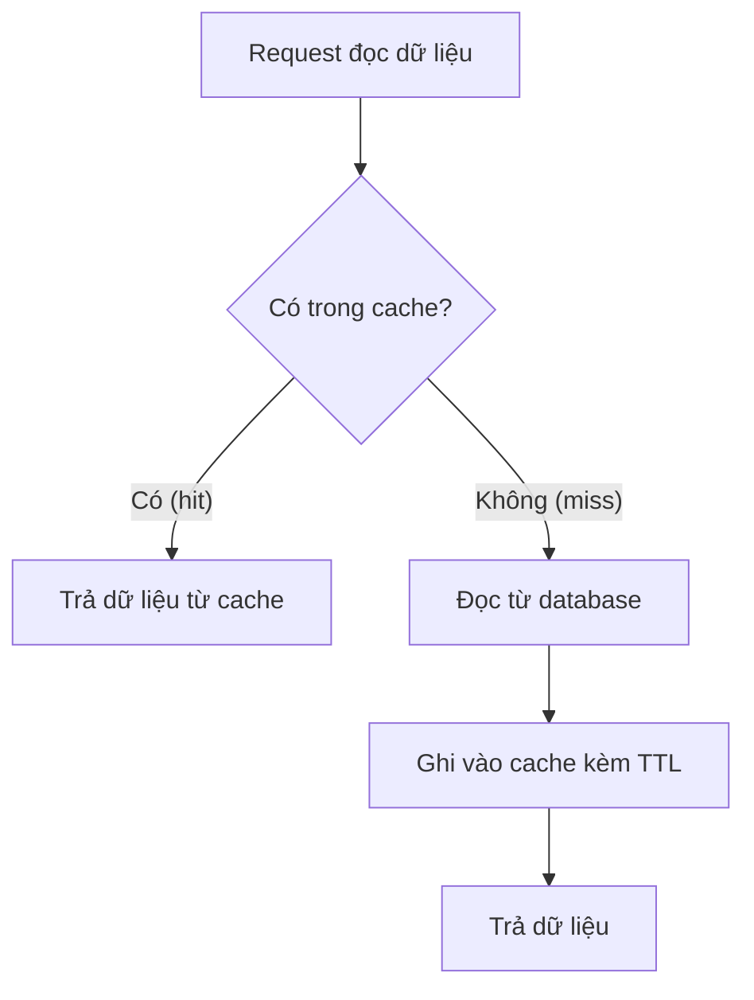
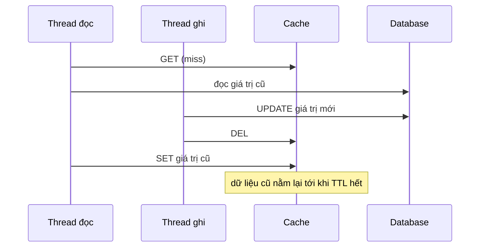
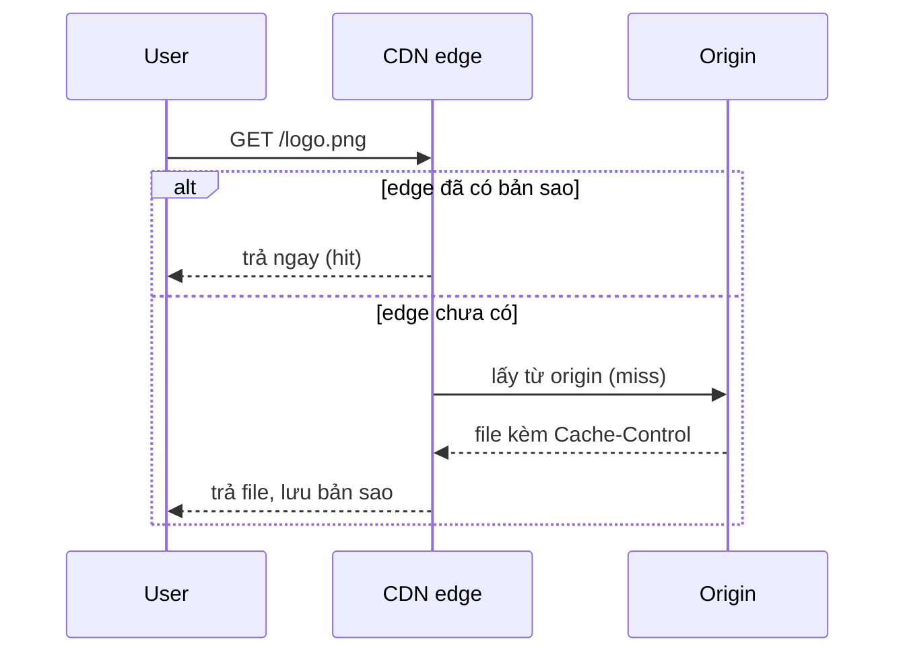

# Bài 3: Caching và CDN

Cache là chỗ giữ tạm dữ liệu hay được hỏi ở nơi truy cập nhanh (thường là RAM), để khỏi phải tính lại hay đọc lại từ nguồn chậm. CDN (Content Delivery Network) là một dạng cache đặt rải ở nhiều nơi trên thế giới, gần người dùng, chủ yếu cho ảnh, video và file tĩnh.

**Tóm tắt:**

- Cache giữ dữ liệu hay được hỏi ở nơi nhanh (RAM) để giảm latency và giảm tải cho database; CDN là cache đặt rải gần người dùng cho file tĩnh.
- Cache hiệu quả vì truy cập lệch (một phần nhỏ key nhận phần lớn lượt đọc), nhưng cái giá là dữ liệu có thể cũ, nên khó nhất luôn là cache invalidation.
- Cache-aside là mặc định hợp lý: app kiểm tra cache, miss thì đọc database rồi nạp vào cache kèm TTL, và cache hỏng thì app vẫn chạy; write-back nhanh nhưng có thể mất dữ liệu.
- Khi ghi: cập nhật database trước rồi xóa key cache (không ghi giá trị mới vào cache), và luôn đặt TTL làm lưới an toàn.
- Ba lỗi kinh điển: stampede (một mục nóng hết hạn), penetration (hỏi key không tồn tại), avalanche (nhiều key hết hạn cùng lúc hoặc cache chết); mỗi lỗi có cách chữa riêng như single-flight, jitter, cache giá trị rỗng, Bloom filter.
- Hit ratio từ 90% lên 99% chỉ giảm latency từ 3,0 xuống 1,2 ms nhưng giảm tải database 10 lần, nên đo bằng tải database còn lại.
- CDN: chỉ request đầu tiên mỗi vùng đi tới origin; đổi file thì dùng tên file có hash nội dung hoặc purge.

## Vấn đề nó giải quyết

Hãy tưởng tượng thủ thư mỗi lần có người hỏi cuốn sách phổ biến lại phải vào kho tầng hầm lấy. Nếu để sẵn những cuốn hay mượn trên quầy thì phần lớn lượt hỏi được trả lời ngay. Hệ thống phần mềm cũng vậy: không có cache thì mọi request đều đập vào database hoặc server gốc, chậm, tốn tiền, và database sập khi traffic tăng đột biến. Người dùng ở xa còn phải chịu thêm độ trễ do đường truyền địa lý, điều mà chỉ có đặt bản sao gần họ (CDN) mới giảm được.

## Khi nào nên dùng, khi nào không

Dùng khi dữ liệu đọc nhiều hơn ghi, ít đổi, hoặc tính toán và truy vấn tốn kém. Với dữ liệu đổi liên tục hoặc bắt buộc luôn chính xác tức thời (số dư tài khoản), cache dễ trả dữ liệu cũ gây sai, nên cần cân nhắc kỹ hoặc đọc thẳng nguồn gốc.

## Cách làm tóm tắt

Bạn phải chọn bốn thứ: tầng đặt cache (client, CDN, app, database), chiến lược đọc/ghi (cache-aside, write-through...), chính sách loại bỏ khi đầy (LRU, TTL) và cách vô hiệu hóa cache khi dữ liệu gốc đổi. Phần cuối cùng là phần khó nhất.

## Các khái niệm cần biết

- **Hit và miss**: tìm thấy trong cache là hit, không thấy là miss. **Hit ratio** (tỷ lệ hit) là thước đo chất lượng cache.
- **TTL**: thời gian sống của một mục; hết hạn thì bị bỏ. Là lưới an toàn chống dữ liệu cũ.
- **Origin**: máy chủ gốc chứa dữ liệu thật; CDN lấy dữ liệu từ đây.
- **Cache-Control và ETag**: header HTTP điều khiển cache của trình duyệt và CDN. `Cache-Control: max-age=3600` cho phép dùng lại trong 1 giờ; `ETag` là dấu vân tay nội dung để hỏi server "bản này còn mới không?" mà không phải tải lại.
- **Cache invalidation**: xóa hoặc cập nhật mục cache khi dữ liệu gốc đổi.
- **Cache stampede (thundering herd)**: một mục nóng hết hạn, hàng nghìn request cùng miss và cùng đổ xuống database.
- **Cache penetration**: truy vấn key không tồn tại lặp đi lặp lại, cache luôn miss nên database luôn bị hỏi.
- **Bloom filter**: cấu trúc xác suất cho biết "chắc chắn không có" hoặc "có thể có", dùng để chặn sớm truy vấn key không tồn tại.
- **Single-flight**: nhiều thread cùng miss một key thì chỉ một thread đi lấy, các thread khác chờ kết quả.
- **Jitter**: nhiễu ngẫu nhiên cộng vào TTL để các key không hết hạn cùng lúc.
- **Hot key**: một key nhận quá nhiều lượt đọc, làm một node cache quá tải.

## Flowchart: cache-aside



## Vì sao cache?

Đọc từ memory (RAM) nhanh hơn đọc từ đĩa hoặc gọi qua mạng hàng trăm lần. Cache lưu dữ liệu hay được truy cập để giảm latency và giảm tải cho database.

**Nền tảng:** Cache hiệu quả vì truy cập dữ liệu thường lệch: một phần nhỏ dữ liệu nhận phần lớn lượt đọc, và RAM nhanh hơn nguồn gốc rất nhiều. Cái giá phải trả là dữ liệu trong cache có thể cũ so với nguồn, nên vấn đề khó nhất luôn là khi nào làm mới hoặc xóa cache (invalidation).

## Các tầng cache

1. **Browser cache:** header `Cache-Control`, `ETag`.
2. **CDN:** máy chủ biên gần người dùng.
3. **Application cache:** Redis, Memcached.
4. **Database cache:** query cache, buffer pool.

## Chiến lược cache

Câu hỏi đặt ra là ai chịu trách nhiệm nạp và cập nhật cache: ứng dụng hay chính cache, và ghi vào đâu trước. Năm chiến lược dưới đây là các câu trả lời khác nhau; cache-aside là mặc định hợp lý cho đa số trường hợp vì đơn giản và cache hỏng thì ứng dụng vẫn chạy được (đọc thẳng DB). Write-back chỉ nên dùng khi chấp nhận mất dữ liệu chưa kịp đẩy xuống nếu cache sập.

| Chiến lược | Cách hoạt động | Đặc điểm |
|---|---|---|
| Cache-aside | App kiểm tra cache, miss thì đọc DB rồi ghi vào cache | Phổ biến nhất, app tự quản |
| Read-through | Cache tự đọc DB khi miss | Code app gọn hơn |
| Write-through | Ghi cache và DB cùng lúc | Nhất quán, ghi chậm hơn |
| Write-back | Ghi cache trước, đẩy xuống DB sau | Ghi rất nhanh, rủi ro mất dữ liệu |
| Write-around | Ghi thẳng DB, bỏ qua cache | Tránh làm đầy cache bằng dữ liệu ít đọc |

**Phải thuộc:** Cache-aside: app kiểm tra cache, miss thì đọc DB rồi ghi vào cache kèm TTL (phổ biến nhất, cache hỏng app vẫn chạy). Write-through: ghi cache và DB cùng lúc (nhất quán, ghi chậm hơn). Write-back: ghi cache trước, đẩy xuống DB sau (ghi nhanh, rủi ro mất dữ liệu). Write-around: ghi thẳng DB, bỏ qua cache.

## Chính sách loại bỏ (Eviction)

- **LRU:** bỏ mục lâu không dùng nhất.
- **LFU:** bỏ mục ít dùng nhất.
- **FIFO:** bỏ mục vào sớm nhất.
- **TTL:** tự hết hạn sau một khoảng thời gian.

## Các vấn đề thường gặp

- **Cache invalidation:** khi nào xóa hoặc cập nhật cache để không trả dữ liệu cũ.
- **Cache stampede:** cache hết hạn đồng loạt, nhiều request cùng đổ xuống DB. Giảm bằng TTL ngẫu nhiên hoặc lock khi nạp lại.
- **Cache penetration:** truy vấn key không tồn tại liên tục. Giảm bằng cache giá trị rỗng hoặc Bloom filter.

**Phải thuộc:** Ba vấn đề kinh điển và cách chữa: stampede (một mục nóng hết hạn, nhiều request cùng đổ xuống DB) chữa bằng TTL ngẫu nhiên (jitter) và single-flight hoặc lock khi nạp lại; penetration (hỏi key không tồn tại) chữa bằng cache giá trị rỗng hoặc Bloom filter; avalanche (nhiều key hết hạn cùng lúc hoặc cache chết) chữa bằng jitter, nhiều bản sao và giới hạn tải xuống DB.

**Suy luận:** Cache hiệu quả vì truy cập dữ liệu thường lệch: một phần nhỏ key nhận phần lớn lượt đọc, và RAM nhanh hơn nguồn gốc hàng chục đến hàng trăm lần. Nhưng chính sự phụ thuộc vào độ lệch này tạo ra các lỗi kinh điển. Một mục nóng hết hạn thì hàng nghìn request cùng miss và cùng đổ xuống database (stampede), vì cache không biết ai đang đi nạp; single-flight giải quyết bằng cách để một thread nạp còn các thread khác chờ. Nhiều key được nạp cùng lúc sẽ hết hạn cùng lúc, nên cộng jitter vào TTL để rải thời điểm hết hạn. Truy vấn key không tồn tại thì không bao giờ có gì để cache, nên penetration đập thẳng vào database trừ khi cache cả giá trị rỗng hoặc chặn bằng Bloom filter. Điểm dễ nhầm là coi ba lỗi này giống nhau: stampede là một key nóng hết hạn, avalanche là nhiều key hoặc cả cache mất cùng lúc, penetration là key không có thật, và mỗi cái cần biện pháp khác. Hệ quả: đo tải database còn lại chứ không chỉ latency, vì hit ratio từ 90% lên 99% giảm tải database 10 lần.

## Ví dụ có số: hit ratio quyết định tất cả

Giả định: 10.000 đọc/giây, cache trả trong 1 ms, đọc DB mất thêm 20 ms (miss tốn 1 + 20 = 21 ms).

| Hit ratio | Độ trễ trung bình | Đọc xuống DB mỗi giây |
|---|---|---|
| 0% (không cache) | 20 ms | 10.000 |
| 80% | 0,8 x 1 + 0,2 x 21 = 5,0 ms | 2.000 |
| 90% | 0,9 x 1 + 0,1 x 21 = 3,0 ms | 1.000 |
| 99% | 0,99 x 1 + 0,01 x 21 = 1,2 ms | 100 |

Từ 90% lên 99% độ trễ chỉ giảm từ 3,0 xuống 1,2 ms nhưng **tải DB giảm 10 lần**. Vì vậy mục tiêu của cache thường tính bằng tải DB còn lại, không chỉ bằng độ trễ.

## Cache-aside chống stampede, bằng code

Ba biện pháp trong một đoạn: **single-flight** (nhiều thread cùng miss một key thì chỉ một thread xuống DB, các thread khác chờ kết quả), **TTL cộng nhiễu ngẫu nhiên** (key không hết hạn đồng loạt), **cache giá trị rỗng** (key không tồn tại cũng được nhớ, chặn penetration). Đã chạy thử với 50 thread cùng đọc một key: DB chỉ bị gọi 1 lần; hỏi key không tồn tại hai lần chỉ tốn 1 lần gọi DB. Java 11 trở lên:

```java
static final String NULL = "\0NULL";   // đánh dấu "không tồn tại"
static class Entry { final String val; final long expireAt; Entry(String v, long e) { val = v; expireAt = e; } }

class CacheAside {
    private final ConcurrentHashMap<String, Entry> cache = new ConcurrentHashMap<>();
    private final ConcurrentHashMap<String, CompletableFuture<String>> inflight = new ConcurrentHashMap<>();
    private final Function<String, String> db;
    private final long ttlMs;
    CacheAside(Function<String, String> db, long ttlMs) { this.db = db; this.ttlMs = ttlMs; }

    String get(String key) throws Exception {
        Entry e = cache.get(key);
        if (e != null && e.expireAt > System.currentTimeMillis())
            return NULL.equals(e.val) ? null : e.val;                  // hit
        CompletableFuture<String> mine = new CompletableFuture<>();
        CompletableFuture<String> f = inflight.putIfAbsent(key, mine);
        // chờ thread đang nạp
        if (f != null) { String v = f.get(); return NULL.equals(v) ? null : v; }
        try {
            // chỉ một thread xuống DB
            String v = db.apply(key);
            String stored = (v == null) ? NULL : v;
            // nhiễu tới 10% TTL
            long jitter = ThreadLocalRandom.current().nextLong(ttlMs / 10 + 1);
            cache.put(key, new Entry(stored, System.currentTimeMillis() + ttlMs + jitter));
            mine.complete(stored);
            return v;
        } catch (Exception ex) {
            mine.completeExceptionally(ex); throw ex;
        } finally {
            inflight.remove(key);
        }
    }
}
```

Trong hệ phân tán, single-flight trên mỗi app server vẫn để N server cùng xuống DB (mỗi server một lần), thường là đủ. Cần chặt hơn thì dùng lock Redis ngắn (`SET lock:key NX PX 5000`) cho thread nạp lại.

## Vô hiệu hóa cache khi ghi

**Phải thuộc:** Khi ghi: cập nhật DB trước, rồi xóa key cache (không ghi giá trị mới vào cache), và luôn đặt TTL làm lưới an toàn.

Quy tắc phổ biến: **cập nhật DB trước, rồi xóa key cache** (không cập nhật giá trị mới vào cache). Vẫn còn một cửa sổ nhỏ trả dữ liệu cũ:



Cửa sổ này hiếm (thread đọc phải chậm hơn thread ghi), và TTL là lưới an toàn: luôn đặt TTL, kể cả khi đã có cơ chế xóa chủ động. Bắt buộc nhất quán chặt (số dư tài khoản) thì đọc thẳng DB, không qua cache.

| Vấn đề | Dấu hiệu | Giám sát |
|---|---|---|
| Hot key | Một key nhận quá nhiều lượt, một node cache nghẽn | Phân bố truy cập theo key, thêm bản sao cục bộ trong app |
| Cache lạnh sau khởi động | Hit ratio thấp, DB bị đập | Làm ấm cache trước, tăng tải dần |
| Cache chết | Toàn bộ tải đổ về DB | Hit ratio, tải DB, rate limiting xuống DB để tự bảo vệ |

**Suy luận:** Khi ghi, có hai cách giữ cache khớp với database: cập nhật giá trị mới vào cache hoặc xóa key để lần đọc sau nạp lại. Cập nhật cache nghe trực tiếp hơn, nhưng hai lần ghi concurrent có thể đến cache theo thứ tự ngược với thứ tự đến database, để lại giá trị cũ mà không ai biết; còn xóa key thì lần đọc kế tiếp luôn đọc từ database, nên mọi sai lệch chỉ sống tới lần nạp lại. Vì thế quy tắc là ghi database trước rồi xóa key. Vẫn còn một cửa sổ hẹp: thread đọc miss và đọc giá trị cũ, thread ghi cập nhật và xóa key xong, rồi thread đọc mới ghi giá trị cũ vào cache. Cửa sổ này hiếm vì thread đọc phải chậm hơn thread ghi, nhưng không bằng không, nên TTL luôn là lưới an toàn cuối cùng. Điểm dễ nhầm là nghĩ TTL chỉ để tiết kiệm memory, trong khi vai trò quan trọng hơn là giới hạn thời gian sống của dữ liệu cũ. Hệ quả: dữ liệu bắt buộc chính xác tức thời, như số dư, thì đọc thẳng database.

## CDN

Mạng lưới server phân tán toàn cầu, lưu bản sao file tĩnh (ảnh, JS, CSS, video) và trả từ nơi gần người dùng nhất.



Đọc sơ đồ: chỉ request đầu tiên tại mỗi vùng phải đi tới origin; các request sau được phục vụ từ edge. Khi bạn đổi file, bản sao cũ vẫn còn đến khi hết TTL, nên thường đặt tên file kèm hash nội dung (ví dụ `app.3f9a1c.js`) hoặc gọi lệnh purge của CDN.

- **Pull CDN:** CDN tự lấy file từ origin khi có request đầu tiên. Hợp với đa số website vì bạn không phải quản lý việc tải lên.
- **Push CDN:** bạn chủ động tải file lên CDN. Hợp với file lớn, ít đổi, biết trước (bản cài đặt, video) khi muốn kiểm soát chính xác cái gì nằm ở đâu.

Lợi ích: giảm latency, giảm tải origin, chịu tải đột biến tốt. Ví dụ: Cloudflare, CloudFront, Akamai.

