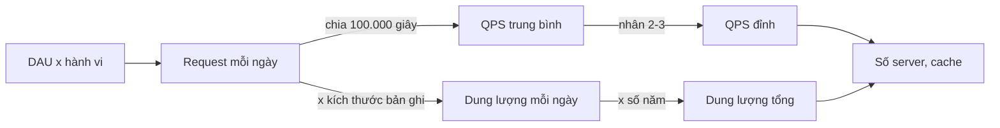

# Back-of-the-envelope (Ước lượng nhanh)

Back-of-the-envelope (ước lượng nhanh, nghĩa đen là "tính trên mặt sau phong bì") là cách tính nhẩm để biết bậc độ lớn: bao nhiêu request mỗi giây, cần lưu bao nhiêu TB, băng thông bao nhiêu, cần cỡ bao nhiêu server. Bạn không cần con số chính xác, chỉ cần đúng bậc: chục, nghìn hay triệu.

**Tóm tắt:**

- Ước lượng nhanh để biết bậc độ lớn (chục, nghìn, triệu), vì quy mô quyết định kiến trúc; không cần chính xác từng con số.
- Chuỗi tính: DAU x hành vi ra request mỗi ngày, chia khoảng 100.000 giây ra QPS trung bình, nhân 2 đến 3 ra QPS đỉnh.
- Một ngày khoảng 86.400 giây (làm tròn 100.000), nên 1 triệu request mỗi ngày khoảng 12 request mỗi giây.
- Dung lượng = số bản ghi x kích thước x số năm x replication factor; thiết kế theo đỉnh chứ không theo trung bình.
- Tách tỷ lệ đọc/ghi vì nó quyết định đầu tư vào cache hay tối ưu ghi.
- Mạng tính bằng bit, lưu trữ tính bằng byte, lệch hệ số 8; nhầm chỗ này là lệch 8 lần băng thông.
- Luôn nói ra giả định và kết thúc mỗi phép tính bằng một quyết định (CDN, object storage, shard, queue).

## Vấn đề nó giải quyết

Quy mô quyết định kiến trúc. Với 10 request/giây, một server và một database là đủ. Với 100.000 request/giây, bạn phải có cache, shard và nhiều server. Nếu không ước lượng, bạn dễ thiết kế thừa (tốn tiền, khó bảo trì) hoặc thiếu (sập khi lên sóng), và không biết bottleneck nằm ở đâu. Ước lượng biến cảm giác "chắc là nhiều lắm" thành con số dẫn tới quyết định cụ thể.

## Khi nào nên dùng, khi nào không

Làm ngay sau khi làm rõ yêu cầu, trước khi vẽ thiết kế. Đừng sa đà vào tính chính xác từng con số: mất thời gian mà không đổi được quyết định nào. Nếu hai phép tính cho cùng một kết luận (ví dụ cùng là "phải có CDN") thì dừng lại.

## Cách làm tóm tắt

Bắt đầu từ số người dùng, tính hành vi trung bình của mỗi người (bao nhiêu request, mỗi cái nặng bao nhiêu), nhân lên rồi làm tròn mạnh tay. Dùng các hằng số quen thuộc như số giây trong ngày (khoảng 100.000) và độ trễ của RAM, SSD, mạng.

## Các khái niệm cần biết

- **DAU (Daily Active Users)**: số người dùng hoạt động mỗi ngày. Điểm khởi đầu của hầu hết phép ước lượng.
- **QPS (queries per second)**: số request mỗi giây. QPS trung bình bằng số request mỗi ngày chia cho khoảng 100.000.
- **QPS đỉnh (peak)**: giờ cao điểm thường gấp 2 đến 3 lần trung bình. Hệ thống phải chịu được đỉnh, không phải trung bình.
- **Tỷ lệ đọc/ghi**: số lần đọc trên mỗi lần ghi; quyết định nên đầu tư cache hay tối ưu ghi.
- **Băng thông**: lượng dữ liệu truyền mỗi giây. Mạng tính bằng bit (Gbps), lưu trữ tính bằng byte, hệ số lệch là 8.
- **Replication factor**: số bản sao dữ liệu; dung lượng thực bằng dữ liệu nhân với hệ số này.
- **Latency**: thời gian một thao tác mất, xem bảng hằng số bên dưới.

## Hằng số nên nhớ

| Đại lượng | Giá trị gần đúng |
|---|---|
| 1 ngày | khoảng 86.400 giây (làm tròn 100.000) |
| 1 triệu request/ngày | khoảng 12 request/giây |
| 1 KB / 1 MB / 1 GB / 1 TB | 10^3 / 10^6 / 10^9 / 10^12 byte |
| Đọc 1 MB từ RAM | khoảng 0,25 ms |
| Đọc 1 MB từ SSD | khoảng 1 ms |
| Round trip trong cùng data center | khoảng 0,5 ms |
| Round trip giữa các châu lục | khoảng 100 đến 150 ms |

Thứ tự tốc độ: RAM nhanh hơn SSD, SSD nhanh hơn HDD, và mạng chậm hơn đĩa cục bộ.

**Phải thuộc:** Một ngày khoảng 86.400 giây (làm tròn 100.000), nên 1 triệu request mỗi ngày khoảng 12 request mỗi giây. QPS đỉnh thường gấp 2 đến 3 lần trung bình. 1 byte = 8 bit. KB, MB, GB, TB lần lượt khoảng 10^3, 10^6, 10^9, 10^12 byte. Dung lượng thực = dữ liệu nhân replication factor.

**Nền tảng:** Ước lượng không để tính đúng mà để biết bậc độ lớn, vì quy mô quyết định kiến trúc (một server hay cả cache, shard, CDN). Luôn nói ra giả định và kết thúc mỗi phép tính bằng một quyết định thiết kế.

## Flowchart

## Ví dụ nhanh

Hãy áp dụng đúng chuỗi trong sơ đồ trên cho một bài toán nhỏ, nói to từng giả định khi tính.

10 triệu người dùng mỗi ngày, mỗi người đăng 2 bài, mỗi bài 1 KB văn bản:

- Ghi: 20 triệu bài/ngày, khoảng 230 ghi/giây, đỉnh khoảng 700 ghi/giây.
- Dung lượng: 20 GB/ngày, khoảng 7 TB/năm.

## Ví dụ đầy đủ: ứng dụng chia sẻ ảnh

Giả định (nói ra thành tiếng): 100 triệu người dùng hoạt động mỗi ngày (DAU); 10% đăng 1 ảnh mỗi ngày, ảnh gốc trung bình 2 MB; mỗi người xem 50 ảnh mỗi ngày, ảnh hiển thị (đã nén) khoảng 200 KB; lưu 5 năm, replication factor 3.

| Đại lượng | Tính | Kết quả |
|---|---|---|
| Ảnh mới mỗi ngày | 100 triệu x 10% | 10 triệu |
| Ghi (QPS) | 10 triệu / 86.400 | khoảng 116/giây, đỉnh x3 khoảng 350/giây |
| Lượt xem mỗi ngày | 100 triệu x 50 | 5 tỷ |
| Đọc (QPS) | 5 tỷ / 86.400 | khoảng 58.000/giây, đỉnh khoảng 175.000/giây |
| Tỷ lệ đọc/ghi | 5 tỷ / 10 triệu | 500:1 |
| Dung lượng mỗi ngày | 10 triệu x 2 MB | 20 TB |
| Dung lượng 5 năm | 20 TB x 365 x 5 | khoảng 36 PB, với replication factor 3 khoảng 110 PB |
| Băng thông ra trung bình | 58.000 x 200 KB | khoảng 11,6 GB/giây, tức khoảng 93 Gbps (1 byte = 8 bit) |
| Băng thông ra đỉnh | x3 | khoảng 280 Gbps |

Kết luận dẫn tới quyết định:

1. Đọc gấp 500 lần ghi và băng thông hàng trăm Gbps: **bắt buộc CDN**, origin chỉ phục vụ phần miss (nếu CDN hit 95% thì origin còn khoảng 5% x 93 Gbps, tức khoảng 5 Gbps).
2. 110 PB: ảnh nằm ở **object storage**, DB chỉ giữ metadata (ví dụ 10 triệu x 365 x 5 = 18 tỷ dòng x 200 B, khoảng 3,6 TB, cần shard).
3. Ghi 350/giây đỉnh nhưng mỗi ảnh 2 MB: băng thông vào khoảng 350 x 2 MB = 700 MB/giây, cho tải lên thẳng object storage bằng presigned URL thay vì đi qua app.

## Quy ước tính nhanh

| Quy ước | Dùng để |
|---|---|
| 2^10 xấp xỉ 10^3, 2^20 xấp xỉ 10^6, 2^30 xấp xỉ 10^9 | Đổi KB, MB, GB nhanh |
| 1 byte = 8 bit; mạng tính bằng bit, lưu trữ tính bằng byte | Tránh nhầm hệ số 8 khi tính băng thông |
| Văn bản: 1 ký tự khoảng 1 byte (ASCII), 1-4 byte (UTF-8 tiếng Việt, emoji) | Dung lượng bài viết, tin nhắn |
| 1 triệu người dùng x 1 KB mỗi người | 1 GB |
| 1 server hiện đại | vài nghìn request/giây cho API đơn giản (đo bằng load test, đừng đoán) |
| Replication factor 3 | Dung lượng thực = dung lượng dữ liệu x 3 |

**Suy luận:** Ước lượng tồn tại vì quy mô quyết định kiến trúc, và quyết định chỉ đổi khi bậc độ lớn đổi, nên làm tròn mạnh tay là đúng chứ không phải cẩu thả. Chuỗi tính luôn đi từ DAU sang request mỗi ngày, chia cho khoảng 100.000 giây ra QPS trung bình, rồi nhân 2 đến 3 ra QPS đỉnh, vì hệ thống phải chịu được đỉnh chứ không phải trung bình. Dung lượng đi theo nhánh riêng: số bản ghi nhân kích thước, nhân số năm, rồi nhân replication factor, vì dữ liệu thật nằm trên nhiều bản sao. Tỷ lệ đọc/ghi được tách riêng vì nó quyết định đầu tư vào cache hay vào tối ưu ghi. Điểm dễ nhầm là bit và byte: mạng tính bằng bit, lưu trữ tính bằng byte, lệch hệ số 8, nên băng thông 11,6 GB/giây thật ra là khoảng 93 Gbps. Hệ quả: mỗi con số cuối bảng phải dẫn tới một quyết định cụ thể như CDN, object storage hay shard; nếu hai phép tính cùng cho một kết luận thì dừng lại.

## Sai lầm thường gặp

- Quên tách **trung bình** và **đỉnh** (thiết kế theo trung bình thì sập giờ cao điểm).
- Nhầm bit và byte, hoặc KB và MB, lệch 8 hay 1.000 lần.
- Quên replication, index và chi phí metadata vào dung lượng.
- Tính chi li đến hàng đơn vị: làm tròn 86.400 thành 100.000 đủ cho mọi kết luận ở đây.
- Không rút ra kết luận: mỗi con số cuối bảng phải dẫn tới một quyết định (cache, CDN, shard, queue).

## Điểm cần nhắc

- Làm tròn mạnh tay, quan trọng là bậc độ lớn.
- Nêu rõ các giả định và nói ra khi tính.
- Tách tỷ lệ đọc/ghi, vì nó quyết định cache và replication.

