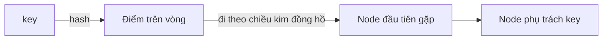
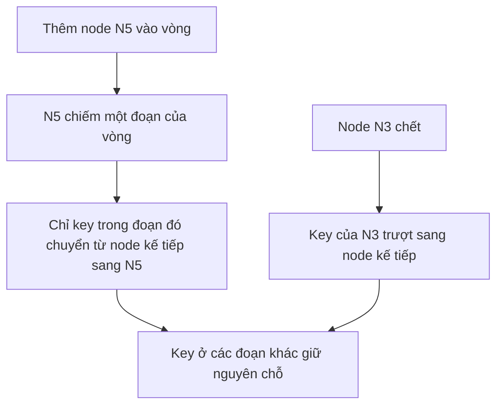
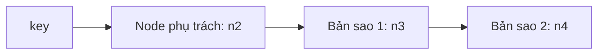

# Consistent Hashing

Consistent hashing là cách chia key cho các node sao cho khi thêm hoặc bớt một node, chỉ một phần nhỏ key phải đổi chỗ, chứ không xáo trộn toàn bộ.

**Tóm tắt:**

- Với `hash(key) % N`, vị trí key phụ thuộc N nên đổi N làm khoảng 80% key đổi chỗ (4 lên 5 node), gây miss hàng loạt đúng lúc scale hoặc sự cố.
- Consistent hashing đặt node và key lên một hash ring; key thuộc node đầu tiên gặp theo chiều kim đồng hồ.
- Thêm hoặc bớt một node chỉ di chuyển khoảng 1/N số key, và chỉ ảnh hưởng đoạn vòng lân cận.
- Với mỗi node một điểm, tải rất lệch; virtual node (ví dụ 200 mỗi node) làm tải cân bằng và chia đều key của node chết cho nhiều node.
- Cài đặt bằng `TreeMap` và `ceilingEntry`, hết vòng thì quay về điểm đầu.
- Replication: lưu key trên N node thật khác nhau liên tiếp, bỏ qua các virtual node cùng một node thật.
- Hash ring không giải quyết hot key vì một key vẫn nằm ở đúng một node; cần replica đọc hoặc cache cục bộ.
- Dùng cho cache phân tán, sharding, key-value store (Cassandra, kiểu Dynamo); số node cố định thì `% N` là đủ.

## Vấn đề nó giải quyết

Cách chia đơn giản nhất là `hash(key) % N`, với N là số node. Nó chạy tốt cho đến khi N thay đổi: thêm hoặc mất một node, gần như mọi key tính ra số dư khác và rơi sang node khác. Với cache phân tán, đó là mất cache hàng loạt, mọi request đồng loạt miss và database bị đập sập ngay vào lúc bạn đang scale hoặc đang sự cố.

Consistent hashing giải quyết bằng cách làm cho vị trí của key không phụ thuộc vào số node: mỗi key có một vị trí cố định trên một vòng tròn, và node chỉ "nhận" các key ở gần nó.

**Nền tảng:** Với `hash(key) % N`, vị trí của key phụ thuộc vào N nên đổi N là xáo trộn gần như toàn bộ. Consistent hashing tách vị trí của key khỏi số node (key có chỗ cố định trên vòng), nhờ đó thêm hoặc bớt node chỉ ảnh hưởng vùng lân cận.

## Khi nào nên dùng, khi nào không

Dùng cho cache phân tán, sharding database, key-value store, hoặc load balancing cần dính server (sticky). Nếu số node cố định và hiếm khi đổi thì `% N` đơn giản là đủ, không cần thêm độ phức tạp.

## Cách làm tóm tắt

Đặt cả node và key lên một hash ring; mỗi key thuộc về node đầu tiên gặp khi đi theo chiều kim đồng hồ từ vị trí của key. Để tải chia đều hơn, mỗi node được đặt nhiều lần trên vòng dưới dạng virtual node (virtual node).

## Các khái niệm cần biết

- **Hash function**: biến một key thành một số; cùng key luôn ra cùng số, và các key khác nhau được rải đều. Ví dụ MD5, murmur3.
- **Hash ring**: không gian số của hash function được nối đầu với cuối thành vòng tròn, để "đi hết vòng thì quay về điểm đầu".
- **Virtual node**: một node thật được đặt tại nhiều điểm trên vòng. Không có chúng, vài node có thể phụ trách phần vòng quá lớn và nhận tải lệch nhiều.
- **Hot key**: một key được truy cập cực nhiều. Hash ring không giải quyết được vì key đó vẫn nằm ở đúng một node.
- **TreeMap và `ceilingEntry`**: cấu trúc Java giữ key có thứ tự, `ceilingEntry(x)` trả phần tử có key nhỏ nhất mà lớn hơn hoặc bằng x, đúng thao tác "tìm điểm kế tiếp trên vòng".
- **Cache warming**: nạp trước dữ liệu vào node mới để tránh miss hàng loạt.

## Flowchart: tìm node cho một key



## Virtual node

Mỗi node thật được đặt nhiều lần trên vòng (ví dụ 100 đến 200 điểm). Nhờ vậy:

- Phân bố key đều hơn, tránh node bị quá tải.
- Node mạnh có thể nhận nhiều điểm hơn.
- Khi một node chết, tải của nó chia đều cho nhiều node khác.

## Thêm hoặc bớt node

Hãy xem điều gì xảy ra khi cụm đổi cấu hình. Vì key chỉ thuộc về "node kế tiếp theo chiều kim đồng hồ", sự thay đổi chỉ ảnh hưởng vùng lân cận:



- **Thêm node:** chỉ các key nằm giữa node mới và node đứng trước nó chuyển sang node mới.
- **Bớt node:** các key của node đó chuyển sang node kế tiếp.

So với `% N`, lượng key di chuyển chỉ khoảng 1/N tổng số.

**Phải thuộc:** Cách hoạt động: hash cả node và key lên một vòng; key thuộc về node đầu tiên gặp theo chiều kim đồng hồ. Thêm hoặc bớt một node chỉ di chuyển khoảng 1/N số key (so với gần như toàn bộ khi dùng `hash % N`). Virtual node giúp phân bố đều và cho phép node mạnh nhận nhiều điểm hơn.

## Ví dụ có số và code

**Tính tay:** 4 node, 100.000 key, thêm node thứ 5.

| Cách chia | Key phải di chuyển |
|---|---|
| `hash(key) % N`, N từ 4 lên 5 | key giữ nguyên chỗ khi `hash % 4 == hash % 5`, xác suất khoảng 1/5, nên khoảng 80% key chuyển |
| Hash ring | node mới chiếm phần vòng chừng 1/5, chỉ khoảng 20% key chuyển (và chỉ chuyển sang node mới, không xáo giữa các node cũ) |

Cài đặt hash ring: `TreeMap` từ vị trí trên vòng tới tên node; tra key bằng `ceilingEntry` (điểm đầu tiên lớn hơn hoặc bằng), hết vòng thì quay về điểm đầu. Đã chạy thử, Java 11 trở lên:

```java
static class HashRing {
    private final TreeMap<Long, String> ring = new TreeMap<>();
    private final int vnodes;
    HashRing(int vnodes) { this.vnodes = vnodes; }

    // 8 byte đầu của MD5, phân bố đều
    static long hash(String s) {
        try {
            byte[] d = MessageDigest.getInstance("MD5").digest(s.getBytes(StandardCharsets.UTF_8));
            long h = 0;
            for (int i = 0; i < 8; i++) h = (h << 8) | (d[i] & 0xFF);
            return h;
        } catch (Exception e) { throw new RuntimeException(e); }
    }
    void addNode(String node)    { for (int i = 0; i < vnodes; i++) ring.put(hash(node + "#" + i), node); }
    void removeNode(String node) { for (int i = 0; i < vnodes; i++) ring.remove(hash(node + "#" + i)); }

    String getNode(String key) {
        // đi theo chiều kim đồng hồ
        Map.Entry<Long, String> e = ring.ceilingEntry(hash(key));
        // hết vòng thì quay về đầu
        return (e != null ? e : ring.firstEntry()).getValue();
    }
}
```

Kết quả đo với 100.000 key `key0..key99999`, 4 node `n1..n4`, rồi thêm `n5`:

| Cấu hình | Số key mỗi node | Key di chuyển khi thêm n5 |
|---|---|---|
| 1 điểm mỗi node | 17.506 / 32.377 / 8.524 / 41.593 (rất lệch) | 25,4% |
| 200 virtual node mỗi node | 23.477 / 24.551 / 25.163 / 26.809 (gần 25.000) | 19,2% (gần lý thuyết 20%) |
| `hash % N` (4 lên 5) | | 80,0% |

Rút ra: **virtual node là thứ làm hash ring dùng được**, không phải chi tiết tùy chọn.

**Suy luận:** Với `hash(key) % N`, vị trí của key là hàm của N, nên đổi N làm gần như mọi key đổi chỗ (khoảng 80% khi từ 4 lên 5 node), và với cache đó là miss hàng loạt đúng lúc đang scale hoặc đang có sự cố. Consistent hashing tách vị trí key khỏi N bằng cách cho key một chỗ cố định trên vòng và để node nhận các key đứng trước nó, nên thêm hoặc bớt một node chỉ ảnh hưởng đoạn vòng lân cận, khoảng 1/N số key. Nhưng với mỗi node chỉ một điểm, các đoạn vòng có độ dài rất lệch nên có node ôm gấp mấy lần node khác, và khi một node chết thì toàn bộ key của nó đổ sang đúng một node kế bên. Virtual node sửa cả hai: nhiều điểm nhỏ rải đều làm tải cân bằng hơn, và key của node chết được chia ra nhiều node. Điểm dễ nhầm là nghĩ hash ring giải quyết hot key: một key vẫn nằm ở đúng một node dù vòng cân bằng đến đâu, nên cần replica đọc hoặc cache cục bộ. Hệ quả: khi replication phải bỏ qua các virtual node cùng thuộc một node thật, và luôn đo độ lệch tải sau mỗi lần đổi cấu hình.

## Replication và xử lý lỗi



Replication: lưu key trên N node **thật khác nhau** liên tiếp theo chiều kim đồng hồ; khi duyệt vòng phải bỏ qua các virtual node cùng thuộc một node thật, nếu không hai bản sao có thể nằm cùng một máy.

| Tình huống | Hệ quả và cách xử lý |
|---|---|
| Node chết | Key của nó trượt sang node kế; với cache thì miss tạm thời, với kho dữ liệu thì đọc từ bản sao |
| Thêm node | Node mới trống: cache bị miss cho phần nó nhận (làm ấm dần), kho dữ liệu cần chuyển dữ liệu từ node cũ sang nền |
| Hot key | Hash ring không giải quyết hot key (một key luôn nằm ở một node): thêm bản sao đọc hoặc cache cục bộ |
| Node mạnh yếu khác nhau | Cấp số virtual node tỷ lệ với dung lượng |

Theo dõi: độ lệch tải giữa các node (lớn nhất so với trung bình), lượng key di chuyển khi đổi cấu hình, tỷ lệ miss sau khi thêm hoặc mất node.

## Điểm cần nhắc

- Replication: lưu key trên N node liên tiếp trên vòng.
- Dùng trong Cassandra, các hệ thống theo thiết kế Dynamo (bài báo Dynamo của Amazon), và nhiều client Memcached (kiểu ketama).
- Hash ổn định, đồng đều (ví dụ murmur3).

