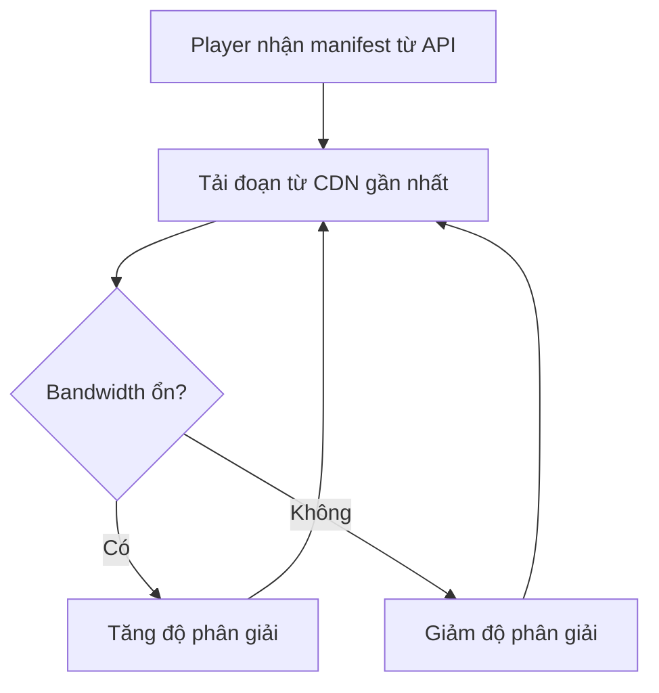
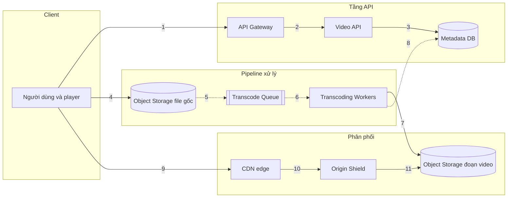
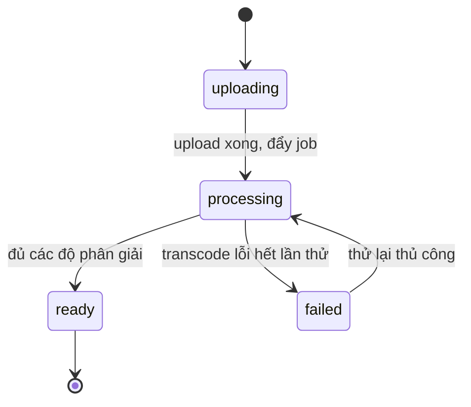
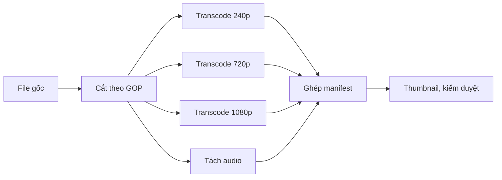

# Video Streaming (Phát video)

**Độ khó:** Hard

Bài này hướng dẫn bạn thiết kế hệ thống kiểu YouTube hoặc Netflix: người dùng upload video, hệ thống xử lý rồi phát lại mượt cho hàng triệu người xem cùng lúc. Đây là một bài thiết kế điển hình vì nó gom đủ ba thứ khó: file rất nặng, lưu lượng phát ra rất lớn, và người xem thì mỗi người một đường truyền, một thiết bị.

**Tóm tắt:**

- Video là file nặng với người xem đa dạng, nên không phát nguyên bản mà biến thành nhiều bậc chất lượng cắt thành đoạn ngắn vài giây.
- Pipeline chuẩn: upload file gốc vào object storage bằng signed URL, đẩy job vào queue, worker transcode rồi cắt đoạn, phát qua CDN.
- HLS và DASH phát đoạn qua HTTP thường nên CDN cache được, còn player tự đổi bậc bitrate theo bandwidth đo được (adaptive bitrate).
- Transcode được tổ chức thành DAG, cắt theo ranh giới GOP để các nhánh chạy parallel, và mỗi tác vụ phải idempotent vì worker có thể chết giữa chừng.
- Bandwidth ra lớn gấp hàng chục lần dữ liệu vào (ví dụ khoảng 65 GB/s so với vài GB/s upload), nên CDN là khoản chi lớn nhất và cache hit rate phải rất cao.
- Upload đi thẳng từ client vào storage bằng signed URL để server API không thành bottleneck bandwidth.
- Chỉ số trải nghiệm quan trọng nhất là rebuffer; hot spot điển hình là video viral làm cache miss đồng loạt dồn về origin.
- Kiến trúc gồm các khối chính: API Gateway, Video API, Metadata DB, object storage (file gốc và đoạn đã xử lý), queue, transcoding worker, CDN kèm origin shield.

## Vấn đề cần giải quyết

Hãy tưởng tượng bạn quay một video 10 phút bằng điện thoại, file gốc nặng cỡ 300 MB. Nếu hệ thống chỉ cất file đó rồi phát lại nguyên bản thì sẽ gặp ba rắc rối:

- Người dùng mạng yếu không tải kịp, video bị giật hoặc đứng hình liên tục.
- Mỗi thiết bị hỗ trợ một định dạng và một độ phân giải khác nhau, file gốc không chắc chạy được trên mọi nơi.
- Bandwidth và chi phí lưu trữ phình rất nhanh, vì cùng một file nặng bị kéo đi kéo lại hàng triệu lần.

Cách giải quyết là biến một file gốc thành nhiều phiên bản nhẹ hơn ở nhiều độ phân giải, cắt mỗi phiên bản thành các đoạn ngắn vài giây, rồi để trình phát (player) tự chọn đoạn phù hợp với mạng hiện tại của người xem. Các đoạn này được phân phối qua mạng CDN đặt gần người xem. Flow chung: upload file gốc vào object storage, đẩy job vào queue, worker transcode ra nhiều độ phân giải và cắt đoạn, đoạn được phát qua CDN, player tự đổi chất lượng theo mạng.

**Nền tảng:** Video là file rất nặng với người xem đa dạng (mạng, thiết bị), nên không phát nguyên bản mà biến file gốc thành nhiều bậc chất lượng, cắt thành đoạn ngắn phát qua HTTP thường để CDN cache được, và để player tự chọn bậc theo mạng (adaptive bitrate). Bandwidth ra lớn gấp hàng chục lần dữ liệu vào nên CDN là khoản chi chính.

## Khi nào nên dùng, khi nào không

Kiến trúc đầy đủ trong bài này đáng làm khi bạn phục vụ video quy mô lớn: web chia sẻ video, xem phim, khóa học online có nhiều học viên. Ngược lại, nếu số video ít và số người xem ít thì đừng tự dựng pipeline phức tạp. Chỉ cần đẩy file lên object storage, gắn CDN phía trước, hoặc dùng luôn service có sẵn (nhúng player của nhà cung cấp) là đủ. Tự xây pipeline transcode khi chưa cần sẽ tốn công vận hành mà không đem lại giá trị.

## Các khái niệm cần biết

- **Object storage** (ví dụ S3): kho lưu file theo kiểu "bucket và key", rẻ, bền, dung lượng gần như không giới hạn. Dùng để lưu file gốc và các đoạn đã xử lý. Nó không phù hợp để truy vấn theo điều kiện, nên thông tin về video (tiêu đề, trạng thái) nằm ở một Metadata DB riêng.
- **Transcoding**: chuyển một video sang định dạng, codec, độ phân giải hoặc bitrate khác. Cần làm vì file gốc quá nặng và không hợp với mọi thiết bị. Việc này tốn CPU nên chạy bằng các worker lấy job từ queue.
- **Bitrate**: lượng dữ liệu mỗi giây của video, tính bằng kbps hoặc Mbps. Độ phân giải cao thì bitrate cao, cần mạng khỏe hơn.
- **Adaptive bitrate (ABR)**: kỹ thuật để player tự đổi giữa các bậc bitrate ngay trong lúc phát, tùy bandwidth đo được. Mạng yếu thì xuống bậc thấp (hình mờ hơn nhưng không đứng), mạng tốt thì lên bậc cao.
- **HLS và DASH**: hai giao thức ABR phổ biến. Video được cắt thành các đoạn nhỏ phát qua HTTP thường, nên đi qua CDN và cache rất tốt. HLS do Apple đề xuất (đuôi `.m3u8`), DASH là chuẩn mở.
- **Manifest**: file văn bản liệt kê các bậc chất lượng và nơi lấy từng đoạn. Player đọc manifest trước rồi mới tải đoạn.
- **GOP (Group of Pictures)**: nhóm khung hình mà các khung trong nhóm phụ thuộc lẫn nhau khi nén. Cắt video ở ranh giới GOP thì mỗi đoạn tự giải mã độc lập được, nhờ vậy transcode parallel theo đoạn.
- **CDN, edge, origin**: CDN là mạng server cache đặt rải khắp nơi. Máy gần người xem gọi là edge, nguồn gốc dữ liệu gọi là origin. Khi edge có sẵn đoạn (cache hit) thì trả ngay, nếu không (cache miss) mới hỏi origin.
- **Cache hit rate**: tỷ lệ request được edge trả lời mà không cần về origin. Với video, chỉ số này phải rất cao, nếu thấp thì origin bị quá tải và hóa đơn bandwidth tăng vọt.
- **Signed URL**: đường dẫn chứa chữ ký và thời điểm hết hạn, chỉ ai có URL mới tải được và hết hạn thì vô hiệu. Dùng để cho client upload trực tiếp vào storage hoặc bảo vệ nội dung, mà không cần lộ access key.
- **DAG (directed acyclic graph)**: mô tả các bước xử lý và thứ tự phụ thuộc, bước nào xong mới đến bước sau, các bước độc lập chạy parallel.
- **Idempotent**: chạy một tác vụ nhiều lần cho kết quả giống chạy một lần. Quan trọng vì worker có thể chết giữa chừng và job được chạy lại.
- **DRM**: công nghệ mã hóa và cấp phép để chống sao chép lậu nội dung trả phí.
- **Rebuffer**: lúc video đứng lại vì buffer cạn. Đây là chỉ số chất lượng trải nghiệm quan trọng nhất.

**Phải thuộc:** Flow chuẩn: upload file gốc vào object storage (bằng signed URL, upload theo từng phần), đẩy job vào queue, worker transcode ra nhiều độ phân giải và cắt đoạn (transcode parallel theo GOP, tổ chức thành DAG), phát qua CDN bằng HLS hoặc DASH (manifest liệt kê các bậc và đoạn), player tự đổi bậc theo bandwidth. Chỉ số trải nghiệm quan trọng nhất là rebuffer.

## Flowchart: phát video

Khi xem, player không tải cả file mà tải từng đoạn, và sau mỗi đoạn nó đo lại bandwidth để quyết định đoạn kế tiếp lấy ở bậc nào.



## Ước lượng (giả định)

Trước khi thiết kế, hãy ước lượng quy mô để biết chỗ nào là bottleneck. Các con số dưới đây là giả định để luyện cách tính, không phải số liệu thật của hệ thống nào.

| Đại lượng | Tính | Kết quả |
|---|---|---|
| Lượt xem/ngày | 5 triệu người x 5 video | 25 triệu |
| Dữ liệu mỗi lượt | 10 phút x 60 s x 3 Mbps / 8 | khoảng 225 MB |
| Bandwidth ra mỗi ngày | 25 triệu x 225 MB | khoảng 5,6 PB |
| Bandwidth ra trung bình | 5,6 PB / 86.400 s | khoảng 65 GB/s (520 Gbps), đỉnh gấp 2-3 lần |
| Upload | 500 nghìn video/ngày x 300 MB | khoảng 150 TB gốc/ngày |
| Số file một video 10 phút | 600 s / 4 s = 150 đoạn x 5 độ phân giải | 750 file nhỏ, cộng manifest |

Kết luận: bandwidth ra gấp hàng chục lần dữ liệu vào, nên **CDN là khoản chi lớn nhất** và phải đạt cache hit rất cao; origin chỉ phục vụ phần lọt cache. Video đuôi dài (ít xem) thì không đẩy ra mọi edge, vì cache chúng ở khắp nơi vừa tốn chỗ vừa ít được dùng lại.

**Suy luận:** Vì file gốc quá nặng và người xem có mạng, thiết bị khác nhau, hệ thống không thể phát nguyên bản mà phải tạo nhiều bậc chất lượng, nên mỗi video biến thành hàng trăm file nhỏ. Vì phát bằng HTTP thường theo từng đoạn vài giây, mỗi đoạn là một object bất biến có URL cố định, nên CDN cache được và player tự chọn bậc sau mỗi đoạn bằng cách đo bandwidth. Chính vì vậy chi phí dồn về phía phát chứ không phải phía upload: bandwidth ra gấp hàng chục lần dữ liệu vào, nên cache hit rate của CDN là con số quyết định hóa đơn. Điểm dễ nhầm là nghĩ transcode là bottleneck vì tốn CPU; thực ra nó chỉ chạy một lần cho mỗi video và có thể chạy parallel theo đoạn GOP, trong khi phát thì lặp lại hàng triệu lần. Cũng vì transcode là việc nặng và có thể hỏng giữa chừng, nó phải đi qua queue và worker, và mỗi tác vụ phải idempotent để chạy lại không sinh file trùng hoặc ghi chồng dở dang. Hệ quả khi thiết kế: đầu tư vào cache hit rate và origin shield trước, còn pipeline transcode chỉ cần đủ scale để không tồn đọng trong queue.

## Kiến trúc tổng thể

Sơ đồ dưới đây vẽ toàn hệ thống: đường upload đi thẳng vào storage bằng signed URL, pipeline transcode bất đồng bộ qua queue, và đường phát qua CDN kèm origin shield.



**Chú thích sơ đồ**

| Thành phần | Vai trò | Vì sao chọn / đánh đổi |
|---|---|---|
| Người dùng và player | Upload file gốc, tải manifest và đoạn, tự đổi bậc bitrate | Player quyết định bậc nên server không phải theo dõi từng người xem |
| API Gateway | Xác thực, rate limit, định tuyến | Một cửa chung; thêm một hop nhưng gom được auth và giới hạn tải |
| Video API | Cấp signed URL, tạo bản ghi video, trả trạng thái và manifest | Stateless nên scale ngang dễ; không đứng trên đường dữ liệu video |
| Metadata DB | Lưu tiêu đề, trạng thái, đường dẫn manifest | Truy vấn theo điều kiện được, khác với object storage; khối lượng nhỏ nên một DB có replica là đủ |
| Object Storage file gốc | Nhận file gốc upload trực tiếp | Rẻ, bền, dung lượng gần như vô hạn; không truy vấn được nên cần Metadata DB đi kèm |
| Transcode Queue | Hàng đợi job xử lý video | Tách upload khỏi xử lý, chịu được đợt tăng tải; đổi lại có độ trễ trước khi video sẵn sàng |
| Transcoding Workers | Cắt theo GOP, transcode nhiều bậc parallel, ghép manifest | Tốn CPU nên scale độc lập; tác vụ phải idempotent vì worker có thể chết giữa chừng |
| Object Storage đoạn video | Chứa các đoạn và manifest đã xử lý, là origin của CDN | Đoạn là object bất biến nên cache được; video ít xem có thể xuống lớp lưu trữ rẻ hơn |
| CDN edge | Cache và phát đoạn gần người xem | Chi phí lớn nhất của hệ thống; cache hit rate quyết định hóa đơn |
| Origin Shield | Tầng cache trung gian gộp các request miss | Bảo vệ origin khi video viral; thêm một tầng nên miss đầu tiên chậm hơn một chút |

Luồng dữ liệu theo số trên mũi tên:

1. Client gọi `POST /api/v1/videos` qua API Gateway để xin quyền upload.
2. API Gateway xác thực rồi chuyển request cho Video API.
3. Video API ghi bản ghi video với trạng thái `uploading` vào Metadata DB và trả signed URL.
4. Client upload từng phần file gốc thẳng vào object storage bằng signed URL, không đi qua Video API.
5. Khi upload xong, storage phát sự kiện và job được đẩy vào queue (async).
6. Worker lấy job từ queue, đọc file gốc rồi chạy DAG transcode (async).
7. Worker ghi các đoạn và manifest đã xử lý vào object storage đoạn video.
8. Worker cập nhật trạng thái `ready` vào Metadata DB (async).
9. Khi xem, player lấy manifest từ API rồi tải manifest và từng đoạn từ CDN edge gần nhất.
10. Nếu edge cache miss, CDN hỏi origin shield.
11. Origin shield gộp các request trùng và chỉ lấy đoạn từ object storage một lần.

**Điểm nghẽn:** Đầu tiên là bandwidth và cache hit rate của CDN khi có video viral; xử lý bằng origin shield, làm nóng cache trước và đưa video đuôi dài ra khỏi edge. Thứ hai là queue transcode bị tồn đọng khi upload tăng đột biến; xử lý bằng autoscale worker theo độ dài queue và ưu tiên làm bản thấp trước.

## Lifecycle video và pipeline xử lý

Một video đi qua các trạng thái sau. Điểm cần chú ý là trạng thái `failed` không phải ngõ cụt: có thể thử lại thủ công để quay về `processing`.



Bên trong trạng thái `processing`, công việc được tổ chức thành một DAG: cắt file gốc theo GOP, transcode từng độ phân giải parallel, tách audio riêng, rồi ghép manifest và làm các việc phụ như thumbnail, kiểm duyệt.



Đọc sơ đồ: ba nhánh transcode độc lập nên chạy cùng lúc trên nhiều worker, bước "Ghép manifest" phải đợi tất cả nhánh xong mới chạy. Nhờ vậy video dài không làm thời gian xử lý tăng tuyến tính.

- Mỗi tác vụ trong DAG idempotent (ghi ra đường dẫn cố định theo `videoId/độ phân giải/số đoạn`), nên worker chết thì chạy lại không hỏng dữ liệu. Nếu không idempotent, chạy lại có thể sinh file trùng hoặc ghi chồng dở dang, dẫn tới video bị lỗi hình ở một số đoạn.
- Chỉ đặt `ready` khi mọi độ phân giải bắt buộc xong; có thể phát sớm bản thấp rồi bổ sung bản cao.

## API và manifest

Flow upload dùng signed URL để client đẩy file thẳng vào object storage, còn API chỉ cấp quyền và trả trạng thái:

```text
POST /api/v1/videos                -> 201 { "videoId": "v9", "uploadUrl": "<URL ký, có hạn>" }
PUT  <uploadUrl>  (Content-Range)  -> tải từng phần, nối tiếp từ byte đã nhận khi đứt mạng
GET  /api/v1/videos/v9             -> { "status": "ready", "manifest": "https://cdn.x/v9/master.m3u8" }
```

Upload đi thẳng từ client vào object storage bằng signed URL; server API không đứng trên đường dữ liệu. Lý do là nếu file 300 MB đi xuyên qua server API thì server trở thành bottleneck bandwidth và tốn kết nối giữ lâu. Manifest HLS (rút gọn) liệt kê các độ phân giải; player chọn:

```text
#EXTM3U
#EXT-X-STREAM-INF:BANDWIDTH=800000,RESOLUTION=640x360
360p/index.m3u8
#EXT-X-STREAM-INF:BANDWIDTH=2500000,RESOLUTION=1280x720
720p/index.m3u8
```

Mỗi `index.m3u8` liệt kê các đoạn `.ts` hoặc `.m4s` dài 2-6 giây. Như vậy có hai tầng: manifest chính (master) trỏ tới manifest của từng bậc chất lượng, và manifest của từng bậc trỏ tới các đoạn thật.

## Chọn độ phân giải phía player

Vấn đề đặt ra là player nên chọn bậc nào. Quy tắc đơn giản: chọn bitrate cao nhất không vượt khoảng 80% bandwidth đo được, chừa dự phòng cho dao động (Java 11+):

```java
static final int[] KBPS = {400, 800, 1200, 2500, 5000}; // các bậc bitrate (kbps)

static int pick(double measuredKbps) {
    int best = 0;
    for (int i = 0; i < KBPS.length; i++)
        if (KBPS[i] <= measuredKbps * 0.8) best = i;   // chừa 20% dự phòng
    return best;
}
// pick(300)=400, pick(1000)=800, pick(4000)=2500, pick(9000)=5000 (đã chạy xác nhận)
```

Thực tế player còn xét mức đầy của buffer và tránh đổi bậc liên tục (hysteresis, tức là chỉ đổi khi chênh lệch đủ lớn hoặc ổn định đủ lâu). Nếu thiếu cơ chế này, chất lượng sẽ nhấp nhô lên xuống mỗi vài giây, người xem thấy khó chịu hơn cả việc ở yên một bậc thấp.

**Suy luận:** Độ dài đoạn là một núm vặn có hai đầu cùng gây đau. Đoạn ngắn thì player đổi bậc nhanh và độ trễ live thấp, nhưng số file và số request tăng, đồng thời nén kém hơn vì mỗi đoạn có ít khung hình để tham chiếu nhau. Đoạn dài thì ngược lại: ít request, nén tốt, nhưng khi mạng xấu đi player phải chịu đoạn nặng đã tải dở nên dễ rebuffer. Vì vậy không có đáp án đúng chung, mà phải bắt đầu từ loại nội dung: live ưu tiên đoạn ngắn, video on-demand ưu tiên đoạn vài giây đến mười giây. Điểm dễ nhầm là cho rằng transcode mọi bậc ngay lúc upload luôn là tốt nhất; với thư viện lớn có phần lớn video ít ai xem thì cách này đốt CPU và storage cho thứ không ai dùng. Phương án transcode bản thấp trước và bản cao khi có người xem tiết kiệm hơn, đổi lại độ trễ lần đầu và logic phức tạp hơn. Khi review, hãy hỏi tỷ lệ video đuôi dài và chọn chiến lược theo con số đó thay vì theo thói quen.

## Đánh đổi

Mỗi lựa chọn dưới đây có lúc đúng, có lúc sai; hãy chọn theo đặc điểm kinh doanh (video live hay video on-demand, thư viện lớn hay nhỏ).

| Lựa chọn | Được | Mất |
|---|---|---|
| Đoạn ngắn (2 s) | Đổi chất lượng nhanh, latency live thấp | Nhiều file, nhiều request, nén kém hơn |
| Đoạn dài (10 s) | Ít request, nén tốt | Đổi chất lượng chậm, bắt đầu phát chậm |
| Transcode mọi độ phân giải ngay | Phát được ngay mọi mạng | Tốn CPU cho video ít ai xem |
| Transcode bản thấp trước, bản cao khi video có người xem | Tiết kiệm | Độ trễ lần đầu và logic phức tạp hơn |

## Điểm cần nhắc

- Adaptive bitrate (HLS/DASH): player tự đổi chất lượng theo mạng.
- Transcoding chạy parallel theo đoạn bằng hệ thống tác vụ (DAG).
- Chi phí chính là CDN và lưu trữ: video ít xem có thể ở lớp lưu trữ rẻ hơn.
- Tải lên file lớn dùng upload theo từng phần, tiếp tục được khi đứt mạng.
- Bảo vệ nội dung: DRM, signed URL.
- **Hot spot:** video viral làm CDN miss đồng loạt dồn về origin. Dùng origin shield (một tầng cache trung gian gộp request) và làm nóng cache trước với video dự kiến hot.
- **Giám sát:** thời gian bắt đầu phát, tỷ lệ rebuffer, tỷ lệ cache hit CDN, độ dài queue transcode, tỷ lệ job lỗi.

