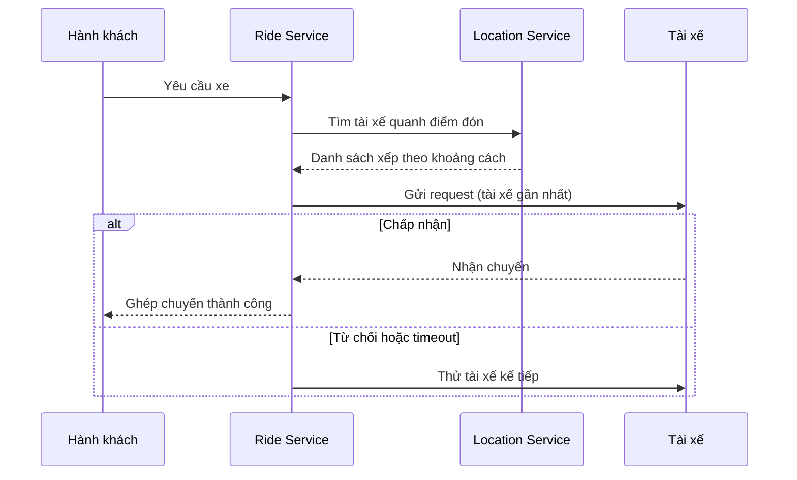
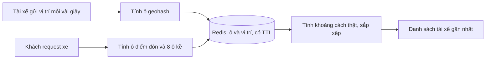
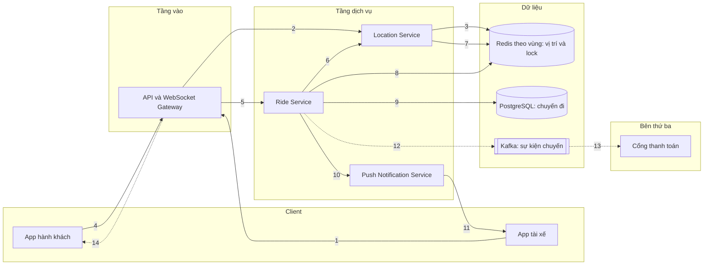
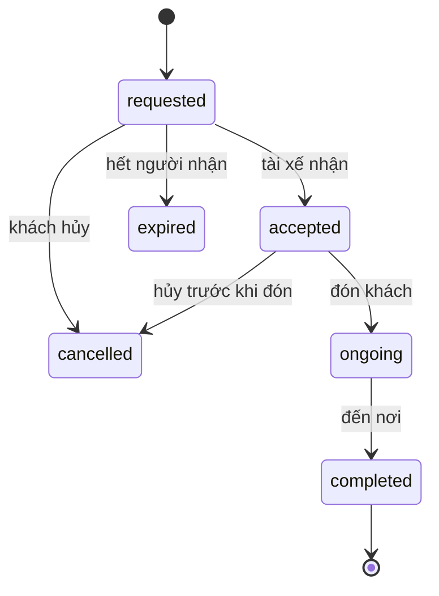

# Ride Hailing (Gọi xe)

**Độ khó:** Hard

Bài này hướng dẫn bạn thiết kế hệ thống kiểu Grab hoặc Uber: khách bấm gọi xe, hệ thống tìm tài xế gần nhất, ghép chuyến rồi theo dõi chuyến đi theo thời gian thực.

**Tóm tắt:**

- Tải chính là flow ghi vị trí của tài xế (khoảng 125.000 ghi mỗi giây), không phải số chuyến gọi xe, nên vị trí hiện tại được giữ trong Redis kèm TTL chứ không ghi vào DB bền vững.
- Không quét mọi tài xế: bản đồ chia thành ô geohash hoặc quadtree, chỉ tra ô của điểm đón cộng 8 ô kề rồi tính khoảng cách thật.
- Geohash là lưới cố định dễ lưu theo key, quadtree tự chia nhỏ nơi đông nhưng khó phân tán và khó cập nhật liên tục.
- Chống ghép trùng hai tầng: `SET ... NX PX` để giữ tài xế cho một lời mời, và cập nhật có điều kiện `WHERE status = 'REQUESTED'` làm hàng rào cuối.
- Trạng thái chuyến quản lý bằng state machine để chặn các chuyển trạng thái vô lý như hoàn thành một chuyến đã hủy.
- Mời lần lượt từng tài xế thì công bằng nhưng chậm; mời cùng lúc vài người thì nhanh nhưng phải hủy các lời mời còn lại.
- Hot spot là sân bay hoặc sự kiện lớn làm một ô quá đông, giải quyết bằng ô nhỏ hơn và shard Redis theo vùng địa lý.
- Kiến trúc gồm các khối chính: gateway (API và WebSocket), Ride Service, Location Service, Redis theo vùng, PostgreSQL, push notification, Kafka và cổng thanh toán.

## Vấn đề cần giải quyết

Có hai khó khăn chính. Thứ nhất, tài xế di chuyển liên tục nên vị trí gửi về dồn dập (hàng trăm nghìn tài xế, mỗi người vài giây gửi một lần), trong khi khách muốn có xe trong vài giây. Câu hỏi "ai đang ở gần tôi" nếu trả lời bằng cách quét hết mọi tài xế rồi tính khoảng cách thì không thể chạy kịp. Thứ hai, nhiều khách có thể gọi cùng lúc, nên phải đảm bảo một tài xế không bị ghép cho hai khách, và một chuyến không bị hai tài xế cùng nhận.

Cách giải quyết gồm ba ý. Tài xế gửi vị trí vài giây một lần, lưu trong Redis với TTL (thời gian sống, hết hạn thì tự xóa). Bản đồ được chia thành các ô (geohash hoặc quadtree) để chỉ cần tra ô của điểm đón và các ô kế bên. Hệ thống gửi request lần lượt cho tài xế gần nhất, ai từ chối hoặc timeout thì chuyển sang người tiếp theo, và trạng thái chuyến được quản lý bằng state machine.

**Nền tảng:** Bài toán có tải ghi vị trí lớn (tài xế gửi liên tục) nhưng vị trí chỉ là dữ liệu tạm, nên để trong memory (Redis có TTL) và dùng spatial index (ô geohash, quadtree) để không phải quét mọi tài xế. Tranh chấp "một tài xế, hai khách" được giải bằng lock có hạn cộng cập nhật có điều kiện, không phải bằng lock dài.

## Khi nào nên dùng, khi nào không

Cách làm này áp dụng cho mọi bài toán tìm đối tượng đang di chuyển quanh một điểm: gọi xe, giao đồ ăn, thuê xe máy hoặc xe đạp công cộng. Nếu bạn chỉ tìm cửa hàng cố định gần mình thì vị trí không đổi, một index địa lý bình thường trong DB (ví dụ PostGIS) là đủ, không cần lưu vị trí trong memory hay dựng flow cập nhật liên tục.

## Các khái niệm cần biết

- **TTL (time to live):** thời gian sống của một key trong Redis; hết hạn thì key tự biến mất. Ở đây dùng để tài xế mất kết nối tự rớt khỏi danh sách "đang online" mà không cần ai dọn.
- **Geohash:** cách mã hóa cặp (vĩ độ, kinh độ) thành một chuỗi ký tự; chuỗi càng dài thì ô càng nhỏ, hai điểm gần nhau thường chung tiền tố. Dùng để biến bài toán tìm theo tọa độ thành tra theo key chuỗi. Ví dụ Hà Nội ở độ dài 6 là `w7er8u`.
- **Quadtree:** cây mà mỗi node chia vùng thành 4 phần, vùng nào đông tài xế thì chia nhỏ thêm. Dùng khi mật độ rất chênh lệch.
- **State machine:** mô hình mô tả một thực thể chỉ ở một trạng thái tại một thời điểm và chỉ được chuyển theo những cạnh cho phép (ví dụ `requested` sang `accepted`). Dùng để chặn các chuyển trạng thái vô lý như hoàn thành một chuyến đã hủy.
- **`SET ... NX PX`:** lệnh Redis chỉ ghi key khi nó chưa tồn tại (`NX`) và tự hết hạn sau số mili giây cho trước (`PX`). Đây là lock có hạn dùng để "giữ" một tài xế cho một lời mời.
- **Cập nhật có điều kiện (compare-and-set):** `UPDATE ... WHERE status = 'REQUESTED'` chỉ thành công nếu trạng thái hiện tại đúng như mong đợi; nếu không thì 0 dòng bị ảnh hưởng. Cách này giải quyết tranh chấp mà không cần lock dài.
- **WebSocket:** kết nối hai chiều giữ mở giữa client và server, để server chủ động đẩy dữ liệu (vị trí xe) xuống khách mà không cần client hỏi liên tục.
- **Shard:** chia dữ liệu ra nhiều node theo một key. Ở đây chia theo vùng địa lý.
- **Surge pricing (giá động):** tăng giá ở khu vực cầu vượt cung, để kéo tài xế tới và giảm bớt nhu cầu.

## Flowchart: đặt xe

Hãy xem một lần đặt xe thành công đi qua những service nào. Ride Service điều phối, Location Service chỉ lo việc tìm tài xế quanh điểm đón.



Đọc sơ đồ: Ride Service nhận request, hỏi Location Service danh sách tài xế đã xếp theo khoảng cách, rồi mời từng người một. Chỉ khi có người nhận thì khách mới được báo ghép thành công; nếu từ chối hoặc timeout, vòng lặp chuyển sang tài xế kế tiếp.

## Tìm tài xế gần

Vấn đề đặt ra là làm sao tìm "tài xế trong bán kính 2 km" mà không so khoảng cách với cả trăm nghìn người. Cách giải quyết là chia bản đồ thành các ô (**geohash** hoặc **quadtree**). Mỗi tài xế thuộc một ô; tìm tài xế quanh điểm đón là tra ô đó và các ô lân cận, không quét toàn bộ.



Đọc sơ đồ: flow ghi (bên trái) và flow đọc (bên phải) gặp nhau ở Redis. Flow đọc chỉ lấy các tài xế trong 9 ô rồi mới tính khoảng cách chính xác, nên chi phí không phụ thuộc tổng số tài xế.

## Ước lượng (giả định)

| Đại lượng | Tính | Kết quả |
|---|---|---|
| Tài xế online cùng lúc | giả định | 500 nghìn |
| Ghi vị trí | 500.000 / 4 s | khoảng 125.000 ghi/giây |
| Bandwidth vị trí | 125.000 x 100 B | khoảng 12,5 MB/s |
| Memory vị trí hiện tại | 500.000 x khoảng 100 B | khoảng 50 MB (rất nhỏ, vừa một node Redis) |
| Request gọi xe | 1 triệu chuyến/ngày | khoảng 12/giây, đỉnh vài chục |
| Lịch sử vị trí nếu lưu hết | 125.000 x 100 B x 86.400 | khoảng 1 TB/ngày, chỉ lưu mẫu thưa cho chuyến đang đi |

Kết luận: request gọi xe ít, **flow ghi vị trí mới là tải chính**. Vị trí hiện tại là dữ liệu tạm nên để trong memory; chỉ đường đi của chuyến mới cần bền vững.

## Kiến trúc tổng thể

Sơ đồ dưới đây vẽ toàn hệ thống: đường ghi vị trí tài xế vào Redis (tải chính), đường đặt xe và ghép chuyến, cùng các luồng async như sự kiện chuyến và thanh toán.



**Chú thích sơ đồ**

| Thành phần | Vai trò | Vì sao chọn / đánh đổi |
|---|---|---|
| App hành khách | Gửi yêu cầu xe, nhận vị trí xe theo thời gian thực | Giữ WebSocket mở để server đẩy dữ liệu, tốn kết nối nhưng không phải hỏi liên tục |
| App tài xế | Gửi vị trí vài giây một lần, nhận và trả lời lời mời | Tần suất gửi quyết định tải ghi; 1 s mượt hơn nhưng tải gấp 4 lần so với 4 s |
| API và WebSocket Gateway | Xác thực, định tuyến, giữ kết nối thời gian thực | Gom auth và kết nối dài một chỗ; cần scale theo số kết nối chứ không chỉ theo request |
| Ride Service | Điều phối ghép chuyến, quản lý state machine của chuyến | Tách khỏi Location Service vì tải và đặc tính khác nhau; là nơi chốt tính đúng đắn |
| Location Service | Nhận vị trí, tra tài xế theo ô geohash | Tách riêng để scale theo tải ghi lớn; chỉ lo việc tìm tài xế quanh điểm đón |
| Redis theo vùng | Lưu vị trí hiện tại có TTL và lock `SET NX PX` | Rất nhanh, dữ liệu tạm nên mất node chỉ trống vài giây; không dùng làm nguồn sự thật |
| PostgreSQL | Lưu chuyến đi, trạng thái, cập nhật có điều kiện | Có transaction và `WHERE status` làm hàng rào cuối; ghi ít nên một primary kèm replica là đủ |
| Push Notification Service | Gửi lời mời tới tài xế | Tách ra để chậm push không chặn vòng ghép; phụ thuộc kênh push của hệ điều hành |
| Kafka | Phát sự kiện chuyến cho thanh toán, giá, phân tích | Tách các việc phụ khỏi đường ghép chuyến; đổi lại là bất đồng bộ nên cần xử lý idempotent |
| Cổng thanh toán | Thu tiền sau chuyến | Bên thứ ba, nên gọi qua service riêng và cho phép thử lại |

Luồng dữ liệu theo số trên mũi tên:

1. Tài xế gửi vị trí vài giây một lần qua gateway.
2. Gateway chuyển vị trí cho Location Service.
3. Location Service tính ô geohash và ghi vị trí vào Redis kèm TTL.
4. Khách gọi `POST /rides` kèm điểm đón qua gateway.
5. Gateway chuyển request cho Ride Service, tạo chuyến ở trạng thái `requested`.
6. Ride Service nhờ Location Service tìm tài xế quanh điểm đón.
7. Location Service tra ô của điểm đón cộng 8 ô kề trong Redis, tính khoảng cách thật và trả danh sách đã sắp xếp.
8. Ride Service giữ tài xế gần nhất bằng `SET driver:{id}:offer ... NX PX 15000`.
9. Khi tài xế nhận, Ride Service cập nhật có điều kiện `WHERE status = 'REQUESTED'` trong PostgreSQL.
10. Ride Service nhờ Push Notification Service gửi lời mời.
11. Push Notification Service đẩy lời mời tới app tài xế; từ chối hoặc timeout thì quay lại bước 8 với tài xế kế tiếp.
12. Ride Service phát sự kiện chuyến sang Kafka (async).
13. Service thanh toán đọc sự kiện và gọi cổng thanh toán sau khi chuyến hoàn thành (async).
14. Gateway đẩy vị trí xe tới khách qua WebSocket trong lúc chuyến diễn ra (async).

**Điểm nghẽn:** Đầu tiên là luồng ghi vị trí (khoảng 125.000 ghi/giây) dồn vào Redis; xử lý bằng shard Redis theo vùng địa lý và tăng bước gửi vị trí khi tài xế đứng yên. Thứ hai là ô quá đông ở sân bay hoặc sự kiện lớn; xử lý bằng chia ô nhỏ hơn ở nơi đông và tách Redis riêng cho vùng nóng.

## Geohash và chọn kích thước ô

Geohash mã hóa (vĩ độ, kinh độ) thành chuỗi base32; chuỗi càng dài ô càng nhỏ, hai điểm gần nhau thường chung tiền tố.

| Độ dài | Kích thước ô (xấp xỉ) | Dùng cho |
|---|---|---|
| 5 | khoảng 4,9 km x 4,9 km | Vùng thưa tài xế |
| 6 | khoảng 1,2 km x 0,6 km | Thành phố, bán kính tìm 1-2 km |
| 7 | khoảng 150 m x 150 m | Khu đông đúc |

**Lỗi biên:** điểm đón sát mép ô thì tài xế gần nhất có thể nằm ở ô bên cạnh. Vì vậy luôn tra ô chứa điểm và **8 ô kề**, rồi tính khoảng cách thật và sắp xếp.

```java
// Java 11+: mã hóa geohash (đã chạy: encode(57.64911, 10.40744, 11) = u4pruydqqvj, giá trị chuẩn)
static final String B32 = "0123456789bcdefghjkmnpqrstuvwxyz";

static String encode(double lat, double lon, int len) {
    double[] latRange = {-90, 90}, lonRange = {-180, 180};
    StringBuilder sb = new StringBuilder();
    boolean even = true;                 // bit chẵn là kinh độ, bit lẻ là vĩ độ
    int bit = 0, ch = 0;
    while (sb.length() < len) {
        double[] r = even ? lonRange : latRange;
        double v = even ? lon : lat, mid = (r[0] + r[1]) / 2;
        ch <<= 1;
        if (v >= mid) { ch |= 1; r[0] = mid; } else r[1] = mid; // chia đôi khoảng
        even = !even;
        if (++bit == 5) { sb.append(B32.charAt(ch)); bit = 0; ch = 0; }
    }
    return sb.toString();
}
// encode(21.0285, 105.8542, 6) = "w7er8u" (Hà Nội, đã chạy)
```

Chín ô cần tra tính bằng cách lệch điểm một bước ô (khoảng 0,0055 độ vĩ và 0,011 độ kinh ở độ dài 6) rồi `encode` lại; thư viện thật có hàm tìm ô kề sẵn.

Với Redis, không cần tự làm: `GEOADD drivers 105.8542 21.0285 d42` rồi `GEOSEARCH drivers FROMLONLAT 105.85 21.03 BYRADIUS 2 km ASC COUNT 10` (Redis 6.2 trở lên). Lưu ý các member của một key GEO không có TTL riêng, nên dùng thêm key `driver:{id}:alive` có TTL hoặc quét xóa tài xế không còn gửi vị trí.

| | Geohash | Quadtree |
|---|---|---|
| Cấu trúc | Lưới cố định, key chuỗi, dễ lưu trong Redis/DB | Cây chia nhỏ theo mật độ |
| Khu đông | Phải chọn độ dài phù hợp từng vùng | Tự chia nhỏ ở nơi đông |
| Cập nhật vị trí liên tục | Rẻ (đổi key ô) | Phải sửa cây, khó phân tán |

**Suy luận:** Vì tài xế gửi vị trí vài giây một lần và vị trí cũ vô giá trị ngay sau đó, dữ liệu này chỉ cần nằm trong memory kèm TTL. Nhờ TTL, tài xế mất kết nối tự rớt khỏi danh sách online mà không cần ai dọn, và mất một node Redis chỉ khiến vị trí trống vài giây cho tới lần gửi kế tiếp. Vì câu hỏi cần trả lời là "ai ở gần điểm này", ta phải đổi tọa độ thành key theo ô để tra trực tiếp thay vì tính khoảng cách với mọi tài xế, nên chi phí đọc không còn phụ thuộc tổng số tài xế. Điểm dễ nhầm nằm ở biên ô: điểm đón sát mép thì tài xế gần nhất có thể nằm ở ô bên cạnh, nên chỉ tra một ô sẽ trả sai; phải tra 9 ô rồi tính khoảng cách thật và sắp xếp. Cũng dễ nhầm khi nghĩ khó khăn nằm ở số chuyến gọi xe, trong khi con số cho thấy flow ghi vị trí mới là tải chính, nên mọi tối ưu phải nhắm vào đường ghi này. Hệ quả khi thiết kế: dùng Redis cho vị trí hiện tại, chỉ lưu bền vững đường đi của chuyến đang chạy, và shard theo vùng địa lý chứ không theo tài xế để một truy vấn không phải đi qua nhiều shard.

## Ghép chuyến không trùng tài xế

Vấn đề đặt ra là hai khách gần nhau có thể cùng chọn trúng một tài xế. Cách giải quyết là mỗi lời mời gửi cho **một** tài xế tại một thời điểm và đặt lock có hạn để không ai khác mời trùng. Nếu thiếu lock này, một tài xế sẽ nhận hai lời mời cùng lúc và một trong hai khách phải chờ vô ích:

```text
SET driver:d42:offer ride:r7 NX PX 15000     # OK: giữ tài xế 15 giây; nil: đang bận lời mời khác
```

Tài xế chấp nhận thì chuyển trạng thái chuyến bằng cập nhật có điều kiện (chỉ thắng một lần). Đây là hàng rào cuối cùng, vì lock Redis có thể hết hạn đúng lúc tài xế bấm nhận:

```sql
-- PostgreSQL: chuyến chỉ được nhận khi còn REQUESTED
UPDATE rides SET status = 'ACCEPTED', driver_id = 'd42', version = version + 1
-- 0 dòng bị ảnh hưởng: chuyến đã bị hủy hoặc đã có người nhận
WHERE id = 'r7' AND status = 'REQUESTED';
```

**Phải thuộc:** Chống ghép trùng hai tầng: `SET driver:{id}:offer ... NX PX 15000` (lock có hạn, mỗi lúc chỉ mời một khách cho một tài xế) và `UPDATE rides SET status='ACCEPTED' ... WHERE status='REQUESTED'` (cập nhật có điều kiện, 0 dòng là thua). Luôn tra ô của điểm đón cộng 8 ô kề rồi tính khoảng cách thật.

Lifecycle của một chuyến đi như sau; mỗi mũi tên là một chuyển trạng thái hợp lệ duy nhất:



Lời mời timeout thì lock tự nhả và service chuyển sang tài xế kế tiếp; khách hủy cùng lúc tài xế nhận được giải quyết bởi điều kiện `status` ở trên, nên chỉ một bên thắng.

**Suy luận:** Tranh chấp ở đây không phải tranh chấp lâu dài mà là những cú va chạm ngắn: hai khách cùng chọn một tài xế trong vài chục mili giây. Vì vậy một lock ngắn có hạn (`SET NX PX`) là đủ để chặn mời trùng, và TTL của lock tự nhả khi tài xế không trả lời nên không ai bị giữ vĩnh viễn. Tuy nhiên lock Redis chỉ là lớp nhanh, không phải lớp đúng đắn, vì nó có thể hết hạn đúng lúc tài xế bấm nhận hoặc mất khi node chết. Do đó bước chốt phải là cập nhật có điều kiện trong DB, nơi chỉ một bên thắng bất kể lock còn hay không; điều này cũng giải quyết luôn trường hợp khách hủy cùng lúc tài xế nhận. Điểm dễ nhầm là dùng lock dài hoặc lock phân tán nặng nề cho cả vòng đời chuyến, khiến một lỗi nhỏ giữ tài xế kẹt rất lâu. Khi review, kiểm tra hai tầng: lock có hạn để giảm va chạm và compare-and-set trong DB để bảo đảm tính đúng.

## Đánh đổi

| Chọn | Được | Mất |
|---|---|---|
| Mời lần lượt từng tài xế | Không trùng, công bằng | Chậm nếu nhiều người từ chối |
| Mời cùng lúc vài người, ai nhận trước thắng | Nhanh hơn | Phải hủy lời mời còn lại, trải nghiệm gây khó chịu |
| Cập nhật vị trí 1 s/lần | Bản đồ mượt | Tải ghi gấp 4 lần so với 4 s |
| Vị trí ở Redis, mất khi node chết | Rất nhanh | Tài xế phải gửi lại vị trí (vài giây là phục hồi) |

Chọn "mời lần lượt" khi mật độ tài xế cao và tỷ lệ từ chối thấp; chọn "mời cùng lúc" khi thị trường thiếu xe hoặc khách hay bỏ đi nếu chờ lâu. Giữ vị trí ở Redis là hợp lý vì đây là dữ liệu tạm, nhưng đừng dùng nó làm nguồn sự thật cho lịch sử chuyến đi.

## Điểm cần nhắc

- **Hot spot:** sự kiện lớn hoặc sân bay làm một ô quá đông; chia ô nhỏ hơn ở nơi đông và shard Redis theo vùng địa lý (thành phố), không theo tài xế.
- **Giám sát:** thời gian từ yêu cầu đến ghép được, tỷ lệ không có xe, tỷ lệ tài xế từ chối, latency cập nhật vị trí.
- Vị trí cập nhật mỗi vài giây: lưu trong Redis (có TTL) thay vì DB bền vững.
- Kênh thời gian thực (WebSocket) để đẩy vị trí xe cho hành khách.
- Trạng thái chuyến (chờ, nhận, đang đi, hoàn thành) dùng state machine, tránh một tài xế nhận hai chuyến bằng key hoặc transaction.
- Giá động (surge pricing) tính theo cung cầu từng khu vực.
- Thanh toán tách thành service riêng.

