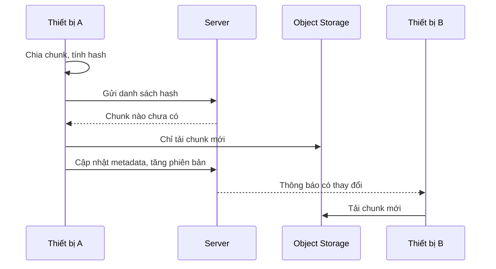
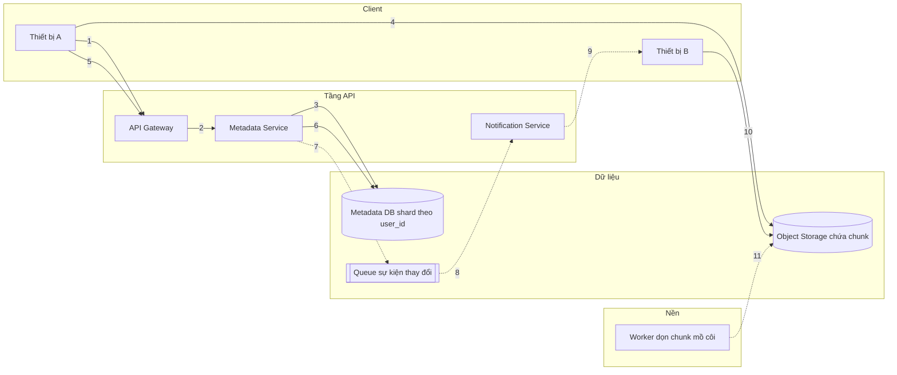
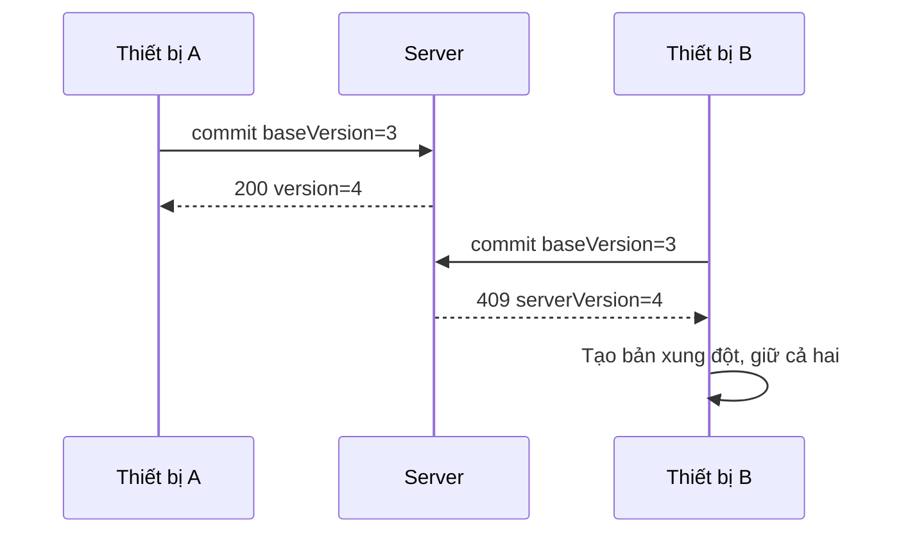

# Cloud Storage (Lưu trữ và đồng bộ file)

**Độ khó:** Hard

Bài này hướng dẫn bạn thiết kế hệ thống kiểu Dropbox hoặc Google Drive: lưu file trên cloud, tự đồng bộ giữa laptop và điện thoại, và cho người khác truy cập.

**Tóm tắt:**

- File được coi là chuỗi chunk cỡ vài MB, mỗi chunk định danh bằng hash nội dung; sửa một dòng chỉ cần upload lại chunk bị đổi (ví dụ 4 MB thay vì 1 GB).
- Chunk trùng hash chỉ lưu một lần (dedup), nên cần `ref_count` để biết khi nào được xóa chunk.
- Nội dung nằm trong object storage, còn metadata (cây thư mục, danh sách chunk của từng phiên bản, version) nằm trong DB và là phần phải shard.
- Thứ tự an toàn: upload chunk xong rồi mới commit metadata, để không bao giờ có phiên bản trỏ tới chunk chưa tồn tại.
- Commit dùng optimistic locking theo version; lệch version thì trả 409 và giữ cả hai bản thay vì ghi đè.
- Chunk cố định đơn giản nhưng chèn vào đầu file làm mọi chunk đổi hash; content-defined chunking chỉ đổi chunk quanh chỗ chèn.
- Dedup xuyên người dùng tiết kiệm chỗ nhưng có rủi ro lộ thông tin về việc một file đã tồn tại.
- Kiến trúc gồm các khối chính: API Gateway, Metadata Service, Metadata DB đã shard, object storage chứa chunk, queue sự kiện, Notification Service và worker dọn chunk mồ côi.

## Vấn đề cần giải quyết

Hãy hình dung bạn có một file 1 GB và sửa đúng một dòng. Nếu hệ thống upload lại cả file thì vừa tốn bandwidth vừa chậm. Đây chưa phải toàn bộ vấn đề: nhiều thiết bị có thể sửa cùng một file cùng lúc, và người dùng tuyệt đối không chấp nhận mất dữ liệu, nên hệ thống phải xử lý xung đột chứ không được âm thầm ghi đè.

Cách giải quyết là coi file như một chuỗi các khối nhỏ. Cắt file thành chunk (cỡ vài MB) và tính hash từng chunk. Chỉ upload chunk mới hoặc đã đổi; chunk trùng hash chỉ lưu một lần (dedup). Nội dung chunk nằm trong object storage, còn metadata (cây thư mục, danh sách chunk của từng phiên bản, version) nằm trong DB. Khi có thay đổi, server báo cho các thiết bị khác tới tải về phần mới.

**Nền tảng:** Coi file như chuỗi các chunk được định danh bằng hash nội dung. Nhờ đó chỉ upload phần đã đổi (delta sync), chunk trùng chỉ lưu một lần (dedup), và nội dung (object storage) được tách khỏi metadata (DB: cây thư mục, danh sách chunk, version).

## Khi nào nên dùng, khi nào không

Dùng cơ chế này khi cần sao lưu, đồng bộ file giữa nhiều máy, hoặc chia sẻ tài liệu cho nhóm, tức là file được sửa nhiều lần sau khi tạo. Nếu bạn chỉ lưu file upload một lần rồi ít khi sửa (ảnh đại diện, file đính kèm) thì đẩy thẳng lên object storage là đủ; chunking, dedup và đồng bộ sẽ chỉ thêm độ phức tạp mà không đem lại lợi ích.

## Các khái niệm cần biết

- **Chunking:** chia file thành khối cố định (ví dụ 4 MB). Sửa một phần chỉ cần gửi lại khối đã đổi.
- **Hash và checksum (SHA-256):** hash function biến một khối dữ liệu thành chuỗi ngắn cố định; nội dung giống nhau thì hash giống nhau, chỉ cần đổi một byte thì hash khác hẳn. Dùng làm "dấu vân tay" để nhận ra khối trùng và để kiểm tra khối tải về có hỏng không.
- **Deduplication (dedup):** mỗi khối có hash; khối trùng chỉ lưu một lần và được nhiều file cùng trỏ tới. Nhờ đó tiết kiệm lưu trữ, nhưng cần đếm tham chiếu (`ref_count`) để biết khi nào xóa được.
- **Metadata:** cây thư mục, danh sách khối, phiên bản. Tách riêng khỏi nội dung vì nhỏ, truy vấn nhiều, cần transaction, khác hẳn đặc tính của nội dung lớn và ít sửa.
- **Delta sync:** chỉ gửi phần chênh lệch giữa hai phiên bản thay vì cả file.
- **Optimistic locking:** không lock trước, mà khi ghi thì kiểm tra version vẫn như lúc đọc (`WHERE version = ?`); nếu có người sửa trước thì ghi thất bại và báo xung đột. Hợp khi xung đột hiếm.
- **Erasure coding:** thay vì replicate nguyên khối, chia dữ liệu thành các mảnh kèm mảnh dự phòng tính toán, mất vài mảnh vẫn khôi phục được. Tốn ít dung lượng hơn replication, đổi lại tốn CPU khi khôi phục.
- **Chunk mồ côi (orphan chunk):** chunk đã upload nhưng chưa được metadata nào trỏ tới, thường do upload dở hoặc commit thất bại; cần dọn nền.
- **Long polling và WebSocket:** hai cách để client biết "có thay đổi" gần như tức thì. Long polling là client hỏi và server giữ request mở đến khi có tin; WebSocket là kết nối hai chiều giữ mở.

## Flowchart: đồng bộ file

Flow dưới đây cho thấy vì sao đồng bộ tiết kiệm bandwidth: thiết bị chỉ gửi danh sách hash trước, server trả lời chunk nào còn thiếu, rồi mới tải đúng những chunk đó.



Đọc sơ đồ: bước "gửi danh sách hash" rất nhẹ so với nội dung thật. Thứ tự quan trọng là tải chunk xong rồi mới cập nhật metadata, để không bao giờ có phiên bản trỏ tới chunk chưa tồn tại.

## Ước lượng (giả định)

| Đại lượng | Tính | Kết quả |
|---|---|---|
| Dung lượng thô | 10 triệu người x 5 GB | 50 PB |
| Sau dedup (tiết kiệm khoảng 30%, tùy dữ liệu) | 50 PB x 0,7 | khoảng 35 PB |
| Có replication/erasure coding (hệ số khoảng 1,5 đến 3) | 35 PB x 1,5 | khoảng 50 PB vật lý |
| Số chunk (4 MB) | 35 PB / 4 MB | khoảng 9 tỷ chunk |
| Metadata mỗi chunk (hash, kích thước, vị trí) | 9 tỷ x khoảng 100 B | khoảng 900 GB, phải shard để chịu tải |
| Sửa 1 dòng trong file 1 GB | chunk 4 MB bị đổi so với 1 GB | gửi 4 MB thay vì 1 GB, ít hơn 256 lần |

Kết luận: nội dung nằm ở object storage, còn **bảng metadata là phần phải shard** (theo `user_id`, vì mọi truy vấn là theo người dùng). Bảng `chunks` dùng chung theo hash thì shard theo `chunk_hash`.

**Suy luận:** Vì file lớn và thường chỉ sửa một phần nhỏ, đơn vị đồng bộ hợp lý là chunk chứ không phải cả file. Khi mỗi chunk được định danh bằng hash nội dung, hai thiết bị chỉ cần trao đổi danh sách hash để biết chunk nào còn thiếu, nên bước này rất nhẹ so với dữ liệu thật. Cũng nhờ hash nội dung, hai chunk giống nhau từ bất kỳ file nào đều trùng định danh, từ đó có dedup nhưng kéo theo nhu cầu đếm tham chiếu để xóa an toàn. Điểm dễ nhầm là dùng một giá trị chunk cho mọi trường hợp: chunk lớn giảm metadata nhưng sửa nhỏ vẫn phải gửi cả chunk, chunk nhỏ cho delta sync mịn nhưng metadata nhân lên nhiều lần. Hệ quả là nội dung phải ở object storage rẻ và bền, còn metadata nhỏ, truy vấn nhiều và cần transaction nên ở DB và là thứ phải shard khi quy mô lớn. Khi thiết kế, hãy chọn kích thước chunk theo kiểu file người dùng sửa (video ít sửa thì chunk to, tài liệu hay sửa thì chunk nhỏ hoặc theo nội dung).

## Kiến trúc tổng thể

Sơ đồ dưới đây vẽ toàn hệ thống: nội dung chunk đi thẳng vào object storage, metadata đi qua Metadata Service vào DB đã shard, và thông báo thay đổi tới thiết bị khác qua queue.



**Chú thích sơ đồ**

| Thành phần | Vai trò | Vì sao chọn / đánh đổi |
|---|---|---|
| Thiết bị A và B | Chia chunk, tính hash, upload phần thiếu, tải phần mới | Tính hash ở client để chỉ gửi phần đổi; tốn CPU và pin máy khách |
| API Gateway | Xác thực, rate limit, định tuyến | Một cửa chung cho cả sync lẫn chia sẻ; thêm một hop nhưng gom được auth |
| Metadata Service | Kiểm tra chunk thiếu, commit phiên bản, quản lý cây thư mục | Là nơi chốt tính đúng đắn bằng optimistic locking; stateless nên scale ngang |
| Metadata DB | Lưu `files`, `file_chunks`, `chunks` kèm `ref_count` | Cần transaction và truy vấn nên dùng DB quan hệ; khoảng 900 GB nên phải shard theo `user_id` |
| Object Storage | Lưu nội dung chunk | Rẻ, bền, gần như vô hạn; không truy vấn được nên cần metadata đi kèm |
| Queue sự kiện thay đổi | Đệm sự kiện "file đã đổi" | Tách commit khỏi việc báo tin, chịu được thư mục chia sẻ có hàng nghìn người; bất đồng bộ nên có độ trễ nhỏ |
| Notification Service | Báo cho thiết bị khác qua long polling hoặc WebSocket | Chỉ báo "có thay đổi", client tự kéo chi tiết; giữ nhiều kết nối mở nên scale theo số kết nối |
| Worker dọn chunk mồ côi | Xóa chunk không được metadata nào trỏ tới | Chạy nền nên không chặn upload; phải tôn trọng `ref_count` để không xóa nhầm |

Luồng dữ liệu theo số trên mũi tên:

1. Thiết bị A gọi `POST /chunks/missing` qua gateway, gửi danh sách hash.
2. Gateway chuyển request cho Metadata Service.
3. Metadata Service tra bảng `chunks` trong DB và trả về chunk nào server chưa có.
4. Thiết bị A upload đúng các chunk thiếu thẳng vào object storage.
5. Sau khi upload xong, thiết bị A gọi `POST /files/{id}/commit` kèm `baseVersion`.
6. Metadata Service cập nhật có điều kiện `WHERE version = ?`, ghi `file_chunks` và tăng `ref_count`; lệch version thì trả 409.
7. Metadata Service đẩy sự kiện thay đổi vào queue (async).
8. Notification Service lấy sự kiện từ queue (async).
9. Notification Service báo thiết bị B có thay đổi qua long polling hoặc WebSocket (async).
10. Thiết bị B lấy danh sách chunk mới rồi tải đúng các chunk thiếu từ object storage.
11. Worker nền quét và xóa chunk mồ côi sau một thời gian chờ (async).

**Điểm nghẽn:** Đầu tiên là Metadata DB vì mọi thao tác sync đều đi qua đó; xử lý bằng shard theo `user_id`, shard bảng `chunks` theo `chunk_hash` và thêm cache cho cây thư mục. Thứ hai là Notification Service khi thư mục chia sẻ có hàng nghìn người; xử lý bằng queue, gộp thông báo và scale theo số kết nối.

## Dữ liệu và API

Mô hình dữ liệu gồm ba bảng: `files` (thông tin file và cây thư mục), `file_chunks` (danh sách chunk có thứ tự của từng phiên bản), `chunks` (kho chunk dùng chung, dedup theo hash).

```sql
-- PostgreSQL (rút gọn)
CREATE TABLE files (
  id         bigint PRIMARY KEY,
  user_id    bigint NOT NULL,
  parent_id  bigint,                 -- thư mục cha
  name       text NOT NULL,
  version    int NOT NULL DEFAULT 1, -- tăng mỗi lần sửa
  UNIQUE (user_id, parent_id, name)
);
CREATE TABLE file_chunks (            -- thứ tự chunk của một phiên bản
  file_id bigint, version int, idx int, chunk_hash char(64),
  PRIMARY KEY (file_id, version, idx)
);
CREATE TABLE chunks (                 -- kho chunk dùng chung, dedup theo hash
  chunk_hash char(64) PRIMARY KEY, size int, ref_count bigint NOT NULL DEFAULT 0
);
```

```text
POST /api/v1/files/{id}/commit
  body: { "baseVersion": 3, "chunks": ["h1","h2","h9"] }
  -> 200 { "version": 4 }                       # baseVersion khớp: nhận
  -> 409 { "serverVersion": 5 }                 # lệch: có người sửa trước, tạo bản xung đột
POST /api/v1/chunks/missing   body: ["h1","h2","h9"]  -> ["h9"]   # chunk server chưa có
```

Khi hai thiết bị cùng sửa từ phiên bản 3, thiết bị commit sau sẽ nhận 409 thay vì ghi đè:



**Phải thuộc:** Thứ tự an toàn: upload chunk xong rồi mới commit metadata (để không có phiên bản trỏ tới chunk chưa tồn tại). Commit dùng optimistic locking theo version; lệch version thì trả 409 và giữ cả hai bản thay vì ghi đè. Chunk chỉ bị xóa khi `ref_count` về 0; chunk mồ côi được dọn nền.

Commit dùng optimistic locking: `UPDATE files SET version = version + 1 WHERE id = ? AND version = ?` (baseVersion). Chunk phải **upload xong rồi mới commit metadata**; chunk mồ côi (upload mà chưa commit) bị dọn nền sau một thời gian, và chunk chỉ bị xóa khi `ref_count` về 0.

**Suy luận:** Thứ tự upload chunk trước, commit metadata sau xuất phát từ một ràng buộc đơn giản: metadata là thứ người khác nhìn thấy, nên nó không được phép trỏ tới thứ chưa tồn tại. Nếu đảo thứ tự, thiết bị khác nhận thông báo, đi tải chunk chưa có và thấy file hỏng; còn với thứ tự đúng, lỗi giữa chừng chỉ để lại chunk mồ côi vô hại, dọn nền được. Vì nhiều thiết bị cùng sửa, commit không thể ghi đè mù quáng, nên server so baseVersion với version hiện tại bằng optimistic locking: xung đột hiếm nên không cần lock trước, và khi lệch thì trả 409 để giữ cả hai bản. Điểm dễ nhầm là cho rằng giữ cả hai bản là phiền toái; thực ra mất dữ liệu người dùng mới là lỗi không chấp nhận được, còn gộp bản là việc người dùng làm được. Hệ quả hành động: luôn viết dọn chunk mồ côi chạy nền và không bao giờ xóa chunk khi `ref_count` chưa về 0.

## Chia chunk và dedup bằng hash

Hãy xem cách chia chunk cố định và tính hash từng chunk, để thấy rõ khi nào cách này hiệu quả và khi nào không:

```java
// Java 11+: chia chunk cố định, tính SHA-256 từng chunk (rút ngắn 8 hex để in)
static List<String> split(byte[] data, int size) throws Exception {
    List<String> hashes = new ArrayList<>();
    for (int off = 0; off < data.length; off += size) {
        MessageDigest md = MessageDigest.getInstance("SHA-256");
        md.update(data, off, Math.min(size, data.length - off));
        StringBuilder sb = new StringBuilder();
        for (byte x : md.digest()) sb.append(String.format("%02x", x));
        hashes.add(sb.substring(0, 8));
    }
    return hashes;
}
// Demo chunk 4 byte, "AAAABBBBCCCCDDDD" gồm 4 chunk (đã chạy):
//   sửa chunk thứ 3 thành "XXXX"          -> cần tải 1/4 chunk
//   chèn 1 byte "Z" vào đầu file          -> cần tải 5/5 chunk (mọi chunk lệch biên)
```

**Phải thuộc:** Chunk cố định đơn giản nhưng chèn vào đầu file làm mọi chunk đổi hash; content-defined chunking (rolling hash như Rabin) cắt theo nội dung nên chỉ chunk quanh chỗ chèn bị đổi. Dedup toàn cục tiết kiệm chỗ nhưng có rủi ro lộ thông tin (dò hash file đã tồn tại).

Ví dụ thứ hai là điểm yếu của chunk cố định: **chèn vào đầu** làm mọi chunk đổi hash. Cách khắc phục là **content-defined chunking**: dùng rolling hash (Rabin, Buzhash) trượt trên nội dung và cắt chunk khi hash thỏa một điều kiện (ví dụ 13 bit thấp bằng 0 cho chunk trung bình khoảng 8 KB), nên biên chunk bám theo nội dung chứ không theo vị trí.

| | Chunk cố định | Chunk theo nội dung |
|---|---|---|
| Đơn giản | Cao | Thấp hơn |
| Chèn đầu file | Mọi chunk đổi | Chỉ chunk quanh chỗ chèn |
| Phù hợp | File nhị phân, video, ảnh | Tài liệu, mã nguồn, ảnh đĩa máy ảo |

Dedup xuyên người dùng có rủi ro: client có thể dò xem hash của một file đã tồn tại chưa (lộ thông tin). Giảm thiểu bằng cách dedup trong phạm vi tài khoản/tổ chức hoặc chỉ xác nhận sau khi client chứng minh đang có nội dung đó.

## Đánh đổi

| Chọn | Được | Mất |
|---|---|---|
| Chunk 4 MB | Metadata vừa phải | Sửa nhỏ vẫn gửi 4 MB |
| Chunk 256 KB | Delta sync mịn, dedup tốt | Metadata nhân 16 lần, nhiều request |
| Dedup toàn cục | Tiết kiệm lưu trữ | Rủi ro lộ thông tin, đếm tham chiếu phức tạp |
| Giữ cả hai bản khi xung đột | Không mất dữ liệu | Người dùng phải tự gộp |

Chọn chunk to khi file chủ yếu là video, ảnh hiếm khi sửa từng phần; chọn chunk nhỏ hoặc theo nội dung khi người dùng hay sửa tài liệu. Nếu chọn sai, hiện tượng là tải lên chậm bất thường sau mỗi lần sửa nhỏ, hoặc bảng metadata phình quá mức.

## Điểm cần nhắc

- **Giám sát:** latency đồng bộ (từ commit đến thiết bị khác thấy), tỷ lệ dedup, số chunk mồ côi, lỗi checksum khi tải về.
- **Hot spot:** thư mục chia sẻ cho hàng nghìn người gây dồn thông báo; gửi thông báo thay đổi qua queue và để client kéo chi tiết (long polling hoặc WebSocket chỉ báo "có thay đổi").
- **Xung đột:** hai thiết bị sửa cùng lúc, thường giữ cả hai phiên bản.
- Lưu nhiều phiên bản để khôi phục.
- Nén và mã hóa (khi lưu và khi truyền).
- Replicate chunk ở nhiều vùng để bền vững.
- Lớp lưu trữ nóng và lạnh để giảm chi phí.

