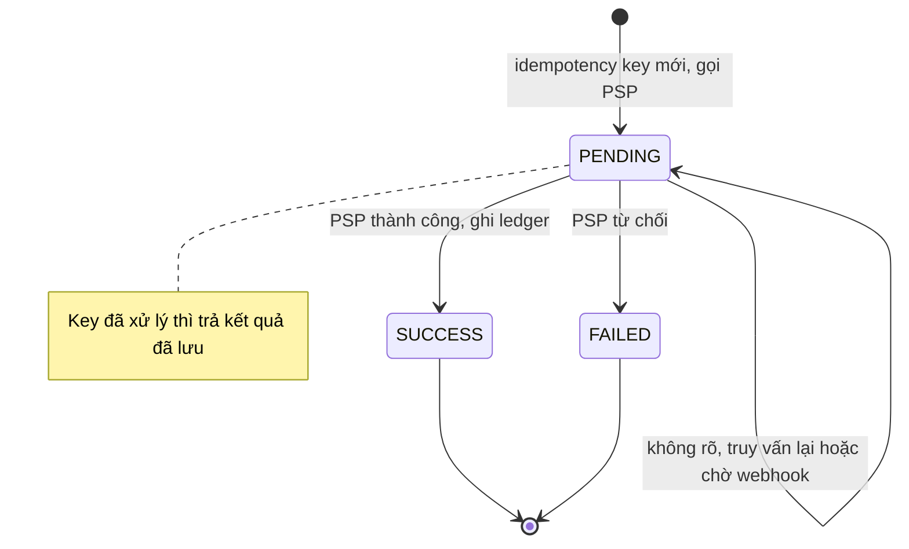
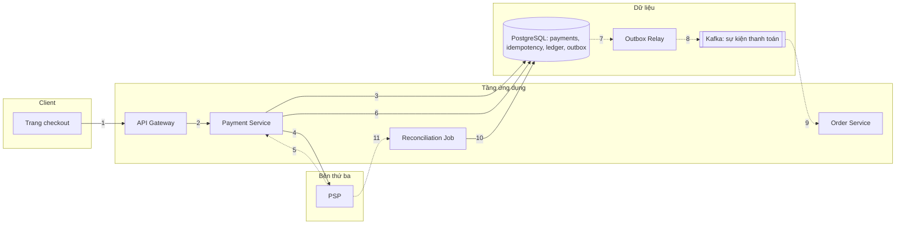
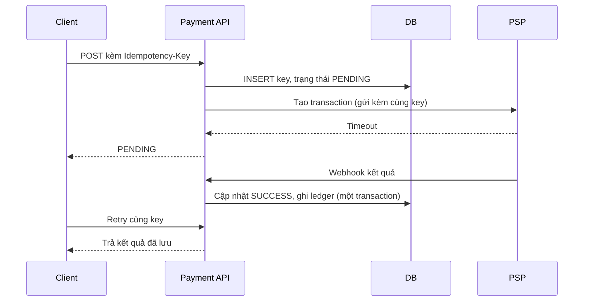

# Payment System (Hệ thống thanh toán)

**Độ khó:** Hard

Bài này hướng dẫn bạn thiết kế hệ thống thanh toán của một sàn thương mại điện tử: nhận tiền từ khách, chuyển cho người bán, và ghi sổ sao cho số liệu luôn khớp.

**Tóm tắt:**

- Với tiền, đúng đắn quan trọng hơn throughput: tải chỉ khoảng vài trăm transaction mỗi giây nhưng không được sai một đồng.
- Idempotency key do client sinh và giữ nguyên khi retry giúp không trừ tiền hai lần.
- Transaction đi qua state machine: chỉ PENDING được đi tiếp, SUCCESS và FAILED là trạng thái cuối bất biến.
- Khi PSP timeout, không coi là thất bại: giữ PENDING và chờ webhook hoặc hỏi lại PSP bằng cùng key.
- Ledger double-entry chỉ thêm, không sửa; tổng nợ luôn bằng tổng có, sai thì ghi reversal entry.
- Ghi ledger và đổi trạng thái phải nằm cùng một transaction DB; số tiền lưu bằng số nguyên đơn vị nhỏ nhất.
- Reconciliation hằng ngày với báo cáo của PSP là lưới an toàn cuối cùng; flow nhiều service dùng saga hoặc outbox, ưu tiên CP cho phần ghi sổ.
- Kiến trúc gồm các khối chính: API Gateway, Payment Service, PostgreSQL (idempotency, ledger, outbox), outbox relay, Kafka, Order Service, reconciliation job và PSP bên thứ ba.

## Vấn đề cần giải quyết

Với hệ thống tiền bạc, sai một đồng cũng là sự cố. Hãy xem ba tình huống hay gặp. Mạng chập chờn, client tự động gửi lại (retry) request mà không có bảo vệ gì thì khách bị trừ tiền hai lần. Hệ thống gọi bên thứ ba (cổng thanh toán) và bị timeout thì không ai biết tiền đã trừ hay chưa: coi là thất bại thì có thể bỏ sót khoản đã trừ, coi là thành công thì có thể giao hàng không thu được tiền. Và cuối cùng, tiền phải truy vết và kiểm toán được, tức là phải trả lời được "khoản này đến từ đâu, đi đâu, lúc nào".

Cách giải quyết gồm bốn mảnh ghép. Mỗi request mang một idempotency key, nên retry không trừ tiền lại. Transaction đi qua một state machine (PENDING, SUCCESS, FAILED) để mọi chuyển trạng thái đều hợp lệ. Mọi dòng tiền được ghi vào ledger double-entry, chỉ thêm không sửa. Định kỳ hệ thống chạy reconciliation đối với báo cáo của PSP để bắt sai lệch mà các bước trên không ngăn được.

**Nền tảng:** Với tiền, đúng đắn quan trọng hơn throughput: tải không lớn nhưng không được sai một đồng. Vì vậy mọi thiết kế xoay quanh việc không mất, không trùng và truy vết được: idempotency key chặn trừ tiền hai lần, state machine chặn chuyển trạng thái vô lý, ledger chỉ thêm chặn sửa lịch sử, reconciliation bắt lỗi còn sót, và ưu tiên nhất quán (CP) hơn khả dụng.

## Khi nào nên dùng, khi nào không

Thiết kế này dành cho e-commerce, ví điện tử, marketplace nhiều người bán, nơi bạn phải tự quản lý dòng tiền và chia tiền cho nhiều bên. Nếu chỉ cần nhận tiền từ khách thì thường tích hợp thẳng PSP (Stripe, VNPay...) là đủ; đừng tự xây lõi thanh toán, vì chi phí tuân thủ và rủi ro rất lớn.

## Các khái niệm cần biết

- **PSP (Payment Service Provider):** bên thứ ba xử lý việc trừ tiền thẻ hoặc ví thay bạn (Stripe, VNPay). Bạn gọi API của họ thay vì tự nói chuyện với ngân hàng.
- **Idempotency key:** một chuỗi định danh do client sinh ra cho mỗi ý định thanh toán và giữ nguyên khi retry. Server thấy key đã xử lý thì trả lại kết quả cũ thay vì làm lại. Nếu thiếu, mỗi lần retry là một lần trừ tiền mới.
- **State machine:** mô hình chỉ cho phép một số chuyển trạng thái nhất định. Ở đây chỉ `PENDING` được đi tiếp, `SUCCESS` và `FAILED` là trạng thái cuối bất biến, để một transaction thành công không thể bị đổi thành thất bại do một webhook đến muộn.
- **Webhook:** PSP chủ động gọi ngược vào API của bạn để báo kết quả transaction. Nó có thể đến lặp lại hoặc sai thứ tự nên phải xử lý idempotent.
- **Double-entry ledger:** mỗi transaction ghi ít nhất hai dòng, một bên nợ và một bên có, tổng nợ luôn bằng tổng có. Nhờ vậy tiền không tự sinh ra hay biến mất, và lỗi lộ ra ngay khi tổng không cân.
- **Append-only:** chỉ thêm bản ghi, không sửa hoặc xóa. Sai thì ghi **reversal entry** để bù, giữ nguyên dấu vết kiểm toán.
- **Reconciliation:** so khớp dữ liệu nội bộ với báo cáo của PSP theo mã transaction và số tiền để tìm chênh lệch.
- **Saga và outbox pattern:** saga là chuỗi bước cục bộ có bước bù trừ khi hỏng giữa chừng; outbox là kỹ thuật ghi event cần gửi vào cùng transaction DB rồi mới gửi đi sau. Cả hai thay thế transaction phân tán xuyên service.
- **PCI DSS và token hóa:** PCI DSS là bộ chuẩn bảo mật cho dữ liệu thẻ. Cách dễ nhất để tuân thủ là không bao giờ chạm vào số thẻ thật: client gửi thẳng cho PSP và nhận về một token, hệ thống của bạn chỉ lưu token.
- **CP (trong CAP):** ưu tiên consistency hơn availability khi có network partition. Với ghi sổ, thà từ chối tạm thời còn hơn ghi sai.

## Flowchart: một lần thanh toán

Sơ đồ trạng thái dưới đây cho thấy lifecycle một transaction. Chú ý vòng lặp `PENDING` về chính nó: khi không rõ kết quả, ta ở yên trạng thái chờ chứ không đoán.



## Ước lượng (giả định)

| Đại lượng | Tính | Kết quả |
|---|---|---|
| Đơn/ngày | 10 triệu | |
| Thanh toán trung bình | 10 triệu / 86.400 | khoảng 116/giây, đỉnh (sale) 10-20 lần: vài nghìn/giây |
| Entry mỗi thanh toán | 3 dòng (khách, người bán, phí) | 30 triệu dòng/ngày |
| Dung lượng ledger | 30 triệu x 100 B x 365 | khoảng 1,1 TB/năm |

Kết luận: tải **không lớn**, độ khó nằm ở đúng đắn chứ không ở throughput. Một cluster PostgreSQL có replica là đủ lâu dài; shard theo `merchant_id` hoặc `account_id` khi cần. Không đánh đổi tính đúng lấy tốc độ.

## Kiến trúc tổng thể

Sơ đồ dưới đây vẽ toàn hệ thống: đường thanh toán đồng bộ qua Payment Service tới PSP, đường webhook quay về, event ra các service khác bằng outbox, và job reconciliation làm lưới an toàn cuối.



**Chú thích sơ đồ**

| Thành phần | Vai trò | Vì sao chọn / đánh đổi |
|---|---|---|
| Trang checkout | Gửi token thẻ thẳng cho PSP, gọi API với `Idempotency-Key` | Không chạm số thẻ nên giảm phạm vi PCI DSS; client phải giữ nguyên key khi retry |
| API Gateway | Xác thực, rate limit, định tuyến | Chặn lạm dụng trước khi tới lõi thanh toán; thêm một hop |
| Payment Service | Chiếm key, gọi PSP, xử lý webhook, ghi ledger | Là nơi duy nhất đổi trạng thái nên dễ bảo đảm state machine; phải stateless để scale ngang |
| PostgreSQL | Lưu idempotency key, payment, ledger chỉ thêm và outbox | Có transaction ACID nên ghi ledger và đổi trạng thái cùng lúc; ưu tiên CP, tải vài nghìn TPS nên một primary kèm replica là đủ |
| Outbox Relay | Đọc bảng outbox và đẩy event sang Kafka | Không mất event dù service chết sau khi commit; có thể gửi trùng nên consumer phải idempotent |
| Kafka | Phát sự kiện `PaymentSucceeded`, `PaymentFailed` | Tách Payment Service khỏi các service khác, thay cho transaction phân tán; bất đồng bộ nên có độ trễ |
| Order Service | Cập nhật đơn hàng, kích hoạt giao hàng khi tiền đã về | Chỉ phản ứng với event nên không chặn đường thanh toán |
| Reconciliation Job | So ledger với báo cáo của PSP mỗi ngày | Bắt lỗi lọt qua idempotency và state machine; chạy nền và phát hiện chậm hơn thời gian thực |
| PSP | Trừ tiền thẻ hoặc ví, gọi webhook báo kết quả | Bên thứ ba có thể timeout hoặc gửi webhook lặp, nên mọi tương tác phải idempotent |

Luồng dữ liệu theo số trên mũi tên:

1. Client gọi `POST /api/v1/payments` kèm `Idempotency-Key` và token thẻ.
2. Gateway xác thực rồi chuyển request cho Payment Service.
3. Payment Service chiếm key bằng `INSERT ... ON CONFLICT DO NOTHING` và ghi payment ở trạng thái `PENDING`; key đã tồn tại thì trả kết quả cũ.
4. Payment Service gọi PSP, gửi kèm cùng key; timeout thì trả `PENDING` cho client.
5. PSP gọi webhook về Payment Service để báo kết quả (async, có thể lặp hoặc sai thứ tự).
6. Payment Service đổi trạng thái sang `SUCCESS` hoặc `FAILED` và ghi ledger cùng outbox trong một transaction DB.
7. Outbox Relay đọc các dòng outbox chưa gửi (async).
8. Outbox Relay đẩy event sang Kafka rồi đánh dấu đã gửi (async).
9. Order Service nhận event và cập nhật đơn hàng, xử lý idempotent theo `paymentId` (async).
10. Mỗi ngày Reconciliation Job đọc ledger để so khớp.
11. PSP gửi báo cáo transaction của ngày để job đối chiếu theo mã transaction và số tiền (async).

**Điểm nghẽn:** Đầu tiên là PostgreSQL primary khi sale lớn vì mọi ghi đều đi qua đó; xử lý bằng giữ transaction ngắn, ghi ledger chỉ thêm, tính số dư bất đồng bộ và shard theo `merchant_id` hoặc `account_id` khi cần. Thứ hai là PSP chậm hoặc timeout làm tồn đọng giao dịch `PENDING`; xử lý bằng timeout ngắn, circuit breaker và job hỏi lại PSP bằng cùng key.

## Flow và API

```text
POST /api/v1/payments
  Header: Idempotency-Key: 7f3a-...      (client sinh, giữ nguyên khi retry)
  body: { "orderId": "o1", "amount": 100000, "currency": "VND", "token": "tok_..." }
  -> 201 { "paymentId": "p1", "status": "PENDING" }
  -> 200 kết quả cũ nếu key đã xử lý với cùng nội dung
  -> 422 nếu cùng key nhưng nội dung khác
```



Đọc sơ đồ: API chiếm idempotency key bằng cách ghi `PENDING` vào DB trước khi gọi PSP; PSP timeout thì client vẫn nhận `PENDING`; kết quả thật đến sau qua webhook và được ghi cùng ledger trong một transaction; lần retry sau chỉ nhận lại kết quả đã lưu.

**Phải thuộc:** Khi PSP timeout không coi là thất bại: giữ PENDING, chờ webhook hoặc hỏi lại PSP bằng cùng idempotency key. Webhook có thể đến lặp hoặc sai thứ tự nên xử lý idempotent và kiểm tra chuyển trạng thái hợp lệ (chỉ PENDING đi tiếp, SUCCESS và FAILED là trạng thái cuối).

Điểm mấu chốt: khi PSP timeout, **không được coi là thất bại** và không tạo transaction mới; giữ PENDING, chờ webhook hoặc chủ động hỏi lại PSP bằng cùng key. Webhook cũng có thể đến lặp hoặc sai thứ tự, nên xử lý idempotent theo `paymentId` và kiểm tra chuyển trạng thái hợp lệ.

**Suy luận:** Vì mạng không đáng tin, client sẽ retry, và vì cổng thanh toán là hệ thống bên ngoài, một lời gọi timeout không cho ta biết tiền đã bị trừ hay chưa. Từ hai sự thật đó suy ra cần một định danh ý định thanh toán (idempotency key) được ghi vào DB trước khi gọi PSP, để mọi lần retry đều quy về cùng một bản ghi. Cũng vì không biết kết quả, trạng thái đúng cho lúc timeout là PENDING chứ không phải FAILED: coi là thất bại có thể bỏ sót khoản đã trừ, coi là thành công có thể giao hàng không thu được tiền. State machine với hai trạng thái cuối bất biến bảo đảm một webhook đến muộn hoặc đến lặp không đổi được kết quả đã chốt. Điểm dễ nhầm là nghĩ rằng "thử lại đến khi được" là an toàn; thiếu idempotency key thì mỗi lần thử có thể là một lần trừ tiền mới. Hệ quả khi review: kiểm tra có key, có kiểm tra nội dung request trùng key (trả 422 nếu khác), và webhook được xử lý idempotent theo paymentId.

## Bảng idempotency và ledger (PostgreSQL)

```sql
CREATE TABLE idempotency_keys (
  key          text PRIMARY KEY,
  request_hash char(64) NOT NULL,        -- băm nội dung, phát hiện dùng lại key sai
  payment_id   bigint,
  response     jsonb,                    -- kết quả đã trả, phát lại khi retry
  created_at   timestamptz DEFAULT now()
);
-- Chiếm key: nếu 0 dòng được chèn thì key đã tồn tại, đọc kết quả cũ
INSERT INTO idempotency_keys(key, request_hash) VALUES ($1, $2)
ON CONFLICT (key) DO NOTHING;

CREATE TABLE ledger_entries (            -- chỉ INSERT, không UPDATE/DELETE
  id         bigserial PRIMARY KEY,
  txn_id     bigint NOT NULL,            -- gom các dòng của một transaction
  account_id bigint NOT NULL,
  debit      bigint NOT NULL DEFAULT 0 CHECK (debit  >= 0),
  credit     bigint NOT NULL DEFAULT 0 CHECK (credit >= 0),
  created_at timestamptz DEFAULT now()
);
-- Kiểm tra bất biến: mỗi txn phải cân bằng
SELECT txn_id FROM ledger_entries GROUP BY txn_id HAVING SUM(debit) <> SUM(credit);
```

**Phải thuộc:** Double-entry ledger: mỗi transaction ghi ít nhất hai dòng, tổng nợ luôn bằng tổng có; chỉ thêm, không sửa (sai thì ghi reversal entry); ghi sổ và đổi trạng thái trong cùng một transaction. Số tiền lưu bằng số nguyên đơn vị nhỏ nhất, không dùng số thực.

Số tiền dùng **số nguyên đơn vị nhỏ nhất** (đồng, cent), không dùng số thực. Ví dụ khách trả 100.000, phí sàn 2.000:

| Tài khoản | Nợ | Có |
|---|---|---|
| Khách (ví/phải thu) | 100.000 | |
| Người bán (phải trả) | | 98.000 |
| Doanh thu phí sàn | | 2.000 |
| **Tổng** | **100.000** | **100.000** |

Sai thì không sửa dòng cũ mà ghi **reversal entry** (hoàn tiền, điều chỉnh), giữ nguyên dấu vết kiểm toán. Ghi ledger và đổi trạng thái transaction phải nằm **cùng một transaction** DB.

```java
// Java 11+: chiếm key nguyên tử và chặn chuyển trạng thái sai (đã chạy xác nhận)
enum Status {
    PENDING, SUCCESS, FAILED;
    // chỉ PENDING đi tiếp, trạng thái cuối bất biến
    boolean canMoveTo(Status next) {
        return this == PENDING && (next == SUCCESS || next == FAILED);
    }
}
static final Map<String, Status> store = new ConcurrentHashMap<>();

static Status pay(String key) {
    // nguyên tử, chỉ một thread thắng
    Status old = store.putIfAbsent(key, Status.PENDING);
    if (old != null) return old;                          // retry: trả kết quả đã lưu
    // chỉ gọi PSP một lần cho mỗi key
    callPsp();
    store.put(key, Status.SUCCESS);
    return Status.SUCCESS;
}
// pay("k1") hai lần: SUCCESS SUCCESS, PSP chỉ bị gọi 1 lần; ledger mẫu 100000/2000 cân bằng
```

Trong thực tế `putIfAbsent` là câu `INSERT ... ON CONFLICT DO NOTHING` ở trên; nếu key đang `PENDING` do request khác chưa xong thì trả `409` hoặc `PENDING` chứ không chạy parallel.

**Suy luận:** Ledger double-entry tồn tại vì tiền không được tự sinh ra hay biến mất, và cách rẻ nhất để kiểm chứng điều đó là bất biến tổng nợ bằng tổng có cho mỗi transaction. Vì ledger chỉ thêm và không sửa, lịch sử luôn truy vết được; khi có lỗi, ta ghi reversal entry bù vào chứ không xóa dấu vết, và nhờ vậy kiểm toán trả lời được khoản tiền đến từ đâu, đi đâu, lúc nào. Ghi ledger và đổi trạng thái phải nằm trong cùng một transaction DB, nếu không có thể xảy ra trạng thái SUCCESS mà không có entry, hoặc ngược lại. Điểm dễ nhầm là lưu số dư và cập nhật tại chỗ cho nhanh; cách đó vừa mất lịch sử vừa tạo tranh chấp row lock trên merchant lớn, trong khi tính số dư từ tổng entry (kèm cache) giữ được cả hai lợi ích. Cũng dễ nhầm khi nghĩ idempotency và state machine là đủ: webhook mất hay lỗi ghi trạng thái vẫn lọt, nên cần reconciliation hằng ngày làm lưới cuối. Hệ quả hành động: đặt cảnh báo cho tổng nợ khác tổng có, transaction kẹt PENDING quá lâu và mọi sai lệch reconciliation.

## Reconciliation

Vấn đề đặt ra là dù đã có idempotency và state machine, vẫn có lỗi lọt (webhook mất, lỗi ghi trạng thái, lệch phí). Reconciliation là lưới an toàn cuối cùng. Chạy mỗi ngày: so khớp `payment_id`/mã tham chiếu và số tiền giữa ledger nội bộ và file của PSP.

| Sai lệch | Nguyên nhân thường gặp | Xử lý |
|---|---|---|
| PSP có, nội bộ không | Webhook mất | Bổ sung transaction, ghi sổ |
| Nội bộ SUCCESS, PSP không có | Lỗi ghi trạng thái | Điều tra, ghi reversal entry |
| Lệch số tiền | Phí, tỷ giá, làm tròn | Kiểm tra quy tắc, điều chỉnh |

## Đánh đổi

| Chọn | Được | Mất |
|---|---|---|
| Synchronous chờ PSP | Client biết kết quả ngay | Dễ timeout, giữ kết nối lâu |
| Trả PENDING rồi báo bằng webhook/polling | Chịu lỗi tốt | Giao diện phức tạp hơn |
| Ledger chỉ thêm | Kiểm toán, truy vết | Cần reversal entry và tính số dư bằng tổng (cache số dư) |
| Kiểm tra số dư ở cùng DB với ledger | Nhất quán, không cần saga | Khó tách service |

Chọn đồng bộ khi PSP rất nhanh và ổn định, chọn PENDING kèm webhook khi thanh toán qua ngân hàng hoặc có bước xác thực OTP. Với tiền, đừng bao giờ chọn phương án "thử lại đến khi được" mà thiếu idempotency key.

## Điểm cần nhắc

- **Giám sát:** số transaction kẹt PENDING quá N phút, tỷ lệ lỗi theo PSP, số sai lệch reconciliation, tổng nợ khác tổng có (phải luôn bằng 0).
- **Hot spot:** một merchant lớn cập nhật số dư liên tục gây tranh chấp row lock; ghi entry chỉ thêm (không cập nhật số dư tại chỗ) và tính số dư asynchronous.
- **Idempotency:** retry cùng một request không trừ tiền hai lần.
- **Double-entry ledger:** mỗi transaction ghi một bên ghi nợ và một bên ghi có, tổng luôn cân bằng; bản ghi chỉ thêm, không sửa.
- **Reconciliation:** so sánh dữ liệu nội bộ với báo cáo của PSP để phát hiện sai lệch.
- **Transaction phân tán:** dùng saga hoặc outbox pattern thay vì transaction xuyên service.
- **Bảo mật:** không tự lưu số thẻ, dùng token của PSP; tuân thủ PCI DSS.
- Chọn strong consistency (CP) cho phần ghi sổ.

