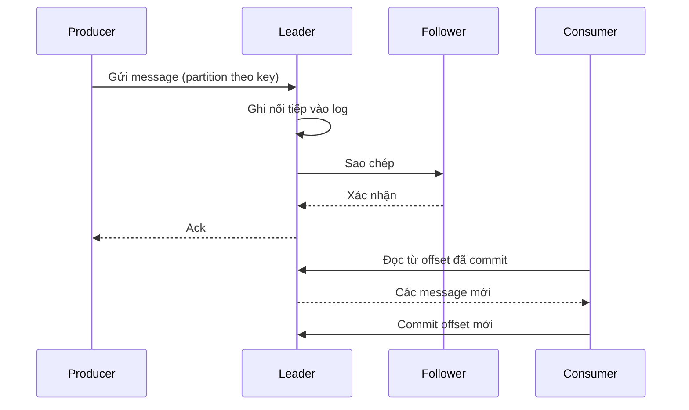
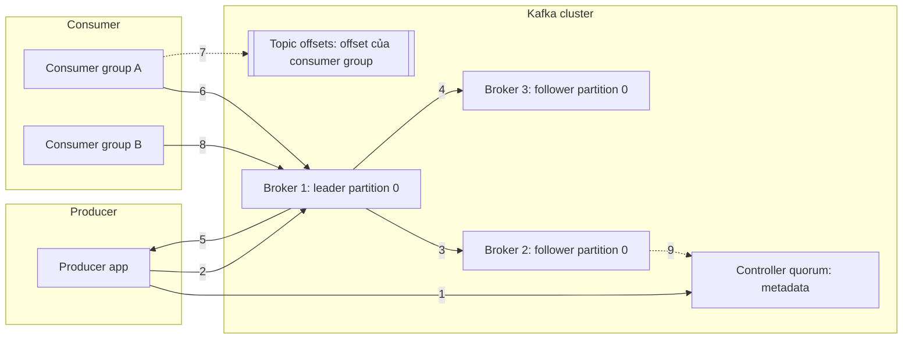
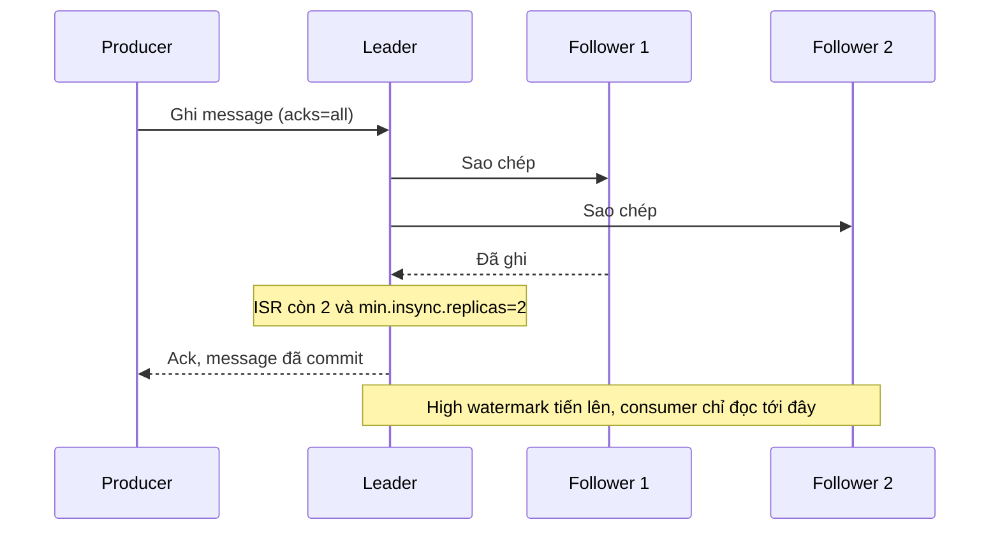

# Distributed Message Queue (kiểu Kafka)

**Độ khó:** Hard

Bài này hướng dẫn bạn thiết kế một message queue phân tán kiểu Kafka: producer ghi message vào, nhiều consumer đọc ra, và message được lưu trên đĩa chứ không biến mất sau khi đọc.

**Tóm tắt:**

- Kafka coi queue là một append-only log: ghi tuần tự xuống đĩa nên rất nhanh, message không bị xóa khi đọc mà được giữ theo retention.
- Topic chia thành partition; thứ tự chỉ được bảo đảm trong một partition, và cùng key thì vào cùng partition.
- Mỗi consumer tự nhớ offset; trong một consumer group mỗi partition chỉ giao cho một consumer nên số consumer hữu ích không vượt số partition.
- Mỗi partition có một leader và các follower; `acks=all` cộng `min.insync.replicas=2` với 3 replica cho phép mất 1 broker mà không mất message.
- Xử lý xong rồi commit offset là at-least-once (mặc định, cần xử lý idempotent); commit trước là at-most-once; exactly-once cần ghi kết quả và offset cùng transaction.
- Giới hạn thật là bandwidth đĩa và mạng chứ không phải CPU; chọn dư số partition lúc đầu vì tăng sau sẽ đổi ánh xạ key sang partition.
- Hot partition xảy ra khi key lệch, và consumer lag là chỉ số giám sát quan trọng nhất.
- Kiến trúc gồm các khối chính: producer, controller quorum, các broker (leader và follower của partition), topic offsets và các consumer group.

## Vấn đề cần giải quyết

Một queue chạy trên một máy sẽ nghẽn ở vài chục nghìn message mỗi giây, và máy đó chết là mất message. Bài toán khó ở chỗ phải đạt ba thứ cùng lúc: hàng triệu message mỗi giây, giữ được thứ tự message, và không mất message khi một broker hỏng.

Ý tưởng cốt lõi của Kafka rất đơn giản: coi queue là một cuốn sổ ghi chỉ thêm vào cuối (log). Topic được chia thành các partition, mỗi partition là một append-only log ghi nối tiếp xuống đĩa nên rất nhanh. Mỗi partition có một leader và các follower để replicate. Consumer không "lấy message ra khỏi hàng" mà tự nhớ mình đã đọc tới vị trí (offset) nào; nhiều consumer group đọc cùng một stream mà không ảnh hưởng nhau. Một ẩn dụ hay dùng: queue truyền thống như hộp thư, đọc xong thư mất; Kafka như cuốn nhật ký, ai muốn đọc lại từ trang nào cũng được cho tới khi trang bị xé bỏ theo thời hạn lưu giữ.

**Nền tảng:** Kafka coi queue là một log chỉ thêm vào cuối: ghi tuần tự xuống đĩa rất nhanh, message không bị xóa khi đọc mà được giữ theo retention, và mỗi consumer tự nhớ offset của mình. Nhờ đó nhiều nhóm đọc cùng một stream và có thể đọc lại; thứ tự và parallelism đều xoay quanh partition.

## Khi nào nên dùng, khi nào không

Dùng khi cần event stream lớn: thu thập log, đồng bộ dữ liệu giữa các hệ thống, stream processing, hoặc nhiều service cùng đọc một event stream (và có thể đọc lại). Nếu chỉ là giao task đơn giản cho worker, với từng task được xử lý rồi xóa, thì RabbitMQ hay SQS là đủ và dễ vận hành hơn nhiều; Kafka đòi hỏi bạn hiểu partition, offset, rebalance và tinh chỉnh độ bền.

## Khái niệm cần biết

Bảng dưới đây liệt kê các thành phần chính; các phần sau sẽ giải thích sâu hơn từng cái.

| Khái niệm | Ý nghĩa |
|---|---|
| Topic | Kênh message theo chủ đề |
| Partition | Một phần của topic, giữ thứ tự bên trong nó |
| Offset | Vị trí của message trong partition; consumer tự theo dõi |
| Broker | Server lưu partition |
| Replica | Replica của partition: một leader, nhiều follower |
| Consumer group | Nhóm consumer chia nhau các partition |

Một số thuật ngữ nữa sẽ gặp trong bài:

- **Append-only log:** file chỉ ghi thêm vào cuối, không sửa giữa chừng. Ghi tuần tự trên đĩa nhanh hơn ghi ngẫu nhiên rất nhiều, đó là bí quyết tốc độ của Kafka.
- **ISR (in-sync replicas):** tập các replica đang theo kịp leader. Chỉ các replica trong ISR được coi là đủ tin cậy để bầu làm leader mới và để tính ack.
- **High watermark:** offset cao nhất đã được sao chép tới mọi replica trong ISR; consumer chỉ đọc tới đây để không đọc phải message có thể bị mất khi đổi leader.
- **Rebalance:** việc chia lại partition cho các consumer trong group khi có consumer vào hoặc rời.
- **Consumer lag:** số message consumer còn chậm so với message mới nhất; tăng liên tục nghĩa là xử lý không kịp.
- **Retention:** chính sách giữ message theo thời gian hoặc dung lượng, hết hạn thì xóa nguyên segment cũ.
- **Zero-copy và page cache:** kỹ thuật cho hệ điều hành chuyển dữ liệu từ cache của file sang card mạng mà không sao chép qua memory ứng dụng, giúp đọc nhanh và ít tốn CPU.
- **At-least-once, at-most-once, exactly-once:** ba mức bảo đảm giao nhận (ít nhất một lần, nhiều nhất một lần, đúng một lần), giải thích ở phần giao nhận bên dưới.

## Flowchart: ghi và đọc

Hãy theo dõi một message từ lúc producer gửi đến lúc consumer xử lý xong và ghi lại vị trí đã đọc.



Đọc sơ đồ: key của message quyết định partition, leader ghi nối tiếp rồi sao chép cho follower trước khi báo ack. Consumer đọc từ offset đã commit lần trước và commit offset mới sau khi xử lý; nếu consumer chết, nó (hoặc consumer khác) sẽ đọc tiếp từ offset đã commit gần nhất.

## Ước lượng (giả định)

| Đại lượng | Tính | Kết quả |
|---|---|---|
| Throughput vào | 1 triệu message/giây x 1 KB | 1 GB/s |
| Ghi đĩa với 3 bản | 1 GB/s x 3 | 3 GB/s toàn cluster |
| Lưu giữ 7 ngày | 1 GB/s x 86.400 x 7 | khoảng 600 TB, x3 = khoảng 1,8 PB |
| Số partition | 1 GB/s / 10 MB/s mỗi partition | khoảng 100 (chọn dư, tùy hệ thống) |
| Số broker | 3 GB/s ghi / khoảng 200 MB/s mỗi broker | khoảng 15-20 (tùy phần cứng) |

Kết luận: bandwidth đĩa và mạng, không phải CPU, là giới hạn. Số partition quyết định mức parallelism tối đa của consumer (một partition chỉ một consumer trong cùng group đọc tại một thời điểm), nên chọn dư lúc đầu vì tăng sau sẽ đổi ánh xạ key sang partition.

## Kiến trúc tổng thể

Sơ đồ dưới đây vẽ toàn hệ thống: producer ghi vào leader của partition, leader sao chép cho follower, nhiều consumer group đọc độc lập và tự commit offset, còn controller giữ metadata và bầu leader.



**Chú thích sơ đồ**

| Thành phần | Vai trò | Vì sao chọn / đánh đổi |
|---|---|---|
| Producer app | Chọn partition theo key, gửi message theo batch | Cùng key vào cùng partition để giữ thứ tự; batch tăng throughput nhưng thêm chút latency |
| Controller quorum | Giữ metadata topic và partition, bầu leader khi broker hỏng | Quorum nhỏ (thường 3 node) đủ chịu lỗi; là điểm nhạy cảm nên phải tách khỏi tải dữ liệu |
| Broker 1 (leader) | Nhận ghi và phục vụ đọc của partition, ghi nối tiếp xuống đĩa | Một leader mỗi partition giữ được thứ tự; đổi lại leader là điểm nóng của partition đó |
| Broker 2 và 3 (follower) | Sao chép log từ leader, thành leader mới khi cần | Ba bản với `min.insync.replicas=2` chịu mất 1 broker; tốn gấp 3 đĩa và bandwidth |
| Topic offsets | Lưu offset đã commit của từng consumer group | Offset nằm ngay trong Kafka nên consumer chết vẫn đọc tiếp được; chỉ là một topic nội bộ |
| Consumer group A và B | Mỗi group đọc toàn bộ stream, chia partition cho consumer trong group | Group độc lập nhau nên đọc lại và thêm nhóm mới không ảnh hưởng; số consumer hữu ích không vượt số partition |

Luồng dữ liệu theo số trên mũi tên:

1. Producer hỏi controller metadata để biết leader của từng partition.
2. Producer gửi message tới leader của partition (chọn bằng `floorMod(key.hashCode(), n)`).
3. Leader ghi nối tiếp vào log rồi cho follower 2 sao chép.
4. Leader cho follower 3 sao chép song song.
5. Khi các replica trong ISR đã ghi (với `acks=all`), leader báo ack cho producer và high watermark tiến lên.
6. Consumer group A đọc từ offset đã commit, chỉ tới high watermark.
7. Consumer group A commit offset mới sau khi xử lý xong (async).
8. Consumer group B đọc cùng partition với offset riêng của nó.
9. Broker gửi heartbeat và trạng thái ISR cho controller để bầu leader mới khi cần (async).

**Điểm nghẽn:** Đầu tiên là bandwidth đĩa và mạng của broker chứa leader nóng, thường do hot partition vì key lệch; xử lý bằng key phân tán hơn, thêm partition và thêm broker. Thứ hai là consumer lag khi consumer xử lý chậm; xử lý bằng thêm consumer tới giới hạn số partition, rồi mới tăng partition.

## Log của một partition

Partition là một dãy message chỉ thêm vào cuối, mỗi message có offset tăng dần. Đọc là "đọc từ offset N", không xóa message. Mô hình tối giản (Java 11+, đã chạy):

```java
class Partition {
    final List<String> log = new ArrayList<>();
    long append(String m) { log.add(m); return log.size() - 1; }   // trả về offset
    List<String> read(long from, int max) {
        return log.subList((int) from, (int) Math.min(log.size(), from + max));
    }
}
// Chọn partition: Math.floorMod(key.hashCode(), n)  -> cùng key luôn vào cùng partition
// send("order-1","tao") = p1@0, send("order-1","thanh toan") = p1@1, send("order-2","tao") = p2@0
// consumer commit offset 1 rồi đọc tiếp: read(1, 10) = [thanh toan]
```

Trên đĩa, mỗi partition là các file **segment** (ví dụ 1 GB), kèm index thưa từ offset sang vị trí trong file; xóa theo retention là xóa nguyên segment cũ, rất rẻ. Dùng `floorMod` vì `hashCode()` có thể âm.

**Suy luận:** Tốc độ của Kafka bắt nguồn từ một lựa chọn: chỉ ghi nối tiếp vào cuối log. Ghi tuần tự trên đĩa nhanh hơn ghi ngẫu nhiên rất nhiều, và vì message không bị xóa khi đọc, mỗi consumer chỉ cần nhớ một con số là offset, nên đọc cũng tuần tự và tận dụng page cache cùng zero-copy. Từ đó suy ra nhiều consumer group đọc cùng một stream mà không ảnh hưởng nhau, và có thể đọc lại bằng cách lùi offset. Để song song hóa, topic được chia thành partition, và vì mỗi partition là một log độc lập nên thứ tự chỉ được giữ trong từng partition; muốn thứ tự theo một đối tượng thì phải cho các message của nó cùng key. Điểm dễ nhầm là nghĩ thêm consumer sẽ luôn tăng tốc: vì một partition chỉ giao cho một consumer trong group, consumer vượt số partition chỉ ngồi chơi. Hệ quả khi thiết kế: chọn số partition dư lúc đầu theo parallelism mong muốn, vì tăng sau sẽ đổi ánh xạ key sang partition và phá thứ tự đã có.

## Replication và độ bền

Vấn đề đặt ra là broker giữ leader chết thì message chưa kịp sao chép sẽ mất. Cách giải quyết là chờ follower xác nhận trước khi báo thành công cho producer, và bạn chọn mức chờ bằng config `acks`:



Đọc sơ đồ: với `acks=all`, leader chỉ báo ack khi các replica trong ISR đã ghi, và chỉ khi đó high watermark mới tiến lên cho consumer thấy message.

| Config | Ý nghĩa | Hệ quả |
|---|---|---|
| `acks=0` | Không chờ | Nhanh nhất, mất message dễ |
| `acks=1` | Leader ghi là ack | Leader chết trước khi follower kịp sao chép thì mất message |
| `acks=all` | Chờ mọi replica trong ISR (tập đang theo kịp) | Bền nhất, chậm hơn |
| `min.insync.replicas=2` (với 3 bản) | `acks=all` còn tối thiểu 2 bản mới nhận ghi | Chịu mất 1 broker mà vẫn ghi được; mất 2 thì từ chối ghi (chọn consistency hơn availability) |
| `unclean.leader.election` bật | Cho phép bầu replica lạc hậu làm leader | Còn chạy được nhưng có thể mất message; tắt cho dữ liệu quan trọng |

**Phải thuộc:** Mất message hay không phụ thuộc config: `acks=all` kết hợp `min.insync.replicas=2` với 3 replica (chịu mất 1 broker mà vẫn ghi được), tắt unclean leader election. `acks=1` có thể mất message khi leader chết trước khi follower sao chép. Giá trị mặc định của producer thay đổi theo phiên bản (từ Kafka 3.0 mặc định là `acks=all` và bật idempotence), nên kiểm tra lại theo phiên bản đang dùng.

## Consumer group, offset và giao nhận

Mỗi consumer group là một "người đọc" logic; trong group, mỗi partition chỉ giao cho một consumer. Ví dụ 6 partition, group có 4 consumer: chia 2-2-1-1. Thêm consumer thứ 7 thì có một consumer nhàn rỗi (nhiều consumer hơn partition vô ích). Consumer vào hoặc rời group gây **rebalance**: tạm dừng đọc rồi chia lại partition, nên xử lý phải chịu được việc bị nhận lại message đã xử lý.

| Thứ tự trong code consumer | Kết quả khi consumer chết giữa chừng |
|---|---|
| Xử lý xong rồi commit offset | Message có thể xử lý lại: **at-least-once** (mặc định, cần xử lý idempotent) |
| Commit offset rồi mới xử lý | Message có thể bị bỏ sót: **at-most-once** |
| Ghi kết quả và offset cùng một transaction | **Exactly-once** hiệu quả (Kafka transactions, hoặc lưu offset cùng kho đích) |

**Phải thuộc:** Trong một consumer group mỗi partition chỉ giao cho một consumer, nên số consumer hữu ích không vượt số partition. Xử lý xong rồi commit offset là at-least-once (mặc định); commit trước rồi xử lý là at-most-once; ghi kết quả và offset cùng transaction cho exactly-once hiệu quả. Thứ tự chỉ đảm bảo trong một partition, cùng key thì cùng partition.

Chọn at-least-once cùng xử lý idempotent là lựa chọn mặc định hợp lý cho đa số hệ thống; chỉ chọn at-most-once khi mất vài message chấp nhận được (ví dụ số liệu thống kê thô), và chỉ dùng exactly-once khi bạn kiểm soát được cả nơi ghi kết quả. Nếu sai, hiện tượng là đơn hàng bị xử lý hai lần hoặc bị bỏ sót.

Producer retry có thể gửi trùng; bật producer idempotent (broker loại message trùng theo producer id và số thứ tự) để tránh trùng trong một partition.

**Suy luận:** Mất message hay không không phụ thuộc vào việc "có replication", mà vào thời điểm producer được báo thành công so với thời điểm message tới các replica. Với `acks=1`, leader báo ack ngay sau khi ghi; nếu leader chết trước khi follower kịp sao chép, follower được bầu lên không có message đó và nó mất mà producer vẫn tưởng đã thành công. Với `acks=all`, leader chờ mọi replica trong ISR, nhưng nếu ISR co lại còn một replica thì `acks=all` suy biến thành `acks=1`; vì thế phải đặt `min.insync.replicas=2` để broker từ chối ghi thay vì âm thầm giảm độ bền, tức là chọn consistency hơn availability. High watermark cũng xuất phát từ đây: consumer chỉ đọc tới offset đã có trên mọi replica trong ISR để không đọc phải message có thể biến mất sau khi đổi leader. Điểm dễ nhầm là bật unclean leader election cho "đỡ gián đoạn", trong khi nó cho phép bầu replica lạc hậu làm leader và chắc chắn mất message. Hệ quả: với dữ liệu quan trọng dùng `acks=all`, `min.insync.replicas=2`, tắt unclean election, và chấp nhận độ trễ ghi cao hơn vì phải chờ follower chậm nhất.

## Đánh đổi

| Chọn | Được | Mất |
|---|---|---|
| Nhiều partition | Parallelism cao | Nhiều file, bầu leader chậm hơn, thứ tự chỉ trong partition |
| Ít partition | Đơn giản | Trần throughput consumer |
| `acks=all` | Không mất message | Latency ghi cao hơn (chờ follower chậm nhất trong ISR) |
| Key ít giá trị phân biệt | Thứ tự theo đối tượng | **Hot partition**: một key nóng dồn vào một partition |

Chọn nhiều partition khi consumer xử lý chậm và cần parallel, nhưng nhớ rằng thứ tự chỉ được bảo đảm trong từng partition.

## Điểm cần nhắc

- **Giám sát:** consumer lag (độ chênh giữa offset mới nhất và offset đã commit), kích thước ISR, số partition under-replicated, thời gian rebalance, dung lượng đĩa.
- **Hot partition:** key lệch thì thêm hậu tố ngẫu nhiên vào key khi không cần thứ tự, hoặc chọn key phân tán hơn.
- **Nhanh nhờ đĩa tuần tự:** ghi nối tiếp, dùng page cache và zero-copy.
- **Thứ tự:** chỉ đảm bảo trong một partition; muốn thứ tự theo đối tượng thì dùng cùng key.
- **Độ bền:** config số in-sync replica tối thiểu và mức ack.
- **Giao nhận:** at-least-once là mặc định; exactly-once cần producer idempotent và transaction.
- Leader chết: bầu leader mới từ các in-sync replica.
- Giữ message theo thời gian hoặc dung lượng, không xóa khi đã đọc.

