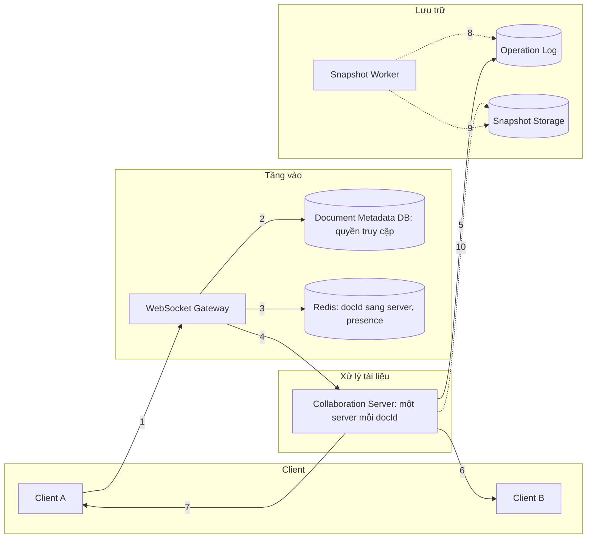
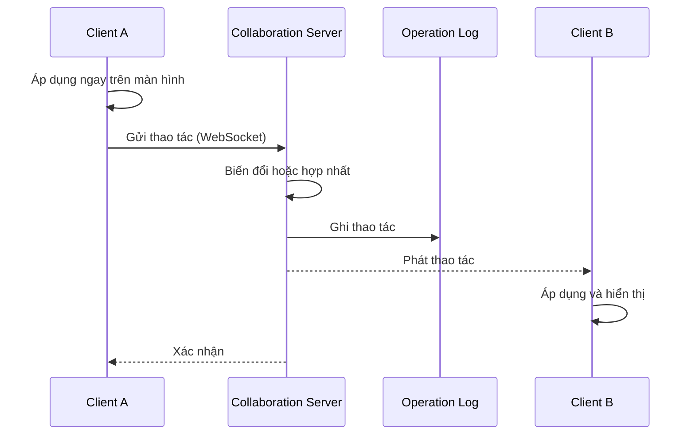
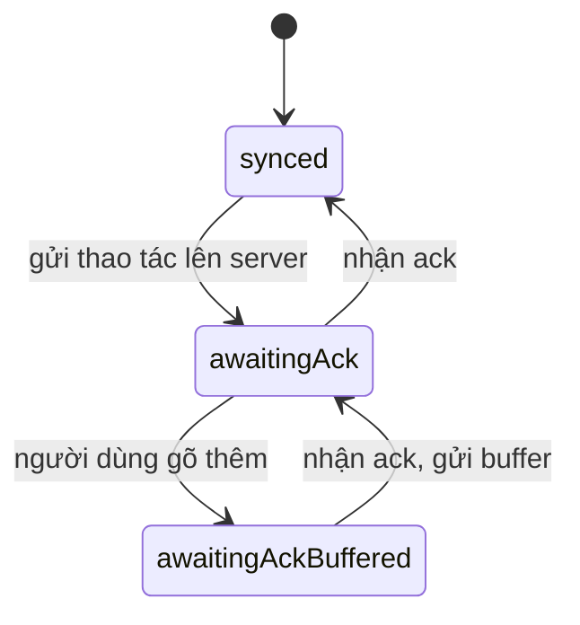

# Collaborative Editing (Soạn thảo cộng tác)

**Độ khó:** Hard

Bài này hướng dẫn bạn thiết kế hệ thống kiểu Google Docs: nhiều người cùng sửa một tài liệu và thấy thay đổi của nhau gần như ngay lập tức.

**Tóm tắt:**

- Bài toán cốt lõi là convergence: nhiều người sửa concurrent, thao tác đến mỗi máy theo thứ tự khác nhau, nhưng cuối cùng mọi máy phải có cùng nội dung.
- Client áp dụng thao tác ngay trên màn hình để không thấy trễ, rồi gửi lên server qua WebSocket; server hợp nhất, ghi operation log và phát cho client khác.
- OT biến đổi vị trí của thao tác theo các thao tác đã áp dụng (ví dụ chèn thì dịch vị trí thêm 1 nếu thao tác kia chèn ở vị trí nhỏ hơn) và cần server làm trọng tài.
- CRDT gán cho mỗi ký tự một id bất biến và xóa bằng tombstone, nên áp dụng theo thứ tự nào cũng ra cùng kết quả, hợp offline và P2P nhưng tốn memory metadata.
- Khi hai thao tác chèn cùng vị trí, cần một luật hòa cố định (ví dụ so id client) để hai bên chọn cùng thứ tự.
- Client chỉ có một thao tác chờ ack tại một thời điểm, nhờ đó server chỉ biến đổi theo một chuỗi tuyến tính có số revision.
- Khôi phục bằng snapshot gần nhất cộng các thao tác sau đó; mỗi tài liệu do một server xử lý thứ tự, nên tài liệu hot bị giới hạn bởi một node.
- Kiến trúc gồm các khối chính: WebSocket gateway, Collaboration Server (một server mỗi tài liệu), Redis định tuyến và presence, operation log, snapshot storage và Metadata DB.

## Vấn đề cần giải quyết

Hãy tưởng tượng hai người cùng mở tài liệu `abc`, một người chèn chữ ở đầu, một người chèn chữ ở cuối, cùng một khoảnh khắc. Thao tác của họ đến server theo thứ tự tùy mạng, và đến các máy khác cũng theo thứ tự khác nhau. Nếu cách xử lý chỉ là "ai gửi sau thì ghi đè" thì chữ của người kia mất; nếu mỗi máy áp dụng các thao tác theo thứ tự nhận được thì hai máy có thể ra hai kết quả khác nhau và không bao giờ khớp lại.

Cách giải quyết là client áp dụng thao tác ngay trên màn hình (để người dùng thấy tức thì) rồi gửi lên server qua WebSocket. Server dùng OT hoặc CRDT để hợp nhất, ghi vào operation log rồi phát cho các client khác. OT biến đổi thao tác đến sau cho khớp với thao tác đã áp dụng; CRDT dùng cấu trúc dữ liệu mà thứ tự áp dụng nào cũng ra cùng kết quả.

**Nền tảng:** Bài toán là hội tụ: nhiều người sửa concurrent, thao tác đến mỗi máy theo thứ tự khác nhau, nhưng cuối cùng mọi máy phải có cùng nội dung và giữ đúng ý định người gõ. Có hai trường phái: OT biến đổi vị trí thao tác theo các thao tác đã áp dụng (cần server trọng tài), CRDT thiết kế dữ liệu để mọi thứ tự áp dụng đều ra cùng kết quả.

## Khi nào nên dùng, khi nào không

Dùng cho tài liệu, bảng tính, whiteboard cần sửa concurrent nhiều người. Nếu mỗi lúc chỉ có một người sửa, hoặc xung đột hiếm, thì lock tài liệu hoặc so version rồi báo xung đột để người dùng tự chọn là đủ, không cần OT hay CRDT. Đừng chọn giải pháp phức tạp khi trường hợp sử dụng không đòi hỏi, vì OT và CRDT đều khó triển khai và khó gỡ lỗi.

## Các khái niệm cần biết

- **WebSocket:** kết nối hai chiều giữ mở giữa client và server, cho phép server đẩy thao tác của người khác xuống ngay mà không cần client hỏi liên tục. Cần vì latency phải ở mức vài chục đến vài trăm mili giây.
- **Operation:** mô tả thay đổi dưới dạng dữ liệu, ví dụ `ins(1,'X')` nghĩa là chèn `X` tại vị trí 1. Gửi thao tác nhỏ hơn nhiều so với gửi cả tài liệu.
- **Convergence:** mục tiêu chính: sau khi mọi thao tác đã được áp dụng, mọi máy đều có cùng nội dung bất kể thứ tự nhận.
- **OT (Operational Transformation):** kỹ thuật biến đổi vị trí của một thao tác dựa trên những thao tác đã áp dụng trước nó, để nó vẫn mang đúng ý định người gõ.
- **CRDT (Conflict-free Replicated Data Type):** kiểu dữ liệu replicated mà các thao tác giao hoán, nên áp dụng theo thứ tự nào cũng hội tụ về cùng một kết quả.
- **Operation log và snapshot:** log là nhật ký mọi thao tác theo thứ tự; snapshot là ảnh chụp nội dung ở một thời điểm. Khôi phục bằng snapshot gần nhất cộng các thao tác sau đó, thay vì phát lại từ đầu.
- **Tombstone:** thay vì xóa hẳn một ký tự trong CRDT, ta đánh dấu "đã xóa" để các thao tác khác vẫn tham chiếu được tới nó.
- **Idempotent:** áp dụng một thao tác hai lần cho kết quả như một lần; cần vì client gửi lại khi mất kết nối, nên mỗi thao tác có id duy nhất để server bỏ qua bản trùng.

## Hai hướng giải quyết xung đột

Có hai trường phái chính; bảng dưới so sánh nhanh, các phần sau đi sâu vào từng cách.

| | OT (Operational Transformation) | CRDT |
|---|---|---|
| Ý tưởng | Server biến đổi các thao tác đến sau để phù hợp với thao tác đã áp dụng | Cấu trúc dữ liệu thiết kế để mọi thứ tự áp dụng đều ra cùng kết quả |
| Cần server trung tâm | Có (thường) | Không bắt buộc, hợp offline và P2P |
| Độ phức tạp | Khó chứng minh đúng | Tốn memory metadata hơn |

## Kiến trúc tổng thể

Sơ đồ dưới đây vẽ toàn hệ thống: client giữ WebSocket tới gateway, gateway định tuyến mỗi tài liệu về đúng một Collaboration Server, server này đánh số thao tác, ghi log rồi phát cho mọi người, còn snapshot được tạo nền.



**Chú thích sơ đồ**

| Thành phần | Vai trò | Vì sao chọn / đánh đổi |
|---|---|---|
| Client A và B | Áp dụng thao tác ngay trên màn hình, giữ buffer và chỉ một thao tác chờ ack | Hiển thị tức thì nhưng client phải biết biến đổi thao tác nhận về |
| WebSocket Gateway | Giữ kết nối hai chiều, xác thực, định tuyến theo `docId` | Cần vì server phải đẩy thao tác xuống chủ động; số kết nối lớn nên scale theo số kết nối |
| Document Metadata DB | Lưu quyền xem, sửa, bình luận và thông tin tài liệu | Dữ liệu nhỏ, cần truy vấn nên dùng DB quan hệ; chỉ đọc lúc mở tài liệu nên không phải đường nóng |
| Redis | Ánh xạ `docId` sang server sở hữu, lưu presence và con trỏ | Rất nhanh, dữ liệu tạm không cần bền vững; mất thì dựng lại từ kết nối mới |
| Collaboration Server | Biến đổi hoặc hợp nhất thao tác, đánh số revision, phát cho client khác | Một server mỗi tài liệu giúp thứ tự tuyến tính và đơn giản, đổi lại tài liệu hot bị giới hạn bởi một node |
| Operation Log | Nhật ký mọi thao tác theo revision | Chỉ thêm nên ghi nhanh và hỗ trợ lịch sử phiên bản; lớn dần nên cần snapshot và nén |
| Snapshot Storage | Ảnh chụp nội dung theo định kỳ | Khôi phục nhanh bằng snapshot cộng log sau đó; tốn thêm lưu trữ |
| Snapshot Worker | Gộp log thành snapshot, chạy nền | Tách khỏi đường gõ nên không làm tăng latency; snapshot có thể trễ so với log |

Luồng dữ liệu theo số trên mũi tên:

1. Client A mở tài liệu, kết nối WebSocket tới gateway; mọi thao tác gõ được áp dụng cục bộ ngay.
2. Gateway kiểm tra quyền truy cập của người dùng trong Metadata DB.
3. Gateway tra Redis để biết server nào đang sở hữu `docId` (chưa có thì chọn một server và ghi vào).
4. Gateway chuyển thao tác `{ docId, baseRev, op }` cho Collaboration Server của tài liệu đó.
5. Server biến đổi thao tác qua các revision mới hơn, gán revision mới và ghi vào operation log.
6. Server phát thao tác đã biến đổi cho Client B và các client khác.
7. Server trả ack(rev) cho Client A để A gửi thao tác kế tiếp trong buffer.
8. Snapshot Worker đọc operation log theo lô, ví dụ mỗi 1.000 thao tác (async).
9. Snapshot Worker ghi snapshot mới vào storage (async).
10. Khi server mở hoặc khôi phục tài liệu, nó nạp snapshot gần nhất rồi phát lại các thao tác sau đó (async).

**Điểm nghẽn:** Đầu tiên là một Collaboration Server cho một tài liệu hot với hàng trăm người; xử lý bằng gộp thao tác 50-100 ms, tách người chỉ xem sang kênh đọc và chọn CRDT khi cần giảm việc cho trọng tài. Thứ hai là số kết nối WebSocket ở gateway; xử lý bằng thêm gateway và định tuyến nhất quán theo `docId`.

## Flowchart

Flow chung cho một thao tác: áp dụng cục bộ trước để người gõ không thấy trễ, rồi mới đồng bộ qua server.



Đọc sơ đồ: client A không chờ server mới hiển thị chữ vừa gõ. Server là nơi duy nhất quyết định thứ tự cuối cùng, ghi vào log rồi phát cho B, và chỉ xác nhận (ack) cho A sau cùng.

## Ví dụ tính tay: vì sao phải biến đổi thao tác

Tài liệu `abc`. A chèn `X` ở vị trí 1, B chèn `Y` ở vị trí 2, cùng lúc (chưa thấy nhau).

| | Máy A | Máy B |
|---|---|---|
| Áp dụng thao tác của mình | `aXbc` | `abYc` |
| Nhận thao tác của người kia, **không** biến đổi | chèn `Y` ở 2: `aXYbc` | chèn `X` ở 1: `aXbYc` |
| Kết quả | Hai máy **khác nhau** | |
| Nhận thao tác **đã biến đổi** | chèn `Y` ở 3 (vì X chèn ở 1 đẩy mọi thứ sang phải): `aXbYc` | chèn `X` ở 1 (Y ở 2 sau X, không ảnh hưởng): `aXbYc` |

Quy tắc biến đổi cho hai phép chèn: thao tác `a` biến đổi theo `b` (đã áp dụng) thì dịch vị trí của `a` thêm 1 nếu `b.pos < a.pos`. Khi **cùng vị trí** phải có luật hòa cố định (ví dụ so sánh id client) để hai bên chọn cùng thứ tự.

```java
// Java 11+: OT chỉ với phép chèn một ký tự (đã chạy)
static class Ins { int pos; char ch; int site; /* constructor bỏ qua */ }

static Ins transform(Ins a, Ins b) {            // biến đổi a theo b đã áp dụng trước
    boolean shift = b.pos < a.pos || (b.pos == a.pos && b.site < a.site);
    return new Ins(shift ? a.pos + 1 : a.pos, a.ch, a.site);
}
static String apply(String s, Ins o) { return s.substring(0, o.pos) + o.ch + s.substring(o.pos); }
// "abc", A=(1,'X',site1), B=(2,'Y',site2):
//   không OT: aXYbc | aXbYc (lệch)    có OT: aXbYc | aXbYc (hội tụ)
//   cùng vị trí 1, 'P' site1 và 'Q' site2: cả hai máy ra aPQbc
```

**Phải thuộc:** OT: khi `b` đã áp dụng trước thì dịch vị trí của `a` thêm 1 nếu `b.pos < a.pos`; cùng vị trí cần luật hòa cố định (ví dụ so id client) để hai bên chọn cùng thứ tự. CRDT: mỗi ký tự có id duy nhất bất biến, xóa bằng tombstone, hợp offline và P2P nhưng tốn memory metadata. Client chỉ có một thao tác chờ ack tại một thời điểm.

Bản đầy đủ còn có phép xóa và biến đổi giữa chèn với xóa; độ khó tăng nhanh theo số loại thao tác, vì thế OT khó chứng minh đúng.

## Server làm trọng tài bằng số phiên bản

Mô hình phổ biến (Google Wave/Docs, ShareDB): server giữ **một chuỗi thao tác có số thứ tự** cho mỗi tài liệu.

```text
Client gửi:  { "docId": "d1", "baseRev": 7, "op": ins(1,'X') }   # op dựa trên bản 7
Server (đang ở rev 9): biến đổi op lần lượt qua thao tác rev 8 và rev 9
                       ghi op đã biến đổi thành rev 10, phát cho mọi client
                       trả ack(rev 10) cho người gửi
```



Client chỉ có **một thao tác đang chờ ack** tại một thời điểm; thao tác phát sinh thêm thì gộp vào buffer cục bộ và biến đổi khi nhận thao tác từ server. Nhờ đó server chỉ cần biến đổi theo chuỗi tuyến tính, không phải xử lý đồ thị thứ tự phức tạp.

**Suy luận:** Vấn đề gốc là vị trí trong văn bản chỉ là một con số, và con số đó đổi nghĩa mỗi khi ai đó chèn hoặc xóa phía trước. Khi hai người sửa concurrent mà không thấy nhau, cùng một thao tác `ins(2, 'Y')` trỏ vào hai chỗ khác nhau trên hai máy, nên áp dụng nguyên văn sẽ cho hai kết quả khác nhau và không bao giờ khớp lại. OT sửa điều này bằng cách biến đổi vị trí của thao tác đến sau theo những thao tác đã áp dụng, nhờ đó ý định người gõ được giữ nguyên. Để phép biến đổi chỉ cần xét một chuỗi tuyến tính, server giữ số revision cho mỗi tài liệu và client chỉ cho một thao tác chờ ack tại một thời điểm. Điểm dễ nhầm là quên trường hợp cùng vị trí: nếu không có luật hòa cố định như so id client, hai máy sẽ chọn thứ tự khác nhau và lệch nhau mà không ai biết. Hệ quả: OT hợp khi có server trung tâm, nhưng độ khó chứng minh đúng tăng nhanh theo số loại thao tác, nên đừng tự viết khi có thư viện đã kiểm chứng.

## CRDT: ý tưởng thay thế

Vấn đề của OT là phải biến đổi vị trí và cần server làm trọng tài. CRDT giải quyết bằng cách làm cho vị trí không còn bị lệch ngay từ đầu. Thay vì chỉ số vị trí (dễ lệch), mỗi ký tự có **id duy nhất bất biến**, ví dụ `(site, bộ đếm)`. Chèn nghĩa là "đặt ký tự mới ngay sau ký tự có id này". Hai chèn cùng sau một ký tự được xếp theo luật so sánh id cố định, nên mọi thứ tự nhận đều ra cùng kết quả mà không cần server biến đổi. Xóa chỉ đánh dấu tombstone (tombstone), nên metadata phình dần và cần dọn định kỳ.

| | OT | CRDT (kiểu RGA, Yjs, Automerge) |
|---|---|---|
| Vị trí | Chỉ số, phải biến đổi | Id ký tự, không đổi |
| Trạng thái | Gọn | Mỗi ký tự kèm id và tombstone |
| Offline, P2P | Khó | Tự nhiên |
| Server | Bắt buộc làm trọng tài | Chỉ cần chuyển tiếp và lưu |

Chọn OT khi đã có server trung tâm và cần trạng thái gọn; chọn CRDT khi cần offline hoặc P2P và chấp nhận tốn memory. Nếu tự viết cả hai, rủi ro là hai máy lệch nhau mà không ai phát hiện.

Lưu ý: các thuật toán CRDT văn bản thực tế có nhiều biến thể; chọn thư viện đã kiểm chứng thay vì tự viết.

## Ước lượng (giả định)

| Đại lượng | Tính | Kết quả |
|---|---|---|
| Người sửa concurrent | 1 triệu tài liệu mở x 3 người | 3 triệu kết nối WebSocket |
| Thao tác | mỗi người 2 thao tác/giây (gộp chuỗi gõ) | khoảng 6 triệu thao tác/giây ở cực đại, thực tế thấp hơn nhiều vì phần lớn tài liệu nhàn rỗi |
| Server giữ kết nối | 50.000 kết nối/server | 60 server |
| Log thao tác | 1 thao tác khoảng 50 B | gộp snapshot mỗi 1.000 thao tác để khôi phục nhanh |

Kết luận: tài liệu là đơn vị parallelism; một tài liệu chỉ một server xử lý thứ tự, nên tải một tài liệu hot (hàng trăm người) giới hạn bởi một node.

**Suy luận:** CRDT chọn hướng ngược với OT: thay vì sửa vị trí, nó làm cho vị trí không bao giờ bị lệch. Mỗi ký tự có id bất biến và phép chèn nghĩa là "đặt sau ký tự có id này", nên một thao tác luôn trỏ vào cùng một chỗ trên mọi máy, và hai thao tác chèn cùng điểm được xếp bằng luật so sánh id cố định. Vì áp dụng theo thứ tự nào cũng ra cùng kết quả, không cần server làm trọng tài, và offline hay P2P trở nên tự nhiên. Cái giá nằm ở dữ liệu: xóa chỉ đánh dấu tombstone để các thao tác khác vẫn tham chiếu được, nên metadata phình dần và cần dọn định kỳ. Điểm dễ nhầm là cho rằng CRDT luôn tốt hơn OT; nếu đã có server trung tâm và cần trạng thái gọn thì OT vẫn hợp lý, còn CRDT đáng chọn khi cần offline hoặc P2P và chấp nhận tốn memory. Hệ quả khi thiết kế: quyết định theo yêu cầu offline trước, rồi mới chọn thuật toán.

## Đánh đổi

| Chọn | Được | Mất |
|---|---|---|
| Gửi từng ký tự | Hiển thị tức thì | Nhiều message nhỏ |
| Gom thao tác 50-100 ms | Ít tải | Trễ nhẹ khi người khác nhìn |
| Snapshot thường xuyên | Khôi phục nhanh | Tốn lưu trữ |
| Giữ lịch sử đầy đủ | Hoàn tác, lịch sử phiên bản | Log lớn, cần nén/gộp |

Gom thao tác phù hợp khi tài liệu có nhiều người đang gõ; với tài liệu chỉ 1-2 người, gửi từng ký tự cho cảm giác tức thì hơn.

## Điểm cần nhắc

- **Lỗi:** server của tài liệu chết thì client kết nối lại, gửi `baseRev` cuối cùng đã ack, server mới nạp snapshot cộng log rồi tiếp tục; thao tác gửi lại phải **idempotent** (id thao tác duy nhất để bỏ qua trùng).
- **Giám sát:** latency từ gõ đến người khác thấy, số kết nối mỗi server, độ dài log chưa snapshot, tỷ lệ kết nối lại.
- Lưu **nhật ký thao tác** và snapshot định kỳ; khôi phục bằng snapshot gần nhất cộng các thao tác sau đó.
- Con trỏ và sự hiện diện của người khác gửi qua kênh riêng, không cần bền vững.
- Mỗi tài liệu được gán cho một server để thứ tự thao tác nhất quán; mở rộng bằng cách chia tài liệu giữa các server.
- Hỗ trợ offline: giữ thao tác cục bộ rồi đồng bộ khi có mạng (CRDT hợp hơn).
- Lịch sử phiên bản và quyền truy cập (xem, sửa, bình luận).

