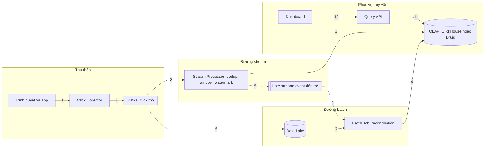
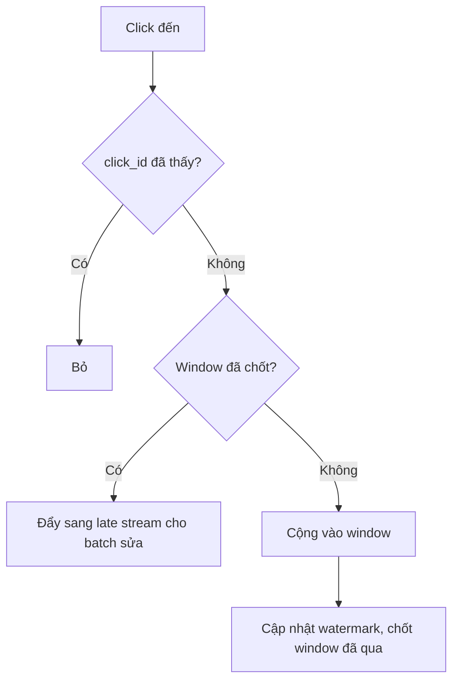

# Ad Click Aggregation (Tổng hợp lượt click quảng cáo)

**Độ khó:** Hard

Bài này hướng dẫn bạn thiết kế hệ thống đếm click quảng cáo: hàng tỷ event đổ về mỗi ngày, cần cộng lại theo từng quảng cáo, theo khung thời gian (ví dụ mỗi phút) và các chiều khác, để hiển thị trên dashboard hoặc dùng tính tiền.

**Tóm tắt:**

- Click quyết định tiền của nhà quảng cáo, nên đếm thiếu hay đếm trùng đều là sự cố; yêu cầu là chính xác, latency vài giây đến vài phút.
- Pipeline: click vào Kafka, stream processor dedup theo `click_id` rồi cộng theo window, kết quả ghi vào kho OLAP; dữ liệu thô giữ trong data lake.
- Phải tổng hợp theo event time chứ không theo ingest time, nếu không click đến trễ rơi vào sai phút.
- Watermark là mốc "mọi event cũ hơn đã đến"; qua cuối window thì chốt, event đến sau đó đẩy sang late stream để batch sửa.
- Exactly-once thực chất là at-least-once cộng ghi idempotent: checkpoint cùng offset Kafka và ghi đè theo key `(ad_id, minute)`, không dùng `+= 1`.
- Lambda kết hợp stream cho số nhanh với batch reconciliation cho số chính xác; Kappa chỉ dùng stream và phát lại khi cần sửa.
- Hot key (một quảng cáo chiếm tỷ lệ lớn) được giải bằng tổng hợp hai pha với key phụ ngẫu nhiên, chỉ áp dụng cho phép cộng.
- Kiến trúc gồm các khối chính: click collector, Kafka, stream processor, late stream, data lake, batch job, kho OLAP và query API cho dashboard.

## Vấn đề cần giải quyết

Con số click quyết định nhà quảng cáo bị tính bao nhiêu tiền, nên đếm thiếu (mất tiền của nền tảng) hay đếm trùng (nhà quảng cáo kiện) đều là sự cố. Trong khi đó, event đến rất nhiều (hàng trăm nghìn mỗi giây), có lúc tăng đột biến, có event đến trễ vì mạng của người dùng chập chờn, và có event bị gửi lặp do retry. Truy vấn thẳng vào dữ liệu thô để cộng mỗi lần xem dashboard thì không chịu nổi.

Cách giải quyết là một pipeline stream processing. Click được đẩy vào Kafka; stream processor khử trùng theo id rồi cộng theo window thời gian; kết quả lưu vào kho OLAP (ClickHouse, Druid) để truy vấn nhanh. Dữ liệu thô giữ trong data lake để batch job chạy lại và reconcile. Dữ liệu đến trễ được xử lý bằng watermark, còn quảng cáo quá hot thì chia thành các key con rồi cộng lại.

**Nền tảng:** Khi tiền phụ thuộc vào số đếm thì đếm thiếu hay trùng đều là sự cố, trong khi event đến dồn dập, trễ và lặp. Do đó phải tổng hợp theo event time (không phải ingest time), chốt window bằng watermark, khử trùng theo `click_id`, và giữ dữ liệu thô để batch reconciliation sửa sai lệch.

## Khi nào nên dùng, khi nào không

Dùng cho ad platform, tracking hành vi người dùng, hay bất kỳ hệ thống nào cần đếm event quy mô lớn mà kết quả liên quan đến tiền. Nếu chỉ cần số liệu ước chừng cho dashboard nội bộ, thì đếm gần đúng hoặc query thẳng DB là đủ, không cần dựng pipeline streaming với dedup và reconciliation.

## Các khái niệm cần biết

- **Kafka:** hệ thống log phân tán lưu event theo từng partition; dùng làm "đường ống" chịu tải lớn và cho phép đọc lại (xem bài Distributed Message Queue).
- **Stream processor (Flink, Kafka Streams...):** chương trình chạy liên tục đọc event stream, giữ trạng thái và xuất kết quả; khác với batch job chạy một lần trên dữ liệu đã đủ.
- **OLAP:** CSDL tối ưu cho truy vấn tổng hợp trên lượng dữ liệu lớn (SUM, COUNT theo nhóm), lưu theo cột nên quét rất nhanh. Không dùng cho cập nhật từng dòng.
- **Data lake:** kho lưu dữ liệu thô giá rẻ (thường là file trên object storage), dùng để tính lại khi có lỗi.
- **Event time và ingest time:** event time là lúc click thực sự xảy ra, ingest time là lúc hệ thống nhận được. Phải tổng hợp theo event time, nếu không click đến trễ sẽ rơi vào sai phút.
- **Window:** khoảng thời gian dùng để gom event; có ba loại tumbling, sliding, session (xem bảng bên dưới).
- **Watermark:** mốc thời gian mà hệ thống tin rằng "mọi event cũ hơn mốc này đã đến rồi". Khi watermark vượt qua cuối window thì window được chốt. Dùng để cân bằng giữa chờ đủ dữ liệu trễ và ra kết quả sớm.
- **Dedup:** loại bỏ event trùng dựa trên `click_id`.
- **Idempotent write:** ghi lại cùng một kết quả nhiều lần vẫn cho trạng thái cuối giống nhau (ghi đè theo key, không cộng dồn).
- **Checkpoint:** ảnh chụp định kỳ trạng thái của stream processor kèm offset Kafka; khi lỗi thì quay lại điểm này.
- **Lambda và Kappa:** Lambda gồm hai đường (stream cho kết quả nhanh, batch cho kết quả chính xác); Kappa chỉ dùng một đường stream và phát lại khi cần sửa.
- **Bloom filter:** cấu trúc dữ liệu xác suất, trả lời "có thể đã thấy" hoặc "chắc chắn chưa thấy" với rất ít memory; có thể báo nhầm "đã thấy" nhưng không bỏ sót.
- **Hot key:** một key (ở đây là một quảng cáo) chiếm tỷ lệ lưu lượng quá lớn nên dồn một partition hoặc task.

## Yêu cầu

- Truy vấn: số click của một quảng cáo trong M phút gần nhất, top N quảng cáo.
- Chính xác (không mất, không đếm trùng), latency vài giây đến vài phút.
- Chịu được đột biến lưu lượng và dữ liệu đến trễ.

## Kiến trúc tổng thể

Sơ đồ dưới đây vẽ toàn hệ thống với hai đường parallel: đường stream cho kết quả nhanh (vài giây) và đường batch chạy lại trên dữ liệu thô để sửa sai lệch, cùng đường truy vấn của dashboard.



**Chú thích sơ đồ**

| Thành phần | Vai trò | Vì sao chọn / đánh đổi |
|---|---|---|
| Trình duyệt và app | Phát sinh click, chuyển hướng qua endpoint đếm | Không tin id do client tự đặt khi liên quan đến tiền; client có thể gửi lặp khi retry |
| Click Collector | Nhận click, gán `click_id` và `event_time`, ghi vào Kafka | Stateless, scale ngang theo QPS; chỉ ghi nhanh rồi trả lời, không tổng hợp |
| Kafka | Đệm click thô, chia theo partition | Chịu đột biến và cho phép đọc lại; thứ tự chỉ trong partition, hot key phải xử lý riêng |
| Stream Processor | Dedup theo `click_id`, cộng theo window, chốt bằng watermark | Cho số liệu trong vài giây; giữ state nên cần checkpoint cùng offset Kafka |
| Late stream | Chứa event đến sau khi window đã chốt | Không bỏ mất click trễ mà đẩy cho batch sửa; thêm một đường cần giám sát |
| Data Lake | Lưu click thô giá rẻ trên object storage | Nguồn sự thật để tính lại; tốn dung lượng và chỉ truy vấn chậm |
| Batch Job | Tính lại từ dữ liệu thô, ghi đè kết quả chính xác | Số chốt đúng cho tính tiền; phải giữ logic khớp với đường stream (Lambda) |
| OLAP | Lưu bảng tổng hợp theo `(ad_id, minute)` | Lưu theo cột nên truy vấn tổng hợp nhanh; không hợp cập nhật từng dòng nên phải ghi idempotent |
| Query API và Dashboard | Phục vụ số click theo quảng cáo và top N | Chỉ đọc bảng tổng hợp nên chi phí không phụ thuộc số click thô |

Luồng dữ liệu theo số trên mũi tên:

1. Người dùng click quảng cáo, trình duyệt hoặc app gọi endpoint của Click Collector.
2. Click Collector gán `click_id`, `event_time`, `ingest_time` và ghi vào Kafka theo key `ad_id`.
3. Stream Processor đọc từ Kafka, loại click trùng theo `click_id` và cộng vào window theo event time.
4. Khi watermark vượt cuối window, kết quả được chốt và ghi đè vào OLAP theo key `(ad_id, minute)`.
5. Event đến sau khi window đã chốt được đẩy sang late stream (async).
6. Kafka đồng thời lưu click thô vào data lake để giữ nguồn sự thật (async).
7. Batch Job đọc dữ liệu thô từ data lake (async).
8. Batch Job đọc thêm event trễ từ late stream để tính lại (async).
9. Batch Job ghi đè số liệu chính xác vào OLAP, thay cho số tạm thời của đường stream.
10. Dashboard gọi Query API để xem số click.
11. Query API đọc bảng tổng hợp trong OLAP.

**Điểm nghẽn:** Đầu tiên là hot key khi một quảng cáo chiếm tỷ lệ lớn làm một partition và một task quá tải; xử lý bằng tổng hợp hai pha với key phụ ngẫu nhiên. Thứ hai là bandwidth và số partition của Kafka khi đỉnh khoảng 580.000 click/giây; xử lý bằng thêm partition, thêm broker và thêm task cho Stream Processor.

## Ước lượng (giả định)

| Đại lượng | Tính | Kết quả |
|---|---|---|
| Click/ngày | 10 tỷ | |
| QPS trung bình | 10 tỷ / 86.400 | khoảng 116.000/giây |
| QPS đỉnh (x5) | | khoảng 580.000/giây |
| Kích thước một click | id, ad, user, thời gian, ... | khoảng 100 B |
| Dữ liệu thô/ngày | 10 tỷ x 100 B | khoảng 1 TB, giữ 30 ngày: 30 TB |
| Hàng tổng hợp theo phút (cận trên) | 1 triệu quảng cáo x 1.440 phút x khoảng 24 B | khoảng 35 GB/ngày |

Kết luận: tổng hợp thu nhỏ dữ liệu hàng chục lần, nên **truy vấn đọc bảng tổng hợp** chứ không quét dữ liệu thô. Throughput 580.000/giây trải trên Kafka nhiều partition, mỗi partition vài chục MB/s.

## API và dữ liệu

```text
GET /api/v1/ads/{adId}/clicks?from=...&to=...&granularity=minute
  -> { "adId": "a1", "points": [ { "ts": "2026-10-27T10:01:00Z", "clicks": 1520 } ] }
GET /api/v1/ads/top?minutes=5&n=100
```

```sql
-- ClickHouse (ví dụ): bảng tổng hợp theo phút; cộng dồn khi ghi lại cùng key
CREATE TABLE ad_clicks_minute (
  ad_id String, minute DateTime, clicks UInt64
) ENGINE = SummingMergeTree ORDER BY (ad_id, minute);
```

Click thô cần `click_id` duy nhất do **server nhận event hoặc bên phát quảng cáo** sinh (không tin id do client tự đặt khi liên quan đến tiền), kèm `ad_id`, `event_time` (lúc click xảy ra) khác `ingest_time` (lúc hệ thống nhận).

## Window, watermark và dedup

| Loại window | Mô tả | Ví dụ dùng |
|---|---|---|
| Tumbling (cố định, không chồng) | Mỗi event thuộc đúng một window | Số click mỗi phút để tính tiền |
| Sliding (trượt, chồng) | Window dài M, bước trượt nhỏ; một event thuộc nhiều window | "5 phút gần nhất" cập nhật mỗi phút (mỗi click nằm trong 5 window) |
| Session | Cắt theo khoảng nghỉ | Phân tích phiên người dùng |

**Phải thuộc:** Ba loại window: tumbling (cố định, không chồng, hợp tính tiền theo phút), sliding (trượt, chồng nhau), session (cắt theo khoảng nghỉ). Watermark là mốc "mọi event cũ hơn đã đến"; qua cuối window thì chốt, event đến sau đó đẩy sang late stream cho batch sửa. Hẹp thì ra kết quả nhanh nhưng nhiều event trễ, rộng thì ngược lại.

Vấn đề đặt ra là một click xảy ra lúc 0:55 có thể đến hệ thống lúc 1:10 do mạng trễ. Nếu chốt window ngay khi đồng hồ qua 1:00 thì sẽ bỏ sót click này; nếu chờ mãi thì kết quả không bao giờ ra. Watermark là cách thỏa hiệp: cho phép trễ một khoảng nhất định rồi mới chốt. Hãy xem ví dụ tay (window 1 phút, trễ cho phép 30 giây, watermark = thời gian event lớn nhất đã thấy trừ 30 giây). Click đến theo thứ tự: c1 lúc 0:10, c2 lúc 0:50, c2 lặp, c3 lúc 1:10, c4 lúc 0:55 (đến trễ 15 giây), c5 lúc 2:05, c6 lúc 0:58.

| Event | Xử lý | Watermark |
|---|---|---|
| c1, c2 | Vào window [0:00, 1:00) | |
| c2 lặp | Bỏ (id đã thấy) | |
| c3 | Vào window [1:00, 2:00) | 0:40 |
| c4 (0:55) | Vẫn vào window 1 (window chưa chốt) | 0:40 |
| c5 (2:05) | Vào window [2:00, 3:00) | 1:35, chốt window 1: **3 click** |
| c6 (0:58) | Window 1 đã chốt: đưa vào late stream cho batch sửa | |

```java
// Java 11+: tumbling window 1 phút + dedup + watermark (đã chạy: closed={adA|0=3})
static final long W = 60_000, LATE = 30_000;
static long watermark = Long.MIN_VALUE;
static Set<String> seen = new HashSet<>();
static Map<String, Long> open = new TreeMap<>(), closed = new TreeMap<>();

static void onClick(String id, String ad, long ts) {
    if (!seen.add(id)) return;                       // dedup theo click id
    long start = ts - ts % W;                        // đầu cửa sổ chứa event
    if (start + W <= watermark) { /* quá trễ: đẩy sang batch sửa */ return; }
    open.merge(ad + "|" + start, 1L, Long::sum);
    watermark = Math.max(watermark, ts - LATE);
    open.entrySet().removeIf(e -> {                  // chốt cửa sổ đã qua watermark
        long s = Long.parseLong(e.getKey().split("\\|")[1]);
        if (s + W <= watermark) { closed.put(e.getKey(), e.getValue()); return true; }
        return false;
    });
}
```

Flow quyết định cho mỗi event đến:



Trong thực tế tập `seen` không được phình vô hạn: giữ id trong khoảng thời gian bằng allowed lateness (state có TTL, hoặc Bloom filter cho dedup xấp xỉ cộng kiểm tra chính xác ở batch).

**Suy luận:** Click xảy ra lúc 0:55 có thể đến hệ thống lúc 1:10 vì mạng của người dùng chập chờn, nên thời điểm hệ thống nhận (ingest time) không phản ánh thời điểm sự việc xảy ra (event time). Nếu gom theo ingest time, click trễ rơi vào sai phút và con số tính tiền sai; vì vậy phải gom theo event time. Nhưng event time kéo theo câu hỏi "bao giờ thì chốt window", vì luôn có thể còn click đến sau. Watermark là câu trả lời thỏa hiệp: coi là mọi event cũ hơn mốc đã đến, nên chờ rộng thì ít bỏ sót nhưng kết quả chốt chậm và tốn memory, chờ hẹp thì ra nhanh nhưng nhiều event trễ. Điểm dễ nhầm là nghĩ phải chọn một trong hai cực; thực tế event đến sau khi window đã chốt không bị bỏ, mà được đẩy sang late stream để batch sửa lại. Hệ quả: chọn độ rộng watermark theo mức chịu trễ của dashboard, còn số liệu tính tiền phải có batch reconciliation làm bước chốt cuối.

## Exactly-once thực chất là gì

**Phải thuộc:** Exactly-once thực chất là at-least-once cộng ghi idempotent: checkpoint trạng thái cùng offset Kafka, và ghi kết quả theo key `(ad_id, minute)` bằng cách ghi đè chứ không `+= 1`.

Không có "exactly-once" thật ở mức mạng; có **at-least-once cộng ghi idempotent**. Hai cách thường dùng: (1) checkpoint trạng thái window và offset Kafka cùng nhau (Flink), khi lỗi thì quay về checkpoint; (2) ghi kết quả bằng key `(ad_id, minute)` để ghi lại cùng giá trị không cộng dồn thêm (dùng ghi đè, không `+= 1`). Lưu ý `SummingMergeTree` ở trên cộng các dòng cùng key khi gộp, nên ghi lặp một batch sẽ bị cộng lặp; khi dùng nó phải khử lặp batch ghi ở phía trước (hoặc dùng bảng cho phép thay thế bản ghi cùng key).

## Hot key

Vấn đề đặt ra là Kafka chia việc theo key, nên một key quá nóng không thể chia cho nhiều task. Một quảng cáo chiếm 30% lưu lượng làm một partition và một task quá tải. Tổng hợp hai pha: pha 1 dùng key `adId#r` với `r` ngẫu nhiên 0..N-1 để chia nhỏ rồi đếm cục bộ; pha 2 cộng N kết quả về key `adId`. Key phụ chỉ dùng cho phép cộng (kết hợp, giao hoán), không dùng cho phép cần thứ tự.

**Suy luận:** Mạng không bảo đảm giao đúng một lần, nên "exactly-once" thật ở mức đường truyền không tồn tại: ta chỉ có at-least-once, tức là retry có thể tạo bản trùng, và cần làm cho bản trùng vô hại. Có hai cách: checkpoint trạng thái window cùng offset Kafka để khi lỗi quay về điểm nhất quán, và ghi kết quả bằng cách ghi đè theo key `(ad_id, minute)` để ghi lại cùng giá trị không cộng dồn thêm. Điểm dễ nhầm là dùng bảng cộng dồn kiểu `SummingMergeTree` rồi ghi lặp một batch: nó cộng các dòng cùng key khi gộp nên ghi lặp sẽ bị cộng lặp, vì vậy phải dedup batch ghi ở phía trước. Với hot key, một partition và một task không đủ chịu một quảng cáo chiếm 30% lưu lượng, nên chia thành key con ngẫu nhiên, đếm cục bộ rồi cộng lại ở pha hai; cách này chỉ đúng với phép cộng (kết hợp, giao hoán), không dùng cho phép cần thứ tự. Hệ quả: khi số liệu dùng tính tiền, chọn stream cộng batch reconciliation, vì bỏ qua bước này thì sai lệch nhỏ tích lũy sẽ lộ ra khi nhà quảng cáo đối chiếu hóa đơn.

## Đánh đổi

| Chọn | Được | Mất |
|---|---|---|
| Chỉ stream (Kappa) | Một đường mã, đơn giản | Sửa dữ liệu lịch sử phải phát lại stream |
| Stream + batch reconciliation (Lambda) | Số liệu cuối cùng chính xác | Hai đường mã phải giữ khớp |
| Watermark rộng | Ít bỏ sót dữ liệu trễ | Kết quả chốt chậm, tốn memory |
| Watermark hẹp | Kết quả nhanh | Nhiều event trễ phải sửa bằng batch |

Khi số liệu dùng để tính tiền, hãy chọn stream cộng batch reconciliation; khi chỉ để xem xu hướng, một đường stream với watermark hẹp là đủ. Nếu bỏ qua reconciliation, sai lệch nhỏ tích lũy sẽ lộ ra khi nhà quảng cáo đối chiếu hóa đơn.

## Điểm cần nhắc

- **Giám sát:** latency end to end (từ click tới truy vấn thấy), consumer lag, số event đến trễ/bị loại, chênh lệch giữa tổng hợp stream và batch reconciliation (cảnh báo nếu vượt ngưỡng nhỏ), tỷ lệ id trùng.
- **Gian lận:** click do bot cần lọc trước khi tính tiền (giới hạn theo IP/thiết bị, chữ ký), là bước riêng với tổng hợp.
- **Kiến trúc Lambda hoặc Kappa:** stream cho kết quả nhanh, batch cho kết quả chính xác cuối cùng.
- **Chống đếm trùng:** mỗi click có id; đếm exactly-once bằng dedup theo id và transaction.
- **Dữ liệu đến trễ:** dùng watermark, cho phép cập nhật window trong một khoảng, sau đó chốt.
- **Hot key:** một quảng cáo cực hot, chia key con rồi cộng lại.
- Giữ dữ liệu thô để tính lại khi có lỗi.
- Lưu kết quả ở kho cột (ClickHouse, Druid) để truy vấn tổng hợp nhanh.

