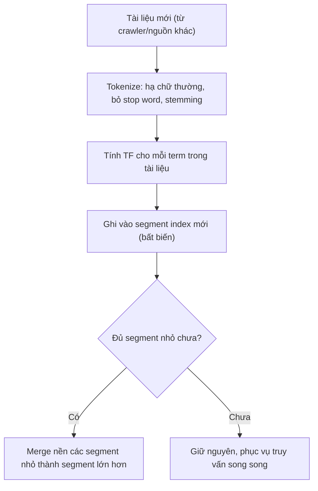
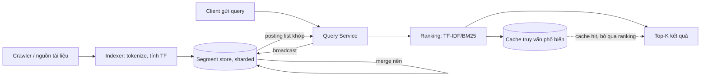

# Search Engine (Công cụ tìm kiếm)

**Độ khó:** Hard

Bài [Web Crawler](/go?p=15-System%20Design%2Fmedium%2F04-web-crawler.md) chỉ lo thu thập trang, không trả lời được "trang nào liên quan nhất tới câu hỏi của người dùng". Bài [Search Autocomplete](/go?p=15-System%20Design%2Fmedium%2F05-search-autocomplete.md) chỉ gợi ý tiếp từ một tiền tố, không xếp hạng hàng tỷ tài liệu theo mức độ liên quan. Search Engine là bài toán còn lại ở giữa: cho một tập tài liệu khổng lồ (do crawler mang về, hoặc do người dùng tự đăng), và một câu truy vấn tự do, trả về danh sách tài liệu liên quan nhất, xếp hạng đúng, trong vài trăm mili-giây. Đây là câu hỏi kinh điển kiểu "thiết kế Google" hoặc "thiết kế Elasticsearch nội bộ cho hệ thống tìm kiếm sản phẩm/tài liệu công ty".

**Tóm tắt:**

- Search Engine giải hai việc Crawler và Autocomplete không làm: tính độ liên quan giữa câu truy vấn và tài liệu, rồi xếp hạng hàng tỷ tài liệu theo độ liên quan đó.
- Cấu trúc lõi là **inverted index**: ánh xạ ngược từ mỗi từ (term) sang danh sách tài liệu chứa từ đó (posting list), thay vì tài liệu trỏ tới từ.
- Chấm điểm liên quan phổ biến nhất là **TF-IDF**: trọng số một từ trong một tài liệu tỷ lệ thuận với tần suất xuất hiện trong tài liệu đó (TF) và tỷ lệ nghịch với việc nó xuất hiện ở bao nhiêu tài liệu khác (IDF) — từ càng hiếm càng mang nhiều thông tin.
- BM25 là bản cải tiến của TF-IDF được dùng thực tế nhiều hơn (Elasticsearch mặc định BM25): bão hòa ảnh hưởng của TF (lặp từ 100 lần không có giá trị gấp 100 lần lặp 10 lần) và chuẩn hóa theo độ dài tài liệu tốt hơn.
- Ở quy mô lớn, index phải **sharded**: theo tài liệu (document-partitioned, mỗi shard giữ index đầy đủ cho một tập con tài liệu, dễ scale ghi) hoặc theo từ khóa (term-partitioned, mỗi shard giữ toàn bộ posting list của một tập từ, một truy vấn chỉ chạm ít shard hơn nhưng khó cân bằng tải).
- Truy vấn nhiều từ cần hợp nhất (merge) nhiều posting list rồi cộng điểm, đây là chi phí chính lúc truy vấn; tối ưu bằng cách nén posting list và duyệt theo thứ tự tăng dần của doc id (skip list) để bỏ qua nhanh các đoạn không giao nhau.
- Cập nhật tài liệu mới không thể rebuild toàn bộ index; giải pháp thực tế là index theo từng **segment** bất biến, ghi segment mới rồi merge dần ở nền (giống LSM-tree).
- Đây không phải chỗ để tự làm từ đầu trong thực tế: Elasticsearch/OpenSearch (dựa trên Lucene) đã hiện thực hoá toàn bộ cơ chế này; thiết kế ở đây để hiểu bên trong, phỏng vấn, hoặc khi cần một chỉ mục rất đặc thù.

## Vấn đề cần giải quyết

Dò tuần tự từng tài liệu để tìm từ khóa (`grep` trên hàng tỷ file) là O(số tài liệu) cho mỗi truy vấn — không chấp nhận được khi cần trả lời trong mili-giây. Vấn đề thật sự có hai lớp: (1) tìm nhanh "tài liệu nào chứa từ này" mà không quét toàn bộ dữ liệu, và (2) trong số hàng triệu tài liệu khớp một phần câu truy vấn, biết tài liệu nào **liên quan nhất** để trả về top 10 thay vì cả triệu kết quả không theo thứ tự.

**Nền tảng:** Giải lớp vấn đề thứ nhất bằng cách đảo chiều cấu trúc dữ liệu — thay vì "tài liệu nào chứa những từ gì" (thuận), lưu "từ nào nằm trong tài liệu nào" (ngược, inverted index) — biến việc tìm kiếm theo từ thành một lần tra bảng băm O(1) ra thẳng danh sách tài liệu ứng viên, không phải quét tuần tự. Giải lớp vấn đề thứ hai bằng một công thức chấm điểm (TF-IDF/BM25) để sắp xếp đúng thứ tự ứng viên đó.

## Các khái niệm cần biết

| Khái niệm | Là gì | Vì sao quan trọng |
|---|---|---|
| **Inverted index** | Ánh xạ term → danh sách (posting list) các tài liệu chứa term đó | Cấu trúc lõi của mọi search engine; biến tìm kiếm theo từ thành tra bảng băm |
| **Posting list** | Danh sách doc id (và thường kèm vị trí, tần suất) chứa một term, thường lưu tăng dần theo doc id | Nén tốt khi tăng dần (delta encoding); hai posting list giao nhau nhanh khi cùng thứ tự |
| **Tokenization** | Tách văn bản thành các term: hạ chữ thường, bỏ dấu câu, tách từ | Bước đầu tiên quyết định "từ" là gì; sai ở đây thì mọi thứ sau sai theo |
| **Stop words** | Từ quá phổ biến (the, là, của) gần như không mang thông tin phân biệt | Thường bị loại khỏi index để giảm kích thước và nhiễu khi chấm điểm (IDF của chúng gần 0) |
| **Stemming/Lemmatization** | Đưa các biến thể của một từ về dạng gốc (running → run) | Giúp "chạy" và "đang chạy" khớp cùng một term trong index |
| **TF (Term Frequency)** | Số lần term xuất hiện trong một tài liệu, thường chuẩn hóa theo độ dài tài liệu | Term xuất hiện nhiều lần trong tài liệu thường (không chắc chắn) liên quan hơn tới tài liệu đó |
| **IDF (Inverse Document Frequency)** | `log(tổng số tài liệu / số tài liệu chứa term)` | Term xuất hiện ở ít tài liệu mang nhiều thông tin phân biệt hơn term xuất hiện khắp nơi |
| **BM25** | Công thức chấm điểm cải tiến từ TF-IDF, bão hòa TF và chuẩn hóa độ dài tốt hơn | Mặc định của Lucene/Elasticsearch trong thực tế, không phải TF-IDF thuần |
| **Document-partitioned sharding** | Mỗi shard giữ index đầy đủ cho một tập con tài liệu | Dễ scale ghi (thêm tài liệu mới); một truy vấn phải hỏi mọi shard rồi hợp nhất kết quả |
| **Term-partitioned sharding** | Mỗi shard giữ toàn bộ posting list của một tập từ khóa | Một truy vấn ít từ chỉ chạm ít shard; khó cân bằng tải vì vài từ phổ biến tạo shard "nóng" |
| **Segment (LSM-style)** | Một khối index bất biến được ghi một lần; index logic = hợp nhiều segment | Cho phép thêm tài liệu mới mà không khóa/ghi lại toàn bộ index; segment cũ được merge dần ở nền |

## Thành phần

- **Indexer:** đọc tài liệu thô (từ crawler hoặc nguồn khác), tokenize, tính TF, ghi vào inverted index dưới dạng segment mới.
- **Index store:** các segment bất biến, sharded theo tài liệu hoặc theo từ khóa, có cơ chế merge nền.
- **Query service:** nhận câu truy vấn, tokenize giống hệt lúc index, tra các shard liên quan, hợp nhất posting list, chấm điểm, trả top-K.
- **Ranking/scoring:** cài đặt TF-IDF hoặc BM25, có thể kết hợp thêm tín hiệu khác (độ mới, độ phổ biến/click-through) ở một tầng re-rank riêng.
- **Cache:** lưu kết quả cho các truy vấn phổ biến, vì phân phối truy vấn thực tế luôn lệch (một số ít truy vấn chiếm phần lớn lượt gọi).

## Flowchart



**Phải thuộc:** Inverted index ánh xạ term → posting list tài liệu (ngược với cấu trúc tự nhiên "tài liệu chứa từ gì"). TF-IDF chấm điểm bằng tích của tần suất trong tài liệu (TF) và độ hiếm toàn cục (IDF); term xuất hiện ở mọi tài liệu có IDF tiến về 0 và gần như không ảnh hưởng điểm số. BM25 là bản dùng thực tế (Elasticsearch/Lucene), bão hòa TF tốt hơn TF-IDF thuần.

## Ước lượng

Giả định 1 tỷ tài liệu, trung bình 1.000 từ/tài liệu, từ vựng phân biệt khoảng 2 triệu từ, 10.000 truy vấn/giây.

| Đại lượng | Tính | Kết quả |
|---|---|---|
| Tổng số (term, tài liệu) cần ghi vào index | 1 tỷ × 1.000 | khoảng 1.000 tỷ mục |
| Posting trung bình mỗi term | 1.000 tỷ / 2 triệu từ | khoảng 500.000 tài liệu mỗi term (từ phổ biến có thể tới vài trăm triệu) |
| Dung lượng posting list (mỗi mục ~4 byte doc id sau nén delta) | 1.000 tỷ × ~1 byte (đã nén tốt) | khoảng 1 TB cho riêng phần doc id, chưa kể vị trí từ |
| Băng thông đọc khi truy vấn (giả định mỗi truy vấn chạm ~5 posting list, mỗi list trung bình nén còn 50 KB) | 10.000 × 5 × 50 KB | khoảng 2,5 GB/giây cần phục vụ từ RAM/SSD nhanh |
| Số shard (document-partitioned, mỗi shard giữ ~50 triệu tài liệu) | 1 tỷ / 50 triệu | khoảng 20 shard, mỗi truy vấn hỏi cả 20 rồi hợp nhất |

Kết luận: posting list của từ phổ biến là điểm nóng cả về dung lượng lẫn CPU hợp nhất; đây là lý do loại stop word và nén posting list (delta encoding + bit-packing) không phải tối ưu sớm mà là bắt buộc.

## Kiến trúc tổng thể



| Thành phần | Vai trò | Đánh đổi |
|---|---|---|
| Indexer | Biến tài liệu thô thành posting list | Tách khỏi query path để không chặn truy vấn khi đang index tài liệu mới |
| Segment store | Lưu index dạng bất biến, sharded | Ghi nhanh (append segment mới), nhưng truy vấn phải đọc nhiều segment rồi hợp nhất; merge nền tốn CPU/IO |
| Query service | Hợp nhất posting list nhiều shard, gọi ranking | Document-partitioned thì luôn hỏi mọi shard (fan-out cố định); term-partitioned thì ít shard hơn nhưng dễ lệch tải |
| Cache | Trả ngay kết quả truy vấn phổ biến | Phân phối truy vấn lệch mạnh (Zipf) nên cache hit rate thường rất cao; phải invalidate khi tài liệu top kết quả đổi |

## Dữ liệu

```text
term_dict(term PK) -> segment_id, offset       -- tra nhanh posting list nằm ở segment nào
posting(term, doc_id, tf, positions[])         -- positions phục vụ phrase query ("đúng cụm từ")
doc_meta(doc_id PK, length, last_indexed_at)   -- độ dài tài liệu cần cho chuẩn hóa TF
```

## Cơ chế lõi: Inverted Index và TF-IDF (Java, đã chạy thử)

```java
static class Posting { int docId, tf; Posting(int docId, int tf) { this.docId = docId; this.tf = tf; } }

static Map<String, List<Posting>> index = new HashMap<>();   // term -> posting list
static Map<Integer, Integer> docLength = new HashMap<>();     // docId -> tong so token
static int totalDocs = 0;

static List<String> tokenize(String text) {
    return Arrays.asList(text.toLowerCase().split("[^a-z0-9]+"));
}

static void addDoc(int docId, String text) {
    List<String> tokens = tokenize(text);
    docLength.put(docId, tokens.size());
    totalDocs++;
    Map<String, Integer> tf = new HashMap<>();
    for (String t : tokens) if (!t.isEmpty()) tf.merge(t, 1, Integer::sum);
    for (var e : tf.entrySet())
        index.computeIfAbsent(e.getKey(), k -> new ArrayList<>()).add(new Posting(docId, e.getValue()));
}

// IDF: log(tong so tai lieu / so tai lieu chua term); term xuat hien khap noi -> IDF tien ve 0
static double idf(String term) {
    List<Posting> postings = index.get(term);
    if (postings == null || postings.isEmpty()) return 0;
    return Math.log((double) totalDocs / postings.size());
}

// Diem = tong qua moi term cua query: (tf chuan hoa theo do dai doc) x idf
static List<int[]> search(String query, int topK) {
    Map<Integer, Double> score = new HashMap<>();
    for (String term : tokenize(query)) {
        List<Posting> postings = index.get(term);
        if (postings == null) continue;
        double idfVal = idf(term);
        for (Posting p : postings)
            score.merge(p.docId, (double) p.tf / docLength.get(p.docId) * idfVal, Double::sum);
    }
    List<Map.Entry<Integer, Double>> ranked = new ArrayList<>(score.entrySet());
    ranked.sort((a, b) -> Double.compare(b.getValue(), a.getValue()));
    List<int[]> out = new ArrayList<>();
    for (int i = 0; i < Math.min(topK, ranked.size()); i++)
        out.add(new int[]{ranked.get(i).getKey(), (int) Math.round(ranked.get(i).getValue() * 1000)});
    return out;
}
```

Đã chạy với 4 tài liệu: doc1 "java la ngon ngu lap trinh huong doi tuong chay tren jvm" (12 từ), doc2 "python la ngon ngu lap trinh de hoc va pho bien" (9 từ), doc3 "kotlin la ngon ngu hien dai chay tren jvm nhu java" (11 từ), doc4 "ngon ngu lap trinh co rat nhieu loai de lua chon" (10 từ). Kết quả thật:

```text
totalDocs = 4
IDF(ngon)   [co trong 4/4 doc] = 0.0
IDF(java)   [co trong 2/4 doc] = 0.693
IDF(kotlin) [co trong 1/4 doc] = 1.386

Query: "java jvm" ->
  doc=3 score(x1000)=126
  doc=1 score(x1000)=116
```

Ba điều đáng chú ý từ kết quả thật này. Một, `"ngon"` xuất hiện ở cả 4/4 tài liệu nên `IDF = log(4/4) = 0`, đúng như lý thuyết: một từ xuất hiện khắp nơi không giúp phân biệt tài liệu nào, nên trọng số của nó trong điểm số bằng 0 dù `tf` của nó có cao đến đâu — đây chính là lý do thực tế hay loại bỏ các từ quá phổ biến (stop word) khỏi index luôn thay vì tính rồi bỏ. Hai, `"kotlin"` chỉ ở 1/4 tài liệu nên `IDF` cao nhất (1.386): từ càng hiếm càng được tin là mang nhiều thông tin. Ba, với truy vấn `"java jvm"`, doc3 thắng doc1 dù cả hai đều chứa đúng 1 lần mỗi từ, vì doc3 ngắn hơn (11 từ so với 12 từ) nên `tf` chuẩn hóa theo độ dài của nó cao hơn — minh họa đúng lý do phải chuẩn hóa TF theo độ dài tài liệu, nếu không tài liệu dài sẽ luôn có lợi thế giả tạo vì tình cờ chứa nhiều từ hơn.

**Suy luận:** Nếu không chuẩn hóa TF theo độ dài tài liệu, một tài liệu dài gấp đôi sẽ có xu hướng chứa mỗi từ nhiều lần hơn chỉ vì nó dài, không phải vì nó liên quan hơn — điểm số khi đó đo "độ dài" chứ không đo "độ liên quan". Chia `tf` cho tổng số token của tài liệu sửa đúng chỗ lệch này. Điểm dễ nhầm tiếp theo là tưởng IDF chỉ là một hệ số phụ: thực ra nó quyết định phần lớn khả năng phân biệt của hệ thống, vì TF một mình không thể biết "ngon" và "kotlin" khác nhau về giá trị thông tin — phải nhân với IDF mới lộ ra. Hệ quả thực tế: loại bỏ stop word trước khi index không chỉ để tiết kiệm dung lượng, mà vì IDF của chúng đã gần 0 nên giữ lại chỉ tốn chỗ mà không đổi thứ hạng kết quả.

## Đào sâu

| Điểm khó | Vấn đề | Cách xử lý và đánh đổi |
|---|---|---|
| Chọn cách shard index | Document-partitioned dễ scale ghi nhưng mọi truy vấn phải hỏi hết mọi shard; term-partitioned ít shard hơn mỗi truy vấn nhưng từ phổ biến tạo shard nóng | Hệ thống lớn thực tế (Elasticsearch) dùng document-partitioned làm mặc định vì cân bằng tải dễ hơn, chấp nhận fan-out toàn bộ shard mỗi truy vấn và bù bằng cache |
| Cập nhật tài liệu mới liên tục | Rebuild toàn bộ inverted index mỗi lần có tài liệu mới là bất khả thi ở quy mô tỷ tài liệu | Ghi segment mới bất biến cho mỗi đợt tài liệu, merge dần ở nền (giống LSM-tree); đánh đổi là truy vấn phải đọc nhiều segment và có độ trễ index tới lúc tài liệu mới thật sự tìm được (near real-time, không phải real-time tuyệt đối) |
| TF-IDF so với BM25 | TF-IDF tăng tuyến tính theo TF, không có giới hạn trên, nên lặp từ khóa 50 lần (nhồi nhét) vẫn tiếp tục tăng điểm | BM25 thêm hệ số bão hòa (tham số k1, b) để TF tăng chậm dần, và chuẩn hóa độ dài tài liệu khác đi (so với độ dài trung bình toàn kho, không chỉ độ dài riêng tài liệu đó); đổi lại cần tinh chỉnh thêm hai tham số |

## Lỗi và giám sát

- Index và dữ liệu nguồn lệch nhau (tài liệu đã xóa nhưng vẫn ra kết quả): theo dõi độ trễ giữa thời điểm ghi nguồn và thời điểm index phản ánh (indexing lag).
- Shard nóng: theo dõi phân phối tải theo shard, không chỉ tổng QPS; một từ khóa cực phổ biến có thể làm một shard term-partitioned quá tải trong khi các shard khác rảnh.
- Cache stale: theo dõi tỷ lệ cache hit và tuổi trung bình của entry trong cache; dữ liệu nguồn đổi mà cache không invalidate sẽ trả kết quả cũ.
- Chất lượng xếp hạng tụt dần: theo dõi tỷ lệ người dùng click vào kết quả đầu (click-through rate theo vị trí) để phát hiện ranking đang xuống cấp trước khi người dùng phàn nàn.

## Điểm cần nhắc

- Inverted index là cấu trúc lõi: term → posting list, không phải tài liệu → danh sách term.
- TF-IDF/BM25 chấm điểm bằng tần suất trong tài liệu nhân độ hiếm toàn cục; luôn chuẩn hóa TF theo độ dài tài liệu.
- Shard theo tài liệu để dễ scale ghi và cân bằng tải, chấp nhận fan-out mọi shard mỗi truy vấn.
- Cập nhật bằng segment bất biến + merge nền, không rebuild toàn bộ index.
- Trong thực tế hiếm khi tự viết lại từ đầu: hiểu cơ chế để dùng đúng và tinh chỉnh Elasticsearch/OpenSearch/Lucene, không phải để thay thế chúng.
