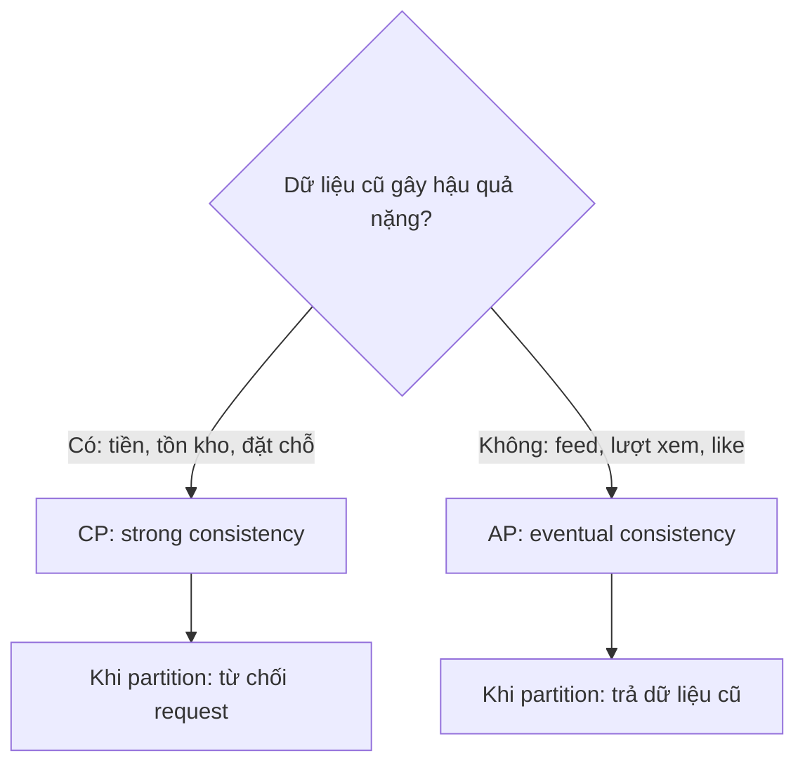
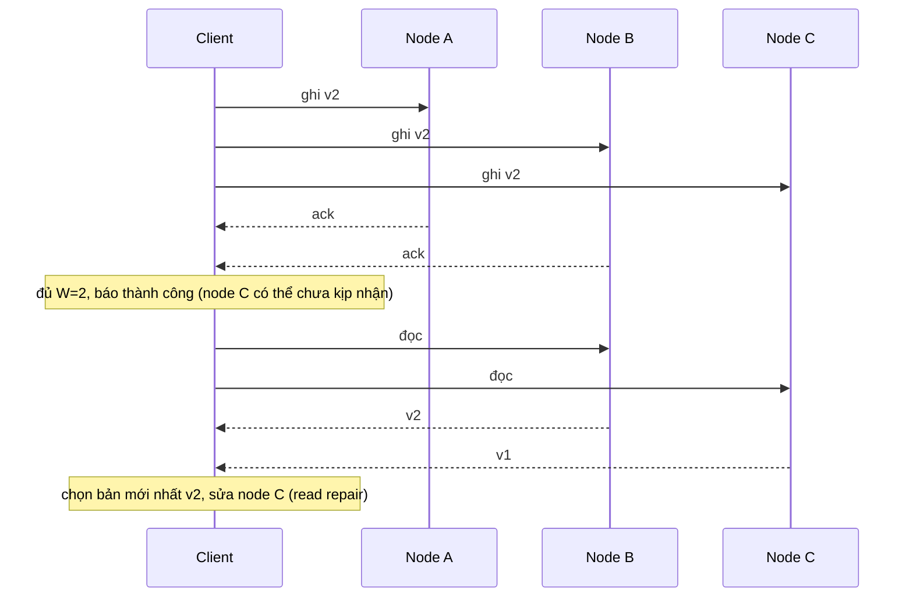
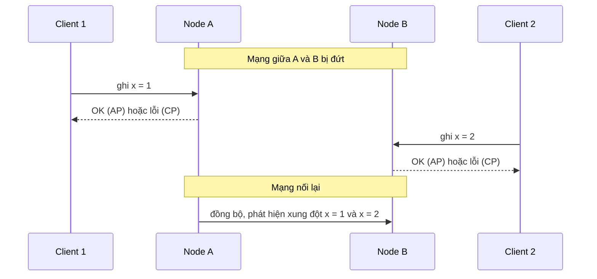

# Bài 5: CAP Theorem và Consistency

Bài này hướng dẫn bạn hiểu CAP theorem: một quy tắc về đánh đổi mà mọi hệ thống phân tán phải tuân theo, và cách biến nó thành quyết định thiết kế cụ thể.

**Tóm tắt:**

- Khi dữ liệu replicate qua nhiều node và mạng đứt (network partition), hệ thống buộc chọn giữa Consistency (từ chối request) và Availability (trả dữ liệu có thể cũ).
- P là bắt buộc vì mạng luôn có thể đứt; lựa chọn thực chất là CP hay AP khi partition xảy ra.
- Cách chọn: hỏi "dữ liệu cũ gây hậu quả nặng không"; tiền, tồn kho, đặt chỗ chọn CP, còn feed, like, lượt xem chọn AP.
- Chữ C trong CAP là linearizability, khác chữ C (ràng buộc toàn vẹn) trong ACID.
- Với N replica, ghi cần W node và đọc hỏi R node; nếu R + W > N thì đọc luôn chạm ít nhất một bản mới (thường N = 3, W = 2, R = 2), nhưng chưa phải linearizability.
- Hệ AP giải quyết xung đột bằng Last write wins (có thể mất dữ liệu), vector clock (phát hiện hai bản concurrent) hoặc CRDT.
- PACELC bổ sung phần CAP bỏ qua: khi mạng bình thường vẫn phải chọn giữa latency và consistency; nên chọn mức nhất quán theo từng thao tác chứ không theo cả hệ thống.

## CAP giải quyết nỗi lo gì?

Khi dữ liệu được replication ra nhiều node (nhiều máy, nhiều region), sẽ có lúc đường mạng giữa các node bị đứt, gọi là partition. Lúc này mỗi nhóm node chỉ thấy được nhau trong nhóm, và hệ thống phải chọn một trong hai: hoặc từ chối trả lời để giữ dữ liệu luôn đúng (chọn C, Consistency), hoặc vẫn trả lời nhưng có thể là dữ liệu cũ (chọn A, Availability). Không có lựa chọn thứ ba.

Hãy hình dung hai chi nhánh ngân hàng mất liên lạc. Nếu một khách rút tiền ở chi nhánh 1 trong lúc chi nhánh 2 không biết, ngân hàng có hai cách: từ chối transaction cho tới khi liên lạc lại (an toàn nhưng khách phải chờ), hoặc cứ cho rút rồi đối chiếu sau (tiện nhưng có thể âm tiền). Đó chính là CP và AP.

Vì sao cần hiểu điều này? Nếu không, bạn dễ kỳ vọng DB phân tán "vừa luôn đúng vừa luôn chạy". Tới lúc mạng đứt thì hoặc hệ thống báo lỗi hàng loạt, hoặc người dùng thấy số dư cũ, mà không ai đã lường trước hay thiết kế cách xử lý.

## Khi nào áp dụng, khi nào không

Áp dụng khi dữ liệu được replication hoặc chia ra nhiều node, nhiều region. Một DB trên một máy duy nhất thì chưa cần nghĩ tới CAP, vì không có đường mạng nào để đứt giữa các replica.

## Cách quyết định

Tự hỏi: "dữ liệu cũ gây hậu quả nặng không?". Tiền, tồn kho, đặt chỗ thì chọn CP. Feed, lượt xem, like thì chọn AP. Sau đó chọn DB phù hợp, rồi chỉnh mức consistency và quorum (số node phải đồng ý khi đọc hoặc ghi) cho khớp với lựa chọn đó.

## Các khái niệm cần biết

- **Network partition:** tình huống mạng giữa các node đứt hoặc quá chậm, khiến chúng không liên lạc được. Không phải là "chia dữ liệu" (sharding) dù trùng từ.
- **Linearizability:** dạng consistency mạnh nhất: hệ thống tỏ ra như chỉ có một bản dữ liệu duy nhất, và mọi thao tác xảy ra tức thì ở một thời điểm nào đó giữa lúc gửi và lúc trả lời. Đây là chữ "C" trong CAP.
- **Eventual consistency:** nếu ngừng ghi, sau một thời gian mọi replica sẽ giống nhau; trong lúc chờ, đọc có thể thấy dữ liệu cũ.
- **Quorum:** số node tối thiểu (thường là đa số) phải đồng ý để một thao tác được coi là thành công.
- **Read repair:** khi đọc phát hiện một replica cũ, hệ thống sửa nó luôn bằng bản mới.
- **Last write wins, vector clock, CRDT:** ba cách giải quyết xung đột ở hệ AP, giải thích ở các phần dưới.
- **Replication lag:** khoảng chậm giữa lúc ghi ở primary và lúc replica thấy bản ghi đó.

## Flowchart: chọn CP hay AP

Sơ đồ dưới tóm tắt cách ra quyết định: một câu hỏi duy nhất về hậu quả của dữ liệu cũ sẽ dẫn tới hành vi khi mạng đứt.



## CAP Theorem

Trong hệ thống phân tán, khi xảy ra **network partition**, bạn chỉ chọn được một trong hai: **Consistency** hoặc **Availability**.

- **Consistency (C):** mọi lần đọc thấy dữ liệu ghi mới nhất.
- **Availability (A):** mọi request đều nhận được response (không lỗi).
- **Partition tolerance (P):** hệ thống vẫn chạy khi mạng giữa các node bị đứt.

**Phải thuộc:** CAP: khi có partition (mạng đứt) hệ phân tán chỉ giữ được Consistency hoặc Availability, không phải cả hai. Vì mạng luôn có thể đứt nên P là bắt buộc; CP từ chối request để giữ đúng dữ liệu (tiền, tồn kho), AP vẫn trả lời nhưng có thể cũ (feed, like). Chữ C trong CAP là linearizability, khác chữ C trong ACID.

**Nền tảng:** Khi dữ liệu được replication qua mạng thì mạng đứt hoặc chậm là chuyện bình thường, và lúc đó mỗi nhóm node không biết nhóm kia đã ghi gì. Hệ thống buộc phải chọn: dừng lại chờ (giữ đúng) hoặc cứ tiếp tục (giữ chạy). Mọi mức consistency, quorum, vector clock sau đây đều là cách quản lý lựa chọn này.

Mạng thực tế luôn có thể đứt, nên P là bắt buộc, bạn không thể "chọn bỏ" P. Vì vậy lựa chọn thực chất là giữa C và A khi partition xảy ra:

| | Ưu tiên | Hành vi khi partition | Ví dụ |
|---|---|---|---|
| CP | Nhất quán | Từ chối một số request để giữ đúng dữ liệu | HBase, MongoDB (phụ thuộc config read/write concern), ZooKeeper |
| AP | Sẵn sàng | Vẫn trả lời, có thể là dữ liệu cũ | Cassandra, DynamoDB, CouchDB |

**Suy luận:** Lý do CAP buộc ta chọn nằm ở chỗ các node không thể biết tức thì nhóm bên kia đã ghi gì khi mạng đứt. Giả sử hai nhóm node đều nhận ghi: nếu cả hai tiếp tục trả lời thì dữ liệu phân kỳ (chọn A), còn nếu muốn dữ liệu luôn đúng thì phía không chắc mình thấy bản mới nhất phải từ chối (chọn C). Không có lựa chọn thứ ba vì thông tin không thể đi qua đường mạng đã đứt. Vì mạng thực tế luôn có thể đứt, P là điều bắt buộc, và câu hỏi thật là "khi đứt, chấp nhận lỗi hay chấp nhận dữ liệu cũ". Điểm dễ nhầm là hiểu "partition" như sharding, và hiểu chữ C như chữ C trong ACID; thực ra partition là mạng đứt, còn C ở đây là linearizability, tức là hệ thống tỏ ra như chỉ có một bản dữ liệu. Hệ quả khi thiết kế: đừng hỏi "CP hay AP cho cả hệ thống" mà hỏi theo từng thao tác, vì số dư ví cần mức mạnh còn danh sách transaction gần đây chấp nhận trễ vài giây.

## Các mức nhất quán

Nhất quán không phải bật hoặc tắt; có một phổ từ mạnh tới yếu, và mức càng mạnh thì càng chậm. Bốn mức hay gặp:

- **Strong consistency:** đọc luôn thấy ghi mới nhất. Chậm hơn, cần phối hợp nhiều node.
- **Eventual consistency:** nếu không có ghi mới, cuối cùng mọi node sẽ giống nhau. Nhanh, sẵn sàng cao.
- **Read-your-writes:** người vừa ghi sẽ thấy thay đổi của chính mình.
- **Causal consistency:** các event có quan hệ nhân quả được thấy đúng thứ tự.

## ACID và BASE

| ACID | BASE |
|---|---|
| Atomic, Consistent, Isolated, Durable | Basically Available, Soft state, Eventually consistent |
| Ưu tiên đúng đắn | Ưu tiên sẵn sàng và mở rộng |

## Chọn thế nào?

Nguyên tắc là chọn mức vừa đủ cho từng loại dữ liệu; nếu chọn quá yếu cho tiền, bạn sẽ có số dư sai; nếu chọn quá mạnh cho lượt xem, bạn tốn latency và dễ lỗi mà chẳng được gì.

- Chuyển tiền, tồn kho, đặt chỗ: cần strong consistency (CP).
- Feed mạng xã hội, lượt thích, số lượt xem: chấp nhận eventual consistency (AP).

## Quorum

Với N replica, ghi cần W node xác nhận và đọc hỏi R node. Nếu **R + W > N** thì đọc luôn chạm ít nhất một bản mới nhất.

**Phải thuộc:** Với N replica, ghi cần W node xác nhận và đọc hỏi R node; nếu **R + W > N** thì đọc luôn chạm ít nhất một bản mới nhất. Config hay dùng N = 3, W = 2, R = 2. Điều này chỉ đảm bảo chạm bản mới, chưa phải linearizability.

Flow ghi và đọc theo quorum với N = 3, W = 2, R = 2:



### Ví dụ tính tay với N = 3

| W | R | R + W | Tính chất | Dùng khi |
|---|---|---|---|---|
| 1 | 1 | 2 | Nhanh nhất, có thể đọc cũ | Số đếm lượt xem, cache |
| 2 | 2 | 4 | Quorum: đọc thấy ghi mới nhất; chịu mất 1 node cả đọc lẫn ghi | Mặc định hợp lý (Cassandra `QUORUM`) |
| 3 | 1 | 4 | Ghi chậm, đọc nhanh; mất 1 node là không ghi được | Đọc nhiều, ghi hiếm |
| 1 | 3 | 4 | Ghi nhanh, đọc chậm; mất 1 node là không đọc được | Ghi nhiều, đọc hiếm |

Chạy tay W=2, R=2: ghi `v2` đến node A, B (node C chưa kịp nhận, còn `v1`). Đọc hỏi bất kỳ 2 trong 3 node: {A,B} thấy `v2`; {A,C} hay {B,C} có ít nhất một node có `v2`. Nhờ có phiên bản (thời gian hoặc vector clock) mà người đọc chọn được `v2` và sửa C (read repair).

Giới hạn cần nói thêm khi phỏng vấn:

- `R + W > N` chỉ đảm bảo **chạm** một bản mới, chưa phải linearizability. Hai ghi concurrent, đồng hồ lệch, hoặc quorum "lỏng" (sloppy quorum và hinted handoff của kiểu Dynamo: ghi tạm vào node khác khi node đích đứt) vẫn có thể cho đọc cũ.
- Khi partition, phía có ít hơn quorum sẽ **từ chối** (CP) hoặc phải hạ mức (AP) tùy config.

## Khi partition: hai bên cùng ghi



Đọc sơ đồ: cùng một thao tác, kết quả phụ thuộc vào config. Hệ **CP** từ chối ghi ở phía thiểu số, nên không có xung đột nhưng người dùng bên đó thấy lỗi. Hệ **AP** nhận cả hai ghi rồi phải **giải quyết xung đột** khi nối lại:

| Cách | Mô tả | Mất gì |
|---|---|---|
| Last write wins (LWW) | Giữ bản có timestamp lớn nhất | Âm thầm mất bản kia, phụ thuộc đồng hồ |
| Vector clock | Phát hiện hai bản **concurrent**, giữ cả hai cho ứng dụng gộp | Ứng dụng phải xử lý, bản ghi phình |
| CRDT | Kiểu dữ liệu tự hợp nhất (bộ đếm, tập hợp) | Chỉ áp dụng được cho kiểu dữ liệu phù hợp |

**Phải thuộc:** Ba cách giải quyết xung đột ở hệ AP: Last write wins (giữ bản có timestamp lớn nhất, có thể âm thầm mất dữ liệu và phụ thuộc đồng hồ), vector clock (phát hiện hai bản concurrent để ứng dụng gộp), CRDT (kiểu dữ liệu tự hợp nhất).

**Suy luận:** Quorum dựa trên một phép tính đơn giản: nếu ghi tới W node, đọc hỏi R node và R + W > N thì tập đọc và tập ghi chắc chắn giao nhau ít nhất một node, nên đọc luôn gặp một bản mới nhất. Chính vì sự giao nhau đó mà cấu hình N = 3, W = 2, R = 2 chịu được mất một node cả đọc lẫn ghi, trong khi W = 3, R = 1 làm ghi chậm và mất một node là không ghi được. Nhưng giao nhau chỉ bảo đảm đọc chạm một bản mới, chưa bảo đảm bản đó là bản đúng duy nhất: hai ghi concurrent, đồng hồ lệch, hoặc sloppy quorum với hinted handoff vẫn có thể cho đọc cũ. Đó là lý do cần phiên bản và read repair để người đọc chọn bản mới nhất và sửa replica cũ. Điểm dễ nhầm là coi R + W > N đồng nghĩa với linearizability, và là điểm phỏng vấn hay hỏi xoáy. Hệ quả: nếu cần nhất quán mạnh thật sự, quorum một mình chưa đủ, phải thêm cơ chế đồng thuận hoặc dùng hệ CP.

## Vector clock

Vấn đề đặt ra là làm sao biết hai bản ghi là "cái sau cập nhật cái trước" hay "hai người sửa độc lập cùng lúc", khi đồng hồ vật lý của các máy không đáng tin. Vector clock giải quyết bằng cách đếm số lần cập nhật theo từng node thay vì dùng giờ. Mỗi bản ghi mang vector đếm số lần cập nhật theo từng node. So sánh hai vector: nếu mọi phần tử của một bên nhỏ hơn hoặc bằng bên kia (và có ít nhất một nhỏ hơn) thì nó **cũ hơn**; nếu mỗi bên có phần tử lớn hơn thì **concurrent** (xung đột).

| So sánh | Kết quả |
|---|---|
| `{A:1}` và `{A:2}` | Bản đầu cũ hơn, bỏ qua được |
| `{A:2, B:0}` và `{A:1, B:1}` | Concurrent: A thấy thêm ghi của A, B thấy thêm ghi của B, phải gộp |

```java
// Java 11+: so sánh vector clock (đã chạy: cmp({A:1},{A:2}) = -1, cmp({A:2,B:0},{A:1,B:1}) = 2)
static int cmp(Map<String, Integer> a, Map<String, Integer> b) {
    boolean less = false, greater = false;
    Set<String> keys = new HashSet<>(a.keySet());
    keys.addAll(b.keySet());
    for (String k : keys) {
        int x = a.getOrDefault(k, 0), y = b.getOrDefault(k, 0);
        if (x < y) less = true;
        if (x > y) greater = true;
    }
    // 2 = đồng thời, -1 = a cũ hơn, 1 = a mới hơn
    return less && greater ? 2 : less ? -1 : greater ? 1 : 0;
}
```

## PACELC: phần CAP không nói tới

Vấn đề của CAP là nó chỉ nói về lúc mạng đứt, trong khi phần lớn thời gian mạng vẫn khỏe. CAP chỉ bàn lúc có partition. PACELC bổ sung (xếp loại chỉ mang tính xấp xỉ, phụ thuộc config và phiên bản của từng sản phẩm): **nếu Partition thì chọn A hay C; Else (bình thường) thì chọn Latency hay Consistency**. Đây là lý do cả khi mạng khỏe, chờ nhiều replica xác nhận vẫn chậm hơn chỉ chờ một bản.

| Hệ thống (config mặc định, xấp xỉ) | Khi partition | Khi bình thường |
|---|---|---|
| Cassandra, DynamoDB (eventual) | A | Latency |
| HBase, ZooKeeper, Spanner | C | Consistency |

## Điểm senior cần nhắc

- Chọn **theo từng thao tác**, không theo cả hệ thống: số dư ví đọc ở mức mạnh, danh sách transaction gần đây chấp nhận trễ vài giây.
- **Replication lag** là thứ phải giám sát (giây hoặc số bản ghi chậm); đọc từ replica có thể thấy dữ liệu cũ. Giải pháp: sau khi ghi, đọc từ primary trong vài giây (read-your-writes), hoặc gắn session vào một replica.
- Consistency trong CAP (tuyến tính hóa) **khác** chữ C trong ACID (ràng buộc toàn vẹn).
- Xem cách áp dụng cho tiền ở [Payment System](/go?p=15-System%20Design%2Fhard%2F04-payment-system.md) và cho nghiệp vụ nhiều service ở [Distributed Transactions](/go?p=15-System%20Design%2Fhard%2Flt-10-distributed-transactions.md).

