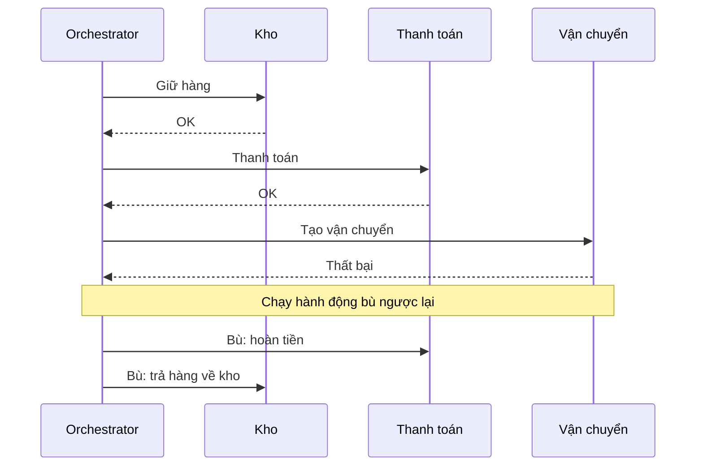
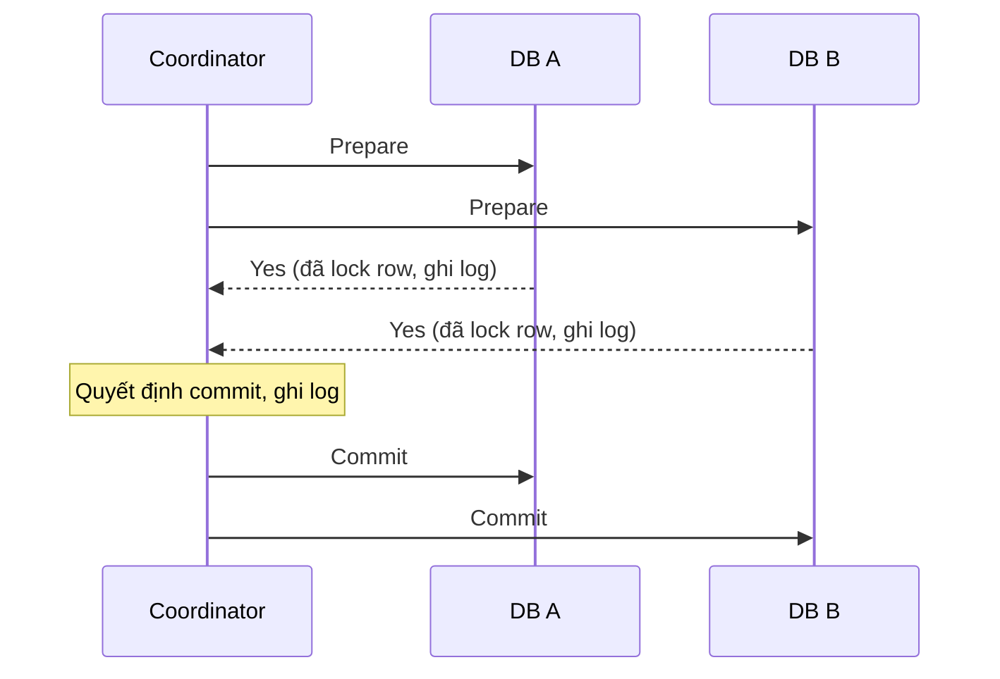
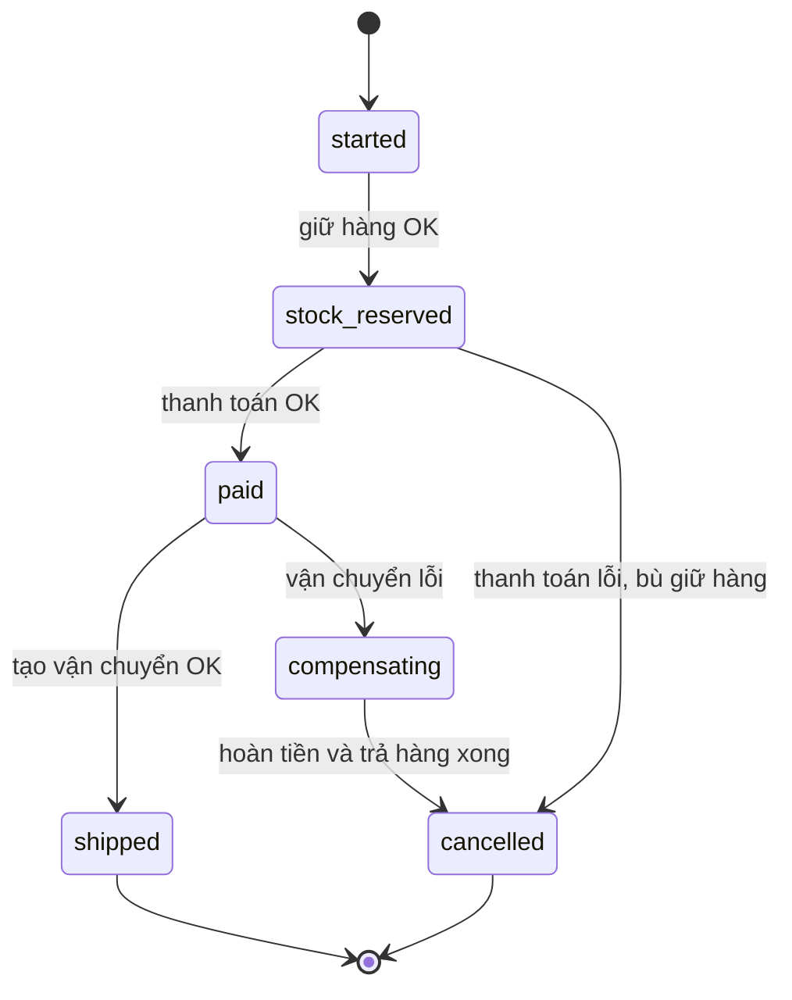
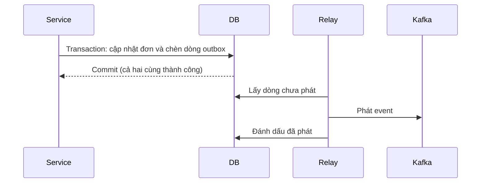

# Distributed Transactions

Bài này hướng dẫn bạn cách làm cho một nghiệp vụ chạy qua nhiều service, mỗi service một DB riêng, mà kết quả vẫn là "hoặc xong hết, hoặc hoàn tác hết".

**Tóm tắt:**

- Khi mỗi service có DB riêng thì không còn một transaction ACID bao trùm cả flow nghiệp vụ; mọi giải pháp là cách bù đắp điều đó.
- 2PC cho strong consistency nhưng giữ lock qua hai pha và kẹt (blocking) nếu coordinator chết, nên chỉ hợp phạm vi hẹp và cùng hạ tầng.
- Saga là chuỗi transaction cục bộ; bước nào lỗi thì chạy hành động bù theo thứ tự ngược, kết quả là eventual consistency và có thể thấy trạng thái trung gian.
- Choreography hợp flow ngắn (các service tự phản ứng với event), orchestration hợp flow dài vì dễ giám sát; bước không thể bù đặt cuối saga.
- TCC chia mỗi bước thành Try (giữ chỗ), Confirm (chốt), Cancel (nhả), kiểm soát chặt hơn nhưng tốn công viết ba hàm.
- Outbox ghi event vào bảng cùng transaction với dữ liệu rồi relay phát sau, vì ghi DB và gửi message không thể nguyên tử.
- Giao nhận là at-least-once nên consumer và hành động bù đều phải idempotent.

## Vấn đề cần giải quyết

Trong một DB duy nhất, bạn bọc nhiều câu lệnh vào một transaction ACID: lỗi giữa chừng thì rollback, mọi thứ trở về như chưa có gì. Khi hệ thống tách thành microservices, mỗi service sở hữu DB riêng, bạn không còn một transaction chung bao trùm tất cả. Làm tay sẽ dẫn tới những tình huống như đã trừ tiền khách nhưng không giữ được hàng, hoặc ghi DB xong mà event chưa kịp gửi đi vì process chết đúng lúc đó, khiến các service khác không bao giờ biết.

Có ba nhóm giải pháp. 2PC (Two-Phase Commit) cho trường hợp cần strong consistency và phạm vi hẹp, nhưng nó giữ lock trong suốt hai pha và kẹt nếu coordinator chết. Với microservices thì dùng Saga: chuỗi transaction cục bộ, bước nào lỗi thì chạy hành động bù (compensation) để hoàn tác các bước trước. Cuối cùng, Outbox giải quyết bài toán ghi event cùng transaction với dữ liệu, để không mất event.

**Nền tảng:** Khi mỗi service có DB riêng thì không còn một transaction ACID bao trùm cả flow nghiệp vụ. Mọi giải pháp (2PC, Saga, TCC, Outbox) đều là cách bù đắp điều đó: hoặc giữ lock để mô phỏng tính nguyên tử (2PC), hoặc chấp nhận eventual consistency và hoàn tác bằng hành động bù (Saga).

## Khi nào nên dùng, khi nào không

Dùng cho flow đi qua nhiều service như đặt hàng (kho, thanh toán, vận chuyển) hay chuyển tiền giữa các hệ thống. Nếu có thể gom dữ liệu liên quan vào cùng một DB (cùng một service) thì cứ dùng transaction thường: đơn giản và an toàn hơn nhiều. Đừng chia service rồi mới nhận ra mình phải tự xây transaction phân tán cho nghiệp vụ vốn cần tính nguyên tử.

## Các khái niệm cần biết

- **ACID:** bốn tính chất của transaction trong một DB: Atomic (hoặc xong hết hoặc hủy hết), Consistent, Isolated (các transaction không thấy trạng thái dở của nhau), Durable (đã commit thì không mất). Transaction phân tán khó vì không có một DB nào bảo đảm chúng cho toàn flow.
- **Coordinator:** thành phần điều khiển trong 2PC, quyết định cuối cùng là commit hay rollback cho mọi bên.
- **Compensation (hành động bù):** thao tác nghiệp vụ làm ngược lại một bước đã hoàn tất (hoàn tiền bù cho thanh toán). Khác rollback ở chỗ bước gốc đã commit và có người thấy được.
- **Eventual consistency:** trong lúc saga đang chạy, dữ liệu giữa các service tạm thời lệch nhau; cuối cùng mới khớp.
- **TCC (Try-Confirm-Cancel):** mỗi bước gồm ba hàm: Try giữ chỗ tài nguyên, Confirm chốt, Cancel nhả.
- **Orchestration và Choreography:** hai cách điều phối saga (một orchestrator ra lệnh, hoặc các service tự phản ứng với event).
- **Outbox pattern:** ghi event vào bảng trong cùng transaction với dữ liệu, một tiến trình riêng đọc bảng rồi phát ra queue.
- **CDC (Change Data Capture) và WAL:** CDC đọc nhật ký ghi trước (WAL, write-ahead log) của DB để biết thay đổi và phát đi; Debezium là công cụ phổ biến.
- **At-least-once:** giao nhận bảo đảm tới ít nhất một lần, có thể tới lặp, nên phía nhận phải xử lý idempotent (làm lại cho kết quả như làm một lần).
- **`FOR UPDATE SKIP LOCKED`:** câu SELECT lock các dòng chọn được và bỏ qua dòng đang bị lock bởi người khác, cho phép nhiều worker lấy việc parallel không giẫm nhau.

## Các phương án

Bảng dưới so sánh bốn công cụ thường gặp; chúng không loại trừ nhau, ví dụ Saga thường đi kèm Outbox.

| Phương án | Ý tưởng | Nhận xét |
|---|---|---|
| 2PC (Two-Phase Commit) | Coordinator hỏi mọi bên "sẵn sàng?" rồi mới commit | Nhất quán mạnh, nhưng chặn tài nguyên và coordinator chết thì kẹt |
| Saga | Chuỗi transaction cục bộ, mỗi bước có hành động bù (compensation) | Mở rộng tốt, eventual consistency |
| Outbox | Ghi event cùng transaction DB, tiến trình khác phát event ra queue | Tránh mất event giữa DB và queue |
| TCC (Try-Confirm-Cancel) | Giữ chỗ (Try), xác nhận hoặc hủy | Kiểm soát chặt, tốn công lập trình |

**Phải thuộc:** 2PC: strong consistency nhưng giữ lock qua hai pha và kẹt (blocking) nếu coordinator chết. Saga: chuỗi transaction cục bộ, lỗi thì chạy hành động bù theo thứ tự ngược, eventual consistency. TCC: Try (giữ chỗ), Confirm (chốt), Cancel (nhả). Outbox: ghi event cùng transaction với dữ liệu để không mất event.

## Flowchart: Saga đặt hàng

Hãy xem một đơn hàng đi qua ba service. Đến bước vận chuyển thì lỗi, và orchestrator phải bù lại hai bước trước theo thứ tự ngược.



Đọc sơ đồ: mỗi mũi tên "OK" đã là một transaction cục bộ đã commit ở service đó. Vì không thể rollback, hệ thống phải gọi hành động bù mới, và bù ngược thứ tự để không để tiền đã hoàn mà hàng vẫn giữ.

## Hai kiểu Saga

- **Choreography:** các service tự lắng nghe event của nhau. Đơn giản nhưng khó theo dõi khi nhiều bước. Chọn khi flow ngắn (2-3 bước) và ít thay đổi.
- **Orchestration:** một orchestrator ra lệnh từng bước. Rõ ràng, dễ giám sát, thêm một thành phần. Chọn khi flow dài, có nhánh điều kiện hoặc cần theo dõi trạng thái từng đơn.

**Phải thuộc:** Choreography: các service tự phản ứng với event của nhau (đơn giản, hợp flow ngắn, khó theo dõi). Orchestration: một orchestrator ra lệnh từng bước (rõ ràng, dễ giám sát, hợp flow dài). Bước không thể bù (gửi email, giao hàng) đặt cuối saga.

Nếu chọn choreography cho flow dài, hiện tượng thường gặp là không ai biết một đơn đang kẹt ở bước nào vì logic nằm rải rác trong nhiều service.

## 2PC: vì sao kẹt

Vấn đề đặt ra là làm sao để nhiều DB cùng commit hoặc cùng rollback. 2PC chia làm hai pha: pha chuẩn bị (hỏi mọi bên có sẵn sàng không) và pha quyết định (ra lệnh chung).



Sau khi trả `Yes`, mỗi bên **phải giữ lock và chờ** lệnh cuối. Coordinator chết giữa hai pha thì các bên đã `Yes` không tự quyết được và giữ lock đến khi coordinator hồi phục (blocking). Vì thế 2PC chỉ hợp khi phạm vi hẹp, cùng hạ tầng, latency thấp.

**Suy luận:** Trong một DB, transaction ACID cho ta rollback miễn phí vì mọi thay đổi chưa commit đều ẩn với người khác. Khi tách thành nhiều service, mỗi bước đã commit ở DB riêng và có người nhìn thấy, nên không thể rollback mà chỉ có thể làm một hành động nghiệp vụ ngược lại, gọi là compensation. Từ đó suy ra hai hệ quả: hành động bù phải đi theo thứ tự ngược để không có chuyện tiền đã hoàn mà hàng vẫn giữ, và trong lúc saga chạy dữ liệu tạm thời lệch giữa các service (eventual consistency). 2PC mô phỏng lại tính nguyên tử bằng cách giữ lock ở mọi bên đến khi coordinator ra lệnh, nên đổi sự đơn giản lấy việc kẹt toàn hệ thống khi coordinator chết hoặc một bên chậm. Điểm dễ nhầm là nghĩ saga cô lập như ACID; thực tế người khác có thể đọc trạng thái trung gian, nên phải thiết kế trạng thái đơn rõ ràng như PENDING hoặc dùng semantic lock. Hệ quả khi thiết kế: đặt bước không thể bù (gửi email, giao hàng) cuối saga, và coi hành động bù là thứ có thể lỗi nên phải retry idempotent.

## Saga orchestrator: code và trạng thái

Trạng thái của một đơn trong saga được mô tả bằng sơ đồ sau; nhánh `compensating` là chỗ bù đang chạy.



Lõi của orchestrator: chạy tuần tự, nhớ các bước đã xong, lỗi thì bù **theo thứ tự ngược**:

```java
// Java 11+ (đã chạy): orchestrator với stack các bước đã hoàn thành
interface Step { void run(String id) throws Exception; void undo(String id); }

static String run(String orderId, List<Step> steps) {
    Deque<Step> done = new ArrayDeque<>();
    for (Step s : steps) {
        try {
            s.run(orderId);
            done.push(s);                       // nhớ để bù
        } catch (Exception e) {
            while (!done.isEmpty()) done.pop().undo(orderId); // bù ngược thứ tự
            return "CANCELLED";
        }
    }
    return "COMPLETED";
}
// 3 bước OK: COMPLETED. Bước 3 lỗi: bù bước 2 rồi bước 1, kết quả CANCELLED.
```

Bản dùng thật còn thiếu ba thứ, đây cũng là điểm phỏng vấn hay hỏi:

1. **Lưu trạng thái saga vào DB** sau mỗi bước (id saga, bước hiện tại, dữ liệu). Orchestrator chết thì tiến trình khác đọc lại và chạy tiếp từ bước đang dở.
2. **Timeout và retry** mỗi bước với backoff; hết số lần thử thì mới bù.
3. **Bù cũng có thể lỗi**: phải retry đến khi thành công (idempotent), kèm cảnh báo cho người xử lý nếu kẹt lâu.

Với bước **không thể bù** (gửi email, giao hàng thật), đặt chúng **cuối cùng** trong saga, sau mọi bước có thể hoàn tác.

## Outbox: ghi DB và phát event không mất

Lỗi kinh điển: `COMMIT` xong rồi gửi Kafka, process chết giữa hai việc thì event mất (DB đã đổi nhưng không ai biết). Đảo thứ tự cũng không cứu được: gửi trước rồi commit lỗi thì event báo về một thay đổi không có thật. Cách sửa: ghi event vào bảng `outbox` **cùng transaction** với dữ liệu, một tiến trình riêng (relay) đọc bảng rồi phát.



```sql
-- PostgreSQL
CREATE TABLE outbox (
  id           bigserial PRIMARY KEY,
  aggregate_id text NOT NULL,           -- dùng làm key Kafka để giữ thứ tự theo đơn
  type         text NOT NULL,
  payload      jsonb NOT NULL,
  created_at   timestamptz DEFAULT now(),
  published_at timestamptz
);

BEGIN;
UPDATE orders SET status = 'PAID' WHERE id = 42;
INSERT INTO outbox(aggregate_id, type, payload) VALUES ('42', 'OrderPaid', '{"orderId":42}');
COMMIT;                                   -- cả hai cùng thành công hoặc cùng thất bại

-- Relay: lấy lô chưa phát; SKIP LOCKED cho phép nhiều relay chạy song song không giẫm nhau
SELECT * FROM outbox WHERE published_at IS NULL ORDER BY id LIMIT 100 FOR UPDATE SKIP LOCKED;
-- Sau khi gửi Kafka thành công:
UPDATE outbox SET published_at = now() WHERE id = ANY($1);
```

**Nền tảng:** Không thể ghi DB và gửi message concurrent một cách nguyên tử, nên bất kỳ thứ tự nào cũng có thể mất hoặc báo sai event. Outbox giải quyết bằng cách biến "gửi event" thành một dòng dữ liệu trong cùng transaction DB, rồi phát sau; giá phải trả là giao nhận at-least-once nên consumer phải idempotent.

Relay có thể gửi xong mà chưa kịp đánh dấu rồi chết, nên event có thể được phát **lặp**: giao nhận là at-least-once. Phía nhận phải khử lặp, thường bằng bảng `processed_events`:

```sql
-- Consumer: xử lý và ghi dấu trong cùng transaction
BEGIN;
-- 0 dòng: đã xử lý, bỏ qua
INSERT INTO processed_events(event_id) VALUES ($1) ON CONFLICT DO NOTHING;
-- ... xử lý nghiệp vụ nếu vừa chèn được ...
COMMIT;
```

Thay vì relay đọc bảng, có thể dùng CDC (đọc WAL, ví dụ Debezium) để phát; giảm tải truy vấn nhưng thêm thành phần vận hành.

**Suy luận:** Bài toán outbox sinh ra từ một sự thật: ghi DB và gửi message vào Kafka là hai hệ thống khác nhau nên không có cách nào làm cả hai nguyên tử. Nếu commit xong rồi mới gửi, process chết giữa hai việc thì DB đã đổi mà không ai biết; nếu gửi trước rồi commit lỗi thì event báo một thay đổi không có thật. Outbox tránh vấn đề bằng cách biến "gửi event" thành một dòng dữ liệu cùng transaction với thay đổi, nên hoặc cả hai cùng có hoặc cả hai cùng không, rồi một relay đọc bảng và phát sau. Cái giá là relay có thể gửi xong mà chưa kịp đánh dấu rồi chết, nên event được phát lặp, tức là giao nhận at-least-once. Điểm dễ nhầm là coi outbox đã cho exactly-once; thực tế phía nhận vẫn phải khử lặp, thường bằng bảng `processed_events` ghi cùng transaction với xử lý nghiệp vụ. Hệ quả: dùng `FOR UPDATE SKIP LOCKED` để nhiều relay chạy parallel không giẫm nhau, dùng aggregate id làm key Kafka để giữ thứ tự theo đơn, và giám sát tuổi bản ghi outbox cũ nhất để biết relay chậm hay chết.

## Chọn phương án

Dùng 2PC khi mọi bên cùng hạ tầng và bạn chấp nhận giữ lock; dùng Saga khi flow dài và đi qua nhiều service; dùng TCC khi cần giữ chỗ chặt như tiền hoặc tồn kho. Chọn sai, ví dụ 2PC xuyên nhiều service ở xa nhau, sẽ cho hiện tượng toàn hệ thống treo khi một bên chậm.

| Tiêu chí | 2PC | Saga | TCC |
|---|---|---|---|
| Nhất quán | Mạnh | Cuối cùng | Cuối cùng, kiểm soát chặt hơn |
| Lock tài nguyên | Giữ suốt hai pha | Không giữ, thấy trạng thái trung gian | Giữ chỗ logic (Try), thả khi Confirm/Cancel |
| Công sức | Thấp nếu DB hỗ trợ | Phải viết bù | Phải viết ba hàm mỗi bước |
| Chịu lỗi coordinator | Kẹt | Tiếp tục từ trạng thái đã lưu | Tương tự saga |
| Hợp với | Cùng hạ tầng, phạm vi hẹp | Microservices, flow dài | Tiền, tồn kho cần giữ chỗ chặt |

## Điểm cần nhắc

- **Giám sát:** số saga kẹt quá N phút, số bước bù đang chạy, tuổi bản ghi outbox chưa phát cũ nhất (relay chậm hay chết), tỷ lệ retry.
- **Cách ly:** saga không cô lập như ACID nên người khác có thể đọc trạng thái trung gian; dùng semantic lock (trạng thái `PENDING` chặn thao tác khác) hoặc giữ chỗ.
- Hành động bù phải idempotent và có thể chạy lại.
- Có thể thấy trạng thái trung gian (đã giữ hàng, chưa thanh toán): thiết kế trạng thái đơn hàng rõ ràng.
- Mọi bước dùng idempotency key vì có thể bị gọi lặp.
- Liên hệ bài [Payment System](/go?p=15-System%20Design%2Fhard%2F04-payment-system.md).

