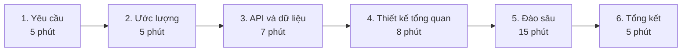
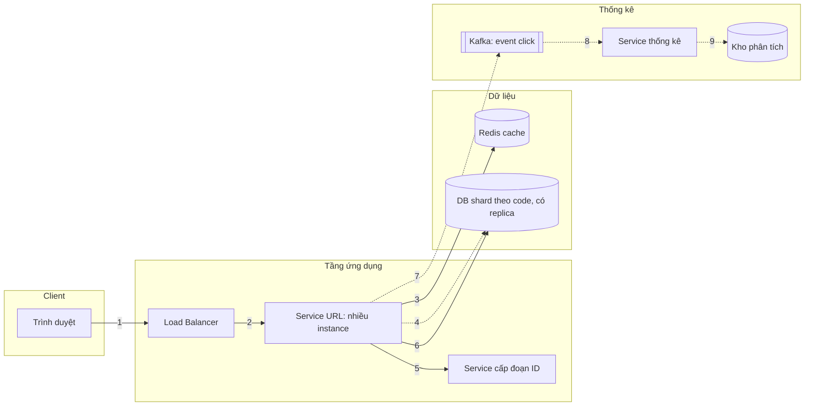
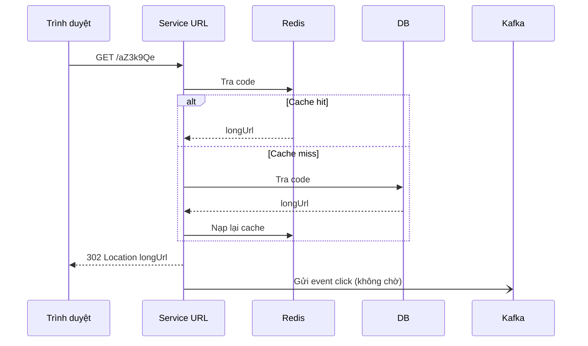
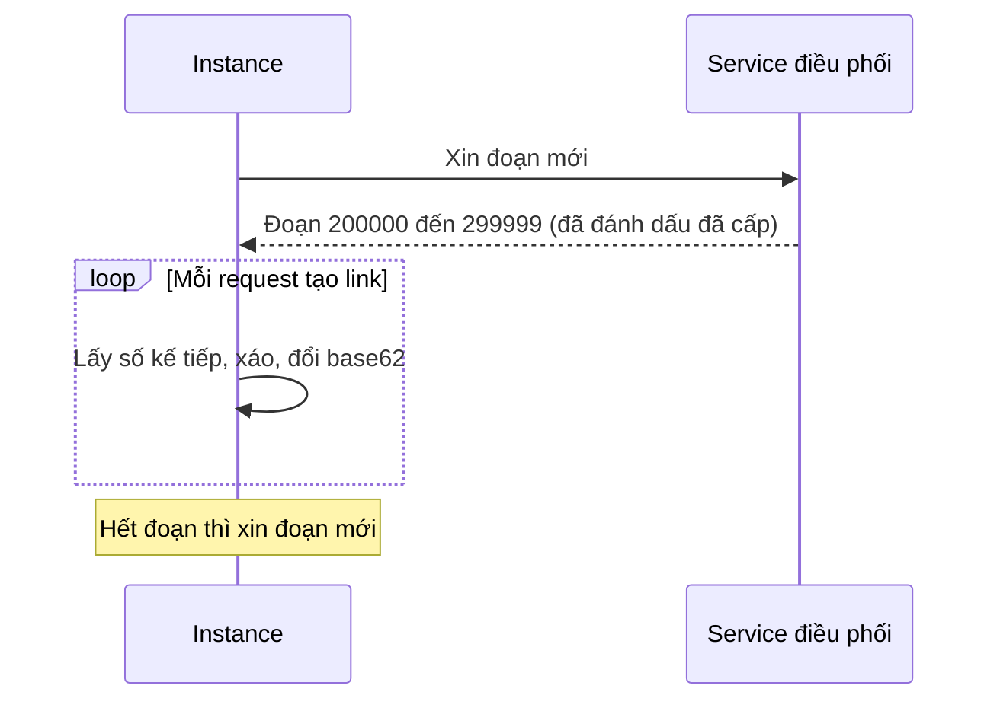

# Bài 11: Khung giải 45 phút và ví dụ đầy đủ

Các bài thiết kế khác trong mục này ngắn gọn như tờ ghi nhớ. Bài này cho bạn **quy trình** để tự giải một đề lạ trong 45 phút, kèm **một lời giải đầy đủ** làm mẫu về độ chi tiết mà vòng senior mong đợi.

**Tóm tắt:**

- Đề thiết kế hệ thống không có đáp án đúng duy nhất; người phỏng vấn chấm cách bạn suy nghĩ có hệ thống chứ không chấm công nghệ nào được liệt kê.
- Khung 6 bước trong 45 phút: yêu cầu 5, ước lượng 5, API và dữ liệu 7, thiết kế tổng quan 8, đào sâu 15, tổng kết 5; bước đào sâu chiếm nhiều thời gian nhất.
- Hỏi trước khi vẽ, dùng con số (QPS, dung lượng, bandwidth) để dẫn tới quyết định, và mỗi lựa chọn phải nêu được gì, mất gì.
- Con số cần thuộc: 1 ngày khoảng 86.400 giây, 1 triệu request mỗi ngày khoảng 12 request mỗi giây, đỉnh gấp 2 đến 5 lần, 1 KB nhân 1 triệu bằng 1 GB.
- Hầu hết đề ghép từ các khối quen thuộc: load balancer, cache và CDN, sharding, queue, ID generator, saga hoặc outbox, rate limiter.
- Lời giải mẫu URL Shortener: 7 ký tự base62 đủ cho hàng tỷ link, cấp phát mã theo đoạn, cache-aside cho đường đọc, redirect 302 để có thống kê, click đẩy asynchronous qua Kafka.
- Luôn nói về lỗi (node chết, partition, retry trùng, hot key) và giám sát (p99, cache hit, replication lag).

## Vì sao cần một khung giải?

**Nền tảng:** Đề thiết kế hệ thống không có đáp án đúng duy nhất; người phỏng vấn chấm cách bạn suy nghĩ có hệ thống: hỏi trước khi vẽ, dùng con số để dẫn tới quyết định, mỗi lựa chọn nêu rõ được gì mất gì, và nói về lỗi cùng giám sát.

Vòng thiết kế hệ thống thường quyết định cấp bậc của bạn. Điều đáng nói là người phỏng vấn không chấm "đáp án đúng" (vì thường không có), mà chấm **cách bạn suy nghĩ**: có làm rõ đề trước khi vẽ không, có ước lượng để dẫn tới quyết định không, có chọn kèm lý do không, có thấy bottleneck và nói được trade-off không. Nếu không có quy trình, rất dễ rơi vào hai thái cực: vẽ ngay một đống hộp công nghệ mà không biết vì sao, hoặc sa đà một chi tiết rồi timeout.

Bài này đưa cho bạn một khung 6 bước để giải bất kỳ đề thiết kế nào trong 45 phút, một bảng số liệu cần thuộc để ước lượng nhanh, và một lời giải mẫu đầy đủ (URL Shortener) gồm ước lượng, API, dữ liệu, đào sâu và trade-off, để bạn thấy mức chi tiết mà vòng senior mong đợi.

## Cách dùng bài này

Hãy luyện từ tuần 10 của [lộ trình](/go?p=00-Roadmap%2Flo-trinh-12-tuan.md), và dùng trong phỏng vấn thật. Nguyên tắc làm theo: làm đúng 6 bước, luôn nói thành tiếng cho người nghe theo dõi được suy nghĩ của bạn, vẽ ra giấy hoặc bảng, và chủ động nêu ít nhất hai điểm đào sâu thay vì chờ người phỏng vấn gợi ý. Khung này không phù hợp để học thuộc một đáp án cho một đề cụ thể; mục tiêu là rèn phản xạ quy trình.

## Các khái niệm cần biết

- **Chức năng và phi chức năng:** chức năng là hệ thống làm được gì (tạo link, redirect); phi chức năng là nó làm tốt tới mức nào (latency, sẵn sàng, nhất quán, quy mô). Đề thiết kế thường khó ở phần phi chức năng.
- **QPS (queries per second):** số request mỗi giây. Ước lượng QPS đọc và ghi giúp quyết định có cần cache, có cần shard hay không.
- **Latency p99:** thời gian trong đó 99% request hoàn thành; nói cách khác 1% chậm nhất bị loại ra. Quan trọng hơn trung bình vì người dùng nhớ những lần chậm.
- **Trade-off:** mỗi lựa chọn được gì và mất gì. Một đáp án senior luôn nêu cả hai.
- **Bottleneck:** thành phần chạm giới hạn trước tiên và quyết định trần của cả hệ thống.
- **Cache-aside:** ứng dụng tự đọc cache, trượt (miss) thì đọc DB rồi nạp lại cache.
- **LRU (least recently used):** chính sách đẩy ra khỏi cache mục lâu không được dùng nhất khi đầy.
- **Hot key:** một key nhận lượng truy cập quá lớn so với phần còn lại.
- **Cache penetration và cache stampede:** penetration là truy cập key không tồn tại liên tục xuyên qua cache tới DB; stampede là key nóng hết hạn cùng lúc khiến hàng loạt request concurrent đổ vào DB.
- **Bloom filter:** cấu trúc xác suất rất gọn cho biết "chắc chắn không có" hoặc "có thể có", dùng để chặn truy vấn key không tồn tại.
- **Sharding và consistent hashing:** chia dữ liệu ra nhiều node theo key; consistent hashing giúp thêm bớt node mà chỉ phải dịch chuyển một phần nhỏ dữ liệu.
- **Idempotency key:** key do client gửi kèm để retry không tạo bản ghi trùng.
- **Base62:** cách biểu diễn số bằng 62 ký tự (a-z, A-Z, 0-9), cho mã ngắn dễ đưa vào URL.
- **Snowflake ID:** ID 64 bit ghép thời gian, mã máy và số thứ tự, sinh phân tán không cần phối hợp.

## Khung 6 bước

Thời gian chia như sơ đồ dưới đây; điểm đáng chú ý là bước đào sâu chiếm nhiều thời gian nhất, vì đó là chỗ phân biệt các cấp bậc.



| Bước | Làm gì | Câu mẫu để nói |
|---|---|---|
| 1. Yêu cầu | Chốt chức năng chính (3-5 ý), phi chức năng (latency, sẵn sàng, nhất quán), quy mô, điều **không** làm | "Trước khi thiết kế, mình xin làm rõ một số yêu cầu..." |
| 2. Ước lượng | QPS đọc/ghi, đỉnh, dung lượng lưu trữ, bandwidth; rút ra kết luận (ví dụ: đọc nhiều thì cần cache) | "Với 100 triệu bản ghi mới mỗi tháng thì ghi khoảng 40 request/giây..." |
| 3. API và dữ liệu | Vài endpoint chính, bảng/collection chính, key, index | "Mình sẽ có hai API chính..." |
| 4. Tổng quan | Sơ đồ khối: client, LB, service, DB, cache, queue; flow đọc và ghi | "Đây là flow ghi, đây là flow đọc" |
| 5. Đào sâu | Chọn điểm khó nhất (người phỏng vấn thường gợi ý); nêu phương án, so sánh, chọn | "Chỗ này có hai hướng, mình chọn X vì..." |
| 6. Tổng kết | Bottleneck còn lại, cách mở rộng, lỗi và giám sát, điều sẽ làm tiếp | "Nếu thêm thời gian mình sẽ xem xét..." |

**Phải thuộc:** Khung 6 bước trong 45 phút: (1) yêu cầu 5 phút, (2) ước lượng 5 phút, (3) API và dữ liệu 7 phút, (4) thiết kế tổng quan 8 phút, (5) đào sâu 15 phút, (6) tổng kết 5 phút. Bước đào sâu chiếm nhiều thời gian nhất.

Khi bí, hãy quay về bước trước: nếu không biết chọn công nghệ nào thì quay lại ước lượng xem con số đòi hỏi gì; nếu không biết đào sâu chỗ nào thì quay lại yêu cầu phi chức năng và hỏi "điều gì dễ vỡ nhất ở quy mô này".

### Những điều người phỏng vấn senior chú ý

- Bạn **hỏi** trước khi **vẽ**.
- Con số dẫn tới quyết định (không ước lượng cho có).
- Mỗi lựa chọn đi kèm **được gì, mất gì**.
- Bạn nói về **lỗi**: node chết, mạng phân vùng, retry trùng, hot key.
- Bạn biết **giám sát** thứ gì (latency p99, tỷ lệ lỗi, replication lag).
- Bạn kiểm soát thời gian và biết bỏ qua chi tiết không cần.

## Bảng số liệu cần thuộc

Vấn đề đặt ra là ước lượng phải nhanh và đủ gần để ra quyết định, không cần chính xác. Vài quy đổi dưới đây giúp bạn tính nhẩm được trong vài chục giây.

| Quy đổi | Giá trị gần đúng |
|---|---|
| 1 ngày | khoảng 86.400 giây (làm tròn 100.000 cho nhanh) |
| 1 triệu request/ngày | khoảng 12 request/giây |
| 100 triệu request/ngày | khoảng 1.160 request/giây |
| 1 tỷ request/ngày | khoảng 11.600 request/giây |
| Đỉnh so với trung bình | thường 2-5 lần |
| 1 KB x 1 triệu | 1 GB |
| 1 KB x 1 tỷ | 1 TB |

**Phải thuộc:** 1 ngày khoảng 86.400 giây (làm tròn 100.000); 1 triệu request mỗi ngày khoảng 12 request mỗi giây; đỉnh thường gấp 2 đến 5 lần trung bình; 1 KB nhân 1 triệu bằng 1 GB.

| Latency tham khảo | Giá trị |
|---|---|
| Truy cập memory | khoảng 100 ns |
| Đọc ngẫu nhiên SSD | khoảng 100 microsecond |
| Vòng khứ hồi trong cùng trung tâm dữ liệu | khoảng 0,5 ms |
| Đọc 1 MB tuần tự từ SSD | khoảng 1 ms |
| Vòng khứ hồi liên lục địa | 100-150 ms |

Xem thêm [Back-of-the-envelope](/go?p=15-System%20Design%2Feasy%2Flt-08-back-of-envelope.md).

## Các khối xây dựng thường dùng

Hầu hết đề thiết kế đều ghép từ một số khối quen thuộc. Khi gặp một nhu cầu, hãy nhớ nó thuộc khối nào và tới bài tương ứng để xem chi tiết.

| Nhu cầu | Khối | Xem |
|---|---|---|
| Phân tải | Load balancer (L4/L7) | [Scalability và Load Balancing](/go?p=15-System%20Design%2Feasy%2Flt-02-scalability-load-balancing.md) |
| Đọc nhanh | Cache (Redis), CDN | [Caching và CDN](/go?p=15-System%20Design%2Feasy%2Flt-03-caching-cdn.md) |
| Chia dữ liệu | Sharding, consistent hashing | [Consistent Hashing](/go?p=15-System%20Design%2Feasy%2Flt-09-consistent-hashing.md) |
| Tách rời, chịu tải đột biến | Message queue | [Message Queue](/go?p=15-System%20Design%2Fmedium%2Flt-06-message-queue.md) |
| Sinh ID | Snowflake, đoạn số cấp phát | [Unique ID Generator](/go?p=15-System%20Design%2Feasy%2F04-unique-id-generator.md) |
| Nhất quán xuyên service | Saga, outbox | [Distributed Transactions](/go?p=15-System%20Design%2Fhard%2Flt-10-distributed-transactions.md) |
| Chống quá tải | Rate limiter | [Rate Limiter](/go?p=15-System%20Design%2Feasy%2F03-rate-limiter.md) |

---

# Lời giải mẫu: URL Shortener

Đề: thiết kế service rút gọn đường dẫn (kiểu bit.ly). So sánh với bản tóm tắt ở [URL Shortener](/go?p=15-System%20Design%2Feasy%2F01-url-shortener.md).

**Suy luận:** Người phỏng vấn senior không có đáp án chuẩn trong tay, nên cách duy nhất họ đánh giá được bạn là quan sát quá trình ra quyết định. Vì vậy hỏi yêu cầu trước khi vẽ không phải thủ tục: cùng một đề URL Shortener, yêu cầu "cần thống kê click" hay "chuyển hướng phải dưới 100 ms" dẫn tới hai thiết kế khác nhau (302 so với 301, cache hay không). Ước lượng đứng ngay sau để biến yêu cầu thành con số, và con số mới là thứ cho phép chọn công nghệ: ghi 40 request mỗi giây thì một node ghi là đủ, đọc 12.000 mỗi giây với p99 thấp thì buộc phải có cache. Điểm dễ nhầm là ước lượng cho có rồi vẽ kiến trúc không liên quan tới con số, hoặc liệt kê Kafka, Redis, Cassandra mà không nói vì sao. Cũng dễ nhầm là dành quá nhiều thời gian cho phần tổng quan, trong khi bước đào sâu mới là chỗ phân biệt các cấp bậc. Hệ quả hành động: khi bí, quay lại bước trước, nếu không biết chọn gì thì xem lại con số, nếu không biết đào sâu chỗ nào thì hỏi "điều gì dễ vỡ nhất ở quy mô này".

## Bước 1: Yêu cầu

**Chức năng**

- Tạo link ngắn từ link dài; tùy chọn alias riêng và thời hạn.
- Truy cập link ngắn thì redirect tới link dài.
- (Mở rộng) thống kê lượt click.

**Phi chức năng**

- Redirect phải **rất nhanh** (p99 dưới 100 ms) và **sẵn sàng cao** (link hỏng là hỏng thương hiệu của khách).
- Link ngắn không đoán được dễ dàng (không tuần tự lộ ra).
- Chấp nhận eventual consistency ở thống kê; **không** chấp nhận hai link dài khác nhau trùng một mã ngắn.

**Quy mô giả định:** 100 triệu link mới mỗi tháng, tỷ lệ đọc/ghi 100:1, lưu 5 năm.

## Bước 2: Ước lượng

| Đại lượng | Tính | Kết quả |
|---|---|---|
| Ghi trung bình | 100 triệu / (30 x 86.400) | khoảng 40/giây |
| Đọc trung bình | 40 x 100 | khoảng 4.000/giây |
| Đọc đỉnh (x3) | | khoảng 12.000/giây |
| Số link sau 5 năm | 100 triệu x 12 x 5 | 6 tỷ |
| Dung lượng (500 byte/bản ghi) | 6 tỷ x 500 B | khoảng 3 TB |
| Độ dài mã | 62^7 = khoảng 3,5 nghìn tỷ | 7 ký tự base62 là đủ (hơn 6 tỷ rất nhiều) |
| Đọc mỗi ngày | 4.000 x 86.400 | khoảng 350 triệu |
| Memory cache nếu giữ 20% link nóng | 350 triệu x 20% x 500 B | khoảng 35 GB |

**Kết luận từ số liệu:**

1. Ghi chỉ 40/giây: một nút ghi xử lý được; **không cần** hệ thống ghi phức tạp.
2. Đọc 12.000/giây đỉnh và p99 thấp: cần **cache**. 35 GB vừa vào một cluster Redis nhỏ.
3. 3 TB trong 5 năm: một database khổng lồ cũng chịu được, nhưng nên chia (shard) để mở rộng và sẵn sàng.

## Bước 3: API và dữ liệu

```text
POST /api/v1/urls
  body: { "longUrl": "...", "alias": "optional", "expiresAt": "optional" }
  -> 201 { "shortUrl": "https://sho.rt/aZ3k9Qe" }
  Header Idempotency-Key để client retry không tạo trùng

GET /{code}
  -> 302 Location: <longUrl>     (404 nếu không có, 410 nếu hết hạn)
```

**Chọn 301 hay 302:** `301` (vĩnh viễn) được trình duyệt cache nên lần sau không tới server của ta: giảm tải nhưng **mất thống kê** và không đổi đích được. `302` (tạm thời) cho phép đếm click và đổi đích. Nếu cần thống kê thì chọn `302`.

**Phải thuộc:** Redirect `301` là vĩnh viễn, trình duyệt cache nên giảm tải nhưng mất thống kê và không đổi đích được; `302` là tạm thời, cho phép đếm click và đổi đích. Cần thống kê thì chọn `302`.

**Mô hình dữ liệu**

```text
urls(
  code        varchar(10) PRIMARY KEY,   -- mã ngắn
  long_url    text NOT NULL,
  user_id     bigint,
  created_at  timestamp,
  expires_at  timestamp NULL
)
```

Truy cập chủ yếu theo primary key (`code`) nên rất hợp với kho **key-value** (DynamoDB, Cassandra) hoặc SQL có shard theo `code`. Không cần join, không cần transaction phức tạp.

## Bước 4: Thiết kế tổng quan

### Kiến trúc tổng thể

Sơ đồ dưới đây vẽ toàn hệ thống URL Shortener: đường đọc (redirect) qua cache, đường ghi qua service cấp đoạn ID, và đường thống kê click chạy asynchronous qua Kafka.



**Chú thích sơ đồ**

| Thành phần | Vai trò | Vì sao chọn / đánh đổi |
|---|---|---|
| Trình duyệt | Gọi `POST /api/v1/urls` để tạo link và `GET /{code}` để truy cập | Với `302` trình duyệt luôn quay về server nên đếm được click; đổi lại không tận dụng cache của trình duyệt |
| Load Balancer | Phân tải và loại instance lỗi | Cho phép scale ngang service và sẵn sàng cao; thêm một hop |
| Service URL | Xử lý tạo link và redirect, stateless | Dễ thêm instance khi đọc đỉnh 12.000/giây; phụ thuộc vào cache và DB |
| Redis cache | Giữ khoảng 20% link nóng (khoảng 35 GB) theo cache-aside, LRU | Đọc rất nhanh giúp p99 dưới 100 ms; phải xử lý hot key, penetration và stampede |
| DB shard theo code | Lưu bản ghi `urls`, shard theo `hash(code)`, có replica | Truy cập theo khóa nên không có truy vấn liên shard; truy vấn theo user cần index phụ |
| Service cấp đoạn ID | Cấp cho mỗi instance một đoạn số (ví dụ 100.000) | Chỉ gọi hiếm nên không là bottleneck; mất số khi instance chết (chấp nhận) và phải xáo để mã khó đoán |
| Kafka | Đệm event click | Tách thống kê khỏi đường redirect; bất đồng bộ nên số liệu trễ vài phút |
| Service thống kê | Tổng hợp click theo phút hoặc giờ | Chấp nhận eventual consistency; xem Ad Click Aggregation để tổng hợp chính xác hơn |
| Kho phân tích | Lưu số click đã tổng hợp | Tối ưu truy vấn tổng hợp, không nằm trên đường nóng |

Luồng dữ liệu theo số trên mũi tên:

1. Client gọi `GET /aZ3k9Qe` (hoặc `POST /api/v1/urls` khi tạo link) tới load balancer.
2. Load balancer chuyển request cho một instance Service URL.
3. Service URL tra Redis theo `code`; cache hit thì có ngay `longUrl` và trả `302`.
4. Cache miss thì đọc DB shard, nạp lại cache rồi trả `302` (đường phụ).
5. Khi tạo link, Service URL lấy số kế tiếp từ đoạn ID đã xin (chỉ gọi service cấp đoạn khi hết đoạn), xáo rồi đổi base62.
6. Service URL ghi bản ghi `urls` vào DB shard bằng `INSERT` có ràng buộc duy nhất.
7. Service URL gửi event click lên Kafka mà không chờ (async).
8. Service thống kê đọc event từ Kafka (async).
9. Service thống kê ghi số click đã tổng hợp vào kho phân tích (async).

**Điểm nghẽn:** Đầu tiên là hot key trên Redis khi một link viral; xử lý bằng cache cục bộ vài giây trong từng instance hoặc replicate key nóng. Thứ hai là DB khi cache miss hàng loạt (stampede hoặc cache node chết); xử lý bằng single-flight, thêm replica đọc và shard theo `hash(code)`.

**Flow đọc:** đọc cache; hit thì redirect ngay; miss thì đọc DB, nạp lại cache, rồi redirect. Gửi event click asynchronous lên Kafka, **không** chặn đường redirect.



Đọc sơ đồ: đường redirect chỉ gồm cache (hoặc DB khi miss); việc ghi event click là asynchronous nên không làm chậm người dùng. Nếu để ghi click đồng bộ vào DB, p99 sẽ tăng và DB phải gánh 12.000 ghi/giây không cần thiết.

**Flow ghi:** validate link dài, lấy mã mới, ghi DB, (tùy chọn) ghi cache, trả link ngắn.

## Bước 5: Đào sâu

### 5.1 Sinh mã ngắn, không trùng

| Cách | Cách làm | Ưu | Nhược |
|---|---|---|---|
| Hash link dài, lấy 7 ký tự đầu | MD5 rồi cắt | Không cần trạng thái | **Va chạm**; phải kiểm tra và hash lại; cùng link dài cho cùng mã (có khi là ưu điểm) |
| Bộ đếm toàn cục rồi encode base62 | Một sequence | Không va chạm | Bottleneck đơn; mã tuần tự dễ đoán |
| **Cấp phát theo đoạn (range)** | Mỗi instance xin một đoạn (ví dụ 100.000 số) từ service điều phối (ZooKeeper, bảng DB), tự phát số trong đoạn | Không va chạm, ghi nhanh, ít phối hợp | Mất số khi instance chết (không sao); cần xáo để khó đoán |
| ID phân tán (Snowflake) rồi base62 | 64 bit gồm thời gian, máy, thứ tự | Không cần phối hợp | Mã dài hơn 7 ký tự |

**Phải thuộc:** Mã ngắn 7 ký tự base62 cho 62^7 khoảng 3,5 nghìn tỷ khả năng. Bốn cách sinh mã: hash cắt (va chạm), bộ đếm toàn cục (bottleneck, dễ đoán), cấp phát theo đoạn (không va chạm, ít phối hợp, được chọn), Snowflake (mã dài hơn).

Flow cấp phát theo đoạn: service điều phối chỉ được gọi hiếm (mỗi 100.000 mã mới một lần), phần còn lại là phát số cục bộ trong memory nên rất nhanh.



**Chọn:** cấp phát theo đoạn, sau đó đảo/xáo bit hoặc dùng thuật toán hoán vị (hoặc cộng secret key rồi encrypt) trước khi base62 để mã **không tuần tự và khó đoán**. Với alias do người dùng nhập, dùng `INSERT` có ràng buộc duy nhất và xử lý lỗi trùng key.

### 5.2 Cache và đường đọc nóng

- Chiến lược **cache-aside**, thời gian sống theo `expires_at` và giới hạn trên (ví dụ 24 giờ).
- Chính sách đẩy ra: LRU, vì link được click nhiều gần đây thường sẽ còn được click.
- **Hot key:** một link bỗng nổi (viral) dồn mọi request vào một key Redis. Giải pháp: cache cục bộ trong từng instance thời gian ngắn (vài giây), hoặc replicate key nóng.
- **Cache penetration:** truy cập mã không tồn tại liên tục xuyên qua cache tới DB. Giải pháp: cache cả kết quả "không có" trong thời gian ngắn, hoặc Bloom filter.
- **Cache stampede:** key nóng hết hạn cùng lúc. Giải pháp: gộp request (single-flight), cộng ngẫu nhiên vào thời gian sống. Xem [Cache pattern](/go?p=06-Distributed-Systems%2FRedis%2Fmedium%2Flt-03-cache-pattern-van-de-cache.md).

### 5.3 Sharding dữ liệu

Vấn đề đặt ra là 3 TB và hàng chục nghìn đọc mỗi giây sẽ vượt khả năng một máy theo thời gian. Shard theo `hash(code)` với consistent hashing; mọi truy vấn đều theo `code` nên **không có truy vấn liên shard**. Mỗi shard có replica (đọc) và failover. Truy vấn "tất cả link của một user" cần secondary index riêng hoặc bảng thứ hai (đánh đổi: ghi hai nơi, eventual consistency).

### 5.4 Thống kê click

Ghi một dòng cho mỗi click vào DB transaction là sai (12.000/giây, không cần strong consistency). Gửi event lên Kafka, một job tổng hợp theo phút/giờ (Flink hoặc consumer) rồi ghi vào kho phân tích. Chấp nhận trễ vài phút. Xem [Ad Click Aggregation](/go?p=15-System%20Design%2Fhard%2F07-ad-click-aggregation.md) cho cách tổng hợp chính xác hơn.

### 5.5 Hết hạn và dọn dẹp

Không thể dựa vào việc xóa kịp thời, vì tác vụ nền có thể chậm; nếu chỉ dựa vào đó, link hết hạn vẫn còn truy cập được một lúc. Đọc kiểm tra `expires_at` (không dựa vào xóa kịp thời); chạy tác vụ nền xóa batch các bản ghi hết hạn, và tái sử dụng mã chỉ sau một thời gian chờ dài.

### 5.6 Lạm dụng

Giới hạn tốc độ tạo link theo người dùng/IP ([Rate Limiter](/go?p=15-System%20Design%2Feasy%2F03-rate-limiter.md)); kiểm tra link độc hại (danh sách chặn, service quét); không cho rút gọn chính tên miền của service (vòng redirect).

**Suy luận:** Trong lời giải mẫu, mỗi quyết định đều đi ra từ một con số hoặc một ràng buộc chứ không từ thói quen. Vì ghi chỉ 40 mỗi giây còn đọc gấp 100 lần, ta chấp nhận một đường ghi đơn giản và đặt phần lớn công sức vào đường đọc: cache-aside với LRU, và gửi event click asynchronous lên Kafka để đường redirect không phải chờ ghi thống kê. Vì mã ngắn phải không trùng và khó đoán, cấp phát theo đoạn cho phép mỗi instance tự phát số cục bộ, chỉ gọi service điều phối rất hiếm, rồi xáo bit trước khi base62 để mã không tuần tự. Vì mọi truy vấn đều theo `code`, shard theo `hash(code)` không sinh truy vấn liên shard, còn truy vấn theo user cần một index phụ với giá là ghi hai nơi và eventual consistency. Điểm dễ nhầm là chọn 301 cho nhanh: trình duyệt cache nên giảm tải nhưng mất thống kê và không đổi được đích, nên khi cần thống kê phải chọn 302. Hệ quả khi tổng kết: nêu rõ bottleneck còn lại (service cấp đoạn ID, hot key), cách hệ thống phản ứng khi một node cache hay một shard chết, và các chỉ số theo dõi như p99 redirect và cache hit.

## Bước 6: Tổng kết

| Chủ đề | Nội dung |
|---|---|
| Bottleneck còn lại | Service cấp đoạn ID (cần sẵn sàng cao, nhưng chỉ gọi hiếm); hot key |
| Lỗi | Một node cache chết: request rơi xuống DB, cần chống stampede; một shard DB chết: replica đảm nhận; mất đoạn ID: chấp nhận bỏ số |
| Giám sát | p99 redirect, tỷ lệ cache hit (mục tiêu trên 95%), replication lag, tỷ lệ 4xx/5xx, latency Kafka consumer |
| Mở rộng | Đa vùng: đọc từ replica gần, ghi về vùng chủ; CDN/edge cho redirect |
| Trade-off chính | Chọn 302 mất lợi thế cache trình duyệt nhưng có thống kê; xáo mã mất tính tuần tự nhưng an toàn hơn |

---

# Mẫu để tự luyện

Với mỗi đề, chép bảng sau ra giấy rồi điền trong 45 phút:

| Mục | Câu hỏi |
|---|---|
| Yêu cầu | 3-5 chức năng chính? Phi chức năng (latency, sẵn sàng, nhất quán)? Điều không làm? |
| Ước lượng | QPS đọc, QPS ghi, đỉnh, dung lượng 5 năm, bandwidth. Kết luận gì? |
| API | Ba endpoint chính? Có cần idempotency, phân trang? |
| Dữ liệu | Thực thể, key, truy vấn chính, index, loại kho dữ liệu và vì sao |
| Tổng quan | Flow đọc, flow ghi, thành phần |
| Đào sâu 1 | Điểm khó nhất, các phương án, lựa chọn, đánh đổi |
| Đào sâu 2 | Mở rộng, hot spot, nhất quán, lỗi |
| Vận hành | Giám sát, cảnh báo, triển khai, chịu lỗi |

Đề gợi ý theo thứ tự tăng dần: [Rate Limiter](/go?p=15-System%20Design%2Feasy%2F03-rate-limiter.md), [News Feed](/go?p=15-System%20Design%2Fmedium%2F01-news-feed.md), [Chat System](/go?p=15-System%20Design%2Fmedium%2F02-chat-system.md), [Notification System](/go?p=15-System%20Design%2Fmedium%2F03-notification-system.md), [Ticket Booking](/go?p=15-System%20Design%2Fmedium%2F07-ticket-booking.md), [Payment System](/go?p=15-System%20Design%2Fhard%2F04-payment-system.md). Sau khi tự giải, mới đọc bản tóm tắt để đối chiếu điều bạn bỏ sót.

## Lỗi hay mắc

- Nhảy vào vẽ sơ đồ ngay mà không hỏi yêu cầu.
- Ước lượng xong không dùng con số để quyết định gì.
- Liệt kê công nghệ ("dùng Kafka, Redis, Cassandra") mà không giải thích vì sao.
- Quên flow lỗi, retry trùng và giám sát.
- Dành 30 phút cho phần tổng quan, không còn thời gian đào sâu.
- Không nói trade-off; mọi lựa chọn nghe như "tốt nhất".

