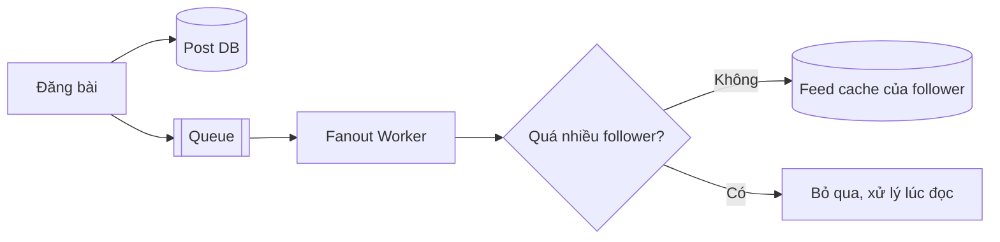
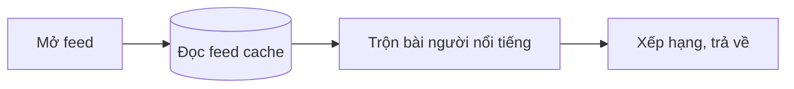
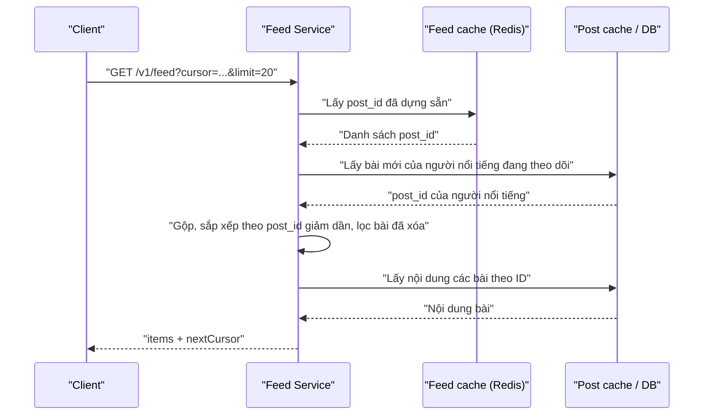
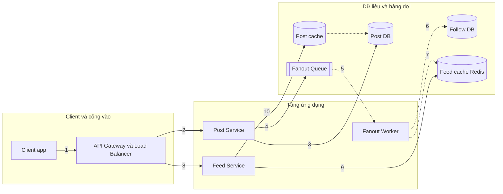

# News Feed (Bảng tin)

**Độ khó:** Medium

## News feed là gì?

News feed là màn hình chính kiểu Facebook: bạn mở app và thấy ngay bài mới của những người mình theo dõi, xếp theo thời gian hoặc theo độ liên quan. Quy mô của bài toán là hàng trăm triệu người dùng, mỗi người theo dõi hàng trăm tài khoản. Bài này dùng cho mạng xã hội, app tin tức, app chia sẻ ảnh. Nếu hệ thống chỉ hiển thị "bài mới nhất toàn hệ thống" (không cá nhân hóa theo người theo dõi) thì một truy vấn đơn giản là đủ, không cần thiết kế phức tạp như dưới đây.

**Tóm tắt:**

- News feed là bài toán chọn làm việc nhiều lúc ghi hay lúc đọc, vì đọc nhiều hơn đăng bài hàng chục lần.
- Fanout-on-write (push) chép `post_id` vào feed cache của từng follower lúc đăng: đọc rất nhanh, nhưng người nổi tiếng biến một bài thành hàng triệu lần ghi.
- Fanout-on-read (pull) chỉ lưu bài và gom lúc đọc: ghi rẻ, nhưng mỗi lần mở feed tốn nhiều truy vấn.
- Cách thực tế là lai: push cho người thường, pull cho người nổi tiếng rồi trộn hai nguồn khi đọc.
- Feed cache chỉ giữ danh sách `post_id` (khoảng 800 bài mới nhất), nội dung bài lấy riêng theo ID nên sửa hay xóa bài chỉ đổi ở một chỗ.
- Phân trang bằng cursor chứ không dùng offset, vì bài mới liên tục chen vào làm offset lệch trang và lặp bài.
- Fanout đi qua queue nên feed có thể trễ vài giây (eventual consistency), riêng bài của chính mình chèn thẳng vào feed (read-your-writes).
- Số liệu mẫu: khoảng 35.000 lượt đọc/giây, 140.000 lần ghi cache/giây, và một bài của người nổi tiếng là 20 triệu lần ghi.
- Kiến trúc gồm Gateway, Post Service, Feed Service, queue fanout với worker, feed cache, post cache, Post DB và Follow DB.

## Vấn đề cần giải quyết

Cách ngây thơ nhất là mỗi lần mở app, hệ thống truy vấn bài của hàng trăm người bạn theo dõi rồi trộn và sắp xếp lại. Cách này quá chậm vì tốn hàng trăm truy vấn cho mỗi lần mở feed, trong khi người dùng mở feed rất thường xuyên.

Cách ngược lại là dựng sẵn feed cho từng người ngay khi có bài mới. Cách này nhanh lúc đọc, nhưng gặp khó ở một chỗ: người nổi tiếng có hàng triệu follower, nên một bài đăng phải được ghi vào hàng triệu feed. Đây là bài kinh điển về đánh đổi giữa việc làm nhiều ở lúc ghi hay lúc đọc.

Hướng giải quyết thực tế là kết hợp. Với người thường, đăng bài xong là đẩy luôn vào feed đã dựng sẵn của từng follower (fanout-on-write). Với người có quá nhiều follower, không đẩy, đến lúc người đọc mở feed mới gom bài của họ (fanout-on-read). Feed lưu trong cache dưới dạng danh sách ID bài; nội dung bài được lấy riêng theo ID.

## Các khái niệm cần biết

- **Fanout**: "tỏa ra". Một bài đăng của một người phải được phân phối tới nhiều người nhận (các follower). Câu hỏi thiết kế là việc phân phối này làm lúc đăng hay lúc đọc.
- **Fanout-on-write (push)**: lúc đăng bài, hệ thống chép `post_id` vào feed cache của từng follower. Dùng khi đọc nhiều hơn ghi và mỗi tác giả có số follower vừa phải. Không dùng cho tài khoản có hàng triệu follower.
- **Fanout-on-read (pull)**: lúc đăng chỉ lưu bài; lúc đọc mới đi gom bài từ những người mình theo dõi. Dùng cho tác giả quá nổi tiếng hoặc người dùng ít hoạt động.
- **Feed cache**: danh sách `post_id` đã dựng sẵn cho mỗi người, thường là Redis sorted set hoặc list, giới hạn độ dài (ví dụ 800 bài mới nhất).
- **Cursor pagination**: phân trang bằng "mốc" (ví dụ `post_id` cuối đã trả) thay vì số thứ tự trang (offset). Dùng cho feed vì bài mới liên tục chen vào, offset sẽ làm lệch trang và lặp bài.
- **Read-your-writes**: người dùng phải thấy ngay bài mình vừa đăng, dù feed của người khác có thể trễ vài giây.
- **Idempotent**: thực hiện một thao tác nhiều lần cho kết quả như thực hiện một lần. Quan trọng khi worker bị giao lại message.

## Yêu cầu

- Đăng bài, theo dõi người khác, xem feed.
- Feed tải nhanh (dưới vài trăm mili giây), cho phép hơi trễ vài giây.

## Hai chiến lược

| | Fanout-on-write (push) | Fanout-on-read (pull) |
|---|---|---|
| Khi đăng | Ghi bài vào feed cache của từng người theo dõi | Chỉ lưu bài |
| Khi đọc | Đọc feed sẵn, rất nhanh | Gom bài từ những người mình theo dõi, chậm hơn |
| Vấn đề | Người nổi tiếng có hàng triệu người theo dõi, ghi rất nặng | Đọc nặng, tốn tính toán |

Chọn push khi lượng đọc lớn hơn ghi nhiều và số follower mỗi tác giả vừa phải; chọn pull khi tác giả có quá nhiều follower, vì push lúc đó biến một bài thành hàng triệu lần ghi. Hệ quả nếu chọn sai: dùng push cho người nổi tiếng thì queue fanout nghẽn và bài của người thường bị trễ theo; dùng pull cho mọi người thì mỗi lần mở feed tốn hàng trăm truy vấn và p99 tăng vọt.

Cách thường dùng: **push cho người dùng thường, pull cho người nổi tiếng**, rồi trộn hai nguồn khi đọc.

**Suy luận:** Gốc của bài toán là một bài đăng phải đến được rất nhiều người, nên tổng công việc không đổi, chỉ chọn làm lúc nào. Vì đọc feed nhiều hơn đăng bài rất nhiều lần, làm sẵn lúc ghi (push) trả giá một lần để mọi lần đọc sau gần như miễn phí, nên với tác giả có vài trăm follower thì push luôn có lợi. Nhưng chi phí push tỷ lệ thuận với số follower, nên một bài của tác giả 20 triệu follower thành 20 triệu lần ghi dồn vào queue fanout, và vì queue dùng chung nên bài của người thường xếp sau cũng bị trễ theo. Do đó phải có một ngưỡng follower (ví dụ 10.000) để chuyển tác giả đó sang pull, và chỗ dễ nhầm là ngưỡng thuộc về tác giả chứ không phải người đọc, nên người đọc buộc phải trộn hai nguồn mỗi khi mở feed. Cái giá của pull là đọc chậm hơn, nên cần cache danh sách bài gần nhất của người nổi tiếng thay vì truy vấn DB mỗi lần. Khi review, hãy hỏi hai câu: ngưỡng được chọn dựa trên số liệu nào, và queue fanout có được tách riêng cho tác giả lớn hay không.

**Phải thuộc:** Fanout-on-write (push): ghi bài vào feed cache của từng follower lúc đăng, đọc rất nhanh nhưng người nổi tiếng gây hàng triệu lần ghi. Fanout-on-read (pull): chỉ lưu bài, gom lúc đọc, chậm hơn. Thực tế dùng lai: push cho người thường, pull cho người nổi tiếng rồi trộn khi đọc.

**Nền tảng:** News feed là bài toán đánh đổi giữa làm việc nhiều lúc ghi hay lúc đọc. Vì đọc nhiều hơn đăng bài rất nhiều lần nên dựng sẵn feed lúc ghi là hợp lý, ngoại lệ là các tác giả có quá nhiều follower.

## Flowchart

Flow ghi: bài được lưu vào DB, sau đó một message được đưa vào queue để worker fanout xử lý async, nên người đăng không phải chờ.



Flow đọc: lấy danh sách đã dựng sẵn, trộn thêm bài của những người nổi tiếng mà user theo dõi rồi mới xếp hạng.



Để thấy rõ ai nói chuyện với ai khi người dùng mở feed, hãy xem sơ đồ trình tự sau.



Đọc sơ đồ: feed cache chỉ chứa ID nên rất nhẹ; nội dung bài được lấy ở bước cuối, thường từ cache bài đăng, nhờ vậy sửa hay xóa bài chỉ cần đổi ở một chỗ.

## Ước lượng

Giả định 300 triệu người dùng hoạt động mỗi ngày, mỗi người mở feed 10 lần, đăng 0,2 bài/ngày, trung bình 200 follower.

| Đại lượng | Tính | Kết quả |
|---|---|---|
| Đọc feed | 300 triệu x 10 / 86.400 | khoảng 35.000/giây (đỉnh x3: 100.000) |
| Bài mới | 300 triệu x 0,2 / 86.400 | khoảng 700/giây |
| Ghi fanout | 700 x 200 | khoảng 140.000 lần ghi cache/giây |
| Feed cache | 300 triệu x 800 post_id x 8 B | khoảng 2 TB (giữ 800 bài mới nhất mỗi người) |
| Người nổi tiếng | 1 bài x 20 triệu follower | 20 triệu lần ghi chỉ cho một bài |

Kết luận: đọc gấp 50 lần đăng nên dựng feed sẵn lúc ghi là đáng; nhưng một bài của người nổi tiếng đủ làm nghẽn queue fanout nên phải tách riêng.

## Kiến trúc tổng thể

Sơ đồ cho thấy đường ghi (đăng bài, fanout qua queue vào feed cache) và đường đọc (mở feed, trộn bài người nổi tiếng) cùng chạy trên một hệ thống.



**Chú thích sơ đồ**

| Thành phần | Vai trò | Vì sao chọn / đánh đổi |
|---|---|---|
| API Gateway và Load Balancer | Nhận request, xác thực, chia tải | Một điểm vào để rate limit và auth; đổi lại phải chạy nhiều bản để không thành điểm chết |
| Post Service | Nhận bài đăng, lưu DB, đẩy message fanout | Tách khỏi Feed Service vì đường ghi và đường đọc có tải rất khác nhau |
| Feed Service | Đọc feed cache, trộn bài người nổi tiếng, lọc, phân trang | Không trạng thái nên scale ngang dễ; đọc chiếm phần lớn tải |
| Post DB | Lưu nội dung bài, nguồn sự thật | Có thể shard theo `post_id` hoặc `author_id`; chậm hơn cache nên chỉ đọc khi cache miss |
| Follow DB | Lưu quan hệ theo dõi | Cần truy vấn theo cả hai chiều (ai theo dõi tôi, tôi theo dõi ai), nên đánh index cả hai |
| Fanout Queue | Tách việc fanout khỏi request đăng bài | Người đăng không phải chờ; đổi lại feed trễ vài giây (eventual consistency) |
| Fanout Worker | Đọc danh sách follower, ghi `post_id` vào feed cache | Bỏ qua tác giả vượt ngưỡng follower; phải idempotent vì message có thể giao lại |
| Feed cache Redis | Danh sách `post_id` dựng sẵn cho mỗi người | Đọc rất nhanh, chỉ giữ khoảng 800 ID nên nhẹ; mất node thì phải dựng lại |
| Post cache | Nội dung bài theo ID | Sửa hay xóa bài chỉ đổi một chỗ; cần chính sách invalidate |

1. Client gọi `POST /v1/posts` hoặc `GET /v1/feed` qua API Gateway.
2. Gateway chuyển request đăng bài tới Post Service.
3. Post Service ghi bài vào Post DB.
4. Post Service đưa message fanout vào queue rồi trả `201` ngay.
5. Fanout Worker lấy message từ queue (async).
6. Worker đọc danh sách follower của tác giả từ Follow DB.
7. Với tác giả dưới ngưỡng, worker ghi `post_id` vào feed cache của từng follower.
8. Khi mở feed, Gateway chuyển request tới Feed Service.
9. Feed Service đọc danh sách `post_id` từ feed cache và kéo thêm bài của người nổi tiếng.
10. Feed Service lấy nội dung bài theo ID từ Post cache; cache miss thì đọc Post DB.

**Điểm nghẽn:** Queue fanout và ghi feed cache nghẽn đầu tiên khi có tác giả lớn; xử lý bằng ngưỡng follower để chuyển sang pull và tách queue riêng cho tác giả lớn. Tiếp theo là Redis feed cache khi lượng đọc tăng; xử lý bằng shard theo `user_id` và thêm replica đọc.

## API và dữ liệu

```text
POST /v1/posts                          body: { "content": "..." }  -> 201 { "postId": 9123 }
POST /v1/users/{id}/follow              (idempotent: PUT thì tốt hơn POST)
GET  /v1/feed?cursor=<post_id>&limit=20 -> { "items": [...], "nextCursor": 9100 }
```

```text
posts(post_id PK tăng theo thời gian, author_id, content, created_at)
follows(follower_id, followee_id)  PK (follower_id, followee_id), index thêm (followee_id)
feed:{user_id}  -> Redis sorted set / list các post_id, cắt còn 800 phần tử
```

Cursor là `post_id` cuối đã trả (vì ID tăng theo thời gian): trang kế tiếp là `post_id < cursor`, không bị lệch khi có bài mới chen vào như offset.

**Suy luận:** Feed là danh sách luôn có phần tử mới chen vào đầu, nên vị trí của một bài tính theo số thứ tự thay đổi sau mỗi lần có bài mới. Với offset, trang 2 được định nghĩa là "bỏ 20 bài đầu", và nếu giữa hai lần tải có 3 bài mới chen vào thì 3 bài cuối của trang 1 bị đẩy sang trang 2, người dùng thấy bài lặp. Cursor tránh điều này vì mốc là chính `post_id` đã trả, không phụ thuộc có bao nhiêu bài đứng trước nó. Điều kiện để cursor đúng là `post_id` tăng theo thời gian, nhờ đó trang kế tiếp chỉ cần `post_id < cursor` và dùng được index, chi phí không đổi dù cuộn sâu. Điểm dễ nhầm là nghĩ cursor chỉ nhanh hơn, trong khi lý do chính là nó đúng khi dữ liệu thay đổi. Hệ quả là cursor không cho nhảy tới trang bất kỳ, điều chấp nhận được với feed vô hạn, còn trang quản trị cần nhảy trang thì vẫn dùng offset.

**Phải thuộc:** Feed cache chỉ lưu danh sách `post_id` (Redis sorted set hoặc list, cắt còn khoảng 800 bài mới nhất), nội dung bài lấy riêng theo ID. Phân trang bằng cursor chứ không dùng offset.

## Cơ chế lõi: fanout lai (Java, đã chạy thử)

```java
// Quy tắc: tác giả có > CELEBRITY_THRESHOLD follower thì KHÔNG fanout, người đọc tự kéo bài của họ.
static void publishPost(long author, long postId) {
    postsOf.computeIfAbsent(author, k -> new ArrayDeque<>()).addFirst(postId);
    List<Long> fs = followers.getOrDefault(author, List.of());
    // nổi tiếng: xử lý lúc đọc
    if (fs.size() > CELEBRITY_THRESHOLD) return;
    for (long f : fs) {                                // push vào feed đã dựng sẵn
        Deque<Long> d = feedCache.computeIfAbsent(f, k -> new ArrayDeque<>());
        d.addFirst(postId);
        if (d.size() > 800) d.removeLast();            // giới hạn độ dài feed cache
    }
}
static List<Long> readFeed(long user, int n) {
    List<Long> out = new ArrayList<>(feedCache.getOrDefault(user, new ArrayDeque<>()));
    // pull bài người nổi tiếng mà user theo dõi
    for (long star : follows(user))
        out.addAll(postsOf.getOrDefault(star, new ArrayDeque<>()));
    out.sort(Comparator.reverseOrder());               // post_id tăng theo thời gian
    return out.subList(0, Math.min(n, out.size()));
}
// Demo: người thường (bài 100, 102) + người nổi tiếng (bài 101) -> feed [102, 101, 100]
```

Các khai báo `followers`, `feedCache`, `postsOf`, `CELEBRITY_THRESHOLD` là các `Map` trong memory; ở hệ thống thật là bảng `follows`, Redis và bảng `posts`.

## Đào sâu

| Điểm khó | Vấn đề | Cách xử lý và đánh đổi |
|---|---|---|
| Người nổi tiếng | Một bài cần 20 triệu lần ghi | Pull lúc đọc cho tác giả vượt ngưỡng (ví dụ 10.000 follower); mất: đọc chậm hơn do phải trộn thêm nguồn, cần cache danh sách bài gần nhất của họ |
| Người dùng không hoạt động | Fanout cho tài khoản 6 tháng không mở app là phí | Chỉ fanout cho người hoạt động gần đây; người quay lại thì dựng feed lúc đọc rồi nạp cache |
| Xóa bài, bỏ theo dõi | Feed cache còn `post_id` cũ | Khi đọc lọc lại theo bài còn tồn tại và quan hệ theo dõi hiện tại, không quét xóa khắp cache |
| Tính mới và nhất quán | Fanout qua queue nên feed trễ vài giây | Chấp nhận eventual consistency; riêng bài của chính mình thì chèn thẳng vào feed của mình (read-your-writes) |

## Lỗi và giám sát

- Worker fanout chết giữa chừng: message ở queue được giao lại; ghi vào feed là idempotent (cùng `post_id` thêm hai lần không đổi gì nếu dùng sorted set).
- Mất node Redis: feed dựng lại từ bảng `follows` và `posts` (chậm, cần rate limiting dựng lại để khỏi sập DB).
- Theo dõi: độ trễ fanout (từ đăng bài tới có trong feed, p99), độ dài queue fanout, tỷ lệ trúng feed cache, p99 `GET /feed`.

## Điểm cần nhắc

- Feed cache lưu danh sách `post_id`, nội dung lấy riêng từ cache bài đăng.
- Phân trang bằng con trỏ (cursor), không dùng offset.
- Xếp hạng theo độ liên quan cần thêm dịch vụ ranking.

