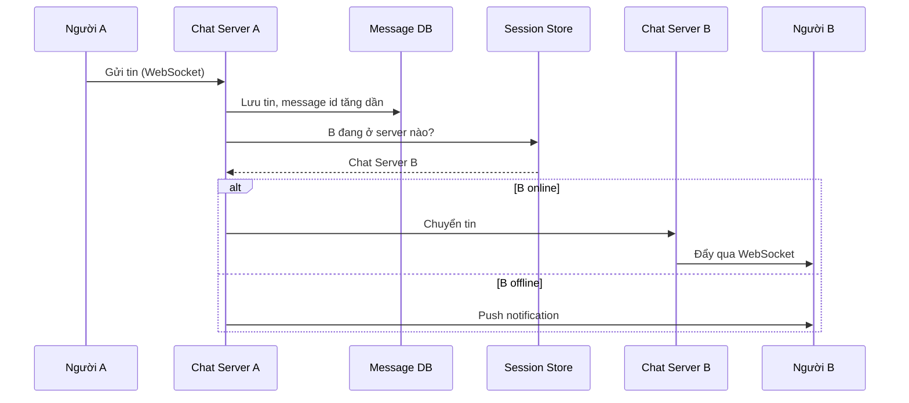
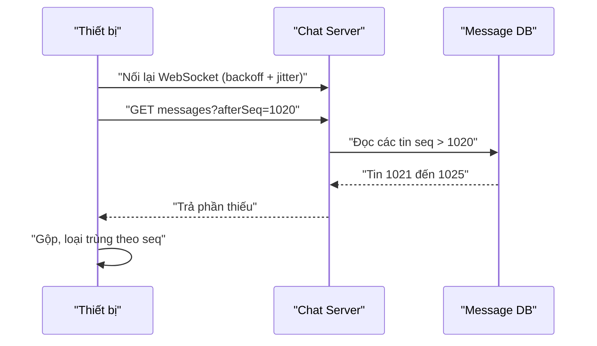
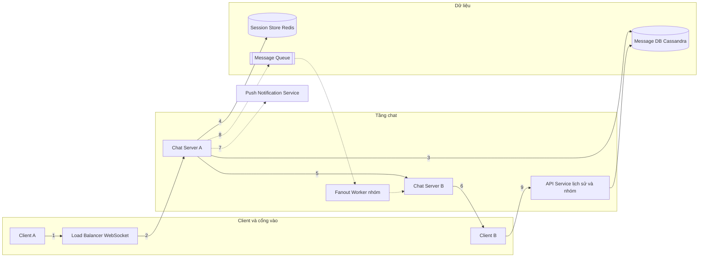

# Chat System (Hệ thống nhắn tin)

**Độ khó:** Medium

## Chat system là gì?

Đây là hệ thống kiểu Messenger hay Zalo: gửi và nhận tin nhắn gần như tức thì giữa hai người hoặc trong nhóm, với quy mô hàng chục triệu người online cùng lúc. Bạn dùng thiết kế này cho app nhắn tin, chat trong game, chat hỗ trợ khách hàng. Nếu chỉ cần cập nhật thỉnh thoảng (vài phút một lần) thì polling thường là đủ và không cần giữ kết nối lâu dài.

**Tóm tắt:**

- Chat cần server đẩy tin xuống client, nên dùng WebSocket (kết nối hai chiều giữ mở) thay vì polling.
- Hệ quả là chat server giữ state của từng kết nối, nên số concurrent connection (khoảng 50.000 mỗi máy) là bottleneck chứ không phải CPU.
- Session store (Redis) ánh xạ `user_id` sang chat server để định tuyến tin, với TTL theo heartbeat.
- Tin được lưu vào DB trước rồi mới chuyển đi, nên server chết hay người nhận offline cũng không mất tin; offline thì gửi push notification.
- Mỗi kênh có `seq` tăng dần riêng để sắp thứ tự và phát hiện thiếu tin; thiết bị nối lại gọi `afterSeq` để lấy phần thiếu.
- Giao at-least-once cộng `clientMsgId` do client sinh để loại trùng khi retry.
- Nối lại dùng backoff có jitter để hàng triệu máy không cùng nối lại một lúc.
- Lưu tin bằng NoSQL ghi nhiều (Cassandra) với partition theo `channel_id`; nhóm lớn thì fanout qua queue.
- Kiến trúc gồm load balancer WebSocket, chat server, session store, message DB, queue với worker fanout nhóm, push notification và API lịch sử.

## Vấn đề cần giải quyết

HTTP thông thường là mô hình client hỏi, server trả lời, nên server không tự đẩy tin tới máy người nhận được. Ngoài ra còn ba khó khăn nữa: kết nối của hàng triệu user phải được giữ mở cùng lúc, tin không được mất hay đảo thứ tự, và một người đọc trên nhiều thiết bị phải thấy cùng nội dung.

Cách giải quyết là để client giữ một kết nối WebSocket tới chat server. Tin đi qua server để định tuyến tới đúng kết nối của người nhận, nên hệ thống phải tra xem người đó đang nối vào server nào. Tin được lưu vào DB để các thiết bị sync với nhau, và nếu người nhận offline thì hệ thống đẩy push notification.

## Các khái niệm cần biết

- **WebSocket**: một kết nối TCP hai chiều, giữ mở lâu, bắt đầu bằng một HTTP request "nâng cấp" (upgrade). Sau đó cả client và server đều gửi được bất cứ lúc nào mà không cần hỏi lại. Dùng cho chat, game, dữ liệu thời gian thực.
- **Polling và long polling**: polling là client hỏi server đều đặn "có tin mới không?"; long polling là server giữ request đó cho tới khi có tin hoặc hết thời gian rồi client hỏi tiếp. Đơn giản nhưng tốn tài nguyên khi quy mô lớn.
- **Session store**: bảng tra `user_id -> chat server đang giữ kết nối`, thường là Redis. Cần vì có hàng nghìn chat server và server nhận tin chưa chắc là server giữ kết nối của người nhận.
- **Heartbeat**: tín hiệu nhỏ gửi định kỳ để báo "tôi còn sống". Dùng để xác định trạng thái online và để bản ghi session hết hạn khi kết nối chết (TTL).
- **seq (sequence number)**: số thứ tự tăng dần trong từng kênh. Dùng để sắp xếp tin, phát hiện thiếu tin, và để thiết bị nói "tôi đã có tới seq N, đưa phần sau".
- **At-least-once**: mỗi tin được giao ít nhất một lần, có thể trùng; để trùng không thành vấn đề, client gắn `clientMsgId` và server loại trùng.
- **Backoff có jitter**: khi nối lại, chờ lâu dần (1s, 2s, 4s...) cộng thêm độ lệch ngẫu nhiên để hàng triệu máy không nối lại cùng một khoảnh khắc.

## Yêu cầu

- Nhắn tin 1-1 và nhóm, trạng thái online, lịch sử tin nhắn, đa thiết bị.
- Tin nhắn không mất và đúng thứ tự trong mỗi cuộc trò chuyện.

## Giao thức

| Cách | Nhận xét |
|---|---|
| Polling | Đơn giản, lãng phí, trễ |
| Long polling | Đỡ lãng phí hơn, vẫn nặng |
| **WebSocket** | Kết nối hai chiều lâu dài, phù hợp nhất |

**Nền tảng:** HTTP là hỏi đáp nên server không tự đẩy tin tới client; chat dùng WebSocket (kết nối hai chiều giữ mở). Hệ quả là chat server phải giữ state kết nối của từng người, nên cần Session Store (user tới server) để định tuyến tin, và con số concurrent connection là bottleneck chính, không phải CPU.

WebSocket đổi lại sự nhanh và tiết kiệm bằng việc server phải giữ state cho từng kết nối (memory, counter, định tuyến). Vì vậy hãy dùng nó khi tin đến thường xuyên và cần độ trễ thấp; đừng dùng khi dữ liệu chỉ đổi vài phút một lần, vì giữ hàng triệu kết nối rảnh rỗi là lãng phí.

**Suy luận:** HTTP là hỏi đáp, nên muốn server đẩy tin tới người nhận thì phải giữ sẵn một kết nối mở, và đó là lý do WebSocket thắng polling. Nhưng kết nối mở nghĩa là server phải nhớ ai đang nối ở đâu, tức chat server trở thành tầng stateful. Vì có hàng nghìn chat server và tin của A có thể đến server khác với server đang giữ kết nối của B, nên bắt buộc có session store tra `user_id` sang server, và bản ghi này phải hết hạn theo heartbeat để kết nối chết không để lại dấu vết sai. Điểm dễ nhầm là nghĩ bottleneck là CPU: mỗi kết nối rảnh rỗi tốn khoảng 10 KB memory, nên giới hạn đến từ số kết nối trên mỗi máy, và ta scale bằng cách thêm máy chứ không phải máy mạnh hơn. Hệ quả khi review: tính số máy theo số kết nối, và mọi đường đi của tin phải chịu được việc session store trả về bản ghi cũ bằng cách rơi về đường offline thay vì làm mất tin.

## Flowchart: gửi tin nhắn 1-1

Sơ đồ dưới đây cho thấy đường đi của một tin từ người A tới người B. Điểm cần chú ý là tin được lưu trước rồi mới chuyển đi, nên dù B offline hay server chết giữa chừng, tin vẫn còn trong DB.



Đọc sơ đồ: bước lưu DB cấp `seq` cho tin; bước tra Session Store quyết định đi đường online (qua server của B) hay đường offline (push, B mở app sẽ kéo bằng `afterSeq`).

Còn khi một thiết bị vừa mất mạng rồi nối lại thì sao? Sơ đồ sau mô tả việc sync phần tin bị thiếu.



## Ước lượng

Giả định 100 triệu người dùng hoạt động mỗi ngày, 40 tin/người/ngày, tin trung bình 100 byte, 50 triệu concurrent connection lúc cao điểm.

| Đại lượng | Tính | Kết quả |
|---|---|---|
| Tin gửi | 100 triệu x 40 / 86.400 | khoảng 46.000/giây (đỉnh x3: 140.000) |
| Lưu trữ | 4 tỷ tin x 100 B | khoảng 400 GB/ngày, khoảng 150 TB/năm (chưa tính bản sao) |
| Memory kết nối | 50 triệu x khoảng 10 KB | khoảng 500 GB trải trên các chat server |
| Số chat server | 50 triệu / 50.000 kết nối mỗi máy (tùy cấu hình) | khoảng 1.000 máy |

Kết luận: bottleneck là số kết nối chứ không phải CPU; chat server phải là tầng giữ state kết nối, còn lưu trữ chọn kho ghi nhiều.

## Kiến trúc tổng thể

Sơ đồ thể hiện đường đi của một tin từ người gửi tới người nhận: kết nối WebSocket qua gateway, lưu DB, tra session store rồi chuyển qua chat server của người nhận, hoặc đi đường push nếu họ offline.



**Chú thích sơ đồ**

| Thành phần | Vai trò | Vì sao chọn / đánh đổi |
|---|---|---|
| Load Balancer WebSocket | Phân kết nối vào các chat server | Giữ kết nối lâu nên cần cân theo số kết nối, không theo request; đổi lại khó drain khi deploy |
| Chat Server | Giữ WebSocket, nhận tin, cấp `seq`, chuyển tin | Stateful nên số kết nối mỗi máy (khoảng 50.000) là giới hạn; scale bằng thêm máy |
| Session Store Redis | Ánh xạ `user_id` sang chat server | Tra cứu nhanh, TTL theo heartbeat; bản ghi có thể cũ nên phải có đường rơi về offline |
| Message DB Cassandra | Lưu tin theo `channel_id`, sắp theo `seq` | Ghi rất nhiều, partition tốt; đổi lại truy vấn linh hoạt kém |
| Message Queue | Tách fanout tin nhóm lớn | Chịu đột biến, retry được; thêm độ trễ nhỏ |
| Fanout Worker | Phân phối tin tới các chat server của thành viên online | Tách tải khỏi chat server gửi; phải idempotent |
| Push Notification Service | Báo cho thiết bị offline qua APNs hoặc FCM | Phụ thuộc bên thứ ba, không đảm bảo giao; chỉ là lời nhắc, dữ liệu thật vẫn lấy từ DB |
| API Service | Lịch sử tin, sync `afterSeq`, quản lý nhóm | Dùng HTTP thường nên dễ cache và scale, tách khỏi tầng kết nối |

1. Client A mở WebSocket và gửi tin qua Load Balancer.
2. Load Balancer chuyển tới Chat Server A đang giữ kết nối của A.
3. Chat Server A lưu tin vào Message DB và cấp `seq` cho kênh.
4. Chat Server A tra Session Store xem B đang ở server nào.
5. Nếu B online, Chat Server A chuyển tin sang Chat Server B.
6. Chat Server B đẩy tin tới B qua WebSocket.
7. Nếu B offline, gửi push notification (async); B mở app sẽ kéo phần thiếu.
8. Với nhóm lớn, tin được đưa vào queue rồi Fanout Worker chuyển tới các chat server (async).
9. B nối lại hoặc mở app thì gọi API Service với `afterSeq` để lấy tin còn thiếu từ Message DB.

**Điểm nghẽn:** Số kết nối trên mỗi chat server chạm trần trước; thêm máy và cân tải theo số kết nối. Tiếp theo là Session Store và partition nóng của kênh nhóm lớn; shard Redis theo `user_id` và đẩy fanout nhóm lớn qua queue hoặc để client kéo theo `seq`.

## API và dữ liệu

```text
WebSocket:  wss://chat.example.com/ws?token=...
  client -> server: { "type":"send", "channelId":77, "clientMsgId":"uuid", "text":"..." }
  server -> client: { "type":"ack", "clientMsgId":"uuid", "seq":1024 }
                    { "type":"msg", "channelId":77, "seq":1025, "from":5, "text":"..." }
REST:  GET /v1/channels/77/messages?afterSeq=1020&limit=50    (sync lại, tải lịch sử)
```

```text
-- Cassandra (CQL): một partition là một kênh, sắp theo seq giảm dần để lấy tin mới nhất nhanh
CREATE TABLE messages (
  channel_id bigint, seq bigint, sender_id bigint, body text,
  PRIMARY KEY ((channel_id), seq)
) WITH CLUSTERING ORDER BY (seq DESC);
```

Nhóm lớn có partition rất lớn thì thêm bucket theo thời gian vào partition key: `(channel_id, bucket_thang)`.

## Cơ chế lõi: seq theo kênh và chống gửi trùng (Java, đã chạy thử)

**Phải thuộc:** Thứ tự tin nhắn chỉ cần đúng trong từng kênh nên mỗi kênh có `seq` tăng dần riêng; `clientMsgId` do client sinh để loại trùng khi retry (giao at-least-once); thiết bị nối lại thì sync phần thiếu bằng `afterSeq`. Tin lưu vào DB trước rồi mới chuyển đi, người nhận offline thì nhận push notification.

Thứ tự chỉ cần đúng **trong từng kênh**, nên mỗi kênh có counter `seq` riêng; `clientMsgId` do client sinh để retry không tạo tin thứ hai.

**Suy luận:** Người dùng chỉ cảm nhận thứ tự trong từng cuộc trò chuyện, nên hệ thống không cần thứ tự toàn cục, và bỏ yêu cầu đó là điều cho phép nó scale. Vì vậy mỗi kênh có `seq` riêng, cấp tại một nơi duy nhất cho kênh đó (shard theo `channel_id`), nên không cần đồng bộ giữa các máy. Mạng có thể làm mất ACK, nên client buộc phải gửi lại, và đó là lý do giao tin là at-least-once chứ không thể exactly-once. Gửi lại thì sinh tin trùng, nên cần `clientMsgId` để server nhận ra và trả `seq` cũ thay vì lưu lần hai. Điểm dễ nhầm là dùng timestamp để sắp xếp: đồng hồ các máy lệch nhau nên hai tin có thể đảo thứ tự, còn `seq` tăng đơn điệu trong kênh. `seq` còn cho thiết bị phát hiện thiếu tin khi thấy số nhảy cách, rồi kéo bù bằng `afterSeq`.

```java
static class Channel {
    long seq = 0;                                       // số thứ tự tăng dần trong kênh
    List<Msg> log = new ArrayList<>();
    Map<String, Long> seqByClientMsgId = new HashMap<>();          // clientMsgId -> seq
    synchronized long send(String clientMsgId, String text) {
        Long existing = seqByClientMsgId.get(clientMsgId);
        // client retry do mất ACK: trả seq cũ, không lưu lại
        if (existing != null) return existing;
        long s = ++seq;
        log.add(new Msg(s, text));
        seqByClientMsgId.put(clientMsgId, s);
        return s;
    }
    synchronized List<Msg> sync(long lastSeq) {       // thiết bị báo seq cuối đã có
        // seq bắt đầu từ 1
        return new ArrayList<>(log.subList((int) lastSeq, log.size()));
    }
}
// Gửi "a1", "a2", "a2" (trùng) -> log có 2 tin; sync(1) trả về tin seq 2.
```

Ở hệ thống thật, `seq` cấp bằng một nút duy nhất mỗi kênh (shard theo `channel_id`) hoặc `INCR` trên Redis; đa thiết bị sync bằng `afterSeq`, mỗi thiết bị nhớ `seq` cuối của mình.

## Đào sâu

| Điểm khó | Vấn đề | Cách xử lý và đánh đổi |
|---|---|---|
| Định tuyến khi nhiều chat server | B nối vào server nào? | Session store (Redis) `user_id -> server_id`, TTL theo heartbeat (ví dụ 30 giây). Mất: bản ghi có thể cũ, nên server nhận tin mà không thấy B thì rơi về đường offline (lưu và push) chứ không mất tin |
| Nhóm lớn | Gửi một tin tới 10.000 thành viên | Đẩy một event vào queue, worker fanout tới các server theo danh sách thành viên đang online; nhóm cực lớn thì client kéo theo `seq` thay vì đẩy |
| Đảm bảo giao | Mạng chập chờn, ACK mất | At-least-once: client giữ tin chưa ACK và gửi lại cùng `clientMsgId`; client nhận loại trùng theo `seq` |

## Lỗi và giám sát

- Chat server chết: client tự nối lại (backoff có jitter, tránh cả triệu máy nối lại cùng lúc), rồi gọi `afterSeq` để lấy phần thiếu.
- Mất đúng thứ tự: client thấy `seq` nhảy cách thì chủ động kéo phần thiếu.
- Theo dõi: số kết nối mỗi server, p99 từ lúc gửi tới lúc nhận, tỷ lệ tin phải qua đường offline, tốc độ nối lại.

## Điểm cần nhắc

- Lưu tin nhắn bằng NoSQL ghi nhiều (Cassandra, HBase), key theo `channel_id` và `message_id`.
- Session Store (Redis) lưu người dùng đang kết nối vào server nào.
- Trạng thái online dùng heartbeat định kỳ.
- Nhóm lớn: chuyển tin qua message queue để fanout.

