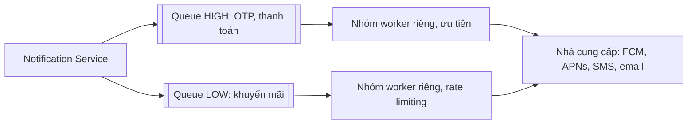
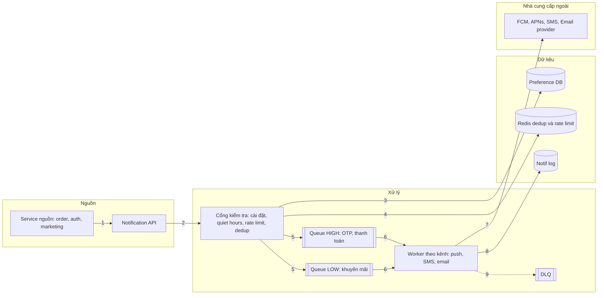

# Notification System (Hệ thống thông báo)

**Độ khó:** Medium

## Notification system là gì?

Đây là một chỗ chung để mọi service gửi thông báo tới người dùng qua nhiều kênh: push, SMS, email, in-app. Quy mô có thể là hàng chục triệu thông báo mỗi ngày. Bạn cần nó khi có nhiều service cùng phải gửi (xác nhận đơn hàng, OTP, nhắc lịch, khuyến mãi). Một app nhỏ chỉ gửi vài email thì gọi thẳng nhà cung cấp là đủ, chưa cần dựng cả hệ thống.

**Tóm tắt:**

- Gom việc gửi về một dịch vụ trung tâm: service nguồn chỉ đẩy event vào queue rồi quay về, worker theo từng kênh lo phần còn lại.
- Trước khi vào queue, event qua cổng kiểm tra: cài đặt người dùng, quiet hours, rate limiting và kiểm tra trùng.
- Nhà cung cấp ngoài không đảm bảo chính xác một lần, nên mặc định là at-least-once cộng consumer idempotent dựa trên `eventId`.
- Retry dùng exponential backoff có jitter, hết lượt thì vào DLQ để không chặn queue chính.
- Tách queue theo mức ưu tiên (OTP và thanh toán cao hơn khuyến mãi) với nhóm worker riêng, để chiến dịch hàng loạt không làm OTP chờ.
- Một nhà cung cấp lỗi liên tục thì dùng circuit breaker và chuyển sang nhà cung cấp dự phòng.
- Device token bị FCM hoặc APNs báo không hợp lệ thì xóa, không retry.
- Tải trung bình thấp (khoảng 580/giây) nhưng đỉnh chiến dịch gấp khoảng 30 lần.
- Kiến trúc gồm Notification API, cổng kiểm tra, queue HIGH và LOW, worker theo kênh, DLQ, Notif log và nhà cung cấp ngoài.

## Vấn đề cần giải quyết

Nếu mỗi service tự gọi FCM, APNs hay nhà cung cấp SMS thì code bị lặp khắp nơi. Khi nhà cung cấp lỗi là mất tin, và không ai kiểm soát được việc gửi trùng hay spam. Còn phải lo thêm độ ưu tiên (OTP gấp hơn khuyến mãi nhiều) và cài đặt "tắt thông báo" của người dùng.

Cách giải quyết là gom về một dịch vụ trung tâm. Service nguồn chỉ đẩy một event vào queue rồi quay về làm việc khác. Worker theo từng kênh lấy event ra, kiểm tra cài đặt người dùng và giới hạn tần suất, gọi nhà cung cấp, và retry khi lỗi. Dùng id event để chống gửi trùng và ghi log trạng thái để truy vết.

**Nền tảng:** Gom việc gửi về một dịch vụ trung tâm và tách rời bằng queue: service nguồn chỉ đẩy event rồi quay về, worker theo từng kênh lo kiểm tra cài đặt, gọi nhà cung cấp và retry. Nhà cung cấp bên ngoài không thể đảm bảo chính xác một lần, nên mặc định là at-least-once cộng consumer idempotent.

## Các khái niệm cần biết

- **FCM và APNs**: dịch vụ push của Google (Firebase Cloud Messaging) cho Android và của Apple (Apple Push Notification service) cho iOS. App muốn đẩy thông báo phải gửi qua họ, kèm token của từng thiết bị.
- **Device token**: mã định danh một thiết bị với FCM/APNs. Có thể hết hạn hoặc bị vô hiệu hóa; khi nhà cung cấp báo token không hợp lệ thì phải xóa, không retry.
- **Idempotency key**: key gắn với một thao tác (ở đây là `eventId`) để làm lại nhiều lần vẫn chỉ có một tác dụng. Dùng khi retry hoặc khi message bị giao lại.
- **At-least-once**: đảm bảo tin được xử lý ít nhất một lần; có thể trùng, nên consumer phải idempotent.
- **Exponential backoff và jitter**: chờ lâu gấp đôi sau mỗi lần thất bại (1s, 2s, 4s...), có trần, cộng thêm độ lệch ngẫu nhiên để các worker không cùng retry một lúc.
- **DLQ (dead-letter queue)**: queue chứa các message đã hết lượt retry mà vẫn lỗi, để con người hoặc công cụ xử lý sau thay vì kẹt queue chính.
- **Circuit breaker**: khi một nhà cung cấp lỗi liên tục thì tạm ngừng gọi (hoặc chuyển sang dự phòng) thay vì dồn thêm yêu cầu vào chỗ đang hỏng.
- **Quiet hours**: khung giờ người dùng không muốn bị làm phiền (`quiet_from`, `quiet_to`).

## Flowchart

Sơ đồ tổng quát nằm ở mục Kiến trúc tổng thể phía trên. Cổng "Được phép gửi?" gồm cài đặt người dùng, quiet hours, giới hạn tần suất và kiểm tra trùng. Chỉ thông báo qua được cổng mới tốn tài nguyên của queue và nhà cung cấp. Nhánh lỗi dùng retry có backoff, hết lượt thì vào DLQ để không chặn các thông báo khác.

Để hiểu vì sao OTP không bị chiến dịch khuyến mãi làm chậm, hãy xem cách tách queue theo ưu tiên.



Hai nhóm worker độc lập nên 10 triệu push khuyến mãi có xếp hàng dài đến đâu cũng không làm OTP phải chờ.

**Suy luận:** Tải thông báo rất gập ghềnh: trung bình khoảng 580/giây nhưng một chiến dịch khuyến mãi đẩy tới 17.000/giây trong 10 phút. Nếu mọi loại dùng chung một queue và một nhóm worker thì 10 triệu push khuyến mãi xếp trước sẽ làm OTP chờ hàng chục phút, mà OTP chờ quá một phút là vô dụng vì người dùng đã bỏ cuộc. Tách queue theo ưu tiên chưa đủ nếu vẫn chung worker, vì worker đang bận với khuyến mãi không rảnh để lấy OTP, nên phải tách cả nhóm worker để cô lập tài nguyên. Nhóm LOW thì rate limiting theo từng nhà cung cấp, vì APNs và FCM sẽ throttle nếu bị dồn dập. Điểm dễ nhầm là nghĩ đặt trường priority trong cùng một queue là đủ; với queue FIFO thông thường nó không đảm bảo cô lập. Hệ quả khi thiết kế: mỗi mức ưu tiên và mỗi kênh có queue riêng, và theo dõi độ sâu từng queue để phát hiện sớm khi nhóm LOW kéo dài.

## Ước lượng

Giả định 50 triệu thông báo/ngày: 10% OTP và thanh toán, 30% push, 40% email, 20% in-app.

| Đại lượng | Tính | Kết quả |
|---|---|---|
| Trung bình | 50 triệu / 86.400 | khoảng 580/giây |
| Chiến dịch khuyến mãi | 10 triệu push gửi trong 10 phút | khoảng 17.000/giây, gấp 30 lần trung bình |
| Nhật ký trạng thái | 50 triệu x 200 B | khoảng 10 GB/ngày, giữ 30 ngày: khoảng 300 GB |

Kết luận: tải trung bình thấp nhưng rất gập ghềnh; chiến dịch hàng loạt không được chặn OTP, nên cần queue tách theo ưu tiên và rate limiting theo nhà cung cấp.

## Kiến trúc tổng thể

Sơ đồ thể hiện đường đi của một thông báo từ service nguồn qua cổng kiểm tra, queue tách theo ưu tiên, worker từng kênh tới nhà cung cấp ngoài, cùng nhánh retry và DLQ.



**Chú thích sơ đồ**

| Thành phần | Vai trò | Vì sao chọn / đánh đổi |
|---|---|---|
| Notification API | Điểm vào duy nhất cho mọi service nguồn | Gom logic về một chỗ; đổi lại là điểm phụ thuộc chung, cần chạy nhiều bản |
| Cổng kiểm tra | Quyết định có được gửi không | Chặn sớm để khỏi tốn queue và nhà cung cấp; phải tra nhiều nguồn nên cần cache |
| Preference DB | Cài đặt kênh, quiet hours, device token | Nhỏ, đọc nhiều, cache được; token cũ phải dọn khi nhà cung cấp báo lỗi |
| Redis dedup và rate limit | Khóa `eventId` và đếm tần suất | Nhanh, có TTL; mất dữ liệu thì có thể gửi trùng nên consumer vẫn phải idempotent |
| Queue HIGH và LOW | Tách ưu tiên, đệm đỉnh chiến dịch | Cô lập OTP khỏi khuyến mãi; thêm số queue cần vận hành |
| Worker theo kênh | Gọi nhà cung cấp, retry có backoff | Scale riêng từng kênh; gọi ngoài chậm nên cần timeout và circuit breaker |
| DLQ | Giữ message hết lượt retry | Không chặn queue chính; cần người hoặc job xử lý lại |
| Notif log | Trạng thái gửi, khóa `(event_id, channel)` | Rào chống gửi trùng và phục vụ tra cứu; tăng nhanh nên cần TTL |
| Nhà cung cấp ngoài | Giao thật tới thiết bị hoặc hộp thư | Không đảm bảo exactly-once, có giới hạn tần suất; cần nhà cung cấp dự phòng |

1. Service nguồn gọi Notification API với `eventId`, loại thông báo và người nhận.
2. API chuyển event vào cổng kiểm tra.
3. Cổng đọc cài đặt người dùng và quiet hours từ Preference DB.
4. Cổng kiểm tra trùng và rate limit bằng Redis; không qua thì bỏ và ghi log.
5. Event qua cổng được đưa vào queue HIGH hoặc LOW theo loại, rồi API trả về ngay.
6. Worker của từng kênh lấy message từ queue.
7. Worker gọi nhà cung cấp ngoài.
8. Worker ghi trạng thái vào Notif log.
9. Gửi lỗi hết lượt retry thì message vào DLQ (async).

**Điểm nghẽn:** Queue LOW và rate limit của nhà cung cấp nghẽn đầu tiên khi có chiến dịch lớn; xử lý bằng worker riêng, rate limiting theo nhà cung cấp và co giãn số worker theo độ sâu queue. Tiếp theo là Preference DB và Redis khi cổng kiểm tra bị gọi dồn; xử lý bằng cache và shard theo `user_id`.

## API và dữ liệu

```text
POST /v1/notifications
  body: { "eventId": "order-9-paid", "userId": 42, "template": "order_paid",
          "params": {"orderNo": "9"}, "priority": "HIGH", "channels": ["PUSH","EMAIL"] }
  -> 202 Accepted { "notificationId": "..." }       (nhận rồi mới xử lý, không chờ gửi xong)
```

```text
user_prefs(user_id, channel, enabled, quiet_from, quiet_to)
device_tokens(user_id, token, platform, updated_at)
notif_log(event_id, channel) PK (event_id, channel), status, attempts, updated_at
```

Primary key `(event_id, channel)` của `notif_log` chính là rào chống gửi trùng.

**Phải thuộc:** Chống gửi trùng bằng `eventId` làm idempotency key (unique key theo event và kênh). Retry bằng exponential backoff có jitter, hết lượt thì vào DLQ. Tách queue theo mức ưu tiên (OTP và thanh toán cao hơn khuyến mãi) với nhóm worker riêng. Token thiết bị bị báo không hợp lệ thì xóa, không retry.

**Suy luận:** Gọi nhà cung cấp ngoài (FCM, APNs, SMS) vừa chậm vừa có thể lỗi, nên nếu service nguồn gọi thẳng thì nó bị kéo chậm theo và mất tin khi nhà cung cấp lỗi; đặt queue ở giữa tách hai bên về thời gian. Khi đã có queue và retry thì có một tình huống không tránh được: nhà cung cấp đã nhận tin nhưng ACK bị mất, worker gửi lại và người dùng nhận hai thông báo. Vì không thể phân biệt "chưa nhận" với "nhận rồi nhưng ACK mất", không tồn tại chính xác một lần với dịch vụ ngoài, và ta chỉ chọn được giữa mất tin (at-most-once) và trùng tin (at-least-once). OTP chấp nhận trùng hơn mất, khuyến mãi thì ngược lại, nên mức đảm bảo là quyết định theo từng loại thông báo. Cách làm cho trùng trở nên vô hại là unique key `(event_id, channel)` trong `notif_log`, nên lần xử lý thứ hai thấy bản ghi và bỏ qua. Điểm dễ nhầm là ghi dấu "đã gửi" trước khi gửi thật: nếu worker chết ở giữa thì thông báo mất vĩnh viễn, nên khi hết lượt retry phải nhả dấu đó trước khi chuyển sang DLQ.

## Cơ chế lõi: consumer idempotent, retry có backoff (Java, đã chạy thử)

```java
// thật: Redis SET NX có TTL hoặc unique key trong DB
static Set<String> sent = new HashSet<>();

// backoff mũ có trần và jitter: khoảng 1s, 2s, 4s ... tối đa 60s
static long backoffMs(int attempt) {
    return (long) (Math.min(60000, 1000L << attempt) * (0.5 + Math.random() / 2));
}
static String process(String eventId, boolean userMuted) {
    if (userMuted) return "SKIPPED";               // tôn trọng cài đặt người dùng
    // add trả false: đã xử lý, bỏ qua
    if (!sent.add(eventId)) return "DUPLICATE";
    for (int attempt = 0; attempt < 5; attempt++) {
        if (provider(eventId)) return "SENT after " + (attempt + 1) + " attempts";
        // thật: Thread.sleep(backoffMs(attempt)) hoặc đẩy vào delay queue rồi giải phóng worker
    }
    // hết lượt: nhả dấu đã xử lý, chuyển sang DLQ
    sent.remove(eventId);
    return "DLQ";
}
// Nhà cung cấp lỗi 2 lần đầu: "SENT after 3 attempts"; nhận lặp cùng eventId: "DUPLICATE"
```

## Đào sâu

| Điểm khó | Vấn đề | Cách xử lý và đánh đổi |
|---|---|---|
| Gửi trùng so với mất | Retry có thể gửi hai lần nếu nhà cung cấp đã nhận nhưng ACK mất | Không thể chính xác một lần với dịch vụ ngoài; chọn at-least-once và truyền `eventId` làm idempotency key cho nhà cung cấp nếu họ hỗ trợ. OTP chấp nhận trùng hơn mất; khuyến mãi chấp nhận mất hơn trùng |
| Ưu tiên và cô lập | Chiến dịch 10 triệu push làm OTP chờ | Queue riêng cho từng mức ưu tiên và từng kênh, nhóm worker riêng; rate limiting theo nhà cung cấp (APNs, FCM, SMS gateway) |
| Nhà cung cấp lỗi | Một nhà cung cấp SMS sập | Circuit breaker rồi chuyển sang nhà cung cấp dự phòng; email và push chạy độc lập |

## Lỗi và giám sát

- Token thiết bị hết hạn (FCM/APNs trả lỗi không hợp lệ): xóa token, không retry.
- Worker chết giữa chừng: message chưa ack được giao lại, nhờ idempotent nên an toàn.
- Theo dõi: độ sâu từng queue, độ trễ từ nhận tới gửi theo mức ưu tiên, tỷ lệ thành công từng kênh và nhà cung cấp, kích thước DLQ, tỷ lệ bị chặn do cài đặt người dùng.

## Điểm cần nhắc

- Chống gửi trùng bằng id event và consumer idempotent.
- Tách queue theo mức ưu tiên (OTP cao hơn khuyến mãi).
- Mẫu thông báo (template) và đa ngôn ngữ lưu riêng.
- Theo dõi tỷ lệ gửi thành công, độ trễ.

