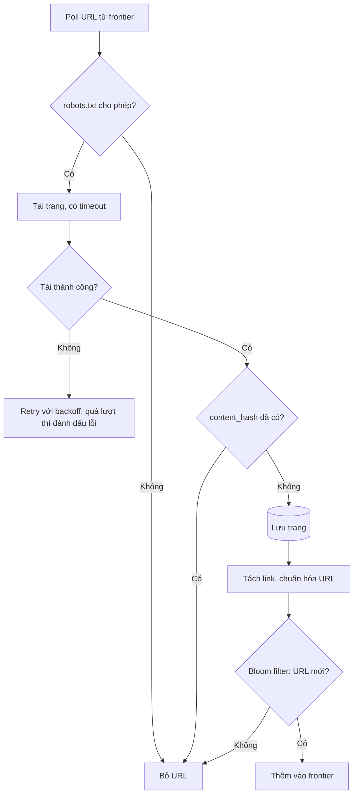
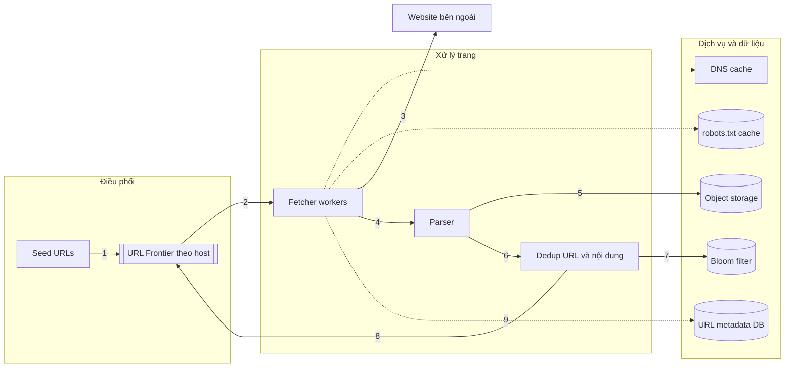

# Web Crawler (Trình thu thập web)

**Độ khó:** Medium

## Web crawler là gì?

Web crawler là chương trình tự đi duyệt web: tải một trang, lấy các link trong đó, rồi đi tiếp theo các link mới. Ở quy mô công cụ tìm kiếm, nó phải xử lý hàng tỷ trang và tải song song liên tục. Bạn dùng crawler cho công cụ tìm kiếm, lưu trữ web, theo dõi giá, hay thu thập dữ liệu huấn luyện. Nếu site đã có API hoặc file dữ liệu công khai thì dùng cái đó, đỡ phải crawl.

**Tóm tắt:**

- Crawler là duyệt đồ thị web có kiểm soát: lấy URL từ URL frontier, tải, phân tích, lưu, rồi đưa link mới quay lại frontier.
- Frontier không chỉ là queue đơn giản: mỗi host một hàng riêng kèm lịch nghỉ giữa các lần tải để giữ politeness.
- Luôn đọc và cache `robots.txt`, đồng thời rate limiting theo từng domain để không vô tình tấn công site.
- Loại trùng ở hai mức: URL (chuẩn hóa rồi Bloom filter, trước khi vào frontier) và nội dung (content hash hoặc SimHash, sau khi tải).
- Bloom filter cho biết "chắc chắn chưa có" hoặc "có thể đã có": tốn rất ít memory nhưng có sai dương tính và không xóa được phần tử.
- Tránh spider trap bằng giới hạn độ sâu và số URL mỗi host.
- Bottleneck là băng thông (khoảng 200 MB/giây cho 400 trang/giây) và 50 tỷ lượt kiểm tra trùng, nên phải kiểm tra trong memory chứ không gọi DB từng URL.
- Worker chết thì URL quá hạn lease được giao lại, nên frontier phải lưu bền.
- Kiến trúc gồm URL frontier theo host, fetcher, parser, dedup với Bloom filter, cache DNS và robots.txt, metadata DB và object storage.

## Vấn đề cần giải quyết

Web quá lớn và lộn xộn. Cùng một trang có thể có nhiều URL, các link tạo thành vòng lặp, có những trang "bẫy" sinh link vô hạn, và nếu dồn dập request vào một site thì bạn vô tình tấn công nó. Khó khăn thật sự là chạy nhanh mà vẫn lịch sự, và không làm đi làm lại cùng một trang.

Cách giải quyết là một vòng lặp có kiểm soát. Lấy URL từ queue (URL frontier), tải trang, phân tích, loại trùng cả URL lẫn nội dung (bằng Bloom filter hoặc hash), lưu lại, rồi thêm link mới vào queue. Xuyên suốt vòng lặp, crawler tôn trọng `robots.txt` và rate limiting theo từng domain.

**Nền tảng:** Web là một đồ thị khổng lồ và lộn xộn (link tạo vòng lặp, một trang có nhiều URL, có bẫy vô hạn), nên crawler là bài toán duyệt đồ thị có kiểm soát: một frontier quyết định tải gì kế tiếp, loại trùng ở hai mức (URL và nội dung), và luôn lịch sự với từng host.

## Các khái niệm cần biết

- **Seed URL**: tập URL khởi đầu mà crawler bắt đầu đi từ đó.
- **URL Frontier**: không chỉ là một queue đơn giản; nó quyết định URL nào được tải tiếp theo, dựa trên độ ưu tiên và việc mỗi host phải được nghỉ giữa các lần tải.
- **robots.txt**: file ở gốc site (ví dụ `https://example.com/robots.txt`) khai báo những đường dẫn crawler không được vào và đôi khi cả khoảng nghỉ (`Crawl-delay`). Crawler lịch sự luôn đọc và cache nó.
- **Politeness**: nguyên tắc không tải quá nhanh từ một host. Nếu sai, site bị quá tải, chặn IP của bạn, hoặc tệ hơn.
- **Bloom filter**: cấu trúc dữ liệu xác suất cho biết một phần tử "chắc chắn chưa có" hoặc "có thể đã có". Dùng khi cần kiểm tra trùng hàng chục tỷ mục trong RAM; không phù hợp khi không chấp nhận sai dương tính hoặc cần xóa phần tử.
- **Content hash và SimHash**: hash nội dung trang để phát hiện trang giống hệt nhau ở nhiều URL; SimHash cho phép phát hiện trang gần giống nhau.
- **URL canonicalization**: đưa các URL khác dạng nhưng cùng một trang về một dạng (bỏ fragment, sắp tham số, chữ thường tên host).
- **Spider trap**: cấu trúc sinh URL vô hạn (ví dụ lịch có link "tháng sau" mãi mãi).
- **Lease**: quyền "mượn" một URL trong thời gian giới hạn; hết hạn mà chưa xong thì URL được giao cho worker khác.

## Thành phần

- **URL Frontier:** queue URL cần duyệt, có ưu tiên và giới hạn theo từng domain.
- **Downloader:** tải trang (DNS cache, timeout).
- **Parser:** trích nội dung và liên kết.
- **Dedup:** loại URL đã duyệt (Bloom filter) và nội dung trùng (hash).
- **Storage:** lưu nội dung đã thu thập.

## Flowchart

Sơ đồ vòng lặp tổng quát nằm ở mục Kiến trúc tổng thể. Sơ đồ sau chi tiết hóa vòng đời của một URL.



**Phải thuộc:** Vòng lặp crawler: seed vào URL frontier, tải (tôn trọng `robots.txt` và rate limiting theo host), phân tích, loại trùng, lưu, đưa link mới vào frontier. Loại trùng URL bằng Bloom filter (sai dương tính nhỏ, không xóa được) và trùng nội dung bằng content hash hoặc SimHash. Tránh bẫy vô hạn bằng giới hạn độ sâu.

Đọc sơ đồ: có hai chặn loại trùng ở hai thời điểm khác nhau. Trùng nội dung được kiểm tra sau khi tải (vì chỉ biết nội dung sau khi tải), còn trùng URL được kiểm tra trước khi đưa vào frontier để khỏi tải lại ngay từ đầu.

## Ước lượng

Giả định thu thập 1 tỷ trang mỗi tháng, trang trung bình 500 KB (HTML), mỗi trang chứa khoảng 50 link.

| Đại lượng | Tính | Kết quả |
|---|---|---|
| Tốc độ tải | 1 tỷ / (30 x 86.400) | khoảng 400 trang/giây (đỉnh x2: 800) |
| Băng thông | 400 x 500 KB | khoảng 200 MB/giây, khoảng 1,6 Gbit/giây |
| Lưu trữ (nén khoảng 3 lần) | 1 tỷ x 500 KB / 3 | khoảng 170 TB/tháng |
| URL cần kiểm tra trùng | 1 tỷ x 50 | khoảng 50 tỷ lượt kiểm tra/tháng |
| Bloom filter cho 10 tỷ URL, sai số 1% | khoảng 9,6 bit mỗi URL | khoảng 12 GB |
| Số worker tải | 400/giây x 0,5 giây mỗi lần tải | khoảng 200 thread chạy đồng thời (thực tế nhiều hơn do chờ DNS, mạng chậm) |

Kết luận: băng thông và loại trùng là bottleneck chính; kiểm tra trùng 50 tỷ lượt phải làm trong memory (Bloom filter), không gọi DB từng URL.

## Kiến trúc tổng thể

Sơ đồ thể hiện vòng lặp của crawler phân tán: seed vào URL frontier, fetcher tải trang, parser tách nội dung và link, dedup loại trùng rồi link mới quay về frontier.



**Chú thích sơ đồ**

| Thành phần | Vai trò | Vì sao chọn / đánh đổi |
|---|---|---|
| URL Frontier | Hàng đợi URL, mỗi host một hàng, có ưu tiên và lịch nghỉ | Giữ politeness; phức tạp hơn queue thường và phải lưu bền để không mất việc |
| Fetcher workers | Tải trang với timeout, retry | Scale ngang theo băng thông; phần lớn thời gian chờ mạng nên cần nhiều thread |
| DNS cache | Cache kết quả phân giải tên miền | DNS thường là điểm chậm; đổi lại có thể cũ khi site đổi IP |
| robots.txt cache | Lưu luật được phép crawl theo host | Tuân thủ quy ước và tránh tải lại; phải có TTL để cập nhật luật mới |
| Parser | Tách nội dung và link, chuẩn hóa URL | Tốn CPU; tách khỏi fetcher để scale riêng |
| Dedup | Loại trùng URL và nội dung | Bloom filter tiết kiệm memory nhưng có sai dương tính và không xóa được |
| Bloom filter | Kiểm tra URL đã thấy trong memory | Tránh 50 tỷ lượt gọi DB; có thể bỏ sót một ít URL mới |
| URL metadata DB | Trạng thái, lần crawl cuối, content hash | Phục vụ re-crawl theo lịch; phải shard theo host khi lớn |
| Object storage | Lưu HTML đã tải, nén | Rẻ cho hàng trăm TB; không truy vấn linh hoạt |
| Website bên ngoài | Nguồn dữ liệu | Có thể chậm, lỗi hoặc chặn; cần rate limiting theo domain |

1. Seed URLs được nạp vào URL Frontier.
2. Fetcher lấy URL từ frontier, mỗi host chỉ khi đã qua thời gian nghỉ.
3. Fetcher kiểm tra `robots.txt` và DNS cache (nét đứt) rồi tải trang từ website.
4. Fetcher chuyển trang tải được cho Parser.
5. Parser lưu HTML vào object storage.
6. Parser gửi nội dung và các link đã chuẩn hóa sang bước dedup.
7. Dedup kiểm tra URL bằng Bloom filter và nội dung bằng content hash.
8. Link mới chưa từng thấy được thêm lại vào frontier.
9. Trạng thái tải và hash được ghi vào URL metadata DB (async).

**Điểm nghẽn:** Băng thông ra ngoài và DNS nghẽn đầu tiên; thêm fetcher nhiều vùng mạng, DNS cache cục bộ và nén khi lưu. Tiếp theo là Bloom filter và frontier khi số URL tăng; shard theo hash của host để mỗi shard giữ Bloom filter và hàng đợi riêng.

## Dữ liệu

```text
url_meta(url_hash PK, url, host, last_crawl_at, content_hash, status, depth)
robots_cache(host PK, rules, fetched_at, crawl_delay_ms)      -- cache robots.txt 24 giờ
pages: object storage, key = content_hash, nén (gzip)
```

## Cơ chế lõi: Bloom filter và frontier có politeness (Java, đã chạy thử)

```java
// Bloom filter: false nghĩa là CHẮC CHẮN chưa thấy; true là "có thể đã thấy" (sai số dương tính nhỏ)
static class Bloom {
    final BitSet bits; final int m, k;
    Bloom(int m, int k) { this.m = m; this.k = k; bits = new BitSet(m); }
    int h(String s, int i) { int h1 = s.hashCode(), h2 = (h1 >>> 16) | 1; return Math.floorMod(h1 + i * h2, m); }
    boolean addIfNew(String s) {                       // true nếu URL chưa từng thấy
        boolean isNew = false;
        for (int i = 0; i < k; i++) { int p = h(s, i); if (!bits.get(p)) { isNew = true; bits.set(p); } }
        return isNew;
    }
}
// Frontier: mỗi host một hàng riêng; priority queue theo thời điểm sớm nhất host được tải lại
static class Frontier {
    final Map<String, Deque<String>> queueByHost = new HashMap<>();
    // {thời điểm, chỉ số host}
    final PriorityQueue<long[]> schedule = new PriorityQueue<>(Comparator.comparingLong(x -> x[0]));
    final List<String> hosts = new ArrayList<>();
    final long delayMs;
    Frontier(long delayMs) { this.delayMs = delayMs; }
    void add(String host, String url, long now) {
        Deque<String> q = queueByHost.get(host);
        if (q == null) { q = new ArrayDeque<>(); queueByHost.put(host, q); hosts.add(host);
                         schedule.add(new long[]{now, hosts.size() - 1}); }
        q.add(url);
    }
    // null nếu chưa host nào đến lượt
    String poll(long now) {
        while (!schedule.isEmpty() && schedule.peek()[0] <= now) {
            long[] e = schedule.poll();
            Deque<String> q = queueByHost.get(hosts.get((int) e[1]));
            if (q.isEmpty()) continue;
            String url = q.poll();
            // host này nghỉ delayMs trước lần tải kế
            schedule.add(new long[]{now + delayMs, e[1]});
            return url;
        }
        return null;
    }
}
// Demo (delay 1000 ms, a.com có 2 URL, b.com có 1): poll(0) = a.com/1, poll(0) = b.com/1, poll(0) = null, poll(1000) = a.com/2
```

Flow một worker: `poll` URL, kiểm tra `robots.txt`, tải, hash nội dung (`content_hash`) để bỏ trang trùng, tách link, mỗi link chuẩn hóa rồi `addIfNew` mới đưa vào frontier.

**Suy luận:** Nếu frontier là một queue FIFO chung, các URL của cùng một site thường nằm sát nhau (vì link trong một trang hay trỏ về cùng domain), nên nhiều worker lấy liên tiếp và cùng đổ request vào một host. Với một site nhỏ đó là một cuộc tấn công vô tình, và hậu quả là bị chặn IP hoặc làm sập site. Vì vậy politeness không thể chỉ là một bước kiểm tra thêm ở worker mà phải là cấu trúc của frontier: mỗi host một hàng riêng, kèm thời điểm sớm nhất được tải lại, và chỉ host đã đến lượt mới được lấy URL. Gán mỗi host cho một worker (hash theo host) tạo khoảng cách tự nhiên giữa các lần tải mà không cần lock. Cái giá là một host rất lớn tải chậm vì bị khống chế tốc độ, và load balancing giữa các worker khó hơn khi vài host chiếm phần lớn URL. Điểm dễ nhầm là tăng số worker để tăng tốc, trong khi tốc độ tối đa trên một host đã bị politeness chặn; muốn nhanh hơn phải có nhiều host trong hàng chờ chứ không phải nhiều worker trên cùng host.

## Đào sâu

| Điểm khó | Vấn đề | Cách xử lý và đánh đổi |
|---|---|---|
| Frontier và politeness | Queue chung sẽ dồn nhiều worker vào cùng một host | Một hàng mỗi host, mỗi host gán cho một worker (hash theo host) để tự nhiên giữ khoảng cách giữa các lần tải; thêm tầng ưu tiên (PageRank, tần suất đổi). Mất: một host rất lớn tải chậm, load balancing khó hơn |
| Loại trùng | 50 tỷ lượt kiểm tra, trang giống nhau ở nhiều URL | Chuẩn hóa URL (bỏ fragment, sắp tham số, chữ thường host); Bloom filter cho URL, hash nội dung (hoặc SimHash cho gần trùng) cho trang. Mất: Bloom filter sai dương tính nên bỏ sót khoảng 1% trang mới, chấp nhận được; không xóa được phần tử |

Về Bloom filter: nó phù hợp ở đây vì crawler chấp nhận bỏ sót một ít trang mới nhưng không chấp nhận tốn một lần gọi DB cho mỗi URL. Nếu bài toán không cho phép bỏ sót (ví dụ kiểm tra giao dịch đã xử lý), đừng dùng Bloom filter làm nguồn sự thật duy nhất. Hiện tượng khi tham số sai: filter quá nhỏ thì tỷ lệ sai dương tính tăng dần và crawler lặng lẽ bỏ qua ngày càng nhiều trang mới.

**Suy luận:** Có 50 tỷ lượt kiểm tra URL mỗi tháng, nên gọi DB cho từng URL là không khả thi, và đó là lý do cần một cấu trúc xác suất nằm trong memory. Bloom filter đổi độ chính xác lấy kích thước: khoảng 9,6 bit mỗi URL cho sai số 1%, nên 10 tỷ URL chỉ cần khoảng 12 GB. Sai số của nó chỉ đi theo một hướng, "có thể đã thấy" khi thật ra chưa, tức crawler bỏ sót khoảng 1% trang mới, một mất mát chấp nhận được với bài toán này. Điểm dễ nhầm là dùng cùng cách cho nội dung: hai URL khác nhau có thể trả cùng một nội dung mà ta chỉ biết sau khi tải, nên cần lớp thứ hai là content hash (SimHash cho trang gần giống). Hai lớp chặn ở hai thời điểm khác nhau, lớp URL tiết kiệm băng thông còn lớp nội dung tiết kiệm storage. Tham số sai là lỗi im lặng: filter quá nhỏ làm tỷ lệ sai dương tính tăng dần, nên phải theo dõi tỷ lệ này thay vì chờ crawler "có vẻ vẫn chạy bình thường".

## Lỗi và giám sát

- Bẫy vô tận: giới hạn độ sâu, giới hạn số URL mỗi host, bỏ URL quá dài hoặc có tham số lặp.
- Timeout, 5xx: thử lại với backoff, quá số lần thì đánh dấu lỗi và hạ ưu tiên host.
- Worker chết: frontier lưu bền (Kafka hoặc DB), URL đang tải quá hạn lease thì được giao lại.
- Theo dõi: số trang/giây, tỷ lệ lỗi theo host, độ sâu frontier, tỷ lệ trang trùng, độ tươi (tuổi trung bình của trang đã lưu).

## Điểm cần nhắc

- **Politeness:** tôn trọng `robots.txt`, rate limiting mỗi domain.
- Tránh bẫy vô tận (URL động sinh vô hạn): giới hạn độ sâu.
- Mở rộng: nhiều crawler, chia URL theo hash của domain.
- Ưu tiên trang quan trọng, và duyệt lại trang hay thay đổi.

