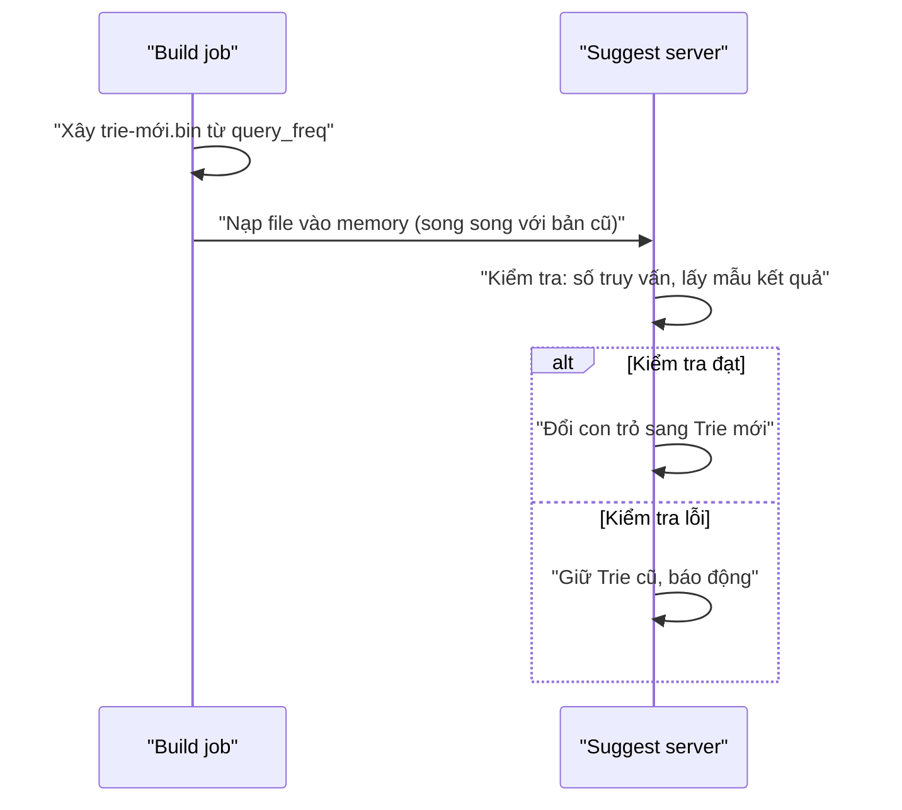
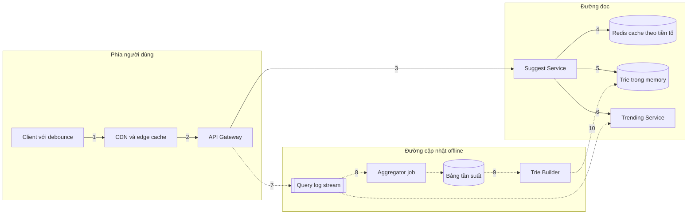

# Search Autocomplete (Gợi ý tìm kiếm)

**Độ khó:** Medium

## Search autocomplete là gì?

Đó là ô gợi ý sổ xuống khi bạn gõ vào thanh tìm kiếm: gõ "how to" là hiện ngay vài truy vấn phổ biến bắt đầu bằng "how to". Bạn dùng nó cho ô tìm kiếm của web, cửa hàng online, trình duyệt. Nếu danh sách gợi ý nhỏ và cố định (vài trăm mục) thì lọc ngay trên client là đủ, không cần thiết kế gì thêm.

**Tóm tắt:**

- Autocomplete là bài toán đọc cực nhiều, ghi gần như không, dữ liệu gần tĩnh, và phải trả lời dưới khoảng 100 ms.
- Không dùng `LIKE` trên bảng truy vấn; thay vào đó tính trước đáp án bằng Trie, mỗi node giữ sẵn top-k gợi ý.
- Tra cứu là O(độ dài tiền tố) và không duyệt cây con; cái giá là mỗi node lặp k chuỗi nên tốn memory.
- Flow đọc và flow cập nhật offline tách rời: đọc không bao giờ ghi vào Trie nên không có lock tranh chấp.
- Trie được xây lại theo giờ hoặc ngày bằng job nền rồi đổi con trỏ sang bản mới (blue/green) sau khi kiểm tra bản mới.
- Kết quả cache theo tiền tố ở CDN và edge, còn client dùng debounce để giảm request.
- Chủ đề nóng bị trễ hàng giờ được bù bằng một tầng trending nhỏ, cập nhật theo phút.
- Trie quá lớn thì chia theo tiền tố, nhưng chia theo thống kê tải vì ký tự đầu phân bố lệch.
- Kiến trúc gồm CDN và cache theo tiền tố, Suggest Service, Trie trong memory, tầng trending và đường offline gồm log stream, aggregator, Trie Builder.

## Vấn đề cần giải quyết

Mỗi lần gõ một ký tự là một request, nên lưu lượng gấp nhiều lần số lượt tìm kiếm thật. Vậy mà hệ thống phải trả lời dưới khoảng 100 ms, nếu không gợi ý sẽ đến trễ hơn tốc độ gõ và vô nghĩa. Dùng `LIKE 'how to%'` trên bảng truy vấn thì không chịu nổi ở quy mô này, vì mỗi request phải quét và sắp xếp lại rất nhiều dòng.

Cách giải quyết là chuẩn bị đáp án từ trước. Lưu các truy vấn trong một Trie kèm tần suất, và để mỗi node giữ sẵn top-k gợi ý, nên khi có tiền tố chỉ cần đi theo từng ký tự rồi đọc luôn kết quả. Dữ liệu được cập nhật định kỳ bằng job nền thay vì sau mỗi truy vấn, và kết quả của những tiền tố hay gặp được cache.

**Nền tảng:** Autocomplete là bài toán đọc cực nhiều, ghi gần như không, dữ liệu gần tĩnh, với yêu cầu trễ rất thấp. Vì vậy ta tính trước đáp án (Trie giữ sẵn top-k ở mỗi node), tách hẳn flow đọc khỏi flow cập nhật offline, và cache theo tiền tố.

## Các khái niệm cần biết

- **Trie**: cây mà mỗi cạnh là một ký tự, đi từ gốc xuống một node là đọc ra một tiền tố. Dùng để tìm mọi chuỗi có chung tiền tố rất nhanh.
- **Top-k**: k kết quả có điểm cao nhất (ở đây là tần suất truy vấn cao nhất). Lưu sẵn ở mỗi node để khỏi phải duyệt cây con.
- **Debounce**: kỹ thuật phía client, chỉ gửi request khi người dùng ngừng gõ một khoảng ngắn (ví dụ 100 đến 200 ms), giảm số request vô ích.
- **Cache-Control và CDN/edge**: header cho phép trình duyệt và CDN lưu kết quả; vì gợi ý của một tiền tố giống nhau với mọi người, cache hiệu quả rất cao.
- **Blue/green (đổi con trỏ)**: dựng bản Trie mới song song, kiểm tra xong mới chuyển hướng phục vụ sang bản mới, không sửa bản đang chạy.
- **Trending**: tầng nhỏ cập nhật theo phút để bắt kịp truy vấn đang bùng nổ.

## Cấu trúc dữ liệu

**Trie** lưu theo từng ký tự. Mỗi node giữ sẵn danh sách top-k truy vấn phổ biến của tiền tố đó, nên tra cứu gần như O(độ dài tiền tố) và không phải duyệt cây con. Cái giá là memory: mỗi node lặp lại k chuỗi, bù lại tốc độ đọc cực nhanh.

**Phải thuộc:** Trie lưu theo từng ký tự, mỗi node giữ sẵn top-k truy vấn phổ biến nên tra cứu O(độ dài tiền tố), đổi lại tốn memory. Cập nhật offline bằng job nền rồi đổi con trỏ sang Trie mới (blue/green); client dùng debounce để giảm request; cache theo tiền tố ở CDN và edge.

## Flowchart

Hai flow đọc và ghi offline được vẽ chung ở mục Kiến trúc tổng thể phía trên. Điểm mấu chốt là hai flow này tách rời: flow đọc không bao giờ ghi vào Trie, nên không có lock tranh chấp và đọc luôn nhanh. Cái giá là gợi ý chậm theo xu hướng một khoảng bằng chu kỳ xây lại.

**Suy luận:** Mỗi ký tự gõ là một request và phải trả lời trong khoảng 100 ms, nên mọi phép tính nặng phải xảy ra trước khi người dùng gõ, không phải sau. Vì gợi ý của một tiền tố giống nhau với mọi người và dữ liệu đổi chậm, ta tính trước top-k và lưu ở mỗi node của Trie, nên lúc phục vụ chỉ còn đi theo từng ký tự rồi đọc kết quả. Cái giá là mỗi node lặp k chuỗi, tức là đổi memory lấy tốc độ đọc. Vì Trie ở trạng thái chỉ đọc khi phục vụ, không ai ghi vào nó, nên không cần lock và đọc song song thoải mái; mọi cập nhật xảy ra ở một Trie mới được dựng offline. Điểm dễ nhầm là cập nhật tần suất trực tiếp trên Trie đang phục vụ: nó buộc phải có lock hoặc sửa top-k của mọi tiền tố, làm chậm đúng đường đọc mà ta muốn giữ nhanh. Hệ quả là gợi ý luôn chậm hơn xu hướng thật một khoảng bằng chu kỳ xây lại, nên tin nóng cần tầng trending riêng, và Trie mới phải được kiểm tra trước khi đổi con trỏ để một bản hỏng không bao giờ được phục vụ.

Còn khi Trie mới được xây xong thì phục vụ thế nào mà không gián đoạn? Sơ đồ sau cho thấy việc đổi con trỏ.



## Ước lượng

Giả định 100 triệu người dùng/ngày, 10 lượt tìm mỗi người, mỗi lượt gõ làm khoảng 5 request gợi ý (đã debounce), 10 triệu truy vấn phổ biến đủ ngưỡng đưa vào Trie.

| Đại lượng | Tính | Kết quả |
|---|---|---|
| Request gợi ý | 100 triệu x 10 x 5 / 86.400 | khoảng 58.000/giây (đỉnh x3: 170.000) |
| Kích thước kết quả | 5 gợi ý x 30 B | khoảng 150 B mỗi response |
| Số tiền tố nóng | tiền tố dài 1-6 ký tự là phần lớn lượt gõ | vài chục triệu key, cache vừa một cluster Redis |
| Dung lượng Trie | 10 triệu truy vấn x 30 ký tự, mỗi node giữ thêm top-5 | cỡ vài chục GB (xấp xỉ, tùy cách nén), đặt trong RAM, chia theo tiền tố |

Kết luận: tải đọc rất lớn, ghi gần như không có, dữ liệu gần tĩnh: hợp với Trie dựng sẵn, cache và CDN, cập nhật bằng job nền.

## Kiến trúc tổng thể

Sơ đồ thể hiện hai đường tách rời: đường đọc (gõ tiền tố, qua CDN và cache tới Trie) và đường cập nhật offline (log truy vấn, đếm tần suất, dựng Trie mới rồi đổi con trỏ).



**Chú thích sơ đồ**

| Thành phần | Vai trò | Vì sao chọn / đánh đổi |
|---|---|---|
| Client với debounce | Chờ người dùng ngừng gõ ngắn rồi mới gửi | Giảm mạnh số request; đổi lại gợi ý hiện chậm vài chục mili giây |
| CDN và edge cache | Cache kết quả theo tiền tố | Phần lớn tiền tố ngắn trúng cache nên không chạm backend; kết quả có thể cũ theo TTL |
| API Gateway | Rate limiting, định tuyến | Bảo vệ backend khỏi bot; thêm một bước nhảy nhỏ |
| Suggest Service | Nhận tiền tố, trả top-k | Không trạng thái nên scale ngang dễ |
| Redis cache | Cache tiền tố nóng giữa edge và Trie | Giảm tải Trie; tốn memory cho hàng chục triệu key |
| Trie trong memory | Mỗi node giữ sẵn top-k | Tra O(độ dài tiền tố), không lock vì chỉ đọc; đổi lại tốn RAM do lặp top-k |
| Trending Service | Tầng nhỏ cập nhật theo phút cho chủ đề nóng | Bù độ trễ của Trie; thêm một nguồn để trộn khi trả kết quả |
| Query log stream | Thu log truy vấn không chặn đường đọc | Tách ghi khỏi đọc; log có thể trễ hoặc mất một ít |
| Aggregator job và bảng tần suất | Đếm tần suất theo giờ hoặc ngày | Batch rẻ và đơn giản; gợi ý chậm theo xu hướng một chu kỳ |
| Trie Builder | Dựng Trie mới, kiểm tra, đổi con trỏ | Blue/green nên không gián đoạn; cần kiểm tra bản mới trước khi đổi |

1. Client gõ tiền tố (đã debounce) và gọi `GET /v1/suggest?q=...` qua CDN.
2. CDN trúng cache thì trả ngay; trượt thì chuyển tới API Gateway.
3. Gateway chuyển request tới Suggest Service.
4. Suggest Service kiểm tra Redis cache theo tiền tố.
5. Cache trượt thì tra Trie trong memory và ghi lại vào cache.
6. Suggest Service trộn thêm gợi ý của tầng trending rồi trả top-k.
7. Truy vấn thật của người dùng được ghi vào log stream (async).
8. Aggregator job đếm tần suất từ log (async).
9. Trie Builder đọc bảng tần suất theo chu kỳ để dựng Trie mới.
10. Sau khi kiểm tra, Builder đổi con trỏ sang Trie mới trên các Suggest server.

**Điểm nghẽn:** Trie trong memory của mỗi server nghẽn đầu tiên khi dữ liệu lớn dần; chia Trie theo tiền tố (theo thống kê tải, vì ký tự đầu phân bố lệch) và thêm replica. Tiếp theo là Redis và CDN khi gặp tiền tố nóng đột biến; tăng TTL và thêm replica đọc.

## API và dữ liệu

```text
GET /v1/suggest?q=how%20to&limit=5   -> 200 { "q": "how to", "items": ["how to code", "how to cook", ...] }
Header: Cache-Control: public, max-age=300     (cho phép trình duyệt và CDN cache)
```

```text
query_log(ts, user_id, query)                   -- ghi vào Kafka rồi object storage
query_freq(query PK, freq_7d, freq_1d)          -- kết quả job đếm, trọng số ngày gần hơn
trie_snapshot: file tuần tự hóa theo phiên bản (trie-2026-10-27-10.bin), nạp vào server rồi đổi con trỏ
```

## Cơ chế lõi: Trie giữ sẵn top-K ở mỗi node (Java, đã chạy thử)

```java
static final int K = 3;
static class Node {
    Map<Character, Node> children = new HashMap<>();
    // {truy vấn, tần suất}, tối đa K phần tử
    List<String[]> top = new ArrayList<>();
}
// chạy khi xây Trie (offline), không chạy lúc phục vụ
void insert(String q, int freq) {
    Node n = root;
    for (char c : q.toCharArray()) {
        n = n.children.computeIfAbsent(c, x -> new Node());
        // mọi tiền tố của q đều ghi nhận q
        updateTop(n, q, freq);
    }
}
void updateTop(Node n, String q, int freq) {
    n.top.removeIf(e -> e[0].equals(q));
    n.top.add(new String[]{q, String.valueOf(freq)});
    n.top.sort((x, y) -> Integer.parseInt(y[1]) - Integer.parseInt(x[1]));
    if (n.top.size() > K) n.top.remove(K);
}
// O(độ dài tiền tố), không duyệt cây con
List<String> suggest(String prefix) {
    Node n = root;
    for (char c : prefix.toCharArray()) { n = n.children.get(c); if (n == null) return List.of(); }
    List<String> r = new ArrayList<>();
    for (String[] e : n.top) r.add(e[0]);
    return r;
}
// Dữ liệu: how to cook 50, how to code 90, how to cut hair 20, how old 70, hotel 80
// suggest("how to") = [how to code, how to cook, how to cut hair]; suggest("ho") = [how to code, hotel, how old]
```

Đổi lấy tốc độ đọc bằng memory: mỗi node lặp K chuỗi; cắt bằng cách chỉ đưa vào Trie truy vấn trên ngưỡng tần suất.

## Đào sâu

| Điểm khó | Vấn đề | Cách xử lý và đánh đổi |
|---|---|---|
| Cập nhật Trie | Xây lại toàn bộ tốn, nhưng gợi ý cần phản ánh xu hướng | Job xây Trie mới theo giờ/ngày, nạp song song rồi đổi con trỏ atomic (blue/green), không sửa Trie đang phục vụ. Mất: chủ đề nóng (tin nóng) trễ hàng giờ; bù bằng một tầng nhỏ "trending" cập nhật theo phút và trộn vào kết quả |
| Dữ liệu lớn hơn một máy | Trie vượt RAM một node | Chia theo tiền tố (hai ký tự đầu), có replica mỗi shard. Mất: ký tự đầu phân bố lệch (chữ "s" nhiều hơn "x"), nên chia theo thống kê tải thay vì chia đều bảng chữ cái |

## Lỗi và giám sát

- Trie mới hỏng: giữ phiên bản cũ, chỉ đổi con trỏ sau khi kiểm tra (số truy vấn, lấy mẫu kết quả).
- Server chết: replica phục vụ; cache và CDN che phần lớn lượt gõ.
- Lọc nội dung nhạy cảm ở bước xây Trie (danh sách chặn) và ở lúc trả về.
- Theo dõi: p99 `GET /suggest`, tỷ lệ cache hit theo tiền tố, tuổi của Trie đang phục vụ, tỷ lệ người dùng chọn gợi ý (chất lượng).

## Điểm cần nhắc

- Cập nhật không cần thời gian thực: xây lại Trie theo giờ hoặc ngày.
- Cache theo tiền tố, và đặt kết quả gần người dùng (CDN/edge).
- Lọc nội dung nhạy cảm; hỗ trợ đa ngôn ngữ.
- Chia Trie theo ký tự đầu khi quá lớn.

