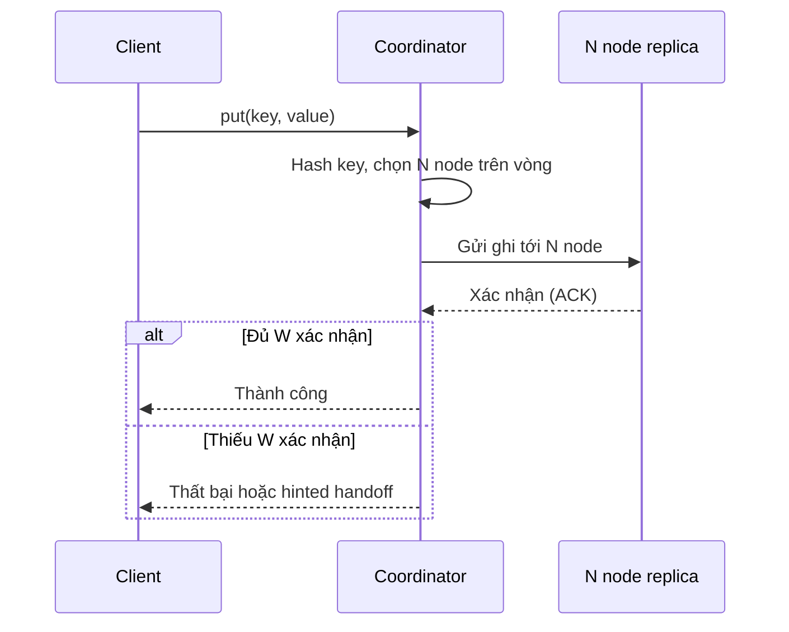
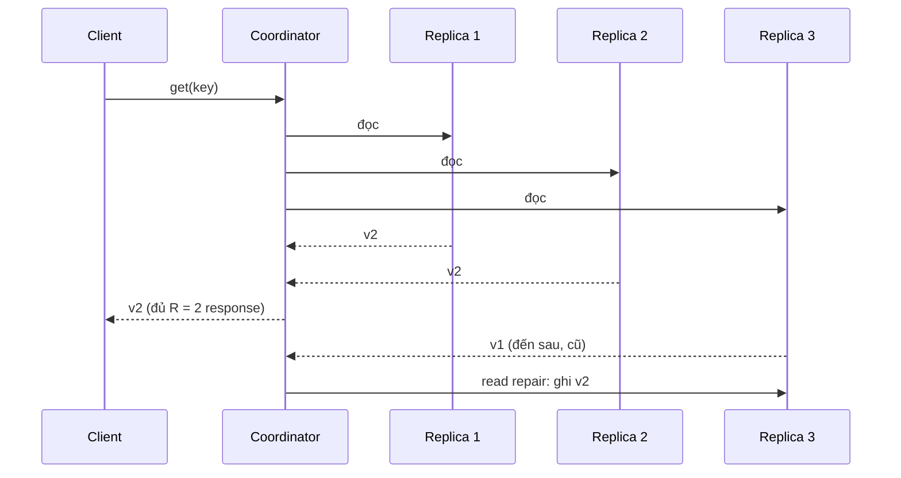
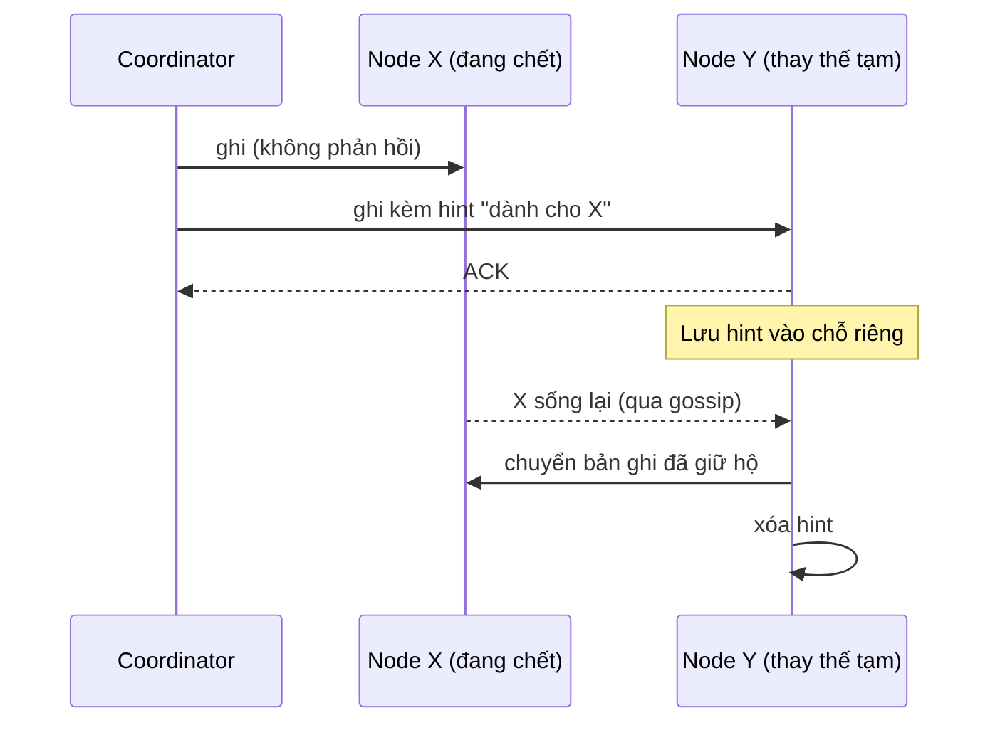
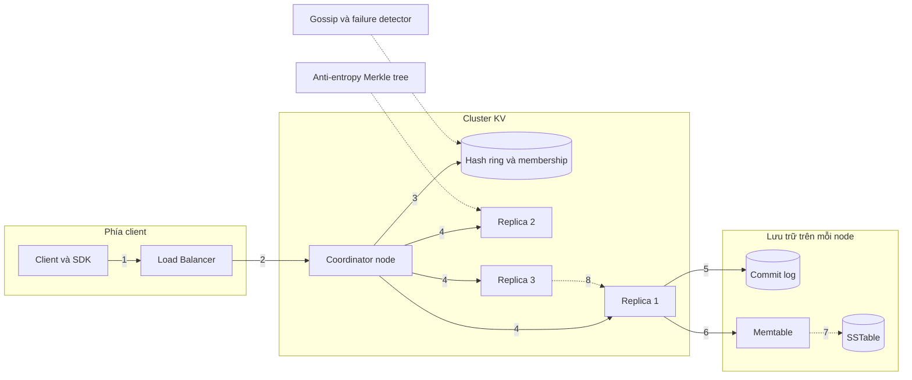

# Distributed Key-Value Store

**Độ khó:** Medium

## Distributed key-value store là gì?

Hãy hình dung một Redis hay DynamoDB do chính bạn thiết kế: lưu các cặp `key -> value` trên nhiều máy, vẫn chạy khi một vài máy chết, và thêm máy là tăng được dung lượng lẫn tốc độ. Kiểu lưu trữ này hợp với session, cấu hình, giỏ hàng, hồ sơ người dùng, tức là những dữ liệu truy cập theo key. Nếu bạn cần truy vấn phức tạp, join, hoặc transaction nhiều bản ghi thì dùng SQL, đừng ép vào KV store.

**Tóm tắt:**

- Một máy không đủ chỗ và không chịu lỗi, nên KV store phân tán phải chia dữ liệu (partition) và replication.
- Consistent hashing với virtual node chia key lên vòng hash; thêm hoặc bớt node chỉ di chuyển khoảng 1/(N+1) số key thay vì gần hết như `hash mod N`.
- Mỗi key lưu trên N node kế tiếp; quorum R + W > N đảm bảo tập đọc và tập ghi giao nhau nên đọc thấy bản mới nhất.
- Chọn N, W, R chính là chọn vị trí giữa consistency và availability (CAP): R + W <= N thì có thể đọc dữ liệu cũ.
- Xung đột ghi xử lý bằng last-write-wins (đơn giản, có thể mất ghi do lệch đồng hồ) hoặc vector clock (giữ cả hai bản cho client hợp nhất).
- Phát hiện node chết bằng gossip, bù ghi hụt bằng hinted handoff, sửa lệch nền bằng anti-entropy (Merkle tree) và read repair.
- Hinted handoff (sloppy quorum) làm yếu đảm bảo R + W > N, vì bản ghi có thể nằm tạm ngoài danh sách replica.
- Ghi nhanh nhờ commit log, memtable rồi SSTable (LSM tree).
- Kiến trúc gồm load balancer, coordinator, hash ring, N replica với commit log, memtable và SSTable, cùng gossip và anti-entropy chạy nền.

## Vấn đề cần giải quyết

Một máy thì sớm hết RAM, hết disk, hết băng thông, và khi nó chết là mất hết. Dùng nhiều máy thì nảy ra các câu hỏi khó: key nằm ở máy nào, replica đặt ở đâu, hai replica lệch nhau thì tin bản nào. Bài này là dịp học CAP và consistency một cách cụ thể.

Lời giải gồm nhiều mảnh ghép, mỗi mảnh trả lời một câu hỏi. Chia key bằng consistent hashing để biết key ở đâu. Replication mỗi key sang N node để chịu lỗi. Dùng quorum (W + R > N) để đọc ghi mà vẫn thấy dữ liệu mới. Xử lý xung đột bằng version hoặc vector clock. Phát hiện node chết bằng gossip, và dùng hinted handoff để bù các lần ghi bị hụt.

## Các khái niệm cần biết

- **Consistent hashing**: cách chia key lên một hash ring, mỗi node chiếm một đoạn của vòng. Khi thêm hoặc bớt node chỉ một phần nhỏ key phải di chuyển, khác với `hash(key) % số node` làm xáo trộn gần hết. Dùng khi cluster hay đổi kích thước.
- **Virtual node (vnode)**: mỗi node vật lý được đặt ở nhiều điểm trên vòng để tải đều hơn; node mạnh nhận nhiều điểm hơn.
- **Replication factor N**: mỗi key được lưu trên N node (N node kế tiếp trên vòng).
- **Quorum (W, R)**: ghi coi là thành công khi W node xác nhận, đọc hỏi R node. Nếu R + W > N thì tập đọc và tập ghi luôn giao nhau, nên đọc thấy bản ghi mới nhất. Nếu sai tham số (R + W <= N) có thể đọc phải dữ liệu cũ.
- **Coordinator**: node nhận request từ client rồi điều phối tới các replica.
- **Last-write-wins (LWW)**: khi có xung đột, bản có timestamp lớn nhất thắng. Đơn giản nhưng lệch đồng hồ có thể làm mất ghi hợp lệ.
- **Vector clock**: counter phiên bản theo từng node, cho phép phân biệt "bản này mới hơn bản kia" với "hai bản ghi concurrent, xung đột". Dùng khi không được phép tự ý mất dữ liệu (giỏ hàng).
- **Gossip protocol**: mỗi node định kỳ "buôn chuyện" trạng thái với vài node ngẫu nhiên; tin về node chết lan ra toàn cluster mà không cần máy chủ trung tâm.
- **Hinted handoff**: khi replica đích đang chết, node khác giữ tạm bản ghi kèm "gợi ý" địa chỉ đích và chuyển lại khi node đó sống lại.
- **Anti-entropy và Merkle tree**: quy trình so sánh nền giữa các replica để sửa chỗ lệch; Merkle tree cho phép so sánh nhanh bằng hash và chỉ truyền phần khác nhau.
- **Commit log, memtable, SSTable, LSM tree**: ghi vào log tuần tự để bền, vào memory (memtable) cho nhanh, rồi định kỳ đổ xuống file sắp xếp bất biến (SSTable). Cách này làm ghi rất nhanh.
- **CAP (AP so với CP)**: khi mạng bị chia cắt chỉ chọn được một trong hai, luôn trả lời (AP) hoặc luôn đúng (CP).

## Thành phần chính

| Vấn đề | Giải pháp |
|---|---|
| Chia dữ liệu | Consistent hashing (hash ring, virtual node) |
| Chịu lỗi | Replication mỗi key sang N node kế tiếp trên vòng |
| Nhất quán | Quorum: R + W > N |
| Xung đột phiên bản | Vector clock hoặc last-write-wins |
| Phát hiện lỗi | Gossip protocol |
| Node tạm thời chết | Hinted handoff |
| Sửa dữ liệu lệch | Anti-entropy bằng Merkle tree |

**Phải thuộc:** Kiểu Dynamo gồm bảy mảnh: consistent hashing (chia dữ liệu), replication N replica, quorum R + W > N (đọc thấy bản mới), vector clock hoặc LWW (xung đột), gossip (phát hiện lỗi), hinted handoff (node chết tạm), Merkle tree (anti-entropy). Lưu ý hinted handoff (sloppy quorum) làm yếu đảm bảo R + W > N vì bản ghi có thể nằm tạm ở node ngoài danh sách replica.

**Nền tảng:** Một máy không đủ chỗ và không chịu lỗi, nên phải chia dữ liệu (partition) và replication. Replication lập tức đặt ra câu hỏi nhất quán giữa các replica, nên KV store phân tán thực chất là bài toán CAP: tham số N, W, R là cách chọn vị trí giữa nhất quán và sẵn sàng.

**Suy luận:** Muốn chịu lỗi thì mỗi key phải nằm trên nhiều node, nhưng ngay khi có nhiều replica thì xuất hiện câu hỏi: ghi xong khi nào, và đọc phải hỏi bao nhiêu node để thấy bản mới. Nếu ghi phải đợi cả N node thì một node chết là cả hệ thống ngừng ghi, còn nếu chỉ đợi một node thì node đó chết trước khi sao chép sẽ mất dữ liệu; quorum là điểm giữa, đợi W node. Đọc hỏi R node, và khi R + W > N thì mọi tập R node đọc chắc chắn chứa ít nhất một node nằm trong tập W node của lần ghi gần nhất, nên thấy bản mới. Điểm dễ nhầm là nghĩ quorum đảm bảo consistency tuyệt đối: nó chỉ đảm bảo hai tập giao nhau, còn khi có ghi concurrent hoặc hinted handoff đưa bản ghi ra ngoài danh sách replica thì vẫn có thể đọc cũ, nên cần version và read repair. Hệ quả là chỉnh N, W, R chính là chỉnh CAP: W = N ghi chắc nhưng chết một node là không ghi được, R = 1 đọc nhanh nhưng dễ đọc cũ.

## Flowchart: ghi dữ liệu

Coordinator hash key để tìm N replica rồi gửi ghi tới tất cả, nhưng chỉ cần đủ W xác nhận là báo thành công cho client.



Đọc sơ đồ: coordinator không chờ cả N node; node chậm nhất sẽ nhận bản ghi sau. Đó là cái giá của việc trả lời nhanh, và là lý do cần anti-entropy chạy nền.

Flow đọc đối xứng với flow ghi: hỏi các replica, chờ R response, rồi chọn bản mới nhất.



Replica 3 trả lời chậm và đang giữ bản cũ. Coordinator thấy chênh lệch nên sửa lại nó (read repair), một cách làm lành dữ liệu bên cạnh anti-entropy.

Cuối cùng là hinted handoff, thứ giúp ghi vẫn thành công khi một node đích chết tạm thời.



## Ước lượng

Giả định 10 tỷ key, value trung bình 1 KB, replication N = 3, mỗi node chứa tối đa 2 TB dữ liệu hữu ích, đỉnh 500.000 thao tác/giây.

| Đại lượng | Tính | Kết quả |
|---|---|---|
| Dữ liệu gốc | 10 tỷ x 1 KB | 10 TB |
| Sau replication | 10 TB x 3 | 30 TB |
| Số node | 30 TB / 2 TB | tối thiểu 15; thực tế 25 đến 30 để chừa chỗ cho compaction và dự phòng |
| Tải mỗi node | 500.000 x 3 (ghi tới 3 bản; đọc ít hơn) / 30 node | cỡ 10.000 đến 50.000 thao tác/giây, tùy tỷ lệ đọc ghi |

## Kiến trúc tổng thể

Sơ đồ thể hiện một cluster kiểu Dynamo không có node trung tâm: client gọi một coordinator bất kỳ, coordinator hash key lên vòng, gửi ghi hoặc đọc tới các replica và chờ đủ quorum.



**Chú thích sơ đồ**

| Thành phần | Vai trò | Vì sao chọn / đánh đổi |
|---|---|---|
| Client và SDK | Gọi `get` và `put`, giữ version khi cần | SDK thông minh có thể gọi thẳng đúng node; đổi lại logic client phức tạp hơn |
| Load Balancer | Chọn coordinator ngẫu nhiên | Không cần master nên không có điểm chết đơn; mỗi node đều phải biết vòng hash |
| Coordinator node | Hash key, gửi tới replica, chờ W hoặc R phản hồi | Bất kỳ node nào cũng làm được; tăng một bước nhảy nếu không phải replica của key |
| Hash ring và membership | Ánh xạ key sang N node kế tiếp (virtual node) | Thêm bớt node chỉ di chuyển khoảng 1/(N+1) số key; cần đồng bộ thông tin vòng |
| Replica 1, 2, 3 | Giữ N bản sao của mỗi key | Chịu lỗi; quorum R + W > N cho đọc thấy bản mới, đổi lại tốn gấp N dung lượng |
| Commit log | Ghi tuần tự để bền | Ghi rất nhanh và không mất khi node chết; phải dọn định kỳ |
| Memtable và SSTable | Ghi vào memory rồi đổ xuống file bất biến (LSM tree) | Ghi nhanh; đọc có thể phải tìm qua nhiều file nên cần compaction và Bloom filter |
| Gossip và failure detector | Lan truyền trạng thái sống chết của node | Không có điểm trung tâm; thông tin hội tụ sau một khoảng ngắn |
| Anti-entropy Merkle tree | So sánh nền giữa các replica để sửa lệch | Chỉ truyền phần khác nhau; chạy nền tốn I/O |

1. Client gọi `put` hoặc `get` qua load balancer.
2. Load Balancer chọn một coordinator node.
3. Coordinator tra hash ring để tìm N replica (danh sách ưu tiên) của key.
4. Coordinator gửi ghi hoặc đọc tới các replica song song và chờ đủ W hoặc R phản hồi rồi trả lời client.
5. Trên mỗi replica, bản ghi được ghi vào commit log trước.
6. Sau đó bản ghi vào memtable trong memory.
7. Memtable đầy thì đổ xuống SSTable (async).
8. Replica lệch được sửa bằng read repair, hinted handoff và anti-entropy chạy nền (async).

**Điểm nghẽn:** Node nóng do key nóng hoặc phân bố lệch trên vòng nghẽn đầu tiên; dùng virtual node, tách hoặc cache key nóng. Tiếp theo là compaction và I/O đĩa khi dữ liệu lớn; giới hạn tốc độ compaction và thêm node để giảm dữ liệu mỗi máy.

## API

```text
put(key, value, [context])  -> ok | lỗi (không đủ W)
get(key)                    -> { values: [v...], context }   (có thể trả nhiều bản khi có xung đột)
```

`context` mang version (vector clock) để lần ghi sau biết nó dựa trên bản nào.

## Ví dụ có số: N = 3, W = 2, R = 2

| Tình huống | Điều xảy ra |
|---|---|
| Ghi lúc cả 3 node sống | Ghi tới 3 node, đủ 2 ACK là trả thành công; node chậm nhất nhận sau |
| 1 node chết | Vẫn đủ 2 ACK; ghi dành cho node chết được node khác giữ tạm (hinted handoff) và chuyển lại khi nó sống |
| Đọc | Hỏi 3 node, chờ 2 response, lấy bản mới nhất. Vì W + R = 4 > 3 nên tập ghi và tập đọc luôn giao nhau ít nhất 1 node, nên đọc thấy bản mới nhất đã commit |
| 2 node chết | Không đủ W hoặc R: từ chối (nghiêng về nhất quán) hoặc hạ yêu cầu xuống W = 1 (nghiêng về sẵn sàng, chấp nhận đọc cũ) |

## Cơ chế lõi: hash ring, danh sách ưu tiên, quorum (Java, đã chạy thử)

```java
static final int N = 3, W = 2, R = 2, VNODE = 4;
static TreeMap<Integer, String> ring = new TreeMap<>();   // vị trí băm -> node vật lý

// mỗi node có VNODE điểm trên vòng
static void addNode(String n) {
    for (int i = 0; i < VNODE; i++) ring.put(hash(n + "#" + i), n);
}
// Danh sách ưu tiên: đi theo chiều kim đồng hồ, lấy N node vật lý KHÁC NHAU
static List<String> prefList(String key) {
    LinkedHashSet<String> r = new LinkedHashSet<>();
    for (String n : ring.tailMap(hash(key), true).values()) { r.add(n); if (r.size() == N) return new ArrayList<>(r); }
    // quay vòng
    for (String n : ring.values()) { r.add(n); if (r.size() == N) break; }
    return new ArrayList<>(r);
}
static boolean put(String key, String val, long version) {
    int ack = 0;
    for (String n : prefList(key)) {
        // node chết: bỏ qua (thật: hinted handoff)
        if (deadNodes.contains(n)) continue;
        store(n, key, val, version); ack++;
    }
    // thành công khi đủ W xác nhận
    return ack >= W;
}
static String get(String key) {
    long best = -1; String val = null; int resp = 0;
    for (String n : prefList(key)) {
        if (deadNodes.contains(n)) continue;
        resp++;
        long v = version(n, key);
        // lấy bản có version lớn nhất (last-write-wins)
        if (v > best) { best = v; val = value(n, key); }
    }
    return resp >= R ? val : "LOI: không đủ R";
}
// Demo 5 node, N=3: ghi v1 khi đủ node (true); một replica chết, ghi v2 (true), đọc trả "v2"
```

`hash`, `store`, `version`, `value`, `deadNodes` là hàm và biến phụ (bản đầy đủ đã chạy với Map trong memory).

**Suy luận:** Cách chia đơn giản nhất là `hash(key) % số node`, nhưng nó gắn vị trí của mọi key với số node, nên thêm một node (N từ 4 lên 5) làm khoảng 80% key đổi chỗ và cả cluster phải chép dữ liệu cùng lúc. Consistent hashing đặt cả key lẫn node lên một vòng hash và giao mỗi key cho node đầu tiên đi theo chiều kim đồng hồ, nên thêm một node chỉ lấy một đoạn từ node kế bên, khoảng 1/(N+1) số key. Nhưng với ít node, các điểm trên vòng rơi không đều nên có node ôm đoạn lớn gấp nhiều lần node khác; virtual node giải quyết bằng cách cho mỗi node vật lý xuất hiện ở nhiều điểm, nên tải đều hơn và node mạnh nhận nhiều điểm hơn. Điểm dễ nhầm trong danh sách ưu tiên là lấy N điểm kế tiếp trên vòng: nhiều điểm đó có thể thuộc cùng một node vật lý, nên phải lấy N node vật lý khác nhau, nếu không "3 replica" thực ra nằm trên một máy và chết một máy là mất cả ba. Hệ quả khi review: kiểm tra replica có được tách theo rack hoặc zone hay không, chứ không chỉ theo node.

## Đào sâu

| Điểm khó | Vấn đề | Cách xử lý và đánh đổi |
|---|---|---|
| Xung đột phiên bản | Hai client ghi cùng key ở hai node cách ly | **Last-write-wins** theo timestamp: đơn giản nhưng lệch đồng hồ có thể làm mất ghi hợp lệ. **Vector clock**: phát hiện ghi concurrent và trả cả hai bản cho client hợp nhất (giỏ hàng), mất: client phức tạp hơn, vector lớn dần nên phải cắt |
| Thêm bớt node | Hash lại làm di chuyển gần hết dữ liệu | Consistent hashing chỉ di chuyển khoảng 1/(N+1) số key khi thêm node; virtual node làm đều tải và cho phép node mạnh nhận nhiều điểm hơn |

## Lỗi và giám sát

- Node chết tạm thời: hinted handoff. Chết lâu: sao chép lại bằng stream từ các bản còn lại, dùng Merkle tree so sánh để chỉ truyền phần lệch (anti-entropy).
- Hot key: thêm bản đọc hoặc cache phía client; replication nhiều hơn cho key nóng.
- Theo dõi: p99 đọc ghi, tỷ lệ ghi thiếu W, số hint đang chờ, độ lệch giữa các bản (số Merkle sai khác), dung lượng và compaction mỗi node.

## Điểm cần nhắc

- Chọn N, R, W theo nhu cầu: R=1 đọc nhanh, W=N ghi chắc chắn, hay cân bằng R=W=2 với N=3.
- Ghi vào commit log và memtable, định kỳ xuống SSTable (cách tiếp cận LSM tree), giúp ghi nhanh.
- Thiên về AP (như Dynamo) hoặc CP tùy cấu hình.

