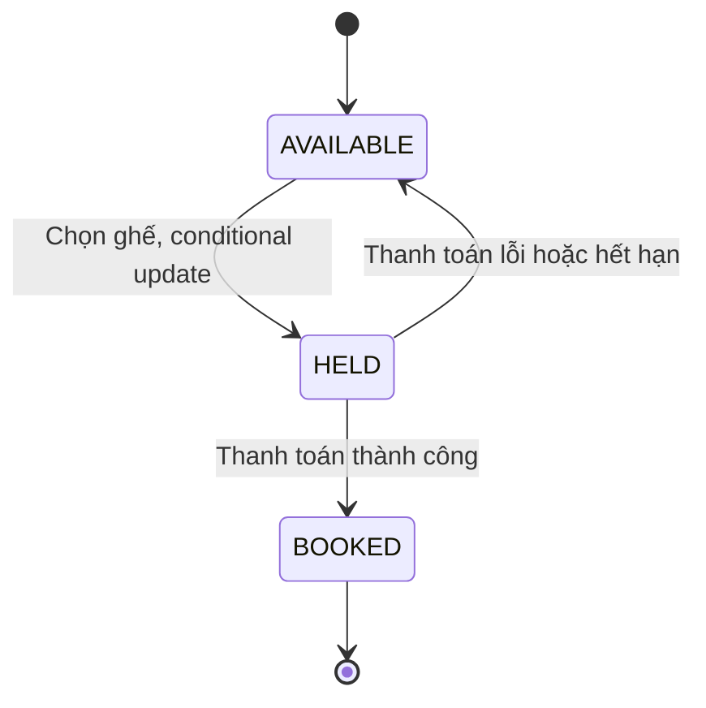
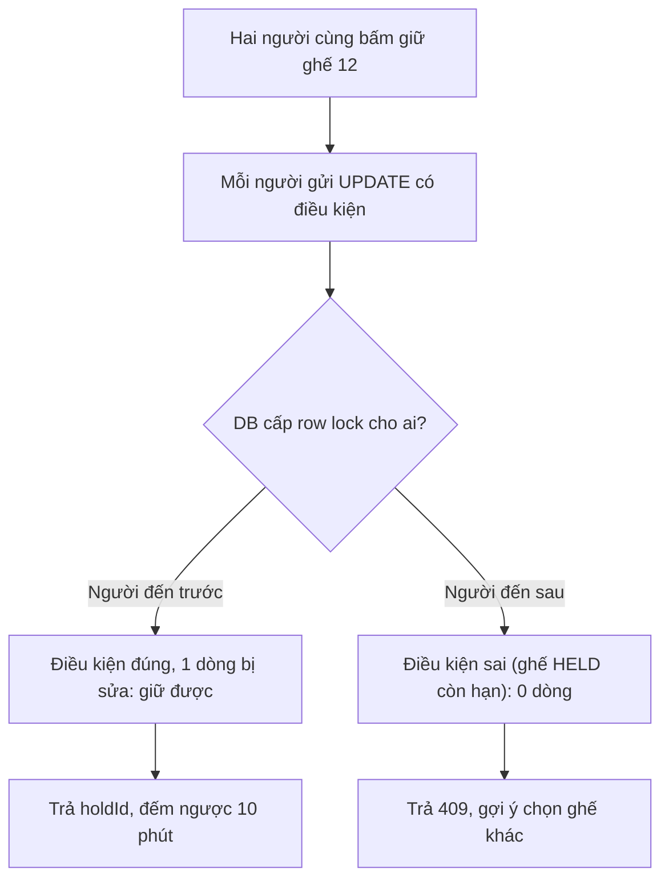
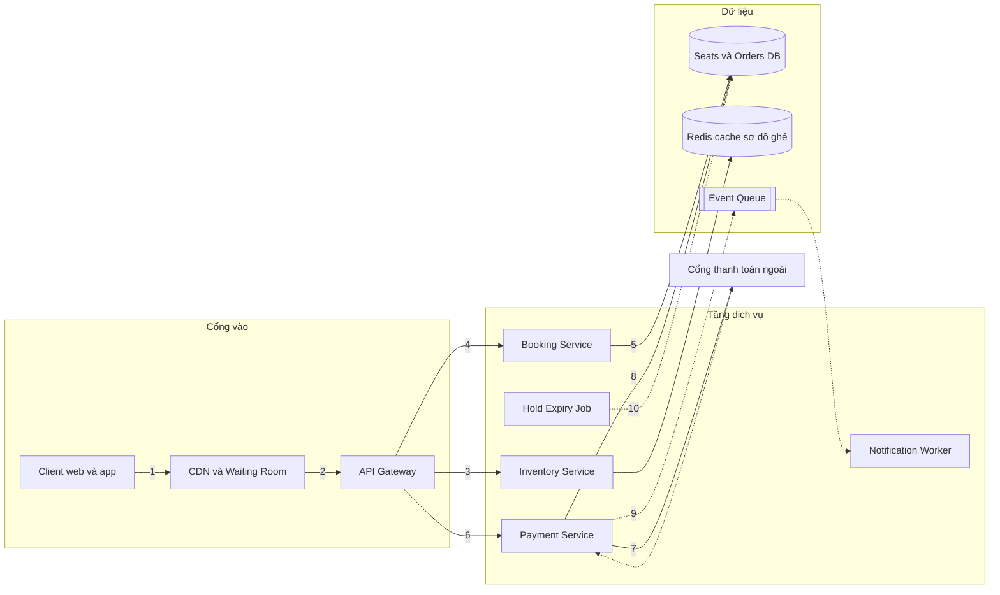
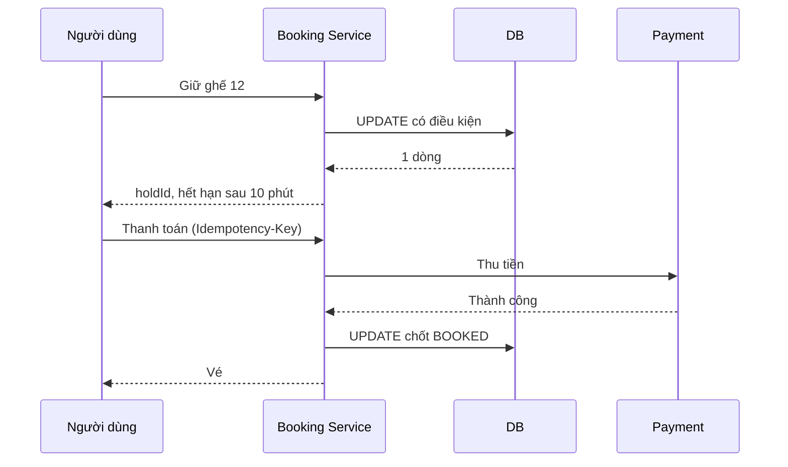

# Ticket Booking (Đặt vé)

**Độ khó:** Medium

## Ticket booking là gì?

Đây là hệ thống cho người dùng chọn ghế, giữ chỗ một lúc rồi thanh toán để chốt vé, giống đặt vé xem phim hay concert. Thiết kế này dùng cho vé show, rạp phim, tàu xe, đặt phòng. Nếu hàng hóa không giới hạn số lượng (bán sách điện tử, bán file) thì không có bài toán tranh chấp này và bạn không cần cơ chế giữ chỗ.

**Tóm tắt:**

- Bài toán cốt lõi là tranh chấp trên tài nguyên hữu hạn: nhiều người cùng muốn một ghế nhưng chỉ một người được, và bán trùng (overselling) là sự cố thật.
- Chính DB phải quyết định ai thắng ở một bước atomic: conditional update `UPDATE ... WHERE status = 'AVAILABLE'`, số dòng bị ảnh hưởng là 1 thì thắng, 0 thì thua.
- Không "đọc rồi ghi", vì giữa hai bước người khác có thể chen vào (race condition).
- Ghế đi qua vòng đời AVAILABLE, HELD (có hạn), BOOKED; giữ chỗ luôn có thời hạn để ghế không kẹt, hết hạn thì tự nhả.
- Pessimistic lock hợp khi tranh chấp cao và thua là đắt; conditional update thất bại nhanh, hợp khi người dùng chọn ghế khác được. Redis lock chỉ là lớp giảm tải, DB vẫn là nguồn quyết định.
- Giữ nhiều ghế thì trong một transaction và lock theo thứ tự `seat_id` để tránh deadlock.
- Thanh toán idempotent bằng `Idempotency-Key`, kèm đối soát định kỳ và hoàn tiền tự động.
- Lưu lượng đột biến (500.000 người cùng lúc) được chắn bằng virtual waiting room ở tầng CDN hoặc edge.
- Kiến trúc gồm waiting room ở CDN, Inventory và Booking Service, DB giữ ghế bằng conditional update, Payment Service với cổng ngoài, job nhả hold và queue thông báo.

## Vấn đề cần giải quyết

Khi mở bán vé hot, hàng nghìn người cùng tranh một ghế trong vài giây. Hai người cùng mua được một ghế là sự cố thật (bán trùng, overselling). Ngược lại, nếu người giữ ghế bỏ đi mà không thanh toán thì ghế bị kẹt mãi, nên giữ chỗ phải có thời hạn.

Cách giải quyết gồm ba ý. Một, khi chọn ghế thì giữ chỗ có hạn (ví dụ 10 phút) bằng lock hoặc conditional update (`UPDATE ... WHERE status = 'AVAILABLE'`), để chỉ một người giữ được. Hai, thanh toán xong thì chuyển ghế sang đã bán, hết hạn thì nhả ghế. Ba, với lượng người cực lớn thì thêm queue chờ ở phía trước để hệ thống không bị đè sập.

## Các khái niệm cần biết

- **Overselling**: bán nhiều vé hơn số ghế thật. Hệ quả: phải hoàn tiền, mất uy tín.
- **Conditional update**: câu `UPDATE` kèm điều kiện trong `WHERE`; DB đảm bảo kiểm tra và ghi là một bước atomic. Số dòng bị ảnh hưởng cho biết bạn thắng (1) hay thua (0).
- **Pessimistic lock**: lock dòng trước khi sửa (`SELECT ... FOR UPDATE`), người khác phải chờ. Hợp khi tranh chấp cao và thua là đắt giá.
- **Optimistic lock**: cứ thử rồi kiểm tra có bị ai chen không (thường bằng điều kiện hoặc version), thua thì thử lại hay báo lỗi. Hợp khi tranh chấp thấp hoặc người dùng chọn ghế khác được.
- **Hold và TTL**: bản ghi giữ chỗ có thời điểm hết hạn (`hold_until`); hết hạn thì coi như ghế trống.
- **Idempotency-Key**: giá trị client gửi kèm để server nhận ra request lặp (do retry) và không thu tiền hai lần.
- **Virtual waiting room**: hàng chờ phía trước hệ thống, chỉ cho một số người vào mỗi phút, phần còn lại đợi ở tầng CDN hoặc edge.
- **Deadlock**: hai transaction lock chéo nhau và cùng chờ mãi; hay gặp khi giữ nhiều ghế theo thứ tự khác nhau.

## Trạng thái ghế

`AVAILABLE` → `HELD` (giữ tạm, có thời hạn) → `BOOKED`. Hết hạn mà chưa thanh toán thì `HELD` → `AVAILABLE`.

**Nền tảng:** Bài toán cốt lõi là tranh chấp trên một tài nguyên có số lượng hữu hạn: nhiều người cùng muốn một ghế nhưng chỉ một người được. Phải để chính DB quyết định ai thắng ở một bước atomic, và việc giữ chỗ luôn phải có thời hạn để ghế không kẹt mãi.

## Flowchart

Mỗi ghế đi qua vòng đời ngắn gọn dưới đây. Lưu ý đường quay lại `AVAILABLE` từ `HELD` để ghế không bị kẹt.



## Chống bán trùng

- **Conditional update:** `UPDATE seats SET status='HELD' WHERE id=? AND status='AVAILABLE'`; chỉ một transaction thành công.
- Hoặc distributed lock (Redis) với thời hạn.
- Pessimistic lock hợp với tranh chấp cao; optimistic lock hợp khi tranh chấp thấp.

**Phải thuộc:** Chống bán trùng bằng conditional update atomic: `UPDATE seats SET status='HELD' ... WHERE id=? AND status='AVAILABLE'`, số dòng bị ảnh hưởng là 1 thì thắng, 0 thì thua. Không "đọc rồi ghi" vì có race condition. Vòng đời ghế: AVAILABLE, HELD (có hạn), BOOKED; hết hạn thì nhả. Giữ nhiều ghế thì trong một transaction và lock theo thứ tự `seat_id` để tránh deadlock.

Vì sao điều kiện nằm trong cùng câu `UPDATE` mà không phải "đọc rồi ghi"? Vì nếu app `SELECT` thấy ghế trống rồi mới `UPDATE`, giữa hai bước đó một người khác có thể chen vào, và cả hai đều tin mình giữ được ghế (race condition). Gộp điều kiện vào câu lệnh ghi thì DB tự row lock và chỉ một transaction thấy điều kiện đúng. Distributed lock Redis chỉ nên là lớp giảm tải phía trước, không thay được kiểm tra ở DB.

**Suy luận:** Với ghế hot, 500.000 người tranh 50.000 ghế, trung bình 10 người mỗi ghế và ghế đẹp hàng trăm người, nên thua là chuyện thường chứ không phải ngoại lệ. Pessimistic lock (`SELECT ... FOR UPDATE`) bắt người đến sau đứng chờ, nên hàng trăm connection xếp hàng giữ transaction mở, chiếm hết connection pool của DB trong khi cuối cùng chỉ một người thắng. Conditional update thì người thua nhận 0 dòng ngay và trả 409, không chờ, nên giải phóng connection nhanh và hợp với người dùng sẵn sàng chọn ghế khác. Điểm dễ nhầm là nghĩ optimistic nghĩa là không có lock: DB vẫn lock dòng trong chốc lát để thực hiện câu `UPDATE`, chỉ là không giữ lock qua nhiều bước của người dùng. Pessimistic chỉ đáng khi thua là đắt và phải làm nhiều bước liên tiếp trên cùng dữ liệu, như giữ nhiều ghế trong một transaction, và khi đó phải lock theo thứ tự `seat_id` để hai người giữ ghế theo thứ tự ngược nhau không deadlock. Hệ quả là Redis lock chỉ nên giảm tải phía trước, vì lock Redis có thể hết hạn khi tiến trình chậm, còn DB mới là hàng rào cuối cùng.

Flow quyết định khi nhiều người cùng bấm giữ một ghế:



## Ước lượng

Giả định concert 50.000 ghế, mở bán lúc 10:00, 500.000 người cùng vào trong vài phút, mỗi người xem sơ đồ rồi thử giữ 3 ghế.

| Đại lượng | Tính | Kết quả |
|---|---|---|
| Xem sơ đồ ghế | 500.000 người, mỗi người tải 5 lần trong 2 phút | khoảng 20.000/giây (đọc, cache được) |
| Thử giữ ghế | 500.000 x 3 trong 2 phút | khoảng 12.500/giây, nhưng chỉ 50.000 lần thành công |
| Tranh chấp | 500.000 người / 50.000 ghế | trung bình 10 người tranh một ghế, ghế đẹp hàng trăm |
| Đơn đặt | 50.000 ghế / khoảng 2 ghế mỗi đơn | khoảng 25.000 đơn cho cả event (tải thanh toán thấp) |

Kết luận: dữ liệu ghi nhỏ (50.000 ghế) nhưng tranh chấp cực cao trên từng hàng; cần chống trùng chính xác ở DB và chắn tải ở phía trước bằng phòng chờ ảo, không cần shard phức tạp.

## Kiến trúc tổng thể

Sơ đồ thể hiện đường đi của một lượt đặt vé: phòng chờ ảo chắn lưu lượng, Booking Service giữ ghế bằng conditional update trên DB, rồi Payment Service thanh toán với cổng ngoài và chốt vé.



**Chú thích sơ đồ**

| Thành phần | Vai trò | Vì sao chọn / đánh đổi |
|---|---|---|
| CDN và Waiting Room | Chắn và xếp hàng khi hàng trăm nghìn người vào cùng lúc | Bảo vệ backend khỏi đột biến; người dùng phải chờ, cần cấp token vào theo lô |
| API Gateway | Xác thực, rate limiting, định tuyến | Chặn bot đầu cơ; thêm một điểm phụ thuộc |
| Inventory Service | Trả sơ đồ ghế còn trống | Đọc nhiều nên cache được; kết quả có thể hơi cũ, DB mới quyết định cuối cùng |
| Redis cache sơ đồ ghế | Giảm tải đọc | Rẻ và nhanh; không dùng để quyết định ai thắng ghế |
| Booking Service | Giữ ghế bằng conditional update, tạo hold có hạn | Thua thì trả 409 ngay, không chờ lock; cần retry phía client |
| Seats và Orders DB | Nguồn sự thật về ghế và đơn | Dùng SQL có transaction và row lock; dữ liệu ghi nhỏ nên một primary đủ, thêm replica cho đọc |
| Payment Service | Tạo thanh toán idempotent, chốt vé | `Idempotency-Key` chống trừ tiền hai lần; phụ thuộc bên ngoài chậm hoặc lỗi |
| Cổng thanh toán ngoài | Xử lý thẻ, gửi webhook | Không kiểm soát được độ trễ; cần timeout, đối soát định kỳ và hoàn tiền tự động |
| Hold Expiry Job | Nhả ghế HELD đã hết hạn | Ghế không kẹt; chạy theo chu kỳ nên nhả có độ trễ nhỏ |
| Event Queue và Notification Worker | Gửi vé, email xác nhận | Tách khỏi đường thanh toán; có thể trễ, phải idempotent |

1. Client vào qua CDN, bị xếp hàng ở Waiting Room khi tải đột biến.
2. Khi tới lượt, Waiting Room cho request đi tiếp tới API Gateway.
3. Client xem sơ đồ ghế qua Inventory Service, đọc từ Redis cache.
4. Client chọn ghế và Gateway chuyển tới Booking Service.
5. Booking Service chạy conditional update để chuyển ghế `AVAILABLE` sang `HELD`; 1 dòng là thắng và nhận `holdId`, 0 dòng là thua và nhận 409.
6. Trong thời hạn giữ, client gọi Payment Service kèm `Idempotency-Key`.
7. Payment Service gọi cổng thanh toán ngoài.
8. Thanh toán thành công thì ghi đơn và chuyển ghế sang `BOOKED` trong một transaction.
9. Payment Service phát event để gửi vé và email (async).
10. Hold Expiry Job nhả các ghế `HELD` quá hạn về `AVAILABLE` (async).

**Điểm nghẽn:** Row lock trên các ghế hot trong DB nghẽn đầu tiên; chắn tải bằng Waiting Room, dùng conditional update thất bại nhanh, và shard theo `event_id` khi có nhiều sự kiện cùng lúc. Tiếp theo là cổng thanh toán ngoài chậm; dùng timeout, circuit breaker và xử lý bất đồng bộ bằng webhook cộng đối soát.

## API và dữ liệu

```text
GET  /v1/events/{id}/seats                -> sơ đồ ghế (cache 1-2 giây, cho phép hơi cũ)
POST /v1/holds     { "eventId":1, "seatIds":[12,13] }    -> 201 { "holdId":..., "expiresAt":... } | 409 nếu ghế đã bị giữ
POST /v1/orders    { "holdId":..., "paymentToken":... }  Header Idempotency-Key  -> 201 | 402 | 410 (hết hạn giữ)
```

```sql
CREATE TABLE seats (
  -- AVAILABLE, HELD, BOOKED
  event_id   bigint, seat_id int, status varchar(10) NOT NULL,
  held_by    bigint, hold_until timestamp,
  PRIMARY KEY (event_id, seat_id)
);
```

## Cơ chế lõi: giữ ghế bằng conditional update (SQL, đã chạy thử trên SQLite)

```sql
-- Giữ ghế 10 phút. Thành công khi ghế trống HOẶC lần giữ trước đã hết hạn (không cần job nhả ghế mới đúng).
UPDATE seats
   SET status = 'HELD', held_by = :user, hold_until = :now + interval '10 minutes'
 WHERE event_id = :e AND seat_id = :s
   AND (status = 'AVAILABLE' OR (status = 'HELD' AND hold_until < :now));
-- Số dòng bị ảnh hưởng = 1: giữ được. = 0: người khác đã giữ hoặc đã bán. Đây là chỗ duy nhất quyết định ai thắng.

-- Chốt vé sau khi thanh toán thành công: phải đúng người giữ và còn hạn
UPDATE seats SET status = 'BOOKED'
 WHERE event_id = :e AND seat_id = :s AND status = 'HELD' AND held_by = :user AND hold_until >= :now;
-- = 0 dòng: hết hạn hoặc ghế đã về tay người khác; hoàn tiền hoặc không thu tiền.
```

(Cú pháp `interval` là PostgreSQL; logic điều kiện đã kiểm tra trên SQLite với cộng số giây: 2 người cùng giữ chỉ 1 người được; người thứ hai chốt vé bị từ chối; ghế hết hạn thì người mới giữ được.)

**Suy luận:** Giữ chỗ phải có thời hạn vì người dùng có thể đóng tab hay mất mạng mà không bao giờ báo hủy, và không có cách đáng tin nào để biết họ đã bỏ đi. Nếu ghế chỉ nhả khi có job nền quét thì job chết hoặc chậm sẽ làm ghế kẹt và mất doanh thu. Vì vậy điều kiện `hold_until < now` nằm ngay trong câu `UPDATE` giữ ghế: ghế quá hạn được coi như trống ngay lúc có người muốn giữ, và job nền chỉ còn là dọn dẹp, không ảnh hưởng tính đúng. Điểm dễ nhầm là đặt hạn giữ đúng bằng thời gian thanh toán tối đa; thanh toán chậm vài giây sẽ thu tiền xong mới thấy ghế đã hết hạn và về tay người khác, nên hạn giữ phải dài hơn thời gian thanh toán một khoảng đệm. Chốt vé cũng phải kiểm tra `held_by` và `hold_until >= now`, vì một lần chốt muộn không được ghi đè người đang giữ hợp lệ. Nếu vẫn lệch, đối soát định kỳ và hoàn tiền tự động là lưới an toàn cuối cùng.

Giữ nhiều ghế trong một yêu cầu thì làm trong một transaction: nếu bất kỳ `UPDATE` nào trả 0 dòng thì `ROLLBACK`, để không giữ dở dang.



## Đào sâu

| Điểm khó | Vấn đề | Cách xử lý và đánh đổi |
|---|---|---|
| Pessimistic lock hay optimistic lock | Tranh chấp cao trên ghế hot | `SELECT ... FOR UPDATE` làm queue lock, chờ lâu, dễ deadlock khi giữ nhiều ghế (luôn lock theo thứ tự `seat_id`). Conditional update (optimistic) thất bại nhanh, không chờ, hợp hơn khi người dùng sẵn sàng chọn ghế khác. Lock Redis chỉ là lớp giảm tải, DB vẫn là nguồn quyết định |
| Thanh toán và giữ chỗ lệch nhau | Thu tiền xong mới phát hiện hết hạn giữ; hoặc timeout nên không biết đã thu chưa | Hạn giữ dài hơn thời gian thanh toán tối đa một khoảng đệm; thanh toán idempotent theo `Idempotency-Key`; có đối soát định kỳ và hoàn tiền tự động cho đơn không chốt được ghế |
| Lưu lượng đột biến | 500.000 người ập vào cùng lúc | Phòng chờ ảo: cấp token vào theo tốc độ hệ thống chịu được (ví dụ 2.000 người/phút), phần còn lại xếp hàng ở tầng CDN hoặc edge |

## Lỗi và giám sát

- Service chết giữa chừng giữ ghế: nhờ điều kiện `hold_until < now` nên ghế tự nhả logic, job nền chỉ dọn dẹp.
- Retry của client: `POST /holds` với cùng người giữ cùng ghế vẫn còn hạn nên coi như thành công (idempotent).
- Theo dõi: tỷ lệ giữ thất bại (409), số ghế HELD hết hạn mà không bán (tỷ lệ bỏ giỏ), độ trễ giữ ghế p99, độ dài phòng chờ, số đơn cần hoàn tiền.

## Điểm cần nhắc

- Show hot: dùng virtual waiting room để bảo vệ hệ thống.
- Nhả ghế hết hạn bằng TTL hoặc job nền.
- Cache bản đồ chỗ ngồi để đọc nhanh, nhưng quyết định cuối cùng luôn dựa trên DB.
- Thanh toán phải idempotent.

