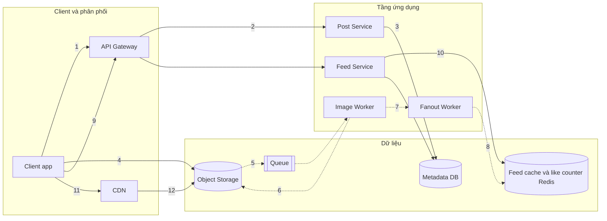
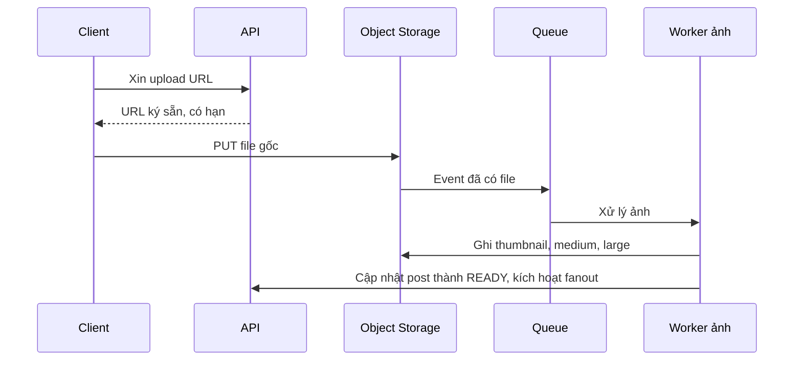
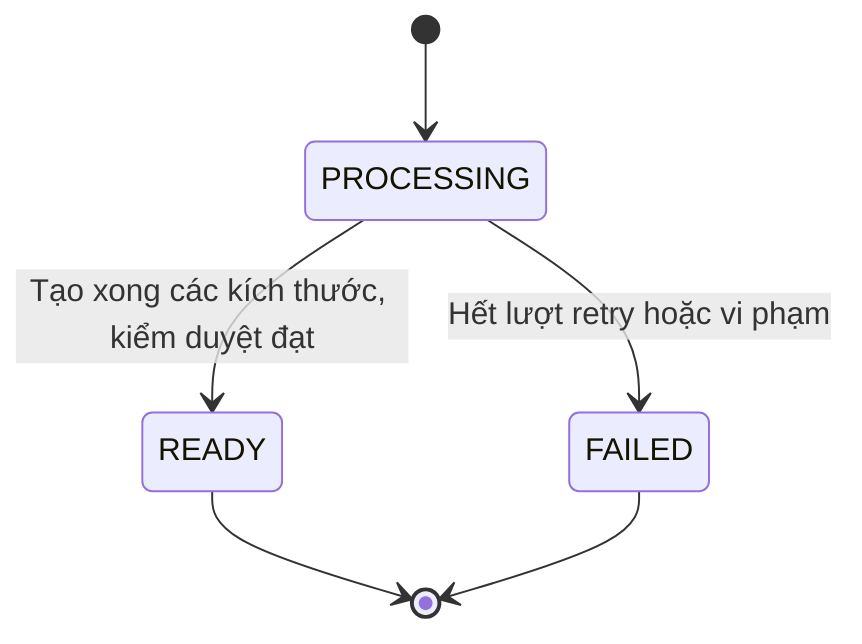

# Instagram (Chia sẻ ảnh)

**Độ khó:** Medium

## Instagram là gì?

Đây là ứng dụng chia sẻ ảnh và video: đăng ảnh, theo dõi người khác, xem feed, thích và bình luận. Quy mô là hàng trăm triệu người dùng, mỗi ngày thêm hàng chục triệu ảnh. Thiết kế này dùng được cho mạng xã hội ảnh, thương mại điện tử có nhiều ảnh sản phẩm, hoặc app chia sẻ nội dung. Nếu bạn chỉ lưu vài ảnh đại diện thì để thẳng vào object storage là đủ.

**Tóm tắt:**

- Instagram là ghép của ba chủ đề: news feed (fanout tới follower), lưu file lớn (object storage) và CDN (phát ảnh gần người dùng).
- Ảnh không bao giờ lưu trong DB: ảnh gốc nằm ở object storage, DB chỉ giữ metadata và quan hệ.
- Upload bằng presigned URL để client gửi thẳng vào object storage, app server không phải gánh băng thông.
- Worker async tạo nhiều kích thước ảnh; bài chỉ được fanout vào feed khi ở trạng thái `READY`.
- Tỷ lệ đọc so với ghi hơn 2.500:1, nên mọi lượt xem ảnh đi qua CDN chứ không qua app server.
- Counter lượt thích không `UPDATE count = count + 1` trên một dòng nóng mà cộng dồn bằng Redis hoặc theo batch, chấp nhận lệch vài giây.
- Chi phí chính là storage (khoảng 15 PB mỗi năm) và CDN, nên ảnh cũ chuyển sang cold tier theo lifecycle policy.
- Kiểm duyệt và xử lý ảnh chạy async, lỗi nhiều lần thì vào DLQ.
- Kiến trúc gồm CDN, API Gateway, Post và Feed Service, object storage, queue với Image và Fanout Worker, Metadata DB và Redis.

## Vấn đề cần giải quyết

Ảnh nặng, nên lưu và phát chúng tốn dung lượng lẫn băng thông. Người xem lại nhiều hơn người đăng rất nhiều, và cùng một ảnh phải hiện nhanh trên điện thoại màn hình nhỏ lẫn máy tính. Bài này thật ra là sự ghép của ba chủ đề: news feed, lưu file lớn và CDN.

Cách giải quyết là tách việc theo bản chất dữ liệu. Ảnh gốc đi vào object storage, một job nền tạo nhiều kích thước (thumbnail, trung bình, lớn) rồi phát qua CDN. Metadata và quan hệ theo dõi nằm trong DB. Feed dựng theo mô hình fanout như bài [News Feed](/go?p=15-System%20Design%2Fmedium%2F01-news-feed.md).

**Nền tảng:** Instagram là sự ghép của ba chủ đề: news feed (phân phối bài tới follower), lưu file lớn (object storage cho ảnh, DB chỉ giữ metadata) và CDN (phát ảnh gần người dùng). Tỷ lệ đọc so với ghi rất lớn nên băng thông ảnh phải đi qua CDN chứ không qua app server.

## Các khái niệm cần biết

- **Object storage**: kho lưu file theo key (như S3), rẻ, gần như vô hạn, phù hợp file lớn bất biến. Không dùng để truy vấn quan hệ; ảnh không bao giờ nên nằm trong DB.
- **CDN (Content Delivery Network)**: mạng máy chủ đặt gần người dùng, giữ bản sao ảnh để tải nhanh và giảm tải cho nguồn. Quan trọng nhất khi tỷ lệ đọc/ghi rất lớn.
- **Presigned URL**: URL tạm thời do server ký sẵn, cho phép client tải thẳng lên (hoặc xuống) object storage trong một khoảng thời gian, không cần đi qua app server và không cần cấp quyền lâu dài.
- **Thumbnail và variants**: các bản ảnh đã thu nhỏ hoặc nén cho từng kích thước màn hình, để không bắt điện thoại tải ảnh gốc 2 MB.
- **Fanout**: phân phối bài mới tới feed của các follower (xem bài News Feed).
- **Hot counter**: một dòng được hàng chục nghìn người cập nhật cùng lúc sẽ nghẽn lock; cần đếm trong memory hoặc theo batch.
- **Lifecycle policy**: quy tắc của bucket tự chuyển file sang lớp lạnh hoặc xóa file mồ côi sau một thời gian.
- **Hot tier và cold tier**: lạnh rẻ hơn nhưng đọc chậm và có phí truy xuất; hợp cho ảnh cũ ít ai xem.

## Ước lượng

Giả định 500 triệu người dùng hoạt động/ngày, 20 triệu ảnh mới/ngày, ảnh gốc trung bình 2 MB, mỗi người xem 100 ảnh/ngày.

| Đại lượng | Tính | Kết quả |
|---|---|---|
| Upload | 20 triệu / 86.400 | khoảng 230 ảnh/giây (đỉnh x3: 700) |
| Lưu ảnh gốc | 20 triệu x 2 MB | 40 TB/ngày, khoảng 15 PB/năm |
| Thêm các kích thước nhỏ | thumbnail + trung bình + lớn khoảng 30% ảnh gốc | khoảng 12 TB/ngày |
| Lượt xem ảnh | 500 triệu x 100 / 86.400 | khoảng 580.000/giây (đỉnh hơn 1 triệu) |
| Băng thông xem | 580.000 x 200 KB (bản đã nén cho màn hình) | khoảng 116 GB/giây, gần như toàn bộ qua CDN |

Kết luận: lưu trữ tăng PB mỗi năm nên chi phí chính là object storage và CDN; DB chỉ giữ metadata nhỏ. Tỷ lệ đọc/ghi hơn 2.500:1 nên đẩy hết việc phát ảnh ra CDN.

## Kiến trúc tổng thể

Sơ đồ thể hiện hai đường: đăng ảnh (client gửi thẳng vào object storage, worker xử lý async rồi fanout vào feed) và xem feed (server chỉ trả danh sách URL, client tải ảnh từ CDN).



**Chú thích sơ đồ**

| Thành phần | Vai trò | Vì sao chọn / đánh đổi |
|---|---|---|
| CDN | Phát ảnh gần người dùng, cache nhiều kích thước | Gần toàn bộ lượt xem (khoảng 580.000/giây) đi qua đây; tốn chi phí và cần invalidate khi xóa ảnh |
| API Gateway | Xác thực, rate limiting, cấp presigned URL | Một điểm vào dễ kiểm soát; phải scale ngang |
| Post Service | Tạo bài ở trạng thái `PROCESSING`, cấp URL upload | Không nhận bytes ảnh nên rất nhẹ |
| Feed Service | Đọc feed cache, gắn metadata, trả URL CDN | Không trạng thái nên scale ngang; chỉ trả URL chứ không trả ảnh |
| Object Storage | Lưu ảnh gốc và các kích thước | Rẻ, gần như vô hạn, bền; không truy vấn quan hệ, đọc trực tiếp chậm nên cần CDN |
| Queue | Đệm event có file mới | Tách upload khỏi xử lý ảnh; có độ trễ nhỏ, cần DLQ cho lỗi lặp |
| Image Worker | Tạo thumbnail, medium, large, kiểm duyệt | Scale theo độ sâu queue; tốn CPU |
| Fanout Worker | Đẩy bài `READY` vào feed của follower | Giống bài News Feed: push cho người thường, pull cho người nổi tiếng |
| Metadata DB | Lưu bài, người dùng, quan hệ, likes | Nhỏ so với ảnh; shard theo `user_id` hoặc `post_id` khi lớn |
| Feed cache và like counter Redis | Danh sách `post_id` dựng sẵn và counter cộng dồn | Nhanh và chịu dòng nóng; số hiển thị lệch vài giây, nguồn sự thật là bảng `likes` |

1. Client xin upload URL từ API Gateway.
2. Gateway chuyển tới Post Service, nơi tạo bài `PROCESSING` và ký presigned URL có hạn.
3. Post Service ghi metadata vào Metadata DB.
4. Client gửi ảnh thẳng vào object storage bằng presigned URL.
5. Object storage phát event có file mới vào queue (async).
6. Image Worker tạo các kích thước ảnh, kiểm duyệt rồi ghi lại vào object storage (async).
7. Worker đánh dấu bài `READY` và kích hoạt Fanout Worker (async).
8. Fanout Worker ghi `post_id` vào feed cache của follower (async).
9. Khi mở app, client gọi `GET /v1/feed` qua Gateway.
10. Feed Service đọc `post_id` từ feed cache và metadata từ cache hoặc DB.
11. Feed Service trả danh sách URL CDN; client tải ảnh từ CDN.
12. CDN trượt cache thì lấy từ object storage rồi giữ lại bản sao.

**Điểm nghẽn:** CDN và băng thông ra từ object storage khi ảnh nóng hoặc cache trượt; tăng tỷ lệ trúng cache, dùng nhiều kích thước ảnh và chuyển ảnh cũ sang cold tier. Tiếp theo là dòng nóng của like counter và queue xử lý ảnh khi upload tăng đột biến; cộng dồn bằng Redis theo batch và co giãn số Image Worker theo độ sâu queue.

## API và dữ liệu

```text
POST /v1/media/upload-url   body: { "contentType": "image/jpeg", "size": 2100000 }
  -> 201 { "mediaId": "m_91", "uploadUrl": "https://storage/...?signature=...", "expiresIn": 600 }
PUT  <uploadUrl>            (client đẩy file thẳng vào object storage, không đi qua app server)
POST /v1/posts              body: { "mediaId": "m_91", "caption": "..." }   Header Idempotency-Key
GET  /v1/feed?cursor=...    -> items kèm URL CDN theo kích thước phù hợp
```

```text
posts(post_id, author_id, media_id, caption, created_at, status)   -- status: PROCESSING -> READY
media(media_id, object_key, width, height, variants[thumb, medium, large])
likes(post_id, user_id) PK (post_id, user_id)      -- primary key chống thích hai lần
like_count(post_id, count)                          -- counter tách riêng, cập nhật async
```

## Flow upload bằng presigned URL

Vấn đề đặt ra: nếu client gửi file 2 MB qua API thì app server phải gánh toàn bộ băng thông upload. Presigned URL cho phép client gửi thẳng vào object storage, app server chỉ phát "giấy phép" và nhận thông báo khi xong.



Lợi ích: app server không gánh băng thông 2 MB x 700/giây; bài chỉ lộ ra feed khi trạng thái `READY` nên không bao giờ thấy ảnh hỏng. Không nên dùng cách này khi bạn cần kiểm tra nội dung ngay trước khi lưu (khi đó phải qua server, hoặc kiểm duyệt async như phần Lỗi và giám sát). Nếu URL ký không có hạn ngắn hoặc không giới hạn kích thước, người khác có thể lạm dụng để tải file tùy ý.

**Suy luận:** Băng thông là tài nguyên đắt nhất ở đây: 700 ảnh 2 MB mỗi giây là hơn 1 GB/giây chỉ riêng upload. Nếu ảnh đi qua app server thì nó vừa phải mua băng thông vừa phải giữ connection mở suốt thời gian truyền, trong khi nó chẳng làm gì với số bytes đó ngoài chuyển tiếp. Presigned URL tách hai việc: app server chỉ quyết định ai được phép upload (việc nhỏ, có tính toán), còn object storage nhận bytes (việc nặng, thứ nó vốn sinh ra để làm). Vì client gửi thẳng nên app server không biết khi nào xong, do đó storage phải phát event để worker xử lý tiếp, và đó là lý do bài có trạng thái PROCESSING rồi mới READY. Điểm dễ nhầm là URL ký quá rộng: không giới hạn thời hạn và kích thước thì ai cũng có thể dùng nó để đẩy file tùy ý vào bucket, nên phải đặt hạn ngắn và giới hạn size. Đổi lại ta mất khả năng kiểm tra nội dung trước khi lưu, nên kiểm duyệt phải chạy async trước khi chuyển sang READY.

**Phải thuộc:** Upload ảnh bằng presigned URL (client gửi thẳng vào object storage, URL có hạn ngắn và giới hạn kích thước), worker async tạo các kích thước ảnh, chỉ bài ở trạng thái `READY` mới được fanout vào feed. Counter lượt thích không `UPDATE count = count + 1` trên một dòng nóng mà cộng dồn bằng Redis hoặc theo batch.

Vòng đời trạng thái của một bài đăng được tóm tắt như sau.



Chỉ bài ở trạng thái `READY` mới được fanout vào feed.

**Suy luận:** Một ảnh nổi tiếng nhận hàng chục nghìn lượt thích mỗi giây, và `UPDATE count = count + 1` trên cùng một dòng buộc DB lock dòng đó cho từng lần cập nhật, nên các lượt thích xếp hàng tuần tự và throughput bị chặn bởi tốc độ lock một dòng. Thêm máy không giúp vì dòng nóng chỉ nằm ở một chỗ. Cách thoát là tách hai việc: ghi bản ghi `likes` với primary key `(post_id, user_id)` để chống thích hai lần (mỗi bản ghi là một dòng khác nhau nên không tranh chấp), còn con số hiển thị thì cộng dồn trong Redis bằng `INCR` hoặc theo batch qua queue rồi ghi về DB định kỳ. Cái giá là số hiển thị có thể lệch vài giây, điều mà người dùng không nhận ra với lượt thích nhưng không chấp nhận được với số dư tiền. Điểm dễ nhầm là coi counter là nguồn sự thật: nguồn sự thật là bảng `likes`, counter chỉ là bản cache, nên cần job đối soát đếm lại khi nghi ngờ lệch.

## Đào sâu

| Điểm khó | Vấn đề | Cách xử lý và đánh đổi |
|---|---|---|
| Chi phí lưu trữ và phát | 15 PB/năm, phần lớn ảnh cũ ít ai xem | Lớp lưu trữ theo độ nóng (ảnh sau 90 ngày chuyển sang lớp lạnh, rẻ hơn nhưng đọc chậm hơn và có phí truy xuất); chỉ giữ ảnh gốc ở lớp lạnh, phát bản đã nén; định dạng WebP/AVIF giảm băng thông nhưng cần dự phòng cho client cũ |
| Counter lượt thích | Ảnh nổi tiếng nhận hàng chục nghìn lượt thích/giây trên một dòng | Không `UPDATE count = count + 1` trên một dòng nóng. Ghi bản ghi `likes` (primary key chống trùng), cộng dồn đếm trong Redis (`INCR`) hoặc theo batch qua queue rồi ghi lại DB định kỳ. Mất: số hiển thị có thể lệch vài giây, đếm lại chính xác bằng job đối soát |

## Lỗi và giám sát

- Worker ảnh chết: event ở queue được giao lại; xử lý idempotent (ghi đè cùng key object) nên an toàn; ảnh lỗi nhiều lần vào DLQ, bài giữ `PROCESSING` hoặc chuyển `FAILED`.
- File upload dở dang hoặc không bao giờ được dùng: lifecycle của bucket tự xóa file mồ côi sau vài ngày.
- Ảnh vi phạm: kiểm duyệt async trước khi chuyển `READY`.
- Theo dõi: thời gian từ upload tới `READY` (p99), tỷ lệ CDN hit (mục tiêu trên 95%), queue xử lý ảnh, chi phí lưu trữ theo lớp, độ trễ cập nhật counter.

## Điểm cần nhắc

- Metadata (người dùng, bài, thích, bình luận) dùng DB quan hệ hoặc NoSQL; ảnh không bao giờ lưu trong DB.
- Quan hệ theo dõi: bảng `follower_id, followee_id`, hoặc graph store.
- Số lượt thích: đếm bằng counter (xem Hit Counter), cho phép chính xác muộn.
- Feed: xem bài [News Feed](/go?p=15-System%20Design%2Fmedium%2F01-news-feed.md).
- Chi phí chính là lưu trữ và CDN, nên có lớp lưu trữ lạnh cho ảnh cũ.

