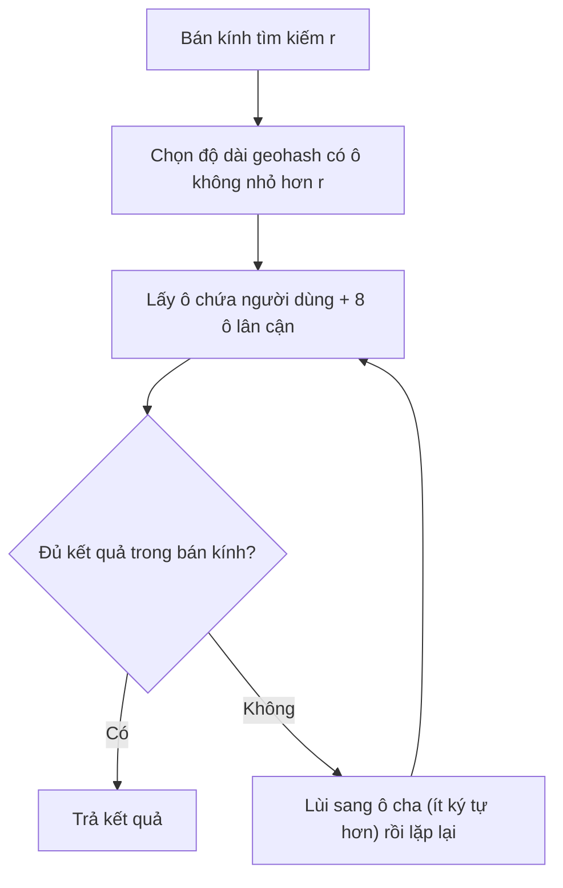
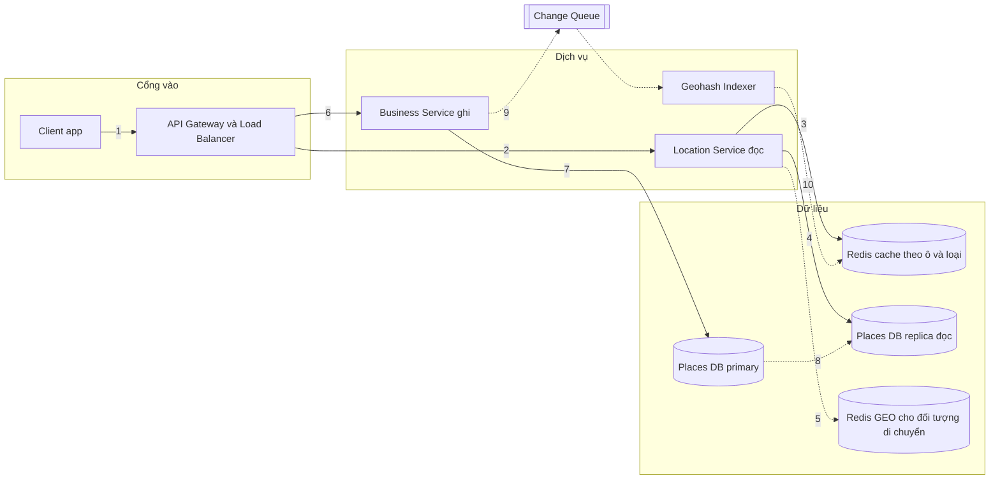

# Nearby Places (Tìm địa điểm gần đây)

**Độ khó:** Medium

## Nearby places là gì?

Đây là bài toán kiểu "quán cà phê gần tôi": cho vị trí người dùng, trả về các địa điểm trong bán kính vài km. Quy mô thường là hàng chục triệu địa điểm, đọc nhiều và địa điểm ít thay đổi. Bạn dùng nó khi tìm quán, tìm bạn bè gần đây, hay giao hàng. Nếu dữ liệu ít (vài nghìn điểm) thì tính khoảng cách trực tiếp tới từng điểm là đủ. Nếu vị trí đổi liên tục (tài xế đang chạy) thì cần cách lưu khác, vì index tĩnh không theo kịp.

**Tóm tắt:**

- Index thường trên lat và lng không trả lời được câu hỏi "trong bán kính", vì khoảng cách thật phải tính cho từng điểm.
- Giải pháp luôn gồm hai bước: spatial index (geohash hoặc quadtree) lấy tập ứng viên rộng và rẻ, rồi tính khoảng cách thật bằng Haversine trên số ít ứng viên (filter rồi refine).
- Geohash encode (lat, lng) thành chuỗi base32, tiền tố chung dài nghĩa là gần nhau; 5 ký tự khoảng 4,9 km x 4,9 km, 6 ký tự khoảng 1,2 km x 0,6 km.
- Luôn truy vấn ô của mình cộng 8 ô lân cận, vì hai điểm sát biên có thể thuộc hai ô có tiền tố khác hẳn nhau.
- Ô phải không nhỏ hơn bán kính, nếu không 9 ô không phủ hết; không đủ kết quả thì lùi sang ô cha.
- Quadtree thích ứng mật độ nhưng nằm trong RAM và phải dựng lại khi dữ liệu đổi; geohash đơn giản, lưu DB thường và dễ shard theo tiền tố.
- Đối tượng di chuyển dùng Redis `GEOADD` và `GEOSEARCH` với TTL ngắn.
- Dữ liệu nhỏ (khoảng 100 GB) và đọc nhiều, nên replication đọc cùng cache theo (ô, loại) là đủ.
- Kiến trúc gồm Location Service đọc, cache theo ô, replica đọc, primary ghi, queue với Geohash Indexer và Redis GEO cho đối tượng di chuyển.

## Vấn đề cần giải quyết

Index thông thường trên latitude và longitude không giúp được truy vấn "trong bán kính". Index chỉ thu hẹp được theo một khoảng của từng cột riêng lẻ, còn khoảng cách thật cần tính cho từng địa điểm, nên quét toàn bảng là quá chậm. Vậy ta cần một spatial index để thu hẹp ứng viên trước, rồi mới tính chính xác trên số ít ứng viên đó.

Cách giải quyết: chia bản đồ thành các ô bằng geohash hoặc quadtree, lấy ô chứa người dùng cộng các ô lân cận, rồi lọc chính xác theo khoảng cách thật. Địa điểm hay được hỏi thì cache theo ô.

**Nền tảng:** Index thường trên hai cột lat và lng không trả lời được câu hỏi "trong bán kính". Giải pháp luôn là hai bước: dùng spatial index (geohash hoặc quadtree) để lấy tập ứng viên rộng và rẻ, rồi mới tính khoảng cách thật (Haversine) trên số ít ứng viên đó (lọc thô rồi lọc tinh).

## Các khái niệm cần biết

- **Geohash**: encode tọa độ (lat, lng) thành một chuỗi ký tự base32. Hai điểm có tiền tố chung dài thì nằm trong cùng một ô, nên tìm "gần nhau" quy về tìm theo tiền tố chuỗi, một thứ DB thường làm tốt. Ví dụ `w3gvk1` là một ô khoảng 1,2 km x 0,6 km ở TP.HCM.
- **Quadtree**: cây mà mỗi node là một ô hình chữ nhật chia thành 4 ô con khi có quá nhiều điểm. Thành phố đông được chia nhỏ, nông thôn thưa giữ nguyên.
- **Neighbor cells**: vì hai điểm sát biên có thể thuộc hai ô có tiền tố khác hẳn nhau, phải lấy thêm 8 ô xung quanh. Quên bước này thì người đứng cạnh biên ô sẽ không thấy quán ngay bên kia biên.
- **Công thức Haversine**: tính khoảng cách giữa hai điểm trên mặt cầu từ tọa độ. Dùng ở bước lọc chính xác vì ô chỉ là xấp xỉ.
- **Filter rồi refine**: dùng index để lấy tập ứng viên rộng, rồi tính chính xác trên tập đó. Mô hình này gặp ở mọi spatial index.
- **Redis GEOADD và GEOSEARCH**: lệnh Redis lưu và tìm theo tọa độ, hợp với dữ liệu đổi liên tục có TTL ngắn.

## Hai cách đánh index

| | Geohash | Quadtree |
|---|---|---|
| Ý tưởng | Encode tọa độ thành chuỗi; tiền tố chung nghĩa là gần nhau | Cây chia ô thành 4, chia tiếp ô quá đông |
| Ưu điểm | Dễ lưu trong DB thường, dễ chia shard | Thích ứng với mật độ (thành phố dày, nông thôn thưa) |
| Nhược điểm | Ô cố định, biên giữa ô cần xử lý | Cần giữ trong memory, cập nhật phức tạp hơn |

Chọn geohash khi bạn muốn đơn giản, lưu trong DB thường và dễ chia shard theo tiền tố. Chọn quadtree khi mật độ điểm chênh lệch lớn và bạn chấp nhận giữ cây trong RAM và dựng lại khi dữ liệu đổi.

**Suy luận:** Hai cách này khác nhau ở chỗ ai quyết định kích thước ô. Geohash dùng ô cố định theo độ dài mã, nên ở trung tâm thành phố một ô có thể chứa hàng chục nghìn điểm còn vùng quê thì trống, và tải truy vấn lệch theo. Quadtree chia ô nào quá đông thành bốn ô con, nên mỗi ô chỉ chứa vài trăm điểm, nhưng muốn biết ô nào đã chia thì phải giữ cây trong memory và dựng lại hoặc sửa khi dữ liệu đổi. Vì địa điểm ít thay đổi và đọc nhiều, cả hai đều khả thi, nên chọn theo vận hành: geohash vừa là một cột trong DB vừa cho phép shard theo tiền tố, còn quadtree cần một tầng service giữ cây. Điểm dễ nhầm là chọn quadtree vì nó "thông minh hơn" trong khi dữ liệu phân bố khá đều; khi mật độ không lệch nhiều thì lợi ích không bù được chi phí vận hành. Với đối tượng di chuyển như tài xế thì cả hai đều không hợp vì ghi quá nhiều, nên dùng Redis GEO với TTL ngắn.

## Flowchart

Luồng truy vấn tổng thể nằm ở mục Kiến trúc tổng thể. Ở đó, tìm ô và 8 ô lân cận là lọc thô (rẻ, dùng index), còn tính khoảng cách thật là lọc tinh chỉ chạy trên vài trăm ứng viên thay vì cả bảng.

**Suy luận:** Index B-tree sắp xếp theo một thứ tự một chiều, nên với hai cột lat và lng nó chỉ thu hẹp được theo khoảng của một cột, rồi vẫn phải quét hết phần còn lại của cột kia. Bản chất bài toán là biến vị trí hai chiều thành thứ tự một chiều mà các điểm gần nhau vẫn gần nhau, và geohash làm đúng việc đó bằng cách xen kẽ bit của kinh độ và vĩ độ, nên tiền tố chung dài nghĩa là cùng một ô và DB tìm theo tiền tố bằng index thường. Cái giá là ô chỉ xấp xỉ vòng tròn bán kính vì nó là hình chữ nhật, nên kết quả thô có cả điểm ngoài bán kính, và phải lọc tinh bằng khoảng cách thật trên vài trăm ứng viên thay vì cả bảng. Điểm dễ nhầm nhất là biên ô: hai điểm cách nhau 10 mét có thể nằm ở hai ô với tiền tố khác hoàn toàn, nên bỏ qua 8 ô lân cận làm người đứng cạnh biên không thấy quán ngay bên kia. Hệ quả khi thiết kế: chọn độ dài geohash sao cho ô không nhỏ hơn bán kính, và theo dõi số ứng viên mỗi truy vấn, vì con số quá cao nghĩa là ô quá to.

Cách chọn độ dài geohash phụ thuộc vào bán kính tìm kiếm, theo flow quyết định sau.



## Ước lượng

Giả định 100 triệu địa điểm, 100 triệu người dùng/ngày, mỗi người tìm 5 lần/ngày.

| Đại lượng | Tính | Kết quả |
|---|---|---|
| Truy vấn | 100 triệu x 5 / 86.400 | khoảng 5.800/giây (đỉnh x3: 17.000) |
| Dung lượng địa điểm | 100 triệu x 1 KB | khoảng 100 GB, vừa một máy; chia shard chủ yếu để tăng đọc và chịu lỗi |
| Index geohash | 100 triệu x (12 B mã + 8 B id) | khoảng 2 GB, nhét vừa RAM |
| Ghi | thêm hoặc sửa địa điểm | rất thấp, vài chục/giây |

Kết luận: dữ liệu nhỏ, đọc nhiều, ghi ít: replication đọc và cache là đủ; điểm khó là thuật toán chọn ứng viên, không phải dung lượng.

## Kiến trúc tổng thể

Sơ đồ thể hiện đường đọc chiếm gần hết tải (tìm quanh vị trí, cache theo ô) và đường ghi nhỏ (thêm hoặc sửa địa điểm) cập nhật index geohash và cache.



**Chú thích sơ đồ**

| Thành phần | Vai trò | Vì sao chọn / đánh đổi |
|---|---|---|
| API Gateway và Load Balancer | Xác thực, rate limiting, chia tải | Tách đọc và ghi theo đường dẫn; thêm một bước nhảy nhỏ |
| Location Service | Tính ô geohash, mở rộng 8 ô lân cận, lọc khoảng cách thật | Không trạng thái nên scale ngang; bước lọc tinh tốn CPU nhưng chỉ trên vài trăm ứng viên |
| Redis cache theo ô và loại | Cache kết quả theo `(geohash, type)` | Nhiều người cùng ô nên trúng cao; dữ liệu có thể cũ theo TTL |
| Places DB replica đọc | Truy vấn `geohash LIKE 'prefix%'` | Đọc nhiều nên thêm replica là đủ; có độ trễ sao chép nhỏ |
| Places DB primary | Nhận ghi, nguồn sự thật | Ghi chỉ vài chục mỗi giây nên một primary đủ; dữ liệu khoảng 100 GB, shard theo tiền tố geohash nếu cần |
| Business Service | Thêm, sửa, xóa địa điểm | Tách khỏi đường đọc để ghi không ảnh hưởng độ trễ tìm kiếm |
| Change Queue và Geohash Indexer | Tính lại geohash, làm mới cache theo ô | Cập nhật async nên kết quả mới có trễ ngắn; cần idempotent |
| Redis GEO | Lưu vị trí tài xế hoặc bạn bè với TTL ngắn | Ghi liên tục không hợp DB; mất dữ liệu khi restart là chấp nhận được vì vị trí tự làm mới |

1. Client gọi `GET /v1/places/nearby?lat=...&lng=...&radius=...` qua Gateway.
2. Gateway chuyển tới Location Service.
3. Location Service tính ô geohash và 8 ô lân cận rồi tra Redis cache theo từng ô.
4. Ô trượt cache thì truy vấn replica đọc, sau đó lọc theo khoảng cách Haversine, sắp xếp và trả kết quả.
5. Với đối tượng di chuyển, service dùng `GEOSEARCH` trên Redis GEO (nhánh phụ).
6. Khi chủ quán thêm hoặc sửa địa điểm, Gateway chuyển tới Business Service.
7. Business Service ghi vào primary.
8. Primary sao chép sang các replica đọc (async).
9. Business Service phát event thay đổi vào queue (async).
10. Geohash Indexer làm mới hoặc xóa các khóa cache của ô bị ảnh hưởng (async).

**Điểm nghẽn:** Replica đọc và ô nóng ở trung tâm thành phố nghẽn đầu tiên; thêm replica, cache theo `(ô, loại)` và dùng ô nhỏ hơn cho vùng đông. Tiếp theo là Redis GEO khi số đối tượng di chuyển tăng; shard theo vùng địa lý hoặc theo tiền tố geohash.

## API và dữ liệu

```text
GET /v1/places/nearby?lat=10.7769&lng=106.7009&radius=2000&type=cafe&limit=20
  -> { "items": [ { "id": 5, "name": "...", "distanceM": 340 } ], "nextCursor": "..." }
```

```sql
places(id PK, name, lat double, lng double, type, geohash char(8))
-- tìm theo tiền tố geohash
CREATE INDEX idx_places_gh ON places (geohash, type);
-- Tìm trong 1 ô:  WHERE geohash LIKE 'w3gvk1%' AND type = 'cafe'
```

## Độ chính xác geohash

| Độ dài mã | Kích thước ô (xấp xỉ) | Dùng cho bán kính |
|---|---|---|
| 4 | 39 km x 20 km | tìm theo thành phố |
| 5 | 4,9 km x 4,9 km | vài km |
| 6 | 1,2 km x 0,6 km | 500 m đến 1 km |
| 7 | 150 m x 150 m | vài trăm mét |

**Phải thuộc:** Geohash encode (lat, lng) thành chuỗi base32, tiền tố chung dài nghĩa là gần nhau; độ dài 5 ký tự khoảng 4,9 km x 4,9 km, 6 ký tự khoảng 1,2 km x 0,6 km. Luôn truy vấn ô của mình cộng 8 ô lân cận (vì biên ô) rồi lọc theo khoảng cách thật. Quadtree thích ứng mật độ nhưng nằm trong RAM; với đối tượng di chuyển dùng Redis `GEOADD` và `GEOSEARCH`.

Quy tắc chọn: ô phải **không nhỏ hơn bán kính**; nếu nhỏ hơn thì 9 ô vẫn không phủ hết. Ví dụ bán kính 1 km: dùng độ dài 5 (9 ô) hoặc độ dài 6 và lấy thêm vòng ngoài. Kích thước thật hẹp dần theo vĩ độ cao (xấp xỉ).

## Cơ chế lõi: encode geohash, chín ô, lọc chính xác (Java, đã chạy thử)

```java
static final String B32 = "0123456789bcdefghjkmnpqrstuvwxyz";
static String encode(double lat, double lon, int len) {
    double[] latRange = {-90, 90}, lonRange = {-180, 180};
    StringBuilder sb = new StringBuilder();
    boolean even = true; int bit = 0, idx = 0;
    while (sb.length() < len) {
        double[] r = even ? lonRange : latRange;
        double v = even ? lon : lat, mid = (r[0] + r[1]) / 2;
        idx <<= 1;
        // xen kẽ bit kinh độ và vĩ độ
        if (v >= mid) { idx |= 1; r[0] = mid; } else r[1] = mid;
        even = !even;
        // 5 bit -> 1 ký tự base32
        if (++bit == 5) { sb.append(B32.charAt(idx)); bit = 0; idx = 0; }
    }
    return sb.toString();
}
// khoảng cách trên mặt cầu
static double haversineKm(double lat1, double lon1, double lat2, double lon2) {
    double dLat = Math.toRadians(lat2 - lat1), dLon = Math.toRadians(lon2 - lon1);
    double h = Math.pow(Math.sin(dLat / 2), 2)
        + Math.cos(Math.toRadians(lat1)) * Math.cos(Math.toRadians(lat2)) * Math.pow(Math.sin(dLon / 2), 2);
    return 2 * 6371 * Math.asin(Math.sqrt(h));
}
// 9 ô cần truy vấn: mã hóa 9 điểm, mỗi điểm lệch đúng một kích thước ô (dLat, dLon)
static Set<String> nineCells(double lat, double lon, int len, double dLat, double dLon) {
    Set<String> s = new LinkedHashSet<>();
    for (int i = -1; i <= 1; i++) for (int j = -1; j <= 1; j++)
        s.add(encode(lat + i * dLat, lon + j * dLon, len));
    return s;
}
// encode(57.64911, 10.40744, 11) = "u4pruydqqvj" (giá trị chuẩn); encode(10.7769, 106.7009, 6) = "w3gvk1"
// haversine từ (10.7769, 106.7009) tới (10.7626, 106.6602) = 4,7 km
```

Truy vấn đầy đủ: encode vị trí, lấy 9 ô, đọc ứng viên theo từng ô, tính `haversine` cho từng ứng viên, giữ cái trong bán kính, sắp theo khoảng cách. Thay vì tính 9 ô lệch điểm như trên, thư viện thật tra bảng láng giềng, nhưng ý nghĩa như nhau.

## Đào sâu

| Điểm khó | Vấn đề | Cách xử lý và đánh đổi |
|---|---|---|
| Biên ô | Hai điểm sát nhau có thể thuộc hai ô khác tiền tố hoàn toàn | Luôn truy vấn ô của mình cộng 8 ô lân cận rồi lọc theo khoảng cách thật. Mất: đọc nhiều ứng viên hơn cần thiết (khoảng 9 lần diện tích ô) |
| Mật độ lệch | Quận trung tâm có hàng chục nghìn điểm trong một ô, vùng quê ô trống | Quadtree chia nhỏ ô quá đông (ví dụ trên 500 điểm) và giữ nguyên ô thưa, nhưng cây nằm trong RAM và cần dựng lại khi dữ liệu đổi. Hoặc geohash nhiều mức: không đủ kết quả thì lùi sang ô cha (ít ký tự hơn). Đánh đổi: geohash đơn giản và dễ lưu DB, quadtree thích nghi tốt hơn nhưng vận hành phức tạp hơn |

## Lỗi và giám sát

- Dữ liệu tọa độ sai (lat ngoài [-90, 90], lng ngoài [-180, 180]): kiểm tra đầu vào.
- Ô quá nóng (một trung tâm thương mại): cache kết quả theo `(ô, loại)` vài chục giây; replica đọc.
- Với đối tượng di chuyển: Redis `GEOADD` và `GEOSEARCH`, TTL ngắn; ghi nhiều nên không dùng DB quan hệ.
- Theo dõi: p99 truy vấn, số ứng viên trung bình mỗi truy vấn (quá cao nghĩa là ô quá to), tỷ lệ cache hit.

## Điểm cần nhắc

- Địa điểm ít thay đổi: đọc nhiều hơn ghi nhiều, cache và replication dễ.
- Chia shard theo vùng địa lý hoặc geohash.
- Với đối tượng di chuyển (bạn bè gần đây), lưu vị trí trong Redis với TTL.
- Ô lân cận cần lấy cả khi người dùng ở gần biên ô.

