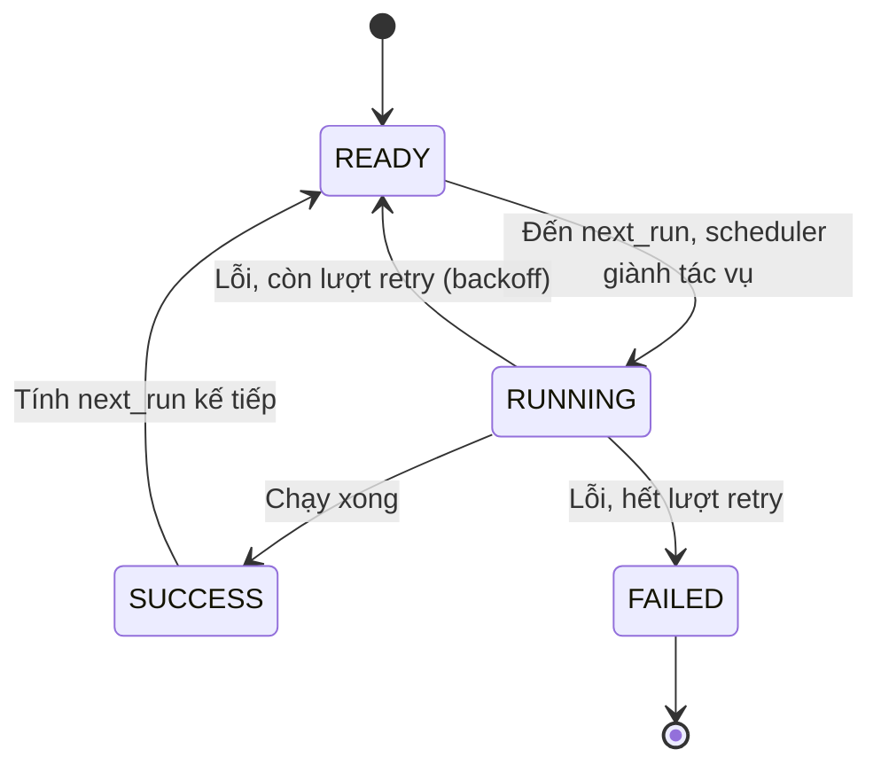
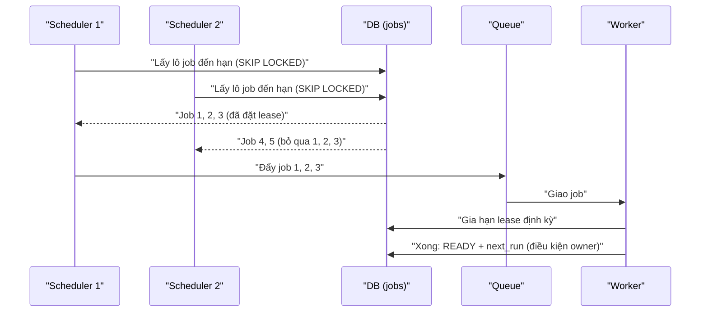
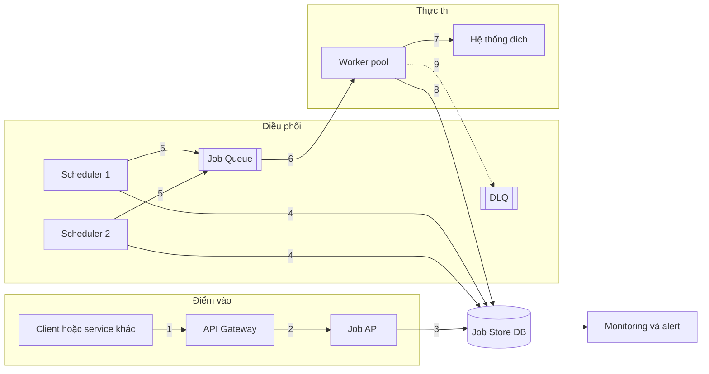

# Distributed Job Scheduler (Lập lịch tác vụ)

**Độ khó:** Medium

## Job scheduler là gì?

Đây là hệ thống chạy tác vụ theo lịch (một lần, định kỳ, hoặc theo biểu thức cron) và giao cho nhiều worker thực hiện, ở quy mô có thể là hàng triệu job mỗi ngày. Bạn dùng nó cho báo cáo định kỳ, dọn dữ liệu, nhắc lịch, xử lý hàng loạt. Nếu chỉ có vài job đơn giản trên một server thì cron hoặc scheduler có sẵn của framework (ví dụ `@Scheduled` của Spring) là đủ.

**Tóm tắt:**

- Cron trên một máy là điểm lỗi duy nhất, còn chạy cron trên nhiều máy thì job chạy trùng; vì vậy đưa state ra DB dùng chung.
- Mỗi job lưu thời điểm chạy kế tiếp (`next_run`); scheduler quét job đến hạn và giành bằng conditional update, kèm `FOR UPDATE SKIP LOCKED` để nhiều scheduler chia batch mà không chờ nhau.
- Lease (`owner`, `lease_until`) cho phép giành lại job của worker đã chết; worker còn sống thì gia hạn lease định kỳ.
- Không thể đảm bảo đúng một lần, nên chọn at-least-once và job phải idempotent.
- Điều kiện `owner` hoặc fencing token chặn worker cũ ghi đè kết quả sau khi đã mất lease.
- Lỗi thì retry với backoff đến `max_retries` rồi FAILED; lease ngắn thì phục hồi nhanh nhưng dễ trùng, lease dài thì ngược lại.
- Bottleneck là cú quét đến hạn và đỉnh đầu giờ: index `(status, next_run)`, quét theo batch, shard theo `hash(id)` hoặc dùng delay queue trong memory.
- Scheduler chết không mất gì vì state nằm ở DB.
- Kiến trúc gồm Job API, Job Store DB, nhiều scheduler giành job bằng lease, job queue, worker pool, DLQ và monitoring.

## Vấn đề cần giải quyết

Cron trên một máy có điểm yếu rõ ràng: máy đó chết là toàn bộ lịch dừng. Nếu bạn chạy cron trên nhiều máy để dự phòng thì job bị chạy trùng nhiều lần (ví dụ gửi báo cáo hai lần). Điều ta muốn là job không bị bỏ sót, không bị trùng, và vẫn retry được khi worker chết giữa chừng.

Cách giải quyết là đưa trạng thái ra DB dùng chung. Mỗi job được lưu cùng thời điểm chạy kế tiếp. Scheduler quét các job đến hạn, giành quyền chạy bằng một conditional update (hoặc lock), rồi đẩy cho worker qua queue. Chỉ một scheduler giành được mỗi job. Trạng thái được ghi lại, lỗi thì retry, và vì job có thể chạy lặp nên nó phải idempotent.

**Nền tảng:** Lập lịch phân tán không thể đảm bảo "đúng một lần" (worker có thể chết hoặc lease hết hạn khi vẫn đang chạy), nên hệ thống chọn at-least-once: trạng thái job nằm ở DB dùng chung, giành job bằng conditional update hoặc lease, và job phải idempotent.

## Các khái niệm cần biết

- **Cron expression**: chuỗi 5 trường mô tả lịch lặp, ví dụ `0 2 * * *` là 2 giờ sáng mỗi ngày. Dùng để khai báo lịch định kỳ ngắn gọn.
- **Lease**: một worker "mượn" job trong một thời gian (`lease_until`). Hết hạn mà chưa báo xong thì coi như worker đã chết và job được giành lại. Khác với lock thường ở chỗ lock treo vĩnh viễn nếu người giữ chết, còn lease tự hết hạn. Lease quá ngắn thì job chạy lâu bị giao hai lần, quá dài thì phục hồi chậm.
- **Leader election**: chọn ra một node làm "người dẫn đầu" duy nhất để làm việc cần độc quyền. Ở bài này ta tránh nó bằng cách cho mọi scheduler cùng giành job qua DB.
- **`FOR UPDATE SKIP LOCKED`**: khi chọn dòng để lock, bỏ qua các dòng đang bị người khác lock thay vì chờ. Hợp để nhiều scheduler chia nhau lô job mà không nghẽn.
- **At-least-once và idempotent**: hệ thống đảm bảo job chạy ít nhất một lần (có thể hơn một), nên bản thân job phải cho cùng kết quả dù chạy lặp.
- **Fencing token**: số tăng dần cấp mỗi lần giành job; bên nhận kết quả từ chối token cũ, ngăn worker cũ (đã mất lease nhưng vẫn chạy) ghi đè kết quả.
- **Backoff**: chờ lâu dần giữa các lần retry để không dồn thêm tải vào chỗ đang lỗi.
- **Định luật Little**: số job chạy đồng thời bằng tốc độ đến nhân thời gian chạy trung bình; dùng để ước lượng số worker.
- **Delayed queue**: queue giữ message tới giờ hẹn mới giao, thay cho việc quét DB liên tục.

## Thành phần

- **Job Store:** lưu định nghĩa tác vụ, lịch, trạng thái.
- **Scheduler:** tìm tác vụ đến hạn.
- **Queue:** chuyển tác vụ cho worker.
- **Worker:** chạy tác vụ, báo kết quả.

## Flowchart

Vòng đời của một job: từ `READY` đến `RUNNING` khi scheduler giành được, rồi hoặc thành công và được xếp lịch lần kế, hoặc lỗi và quay lại retry.



Trên thực tế, chuyển từ `SUCCESS` về `READY` cùng lúc với tính `next_run` trong một câu `UPDATE`. Còn job "mồ côi" (worker chết nên mãi ở `RUNNING`) được giành lại khi `lease_until` đã qua.

Sơ đồ trình tự dưới đây cho thấy ai làm gì khi hai scheduler cùng quét một lúc.



Đọc sơ đồ: `SKIP LOCKED` làm hai scheduler chia nhau lô job mà không chờ nhau. Điều kiện `owner` ở bước cuối chặn một worker đã mất lease ghi đè kết quả.

## Ước lượng

Giả định 10 triệu lần chạy mỗi ngày, mỗi lần chạy trung bình 30 giây, một nửa tập trung vào đầu giờ.

| Đại lượng | Tính | Kết quả |
|---|---|---|
| Trung bình | 10 triệu / 86.400 | khoảng 115 job/giây |
| Đỉnh đầu giờ | giả định 2 triệu job cùng đặt vào giây 00 của giờ tròn, dàn đều trong 1 phút | khoảng 33.000 job/giây cần giao cho worker |
| Worker đồng thời | 115 x 30 giây (định luật Little) | khoảng 3.500 job chạy cùng lúc ở mức trung bình; đỉnh gấp vài lần |
| Bảng jobs | 10 triệu định nghĩa x 500 B | khoảng 5 GB; truy vấn quét theo `next_run` cần index |

Kết luận: số job lớn nhưng dữ liệu nhỏ; bottleneck là cú quét đến hạn và độ trễ đầu giờ, giải quyết bằng index `(status, next_run)`, quét theo batch và nhiều scheduler chia nhau việc.

## Kiến trúc tổng thể

Sơ đồ thể hiện job được khai báo qua API, lưu ở Job Store, nhiều scheduler cùng quét job đến hạn và giành bằng lease, rồi giao qua queue cho worker chạy và báo kết quả về DB.



**Chú thích sơ đồ**

| Thành phần | Vai trò | Vì sao chọn / đánh đổi |
|---|---|---|
| API Gateway và Job API | Tạo, sửa, hủy, xem job và lịch cron | Một điểm vào để xác thực và validate cron; không giữ state nên scale dễ |
| Job Store DB | Lưu định nghĩa, `next_run`, `status`, lease, số lần retry | State dùng chung nên scheduler chết không mất gì; là điểm nghẽn quét nên cần index `(status, next_run)` |
| Scheduler 1 và 2 | Quét job đến hạn, giành bằng conditional update với `SKIP LOCKED` | Nhiều scheduler chia lô không cần leader election; phải chịu được việc quét chồng |
| Job Queue | Chuyển job đã giành cho worker | Đệm đỉnh đầu giờ và tách điều phối khỏi thực thi; thêm độ trễ nhỏ |
| Worker pool | Chạy job, gia hạn lease, báo kết quả | Scale ngang theo tải (định luật Little); job phải idempotent vì at-least-once |
| Hệ thống đích | Nơi job thực sự tác động | Có thể chậm hoặc lỗi nên cần timeout và retry với backoff |
| DLQ | Giữ job hết lượt retry | Không chặn queue chính; cần người xử lý hoặc job nhập lại |
| Monitoring và alert | Theo dõi độ trễ khỏi `next_run`, job kẹt `RUNNING` | Phát hiện lệch lịch sớm; cần đặt ngưỡng cảnh báo hợp lý |

1. Client gọi `POST /v1/jobs` kèm biểu thức cron qua API Gateway.
2. Gateway chuyển tới Job API để kiểm tra hợp lệ.
3. Job API ghi job với `next_run` vào Job Store DB.
4. Các scheduler quét job đến hạn và giành bằng conditional update cùng `SKIP LOCKED`, đặt `owner` và `lease_until`.
5. Scheduler đẩy job đã giành vào Job Queue.
6. Worker lấy job từ queue.
7. Worker chạy job trên hệ thống đích và gia hạn lease định kỳ.
8. Xong thì worker ghi `SUCCESS` và tính `next_run` kế tiếp với điều kiện `owner`; lỗi thì retry với backoff.
9. Job hết lượt retry được chuyển vào DLQ (async).

**Điểm nghẽn:** Cú quét đến hạn trên Job Store DB nghẽn đầu tiên, nhất là đỉnh đầu giờ; dùng index `(status, next_run)`, quét theo batch, shard theo `hash(id)` hoặc đặt delay queue trong memory. Tiếp theo là worker pool khi đỉnh gấp vài lần trung bình; co giãn số worker theo độ sâu queue và tách pool theo mức ưu tiên.

## API và dữ liệu

```text
POST   /v1/jobs   { "name":"daily-report", "cron":"0 2 * * *", "payload":{...}, "maxRetries":3 }
GET    /v1/jobs/{id}/runs        (lịch sử các lần chạy)
DELETE /v1/jobs/{id}
```

```sql
CREATE TABLE jobs (
  id bigint PRIMARY KEY, cron varchar(64), payload jsonb,
  status varchar(10) NOT NULL,          -- READY, RUNNING, FAILED
  next_run timestamp NOT NULL,
  lease_until timestamp, owner varchar(64),
  attempts int DEFAULT 0, max_retries int DEFAULT 3
);
CREATE INDEX idx_jobs_due ON jobs (next_run) WHERE status IN ('READY','RUNNING');
```

## Cơ chế lõi: giành job bằng lease (SQL)

```sql
-- Mỗi scheduler lấy một lô job đến hạn. SKIP LOCKED (PostgreSQL, MySQL 8) để nhiều scheduler không chờ nhau.
WITH due AS (
  SELECT id FROM jobs
   WHERE next_run <= now()
     -- gồm cả job mồ côi do worker chết
     AND (status = 'READY' OR (status = 'RUNNING' AND lease_until < now()))
   ORDER BY next_run
   LIMIT 100
   FOR UPDATE SKIP LOCKED
)
UPDATE jobs j
   SET status = 'RUNNING', owner = :me, lease_until = now() + interval '60 seconds', attempts = attempts + 1
  FROM due WHERE j.id = due.id
RETURNING j.id, j.payload;
```

Logic điều kiện (giành một lần duy nhất, bên thứ hai bị từ chối, job quá hạn lease được giành lại) đã kiểm tra bằng SQLite với phiên bản một job; `SKIP LOCKED` và `RETURNING` ở trên chưa chạy thử.

**Suy luận:** Mỗi scheduler cần một batch job khác nhau, và nếu họ cùng `SELECT` rồi `UPDATE` thì cả hai thấy cùng danh sách và tranh nhau từng job. `FOR UPDATE` làm người thứ hai chờ người thứ nhất, nên các scheduler xếp hàng và thêm máy không tăng throughput. `SKIP LOCKED` đổi cách: dòng nào đang bị lock thì bỏ qua và lấy dòng kế tiếp, nên mỗi scheduler nhận một batch riêng và chạy parallel. Có hai điều kiện đi kèm: batch phải được `UPDATE` thành RUNNING trong cùng statement hoặc cùng transaction với lúc chọn, nếu không lock nhả ra trước khi đánh dấu và job bị giành hai lần; và thứ tự giao job không còn là FIFO chặt, nên không dùng cách này khi cần thứ tự nghiêm ngặt. Phần còn lại của throughput nằm ở index `(status, next_run)` để quét không phải đọc cả bảng, và ở việc dàn đầu giờ bằng cách ngẫu nhiên hóa giờ chạy.

**Phải thuộc:** Giành job bằng `SELECT ... FOR UPDATE SKIP LOCKED` rồi `UPDATE` đặt `owner` và `lease_until` (job RUNNING mà `lease_until` đã qua thì giành lại được). Worker gia hạn lease định kỳ; khi xong chỉ ghi kết quả nếu còn là `owner` (hoặc fencing token) để worker cũ không ghi đè. Cron `0 2 * * *` nghĩa là 2 giờ sáng mỗi ngày (5 trường: phút, giờ, ngày, tháng, thứ).

Worker đang chạy lâu thì **gia hạn lease** định kỳ (`UPDATE ... SET lease_until = now() + 60s WHERE id=? AND owner=:me`). Khi xong:

```sql
UPDATE jobs SET status = 'READY', next_run = :next_cron_time, attempts = 0, lease_until = NULL
 -- điều kiện owner chặn worker cũ ghi đè sau khi mất lease
 WHERE id = :id AND owner = :me;
```

Lỗi thì đặt `next_run = now() + backoff(attempts)` và `status = 'READY'`; vượt `max_retries` thì `FAILED` và báo động.

**Suy luận:** Cron một máy chết là dừng, cron nhiều máy thì trùng, nên giải pháp là đưa state ra chỗ dùng chung và để mọi scheduler cạnh tranh trên đó, chứ không bầu một leader. Cạnh tranh an toàn vì giành job là một conditional update: DB chỉ cho một bên thấy điều kiện đúng. Nhưng giành xong, worker có thể chết, và không ai biết nó chết hay chỉ chậm, nên không thể giữ job vĩnh viễn như lock thường; lease biến quyền giữ thành có hạn, hết hạn mà chưa báo xong thì job được giành lại. Đây chính là chỗ at-least-once xuất hiện: worker chậm nhưng vẫn sống có thể chạy tiếp sau khi job đã giao cho người khác, nên cùng một job chạy hai lần. Điểm dễ nhầm là nghĩ lease đủ để chặn trùng; nó chỉ giới hạn thời gian, còn chống ghi đè phải dùng điều kiện `owner` hoặc fencing token ở bước ghi kết quả, và bản thân job phải idempotent. Hệ quả khi chọn thời hạn lease: ngắn thì phục hồi nhanh nhưng dễ trùng khi job chạy lâu nên worker phải gia hạn định kỳ, dài thì ít trùng nhưng job mồ côi nằm lâu.

## Đào sâu

| Điểm khó | Vấn đề | Cách xử lý và đánh đổi |
|---|---|---|
| Chạy trùng so với bỏ sót | Worker chạm lease hết hạn nhưng vẫn đang chạy, job bị giao hai lần | Không thể đảm bảo đúng một lần; chọn at-least-once. Job idempotent, ghi kèm `run_id` hoặc fencing token (số tăng dần mỗi lần giành) để bên nhận từ chối kết quả của lần cũ. Lease ngắn thì phục hồi nhanh nhưng dễ trùng, lease dài thì ngược lại |
| Quét bảng và độ trễ | Quét mỗi giây ở quy mô lớn tốn, đầu giờ dồn cục | Index theo `next_run`, quét theo batch; chia job theo `hash(id) % số shard` để mỗi scheduler quét phần riêng; hoặc đưa job sắp đến hạn (trong 1 phút tới) vào delay queue trong memory (min-heap hoặc Redis sorted set theo `next_run`) và chỉ quét DB để nạp. Thêm ngẫu nhiên vào giờ chạy để dàn tải đầu giờ |

## Lỗi và giám sát

- Scheduler chết: không mất gì vì trạng thái ở DB; scheduler khác tiếp tục quét.
- Worker chết: hết lease, job được giành lại (đã đảm bảo ở câu lệnh trên).
- DB chủ chết: failover sang synchronous replica; job có thể chạy lại (idempotent).
- Chạy bù khi hệ thống ngừng lâu: quyết định theo job (bỏ qua các lần lỡ hay chạy bù), không mặc định chạy bù hàng nghìn lần.
- Theo dõi: độ trễ lịch (giờ chạy thật trừ `next_run`, p99), số job RUNNING quá lease, tỷ lệ retry và FAILED, độ sâu queue, số lần giành lại lease.

## Điểm cần nhắc

- **Không chạy trùng:** nhiều scheduler cùng chạy, dùng lock hoặc `UPDATE ... WHERE status='READY'` để chỉ một bên giành được.
- **Không bỏ sót:** worker chết giữa chừng thì tác vụ hết hạn lease và được giao lại.
- Tác vụ phải idempotent vì có thể chạy lặp.
- Quy mô lớn: chia tác vụ theo shard, hoặc dùng delayed queue thay vì quét.
- Theo dõi độ trễ giữa giờ hẹn và giờ chạy thật.

