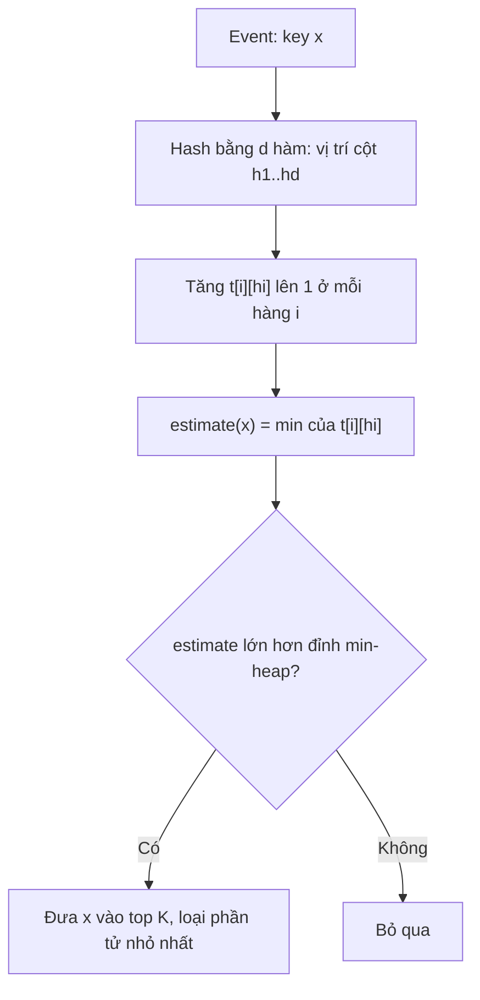
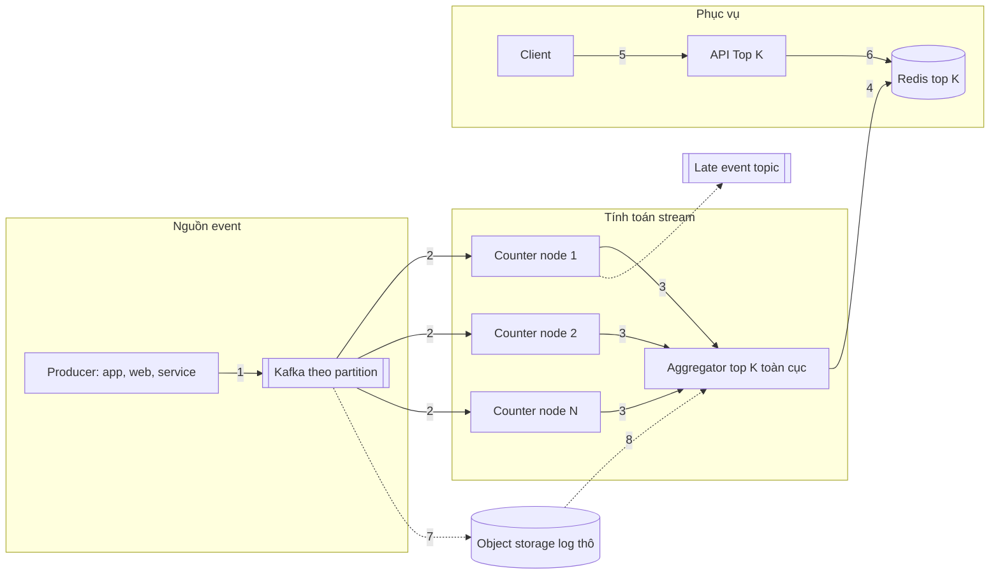

# Top-K (Trending, Top K phổ biến nhất)

**Độ khó:** Medium

## Top-K là gì?

Bài toán này bắt đầu từ một event stream chảy liên tục (hashtag, bài hát, keyword) và hỏi: K thứ nào xuất hiện nhiều nhất trong một khoảng thời gian, ví dụ "top 10 trending trong 1 giờ qua". Bạn gặp nó ở trending hashtag, bài hát nghe nhiều nhất, sản phẩm bán chạy. Nếu dữ liệu nhỏ vừa một máy thì cứ đếm bằng hash map rồi sắp xếp, không cần cấu trúc xấp xỉ.

**Tóm tắt:**

- Không cần đếm và sắp xếp mọi key; chỉ cần chính xác với các key nóng, nên giữ top K bằng min-heap (O(log K) mỗi event).
- Quy mô nhỏ: hash map đếm chính xác cộng min-heap; quy mô lớn: chia stream theo `hash(key)`, mỗi node đếm cục bộ rồi aggregator gộp.
- Quy mô rất lớn dùng Count-Min Sketch: d hàng x w cột, ước lượng là min của d ô, có thể đếm dư nhưng không bao giờ đếm thiếu, memory cố định.
- Sliding window bằng bucket theo phút: window 1 giờ là tổng 60 bucket, sang phút mới thì bỏ bucket cũ nhất.
- Chia theo `hash(key)` để mỗi key thuộc đúng một node, khi đó top K toàn cục nằm trong hợp các top K cục bộ.
- Hot key làm lệch tải một node, xử lý bằng cách đếm trước ở producer rồi gửi theo batch.
- Cần số chính xác (tính tiền, xếp hạng công khai) thì dùng hai pha: CMS chọn ứng viên rồi đếm chính xác lại.
- Kết quả cập nhật mỗi vài chục giây vào Redis cho API đọc; event đến muộn xử lý bằng watermark.
- Kiến trúc gồm Kafka chia theo hash(key), counter node đếm theo bucket, aggregator top K toàn cục, Redis và API đọc, cộng log thô để đếm lại chính xác.

## Vấn đề cần giải quyết

Đếm từng thứ rồi sắp xếp tất cả thì tốn memory, vì số phần tử khác nhau (key) có thể lên hàng trăm triệu, và quá chậm khi event đến hàng trăm nghìn mỗi giây. Chưa kể kết quả phải luôn mới theo một time window trượt: event cũ phải dần "rơi ra" khỏi bảng đếm.

Cách giải quyết gồm hai ý. Một, đếm theo time window và chỉ giữ top K bằng min-heap thay vì sắp xếp tất cả. Hai, ở quy mô lớn thì mỗi node đếm cục bộ bằng Count-Min Sketch (đếm xấp xỉ, memory cố định), rồi gộp kết quả từng phần ở một node tổng hợp.

**Nền tảng:** Không cần đếm và sắp xếp tất cả key. Chỉ cần đúng với các key nóng, nên ta giữ top K bằng min-heap (chi phí O(log K) mỗi event) và với quy mô lớn dùng cấu trúc xấp xỉ có memory cố định như Count-Min Sketch, đổi lấy sai số nhỏ.

## Các khái niệm cần biết

- **Min-heap kích thước K**: priority queue mà đỉnh là phần tử nhỏ nhất. Giữ K phần tử lớn nhất đang gặp; phần tử mới chỉ vào heap khi lớn hơn đỉnh, khi đó đỉnh bị loại. Chi phí mỗi event là O(log K) thay vì sắp xếp cả tập.
- **Count-Min Sketch (CMS)**: bảng đếm d hàng x w cột, mỗi key được hash bởi d hàm vào d ô và tăng cả d ô; ước lượng là giá trị nhỏ nhất trong d ô đó. Nó có thể đếm dư (do va chạm hash) nhưng không bao giờ đếm thiếu, và dùng memory cố định bất kể số key. Dùng khi chấp nhận sai số nhỏ; không dùng khi cần số chính xác (tính tiền).
- **Sliding window bằng bucket**: chia thời gian thành các bucket (ví dụ mỗi phút một sketch); window 1 giờ là tổng 60 bucket gần nhất, bucket cũ nhất bị bỏ khi sang phút mới.
- **Partition theo hash(key)**: đảm bảo mọi event của cùng một key về cùng một node đếm, để số đếm của key không bị xé lẻ.
- **Hot key**: key quá nóng làm một node/partition quá tải.
- **Watermark**: ngưỡng thời gian cho biết "event đến muộn quá mức này thì bỏ qua", để quyết định đóng một window.
- **Hai pha (two-phase)**: dùng CMS chọn ứng viên rồi đếm chính xác lại chỉ cho ứng viên.

## Cách làm theo quy mô

| Quy mô | Cách làm |
|---|---|
| Nhỏ | Hash map đếm + min-heap kích thước K |
| Lớn | Chia stream cho nhiều node, mỗi node tính top K cục bộ, một node gộp lại |
| Rất lớn, chấp nhận xấp xỉ | Count-Min Sketch + heap, tiết kiệm memory |

Chọn mức "Nhỏ" khi số key khác nhau vừa RAM một máy, vì kết quả chính xác và đơn giản. Chuyển sang "Lớn" khi một máy không kịp xử lý event stream. Chỉ dùng "Rất lớn" khi RAM không đủ giữ bảng đếm đầy đủ và bạn chấp nhận số đếm cao hơn thực tế một chút. Nếu chọn xấp xỉ mà lại cần số chính xác, hiện tượng sẽ là hai key sát nhau bị đảo thứ hạng.

## Flowchart

Sơ đồ tổng quát của cả hệ thống nằm ở mục Kiến trúc tổng thể. Để hiểu CMS đếm thế nào, xem ví dụ sơ đồ cho một event vào.



**Phải thuộc:** Count-Min Sketch là bảng d hàng x w cột; mỗi key tăng d ô, ước lượng là giá trị nhỏ nhất trong d ô; có thể đếm dư, không bao giờ đếm thiếu, memory cố định. Sliding window dùng các bucket theo phút (window 1 giờ là tổng 60 bucket). Chia stream theo `hash(key)` để mỗi key thuộc đúng một node.

Lý do lấy `min`: va chạm hash chỉ làm một ô bị cộng dư, nên ô nhỏ nhất là ô ít va chạm nhất, gần số đếm thật nhất.

**Suy luận:** Số key khác nhau lên hàng trăm triệu, nên một bảng đếm chính xác cho mỗi window tốn hàng GB và nhân lên theo số bucket, trong khi người dùng chỉ quan tâm vài chục key đứng đầu. Vì phần đuôi dài không bao giờ vào top, sai số ở đó vô hại; CMS tận dụng điều này bằng cách để nhiều key dùng chung các ô đếm, đổi lấy memory cố định bất kể số key. Va chạm hash chỉ có thể cộng thêm vào một ô chứ không bao giờ trừ đi, nên mỗi ô đều lớn hơn hoặc bằng số đếm thật, và lấy min qua d hàng chọn ra ô ít va chạm nhất; đó là lý do CMS có thể đếm dư nhưng không đếm thiếu. Sai số tối đa tỷ lệ với tổng số event chia cho w, nên tăng w giảm sai số còn tăng d giảm xác suất vượt sai số. Điểm dễ nhầm là nghĩ CMS tự cho ra top K: nó chỉ trả số đếm cho một key đã biết, nên vẫn cần min-heap giữ K key đứng đầu và mỗi event phải so với đỉnh heap. Hệ quả là hai key sát nhau có thể đảo thứ hạng, nên nếu cần số đúng thì dùng hai pha.

## Ước lượng

Giả định 500.000 event/giây (lượt xem hoặc hashtag), 100 triệu key khác nhau trong một giờ, cần top 100 của 1 giờ gần nhất, cập nhật mỗi 30 giây.

| Đại lượng | Tính | Kết quả |
|---|---|---|
| Hash map chính xác | 100 triệu key x khoảng 50 B | khoảng 5 GB mỗi window; nhân với 60 bucket phút là quá lớn cho một node |
| Count-Min Sketch | d = 4 hàng, w = 2 triệu cột, 4 B mỗi ô | 32 MB mỗi sketch, không phụ thuộc số key |
| Window 1 giờ bằng bucket phút | 60 sketch x 32 MB | khoảng 2 GB mỗi node |
| Sai số CMS | độ lệch tối đa khoảng (e / w) x tổng event, với xác suất 1 - e^(-d) | với w = 2 triệu và 1,8 tỷ event/giờ: dư tối đa cỡ 2.400 lượt, không đáng kể so với key top (hàng triệu lượt) |

Kết luận: chỉ cần chính xác với các key nóng, còn đuôi dài thì không quan trọng; CMS cho đúng điều đó với memory cố định.

## Kiến trúc tổng thể

Sơ đồ thể hiện event stream được chia theo `hash(key)` cho các node đếm theo window, mỗi node giữ top K cục bộ, aggregator gộp thành top K toàn cục và ghi vào Redis cho API đọc.



**Chú thích sơ đồ**

| Thành phần | Vai trò | Vì sao chọn / đánh đổi |
|---|---|---|
| Producer | Phát event, có thể đếm trước theo batch | Giảm tải cho key nóng; thêm một chút độ trễ |
| Kafka theo partition | Chia stream theo `hash(key)`, đệm đột biến | Mỗi key thuộc đúng một node nên top K toàn cục nằm trong hợp các top K cục bộ; hot key làm lệch một partition |
| Counter node | Đếm theo bucket phút bằng hash map hoặc Count-Min Sketch, giữ top K cục bộ bằng min-heap | Memory cố định với CMS; đổi lại số đếm có thể dư nhẹ |
| Aggregator | Gộp top K cục bộ thành top K toàn cục, ghi mỗi vài chục giây | Chỉ gộp K phần tử mỗi node nên rất nhẹ; là điểm trung tâm cần chạy dự phòng |
| Redis top K | Lưu kết quả đã tính | API đọc rất nhanh; kết quả trễ theo chu kỳ cập nhật |
| API Top K | Trả `GET /v1/topk?window=1h&k=10` | Không tính toán lúc đọc nên độ trễ thấp |
| Late event topic | Chứa event đến muộn quá watermark | Không làm sai window đã đóng; cần job bù hoặc chấp nhận bỏ |
| Object storage log thô | Lưu log gốc để đếm lại chính xác | Rẻ, dùng cho hai pha và sửa lỗi; chạy batch nên chậm |

1. Producer đẩy event vào Kafka, partition theo `hash(key)`.
2. Mỗi Counter node đọc partition của mình, đếm theo bucket phút và giữ top K cục bộ.
3. Counter node gửi top K cục bộ sang aggregator theo chu kỳ.
4. Aggregator gộp thành top K toàn cục và ghi vào Redis.
5. Client gọi API Top K.
6. API đọc kết quả có sẵn từ Redis và trả về.
7. Log thô được lưu vào object storage, event đến muộn vào topic riêng (async).
8. Khi cần số chính xác, job batch đếm lại các ứng viên từ log thô rồi cập nhật kết quả (async).

**Điểm nghẽn:** Hot key làm một partition và Counter node quá tải đầu tiên; đếm trước ở producer rồi gửi theo batch, hoặc tách key nóng ra nhiều node rồi gộp lại. Tiếp theo là memory của bảng đếm khi số key tăng; chuyển sang Count-Min Sketch với kích thước cố định và thêm partition.

## API và dữ liệu

```text
GET /v1/topk?window=1h&k=10   -> { "asOf": "...", "items": [ {"key":"#worldcup","count":1203000}, ... ] }
```

```text
Kafka topic "events", partition theo hash(key)   -- cùng key luôn về cùng node đếm
Redis: topk:{window} = sorted set (key, count), ghi đè mỗi 30 giây bởi aggregator
```

## Cơ chế lõi: Count-Min Sketch và min-heap (Java, đã chạy thử)

```java
class Cms {
    final int d, w; final int[][] t; final long[] seed;
    Cms(int d, int w) { this.d = d; this.w = w; t = new int[d][w]; seed = new long[d];
        Random r = new Random(7); for (int i = 0; i < d; i++) seed[i] = r.nextLong() | 1; }
    int idx(String s, int i) { return (int) Math.floorMod((s.hashCode() * seed[i]) >>> 7, (long) w); }
    void add(String s) { for (int i = 0; i < d; i++) t[i][idx(s, i)]++; }
    // lấy min các hàng: có thể dư, không bao giờ thiếu
    int estimate(String s) {
        int m = Integer.MAX_VALUE;
        for (int i = 0; i < d; i++) m = Math.min(m, t[i][idx(s, i)]);
        return m;
    }
}
// Giữ top K bằng min-heap: đỉnh heap là phần tử NHỎ NHẤT trong top K, so với nó để quyết định thay thế.
PriorityQueue<Map.Entry<String, Integer>> heap = new PriorityQueue<>(Map.Entry.comparingByValue());
Map<String, Integer> inHeap = new HashMap<>();
void process(String s) {
    c.add(s);
    int est = c.estimate(s);
    if (inHeap.containsKey(s)) {                // đã trong top K: cập nhật số đếm
        heap.removeIf(e -> e.getKey().equals(s)); heap.add(Map.entry(s, est)); inHeap.put(s, est);
    } else if (heap.size() < K) { heap.add(Map.entry(s, est)); inHeap.put(s, est); }
    // lớn hơn phần tử nhỏ nhất trong top K thì thay
    else if (est > heap.peek().getValue()) {
        inHeap.remove(heap.poll().getKey()); heap.add(Map.entry(s, est)); inHeap.put(s, est);
    }
}
// Thử 100.000 event: 5 key nóng (mỗi key khoảng 10.000 lượt) và đuôi dài 20.000 key, K = 3,
// sketch 4 x 2000: top 3 đều là key hot* với số đếm quanh 10.000. Đoạn dùng Map.entry nên cần Java 9 trở lên.
```

`removeIf` trên heap là O(K); K nhỏ (10 đến 100) nên chấp nhận được.

## Sliding window bằng bucket

```text
Mỗi phút một sketch (hoặc một map) -> vòng tròn 60 bucket.
Tới phút mới: bỏ bucket cũ nhất, tạo bucket mới.
Số đếm 1 giờ của key x = tổng estimate(x) qua 60 bucket   (CMS cộng được vì cộng từng ô)
```

Cộng sketch theo từng ô cũng là cách **gộp** kết quả giữa các node khi chúng đếm cùng loại key, nhưng vì ta chia theo hash(key) nên mỗi key chỉ thuộc một node, và aggregator chỉ cần gộp top K của từng node.

**Suy luận:** Top K toàn cục không thể suy ra từ top K cục bộ nếu cùng một key bị chia cho nhiều node: key đứng thứ 11 ở mỗi node có thể cộng lại thành hạng nhất mà không node nào báo cáo. Vì vậy cách chia stream quyết định tính đúng của cả phép gộp. Chia theo `hash(key)` đảm bảo mọi event của một key về cùng một node, nên số đếm của key không bị xé lẻ và top K toàn cục chắc chắn nằm trong hợp các top K cục bộ; aggregator chỉ cần lấy K lớn nhất của hợp đó. Cái giá là phân bố tải theo key: một key cực nóng đưa toàn bộ tải của nó vào một node (hot key), và cách giảm là cộng dồn trước ở phía producer rồi gửi theo batch, đổi lại độ trễ vài giây. Điểm dễ nhầm là chia ngẫu nhiên cho cân tải rồi lấy top K của mỗi node: cách đó sai, và nếu buộc phải làm thì phải cộng số đếm theo key trước khi lấy top. Khi review, hãy hỏi trước tiên partition key của topic là gì.

## Đào sâu

| Điểm khó | Vấn đề | Cách xử lý và đánh đổi |
|---|---|---|
| Gộp top K từ nhiều node | Top K toàn cục khác với hợp các top K cục bộ nếu key bị chia cho nhiều node | Chia theo `hash(key)` để mỗi key thuộc đúng một node, khi đó top K toàn cục nằm trong hợp các top K cục bộ (lấy K lớn nhất của hợp). Nếu buộc phải chia ngẫu nhiên thì cộng số đếm trước rồi mới lấy top. Mất: key cực nóng làm lệch tải một node (hot key), xử lý bằng đếm trước ở phía producer rồi gửi theo batch |
| Chính xác hay xấp xỉ | CMS đếm dư, nên key xếp hạng sát nhau có thể đảo thứ tự | Dùng CMS để chọn ứng viên, rồi đếm chính xác lại riêng cho vài trăm ứng viên (hai pha) nếu cần số liệu đúng, ví dụ tính tiền hoặc xếp hạng công khai |

## Lỗi và giám sát

- Node đếm chết: mất bucket trong RAM, dựng lại bằng cách đọc lại Kafka từ offset đầu window (nên lưu snapshot sketch định kỳ).
- Event đến muộn hoặc trùng: dùng thời gian event, cho phép trễ vài phút (watermark); loại trùng nếu nguồn có at-least-once.
- Spam và bot: giới hạn đóng góp mỗi người dùng cho mỗi key trong một bucket.
- Theo dõi: độ trễ consumer, độ tươi của `asOf`, độ lệch tải giữa các partition, sai số ước tính khi đối chiếu mẫu với đếm chính xác.

## Điểm cần nhắc

- **Sliding window:** top K của 1 giờ gần nhất = tổng các bucket 1 phút.
- Kết quả không cần thời gian thực tuyệt đối: cập nhật mỗi vài chục giây là đủ.
- Chia theo key (hash) để cùng một phần tử luôn về cùng node đếm.
- Count-Min Sketch có thể đếm dư nhưng không đếm thiếu.
- Chống spam đẩy số liệu giả bằng lọc bot.

