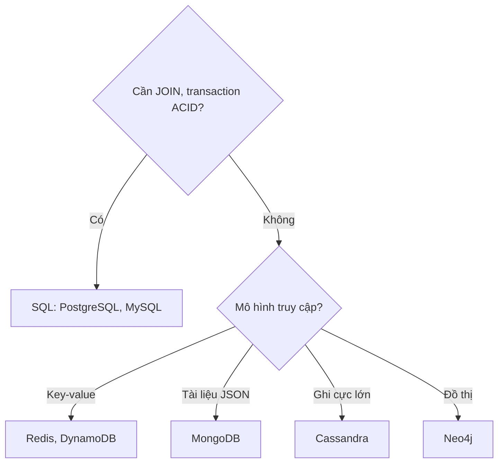
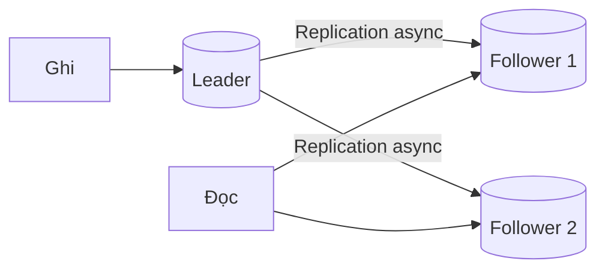
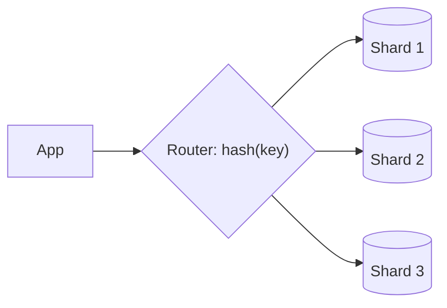
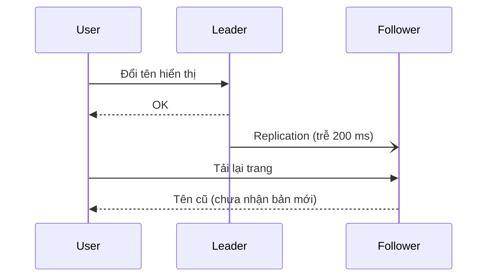

# Bài 4: Database

## Database trong thiết kế hệ thống

Database là chỗ lưu dữ liệu bền vững. Nó gồm SQL và các loại NoSQL (key-value, document, wide-column, graph), cùng các kỹ thuật làm nó nhanh hơn và lớn hơn: index, replication, sharding. Bài này đưa ra cách chọn và cách mở rộng, không đi sâu vào từng sản phẩm.

**Tóm tắt:**

- Chọn DB theo kiểu truy cập: SQL khi cần quan hệ và transaction ACID; NoSQL (key-value, document, wide-column, graph) khi cần scale ngang lớn hoặc schema linh hoạt.
- Mở rộng theo từng bước từ ít phức tạp đến nhiều: index, rồi replica và cache, sharding là bước cuối.
- Index (thường là B-tree) đổi chi phí ghi và dung lượng lấy tốc độ đọc; bảng 1 tỷ dòng chỉ cần khoảng 4 lần đọc trang, và index ghép theo quy tắc tiền tố trái.
- ACID gồm Atomicity, Consistency, Isolation, Durability; sai một bước là mất tiền nên tiền và tồn kho cần SQL.
- Replication leader-follower tăng khả năng đọc và chịu lỗi nhưng không tăng khả năng ghi, và replication lag có thể làm follower trả dữ liệu cũ (cần read-your-writes).
- Sharding chia nhỏ dữ liệu để scale ghi và dung lượng; shard key tốt phân bố đều, nằm trong hầu hết truy vấn và ít thay đổi.
- `hash(key) mod N` làm khoảng 80% key phải chuyển khi thêm shard, nên dùng consistent hashing.
- Sharding làm truy vấn chéo shard, JOIN và distributed transaction trở nên khó.

## Vì sao phải chọn cẩn thận

Code có thể sửa lại, nhưng dữ liệu thì đã nằm đó. Chọn sai loại DB, hoặc thiếu index, thì hệ thống chậm dần theo lượng dữ liệu. Khi dữ liệu đã lớn thì việc chuyển sang cái khác rất đau, vì phải di chuyển dữ liệu và viết lại cách truy cập.

Cách tiếp cận là đi theo từng bước, từ ít phức tạp đến nhiều. Một, chọn loại DB theo kiểu truy cập dữ liệu. Hai, thiết kế index cho các truy vấn hay chạy. Ba, thêm replica khi đọc nhiều hoặc cần chịu lỗi. Bốn, chia shard khi một DB không chứa hoặc không ghi nổi nữa.

Khi nào dùng cái nào: SQL khi cần quan hệ và transaction (đơn hàng, tiền). NoSQL khi cần scale ngang lớn hoặc schema linh hoạt. Replication khi đọc nhiều hơn ghi. Sharding là bước cuối vì nó phức tạp (truy vấn chéo shard, distributed transaction), nên đừng làm sớm; hầu hết hệ thống chưa cần shard khi chưa thử index, cache và replica.

## Các khái niệm cần biết

- **ACID**: bốn tính chất của transaction quan hệ (xem mục ACID bên dưới). Cần khi sai một bước là mất tiền hay sai tồn kho.
- **Eventual consistency**: sau khi ghi, các bản sao không sync ngay nhưng cuối cùng sẽ giống nhau. Chấp nhận được với like, view; không chấp nhận được với số dư.
- **Scale dọc và scale ngang**: dọc là mua máy mạnh hơn (có trần, đắt); ngang là thêm nhiều máy (không trần nhưng phức tạp).
- **B-tree**: cây cân bằng nhiều nhánh, mỗi nút là một trang đĩa. Nền tảng của hầu hết index quan hệ vì tìm trong hàng tỷ dòng chỉ cần vài lần đọc trang.
- **Index ghép và quy tắc tiền tố trái**: index trên nhiều cột chỉ dùng được cho các tiền tố từ trái của danh sách cột.
- **Seq Scan và Index Scan**: kế hoạch thực thi quét cả bảng hay dùng index; `EXPLAIN` cho biết DB chọn cái nào.
- **Replication lag**: độ trễ giữa lúc leader ghi và lúc follower có dữ liệu đó.
- **Read-your-writes**: bảo đảm một người đọc lại thấy chính thứ mình vừa ghi.
- **Shard key**: cột dùng để quyết định dòng thuộc shard nào.
- **Hot spot**: một shard hoặc dòng nhận quá nhiều tải so với phần còn lại.
- **DLQ, consistent hashing** và các khái niệm liên quan có bài riêng; xem [Consistent Hashing](/go?p=15-System%20Design%2Feasy%2Flt-09-consistent-hashing.md).

## Flowchart: chọn database

Sơ đồ dưới giúp chọn loại DB theo nhu cầu: nếu cần JOIN và ACID thì SQL, ngược lại chọn theo mô hình truy cập.



## SQL và NoSQL

| | SQL (quan hệ) | NoSQL |
|---|---|---|
| Mô hình | Bảng, schema cố định | Linh hoạt theo loại |
| Truy vấn | SQL, JOIN mạnh | Tùy loại, thường đơn giản hơn |
| Transaction | ACID chặt chẽ | Thường eventual consistency |
| Mở rộng | Chủ yếu scale dọc, scale ngang khó hơn | Thiết kế để scale ngang |
| Ví dụ | PostgreSQL, MySQL | MongoDB, Cassandra, Redis, Neo4j |

**Phải thuộc:** SQL: bảng, schema cố định, JOIN và transaction ACID, chủ yếu scale dọc. NoSQL: schema linh hoạt, thường eventual consistency, thiết kế để scale ngang. Bốn loại NoSQL: key-value (Redis, DynamoDB), document (MongoDB), wide-column (Cassandra), graph (Neo4j). Cần quan hệ và transaction thì bắt đầu với SQL.

### Các loại NoSQL

- **Key-Value:** Redis, DynamoDB. Rất nhanh, phù hợp cache, session. Không dùng khi cần truy vấn theo nhiều điều kiện hoặc join.
- **Document:** MongoDB. Lưu JSON linh hoạt, hợp dữ liệu có cấu trúc thay đổi theo bản ghi (hồ sơ, catalog). Không hợp khi có nhiều quan hệ chéo cần join thường xuyên.
- **Wide-column:** Cassandra, HBase. Ghi khối lượng lớn, dữ liệu time-series; truy vấn phải được thiết kế theo partition key từ đầu.
- **Graph:** Neo4j. Quan hệ phức tạp như mạng xã hội, gợi ý bạn bè; không hợp để lưu dữ liệu dạng bảng đơn giản.

### Chọn loại nào?

Bắt đầu với SQL nếu dữ liệu có quan hệ rõ và cần transaction. Chọn NoSQL khi cần scale ngang rất lớn, schema thay đổi nhiều hoặc mô hình truy cập đơn giản. Hệ quả của việc chọn NoSQL chỉ vì "nghe hiện đại" là bạn tự gánh việc join và đảm bảo nhất quán ở tầng ứng dụng.

## ACID

Khi một thao tác gồm nhiều bước (ví dụ chuyển tiền: trừ một tài khoản, cộng tài khoản kia), ta cần các bước hoạt động như một khối. ACID mô tả bốn đảm bảo đó:

- **Atomicity:** transaction làm hết hoặc không làm gì. Không có chuyện trừ tiền rồi mất điện mà không cộng.
- **Consistency:** dữ liệu luôn hợp lệ theo ràng buộc (foreign key, `CHECK`, unique).
- **Isolation:** các transaction concurrent không làm hỏng nhau; mức isolation càng cao càng an toàn nhưng càng chậm.
- **Durability:** đã commit thì không mất, kể cả khi sập nguồn (nhờ ghi log trước khi báo thành công).

**Phải thuộc:** ACID gồm Atomicity (làm hết hoặc không làm gì), Consistency (dữ liệu luôn hợp lệ theo ràng buộc), Isolation (transaction concurrent không làm hỏng nhau), Durability (đã commit thì không mất).

## Index

Index là cấu trúc (thường là B-tree) giúp tìm nhanh mà không quét toàn bảng, giống mục lục cuối sách thay vì lật từng trang. Cái giá là đọc nhanh hơn nhưng ghi chậm hơn (mỗi `INSERT` và `UPDATE` phải cập nhật thêm index) và tốn dung lượng, nên chỉ index các cột hay xuất hiện trong `WHERE`, `JOIN` và `ORDER BY`. Nếu thiếu index trên cột hay lọc, hiện tượng là truy vấn nhanh khi bảng nhỏ rồi chậm dần theo số dòng.

**Nền tảng:** Index (thường là B-tree) đổi chi phí ghi và dung lượng lấy tốc độ đọc: tìm trong hàng tỷ dòng chỉ cần vài lần đọc trang thay vì quét cả bảng. Vì vậy chỉ index các cột thường xuất hiện trong `WHERE`, `JOIN`, `ORDER BY`, và với index ghép phải nhớ quy tắc tiền tố trái.

## Replication

Replication là sao chép dữ liệu sang nhiều node, để tăng khả năng đọc và để còn dữ liệu khi một node hỏng.

- **Leader-Follower:** ghi vào leader, đọc từ các follower. Tăng khả năng đọc và chịu lỗi. Dùng khi đọc nhiều hơn ghi; không giúp tăng khả năng ghi, vì mọi ghi vẫn đi qua một leader.
- **Multi-Leader:** nhiều node nhận ghi, cần xử lý xung đột khi hai leader sửa cùng một bản ghi. Dùng khi có nhiều trung tâm dữ liệu cần ghi cục bộ.
- Replication lag có thể khiến follower trả dữ liệu cũ.

**Phải thuộc:** Replication sao chép toàn bộ dữ liệu để tăng khả năng đọc và chịu lỗi (leader-follower: ghi vào leader, đọc từ follower), nhưng không tăng khả năng ghi. Sharding chia nhỏ dữ liệu để scale ghi và dung lượng. Replication async gây replication lag nên follower có thể trả dữ liệu cũ.

**Suy luận:** Hệ thống thường chạm giới hạn theo một thứ tự cố định, và mỗi bước giải quyết một giới hạn khác nhau. Đọc chậm do quét bảng thì index giải quyết, rẻ nhất và không đổi kiến trúc. Khi một máy không đủ sức đọc hoặc cần chịu lỗi, replication sao chép toàn bộ dữ liệu sang follower: khả năng đọc tăng gần tuyến tính theo số follower, nhưng mọi ghi vẫn đi qua một leader nên khả năng ghi và dung lượng không đổi. Chỉ khi ghi hoặc dung lượng vượt một máy mới cần sharding, và nó là bước cuối vì phá vỡ những thứ SQL cho miễn phí: JOIN chéo shard, transaction nhiều shard, ràng buộc unique toàn cục. Điểm dễ nhầm là dùng replica để giải bài toán ghi chậm: follower phải áp lại mọi ghi của leader nên không giảm tải ghi, còn replication async thêm lag nên đọc từ follower có thể thấy dữ liệu cũ. Vì vậy khi chẩn đoán, phải biết bottleneck là đọc, ghi hay dung lượng trước khi chọn công cụ.

Flow ghi và đọc với Leader-Follower:



## Sharding

Sharding là chia dữ liệu ra nhiều database để scale ghi và dung lượng, mỗi shard giữ một phần dữ liệu. Nó khác replication ở chỗ replication sao chép toàn bộ dữ liệu, còn sharding chia nhỏ dữ liệu. Chỉ dùng khi một DB (đã có index và replica) vẫn không chứa hoặc không ghi nổi.

| Cách chia | Mô tả | Rủi ro |
|---|---|---|
| Range | Theo khoảng giá trị (ID từ 1 đến 1000...) | Hot spot |
| Hash | Hash key rồi chia | Khó thêm shard (dùng consistent hashing) |
| Directory | Bảng tra cứu shard | Bảng tra cứu thành bottleneck |

Khó khăn: truy vấn chéo shard, JOIN, distributed transaction, cân bằng lại shard.



## Ví dụ có số

### Index giúp bao nhiêu

B-tree với trang 8 KB, mỗi key cộng con trỏ khoảng 16 B cho khoảng 500 nhánh mỗi nút. Bảng 1 tỷ dòng cần khoảng log500(1 tỷ) = 3,3, tức **4 tầng**, nghĩa là 4 lần đọc trang (tầng gốc thường nằm sẵn trong memory) thay vì quét 1 tỷ dòng. Đổi lại mỗi lần `INSERT` phải cập nhật thêm mọi index của bảng.

```sql
-- Truy vấn hay chạy: đơn của một user trong 30 ngày gần nhất
SELECT id, total FROM orders WHERE user_id = 42 AND created_at >= now() - interval '30 days' ORDER BY created_at DESC;

CREATE INDEX idx_orders_user_time ON orders (user_id, created_at DESC);
-- Index ghép: quy tắc "tiền tố trái". Dùng được cho (user_id) và (user_id, created_at),
-- KHÔNG giúp truy vấn chỉ có created_at. Cột so sánh bằng đặt trước, cột khoảng/sắp xếp đặt sau.
EXPLAIN SELECT ...;   -- kiểm tra có "Index Scan", không phải "Seq Scan"
```

### Transaction ACID

```sql
BEGIN;
-- 0 dòng: không đủ tiền, ROLLBACK
UPDATE accounts SET balance = balance - 100 WHERE id = 1 AND balance >= 100;
UPDATE accounts SET balance = balance + 100 WHERE id = 2;
COMMIT;   -- hai UPDATE cùng thành công hoặc cùng bị hủy (Atomicity)
```

### Replication lag và đọc dữ liệu cũ



Cách xử lý (read-your-writes): sau khi ghi, đọc từ leader trong vài giây cho chính người đó; hoặc gửi kèm vị trí log đã ghi và chỉ đọc từ follower đã đuổi kịp vị trí đó. Đọc của người khác chấp nhận cũ vài trăm mili giây.

### Chia shard: chọn cách chia quan trọng thế nào

Chia theo `shard = hash(key) mod N`: khi thêm shard thứ 5 (N từ 4 lên 5), key giữ nguyên shard chỉ khi `hash mod 4 = hash mod 5`, tức khoảng 1/5. Chạy thử với 1 triệu key: **80% key phải chuyển**. Consistent hashing chỉ chuyển khoảng 1/(N+1) = 20%. Xem [Consistent Hashing](/go?p=15-System%20Design%2Feasy%2Flt-09-consistent-hashing.md).

```java
// Java 11 trở lên, đã chạy thử: kết quả khoảng 80%
int total = 1_000_000, moved = 0;
for (int k = 0; k < total; k++) {
    // hash đơn giản cho key số
    int h = (int) (k * 2654435761L);
    // shard cũ khác shard mới
    if (Math.floorMod(h, 4) != Math.floorMod(h, 5)) moved++;
}
System.out.println(moved * 100.0 / total + "% key phải chuyển");
```

**Phải thuộc:** Shard key tốt phải phân bố đều (tránh hot spot), nằm trong hầu hết truy vấn (tránh truy vấn chéo shard) và ít thay đổi. Chia theo `hash(key) mod N` thì đổi N làm gần như mọi key phải chuyển, nên dùng consistent hashing.

Shard key tốt có: phân bố đều (tránh hot spot), nằm trong hầu hết truy vấn (tránh truy vấn chéo shard), và ít thay đổi. Ví dụ `user_id` cho dữ liệu của người dùng; `created_at` làm shard key sẽ dồn mọi ghi mới vào một shard.

**Suy luận:** Mọi truy vấn phải biết shard nào chứa dữ liệu, và shard key chính là thông tin để định tuyến đó. Nếu truy vấn không có shard key thì phải hỏi mọi shard rồi gộp kết quả (scatter-gather), chậm bằng shard chậm nhất, nên shard key phải nằm trong hầu hết truy vấn. Vì cùng một key luôn về cùng shard, key phân bố lệch hoặc tăng đơn điệu sẽ dồn mọi ghi vào một shard: `created_at` làm shard key khiến mọi ghi mới rơi vào shard cuối còn các shard cũ nhàn rỗi, nên một hot spot nuốt cả lợi ích của việc chia. Key cũng phải ít đổi, vì đổi key là di chuyển dòng sang shard khác. Cách chia cũng quan trọng không kém: `hash mod N` gắn vị trí với số shard nên thêm một shard làm khoảng 80% key chuyển chỗ, còn consistent hashing chỉ chuyển khoảng 1/(N+1). Điểm dễ nhầm là chọn key theo nghiệp vụ dễ nghĩ (ví dụ `country`) mà không kiểm tra phân bố: một nước chiếm 60% dữ liệu sẽ thành shard nóng.

