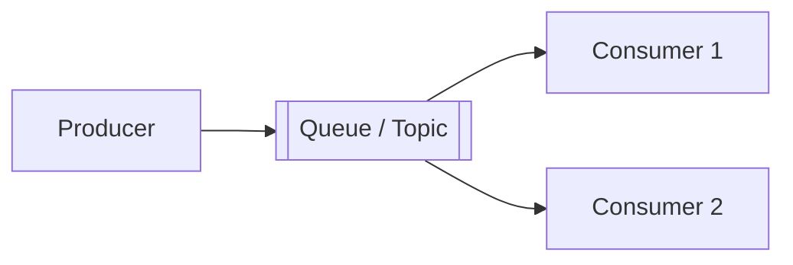
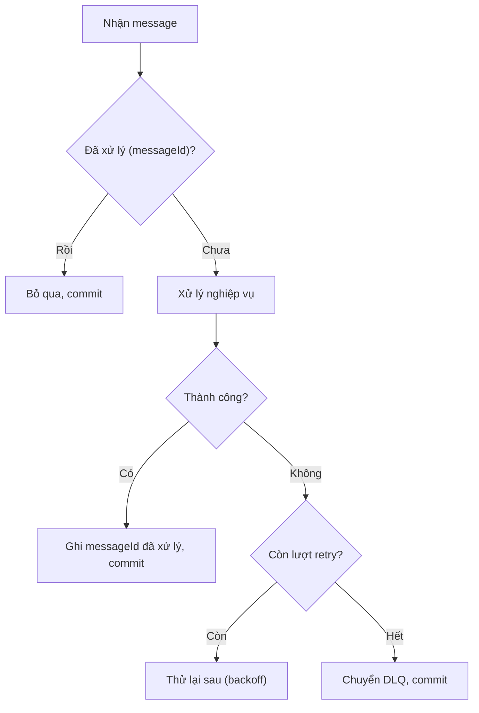
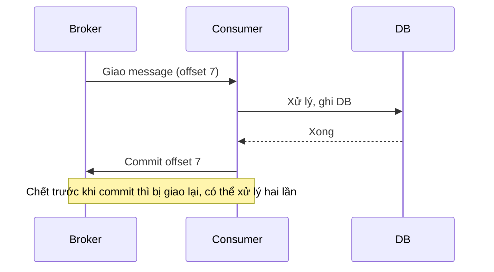

# Bài 6: Message Queue và xử lý async

## Message queue là gì?

Message queue là một queue đứng giữa hai bên: producer bỏ message vào, consumer lấy ra xử lý sau, không cần hai bên chạy cùng lúc hay chờ nhau. Hãy nghĩ đến quầy nhận đơn ở tiệm bánh: người đặt đơn bỏ phiếu vào khay rồi đi, thợ bánh lấy từng phiếu ra làm theo sức của mình.

Bạn dùng nó cho tác vụ chậm không cần trả kết quả ngay (gửi email, xử lý ảnh), hoặc khi nhiều bên cần nhận cùng một event. Không dùng khi caller cần kết quả tức thì, vì queue thêm độ trễ và thêm một thành phần phải vận hành (có thể hỏng, cần giám sát).
**Tóm tắt:**

- Message queue tách producer và consumer về thời gian và tốc độ: queue là buffer hấp thụ đột biến, consumer xử lý theo sức của mình.
- Cái giá là độ trễ, thêm một thành phần phải vận hành, và message có thể được giao lặp.
- Point-to-point (RabbitMQ, SQS) chia việc cho một consumer; pub/sub (Kafka, SNS) phát event cho nhiều bên; Kafka làm được cả hai nhờ consumer group.
- Ba mức giao nhận: at-most-once (có thể mất), at-least-once (có thể trùng, phổ biến nhất), exactly-once (khó, thực tế là at-least-once cộng idempotent).
- Mức giao nhận do thời điểm commit offset quyết định: commit trước xử lý là at-most-once, xử lý xong mới commit là at-least-once.
- Consumer phải idempotent, và `messageId` được ghi cùng transaction với nghiệp vụ.
- Message lỗi vĩnh viễn (poison) đi vào DLQ sau vài lần retry có backoff để không chặn các message sau.
- Kafka chỉ đảm bảo thứ tự trong một partition (cùng key thì cùng partition); lag là chỉ số chính, backpressure tránh queue phình vô hạn.

## Vấn đề

Nếu service A gọi trực tiếp (sync) service B, A phải chờ B xong. B chậm hoặc chết thì A cũng kẹt hoặc lỗi theo, và lượng truy cập tăng đột biến đổ thẳng vào B. Message queue đặt một buffer ở giữa để tách rời hai bên. Khi có queue, B xử lý theo sức của nó, lỗi thì thử lại sau, và hai bên scale độc lập.

**Nền tảng:** Message queue tách rời producer và consumer về thời gian và tốc độ: queue là buffer hấp thụ đột biến, consumer xử lý theo sức của mình, lỗi thì thử lại. Cái giá là độ trễ, một thành phần phải vận hành, và message có thể được giao lặp.

Để dùng đúng, bạn cần chọn: queue (một consumer nhận) hay pub/sub (nhiều bên cùng nhận); mức đảm bảo giao nhận (at-most, at-least hay exactly-once); viết consumer idempotent vì có thể nhận lặp; và dùng DLQ (dead letter queue) cho message lỗi mãi.

## Các khái niệm cần biết

- **Producer và consumer**: bên gửi và bên nhận message.
- **Broker**: phần mềm trung gian giữ queue (Kafka, RabbitMQ, SQS). Nhận message từ producer, lưu, rồi giao cho consumer.
- **Topic và partition**: topic là kênh có tên; partition là một phân đoạn có thứ tự của topic (Kafka). Chia partition để nhiều consumer xử lý parallel, và chỉ đảm bảo thứ tự trong từng partition.
- **Consumer group**: tập consumer chia nhau các partition của một topic; mỗi partition chỉ một consumer trong nhóm đọc. Nhiều nhóm khác nhau thì mỗi nhóm nhận đủ toàn bộ message (đó là cách Kafka làm pub/sub).
- **Offset và commit**: offset là vị trí của message trong partition; commit offset là báo broker "tôi đã xử lý tới đây". Thời điểm commit quyết định mức đảm bảo giao nhận (xem bên dưới).
- **Ack (acknowledgement)**: thông báo xác nhận đã nhận hoặc xử lý, ở các broker như RabbitMQ và SQS.
- **Idempotent**: xử lý một message nhiều lần cho kết quả như một lần.
- **Lag**: số message đã vào nhưng chưa được xử lý; chỉ số quan trọng nhất của consumer.
- **Poison message**: message luôn gây lỗi khi xử lý (dữ liệu hỏng); nếu cứ retry sẽ chặn queue.



## Lợi ích

- **Tách rời (decoupling):** producer không cần biết consumer.
- **Chịu tải đột biến:** queue hấp thụ spike, consumer xử lý theo tốc độ riêng.
- **Độ tin cậy:** tin nhắn được lưu, thử lại khi lỗi.
- **Scale độc lập:** thêm consumer khi queue dài.

## Hai mô hình chính

| | Point-to-point (Queue) | Publish/Subscribe (Topic) |
|---|---|---|
| Mỗi tin được xử lý bởi | Một consumer | Tất cả subscriber |
| Dùng cho | Chia việc (worker) | Phát event cho nhiều bên |
| Ví dụ | RabbitMQ, SQS | Kafka, SNS |

Chọn point-to-point khi bạn cần chia việc để mỗi tác vụ làm đúng một lần (gửi email cho một đơn hàng). Chọn pub/sub khi một event có nhiều bên quan tâm (đơn hàng được tạo: kho, thanh toán, thông báo cùng phản ứng). Lưu ý Kafka vừa làm được cả hai: mỗi consumer group nhận đủ message (giống pub/sub), còn trong một group thì các consumer chia nhau việc (giống queue).

## Đảm bảo giao nhận

- **At-most-once:** có thể mất tin, không trùng.
- **At-least-once:** không mất, có thể trùng. Phổ biến nhất, consumer cần **idempotent** (xử lý lặp lại vẫn đúng).
- **Exactly-once:** khó đạt, thường cần hỗ trợ đặc biệt.

**Phải thuộc:** Ba mức đảm bảo: at-most-once (có thể mất, không trùng), at-least-once (không mất, có thể trùng, phổ biến nhất, consumer phải idempotent), exactly-once (khó đạt, thực tế là at-least-once cộng xử lý idempotent). Kafka chỉ đảm bảo thứ tự trong một partition; cùng key thì cùng partition.

## Một số khái niệm

- **Dead Letter Queue (DLQ):** nơi chứa tin lỗi nhiều lần để kiểm tra sau. Dùng để một message hỏng không chặn cả queue; nếu không có DLQ, message độc hại bị retry mãi và các message sau nó kẹt theo.
- **Backpressure:** cơ chế báo producer chậm lại (hoặc broker ngừng giao thêm) khi consumer quá tải. Nếu thiếu, queue phình vô hạn, hết memory hoặc đĩa, hoặc độ trễ tăng không kiểm soát.
- **Thứ tự tin nhắn:** Kafka giữ thứ tự trong từng partition, không giữ giữa các partition. Muốn các event của cùng một đối tượng (ví dụ cùng một đơn hàng) đúng thứ tự thì dùng cùng một key để chúng rơi vào cùng partition.

Flow xử lý lỗi trong consumer: lỗi tạm thời được thử lại có giới hạn, quá giới hạn thì chuyển sang DLQ.



Điểm quan trọng là việc ghi `messageId` và kết quả nghiệp vụ nằm cùng một transaction, nếu không có kẽ hở giữa hai bước và chống lặp mất tác dụng.

## Ví dụ có số: cần bao nhiêu consumer

Producer đẩy 10.000 message/giây lúc cao điểm, mỗi message consumer xử lý mất 20 ms.

- Một thread consumer xử lý 1 / 0,02 = 50 message/giây.
- Cần 10.000 / 50 = **200 thread** parallel (thêm khoảng 30% dự phòng, vậy khoảng 260).
- Với Kafka, số consumer trong một nhóm không hơn số partition (mỗi partition chỉ một consumer trong nhóm), nên tạo **tối thiểu 260 partition**; khó tăng sau này vì đổi số partition làm đổi cách chia theo key.
- Lag (số message chưa xử lý) là chỉ số chính: nếu producer 10.000/giây mà consumer chỉ kịp 8.000/giây thì lag tăng 2.000 mỗi giây, sau 10 phút là 1,2 triệu message.

## Thời điểm xác nhận quyết định mức đảm bảo



| Thứ tự | Kết quả khi consumer chết giữa chừng | Mức đảm bảo |
|---|---|---|
| Commit trước, xử lý sau | Đã commit nhưng chưa xử lý nên mất message | At-most-once |
| Xử lý trước, commit sau | Chưa commit nên bị giao lại, xử lý lặp | At-least-once |
| Xử lý và commit trong cùng transaction (hoặc có unique key) | Lặp nhưng kết quả không đổi | Hiệu quả như exactly-once |

**Phải thuộc:** Commit offset trước khi xử lý cho at-most-once (có thể mất message); xử lý xong mới commit cho at-least-once (có thể xử lý lặp). Kết hợp at-least-once với consumer idempotent (unique key theo messageId, ghi cùng transaction) cho hiệu quả như exactly-once.

**Suy luận:** Consumer có thể chết ở bất kỳ điểm nào giữa nhận message, xử lý và commit, và broker chỉ biết "đã commit chưa", không biết "đã xử lý chưa". Vì hai việc đó không thể thực hiện atomic cùng lúc với một hệ thống bên ngoài, thứ tự giữa chúng quyết định điều gì xảy ra khi chết: commit trước thì chết sau commit là mất message, xử lý trước thì chết trước commit là xử lý lại. Mất message thường đắt hơn xử lý lặp, nên at-least-once là mặc định và rủi ro chuyển sang trùng lặp. Exactly-once thực chất không tồn tại giữa hai hệ thống độc lập; cái ta có là at-least-once cộng consumer idempotent, cho kết quả cuối giống như đúng một lần. Điểm dễ nhầm là nghĩ idempotent chỉ cần kiểm tra `messageId` trong memory: nếu bước kiểm tra và bước ghi nghiệp vụ nằm ở hai nơi hoặc hai transaction, consumer chết giữa hai bước vẫn lọt trùng, nên `messageId` phải là unique key ghi cùng transaction với nghiệp vụ. Hệ quả khi review: hỏi "chết ở bước nào thì chuyện gì xảy ra" cho từng bước của consumer.

## Consumer idempotent, retry và DLQ (Java, đã chạy thử)

```java
// {messageId, nội dung, số lần thử}
static Deque<String[]> queue = new ArrayDeque<>();
// thật: bảng có unique key theo messageId
static Set<String> processed = new HashSet<>();
static List<String> dlq = new ArrayList<>();
static int dbWriteCount = 0;

static void process(String id, String body) {
    if (body.equals("poison")) throw new RuntimeException("lỗi vĩnh viễn");
    // idempotent: đã làm rồi thì bỏ qua
    if (!processed.add(id)) return;
    dbWriteCount++;
}
// Vòng lặp consumer: chỉ "commit" khi không ném lỗi; lỗi thì thử lại tối đa 3 lần rồi vào DLQ
while (!queue.isEmpty()) {
    String[] m = queue.poll();
    try { process(m[0], m[1]); }
    catch (RuntimeException e) {
        int n = Integer.parseInt(m[2]) + 1;
        if (n >= 3) dlq.add(m[0]); else queue.add(new String[]{m[0], m[1], "" + n});
    }
}
// Đưa vào: m1 (hai lần, giả lập broker giao lặp) và m2 "poison"
// Kết quả: dbWriteCount=1 (m1 chỉ ghi một lần), dlq=[m2]
```

Trong thực tế, thay `Set` bằng bảng `processed_messages(message_id PRIMARY KEY)` ghi **cùng transaction** với nghiệp vụ, để việc "đã xử lý" và kết quả không tách rời nhau. Lỗi tạm thời (mạng) thì retry có backoff; lỗi vĩnh viễn (dữ liệu hỏng, ví dụ `poison`) thì sớm vào DLQ để không chặn các message sau trong cùng partition.

**Suy luận:** Kafka giữ thứ tự trong một partition, và một consumer của group đọc partition đó tuần tự, nên một message luôn lỗi làm consumer retry mãi và mọi message sau nó trong partition đứng chờ (head-of-line blocking). Vì lỗi tạm thời (mạng, DB chậm) khác lỗi vĩnh viễn (dữ liệu hỏng), cách xử lý phải khác nhau: lỗi tạm thì retry với backoff để hệ thống phía sau có thời gian hồi phục, lỗi vĩnh viễn thì không có gì để chờ nên rẽ sang DLQ sớm. Giới hạn số lần retry là thứ buộc ta rẽ nhánh, và DLQ giữ message lại để con người xem sau thay vì làm mất. Điểm dễ nhầm là retry ngay lập tức nhiều lần: nó dồn thêm tải vào chỗ đang lỗi và hết lượt trước khi chỗ đó kịp hồi phục, nên cần backoff. Một DLQ không ai giám sát cũng chỉ là cách mất message chậm hơn, nên kích thước DLQ phải có alert.

## Khi nào dùng?

Gửi email/SMS, xử lý ảnh/video, sync dữ liệu giữa service, ghi log và analytics, đặt hàng nhiều bước.

## Công cụ

Kafka (throughput rất lớn, lưu log event), RabbitMQ (định tuyến linh hoạt), AWS SQS/SNS, Google Pub/Sub.

