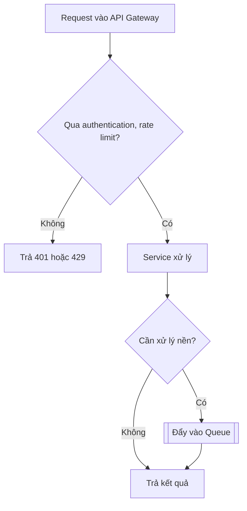
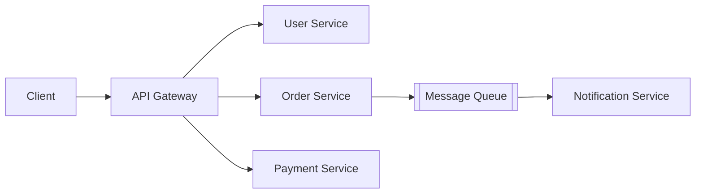
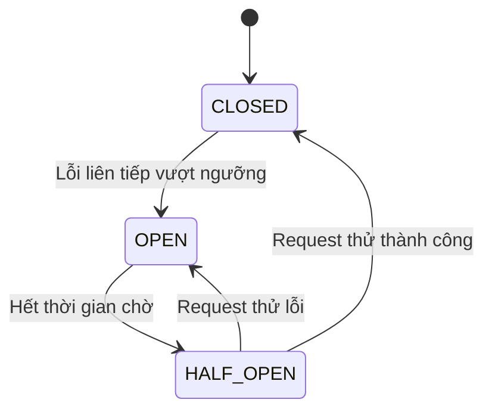
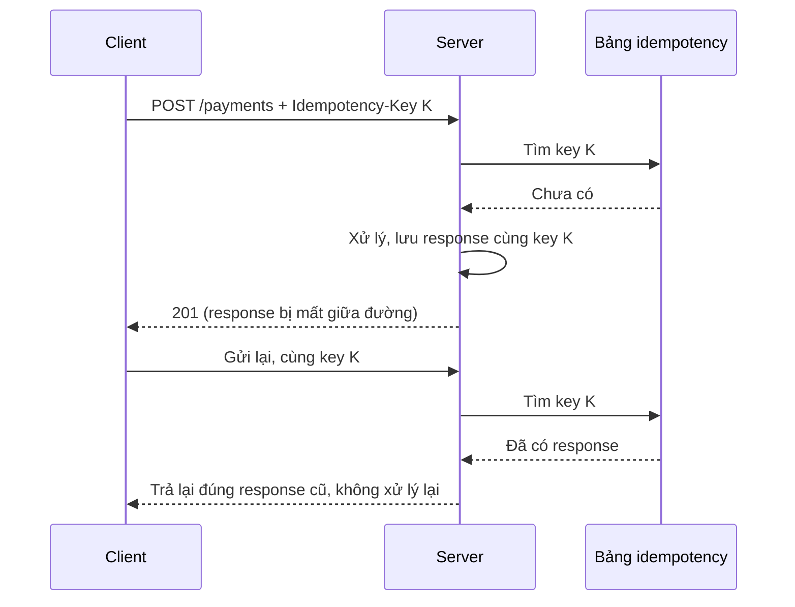

# Bài 7: API Design và Microservices

Bài này nói về hai chuyện hay đi cùng nhau: cách các phần mềm "nói chuyện" với nhau (API) và cách chia một hệ thống lớn thành nhiều phần nhỏ chạy độc lập (microservices). Đọc xong, bạn sẽ biết chọn kiểu API nào, khi nào nên và không nên tách service, và cần những cơ chế nào để hệ thống nhiều service không sập dây chuyền.

## API và microservices là gì?

**API** (Application Programming Interface) là thỏa thuận về cách các phần nói chuyện với nhau: gọi địa chỉ nào, gửi dữ liệu gì, nhận lại gì. Hãy nghĩ đến thực đơn của một nhà hàng: bạn không vào bếp, bạn chỉ gọi món theo thực đơn và nhận đúng món đó. Thực đơn chính là API; bếp có đổi cách nấu thế nào thì bạn vẫn gọi món như cũ.

**Microservices** là cách tách hệ thống thành nhiều service nhỏ, mỗi service lo một mảng nghiệp vụ (người dùng, đơn hàng, thanh toán...), tự deploy độc lập và tự quản lý dữ liệu của mình. Các service nói chuyện với nhau qua API hoặc qua queue tin nhắn.

**Tóm tắt:**

- API là contract công khai giữa các bên; đổi contract thì mọi client dựa vào nó có thể vỡ, nên phải thiết kế cẩn thận và có version.
- Microservices đổi sự đơn giản của monolith lấy khả năng deploy và scale độc lập, với cái giá là toàn bộ độ phức tạp của hệ thống phân tán; hãy bắt đầu từ monolith chia module rõ và chỉ tách khi có lý do cụ thể.
- REST là mặc định cho API công khai, GraphQL cho client tự chọn field, gRPC (Protobuf) cho giao tiếp nội bộ giữa service.
- API Gateway là cổng vào duy nhất lo authentication và rate limiting; việc nặng không cần trả lời ngay thì đẩy vào queue.
- Lỗi mạng là chuyện bình thường nên cần timeout, retry với exponential backoff và jitter (chỉ với thao tác idempotent), circuit breaker và bulkhead.
- Availability nối tiếp bị nhân lại: 5 service 99,9% chỉ còn khoảng 99,5%; và thread của caller cạn nếu callee treo mà không có timeout.
- `POST` cần `Idempotency-Key` để retry không trừ tiền hai lần.
- Phân trang cursor ổn định và nhanh ở trang sâu, còn offset chậm dần và bị lệch khi có dữ liệu mới chen vào.

## Vấn đề chúng giải quyết

Khi một monolith (cả ứng dụng nằm trong một khối) lớn dần, nhiều người cùng sửa một codebase nên hay đụng nhau, deploy chậm và rủi ro vì sửa một dòng cũng phải phát hành cả khối, một chỗ lỗi có thể kéo cả hệ thống xuống, và bạn không thể scale riêng phần nào cần nhiều tài nguyên (ví dụ chỉ riêng phần tìm kiếm). Tách thành microservices cho phép mỗi team làm và phát hành độc lập, và scale đúng chỗ cần.

Còn với API: nếu thiết kế tệ (tên lung tung, trả mã trạng thái sai, không có phiên bản) thì mỗi lần sửa sau này sẽ làm vỡ mọi client đang dùng. API là contract công khai, đổi contract thì ai đang dựa vào nó đều gặp lỗi.

**Nền tảng:** API là contract công khai giữa các bên, đổi contract thì ai dựa vào nó đều có thể vỡ, nên phải thiết kế cẩn thận và có phiên bản. Microservices đổi sự đơn giản của một khối lấy khả năng phát hành và scale độc lập, với cái giá là toàn bộ độ phức tạp của hệ thống phân tán (mạng chậm hoặc đứt, lỗi một phần, distributed transaction).

## Khi nào nên dùng, khi nào không

Nên dùng microservices khi monolith đã quá lớn, có nhiều team cần làm việc độc lập, và các phần của hệ thống cần scale rất khác nhau. Không nên tách sớm với sản phẩm nhỏ: bạn nhận về toàn bộ độ phức tạp của hệ thống phân tán (mạng chậm hoặc đứt, lỗi một phần, transaction trải qua nhiều service, debug khó) mà chưa được lợi gì. Lời khuyên thực tế là bắt đầu với một monolith được tổ chức tốt theo module, và chỉ tách khi có lý do rõ ràng.

Cách làm tổng quát: chọn kiểu API (REST, GraphQL hoặc gRPC), đặt API Gateway làm cổng vào, cho các service giao tiếp sync hoặc qua queue, rồi bù lại độ mong manh của mạng bằng rate limit, retry, timeout và circuit breaker. Các phần dưới đây đi lần lượt qua từng mảnh.

## Các khái niệm cần biết

- **API Gateway:** một "cổng bảo vệ" duy nhất đứng trước mọi service. Client chỉ biết địa chỉ của gateway; gateway lo authentication, rate limiting, rồi chuyển request tới đúng service. Dùng khi có nhiều service và không muốn mỗi service tự làm lại các việc chung đó.
- **Service Discovery:** cơ chế tìm địa chỉ (IP, cổng) của một service khi địa chỉ đó thay đổi liên tục (container khởi động lại, scale thêm bớt). Service tự đăng ký vào một sổ danh bạ, và nơi gọi tra sổ này thay vì ghi cứng địa chỉ.
- **Message Queue / Event bus:** queue để service này để lại tin nhắn cho service khác xử lý sau, không cần chờ trả lời ngay (async). Dùng cho việc nền như gửi email, hoặc để hai service không phụ thuộc vào việc cùng sống tại một thời điểm.
- **Observability:** khả năng nhìn vào bên trong hệ thống đang chạy, gồm log tập trung, metric (số liệu) và tracing (theo dõi một request đi qua những service nào, mất bao lâu ở mỗi chỗ). Với nhiều service, thiếu phần này thì lỗi gần như không truy ra được.
- **Idempotent:** một thao tác gọi một lần hay nhiều lần đều cho cùng kết quả cuối. Quan trọng vì mạng có thể mất response nên client sẽ gửi lại; nếu thao tác "trừ tiền" không idempotent thì khách bị trừ hai lần.
- **Rate limiting:** giới hạn số request mỗi client (hoặc toàn hệ thống) trong một khoảng thời gian, trả `429` khi vượt; bảo vệ hệ thống khỏi bị quá tải hoặc bị lạm dụng.
- **Exponential backoff và jitter:** khi retry, thời gian chờ tăng gấp đôi sau mỗi lần (1 s, 2 s, 4 s...), cộng thêm một chút ngẫu nhiên (jitter) để nhiều client không cùng retry đúng một thời điểm.

## Flowchart: một request đi qua hệ thống

Sơ đồ sau cho thấy đường đi của một request từ lúc vào cổng tới lúc có kết quả. Gateway chặn sớm những request không hợp lệ hoặc vượt giới hạn, để service phía sau không phải tốn sức.



Đọc sơ đồ: `401` nghĩa là chưa authenticate được, `429` nghĩa là gọi quá nhiều. Nếu request qua được, service xử lý phần cần trả lời ngay; phần nặng và không cần chờ (gửi email, tạo báo cáo) được đẩy vào queue để worker làm sau, nhờ đó client nhận phản hồi nhanh.

## Kiểu API

Vấn đề đặt ra là chọn kiểu API nào cho từng nơi dùng. Không có kiểu "tốt nhất"; mỗi kiểu hợp với một hoàn cảnh.

| Kiểu | Đặc điểm | Hợp với |
|---|---|---|
| REST | HTTP + JSON, tài nguyên theo URL | API công khai, CRUD |
| GraphQL | Client chọn chính xác trường cần | Frontend phức tạp, nhiều loại client |
| gRPC | Nhị phân (Protobuf), nhanh, có schema | Giao tiếp nội bộ giữa service |

Giải thích thêm: **GraphQL** cho client tự khai báo cần những trường nào trong một lần gọi, tránh việc phải gọi nhiều endpoint hoặc nhận về thừa dữ liệu; đổi lại server phức tạp hơn và khó cache theo URL. **gRPC** dùng **Protobuf** (định dạng nhị phân có schema khai báo trước) nên nhỏ và nhanh hơn JSON, rất hợp giữa các service nội bộ, nhưng trình duyệt gọi trực tiếp thì kém tiện. **REST** đơn giản và phổ biến nhất nên là lựa chọn mặc định cho API công khai; không nên dùng nó khi client cần ghép dữ liệu từ rất nhiều tài nguyên trong một màn hình.

**Phải thuộc:** REST (HTTP + JSON, tài nguyên theo URL) là mặc định cho API công khai; GraphQL cho client tự chọn trường cần, hợp frontend phức tạp; gRPC (Protobuf nhị phân, có schema, chạy trên HTTP/2) hợp giao tiếp nội bộ giữa service.

### Nguyên tắc thiết kế REST

REST coi mọi thứ là "tài nguyên" có địa chỉ riêng, và dùng phương thức HTTP để nói bạn muốn làm gì với nó. Làm đúng các quy ước này thì người khác đoán được API của bạn mà không cần đọc tài liệu.

- Danh từ số nhiều cho tài nguyên: `GET /users/42`.
- Dùng đúng phương thức: GET (đọc), POST (tạo), PUT/PATCH (sửa), DELETE (xóa).
- Mã trạng thái đúng nghĩa: 200, 201, 400, 401, 404, 500. Trả 200 cho cả lỗi khiến client và công cụ giám sát không phân biệt được thành công với thất bại.
- Phân trang cho danh sách lớn, có phiên bản (`/v1/...`) để sau này đổi cách trả dữ liệu mà không làm vỡ client cũ.
- **Idempotency:** gọi lại cùng request không gây tác dụng phụ ngoài ý muốn.

## Monolith và Microservices

| | Monolith | Microservices |
|---|---|---|
| Triển khai | Một khối | Nhiều service độc lập |
| Ưu điểm | Đơn giản, dễ debug, ít chi phí vận hành | Scale riêng từng phần, team làm độc lập |
| Nhược điểm | Khó scale từng phần, codebase phình to | Phức tạp: mạng, distributed transaction, giám sát |

Gợi ý: bắt đầu với monolith được tổ chức tốt, tách service khi thực sự cần. "Distributed transaction" ở đây nghĩa là một nghiệp vụ (ví dụ đặt hàng) chạm vào nhiều service với nhiều cơ sở dữ liệu riêng, nên không còn một transaction duy nhất bảo đảm tất cả cùng thành công hoặc cùng hủy.

**Suy luận:** Lý do tách service là tổ chức và scale chứ không phải mã nguồn: khi nhiều team cùng sửa một codebase thì deploy phải phối hợp và một lỗi kéo cả khối xuống. Tách ra thì mỗi team deploy độc lập, nhưng một lời gọi hàm trong process thành lời gọi mạng, nên bạn nhận thêm độ trễ, lỗi một phần và mất transaction đơn: nghiệp vụ chạm nhiều service với database riêng thì không còn một transaction bảo đảm cùng thành công hoặc cùng hủy, phải dùng saga hoặc event. Availability cũng giảm vì các service nối tiếp nhân xác suất. Do đó lợi ích chỉ vượt chi phí khi có đủ team và đủ khác biệt về tải; với sản phẩm nhỏ bạn trả chi phí mà không nhận lợi ích. Điểm dễ nhầm là chia theo tầng kỹ thuật (service cho database, service cho UI) thay vì theo ranh giới nghiệp vụ, vì khi đó mọi tính năng vẫn chạm mọi service và deploy vẫn phải phối hợp. Hệ quả là bắt đầu bằng monolith chia module rõ, rồi tách service dọc theo module khi có tín hiệu cụ thể.

## Thành phần thường đi kèm microservices

Sơ đồ dưới cho thấy bố cục điển hình: client chỉ gặp gateway, gateway chuyển tới từng service, và những việc không cần trả lời ngay đi qua queue.



Ví dụ: Order Service nhận đơn, lưu xong thì đẩy một tin "đơn đã tạo" vào queue rồi trả lời client ngay. Notification Service đọc tin đó và gửi email. Nếu Notification Service đang sập, tin vẫn nằm trong queue chờ, đơn hàng không bị ảnh hưởng. (Các thành phần API Gateway, Service Discovery, Message Queue, Observability đã được giải thích ở mục "Các khái niệm cần biết" phía trên.)

## Độ bền của hệ thống

Trong hệ thống phân tán, lỗi mạng và service chậm là chuyện bình thường, không phải ngoại lệ. Các cơ chế sau giúp một lỗi cục bộ không lan thành sự cố toàn hệ thống.

- **Rate limiting:** giới hạn số request để bảo vệ hệ thống.
- **Timeout và Retry** (kèm exponential backoff). Timeout là thời gian tối đa chịu chờ một lời gọi; retry là thử lại khi lỗi tạm thời. Chỉ nên retry thao tác idempotent, và không retry khi lỗi là do client gửi sai (4xx).
- **Circuit breaker:** ngắt tạm khi dependency liên tục lỗi, tránh lỗi lan truyền. Giống cầu dao điện: quá tải thì ngắt để bảo vệ phần còn lại, một lúc sau thử đóng lại.
- **Bulkhead:** cô lập tài nguyên (ví dụ mỗi dependency có thread pool riêng) để lỗi một phần không kéo sập tất cả, như các khoang kín trong thân tàu.

**Phải thuộc:** Bộ cơ chế chịu lỗi: timeout (không chờ vô hạn), retry với exponential backoff và jitter (chỉ với thao tác idempotent, không retry lỗi 4xx), circuit breaker (ngắt khi dependency lỗi liên tục), bulkhead (cô lập tài nguyên), rate limit (trả 429).

## Ví dụ có số: vì sao phải có timeout và circuit breaker

Vấn đề là các cơ chế trên nghe có vẻ "thừa" cho tới khi bạn tính ra con số. Bốn tình huống sau cho thấy hậu quả khi thiếu chúng.

- **Sẵn sàng nhân lại:** một request đi qua 5 service nối tiếp, mỗi service đạt 99,9% thì cả chuỗi đạt khoảng 0,999^5 = 99,5% (khoảng 3,6 giờ lỗi mỗi tháng thay vì 43 phút). Càng nhiều service gọi nối tiếp, càng cần cache, async và dự phòng.
- **Cạn thread:** service A có 200 thread, gọi B bình thường mất 50 ms. B bắt đầu treo (không timeout): sau vài giây cả 200 thread của A kẹt chờ B, A cũng ngừng phục vụ. Đặt timeout 300 ms và circuit breaker thì A lỗi nhanh, giữ được thread cho việc khác.
- **Retry nhân tải:** 3 tầng service, mỗi tầng retry 3 lần thì một request gốc có thể thành 27 lời gọi tới tầng cuối đúng lúc nó đang yếu. Chỉ retry ở một tầng, có backoff cộng jitter và giới hạn tổng ngân sách retry.
- **Ngân sách timeout:** nếu client chờ tối đa 1 giây thì các lời gọi bên trong phải có timeout nhỏ hơn và cộng lại không vượt quá 1 giây.

### Circuit breaker (Java, đã chạy thử)

Circuit breaker có ba trạng thái. `CLOSED`: mọi request đi qua bình thường, đồng thời đếm lỗi liên tiếp. `OPEN`: đã lỗi quá ngưỡng nên chặn ngay, không gọi service đang hỏng. `HALF_OPEN`: sau một khoảng chờ, cho thử một request; thành công thì đóng lại, lỗi thì mở lại.

**Phải thuộc:** Circuit breaker có ba trạng thái: CLOSED (cho request đi qua, đếm lỗi), OPEN (lỗi quá ngưỡng thì chặn ngay), HALF_OPEN (sau thời gian chờ cho thử một request; thành công thì về CLOSED, lỗi thì về OPEN).

```java
class Cb {
    enum State { CLOSED, OPEN, HALF_OPEN }
    State st = State.CLOSED; int consecutiveFailures = 0; long openedAt = 0;
    final int threshold = 3; final long waitMs = 10_000;
    boolean allowRequest(long now) {
        // hết thời gian chờ: thử một request
        if (st == State.OPEN && now - openedAt >= waitMs) st = State.HALF_OPEN;
        return st != State.OPEN;
    }
    void recordResult(boolean ok, long now) {
        if (ok) { consecutiveFailures = 0; st = State.CLOSED; return; }
        if (st == State.HALF_OPEN || ++consecutiveFailures >= threshold) { st = State.OPEN; openedAt = now; }
    }
}
// 3 lỗi liên tiếp -> OPEN; allowRequest(5.000) = false (chặn ngay, không gọi dịch vụ lỗi);
// allowRequest(10.000) = true và chuyển HALF_OPEN; recordResult(true) -> CLOSED
```



Bản thật nên đếm theo time window hoặc tỷ lệ lỗi (ví dụ trên 50% trong 20 request gần nhất), thread-safe, và cho `OPEN` trả về dữ liệu dự phòng (fallback) thay vì lỗi trần. Thư viện: Resilience4j. Không cần circuit breaker cho lời gọi tới thứ luôn nằm cùng tiến trình hoặc không bao giờ treo; nó dành cho lời gọi qua mạng tới dịch vụ có thể chậm hoặc hỏng.

**Suy luận:** Gọi qua mạng khác gọi hàm ở chỗ nó có thể không bao giờ trả về, và không có timeout thì một callee treo giữ thread của caller vô hạn. Caller có số thread hữu hạn (ví dụ 200), nên khi callee treo, thread lần lượt kẹt hết trong vài giây, caller ngừng phục vụ cả những request không liên quan đến callee, rồi caller của caller cũng cạn thread theo; lỗi lan ngược lên chuỗi gọi. Timeout chặn thời gian mỗi lần kẹt nhưng mọi request vẫn phải chờ hết timeout mới báo lỗi, nên vẫn tốn thread; circuit breaker bổ sung bằng cách thấy lỗi liên tiếp thì ngừng gọi hẳn và báo lỗi ngay, nhờ đó thread được giải phóng và callee có thời gian hồi phục. Retry thì làm ngược lại nếu dùng sai: 3 tầng mỗi tầng retry 3 lần biến một request thành 27 lời gọi tới tầng cuối đúng lúc nó yếu nhất, nên chỉ retry ở một tầng, có backoff và jitter, và chỉ với thao tác idempotent. Điểm dễ nhầm là coi các cơ chế này như tùy chọn tối ưu, trong khi chúng là điều kiện để lỗi một phần không thành sự cố toàn hệ thống. Bulkhead hoàn thiện bằng cách cho mỗi dependency một thread pool riêng, nên một dependency chậm chỉ làm cạn pool của chính nó.

### Idempotency key cho API ghi

Vấn đề: client gửi `POST /payments`, server xử lý xong nhưng response bị mất; client không biết đã thành công hay chưa nên gửi lại, và khách bị trừ tiền hai lần. Cách giải quyết là **idempotency key**: client sinh một UUID cho mỗi ý định thanh toán và gửi trong header `Idempotency-Key`; retry dùng lại đúng key đó, nhờ vậy server nhận ra đây là cùng một ý định.



```sql
CREATE TABLE idempotency (
  key varchar(64) PRIMARY KEY, request_hash char(64), response jsonb, created_at timestamp
);
-- Server: INSERT key trước; trùng key thì trả lại response đã lưu, không xử lý lại.
-- Nếu cùng key nhưng request_hash khác thì trả 422 (client dùng sai key).
```

**Phải thuộc:** `GET`, `PUT`, `DELETE` vốn idempotent; `POST` cần `Idempotency-Key` (UUID do client sinh, giữ nguyên khi retry) để chống tạo hoặc trừ tiền hai lần. Server lưu key cùng response, nhận lại key cũ thì trả response đã lưu.

Xử lý và lưu response nên nằm trong cùng transaction; key giữ 24 giờ rồi xóa. `GET`, `PUT`, `DELETE` vốn idempotent theo thiết kế; `POST` thì cần key này.

### Phân trang: offset và cursor

Khi danh sách có hàng triệu dòng, ta phải trả từng trang. Có hai cách, khác nhau rõ ở hiệu năng và độ ổn định. **Offset** nói "bỏ qua N dòng rồi lấy 20 dòng"; **cursor** nói "lấy 20 dòng sau mốc này" (mốc thường là id của dòng cuối trang trước).

| | Offset | Cursor |
|---|---|---|
| Cú pháp | `?page=500&size=20` | `?after=9100&limit=20` |
| Truy vấn | `LIMIT 20 OFFSET 10000`: DB đọc rồi bỏ 10.000 dòng, chậm dần | `WHERE id < 9100 ORDER BY id DESC LIMIT 20`: dùng index, thời gian không đổi |
| Khi có dữ liệu mới chen vào | Trang lệch, trùng hoặc sót dòng | Ổn định |
| Nhảy tới trang N | Có | Không |

**Phải thuộc:** Offset (`LIMIT ... OFFSET`) chậm dần theo độ sâu trang và bị lệch khi có dữ liệu chen vào; cursor (`WHERE id < mốc ORDER BY id DESC LIMIT n`) dùng index, thời gian không đổi và ổn định, nhưng không nhảy tới trang bất kỳ.

Chọn offset khi dữ liệu nhỏ hoặc người dùng cần nhảy tới trang bất kỳ (trang quản trị). Chọn cursor cho feed, danh sách dài, dữ liệu liên tục thay đổi; hậu quả của việc dùng offset ở đây là trang càng sâu càng chậm và người dùng thấy bài bị lặp hoặc mất khi có bài mới chen vào.

