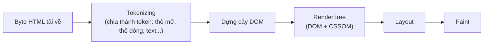
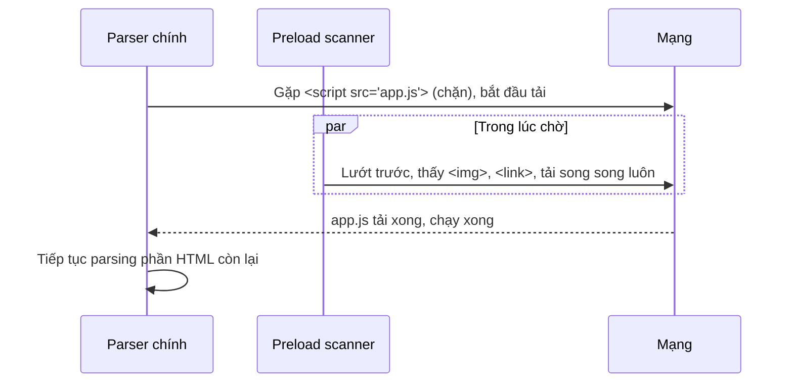

# Từ HTML tới pixel: parsing, script chặn render và FOUC

Bài [Hiệu năng web và Core Web Vitals](/go?p=11-Frontend-Core%2Flt-03-web-performance-core-web-vitals.md) đo kết quả cuối cùng (LCP, CLS...) và cách cải thiện từng chỉ số. Bài này đi vào lớp **bên dưới** những chỉ số đó: cơ chế thật sự khiến một trang "hiện chậm" hay "nhấp nháy nội dung chưa style" không phải phép màu, mà là hệ quả trực tiếp của cách trình duyệt đọc HTML theo từng byte, dừng lại đúng những chỗ nó buộc phải dừng. Hiểu cơ chế này, bạn đọc được vì sao một thẻ `<script>` đặt sai chỗ lại làm chậm toàn bộ trang, dù bản thân file JavaScript đó rất nhỏ.

**Tóm tắt:**

- Trình duyệt đọc HTML theo từng byte, biến thành token (tokenizing), rồi dựng cây DOM — đây là một tiến trình **tăng dần** (incremental), không đợi tải xong toàn bộ file mới bắt đầu dựng cây.
- Thẻ `<script>` thường (không `async`/`defer`) **chặn parsing**: trình duyệt dừng hẳn việc đọc HTML tiếp theo, tải xong file JS, chạy xong, rồi mới đọc tiếp — vì script có thể gọi `document.write()` làm thay đổi chính những gì sắp được parse.
- `defer` tải song song với parsing nhưng hoãn chạy tới khi parsing xong, theo đúng thứ tự khai báo — lựa chọn mặc định tốt cho hầu hết script.
- `async` tải song song và chạy **ngay khi tải xong**, không đợi parsing xong, không đảm bảo thứ tự giữa các script — phù hợp cho script độc lập hoàn toàn (ví dụ analytics).
- Preload scanner là một trình quét "lướt trước" chạy song song với parser chính, tìm trước các tài nguyên (ảnh, script, CSS) để bắt đầu tải sớm, ngay cả khi parser chính đang bị một script chặn.
- FOUC (Flash Of Unstyled Content) xảy ra khi HTML được render trước khi CSS tải xong; CSS mặc định **chặn render** (không chặn parsing HTML) chính để tránh hiện tượng này, đổi lại CSS chặn trở thành một nguồn trễ hiển thị nếu file CSS lớn hoặc tải chậm.
- Trình duyệt không dựng CSSOM (cây style) tăng dần như DOM — nó cần **toàn bộ** CSS đã khai báo trước khi biết chắc giá trị cuối cùng của một thuộc tính (vì quy tắc sau có thể ghi đè quy tắc trước), nên CSS luôn phải tải xong hoàn chỉnh trước khi trang được phép render lần đầu.

## Từ byte tới DOM: một tiến trình tăng dần



**Nền tảng:** Trình duyệt không chờ tải xong toàn bộ file HTML rồi mới bắt đầu xử lý — nó tokenize và dựng DOM **ngay khi từng phần byte về tới**, đó là lý do trang lớn vẫn hiện được nội dung đầu trang trước khi phần cuối trang tải xong. DOM được dựng tăng dần như vậy, nhưng **render tree** (kết hợp DOM với CSSOM để biết style cuối cùng của từng phần tử) thì không thể tăng dần theo cách tương tự với CSS, lý do nằm ở chính bản chất "cascade" của CSS (xem phần dưới).

## Vì sao `<script>` thường chặn parsing

```html
<!-- Chặn: trình duyệt dừng đọc HTML tiếp, tải + chạy xong script này mới đọc tiếp -->
<script src="app.js"></script>

<!-- defer: tải song song, chạy sau khi parsing xong, đúng thứ tự khai báo -->
<script src="app.js" defer></script>

<!-- async: tải song song, chạy ngay khi tải xong, không đảm bảo thứ tự -->
<script src="analytics.js" async></script>
```

**Suy luận:** Vì sao trình duyệt phải dừng hẳn parsing để chờ một script thường, thay vì cứ đọc tiếp HTML song song? Vì một script đang chạy **có thể gọi `document.write()`**, chèn thêm HTML ngay tại đúng vị trí nó đang được thực thi — nếu trình duyệt đã lỡ đọc tiếp phần HTML phía sau trong lúc chờ, nội dung vừa đọc đó có thể hoàn toàn sai vị trí hoặc phải bỏ đi làm lại. Để tránh sự không chắc chắn này, đặc tả chọn giải pháp an toàn tuyệt đối: dừng hẳn, chạy xong script, rồi mới tiếp tục đọc — dù trên thực tế đại đa số script hiện đại không bao giờ dùng `document.write()`. `defer` và `async` ra đời chính là cách lập trình viên "cam kết với trình duyệt" rằng script này sẽ không làm việc đó, cho phép trình duyệt bỏ qua sự thận trọng mặc định.

| | Script thường | `defer` | `async` |
|---|---|---|---|
| Tải | Chặn parsing, tải xong mới đọc tiếp | Song song với parsing | Song song với parsing |
| Chạy | Ngay sau khi tải xong | Sau khi parsing xong, trước `DOMContentLoaded` | Ngay khi tải xong, **ngắt ngang** parsing nếu đang chạy, dù xong hay chưa |
| Thứ tự giữa nhiều script | Theo thứ tự khai báo (vì tuần tự chặn) | Theo thứ tự khai báo | Không đảm bảo — script nào tải xong trước chạy trước |
| Dùng khi | Script rất nhỏ, cần chạy ngay lập tức trước khi parsing tiếp (hiếm) | Hầu hết script của ứng dụng, cần DOM đã dựng xong và cần đúng thứ tự | Script độc lập hoàn toàn, không phụ thuộc DOM hay script khác (analytics, quảng cáo) |

**Phải thuộc:** `defer` luôn chạy sau khi DOM dựng xong (tương đương thời điểm `DOMContentLoaded`) và theo đúng thứ tự khai báo trong file; `async` không đảm bảo bất kỳ điều gì về thời điểm hay thứ tự ngoài "chạy ngay khi tải xong" — hai script `async` cùng khai báo có thể chạy theo thứ tự ngược với thứ tự viết trong HTML nếu script sau tải nhanh hơn.

## Preload scanner: lướt trước trong lúc parser chính bị chặn

**Nền tảng:** Ngay cả khi parser chính đang bị một `<script>` thường chặn đứng, trình duyệt vẫn chạy một tiến trình phụ gọi là **preload scanner**, lướt qua phần HTML phía trước (dù chưa tới lượt parser chính xử lý) để tìm sớm các tài nguyên cần tải: ``, `<link rel="stylesheet">`, các `<script src>` khác. Nhờ preload scanner, ảnh và CSS phía dưới trang vẫn bắt đầu tải song song ngay cả khi một script ở đầu trang đang chặn parser chính — nếu không có cơ chế này, mọi tài nguyên phía sau script chặn sẽ phải xếp hàng chờ tuần tự, làm trang chậm hơn rất nhiều so với thực tế.



## FOUC: vì sao CSS chặn render nhưng không chặn parsing HTML

```html
<head>
  <link rel="stylesheet" href="styles.css">
</head>
```

**Phải thuộc:** CSS **không chặn việc dựng DOM** (parsing HTML vẫn tiếp tục bình thường khi gặp `<link rel="stylesheet">`), nhưng **chặn việc render** — trình duyệt cố tình không vẽ bất kỳ pixel nào cho tới khi toàn bộ CSS đã khai báo được tải và xử lý xong. Đây chính là cơ chế **ngăn** FOUC (Flash Of Unstyled Content — nội dung HTML hiện ra trần trụi, chưa có style, rồi "nhảy" sang có style ngay sau đó), chứ không phải nguyên nhân gây ra nó. FOUC thường xảy ra khi CSS bị trì hoãn tải theo cách bất thường (ví dụ nạp CSS bằng JavaScript sau khi trang đã render, hoặc một số tình huống đặc thù với font/CSS-in-JS runtime — xem phần "vì sao RSC làm giảm CSS-in-JS runtime" trong [Styling và Headless UI trong React](/go?p=09-React%2Fhard%2Flt-16-styling-headless-ui-react.md)) khiến trình duyệt đã lỡ render một lần trước khi style đầy đủ sẵn sàng.

**Suy luận:** Vì sao trình duyệt không thể render "tăng dần" theo CSS giống như nó dựng DOM tăng dần theo HTML? Vì CSS hoạt động theo nguyên tắc **cascade** (xếp tầng) — một thuộc tính của một phần tử có thể bị ghi đè bởi một quy tắc xuất hiện **sau** trong cùng file, hoặc bởi một file CSS khác tải sau. Nếu trình duyệt render ngay khi có quy tắc đầu tiên khớp, rồi lại phải vẽ lại khi gặp quy tắc ghi đè phía sau, người dùng sẽ thấy trang nhấp nháy liên tục theo đúng thứ tự từng dòng CSS được tải về — tệ hơn hẳn so với việc đợi một lần rồi vẽ đúng ngay từ đầu. Vì vậy trình duyệt chọn chờ **toàn bộ** CSSOM dựng xong rồi mới ghép với DOM thành render tree và vẽ lần đầu, đánh đổi độ trễ hiển thị lấy sự chắc chắn không nhấp nháy.

## Chẩn đoán thực tế: render-blocking resources

| Dấu hiệu | Nguyên nhân thường gặp | Hướng xử lý |
|---|---|---|
| Trang trắng lâu trước khi hiện gì cả | CSS lớn ở `head`, hoặc script chặn parsing đặt trước nội dung chính | Tách CSS quan trọng (critical CSS) để inline, phần còn lại tải không chặn; chuyển script xuống cuối `body` hoặc thêm `defer` |
| Nội dung hiện ra trần trụi rồi "nhảy" style (FOUC thật) | CSS được nạp động bằng JavaScript sau khi DOM đã render, hoặc font tải chậm làm đổi layout khi font thật thay thế font dự phòng | Nạp CSS qua `<link>` tĩnh trong `head` thay vì JS động; dùng `font-display` hợp lý cho web font |
| Lighthouse báo "Eliminate render-blocking resources" | CSS/JS không cần thiết ngay lần render đầu vẫn được tải chặn render | Trì hoãn CSS không quan trọng (ví dụ CSS cho phần dưới màn hình) bằng kỹ thuật tải không chặn (`media` giả hoặc `rel="preload"` rồi đổi `rel="stylesheet"`) |

Công cụ DevTools (tab Network, cột Waterfall) cho thấy trực quan: một request CSS/script có đường kẻ dọc màu đỏ hoặc được đánh dấu "render blocking" nghĩa là trình duyệt đang chờ nó trước khi vẽ pixel đầu tiên.

## Điều cần nhớ

- Script thường chặn parsing vì có thể `document.write()`; `defer` (tải song song, chạy sau khi parsing xong, đúng thứ tự) là lựa chọn mặc định an toàn cho hầu hết trường hợp.
- Preload scanner lướt trước ngay cả khi parser chính bị chặn, nên ảnh/CSS phía dưới một script chặn vẫn thường đã bắt đầu tải song song.
- CSS chặn **render**, không chặn **parsing HTML** — đây là cơ chế cố ý để tránh FOUC, không phải nguyên nhân gây ra nó.
