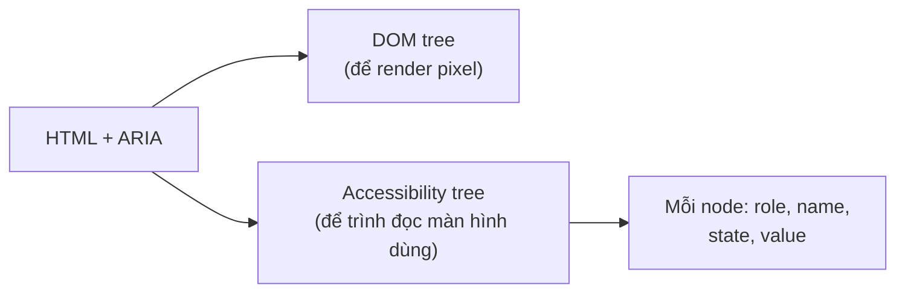
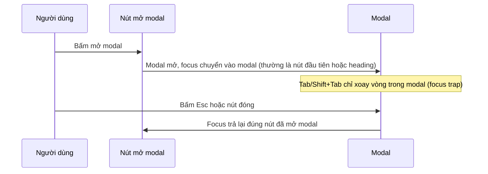

# Accessibility thực chiến: ARIA, focus và kiểm tra thật

Bài [Semantic HTML](/go?p=16-HTML%2Feasy%2Flt-02-semantic-html.md) đã nói thẻ semantic mang theo vai trò ARIA miễn phí. Nhưng mọi giao diện thực tế sớm muộn cũng cần một thứ HTML gốc không có sẵn: modal tự chế, tab tự chế, dropdown tự chế, thông báo toast xuất hiện bất ngờ. Những widget này không phải thẻ có sẵn trong HTML, nên trình đọc màn hình không tự biết cách công bố chúng — đây là lúc ARIA (Accessible Rich Internet Applications) vào cuộc, không phải để thay thế HTML, mà để **vá** đúng những chỗ HTML không với tới. Dùng ARIA sai còn tệ hơn không dùng gì cả, vì nó ghi đè thông tin đúng mà trình duyệt đã tự suy ra, bằng thông tin sai bạn tự khai báo.

**Tóm tắt:**

- Nguyên tắc đầu tiên của ARIA: "No ARIA is better than Bad ARIA" — nếu một thẻ HTML có sẵn mang đúng vai trò bạn cần, dùng thẻ đó luôn thay vì thêm `role` vào `div`.
- Cây accessibility (accessibility tree) là một cây song song với DOM, do trình duyệt dựng từ HTML + ARIA, và là thứ duy nhất trình đọc màn hình thực sự "nhìn thấy".
- `aria-label` đặt tên trực tiếp bằng chuỗi tĩnh; `aria-labelledby` trỏ tới id của một phần tử khác đã có text; `aria-describedby` bổ sung mô tả chi tiết hơn tên, đọc sau tên.
- `aria-live="polite"` công bố nội dung thay đổi mà không ngắt lời người dùng đang thao tác; `assertive` ngắt ngay lập tức, chỉ dùng cho lỗi hoặc cảnh báo khẩn.
- Một modal tự chế bắt buộc phải tự quản lý focus: đưa focus vào khi mở, giữ focus không thoát ra ngoài (focus trap) khi đang mở, và trả focus về đúng chỗ khi đóng.
- Tab order mặc định đi theo thứ tự trong DOM; `tabindex="0"` thêm phần tử không-tự-nhiên-focusable vào tab order đúng vị trí đó; `tabindex` dương (1, 2...) gần như luôn là một lỗi vì nó phá vỡ thứ tự tự nhiên.
- axe DevTools và Lighthouse bắt được lỗi ARIA sai cú pháp hoặc thiếu tên, nhưng không bắt được trải nghiệm bàn phím/trình đọc màn hình thật — phải tự thao tác bằng Tab và một trình đọc màn hình thật (VoiceOver, NVDA) để biết chắc.

## Cây accessibility: thứ trình đọc màn hình thực sự dùng



**Nền tảng:** Với mỗi phần tử, trình duyệt tính ra bốn thứ cho cây accessibility: **role** (nó là gì — button, link, navigation...), **name** (tên gọi — "Đóng", "Email"...), **state** (trạng thái hiện tại — đã check chưa, đang mở hay đóng, disabled hay không), và **value** (giá trị, nếu có). Semantic HTML đúng và ARIA đúng cùng làm một việc: cung cấp bốn thông tin này chính xác nhất có thể. Một `<div onclick="...">` không khai báo gì thêm thì role/name/state đều rỗng — với trình đọc màn hình, nó gần như vô hình dù mắt người vẫn thấy một nút bấm được.

## Khi nào cần ARIA, khi nào semantic HTML đã đủ

| Tình huống | Có cần ARIA không |
|---|---|
| Một nút bấm thường | Không — `<button>` đã có role `button`, tự nhận focus, tự phản hồi phím Enter/Space |
| Một "nút" dựng bằng `<div onclick>` | Có, và nên tránh từ đầu — thêm `role="button"`, `tabindex="0"`, tự bắt cả phím Enter/Space (vốn `<button>` tự làm) |
| Modal tự chế (không dùng `<dialog>`) | Có — `role="dialog"`, `aria-modal="true"`, `aria-labelledby` trỏ tới tiêu đề modal |
| Tab điều hướng tự chế | Có — `role="tablist"`/`role="tab"`/`role="tabpanel"`, `aria-selected`, quản lý `tabindex` giữa các tab (xem ví dụ thực tế đã làm trong [Ôn luyện](../../.) của chính nền tảng này) |
| Icon-only button (chỉ có icon, không có text) | Có — `aria-label="Đóng"` vì không có text nào để trình đọc màn hình đọc |
| Ảnh minh họa có `alt` | Không cần thêm ARIA — `alt` đã đủ, đây là lý do `alt` quan trọng hơn người mới tưởng |

**Phải thuộc:** Quy tắc thực dụng: trước khi viết bất kỳ `role`/`aria-*` nào, tự hỏi "có thẻ HTML gốc nào đã làm việc này chưa". `<dialog>`, `<button>`, `<details>`/`<summary>`, `<select>` đều đã có hành vi bàn phím và accessibility tích hợp sẵn mà một widget tự chế phải tốn hàng chục dòng JavaScript để tái tạo lại, và thường tái tạo thiếu sót.

## `aria-label`, `aria-labelledby`, `aria-describedby`

```html
<!-- aria-label: đặt tên trực tiếp, không cần phần tử nào khác -->
<button aria-label="Đóng">✕</button>

<!-- aria-labelledby: tên lấy từ text của phần tử khác (có thể ghép nhiều id) -->
<h2 id="tieu-de-modal">Xác nhận xóa</h2>
<div role="dialog" aria-labelledby="tieu-de-modal">...</div>

<!-- aria-describedby: mô tả bổ sung, đọc SAU tên, không thay thế tên -->
<input id="mk" type="password" aria-describedby="mk-hint">
<p id="mk-hint">Tối thiểu 8 ký tự, có số và chữ hoa</p>
```

**Suy luận:** Vì sao cần ba thuộc tính khác nhau cho việc tưởng như chỉ là "đặt tên"? Vì tên (name) và mô tả (description) đóng hai vai trò khác nhau trong cách trình đọc màn hình công bố một phần tử: tên được đọc trước, ngắn gọn, định danh "đây là cái gì"; mô tả đọc sau, có thể dài hơn, bổ sung ngữ cảnh mà không làm loãng tên. Gộp cả hai vào một `aria-label` dài khiến người dùng nghe một chuỗi dài mỗi lần phần tử được focus lại, trong khi `aria-describedby` chỉ cần nghe qua một lần là đủ hiểu, sau đó tên ngắn vẫn đủ để nhận diện lại.

## `aria-live`: công bố thay đổi động

```html
<div aria-live="polite" aria-atomic="true">
  <!-- Nội dung này đổi bằng JS sau khi fetch xong -->
  Đã lưu lúc 14:32
</div>
```

| `aria-live` | Hành vi |
|---|---|
| `off` (mặc định) | Thay đổi không được công bố, trừ khi người dùng đang focus đúng phần tử đó |
| `polite` | Công bố khi trình đọc màn hình "rảnh" — không ngắt lời người dùng đang gõ hay đang nghe phần khác |
| `assertive` | Ngắt ngay lập tức, bất kể người dùng đang làm gì — chỉ dùng cho lỗi nghiêm trọng hoặc cảnh báo cần phản ứng ngay |

**Bẫy thường gặp:** đặt `aria-live` lên một container rồi **thay toàn bộ nội dung bên trong nó** (xóa rồi render lại) thay vì chỉ đổi text — nhiều trình đọc màn hình không công bố thay đổi nếu toàn bộ node bị thay thế thay vì text bên trong được cập nhật tại chỗ; `aria-atomic="true"` giúp đảm bảo toàn bộ vùng được đọc lại thay vì chỉ phần thay đổi, nhưng không giải quyết được việc node bị thay thế hoàn toàn.

## Quản lý focus cho một modal tự chế



**Phải thuộc:** Ba việc bắt buộc khi tự dựng modal: (1) khi mở, chủ động đưa focus vào trong modal — trình duyệt không tự làm điều này cho một `<div>`; (2) khi đang mở, `Tab`/`Shift+Tab` không được thoát ra ngoài modal (focus trap), nếu không người dùng dùng bàn phím sẽ "lạc" ra nền phía sau mà không biết; (3) khi đóng, trả focus về đúng phần tử đã mở modal, không phải về đầu trang — mất bước này, người dùng dùng bàn phím phải tự dò lại từ đầu trang mỗi lần đóng một hộp thoại.

Thẻ `<dialog>` gốc của HTML đã tự làm việc (1) và một phần việc (3) nếu dùng đúng cách (`showModal()`), là lý do nó đáng cân nhắc trước khi tự dựng modal từ `div`.

## Tab order và `tabindex`

| Giá trị `tabindex` | Ý nghĩa |
|---|---|
| Không đặt (mặc định) | `a[href]`, `button`, `input`, `select`, `textarea` tự nhận focus theo thứ tự DOM; `div`, `span`, `p` không nhận focus |
| `0` | Thêm phần tử vốn không tự focus được vào tab order, đúng vị trí tự nhiên của nó trong DOM |
| `-1` | Có thể nhận focus **bằng JavaScript** (`el.focus()`), nhưng bị loại khỏi tab order khi người dùng tự bấm Tab |
| Số dương (`1`, `2`...) | Ép phần tử đó lên **trước mọi phần tử tabindex mặc định**, bất kể vị trí DOM — gần như luôn là một lỗi |

**Phải thuộc:** `tabindex` dương tạo ra một thứ tự tab "nhảy cóc" khó bảo trì: thêm một phần tử mới vào giữa trang có thể vô tình chen vào giữa một chuỗi số bạn đã đặt tay trước đó, phá vỡ toàn bộ thứ tự. Cách đúng gần như luôn là sắp xếp lại HTML theo đúng thứ tự mong muốn và chỉ dùng `tabindex="0"`/`-1`.

### Skip link: lối tắt quen thuộc bị bỏ qua

```html
<body>
  <a href="#main" class="skip-link">Bỏ qua điều hướng, tới nội dung chính</a>
  <nav>...</nav>
  <main id="main">...</main>
</body>
```

Skip link thường bị ẩn bằng CSS (`position: absolute; left: -9999px`) và chỉ hiện khi nhận focus — cho phép người dùng bàn phím bỏ qua toàn bộ menu điều hướng lặp lại ở mọi trang, nhảy thẳng tới nội dung chính, thay vì phải bấm Tab hàng chục lần mỗi khi vào trang mới.

## Kiểm tra thật: tool tự động không đủ

| Công cụ | Bắt được gì | Không bắt được gì |
|---|---|---|
| axe DevTools / Lighthouse | Thiếu `alt`, thiếu tên cho input, contrast màu không đủ, ARIA sai cú pháp, heading nhảy cấp | Trải nghiệm bàn phím thật có mượt không, trình đọc màn hình có đọc đúng ngữ cảnh không, focus trap có hoạt động không |
| Tự thao tác chỉ bằng bàn phím (rút chuột ra) | Tab order có hợp lý không, có phần tử nào "vô hình" với bàn phím không, focus có bao giờ bị kẹt/mất dấu không | Nội dung trình đọc màn hình thực sự đọc ra là gì |
| VoiceOver (macOS/iOS), NVDA (Windows, miễn phí) | Tên/vai trò/trạng thái thực sự được công bố, thứ tự đọc thực tế | Tốn thời gian học thao tác, không chạy tự động trong CI |

**Suy luận:** Vì sao công cụ tự động không đủ? Vì axe/Lighthouse chỉ kiểm tra được những quy tắc **có thể biểu diễn thành luật tĩnh** (thiếu attribute, sai cú pháp, contrast dưới ngưỡng) — chúng không "trải nghiệm" trang theo cách một người dùng thật trải nghiệm. Một modal có đủ `role="dialog"` và `aria-label` đúng cú pháp (qua được mọi tool tự động) vẫn có thể hoàn toàn vô dụng với người dùng thật nếu focus không bao giờ được đưa vào trong nó khi mở — đó là một lỗi về **hành vi theo thời gian**, không phải lỗi về **cấu trúc tĩnh**, và chỉ lộ ra khi có ai đó thực sự dùng Tab hoặc một trình đọc màn hình thật để thử.

## Điều cần nhớ

- Luôn hỏi "có thẻ HTML gốc nào đã làm việc này chưa" trước khi thêm `role`/`aria-*` — ARIA là lớp vá, không phải lớp mặc định.
- `aria-label`/`aria-labelledby` đặt tên, `aria-describedby` bổ sung mô tả sau tên — không gộp chung một thuộc tính.
- Tool tự động (axe, Lighthouse) chỉ bắt lỗi cấu trúc tĩnh; focus trap, tab order thật, nội dung trình đọc màn hình thực sự đọc ra chỉ lộ ra khi tự thao tác bằng bàn phím và trình đọc màn hình thật.
