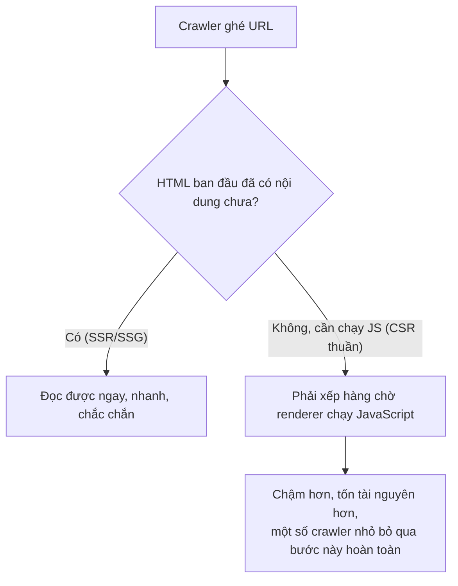

# SEO: meta tag, structured data và vì sao SSR quan trọng với crawler

Một trang web có nội dung tốt nhưng công cụ tìm kiếm không đọc được xem như không tồn tại với phần lớn người dùng tìm tới nó qua Google. Phần lớn công sức SEO kỹ thuật (khác với SEO nội dung) nằm ở việc đảm bảo đúng ba thứ: công cụ tìm kiếm **đọc được** trang (crawl), **hiểu được** trang nói về cái gì (meta tag, structured data), và quyết định **nên lập chỉ mục** trang hay không (robots, canonical). Bài này đi qua ba lớp đó, và vì sao cách trang được render (server hay client) lại ảnh hưởng trực tiếp tới lớp đầu tiên.

**Tóm tắt:**

- `title` và `meta description` là thứ người dùng thấy đầu tiên trên kết quả tìm kiếm — chúng quyết định tỷ lệ click, không trực tiếp quyết định thứ hạng.
- Open Graph (`og:*`) và Twitter Card là hai bộ meta tag riêng biệt quyết định trang hiện thế nào khi được chia sẻ trên mạng xã hội, không liên quan tới thứ hạng tìm kiếm.
- `canonical` khai báo "đây là phiên bản chính thức" khi nhiều URL cùng dẫn tới nội dung giống hệt nhau, tránh bị phạt vì nội dung trùng lặp.
- `robots.txt` chặn **crawl** (bot không ghé trang đó) còn `meta robots noindex` chặn **index** (bot vẫn ghé nhưng không đưa vào kết quả tìm kiếm) — hai cơ chế khác nhau, dễ dùng nhầm lẫn nhau.
- `sitemap.xml` là danh sách URL bạn chủ động "mời" công cụ tìm kiếm ghé qua, hữu ích nhất với trang mới hoặc ít được link tới từ nơi khác.
- Structured data (JSON-LD theo schema.org) không đổi nội dung hiển thị cho người dùng, nhưng cho công cụ tìm kiếm hiểu dữ liệu có cấu trúc (giá, đánh giá, công thức nấu ăn...) để hiện "rich result" bắt mắt hơn trên kết quả tìm kiếm.
- Crawler hiện đại của Google có thể chạy JavaScript, nhưng việc đó tốn tài nguyên và có độ trễ hơn hẳn so với đọc HTML tĩnh — nội dung quan trọng có trong HTML ban đầu (SSR) luôn an toàn hơn nội dung chỉ xuất hiện sau khi JavaScript chạy xong (CSR thuần).

## Meta tag người dùng thực sự thấy

```html
<title>Học lập trình backend — KemTech</title>
<meta name="description" content="Lộ trình học Java, Spring Boot, database và hệ thống phân tán, có bài tập và trắc nghiệm.">
```

| Thẻ | Hiện ở đâu | Ảnh hưởng gì |
|---|---|---|
| `<title>` | Dòng tiêu đề xanh trên kết quả tìm kiếm, tab trình duyệt | Ảnh hưởng cả thứ hạng (từ khóa trong title có trọng số) lẫn tỷ lệ click |
| `meta description` | Đoạn tóm tắt dưới title trên kết quả tìm kiếm | Không ảnh hưởng thứ hạng trực tiếp, nhưng ảnh hưởng tỷ lệ click — và nếu bạn không viết, Google tự trích một đoạn trong trang, có thể không phải đoạn bạn muốn |

**Phải thuộc:** `meta description` không nằm trong công thức xếp hạng của Google — viết "nhồi từ khóa" vào đó không giúp thứ hạng cao hơn, chỉ giúp hoặc hại tỷ lệ click vì đó là thứ người dùng đọc trước khi quyết định bấm vào.

## Open Graph và Twitter Card: kiểm soát việc chia sẻ

```html
<meta property="og:title" content="Học lập trình backend">
<meta property="og:description" content="Lộ trình học Java, Spring Boot...">
<meta property="og:image" content="https://example.com/cover.jpg">
<meta property="og:url" content="https://example.com/">
<meta name="twitter:card" content="summary_large_image">
```

**Nền tảng:** Khi một link được dán vào Facebook, Zalo, Slack hay Twitter/X, ứng dụng đó tự ghé qua URL và đọc các thẻ `og:*` (chuẩn do Facebook khởi xướng, nay được hầu hết nền tảng tôn trọng) để dựng card xem trước (ảnh, tiêu đề, mô tả). Twitter/X có thêm bộ thẻ `twitter:*` riêng, dùng khi có, và rơi về `og:*` nếu thiếu. Thiếu các thẻ này, link được chia sẻ chỉ hiện trần URL hoặc một preview rất sơ sài tự đoán từ nội dung trang — không ảnh hưởng gì tới SEO, nhưng ảnh hưởng trực tiếp tới việc người khác có muốn bấm vào link bạn chia sẻ hay không.

## `canonical`: tránh bị phạt vì nội dung trùng lặp

```html
<link rel="canonical" href="https://example.com/san-pham/ao-thun">
```

Tình huống kinh điển cần `canonical`: một sản phẩm thương mại điện tử có thể truy cập qua nhiều URL khác nhau cùng trả về nội dung giống hệt (`?utm_source=...`, `?ref=...`, hoặc qua nhiều danh mục khác nhau dẫn tới cùng một trang chi tiết). Không có `canonical`, công cụ tìm kiếm thấy nhiều URL cùng nội dung và phải tự đoán URL nào là "chính", có thể chia điểm xếp hạng ra nhiều URL thay vì gom về một, hoặc tệ hơn là coi đó là nội dung trùng lặp spam.

**Phải thuộc:** `canonical` chỉ là một **gợi ý mạnh**, không phải lệnh bắt buộc — công cụ tìm kiếm có thể bỏ qua nếu có tín hiệu mâu thuẫn khác (ví dụ nội dung hai trang thực ra không giống hệt nhau như khai báo).

## `robots.txt` so với `meta robots`: hai lớp khác nhau

```txt
# robots.txt — đặt ở gốc domain: example.com/robots.txt
User-agent: *
Disallow: /admin/
Sitemap: https://example.com/sitemap.xml
```

```html
<!-- meta robots — đặt trong head của một trang cụ thể -->
<meta name="robots" content="noindex, nofollow">
```

| | `robots.txt` | `meta robots` |
|---|---|---|
| Chặn ở mức | Trước khi bot **ghé thăm** trang | Sau khi bot **đã ghé thăm**, chặn đưa vào index |
| Áp dụng cho | Cả một đường dẫn/thư mục | Từng trang riêng lẻ |
| Hậu quả nếu dùng sai | Chặn `/admin/` trong `robots.txt` nhưng link `/admin/` vẫn có thể bị index nếu có nơi khác trỏ tới nó — vì bot không ghé qua nên không bao giờ thấy được `meta robots noindex` đặt bên trong trang đó | — |

**Suy luận:** Vì sao chặn một trang nhạy cảm bằng `robots.txt` đôi khi vẫn khiến nó xuất hiện trên kết quả tìm kiếm (dù không có nội dung, chỉ có URL trần)? Vì `robots.txt` chỉ ngăn bot **tải nội dung** trang đó — nếu một trang khác (kể cả ngoài domain của bạn) có link trỏ tới URL bị chặn, công cụ tìm kiếm vẫn biết URL đó tồn tại qua link, và có thể hiển thị nó trên kết quả tìm kiếm chỉ với URL trần, không có title/description, vì chưa bao giờ được phép đọc nội dung bên trong để lấy các thông tin đó. Muốn chắc chắn một trang không bao giờ xuất hiện trên kết quả tìm kiếm, `meta robots noindex` (yêu cầu bot phải ghé qua được để đọc) mới là cơ chế đúng, không phải `robots.txt`.

## `sitemap.xml`

```xml
<?xml version="1.0" encoding="UTF-8"?>
<urlset xmlns="http://www.sitemaps.org/schemas/sitemap/0.9">
  <url>
    <loc>https://example.com/</loc>
    <lastmod>2026-01-15</lastmod>
  </url>
  <url>
    <loc>https://example.com/blog/bai-viet-1</loc>
  </url>
</urlset>
```

**Nền tảng:** Công cụ tìm kiếm thường tự khám phá trang mới bằng cách đi theo link từ trang này sang trang khác (crawl). `sitemap.xml` là danh sách URL bạn **chủ động khai báo**, hữu ích nhất khi: trang mới chưa được link tới từ đâu cả, trang nằm sâu nhiều cấp link mà crawler ít khi đi tới, hoặc site rất lớn và muốn đảm bảo mọi trang quan trọng đều được biết tới thay vì chờ crawler tự tìm ra.

## Structured data (JSON-LD): cho máy hiểu, không chỉ cho người đọc

```html
<script type="application/ld+json">
{
  "@context": "https://schema.org",
  "@type": "Article",
  "headline": "Học lập trình backend từ đầu",
  "datePublished": "2026-01-15",
  "author": { "@type": "Organization", "name": "KemTech" }
}
</script>
```

**Phải thuộc:** JSON-LD không hiển thị gì trên trang — nó là dữ liệu thuần cho máy đọc, đặt trong một thẻ `<script type="application/ld+json">` không chạy như JavaScript thường. `schema.org` là từ điển vai trò chung (`Article`, `Product`, `Recipe`, `FAQPage`, `BreadcrumbList`...) mà Google và các công cụ tìm kiếm khác cùng thống nhất hiểu, cho phép hiện "rich result": sao đánh giá sao cho `Product`, danh sách nguyên liệu/thời gian nấu cho `Recipe`, câu hỏi gấp mở trực tiếp trên kết quả tìm kiếm cho `FAQPage`.

**Bẫy thường gặp:** structured data khai báo một thứ (ví dụ giá sản phẩm, điểm đánh giá) không khớp với nội dung thực sự hiển thị trên trang cho người dùng — công cụ tìm kiếm có chính sách phạt rõ ràng cho "structured data đánh lừa" (misleading structured data), vì rich result dựa trên dữ liệu không khớp nội dung thật gây hại cho trải nghiệm người tìm kiếm.

## SSR/CSR và những gì crawler thực sự thấy



**Nền tảng:** Google có một tiến trình render JavaScript riêng (dùng engine trình duyệt thật) để đọc được nội dung chỉ xuất hiện sau khi chạy JS — nhưng bước này tốn thêm tài nguyên và thời gian so với đọc HTML tĩnh, nên không phải mọi crawler (kể cả một số công cụ nội bộ của mạng xã hội khi tạo preview link) đều làm bước này, và ngay cả Google cũng có thể trì hoãn việc render JS của một trang cụ thể sang một thời điểm sau. Nội dung quan trọng (tiêu đề bài viết, nội dung chính, giá sản phẩm) nằm sẵn trong HTML ban đầu — tức là được server render trước (SSR) hoặc sinh tĩnh trước (SSG) — luôn là lựa chọn an toàn nhất cho SEO. Cơ chế render phía server/streaming/Server Components cụ thể của React đã có bài riêng: xem [SSR, React Server Components và Next.js](/go?p=09-React%2Fhard%2Flt-09-ssr-rsc-nextjs.md) — bài đó giải thích **cách** render phía server hoạt động bên trong; bài này chỉ cần bạn nhớ **vì sao** nó quan trọng với crawler.

## Điều cần nhớ

- `title`/`meta description` quyết định tỷ lệ click trên kết quả tìm kiếm, không trực tiếp quyết định thứ hạng; Open Graph/Twitter Card chỉ ảnh hưởng khi chia sẻ mạng xã hội.
- `robots.txt` chặn crawl (bot không ghé), `meta robots noindex` chặn index (bot ghé nhưng không đưa vào kết quả) — nhầm lẫn hai cơ chế này là lỗi SEO kỹ thuật phổ biến nhất.
- Nội dung quan trọng nên có sẵn trong HTML ban đầu (SSR/SSG) thay vì chỉ xuất hiện sau khi JavaScript chạy xong, vì không phải crawler nào cũng chờ/chạy JavaScript.
