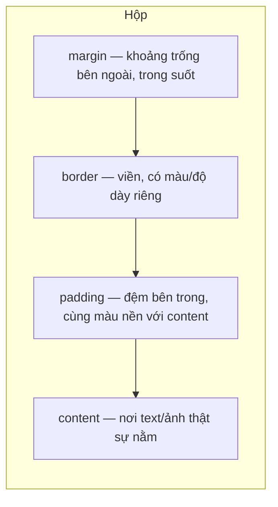

# Box model, cascade và selector: vì sao CSS "không nghe lời" bạn

Bạn đặt `width: 200px` cho một `div`, thêm `padding: 20px` và `border: 2px solid`, rồi ngạc nhiên khi nó rộng tới 244px chứ không phải 200px. Bạn viết `.btn { color: red }` rồi lại viết `#header .btn { color: blue }` ở dưới, và màu đỏ vẫn thắng dù blue nằm sau. Cả hai đều không phải "lỗi" của CSS — đó là **box model** và **cascade** đang hoạt động đúng như thiết kế. Bài này giải thích chính xác cơ chế đó, để bạn đoán được text sẽ vào đâu trước khi nhấn F5.

**Tóm tắt:**

- Mỗi phần tử là một hộp gồm 4 lớp lồng nhau: content, padding, border, margin; mặc định `width`/`height` chỉ đo content, nên thêm padding/border sẽ làm hộp phình to hơn con số bạn gõ.
- `box-sizing: border-box` đổi lại cách đo: `width` giờ là tổng content+padding+border, nên hộp luôn đúng kích thước bạn khai báo — gần như mọi dự án hiện đại bật mặc định này.
- Margin dọc giữa hai phần tử anh em (và giữa cha-con không có rào cản) có thể **cộng dồn thành một** (margin collapsing) thay vì cộng lại, khiến khoảng cách thực tế nhỏ hơn bạn tính.
- Khi hai rule cùng áp cho một phần tử, CSS không chọn theo thứ tự đọc trước — nó tính **specificity** (độ đặc hiệu) của từng selector và rule đặc hiệu hơn thắng, bất kể viết trước hay sau.
- Specificity tính theo bộ ba (số ID, số class/attribute/pseudo-class, số tên thẻ); so sánh theo thứ tự đó như so số, không phải cộng dồn thành một con số duy nhất.
- Cùng specificity thì rule đọc **sau** trong nguồn thắng (thứ tự xuất hiện); `!important` đứng trên gần hết thang specificity thông thường và nên tránh vì rất khó ghi đè lại.
- Kế thừa (inheritance) chỉ áp cho một số thuộc tính nhất định (chữ: `color`, `font-*`) — thuộc tính box (`margin`, `border`, `width`...) không bao giờ kế thừa từ cha.

## Box model: bốn lớp lồng nhau

Mọi phần tử HTML, dù là `<div>` hay `<span>`, đều được trình duyệt vẽ như một hộp chữ nhật gồm 4 lớp, từ trong ra ngoài:



**Nền tảng:** `width`/`height` bạn khai báo chỉ đo đúng lớp **content**. Padding và border cộng thêm vào kích thước hiển thị thực tế, margin thì không tính vào kích thước của hộp mà chỉ đẩy các hộp khác ra xa.

```css
.card {
  width: 200px;
  padding: 20px;
  border: 2px solid #333;
}
/* Kích thước hiển thị thực tế = 200 (content) + 20*2 (padding trái-phải) + 2*2 (border trái-phải) = 244px */
```

**Phải thuộc:** mặc định (`box-sizing: content-box`), width chỉ là content; cộng thêm padding và border hai bên mới ra bề rộng hiển thị thật. Đây là nguyên nhân phổ biến nhất khiến layout "lệch vài chục pixel" không rõ lý do.

### `box-sizing: border-box` — sửa đúng chỗ gây nhầm

```css
*, *::before, *::after {
  box-sizing: border-box;
}
```

Với `border-box`, `width: 200px` nghĩa là **tổng** content + padding + border đúng bằng 200px; trình duyệt tự co content lại để nhường chỗ cho padding/border. Vì vậy gần như mọi CSS reset hiện đại (Tailwind, normalize.css, hầu hết starter project) bật `border-box` toàn cục ngay dòng đầu tiên — không có lý do thực tế nào để giữ `content-box` mặc định trong dự án mới.

| | `content-box` (mặc định) | `border-box` |
|---|---|---|
| `width` đo gì | Chỉ content | Content + padding + border |
| Thêm padding | Hộp phình to ra | Hộp giữ nguyên kích thước, content co lại |
| Dùng khi nào | Hiếm khi cố ý chọn | Gần như luôn luôn |

### Margin collapsing: khoảng cách không cộng dồn

```html
<p style="margin-bottom: 20px">Đoạn 1</p>
<p style="margin-top: 30px">Đoạn 2</p>
```

Trực giác: khoảng cách giữa hai đoạn là 20 + 30 = 50px. Thực tế trình duyệt chỉ lấy **margin lớn hơn**, tức 30px. Đây gọi là margin collapsing, xảy ra giữa margin dọc (không phải margin ngang) của các phần tử anh em liền kề, và cả giữa phần tử cha-con nếu cha không có padding/border/nội dung nào chắn ở giữa.

**Suy luận:** quy tắc này tồn tại vì nếu cộng dồn, việc chỉnh khoảng cách giữa các đoạn văn bản sẽ phụ thuộc vào việc bạn đặt margin ở phần tử trên hay phần tử dưới — hai lập trình viên khác nhau chỉnh cùng một khu vực sẽ ra kết quả khó đoán. Lấy max() thay vì cộng khiến khoảng cách chỉ phụ thuộc vào "margin lớn nhất đang được yêu cầu ở đó", nhất quán dù ai chỉnh. Hệ quả thực hành: nếu bạn thấy margin "biến mất" một cách khó hiểu giữa hai khối, nghi ngay margin collapsing trước khi nghi đến lỗi hiển thị khác; cách né phổ biến nhất là dùng `gap` trong flex/grid (không bị collapse) thay vì margin cho khoảng cách giữa các phần tử trong cùng một container.

## Cascade và specificity: ai thắng khi hai rule đụng nhau

CSS là viết tắt của Cascading Style Sheets — cơ chế "thác đổ" quyết định rule nào thắng khi nhiều rule cùng nhắm vào một phần tử và cùng thuộc tính. Thứ tự xét, từ quan trọng nhất:

1. `!important` (nên tránh — xem bên dưới).
2. **Specificity** (độ đặc hiệu) của selector.
3. **Thứ tự xuất hiện** trong nguồn — nếu specificity bằng nhau, rule đọc sau thắng.

### Specificity tính thế nào

Specificity là một bộ ba số `(a, b, c)`, so sánh như so từng chữ số từ trái sang phải, **không** cộng gộp thành một số duy nhất:

| Thành phần | Tính vào vị trí | Ví dụ |
|---|---|---|
| ID (`#id`) | a | `#header` → a=1 |
| Class, pseudo-class, attribute (`.class`, `:hover`, `[type]`) | b | `.btn:hover` → b=2 |
| Tên thẻ, pseudo-element (`div`, `::before`) | c | `div::before` → c=2 |

```css
#header .btn { color: blue; }   /* specificity (1, 1, 0) */
.btn { color: red; }            /* specificity (0, 1, 0) */
```

`(1,1,0) > (0,1,0)` vì so chữ số đầu tiên trước (1 > 0) — `#header .btn` thắng, bất kể `.btn { color: red }` nằm ở dòng cuối file CSS. Đây đúng là ví dụ ở đầu bài: màu đỏ thua không phải vì thứ tự, mà vì `.btn` đơn độc có specificity thấp hơn.

**Phải thuộc:** so sánh specificity theo từng chữ số (ID trước, rồi class, rồi thẻ) chứ không cộng dồn — 10 class (0,10,0) vẫn thua 1 ID (1,0,0), vì ta so chữ số đầu trước tiên và 1 > 0 ngay từ đó.

### Khi specificity bằng nhau: ai viết sau thắng

```css
.btn { color: red; }
.btn { color: green; }  /* cùng specificity (0,1,0) — rule này ở sau nên thắng, kết quả: green */
```

Đây là lý do thứ tự `@import`/`<link>` và thứ tự nạp file CSS trong project quan trọng — framework UI nạp trước, CSS tùy biến của bạn nạp sau để ghi đè đúng ý.

### `!important` và vì sao nên tránh

```css
.btn { color: red !important; }
```

`!important` gần như đứng trên toàn bộ thang specificity thông thường (một `!important` thắng mọi rule thường, bất kể specificity). Vấn đề: muốn ghi đè lại, bạn phải thêm `!important` khác với specificity cao hơn — nhanh chóng thành một cuộc chạy đua vũ trang trong codebase, nơi không ai dám xóa `!important` cũ vì không biết nó đang chặn cái gì. Cách đúng để "thắng" một rule khó ghi đè là tăng specificity có kiểm soát (ví dụ thêm một class bọc ngoài) hoặc tổ chức lại thứ tự nạp CSS, không phải leo thang `!important`.

## Selector: các cách chọn phần tử

| Loại | Cú pháp | Ý nghĩa |
|---|---|---|
| Type | `div` | Mọi thẻ `div` |
| Class | `.card` | Phần tử có `class="card"` (có thể nhiều class trên một phần tử) |
| ID | `#header` | Phần tử có `id="header"` (phải duy nhất trên trang) |
| Attribute | `[type="email"]` | Phần tử có attribute khớp |
| Descendant | `.card p` | `p` nằm **bất kỳ đâu** bên trong `.card` |
| Child | `.card > p` | `p` là **con trực tiếp** của `.card` |
| Adjacent sibling | `h2 + p` | `p` ngay **sau** `h2`, cùng cấp |
| General sibling | `h2 ~ p` | Mọi `p` sau `h2`, cùng cấp |
| Pseudo-class | `:hover`, `:first-child`, `:nth-child(2)` | Trạng thái hoặc vị trí, không phải phần tử riêng trong DOM |
| Pseudo-element | `::before`, `::first-line` | Tạo "phần tử ảo" không có trong DOM, hoặc chọn một phần của phần tử có sẵn |

**Phải thuộc:** pseudo-class (một dấu `:`) mô tả **trạng thái** của một phần tử thật đã có trong DOM (`:hover`, `:checked`, `:nth-child`); pseudo-element (hai dấu `::`) tạo ra hoặc nhắm vào một **phần** không tồn tại như một node DOM riêng (`::before` chèn nội dung ảo, `::first-line` chọn dòng đầu của đoạn văn dù "dòng đầu" thay đổi theo kích thước màn hình).

### Kế thừa: chỉ chữ, không phải hộp

```css
body { color: #333; font-family: sans-serif; }
```

Đặt `color` và `font-family` trên `body` thì mọi phần tử con bên trong tự động nhận giá trị đó (trừ khi bị ghi đè), vì đây là thuộc tính **kế thừa được** — chủ yếu là các thuộc tính liên quan đến chữ (`color`, `font-*`, `line-height`, `text-align`). Ngược lại `margin`, `padding`, `border`, `width`, `background` **không** kế thừa: đặt `border: 1px solid` trên cha không khiến con tự có viền. Nguyên tắc chọn: nếu thuộc tính nói về cách hiển thị **chữ**, nhiều khả năng nó kế thừa; nếu nói về **hộp** (kích thước, viền, nền), gần như chắc chắn không.

## Bẫy thường gặp

| Bẫy | Hệ quả | Cách tránh |
|---|---|---|
| Quên `box-sizing: border-box` | Thêm padding làm vỡ layout đã tính sẵn width | Bật `border-box` toàn cục ngay đầu file CSS |
| Tưởng margin dọc cộng dồn | Khoảng cách thực tế nhỏ hơn tính toán | Nhớ margin collapsing lấy max, không cộng; dùng `gap` khi có thể |
| Thêm class mới để "thắng" rule cũ nhưng đặt sai chỗ | Vẫn thua vì ID cũ có specificity cao hơn hẳn | Tính đúng bộ ba specificity trước khi đoán |
| Lạm dụng `!important` | Không ai dám xóa, debug CSS thành đoán mò | Ghi đè bằng tăng specificity có kiểm soát, giữ `!important` cho trường hợp thật sự đặc biệt |
| Đặt `border`/`background` trên cha và mong con kế thừa | Con không có gì cả | Chỉ chữ mới kế thừa; thuộc tính hộp phải đặt trực tiếp hoặc dùng CSS variable |

## Câu hỏi tự kiểm tra

1. **`.btn` có `width: 100px`, thêm `padding: 10px` và `border: 1px solid`, không có `box-sizing`. Hộp rộng bao nhiêu?**
   Gợi ý: mặc định là `content-box`.
   Đáp án: 100 + 10×2 + 1×2 = 122px, vì width mặc định chỉ đo content.

2. **`#nav .link { color: red }` và `.link.active { color: blue }` cùng áp cho một phần tử. Màu nào thắng?**
   Gợi ý: so specificity theo bộ ba, không đếm tổng số class.
   Đáp án: `#nav .link` có specificity (1,1,0); `.link.active` có (0,2,0). So chữ số đầu: 1 > 0, nên đỏ thắng dù vế sau có nhiều class hơn.

3. **Hai `<div>` anh em có `margin-bottom: 40px` và `margin-top: 24px`. Khoảng cách thực tế giữa chúng là bao nhiêu?**
   Gợi ý: margin dọc giữa anh em liền kề bị collapse.
   Đáp án: 40px (lấy max, không cộng 64px).

## Điều cần nhớ

- Width mặc định chỉ đo content; dùng `box-sizing: border-box` toàn cục để width luôn đúng nghĩa "tổng kích thước hộp".
- Margin dọc giữa các phần tử liền kề bị collapse thành giá trị lớn nhất, không cộng dồn; dùng `gap` trong flex/grid để né hoàn toàn vấn đề này.
- Rule nào thắng được quyết định bởi specificity (tính theo bộ ba ID/class/thẻ, so như so số thứ tự), rồi mới đến thứ tự xuất hiện; tránh `!important` vì nó phá vỡ khả năng ghi đè có trật tự.
- Chỉ thuộc tính liên quan đến chữ mới kế thừa từ cha; thuộc tính hộp (margin/padding/border/width) luôn phải khai báo trực tiếp.
