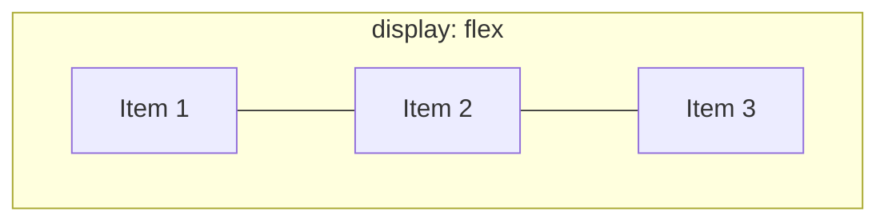
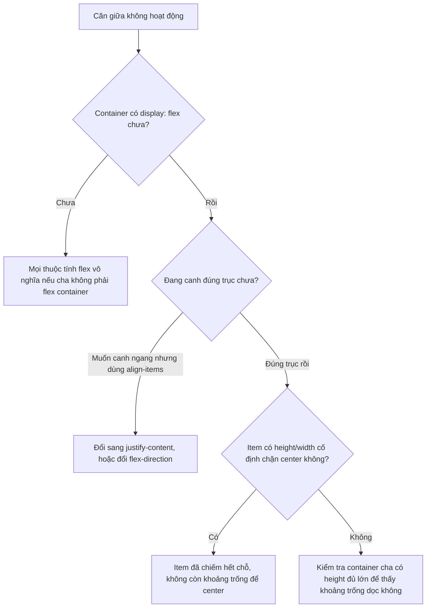

# Flexbox: trục chính, trục phụ và vì sao căn giữa "không chịu giữa"

"CSS để căn giữa một div" là câu đùa kinh điển của dân frontend, nhưng lý do nó khó không phải vì CSS vô lý — mà vì trước Flexbox, CSS chưa có khái niệm "phân bổ khoảng trống dư ra trong một hàng/cột". Flexbox sinh ra đúng để giải bài toán đó: cho một container, chia đều hoặc canh các phần tử con theo một trục. Hiểu đúng **trục chính** và **trục phụ** thì mọi thuộc tính flex trở thành hiển nhiên; nhầm trục là nguồn gốc của hầu hết các câu hỏi "sao `align-items` không hoạt động".

**Tóm tắt:**

- Flexbox luôn có hai trục: trục chính (main axis, theo `flex-direction`) và trục phụ (cross axis, vuông góc với trục chính); mọi thuộc tính canh chỉnh chỉ tác động đúng một trục.
- `justify-content` canh theo trục chính, `align-items`/`align-self` canh theo trục phụ — nhầm hai thuộc tính này với nhau là lỗi phổ biến nhất khi "căn giữa không ăn".
- `flex-direction: row` (mặc định) làm trục chính nằm ngang; đổi sang `column` thì trục chính xoay dọc, kéo theo `justify-content` và `align-items` đổi vai trò theo.
- `flex-grow`/`flex-shrink`/`flex-basis` (gộp lại thành `flex`) quyết định một item co giãn bao nhiêu phần khoảng trống dư/thiếu so với các item khác, không phải kích thước tuyệt đối.
- `flex: 1` là cách viết tắt rất hay dùng của `flex: 1 1 0%`: cho phép item giãn và co tự do, bỏ qua kích thước nội dung ban đầu — khác với `flex: auto` (giữ kích thước nội dung làm điểm xuất phát).
- `gap` tạo khoảng cách giữa các item mà không bị margin collapsing và không cần "trick" margin âm ở item đầu/cuối như cách làm cũ.
- `align-items` canh mọi item theo trục phụ cùng lúc; `align-self` ghi đè cho **một** item riêng lẻ, hữu ích khi cần một item lệch khỏi hàng.

## Hai trục: chìa khóa của toàn bộ Flexbox



Khi bạn đặt `display: flex` lên một container, nó tự xác định hai trục:

- **Trục chính (main axis):** hướng mà `flex-direction` chỉ định — mặc định `row` nghĩa là trục chính nằm **ngang**, các item xếp từ trái sang phải.
- **Trục phụ (cross axis):** luôn vuông góc với trục chính — khi trục chính ngang thì trục phụ là **dọc**.

**Nền tảng:** mọi thuộc tính canh chỉnh trong Flexbox chỉ thuộc về một trong hai trục. `justify-content` luôn luôn canh theo trục **chính**; `align-items` và `align-self` luôn luôn canh theo trục **phụ**. Thuộc tính không đổi ý nghĩa, nhưng trục chính/phụ đổi hướng theo `flex-direction` — đó là lý do cùng một đoạn CSS cho kết quả khác nhau khi bạn đổi `row` thành `column`.

| `flex-direction` | Trục chính | Trục phụ | `justify-content` canh | `align-items` canh |
|---|---|---|---|---|
| `row` (mặc định) | Ngang | Dọc | Trái-phải | Trên-dưới |
| `row-reverse` | Ngang (đảo chiều) | Dọc | Trái-phải (ngược) | Trên-dưới |
| `column` | Dọc | Ngang | Trên-dưới | Trái-phải |
| `column-reverse` | Dọc (đảo chiều) | Ngang | Trên-dưới (ngược) | Trái-phải |

**Phải thuộc:** đổi `flex-direction` từ `row` sang `column` không chỉ xoay layout — nó **hoán đổi vai trò** của `justify-content` và `align-items`. Đây là câu hỏi phỏng vấn rất hay gặp: "tôi đổi sang `column` mà `justify-content: center` không còn căn giữa ngang nữa" — đúng, vì giờ nó canh theo chiều dọc.

## Các thuộc tính canh chỉnh, từng cái một

| Thuộc tính | Đặt ở đâu | Canh theo trục | Giá trị hay dùng |
|---|---|---|---|
| `justify-content` | Container | Chính | `flex-start`, `center`, `space-between`, `space-around`, `space-evenly` |
| `align-items` | Container | Phụ | `flex-start`, `center`, `stretch` (mặc định), `baseline` |
| `align-self` | Từng item | Phụ | Giống `align-items`, nhưng chỉ ghi đè cho item này |
| `align-content` | Container (khi có nhiều dòng, `flex-wrap: wrap`) | Phụ, nhưng canh **cả cụm dòng** | Giống `justify-content` nhưng áp cho các dòng, không phải từng item |

```css
.navbar {
  display: flex;
  justify-content: space-between; /* logo bên trái, menu bên phải, cách đều */
  align-items: center;            /* mọi item canh giữa theo chiều dọc navbar */
}
```

**Suy luận:** vì sao `align-items` mặc định là `stretch` chứ không phải `flex-start`? Vì Flexbox được thiết kế cho layout UI thực tế, nơi các item trong cùng một hàng (card, cột sidebar) thường cần cao bằng nhau để trông liền mạch — ví dụ ba card sản phẩm cao thấp khác nhau do nội dung dài ngắn trông rất xấu. `stretch` kéo mọi item giãn ra bằng item cao nhất theo mặc định, nên phần lớn layout "tự nhiên" đã đẹp mà không cần khai báo gì thêm; bạn chỉ cần đổi sang `flex-start`/`center` khi cố tình muốn các item giữ chiều cao riêng.

## `flex-grow`, `flex-shrink`, `flex-basis`: toán học đằng sau `flex: 1`

Ba thuộc tính này điều khiển việc **phân bổ khoảng trống dư hoặc thiếu** trên trục chính, không phải đặt kích thước tuyệt đối:

| Thuộc tính | Ý nghĩa | Giá trị mặc định |
|---|---|---|
| `flex-grow` | Item này nhận bao nhiêu **phần** khoảng trống **dư ra** so với các item khác (theo tỉ lệ) | `0` (không giãn) |
| `flex-shrink` | Item này co lại bao nhiêu **phần** khi container **thiếu chỗ** | `1` (co theo tỉ lệ mặc định) |
| `flex-basis` | Kích thước "xuất phát" trước khi grow/shrink tính toán | `auto` (dựa theo nội dung/width) |

```css
.item-a { flex: 1; }  /* flex-grow:1 flex-shrink:1 flex-basis:0% — chia đều, bỏ qua kích thước nội dung */
.item-b { flex: 2; }  /* chiếm gấp đôi phần dư so với .item-a */
.item-c { flex: auto; } /* flex-grow:1 flex-shrink:1 flex-basis:auto — bắt đầu từ kích thước nội dung rồi mới giãn/co */
```

Nếu container rộng 900px và ba item `.item-a` (flex:1), `.item-a` (flex:1), `.item-b` (flex:2) không có nội dung chiếm chỗ (`flex-basis: 0%`), khoảng trống 900px chia theo tỉ lệ 1:1:2 → 225px, 225px, 450px.

**Phải thuộc:** `flex: 1` tương đương `flex: 1 1 0%` — bỏ qua hoàn toàn kích thước nội dung ban đầu, chia khoảng trống thuần theo tỉ lệ `flex-grow`. `flex: auto` tương đương `flex: 1 1 auto` — vẫn giãn/co được, nhưng **xuất phát** từ kích thước nội dung, nên hai item cùng `flex-grow: 1` nhưng nội dung dài ngắn khác nhau sẽ không ra kích thước bằng nhau tuyệt đối như với `flex: 1`.

### Checklist "vì sao không căn giữa được"

Khi `justify-content: center` hoặc `align-items: center` "không ăn", kiểm tra theo thứ tự:



Lỗi hay gặp nhất trong sơ đồ trên là bước B: quên `display: flex` trên **container cha trực tiếp** — `justify-content`/`align-items` đặt trên chính item hoặc trên container không phải flex sẽ bị trình duyệt bỏ qua hoàn toàn, không báo lỗi gì.

## Ba layout thực tế hay gặp

**Navbar: logo trái, menu phải, canh giữa dọc**

```css
.navbar { display: flex; justify-content: space-between; align-items: center; padding: 12px 24px; }
```

**Hàng card co giãn đều, cách đều bằng `gap`**

```css
.card-row { display: flex; gap: 16px; flex-wrap: wrap; }
.card { flex: 1 1 240px; } /* mỗi card tối thiểu 240px, giãn đều phần dư, tự xuống dòng khi hết chỗ */
```

`flex-wrap: wrap` cho phép item xuống dòng khi không đủ chỗ thay vì bị ép co nhỏ lại (mặc định `nowrap` sẽ co toàn bộ item, dễ làm vỡ layout trên màn hình hẹp).

**Sticky footer: footer luôn ở đáy dù nội dung ngắn**

```css
body { display: flex; flex-direction: column; min-height: 100vh; }
main { flex: 1; } /* chiếm hết khoảng trống dư, đẩy footer xuống đáy */
```

**Nền tảng:** đây là cách "sticky footer" đúng chuẩn hiện đại — không cần tính `margin-top: calc(-100vh + ...)` như kỹ thuật cũ trước khi có Flexbox. `main { flex: 1 }` tự động nở ra lấp đầy khoảng trống còn lại giữa header và footer.

## `gap` thay cho trick margin

```css
.card-row { display: flex; gap: 16px; }
/* so với cách cũ: */
.card-row-old > * { margin-right: 16px; }
.card-row-old > *:last-child { margin-right: 0; } /* phải "vá" item cuối */
```

`gap` chỉ tạo khoảng cách **giữa** các item, không thêm khoảng trống ở hai đầu container, và không cần trick `:last-child` để trừ margin thừa. `gap` cũng không bị margin collapsing vì nó không phải margin — đây là lý do bài trước khuyên dùng `gap` thay margin khi có thể.

## Bẫy thường gặp

| Bẫy | Hệ quả | Cách tránh |
|---|---|---|
| Nhầm `justify-content` với `align-items` | Căn giữa sai trục, "không ăn" | Nhớ: chính = justify, phụ = align |
| Quên `display: flex` trên cha trực tiếp | Mọi thuộc tính flex bị bỏ qua lặng lẽ | Kiểm tra DevTools xem phần tử có đúng là flex container không |
| Dùng `flex: 1` khi muốn giữ kích thước nội dung ban đầu | Item bị ép về `flex-basis: 0%`, bỏ qua nội dung | Dùng `flex: auto` hoặc `flex-basis` cụ thể |
| `flex-wrap` mặc định `nowrap` trên hàng nhiều item | Item bị co nhỏ lại dồn cục trên màn hình hẹp | Thêm `flex-wrap: wrap` khi số item không cố định |
| Dùng margin để tạo khoảng cách giữa item | Dính margin collapsing, phải vá `:last-child` | Dùng `gap` |

## Câu hỏi tự kiểm tra

1. **Container có `flex-direction: column`. Muốn các item canh giữa theo chiều ngang, dùng thuộc tính nào?**
   Gợi ý: `column` đổi trục chính thành dọc.
   Đáp án: `align-items: center` — vì trục phụ lúc này là chiều ngang.

2. **Ba item có `flex: 1`, `flex: 1`, `flex: 2` trong container không có khoảng trống thiếu. Item thứ ba chiếm bao nhiêu phần khoảng trống dư so với tổng?**
   Gợi ý: cộng tổng flex-grow rồi tính tỉ lệ.
   Đáp án: tổng = 1+1+2 = 4 phần; item thứ ba nhận 2/4 = 50% khoảng trống dư.

3. **Vì sao `gap` được khuyến khích hơn margin để tạo khoảng cách giữa các item trong flex container?**
   Gợi ý: nhớ lại bẫy margin collapsing và trick `:last-child`.
   Đáp án: `gap` chỉ tạo khoảng cách ở giữa (không thừa ở hai đầu, không cần vá item cuối) và không bị margin collapsing vì nó không phải margin.

## Điều cần nhớ

- Flexbox luôn có trục chính (theo `flex-direction`) và trục phụ (vuông góc); `justify-content` canh trục chính, `align-items`/`align-self` canh trục phụ — đổi `flex-direction` thì hai thuộc tính này hoán đổi vai trò.
- `flex-grow`/`flex-shrink`/`flex-basis` phân bổ khoảng trống **dư/thiếu** theo tỉ lệ, không đặt kích thước tuyệt đối; `flex: 1` bỏ qua kích thước nội dung, `flex: auto` thì không.
- Dùng `gap` cho khoảng cách giữa item thay vì margin, để tránh margin collapsing và trick `:last-child`.
