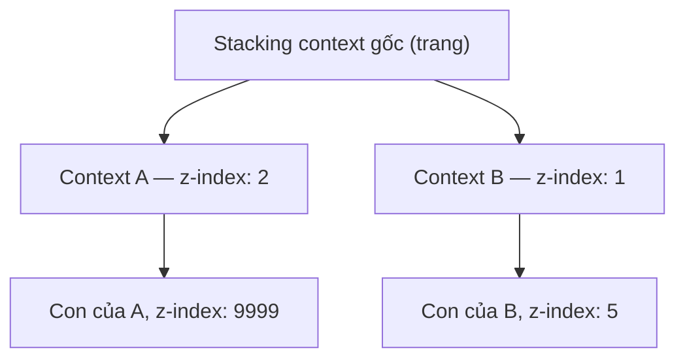
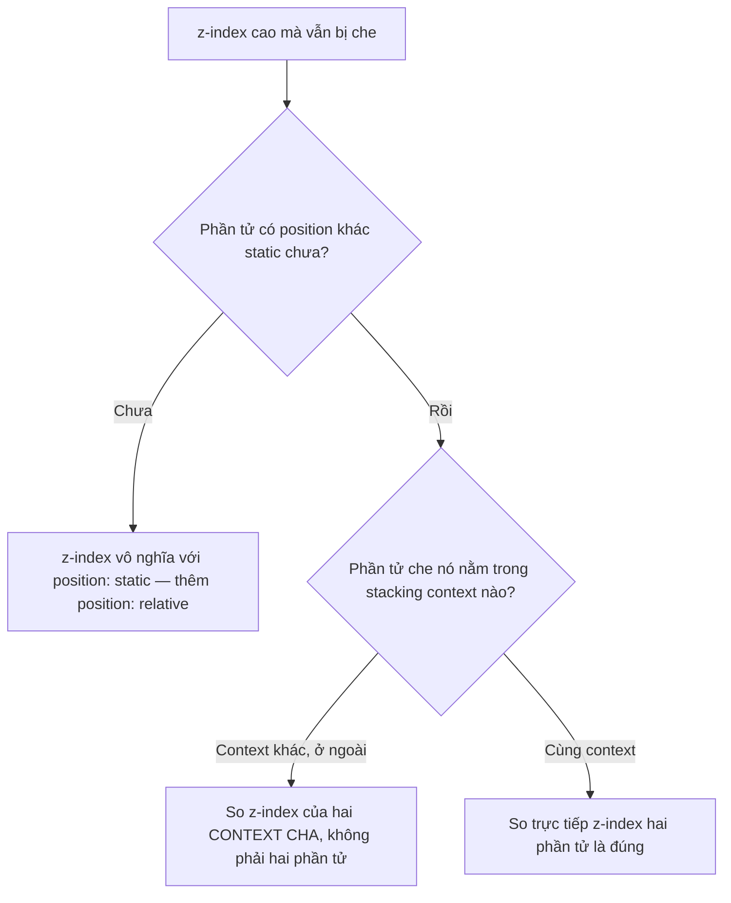

# Position, z-index và stacking context: vì sao z-index: 9999 đôi khi vẫn thua

Một bẫy kinh điển: bạn đặt `z-index: 9999` cho một tooltip, nó vẫn bị che bởi một phần tử khác chỉ có `z-index: 1`. Lỗi không nằm ở con số — nó nằm ở việc hai phần tử đó thuộc hai **stacking context** (ngữ cảnh xếp chồng) khác nhau, và z-index chỉ có ý nghĩa khi so sánh trong cùng một ngữ cảnh. Bài này đi từ `position` (vì nó là thứ **tạo ra** stacking context) đến z-index, để bạn ngừng đoán số và bắt đầu hiểu cấu trúc.

**Tóm tắt:**

- `position: static` (mặc định) là "không định vị gì cả" — phần tử nằm đúng vị trí tự nhiên trong luồng tài liệu, và `top`/`left`/`z-index` hoàn toàn vô nghĩa với nó.
- `relative` dịch chuyển phần tử so với **chính vị trí gốc của nó**, không ảnh hưởng đến các phần tử khác xung quanh — và quan trọng hơn, nó tạo ra điểm tham chiếu (containing block) cho con cháu `absolute`.
- `absolute` định vị theo **containing block gần nhất có `position` khác `static`** (thường là tổ tiên `relative`/`absolute`/`fixed` gần nhất) — nếu không tìm thấy, nó lùi về `<html>`.
- `fixed` định vị theo **viewport** (khung nhìn trình duyệt), trừ khi một tổ tiên có `transform`/`filter`/`will-change` — những thuộc tính đó vô tình biến tổ tiên thành containing block mới, làm `fixed` "dính" theo tổ tiên thay vì viewport.
- `sticky` là lai giữa `relative` và `fixed`: cư xử như `relative` cho đến khi cuộn tới một ngưỡng (`top`, `left`...), rồi "dính" lại như `fixed` trong phạm vi phần tử cha của nó.
- `z-index` chỉ so sánh được giữa các phần tử **cùng một stacking context**; một phần tử tạo stacking context mới sẽ "đóng gói" toàn bộ con cháu của nó thành một khối duy nhất khi so với anh em bên ngoài, bất kể con cháu bên trong có z-index cao thế nào.
- `display: none` gỡ phần tử khỏi layout hoàn toàn (không chiếm chỗ); `visibility: hidden` ẩn nhưng vẫn chiếm chỗ; `opacity: 0` vẫn chiếm chỗ **và** vẫn nhận được sự kiện chuột, khác hẳn hai cái kia.

## Năm giá trị `position`

| Giá trị | Định vị theo | Chiếm chỗ trong layout? | Tạo containing block cho con `absolute`? |
|---|---|---|---|
| `static` (mặc định) | Không định vị; `top`/`left`/`z-index` vô nghĩa | Có | Không |
| `relative` | Vị trí gốc của chính nó | Có (giữ chỗ cũ, chỉ dịch hình ảnh) | **Có** |
| `absolute` | Containing block gần nhất khác `static` | Không | Có |
| `fixed` | Viewport (trừ ngoại lệ bên dưới) | Không | Có |
| `sticky` | Relative cho tới ngưỡng, rồi như fixed trong phạm vi cha | Có | Có |

**Nền tảng:** "containing block" là khung tham chiếu mà `top`/`right`/`bottom`/`left` của một phần tử `absolute` tính theo. Trình duyệt đi ngược lên cây tổ tiên, tìm tổ tiên **gần nhất** có `position` khác `static`; nếu không có tổ tiên nào như vậy, containing block mặc định là viewport ban đầu (tương đương `<html>`).

### Vì sao `relative` lại quan trọng dù "không làm gì"

```css
.card { position: relative; }           /* bản thân không dịch chuyển gì */
.badge { position: absolute; top: 8px; right: 8px; } /* định vị theo .card, không phải theo <body> */
```

Đây là pattern phổ biến nhất của `position`: đặt `position: relative` (không kèm `top`/`left` nào) lên container, chỉ để nó trở thành containing block cho một phần tử con `absolute` bên trong — ví dụ badge góc card, nút đóng góc modal, icon trong ô input. Nếu quên dòng `position: relative` này, phần tử `absolute` sẽ "bay" lên định vị theo `<html>`, dính góc màn hình thay vì góc card.

**Phải thuộc:** `absolute` luôn định vị theo tổ tiên gần nhất có `position` khác `static`, không phải theo cha trực tiếp nếu cha đó là `static`. Debug một phần tử `absolute` "nằm sai chỗ" luôn bắt đầu bằng: tìm xem containing block thật sự của nó là tổ tiên nào.

### `fixed` và cái bẫy transform

```css
.modal-overlay { position: fixed; inset: 0; } /* phủ toàn viewport, kể cả khi trang cuộn */
```

Thông thường `fixed` định vị theo viewport, không bị ảnh hưởng bởi cuộn trang. **Nhưng**: nếu bất kỳ tổ tiên nào của nó có `transform`, `filter`, `perspective`, hoặc `will-change: transform` khác `none`, tổ tiên đó sẽ trở thành containing block mới cho mọi hậu duệ `fixed` bên trong — phần tử `fixed` lúc này "dính" theo tổ tiên đó, không còn dính theo viewport. Đây là nguyên nhân của một bug rất khó tìm: một modal `fixed` chạy đúng ở mọi nơi, nhưng tự nhiên "kẹt" trong một khối cha có animation `transform` (ví dụ carousel, page-transition wrapper).

### `sticky`: lai giữa hai thế giới

```css
thead th { position: sticky; top: 0; background: white; }
```

`sticky` cư xử như `relative` (chiếm đúng chỗ tự nhiên trong luồng, không tạo containing block cho con theo cách khác) **cho tới khi** điểm cuộn chạm ngưỡng `top: 0` — lúc đó nó "đóng băng" và dính như `fixed`, nhưng chỉ trong phạm vi phần tử cha chứa nó (không phải toàn trang). Khi cuộn qua khỏi phạm vi cha, nó cuộn đi tiếp bình thường. Đây là cách làm header bảng dính đúng chuẩn mà không cần JavaScript.

**Bẫy hay gặp với `sticky`:** nếu một tổ tiên có `overflow: hidden`/`auto`/`scroll` (kể cả vô tình, ví dụ do một CSS reset), `sticky` sẽ **mất tác dụng** vì phạm vi "dính" bị cắt theo tổ tiên đó — một trong những lỗi CSS khó debug nhất vì tổ tiên gây lỗi có thể cách xa phần tử `sticky` vài tầng.

## Z-index và stacking context



A1 có z-index 9999, B1 chỉ có 5 — nhưng A1 **vẫn ở dưới** B1 nếu context A có z-index 2 và context B có z-index... sai, hãy đổi lại: nếu A (z-index: 1) nằm dưới B (z-index: 2), thì **toàn bộ A, kể cả A1 z-index 9999**, nằm dưới toàn bộ B, kể cả B1 z-index 5. z-index bên trong A1 chỉ có ý nghĩa khi so với các anh em khác **cùng trong context A**; nó không "thoát ra ngoài" để so với B1.

**Phải thuộc:** z-index chỉ so sánh được giữa các phần tử nằm trong cùng một stacking context. Khi một phần tử tạo stacking context mới, mọi hậu duệ của nó bị "niêm phong" thành một khối duy nhất khi nhìn từ bên ngoài — z-index khổng lồ bên trong không giúp nó vượt ra khỏi thứ hạng của khối chứa nó.

### Khi nào một phần tử tạo stacking context mới

Không chỉ `z-index` mới tạo stacking context. Các trường hợp phổ biến nhất:

| Điều kiện | Ghi chú |
|---|---|
| `position` khác `static` **và** có `z-index` khác `auto` | Trường hợp kinh điển nhất |
| `opacity` nhỏ hơn 1 | Luôn tạo context mới, dù không có `position`/`z-index` |
| `transform`, `filter`, `perspective` khác `none` | Cũng tạo luôn containing block cho `fixed` như đã nói ở trên |
| `will-change: transform`/`opacity` (hoặc bất kỳ thuộc tính nào kích hoạt các mục trên) | Trình duyệt tạo context sớm để chuẩn bị tối ưu |
| `isolation: isolate` | Cách tạo stacking context **chủ động**, không kèm theo tác dụng phụ nào khác — dùng khi bạn chỉ muốn cô lập z-index mà không muốn đổi `position` hay `opacity` |

**Suy luận:** vì sao `opacity < 1` lại tạo stacking context dù không liên quan gì đến z-index? Vì để vẽ đúng độ trong suốt, trình duyệt phải render toàn bộ phần tử và con cháu của nó thành **một lớp (layer) duy nhất** trước, rồi mới áp opacity lên cả lớp đó — nếu không, các con cháu chồng lấn nhau bên trong sẽ bị áp opacity riêng lẻ nhiều lần ở chỗ chồng lấn, cho ra màu sai. Cùng lý do đó áp dụng cho `transform` và `filter`: mọi thuộc tính yêu cầu "vẽ cả cụm thành một lớp rồi biến đổi lớp đó" đều kéo theo việc tạo stacking context, vì bản chất layer hóa chính là cơ chế đứng sau stacking context.

### Quyết định khi z-index "không ăn"



## `display`, `visibility`, `opacity`: ba cách "ẩn" rất khác nhau

| Thuộc tính | Chiếm chỗ layout? | Nhận sự kiện chuột? | Ảnh hưởng con cháu |
|---|---|---|---|
| `display: none` | Không | Không | Gỡ hoàn toàn khỏi cây render |
| `visibility: hidden` | Có | Không | Con có thể `visibility: visible` riêng để hiện lại |
| `opacity: 0` | Có | **Có** (vẫn click được dù không thấy gì) | Luôn tạo stacking context mới |

**Phải thuộc:** `opacity: 0` không giống "ẩn" theo nghĩa thông thường — phần tử vẫn chiếm chỗ và vẫn bắt sự kiện chuột/phím, nên một nút `opacity: 0` nằm đè lên nút khác vẫn sẽ nhận click thay vì nút bên dưới. Đây là kỹ thuật cố ý dùng cho input file tùy biến (`<input type="file">` ẩn bằng opacity, đặt đè lên một nút đẹp) chứ không phải lựa chọn ngẫu nhiên.

## Bẫy thường gặp

| Bẫy | Hệ quả | Cách tránh |
|---|---|---|
| Quên `position: relative` trên container của phần tử `absolute` | Phần tử con định vị theo `<html>`, bay lên góc màn hình | Luôn kiểm tra containing block gần nhất trước khi debug tọa độ |
| Tổ tiên có `transform` nhưng bên trong có `position: fixed` | `fixed` dính theo tổ tiên, không theo viewport | Tránh đặt `transform` trên wrapper bao ngoài phần tử `fixed`, hoặc cố ý tận dụng nếu muốn hành vi đó |
| Tổ tiên có `overflow: hidden` làm `sticky` mất tác dụng | Header "dính" không dính nữa, khó hiểu vì tổ tiên gây lỗi ở xa | Kiểm tra toàn bộ tổ tiên xem có `overflow` nào không phải `visible` |
| So z-index giữa hai phần tử khác stacking context | Số lớn vẫn thua số nhỏ | Xác định đúng context chứa mỗi phần tử trước khi so |
| Dùng `opacity: 0` để "ẩn" một phần tử tương tác | Phần tử vô hình vẫn chặn click | Dùng `visibility: hidden` hoặc `display: none` nếu không muốn nhận sự kiện |

## Câu hỏi tự kiểm tra

1. **Một `<div>` có `position: absolute; top: 0; right: 0`, không có tổ tiên nào đặt `position`. Nó định vị theo đâu?**
   Gợi ý: containing block lùi về đâu khi không tìm thấy tổ tiên phù hợp.
   Đáp án: theo `<html>` (viewport ban đầu), vì không có tổ tiên nào có `position` khác `static`.

2. **Phần tử A có `z-index: 999` nằm trong stacking context X (X có `z-index: 1`). Phần tử B có `z-index: 2`, không tạo stacking context riêng, nằm ngoài X cùng cấp với X. B có che được A không?**
   Gợi ý: so sánh đúng cấp.
   Đáp án: Có — vì phải so z-index của context X (1) với B (2) ở cấp ngoài; 2 > 1 nên B đè lên toàn bộ X kể cả A, bất kể z-index 999 bên trong A.

3. **Vì sao `opacity: 0.99` (gần như không đổi gì về mặt nhìn thấy) vẫn có thể "sửa" được một lỗi z-index khó hiểu?**
   Gợi ý: nhớ danh sách điều kiện tạo stacking context.
   Đáp án: bất kỳ `opacity` nào khác 1 đều tạo stacking context mới cho phần tử đó, nên đây là một cách (hơi "hack") để cô lập z-index của một nhánh con mà không đổi `position`; cách sạch hơn là dùng `isolation: isolate`.

## Điều cần nhớ

- `absolute` định vị theo tổ tiên gần nhất có `position` khác `static`; `fixed` theo viewport trừ khi tổ tiên có `transform`/`filter`; `sticky` là relative-rồi-fixed trong phạm vi cha, và bị `overflow` của tổ tiên vô hiệu hóa.
- z-index chỉ so sánh được trong cùng một stacking context; `position`+`z-index`, `opacity<1`, `transform`/`filter` đều tự tạo context mới và "niêm phong" con cháu thành một khối khi so với bên ngoài.
- `display: none` gỡ khỏi layout, `visibility: hidden` giữ chỗ nhưng không tương tác được, `opacity: 0` giữ chỗ **và** vẫn nhận sự kiện chuột — chọn đúng cái cho đúng mục đích.
