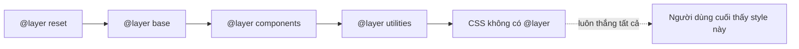

# CSS hiện đại: `:has()`, cascade layers, `@property` và logical properties

Nhiều năm liền, CSS không có cách nào để một phần tử cha đổi style dựa trên **con** của nó — muốn làm vậy luôn phải nhờ JavaScript. Cũng không có cách nào tổ chức specificity theo "tầng" một cách tường minh mà không phải đếm số class thủ công. Một loạt tính năng CSS mới trong vài năm gần đây giải quyết đúng những khoảng trống đó. Bài này đi qua bốn tính năng có ảnh hưởng thực sự tới kiến trúc CSS senior-level: `:has()`, `@layer`, `@property`, và logical properties.

**Tóm tắt:**

- `:has()` là "parent selector" CSS từng thiếu suốt nhiều năm: chọn một phần tử **dựa trên con/hậu duệ của nó** thỏa điều kiện nào đó, điều mà selector thông thường (luôn đi từ cha xuống con) không làm được.
- `:has()` cũng dùng được để kiểm tra trạng thái anh em (`a:has(+ b)`), mở rộng đáng kể những gì CSS thuần làm được mà trước đây phải dùng JavaScript để toggle class.
- Cascade layers (`@layer`) định nghĩa thứ tự ưu tiên giữa các **nhóm rule**, độc lập với specificity từng selector bên trong — layer nạp sau luôn thắng layer nạp trước, bất kể selector trong layer trước có đặc hiệu cao đến đâu.
- `@layer` giải quyết đúng vấn đề kinh điển "CSS của thư viện UI có specificity cao hơn CSS tùy biến của tôi" — đặt thư viện vào layer thấp, code của bạn vào layer cao, không cần đua specificity hay `!important`.
- `@property` đăng ký một custom property với **kiểu dữ liệu tường minh** (`<color>`, `<number>`...) — nhờ đó trình duyệt biết cách nội suy giá trị khi animate, điều custom property thường (không khai báo kiểu) không làm được.
- Logical properties (`margin-inline`, `padding-block`...) mô tả khoảng cách theo **hướng đọc** (đầu dòng/cuối dòng, đầu khối/cuối khối) thay vì theo hướng vật lý (trái/phải/trên/dưới) — tự động đổi đúng hướng khi trang chạy ngôn ngữ viết từ phải sang trái (RTL) như tiếng Ả Rập.
- Cả bốn tính năng đều nhắm vào bài toán tổ chức CSS ở **quy mô lớn**: giảm phụ thuộc vào JavaScript cho những việc thuần hiển thị, giảm xung đột specificity giữa nhiều nguồn CSS, và giảm code phải viết lại cho đa ngôn ngữ.

## `:has()`: parent selector cuối cùng cũng có

```css
/* Card có chứa ảnh thì thêm padding-top khác với card không có ảnh */
.card:has(img) { padding-top: 0; }

/* Form group có input lỗi thì đổi màu label của chính group đó */
.form-group:has(input:invalid) label { color: #dc2626; }

/* Ẩn hẳn một section nếu nó không chứa kết quả tìm kiếm nào */
.results:has(> .result-item) { display: block; }
.results:not(:has(> .result-item)) { display: none; }
```

**Nền tảng:** mọi selector CSS trước `:has()` chỉ đi được một hướng — từ tổ tiên xuống hậu duệ (`.card img`), hoặc kiểm tra chính phần tử đó (`:hover`, `:focus`). Không có cách nào để nói "chọn `.card` **nếu** nó có chứa `img`" — `:has()` chính là phép chọn ngược đó. Về cú pháp, `:has()` nhận vào một selector tương đối: `.card:has(img)` nghĩa là ".card mà bên trong (ở bất kỳ độ sâu nào) có `img`"; thêm `>` như `:has(> img)` thu hẹp lại thành "con trực tiếp".

### `:has()` cũng kiểm tra được anh em

```css
/* Input ngay sau (+) label bị focus thì đổi style label */
label:has(+ input:focus) { color: #2563eb; }
```

**Suy luận:** vì sao đây là một bước nhảy lớn so với CSS trước đây? Vì trước `:has()`, mọi tương tác "trạng thái của phần tử A ảnh hưởng tới style của phần tử B không phải con/cháu của A" đều phải giải bằng JavaScript (lắng nghe sự kiện, toggle class tay). `:has()` khiến rất nhiều trường hợp trong số đó quay về thuần CSS, vì bản chất nó biến CSS từ "mô tả cây DOM một chiều" thành "có thể hỏi về quan hệ hai chiều" — miễn là quan hệ đó biểu diễn được bằng selector (cha-con, anh em), không cần logic nghiệp vụ phức tạp.

**Phải thuộc:** `:has()` **không** chọn phần tử con để style con — nó dùng điều kiện về con để quyết định style cho chính phần tử gọi `:has()`. `.card:has(img) { padding: 0 }` style cho `.card`, không style cho `img`.

## Cascade layers (`@layer`): thứ tự thắng theo tầng, không theo specificity

```css
@layer reset, base, components, utilities; /* khai báo thứ tự layer NGAY TỪ ĐẦU, trước khi có nội dung */

@layer reset {
  * { margin: 0; padding: 0; }
}
@layer components {
  .btn#submit-button { background: blue; } /* dù có ID, specificity rất cao */
}
@layer utilities {
  .text-red { color: red; }
}
```

Quy tắc cốt lõi: **layer nạp sau luôn thắng layer nạp trước**, hoàn toàn không quan tâm specificity của selector bên trong layer đó cao hay thấp. Trong ví dụ trên, `.text-red` ở layer `utilities` sẽ thắng `.btn#submit-button` ở layer `components` nếu cả hai cùng áp `color` lên một phần tử — dù `#submit-button` (có ID) đặc hiệu hơn hẳn `.text-red` về specificity thông thường. Specificity chỉ còn quyết định thứ hạng **giữa các rule trong cùng một layer**, hoặc giữa các rule không thuộc layer nào (các rule không khai báo layer luôn được coi là ở layer "sau cùng", thắng mọi layer có tên).

**Phải thuộc:** thứ tự ưu tiên đầy đủ, từ thấp đến cao: layer khai báo trước → layer khai báo sau → CSS không nằm trong layer nào. Đây là lý do `@layer` giải quyết gọn vấn đề "CSS thư viện UI (Bootstrap, MUI...) có specificity cao hơn CSS tùy biến của tôi": đặt toàn bộ CSS thư viện vào một layer nạp sớm (ví dụ `@layer vendor`), code của bạn nằm ngoài layer hoặc ở layer nạp muộn hơn — tự động thắng mà không cần đua ID hay đếm số class.



## `@property`: cho custom property một kiểu dữ liệu thật

```css
@property --progress {
  syntax: '<percentage>';
  inherits: false;
  initial-value: 0%;
}

.bar {
  background: conic-gradient(blue var(--progress), #eee 0);
  transition: --progress 0.3s ease;
}
.bar.loaded { --progress: 75%; }
```

Custom property thông thường (`--progress: 75%` không qua `@property`) được trình duyệt coi là một **chuỗi văn bản vô nghĩa** — nó không biết `75%` và `20%` là hai số có thể nội suy dần dần giữa chúng khi animate, nên `transition`/`animation` trên một custom property thường **không chạy mượt**, nó chỉ nhảy khựng từ giá trị cũ sang giá trị mới. `@property` đăng ký trước kiểu dữ liệu (`<percentage>`, `<color>`, `<number>`, `<length>`...) cho một custom property — nhờ biết kiểu, trình duyệt mới nội suy được các bước trung gian, và animation chạy mượt như với thuộc tính CSS gốc.

**Phải thuộc:** `@property` chủ yếu giải quyết đúng một vấn đề — **animate một custom property mượt mà**. Nếu bạn chỉ dùng custom property để lưu giá trị tĩnh (màu theme, kích thước), không cần `@property`; chỉ cần nó khi muốn `transition`/`animation` chạy trên chính biến đó, như gradient xoay dần theo tiến độ ở ví dụ trên.

## Logical properties: viết CSS không gắn chết với trái/phải

```css
/* Cách cũ: gắn chết với hướng vật lý */
.card { margin-left: 16px; border-right: 1px solid #ccc; }

/* Logical properties: mô tả theo HƯỚNG ĐỌC */
.card { margin-inline-start: 16px; border-inline-end: 1px solid #ccc; }
```

| Logical property | Trong văn bản trái-sang-phải (LTR, ví dụ tiếng Việt) | Trong văn bản phải-sang-trái (RTL, ví dụ tiếng Ả Rập) |
|---|---|---|
| `margin-inline-start` | = `margin-left` | = `margin-right` |
| `margin-inline-end` | = `margin-right` | = `margin-left` |
| `margin-block-start` | = `margin-top` | = `margin-top` (block luôn theo chiều dọc, không đổi theo RTL) |
| `padding-inline` | Viết tắt cho cả `-start` và `-end` cùng lúc | (tương tự) |

**Nền tảng:** "inline" là trục theo **hướng đọc chữ** (ngang với tiếng Việt/Anh, nhưng vẫn ngang dù RTL — chỉ đảo start/end); "block" là trục **xuống dòng** (dọc trong hầu hết ngôn ngữ). Khi trang chạy ở chế độ RTL (`dir="rtl"`), mọi khai báo `margin-left`/`margin-right` theo kiểu vật lý cũ **không tự đổi** — bạn phải viết CSS riêng hoặc lật tay cho bản RTL. Logical properties tự đổi đúng hướng theo `dir` và `writing-mode` của tài liệu, không cần viết thêm một dòng CSS nào riêng cho RTL.

**Phải thuộc:** logical properties không phải chỉ dành cho dự án đa ngôn ngữ tương lai — một khi đã quen cú pháp, chúng cũng là cách viết "đúng ý nghĩa" hơn ngay cả cho dự án chỉ có một ngôn ngữ, vì tên thuộc tính mô tả **vai trò** (đầu dòng, cuối khối) thay vì một tọa độ vật lý tình cờ đúng ở thời điểm viết.

## Bẫy thường gặp

| Bẫy | Hệ quả | Cách tránh |
|---|---|---|
| Dùng `:has()` để cố style phần tử **con** dựa trên điều kiện | `:has()` chỉ style phần tử gọi nó, không style con bên trong | Dùng `:has()` cho cha, rồi selector con bình thường cho con nếu cần |
| Khai báo `@layer` rải rác, không gom thứ tự ở một chỗ | Thứ tự layer phụ thuộc file nào được nạp trước, dễ sai | Khai báo thứ tự đầy đủ một lần ở đầu (`@layer a, b, c;`) trước khi có nội dung bất kỳ layer nào |
| Animate custom property mà không `@property` | Animation nhảy khựng thay vì mượt | Đăng ký `@property` với `syntax` đúng kiểu trước khi animate biến đó |
| Trộn logical và physical properties trong cùng component | Nửa đổi hướng theo RTL, nửa không — layout vỡ khi đổi `dir` | Chọn một hệ (logical hoặc physical) nhất quán cho toàn bộ component |
| Tưởng CSS không nằm trong `@layer` nào có specificity thấp nhất | Vô tình bị CSS không-layer ghi đè vì nó luôn thắng mọi layer có tên | Nhớ: CSS ngoài layer luôn thắng mọi layer, bất kể specificity |

## Câu hỏi tự kiểm tra

1. **Viết CSS để tô đỏ viền một `.form-group` nếu `<input>` bên trong nó đang invalid. Dùng tính năng nào?**
   Gợi ý: cần chọn cha dựa trên trạng thái của con.
   Đáp án: `:has()` — ví dụ `.form-group:has(input:invalid) { border-color: red; }`.

2. **Layer `components` nạp trước layer `utilities`. Một rule trong `components` dùng selector có ID (specificity rất cao), một rule trong `utilities` chỉ dùng class đơn. Rule nào thắng?**
   Gợi ý: nhớ thứ tự layer đứng trên specificity trong layer.
   Đáp án: Rule trong `utilities` thắng — layer nạp sau luôn thắng layer nạp trước, bất kể specificity bên trong mỗi layer.

3. **Vì sao animate trực tiếp một custom property thường (không qua `@property`) bằng `transition` lại bị giật thay vì mượt?**
   Gợi ý: trình duyệt cần biết kiểu dữ liệu mới nội suy được.
   Đáp án: Custom property không khai báo `@property` được coi là chuỗi văn bản thuần, trình duyệt không biết cách tính các bước trung gian giữa hai giá trị; `@property` với `syntax` đúng kiểu mới cho phép nội suy mượt.

## Điều cần nhớ

- `:has()` là parent/sibling selector thật sự đầu tiên của CSS — chọn phần tử dựa trên điều kiện của con/hậu duệ/anh em, thay thế được nhiều trường hợp trước đây phải dùng JavaScript.
- `@layer` tách biệt "thứ tự ưu tiên theo nhóm" khỏi specificity từng selector — layer nạp sau luôn thắng, giải quyết gọn vấn đề CSS thư viện lấn át CSS tùy biến.
- `@property` cho custom property một kiểu dữ liệu để animate mượt; logical properties (`inline`/`block`) mô tả khoảng cách theo hướng đọc, tự đổi đúng khi trang chạy RTL.
