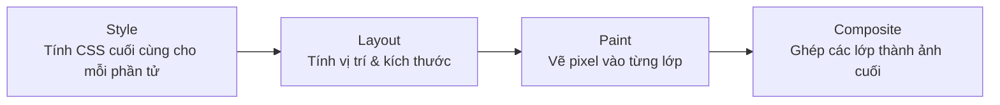
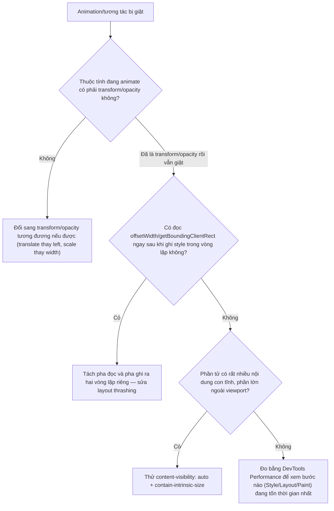

# Hiệu năng CSS: vì sao animate `transform` mượt mà animate `width` giật

Hai đoạn CSS trông tương tự — một animate `left`, một animate `transform: translateX` — nhưng một cái giật lag rõ rệt trên máy yếu, cái kia mượt như không có gì đang chạy. Khác biệt không nằm ở "transform nhanh hơn một chút", mà nằm ở việc chúng đi qua **số bước khác nhau hẳn** trong pipeline render của trình duyệt. Bài này mổ xẻ đúng pipeline đó, để bạn biết trước một thuộc tính CSS sẽ rẻ hay đắt trước khi phải đo bằng DevTools. (Các chỉ số người dùng thấy được như LCP/CLS đã có ở [Frontend-Core: Hiệu năng web và Core Web Vitals](../../11-Frontend-Core/lt-03-web-performance-core-web-vitals.md) — bài này đi vào cơ chế trình duyệt **bên dưới** những chỉ số đó.)

**Tóm tắt:**

- Trình duyệt vẽ một frame qua bốn bước nối tiếp: **Style** (tính giá trị CSS cuối cùng cho mỗi phần tử) → **Layout** (tính vị trí/kích thước) → **Paint** (vẽ pixel vào các lớp) → **Composite** (ghép các lớp lại thành ảnh cuối).
- Một thuộc tính CSS đổi sẽ buộc trình duyệt chạy lại từ bước tương ứng **và mọi bước sau nó** — đổi `width` phải chạy lại cả Layout, Paint, Composite; đổi `transform`/`opacity` chỉ cần chạy lại Composite.
- `transform` và `opacity` là hai thuộc tính gần như duy nhất trình duyệt có thể xử lý **chỉ ở bước Composite**, vì chúng chỉ biến đổi một lớp đã vẽ sẵn (di chuyển, xoay, mờ dần) mà không cần vẽ lại pixel bên trong lớp đó.
- "Layout thrashing" xảy ra khi code (thường là JavaScript) xen kẽ việc **ghi** một thuộc tính gây layout rồi **đọc** ngay một giá trị phụ thuộc layout (như `offsetHeight`) trong vòng lặp — mỗi lần đọc buộc trình duyệt phải tính lại layout ngay lập tức thay vì gộp lại.
- `will-change` báo trước cho trình duyệt "phần tử này sắp đổi thuộc tính X" để nó chuẩn bị một lớp composite riêng từ sớm — nhưng mỗi lớp riêng tốn thêm bộ nhớ GPU, nên khai báo tràn lan (ví dụ đặt `will-change` cho mọi phần tử "phòng khi") làm chậm đi chứ không nhanh lên.
- `contain` khai báo một phần tử là "hộp cô lập" để trình duyệt không cần kiểm tra ảnh hưởng của nó lên phần còn lại của trang khi tính layout/paint — thu hẹp phạm vi tính toán lại đúng bên trong phần tử đó.
- `content-visibility: auto` đi xa hơn `contain`: trình duyệt **bỏ qua hoàn toàn** việc render phần tử nếu nó đang nằm ngoài viewport, chỉ render khi sắp cuộn tới — hiệu quả gần như virtualization nhưng không cần JavaScript.

## Pipeline bốn bước



| Bước | Làm gì | Ví dụ thuộc tính kích hoạt |
|---|---|---|
| Style | Áp cascade, tính specificity, ra giá trị CSS cuối cho mỗi phần tử | Hầu như mọi thay đổi class/style đều chạy lại bước này |
| Layout (hay "reflow") | Tính `width`/`height`/vị trí thật của mọi phần tử bị ảnh hưởng | `width`, `height`, `top`/`left` (khi `position` khác static), `font-size`, thêm/xóa phần tử |
| Paint | Vẽ pixel (màu nền, chữ, bóng đổ, viền) vào các lớp (layer) | `background`, `box-shadow`, `color`, `border-radius` |
| Composite | Ghép các lớp đã vẽ sẵn lại theo đúng vị trí/độ trong suốt | `transform`, `opacity` |

**Phải thuộc:** mỗi bước chỉ chạy lại khi cần, nhưng chạy lại một bước luôn kéo theo chạy lại **mọi bước phía sau nó**. Đổi `width` → chạy lại Layout → Paint → Composite (cả ba). Đổi `background-color` → chỉ cần Paint → Composite (bỏ qua Layout vì kích thước không đổi). Đổi `transform`/`opacity` → chỉ cần Composite (bỏ qua cả Layout lẫn Paint).

## Vì sao `transform`/`opacity` gần như miễn phí

```css
/* Đắt: kích hoạt Layout + Paint + Composite mỗi frame */
.box.slide-left { left: -100px; }

/* Rẻ: chỉ kích hoạt Composite */
.box.slide-left { transform: translateX(-100px); }
```

**Suy luận:** `left: -100px` thay đổi **vị trí trong luồng layout** — trình duyệt phải tính lại xem phần tử này chiếm chỗ ở đâu, điều đó có thể đẩy các phần tử khác dịch theo (nếu chúng phụ thuộc vào vị trí của nó), nên bắt buộc chạy lại Layout cho cả phần cây bị ảnh hưởng, rồi vẽ lại Paint vì pixel đã đổi chỗ, rồi mới Composite. `transform: translateX()` thì khác hẳn về bản chất: phần tử vẫn **chiếm đúng vị trí cũ** trong luồng layout (các phần tử khác không biết gì về việc nó đang "nhìn" dịch chuyển) — trình duyệt chỉ di chuyển **lớp đã vẽ sẵn** sang vị trí khác trên màn hình ở bước Composite, không cần tính lại Layout hay vẽ lại Paint gì cả. Cùng lý lẽ áp dụng cho `opacity`: làm mờ dần một lớp đã vẽ sẵn không cần vẽ lại pixel bên trong nó. Vì Composite thường chạy trên GPU và không đụng tới CPU-heavy work của Layout/Paint, animation chỉ dùng `transform`/`opacity` gần như luôn đạt 60fps mượt, trong khi animate `width`/`left`/`top` dễ giật trên thiết bị yếu vì CPU phải tính lại Layout mỗi frame.

**Phải thuộc:** câu trả lời chuẩn cho "animate cái gì để mượt" — chỉ dùng `transform` (translate/scale/rotate) và `opacity`; tránh animate `width`, `height`, `top`, `left`, `margin` nếu có thể thay bằng `transform` tương đương.

## Layout thrashing: khi JavaScript tự gây ra việc tính lại hàng loạt

```js
// Tệ: xen kẽ ghi rồi đọc trong vòng lặp
boxes.forEach((box) => {
  box.style.width = box.offsetWidth + 10 + 'px'; // ghi (gây "dirty" layout)
  console.log(box.offsetHeight);                  // đọc ngay — ép tính lại layout NGAY LẬP TỨC
});
```

```js
// Tốt: tách hẳn pha đọc và pha ghi
const heights = boxes.map((box) => box.offsetHeight); // đọc hết trước
boxes.forEach((box, i) => { box.style.width = heights[i] + 10 + 'px'; }); // rồi mới ghi hết
```

**Nền tảng:** bình thường trình duyệt **gộp** nhiều thay đổi style lại, chỉ tính Layout một lần trước khi vẽ frame tiếp theo — đây là lý do thay đổi hàng trăm phần tử trong cùng một hàm JavaScript vẫn thường nhanh. Nhưng nếu code **đọc** một giá trị phụ thuộc layout (`offsetHeight`, `offsetWidth`, `getBoundingClientRect()`, `scrollTop`...) ngay sau khi vừa **ghi** một thuộc tính gây layout, trình duyệt buộc phải tính lại Layout ngay lập tức để trả lời đúng giá trị đọc đó — không thể trì hoãn gộp chung được nữa. Lặp lại việc ghi-rồi-đọc trong một vòng lặp qua N phần tử khiến Layout bị tính lại N lần thay vì 1 lần, gọi là "layout thrashing" (đo được rất rõ trong DevTools Performance dưới dạng nhiều "Recalculate Style"/"Layout" nhỏ liên tiếp). Cách sửa luôn là tách pha đọc và pha ghi ra làm hai vòng lặp riêng như ví dụ "Tốt" ở trên.

## `will-change`: chuẩn bị trước, nhưng đừng lạm dụng

```css
.modal { will-change: transform, opacity; } /* báo trước: sắp animate hai thuộc tính này */
```

`will-change` gợi ý trình duyệt **tạo sẵn một lớp composite riêng** cho phần tử trước khi animation thật sự bắt đầu, để khi animation chạy, trình duyệt không phải tốn thời gian "thăng cấp" phần tử lên một lớp riêng giữa chừng (việc thăng cấp đó có thể gây giật khung hình đầu tiên).

**Phải thuộc:** mỗi lớp composite riêng tốn thêm bộ nhớ GPU và một phần chi phí quản lý; đặt `will-change` cho **mọi** phần tử "phòng khi sau này cần" tạo ra hàng trăm lớp không dùng tới, làm chậm trang đi thay vì nhanh lên. Dùng đúng cách: chỉ thêm `will-change` ngay trước khi animation sắp chạy (ví dụ lúc `:hover` hoặc lúc mở modal), và **gỡ lại** sau khi animation xong — không khai báo tĩnh vĩnh viễn trong CSS cho thành phần ít khi animate.

## `contain` và `content-visibility`: cô lập để giảm phạm vi tính toán

```css
.widget { contain: layout paint; }
```

`contain: layout` báo cho trình duyệt: "những gì xảy ra bên trong `.widget` không ảnh hưởng tới layout của phần tử **bên ngoài** nó" — nhờ cam kết đó, khi nội dung bên trong `.widget` đổi, trình duyệt chỉ cần tính lại layout **trong phạm vi** `.widget`, không cần kiểm tra lại toàn trang. `contain: paint` tương tự nhưng cho việc vẽ (clip nội dung tràn ra ngoài, như một `overflow: hidden` ngầm định về mặt tối ưu).

```css
.offscreen-section { content-visibility: auto; }
```

**Suy luận:** `content-visibility: auto` đi xa hơn hẳn `contain` — nó khiến trình duyệt **bỏ qua hoàn toàn** việc tính Layout/Paint cho nội dung bên trong phần tử nếu phần tử đó đang nằm ngoài vùng nhìn thấy (viewport), gần giống hệt nguyên lý của virtualization (chỉ render cái đang hiển thị) nhưng được chính trình duyệt làm, không cần thư viện JavaScript nào đo scroll và tính toán item nào cần render. Trình duyệt vẫn giữ lại kích thước ước lượng (qua `contain-intrinsic-size`) để thanh cuộn không bị nhảy khi phần tử chưa render thật sự — đây là lý do nên luôn khai báo `contain-intrinsic-size` đi kèm, nếu không trình duyệt mặc định coi phần tử cao 0px cho tới khi nó vào viewport, gây giật thanh cuộn.

```css
.offscreen-section {
  content-visibility: auto;
  contain-intrinsic-size: auto 800px; /* ước lượng chiều cao khi chưa render, tránh giật scrollbar */
}
```

## Quyết định khi gặp một đoạn CSS/animation chậm



## Bẫy thường gặp

| Bẫy | Hệ quả | Cách tránh |
|---|---|---|
| Animate `width`/`left`/`top` cho hiệu ứng trượt/giãn | Giật trên máy yếu, tốn CPU mỗi frame | Đổi sang `transform: translate/scale` tương đương |
| Đọc `offsetHeight` ngay sau khi ghi style trong vòng lặp | Layout thrashing, chậm theo cấp số nhân với số phần tử | Tách hẳn pha đọc trước, pha ghi sau |
| Đặt `will-change` tĩnh cho rất nhiều phần tử | Tốn bộ nhớ GPU, chậm đi thay vì nhanh lên | Chỉ thêm ngay trước animation, gỡ lại sau khi xong |
| Dùng `content-visibility: auto` mà không có `contain-intrinsic-size` | Thanh cuộn nhảy giật vì phần tử co về cao 0px khi chưa render | Luôn khai báo chiều cao ước lượng đi kèm |
| Cho rằng mọi CSS đều "rẻ như nhau" vì không thấy JavaScript nào chạy | Bỏ qua chi phí Layout/Paint thật sự đang xảy ra | Nhớ pipeline 4 bước: một số thuộc tính CSS đắt hơn hẳn thuộc tính khác dù cùng là "thuần CSS" |

## Câu hỏi tự kiểm tra

1. **Vì sao `transform: translateX(100px)` mượt hơn hẳn `left: 100px` cho cùng một hiệu ứng trượt ngang?**
   Gợi ý: nhớ phần tử nào vẫn giữ nguyên vị trí trong luồng layout.
   Đáp án: `left` thay đổi vị trí thật trong layout, buộc chạy lại Layout + Paint + Composite mỗi frame; `transform` chỉ di chuyển lớp đã vẽ sẵn ở bước Composite, bỏ qua Layout và Paint.

2. **Một đoạn code đổi `style.width` của 100 phần tử trong vòng lặp, sau mỗi lần đổi lại đọc `offsetHeight`. Vì sao đoạn code này chậm bất thường, và sửa thế nào?**
   Gợi ý: nhớ cơ chế gộp (batching) của trình duyệt bị phá vỡ khi nào.
   Đáp án: Đọc `offsetHeight` ngay sau khi ghi `width` ép trình duyệt tính lại Layout ngay lập tức mỗi vòng lặp (layout thrashing) thay vì gộp 100 lần ghi thành 1 lần tính; sửa bằng cách đọc hết `offsetHeight` của mọi phần tử trước, rồi mới ghi `width` sau trong một vòng lặp riêng.

3. **Đặt `content-visibility: auto` cho một danh sách rất dài nhưng không set `contain-intrinsic-size`. Hiện tượng gì xảy ra khi cuộn nhanh?**
   Gợi ý: trình duyệt không biết chiều cao của phần tử chưa render.
   Đáp án: Thanh cuộn nhảy/giật vì phần tử ngoài viewport bị coi như cao 0px cho tới khi sắp vào vùng nhìn thấy; cần khai báo `contain-intrinsic-size` để trình duyệt giữ chỗ đúng kích thước ước lượng.

## Điều cần nhớ

- Render pipeline có 4 bước nối tiếp (Style → Layout → Paint → Composite); một thuộc tính CSS đổi sẽ chạy lại bước tương ứng và mọi bước sau nó — `transform`/`opacity` là hiếm hoi chỉ cần chạy lại Composite.
- Layout thrashing xảy ra khi xen kẽ ghi-rồi-đọc giá trị phụ thuộc layout trong vòng lặp; luôn tách pha đọc và pha ghi.
- `will-change` chỉ nên dùng tạm thời ngay trước animation; `content-visibility: auto` (kèm `contain-intrinsic-size`) cho hiệu quả gần như virtualization mà không cần JavaScript, cho các danh sách dài có nhiều nội dung ngoài viewport.
